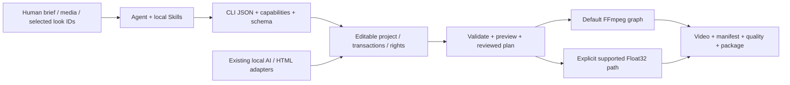

# agent editor kit

**The complete CLI54 candidate is now installed natively and offline; the registered Skill remains53/r54.** Fixed the driver timeout while preserving the failed attempt;1705 wheel payload files,281 runtime modules and8 native resources verified exact.45 installed selection/storyboard tests passed; actual CUDA calibration, selection and rendered replay remain separate acceptance gates.[Recovery and installed entry](docs/validation/CLI54安装恢复_2026-10-29.md).

**Source CLI0.1.54 joins calibrated visual selection to editable ad storyboards.** New `ad select` filters candidates by every variant’s source window, explicit source audio and verified rights, then assigns assets jointly and preserves shot-level receipts. 45 source tests passed; actual CUDA workflow acceptance is separate. The installed runtime and sole Skill remain CLI53/r54. [Design and usage](docs/product/AD_SEMANTIC_SELECTION.md).

**Local CLI0.1.53 / local.51 is installed and registered.** Source and installed packages independently passed 18 ACES, 46 metering/Schema and 373 compatibility tests. The sole `$agent-ffmpeg-local-editor` retains one entry, 17 modules and 92 files. [C67 actual registered-entry acceptance](docs/product/CASES.md#c67-registered-aces-timeline) verifies complete video, audio, previews and editable-project replay. The [final r54 kit](docs/skills/agent-editor-kit-community-unified-skill-r54.zip) passed independent extraction, configuration, registration and complete video/audio replay acceptance. [Usage and installation](docs/releases/CLI_0.1.53_LOCAL.md).

Candidate-stage history: the unified Skill candidate passed seven actual CLI53 calls, including native configuration, PNG16 preview and all-frame metering. It retains one entry, 17 modules and 92 files; live discovery and configuration remain unchanged. Both compatibility gates have since passed and the live entry is upgraded.

<!-- aces-timeline-source53 -->

**Source CLI0.1.53 connects ACES rendering and previews.** Formal delivery, all-frame metering, one display transform before display-linear resizing, and a separate SDR view for HDR masters; 18 specialized tests and 46 metering/Schema regressions passed separately. [Workflow](docs/product/ACES_TIMELINE.md) · [C65: video, GIF, PNG16, editable project](docs/product/CASES.md#c65-source-aces-timeline). This preserves the earlier source-stage record. The live entry is now CLI53; ACES remains CPU, and full product parity is still open.


Verify the current CLI53 entry before editing. Enumerate the actual ACES configuration, display and view names; follow the linked workflow for an editable project:

```powershell
$aekSkill = 'C:/Users/carzy/.codex/skills/agent-ffmpeg-local-editor/scripts/run.ps1'
& $aekSkill version
& $aekSkill capabilities
& $aekSkill surface ocio-configs --config aces-2.1
```

The installed package separately passed **18 ACES + 46 metering/Schema tests**. [C66: actual video, GIF, PNG16 and editable project](docs/product/CASES.md#c66-installed-aces-timeline) verifies complete decoded video/audio replay. Both 373-test broad compatibility gates and live Skill activation have since passed.

<!-- aces-native-kernel-source -->

**Historical kernel stage: native ACES kernel and configuration discovery.** Pinned OCIO 2.6.0 provides ACES 1.3/2.0/2.1 display/view transforms and scene exposure. Source stage only: timeline, preview and installed Skill integration remain pending. [Workflow, evidence and remaining work](docs/product/ACES_NATIVE.md).

**An open-source local video-editing CLI for Agents.** Turn structured plans into editable projects, previews, video, quality reports and recoverable deliveries, retaining real artifacts and provenance.

[简体中文](README.md) · [繁體中文](README.zh-TW.md) · [English](README.en.md) · [Repository](https://github.com/copypasteltd/agent-editor-kit) · [Docs](docs/README.md)


Development reporting: every round ends with numbered completed-work and pending-work tables, including verification evidence and remaining limits. See the [reporting convention](docs/DEVELOPMENT_REPORTING.md).

**Public release: v0.1.0-alpha.3 prerelease · CLI 0.1.2 · 500 looks · 17 historical separate Skills.** Downloads provide a complete runtime ZIP, Agent kit, optional gallery and checksums. The verified runtime bytes are unchanged; portable installation and a runnable example are added. Complete Jianying/CapCut parity remains an unaccepted development target.

This page includes functional modules, services/dependencies, installation/usage, Skill inputs/outputs, real cases and verification. Long raw acceptance logs remain archived; practical feature descriptions and case access are restored here.


<!-- gpu-gamut-installed-current -->

**CLI0.1.52 / local.50 / r53 kit · 1 Skill / 17 modules / 91 files.**

[Verified small kit](docs/skills/agent-editor-kit-community-unified-skill-r53.zip) · [SHA256 / inventory](docs/skills/community-unified-skill-package-0.1.52-r53.json)

The registered unified Skill now uses CLI52: GPU luminance shoulder and OKLab chroma search, with signal conversion and ICC on CPU. Separate source and installed 70-test and 352-test groups passed. C64 exercised real registered-Skill GPU rendering, previews and complete video/audio editable-package replay.

[Workflow](docs/product/GPU_GAMUT.md) · [Install / usage](docs/releases/CLI_0.1.52_LOCAL.md) · [C64](docs/product/CASES.md#c64-installed-gpu-gamut)


<!-- /gpu-gamut-installed-current -->

<!-- gpu-gamut-source-history -->

Historical source/candidate stage; superseded by installed CLI52 above.

**Development source CLI0.1.52 · installed Skill CLI0.1.51 / local.49 / r52 unchanged.**

Source CLI52 adds a real GPU luminance shoulder and OKLab chroma reduction; signal conversion and ICC remain on CPU. Separate 70-test and 12-test groups, an independent 4K single-surface check and full C63 video/audio/package replay passed. Registered Skill remains CLI51/local49/r52. The 352-test compatibility run and new installed delivery require separate acceptance.

[Workflow](docs/product/GPU_GAMUT.md) · [Source release](docs/releases/CLI_0.1.52_SOURCE.md) · [C63](docs/product/CASES.md#c63-source-gpu-gamut) · [Evidence](docs/validation/GPU色域映射源码实测_2026-10-29.md)


The candidate installation passed its separate 70-test group. Source and installed 352-test compatibility runs are still active; the unified Skill has not switched.

<!-- /gpu-gamut-source-history -->

<!-- oklab-installed-history -->

Historical installed CLI51; superseded by CLI52 above.

**CLI0.1.51 / local.49 / r52 kit · 1 Skill / 17 modules / 90 files.**

Installed CLI51 provides explicit OKLab chroma reduction, inherited formal SDR mapping and display-linear preview resizing after mapping. Explicit preview_mapping takes priority. C62 runs through the actual unified Skill with full pixel/PCM package replay. CPU colour math; no complete CapCut/ACES/physical-monitor claim.

[Workflow](docs/product/OKLAB_GAMUT.md) · [Install](docs/releases/CLI_0.1.51_LOCAL.md) · [C62](docs/product/CASES.md#c62-installed-oklab)


<!-- /oklab-installed-history -->

<!-- oklab-gamut-source-history -->

Historical source/candidate stage; superseded by the installed workflow above.


Formal SDR preview inheritance is fixed and CLI51 candidate r2 passes source/installed targeted gates plus actual package replay. Registered Skill remains50; full compatibility and matching kit delivery are pending. [Fix / evidence / C61 errata](docs/validation/SDR预览映射修复_2026-10-29.md).

**Source CLI0.1.51 adds opt-in OKLab lightness/hue-preserving chroma reduction for HDR-to-BT.709 SDR delivery and previews. Installed Skill remains CLI0.1.50/local.48/r51; matching installation and independent kit acceptance are pending.**

[Workflow](docs/product/OKLAB_GAMUT.md) · [Source release](docs/releases/CLI_0.1.51_SOURCE.md) · [C61](docs/product/CASES.md#c61-oklab-gamut) · [Evidence](docs/validation/OKLab色域映射源码实测_2026-10-29.md)


Source-specific62/62 passes; compatibility initially passes351/352, then the documented Schema copy is synchronized and Schema17/17 passes. C61 contains real encoded comparisons, an independent full-frame oracle and complete editable-package pixel/PCM replay. Diagnostic charts do not certify natural-image aesthetics or physical HDR monitoring.

<!-- /oklab-gamut-source-history -->

<!-- native-hdr-media-history -->

Historical CLI50 delivery; current CLI51 is described above.

**CLI0.1.50 / alpha.4-local.48 / r51 kit · 1 Skill / 17 modules / 89 files.**

Added **native post-codec media light metering**:original PTS/exposures,explicit RGB/YCbCr interpretation,separate MaxRGB/CIE Y,range/clipping counts,and full decoded-pixel/clock digests.`surface measure` remains the pre-codec boundary;`surface measure-media` checks the encoded file.

[Workflow](docs/product/HDR_MEDIA_MEASUREMENT.md) · [C60](docs/product/CASES.md#c60-post-codec-hdr420) · [Install](docs/releases/CLI_0.1.50_LOCAL.md) · [Evidence](docs/validation/编码后成片安装与跨编码实测_2026-10-29.md)


Installed focused29,boundary42 and compatibility352 tests pass separately.C60 uses the actual registered unified Skill to render PQ/HLG H.265 Main10 4:2:0;both48-frame movies match independent pixel/light oracles.HLG package replay preserves decoded pixels and complete PCM.The GIF is an explicit authored-timeline SDR view,not encoded-output or physical HDR acceptance.

C59/R331 correction:384000 total PCM scalars,383999 nonzero.Historical rows remain archived;see the [current correction and evidence](docs/validation/编码后成片安装与跨编码实测_2026-10-29.md).

<!-- /native-hdr-media-history -->

<!-- native-hdr-measure-history -->

**CLI0.1.49 / alpha.4-local.47 / r50 kit · 1 Skill / 17 modules.**

Added **all-frame HDR light metering and colour-clipping ledgers**: actual authored timeline,explicit nits,separate MaxRGB/CIE Y,peak locations/maximum frame averages/exact exposure weighting,and explicit active regions. Metering shares the real RGB16 encoder-input path;intermediate bundles now retain all-frame conversion receipts.

[Workflow](docs/product/HDR_MEASUREMENT.md) · [C59](docs/product/CASES.md#c59-native-hdr-measurement) · [Install](docs/releases/CLI_0.1.49_LOCAL.md) · [Evidence](docs/validation/全帧HDR光量与裁切汇总实测_2026-10-29.md)


19 source checks,19 installed checks and352 installed compatibility checks pass separately. C59 independently checks all48 frames/11059200 pixels and the RGB16 input digest,then replays the complete PQ master/audio/measurements after package import. Another48-frame actual GPU Bloom/native ICC proof run has identical meter/render input. No post-codec peak,physical display or artistic-quality acceptance is claimed.

<!-- /native-hdr-measure-history -->

<!-- native-icc-output-history -->

**CLI0.1.48 / alpha.4-local.46 / r49 kit · 1 Skill / 17 modules.**

Added **native RGB ICC output, profile-embedded16-bit PNG sequence delivery and soft proof**: actual B2A tables,intents/BPC,explicit nits scaling,authored frames and synchronized PCM;native simulation in normal render/previews and portable profile dependencies.

[Workflow / usage](docs/product/ICC_OUTPUT.md) · [C58](docs/product/CASES.md#c58-native-icc-output) · [Install](docs/releases/CLI_0.1.48_LOCAL.md) · [Evidence](docs/validation/原生ICC输出与软打样实测_2026-10-29.md)


17 source checks,17 installed checks and335 installed compatibility checks pass separately. C58 embeds ICC per frame,independently checks384 B2A patches and384 soft-proof Y/Cb/Cr triplets,and replays all48 PNG frames/files,66355200 decoded soft-proof movie bytes and384000 nonzero PCM scalars identically,with48 actual GPU Bloom calls/sequence. ICC uses CPU;supported editing uses GPU. The synthetic diagnostic profile is not printer/display calibration or artistic acceptance.

<!-- /native-icc-output-history -->

<!-- native-hlg-black-history -->

**CLI0.1.47 / alpha.4-local.45 / r48 kit · 1 Skill / 17 modules.**

Added **nonzero HLG display black and complete signal JSON CLI**: explicit black/peak/gamma/reference-white nits across sources, outputs, raw surfaces, previews and packages; below-black outputs reject or explicitly clip with counts.

[Workflow / usage](docs/product/HLG_BLACK_LEVEL.md) · [C57](docs/product/CASES.md#c57-hlg-display-black) · [Install](docs/releases/CLI_0.1.47_LOCAL.md) · [Evidence](docs/validation/HLG显示黑位实测_2026-10-28.md)


21 source checks,21 installed checks and314 installed compatibility checks pass separately. C57 checks230400 working pixels,384 encoded frame/patch pairs and all48 frames/384000 nonzero PCM scalars after package replay,with48 actual GPU Bloom calls/render. Color math uses CPU; supported composition uses GPU. The0.5-nit black is a diagnostic declaration,not monitor calibration; dynamic HDR,full ACES and natural-image monitoring remain open.

<!-- /native-hlg-black-history -->

<!-- native-icc-history -->

**CLI0.1.46 / alpha.4-local.44 / r47 kit · 1 Skill / 17 modules.**

Added **native ICC source color management**: explicit local RGB ICC v2/v4 files, SHA pins, four rendering intents and black-point compensation. LittleCMS 2.19.1 converts directly to linear working RGB across source decoding, raw surfaces, preview caches and editable packages.

[Workflow / usage](docs/product/ICC_PROFILES.md) · [C56](docs/product/CASES.md#c56-native-icc-profiles) · [Install](docs/releases/CLI_0.1.46_LOCAL.md) · [Evidence](docs/validation/原生ICC色彩管理实测_2026-10-28.md)


26 source checks, 26 installed checks and 287 installed compatibility checks pass separately. C56 independently checks 230400 first-frame pixels, patches across all 48 encoded frames and full non-silent video/PCM package replay, with 48 actual GPU Bloom calls per render. ICC uses CPU; supported composition/glow uses native GPU. Arbitrary output ICC, softproofing, CMYK, embedded-profile inference, full ACES and natural HDR monitoring remain open. All 38 original goal closure conditions are retained.

<!-- /native-icc-history -->

<!-- native-chromatic-history -->

**CLI0.1.45 / alpha.4-local.43 / r46 kit · 1 Skill / 17 modules.**

Added **Bradford reference-white adaptation, ProPhoto RGB D50 and linear ACES AP1 D60** across sources, working RGB, effect signals, raw surfaces, actual previews and editable packages. Glow luminance follows the declared white; existing D65 behavior is retained.

[Workflow / usage](docs/product/CHROMATIC_ADAPTATION.md) · [C55](docs/product/CASES.md#c55-native-chromatic-adaptation) · [Install](docs/releases/CLI_0.1.45_LOCAL.md) · [Evidence](docs/validation/明确白点色适应实测_2026-10-28.md)


[Actual MP4](docs/assets/native-chromatic-20261028-r3/actual-preview.mp4) · [Signals](docs/assets/native-chromatic-20261028-r3/signals.json) · [Comparison](docs/assets/native-chromatic-20261028-r3/comparison.png) · [Editable package](docs/assets/native-chromatic-20261028-r3/editable-chromatic.aevpkg.zip)

20 source checks,20 installed checks and267 installed compatibility checks pass separately. C55 independently checks230400 first-frame pixels and patches across all48 encoded frames,actual GPU Bloom and full video/PCM package replay. Color math uses CPU; composition/glow can use GPU. BT.709/BT.2100 delivery remains D65. Reference-white conversion does not parse ICC, infer physical white balance or provide full ACES output rendering. Perceptual gamut mapping,natural HDR monitoring and all38 original goal closure conditions remain ongoing.

<!-- /native-chromatic-history -->

<!-- native-hdr-metadata-history -->

**CLI0.1.44 / alpha.4-local.42 / r45 kit · 1 Skill / 17 modules.**

Added **HDR10 mastering-display and MaxCLL/MaxFALL static metadata**: exact xy/nit units, actual HEVC SEI writing and decoded-frame verification before publication; editable packages, GPU composition and separate SDR viewing copies.

[Workflow / usage](docs/product/HDR_METADATA.md) · [C54](docs/product/CASES.md#c54-native-hdr10-metadata) · [Install](docs/releases/CLI_0.1.44_LOCAL.md) · [Evidence](docs/validation/HDR10静态元数据实测_2026-10-28.md)


[HDR10 master](docs/assets/native-hdr-metadata-20261028-r2/hdr10-master.mkv) · [SDR preview](docs/assets/native-hdr-metadata-20261028-r2/sdr-preview.mp4) · [Declared values](docs/assets/native-hdr-metadata-20261028-r2/declaration.json) · [Editable package](docs/assets/native-hdr-metadata-20261028-r2/editable-hdr10.aevpkg.zip)

21 source checks,21 installed checks and105 installed compatibility checks pass separately. C54 independently checks all48 frames of SEI; package replay preserves every decoded video frame and384000 PCM scalars. Production verifies frames decoded from the first32 video packets. Values are author declarations, not measured peaks. x265 encoding uses CPU; composition uses GPU. Dynamic HDR,ICC/monitoring,natural quality and all38 original goal closure conditions remain ongoing.

<!-- /native-hdr-metadata-history -->

<!-- native-speech-enhancement-history -->

**CLI0.1.43 / alpha.4-local.41 / r44 kit · 1 Skill / 17 modules.**

Adds **actual native CUDA DeepFilterNet3 speech denoising** with native sample clocks, mono/stereo, separate enhanced assets and editable audio tracks, strength/attenuation controls, overlapping segments, portable rerun recipes, packages and owned cancellation.

[Workflow / usage](docs/product/SPEECH_ENHANCEMENT.md) · [C53](docs/product/CASES.md#c53-native-speech-enhancement) · [Install](docs/releases/CLI_0.1.43_LOCAL.md) · [Evidence](docs/validation/本地对白增强实测_2026-10-27.md)


[Listen: clean → noisy → actual enhanced](docs/assets/native-speech-enhancement-20261027-r2/audible-comparison.mp4) · [Original16k human source](docs/assets/native-speech-enhancement-20261027-r2/original-human-16k.flac) · [Enhanced WAV](docs/assets/native-speech-enhancement-20261027-r2/english-enhanced.wav) · [Scientific spectra](docs/assets/native-speech-enhancement-20261027-r2/spectra-and-waveforms.png)

33 source checks,33 installed checks and156 installed compatibility regressions pass separately. C53 real English human speech improves from0 dB input to SNR 12.25 dB; synthetic Mandarin reaches9.69 dB. Native samples and complete package-render PCM are preserved. Clean-speech damage,reverb controls and the initial atomic-temp-file race remain recorded. No human listening acceptance; per-segment state resets,CPU frontend/CUDA neural graph. Full dereverberation,music fidelity and all38 original closure conditions remain ongoing.

<!-- /native-speech-enhancement-history -->

<!-- native-interpolation-history -->

**CLI0.1.42 / alpha.4-local.40 / r43 kit · 1 Skill / 17 modules.**

Adds **actual native CUDA RIFE4.25 interpolation and editable slow motion**: native CFR/VFR PTS, every frame duration, all original RGBA anchors and selected original PCM remain intact. Integer2..8 factors,explicit cut holds,premultiplied alpha,rerunnable recipes and linked tracks.

[Workflow / usage](docs/product/NEURAL_INTERPOLATION.md) · [C52](docs/product/CASES.md#c52-native-neural-interpolation) · [Install](docs/releases/CLI_0.1.42_LOCAL.md) · [Evidence](docs/validation/本地神经补帧实测_2026-10-27.md)


37 installed interpolation checks and143 installed compatibility regressions pass;37 source checks are separate. C52 animation24→96frames; another transparent VFR12→36 case preserves all105840 original PCM scalars. Complete package-render audio/video match. Across23 held-out originals,mean MSE is12.28 neural/24.36 hold/14.87 blend. **The final-pair ghosting failure is retained**; an explicit hold trades motion for removing it. No continuous human playback/listening,natural-quality/HDR-model or full-product acceptance is claimed.

[Actual retained failure and explicit hold](docs/assets/native-interpolation-20261027-r1/failure-and-hold.png) · [Held-out per-frame measurements](docs/validation/evidence/native-interpolation-20261027-r1/case-r1/verification.json)

<!-- /native-interpolation-history -->

<!-- native-lip-sync-history -->

**CLI0.1.41 / alpha.4-local.39 / r42 kit · 1 Skill / 17 modules.**

Adds **actual local CUDA neural lip sync**: MuseTalk1.5, Whisper-tiny, VAE and BiSeNet drive a supplied portrait/video from separate speech. Explicit25FPS face-box keys, complete selected PCM, rerunnable recipes and independent linked video/audio clips remain editable.

[Workflow / usage](docs/product/LIP_SYNC.md) · [C51](docs/product/CASES.md#c51-native-lip-sync) · [Install](docs/releases/CLI_0.1.41_LOCAL.md) · [Evidence](docs/validation/本地神经口型实测_2026-10-27.md)


This batch passes **28 installed checks with zero failures/errors/skips**, plus177 source regressions for existing services; all248 source/installed files match. Actual C51 retains133 frames, all126795 original PCM scalars, all alpha and outside-region RGB; full rendered audio/video match after package import. Earlier993-test HDR results remain historical. The256×256 face model does not close full-body performance, automatic tracking, natural lip/listening quality, HDR inference or the complete goal.

A separate30-frame moving-video/box case passes; cancellation after actual neural frames reclaims all three children, rolls back metadata and retains diagnostics. [Evidence](docs/validation/evidence/native-lipsync-20261027-r1/video-and-cancel-r1/verification.json).

<!-- /native-lip-sync-history -->

<!-- hdr-display-history -->

**CLI0.1.40 / alpha.4-local.38 / r41 kit · 1 Skill / 17 modules.**

Adds **native display-light PQ/HLG, explicit nit units, 10-bit BT.2020 delivery and separate SDR previews**. HLG includes the RGB-coupled OOTF; SDR graphics and HDR highlights with different reference whites compose in linear light. Author clocks, effects and editable projects retain explicit input/output clipping and SDR mapping decisions.

[Workflow / usage](docs/product/HDR_DISPLAY.md) · [C50](docs/product/CASES.md#c50-native-hdr) · [Install](docs/releases/CLI_0.1.40_LOCAL.md) · [Evidence](docs/validation/HDR显示光实测_2026-10-27.md)


One installed run passes **993 regressions with zero failures/errors/skips**: all prior734, 20 HDR numeric/actual-engineering checks and239 related color compatibility tests. Registered Skill C50 retains all48 decoded10-bit frames and384000 nonzero stereo Float32 PCM scalars after package import (12FPS/four seconds). Transfer math is tiled CPU; supported composition/effects retain actual GPU use. HDR monitor/natural quality, ICC, nonzero-black HLG, mastering/dynamic metadata and the complete goal remain open.

<!-- /hdr-display-history -->

<!-- highlight-glow-history -->

**CLI0.1.39 / alpha.4-local.37 / r40 kit · 1 Skill / 17 modules.**

New **highlight Bloom and film Halation** extract actual image highlights in explicit linear RGB, with soft-knee thresholds, separable Gaussian neighborhood spread, core suppression and tinted addition. Numeric author-clock keys, clip effects and selected-root adjustments use CPU references or actual four-stage GPU execution.

[Workflow / usage](docs/product/HIGHLIGHT_GLOW.md) · [C49](docs/product/CASES.md#c49-highlight-glow) · [Install](docs/releases/CLI_0.1.39_LOCAL.md) · [Evidence](docs/validation/高光扩散实测_2026-10-27.md)


A single installed run passes all 734 regressions with zero failures/errors/skips, adding 21 numeric, 3 real GPU and 6 engineering tests. C49 retains six numeric tracks, all 48 decoded 10-bit frames and 384000 Float32 PCM scalars after package import. Each content render uses 192 glow operations/768 device kernels, excluding startup probes. Natural-footage quality, physical film accuracy, HDR, real-time/4K long-form performance, the full effect library and all 38 original closure conditions remain open. All 265 prior R rows are preserved.

<!-- /highlight-glow-history -->

<!-- optical-effects-history -->

**CLI0.1.38 / alpha.4-local.36 / r39 kit · 1 Skill / 17 modules.**

New editable **lens flare, light leaks and chromatic aberration**: linear-light Float32 math, numeric keys, original author clocks, clip effects and selected-sequence adjustments, with CPU references and actual OpenCL GPU execution. Discover constraints with `effects list --query optical` / `effects inspect`; author with `timeline compose`. The four-panel case retains the original image, effects-removed control and actual GPU output.

[Workflow / usage](docs/product/OPTICAL_EFFECTS.md) · [C48](docs/product/CASES.md#c48-optical-effects) · [Install](docs/releases/CLI_0.1.38_LOCAL.md) · [Evidence](docs/validation/光学效果实测_2026-10-27.md)


All 704 distinct installed tests pass: 702 full-run successes plus two corrected catalog retests, with unchanged product files and no skips. C48 preserves nine animation tracks, all 48 decoded 10-bit frames and 384000 Float32 PCM scalars after package reimport; the GIF contains actual decoded frames and lasts 4000ms. Physical lens solving, automatic light detection, bloom/halation/depth and the full CapCut effect library remain open. All 259 prior R rows and 38 original closure conditions remain.

<!-- /optical-effects-history -->

<!-- emitter-animation-history -->

**CLI0.1.37 / alpha.4-local.35 / r38 kit · 1 Skill / 17 modules.**

New **keyframes for all 21 emitter properties**: integrated birth rate, motion/lifetime sampled at birth and live color/size/shape, with six easing modes and emission pauses. Discover constraints through `vfx animation-properties`; add, explicitly replace or remove a property with `vfx animate`. The original source clock survives trim, reverse, nesting, preview, queues and packages. The four-cell case is actual registered installed Skill GPU output.

[Workflow / usage](docs/product/EMITTER_ANIMATION.md) · [C47](docs/product/CASES.md#c47-emitter-animation) · [Install](docs/releases/CLI_0.1.37_LOCAL.md) · [Evidence](docs/validation/发射器关键帧实测_2026-10-27.md)


All 679 installed regressions pass with zero skips. C47 retains 14 tracks, all 48 decoded 10-bit frames and all 384000 Float32 PCM scalars after package reimport. The GIF contains actual rendered frames over four seconds. 3-D, collisions, depth, fluids and the complete CapCut-scale effect library remain open; all 253 earlier R rows and 38 original closure conditions remain.

<!-- /emitter-animation-history -->

<!-- gpu-dispatch-history -->

**CLI0.1.36 / alpha.4-local.34 / r37 kit · 1 Skill / 17 modules.**

Native Float32 GPU control now uses owned native pipes, removing per-operator control-file writes and polling. The same48-frame project through the registered installed Skill measures **133.95s → 35.19s (3.81×)**; all decoded10bit frames and384000 Float32 audio samples match, with byte-identical numeric kernels.

[Workflow / usage](docs/product/GPU_DISPATCH.md) · [C46](docs/product/CASES.md#c46-gpu-dispatch) · [Install](docs/releases/CLI_0.1.36_LOCAL.md) · [Evidence](docs/validation/GPU管道调度实测_2026-10-27.md)


One matched960×360 diagnostic pair on this machine, including startup,encoding and checks; not realtime,4K,long-form or multivendor acceptance. Full CapCut parity remains open; all38 original closure cells and247 historical verification rows remain.

<!-- /gpu-dispatch-history -->

<!-- procedural-particles-history -->

**CLI0.1.35 / alpha.4-local.33 / r36 kit · 1 Skill / 17 modules.**

Editable procedural snow, confetti, embers, bokeh, rain and sparkles now retain their parameters, seed and independent FPS in the project. Native Float32 composition, actual OpenCL rasterization, normal clip keys/cuts/reverse, preview, queues and package/OTIO reimport share the editable source. The six-cell scene is rendered through the registered installed Skill with no models or third-party footage.

```powershell
$aekSkills = if ($env:CODEX_HOME) { Join-Path $env:CODEX_HOME 'skills' } else { Join-Path $env:USERPROFILE '.codex/skills' }
$avk = Join-Path $aekSkills 'agent-ffmpeg-local-editor/scripts/run.ps1'
$avkProject = 'E:/dev/sandbox/particle-demo'
& $avk project init $avkProject
& $avk vfx list
& $avk vfx inspect --name snow
& $avk vfx apply --project $avkProject --preset snow --seed 73 --clip-id snow --duration-tick 360000 --enable-native --dry-run
& $avk vfx apply --project $avkProject --preset snow --seed 73 --clip-id snow --duration-tick 360000 --enable-native
& $avk vfx show --project $avkProject --clip-id snow
```

[Workflow / parameters](docs/product/PROCEDURAL_PARTICLES.md) · [C45](docs/product/CASES.md#c45-procedural-particles) · [Install](docs/releases/CLI_0.1.35_LOCAL.md) · [Evidence](docs/validation/可编辑粒子实测_2026-10-27.md)


CLI0.1.35 was a 2-D diagnostic core without emitter keyframes; CLI0.1.37 adds them. 3-D/collisions, depth occlusion and fluids remain open. The legacy FFmpeg graph explicitly rejects this source. Full CapCut parity and all 38 original closure conditions remain open.

<!-- /procedural-particles-history -->

<!-- model-session-history -->

**CLI0.1.34 / alpha.4-local.32 / r35 kit · 1 Skill / 17 modules.**

Explicit native GPU sessions add start/status/stop and reuse weights plus the same prompt embeddings. Scheduler, prior-frame context and metrics reset per job. This host measured 654.27s for the first generation and 35.46/28.48s for the next two; session-wide model verification adds 480.42s separately. Same-seed replay matches all 17 decoded frames. Cancellation during real denoising rolls back and exits only the owned process.

```powershell
$sessionStart = & $avk media model-session start --project $avkProject --adapter-id $vaceAdapterId | ConvertFrom-Json
if (-not $sessionStart.ok) { throw 'Model session failed to start' }
try {
  & $avk media generate --project $avkProject --adapter-id $vaceAdapterId `
    --model-session $sessionStart.data.session_id --asset-id variant-01 `
    --prompt $reviewedPrompt --width 256 --height 144 --frames 17 --fps 12
  if ($LASTEXITCODE -ne 0) { throw 'Generation failed' }
} finally {
  & $avk media model-session stop --project $avkProject --session-id $sessionStart.data.session_id
}
```

[Workflow / try-finally](docs/product/MODEL_SESSIONS.md) · [C44](docs/product/CASES.md#c44-model-sessions) · [Install](docs/releases/CLI_0.1.34_LOCAL.md) · [Evidence](docs/validation/原生GPU模型常驻实测_2026-10-27.md)

These are single observations on one host, with registration, full verification and first-load costs retained. A new prompt pair/token budget requires a new session; jobs are serial. Natural quality, model/output rights, total process RAM/VRAM quotas, multi-GPU support and full CapCut equivalence remain unaccepted. Static review found colored edges, block-like backgrounds and a stray fragment in generated interiors. Actual videos/GIFs/packages stay local. The chart shows measured timing data only.


<!-- /model-session-history -->

<!-- video-generation-current -->

**Historical / 历史 / 歷史：CLI0.1.33 / alpha.4-local.31 / r34 kit · 1 Skill / 17 modules.**

Local GPU generation now accepts text, a first image, a last image or a first/last pair. Explicit prompt, seed/sampling and bounded windows produce silent video assets and ordinary editable timeline clips, reusing the native VACE engine, GPU admission, rights dependencies and transactional recovery.

```powershell
& $avk media generate --project $avkProject --adapter-id $vaceAdapterId `
  --asset-id generated-shot-01 --mode first-last-to-video `
  --first-asset-id $firstAssetId --last-asset-id $lastAssetId `
  --width 256 --height 144 --frames 17 --fps 12 --image-fit contain `
  --prompt $reviewedPrompt --inference-steps 18 --window-frames 17 `
  --window-overlap 4 --apply --track-id track_video_1
```

[Workflow](docs/product/VIDEO_GENERATION.md) · [C43](docs/product/CASES.md#c43-video-generation) · [Install](docs/releases/CLI_0.1.33_LOCAL.md) · [Evidence](docs/validation/本地GPU视频生成实测_2026-10-26.md)

All four modes have real CUDA outputs, complete 17-frame decoding and project-package roundtrips; each supplied endpoint has an independent decoded hash check. Retained endpoints do not establish generated motion/identity quality. Model/output rights, natural quality, continuous playback and full CapCut equivalence remain unaccepted. Actual movies/GIFs/packages stay local; the image below shows original CC0 conditions only.


<!-- /video-generation-current -->

<!-- tracking-bake-current -->

**Historical / 历史 / 歷史：CLI0.1.32 / alpha.4-local.30 / r33 kit · 1 Skill / 17 modules.**

Native PTS tracking now exports as ordinary hold keys. It samples actual clocks, masks and transition visibility, then compares every Float32 display frame before exporting. Original bindings remain in a separate source sidecar; ordinary packages still retain dynamic bindings.

```powershell
& $avk convert export --project $avkProject --target-format package `
  --bake-tracking --output $bakedPackagePath
& $avk convert import --input $bakedPackagePath --output $newProjectDirectory
```

[Workflow](docs/product/TRACKING_BAKE.md) · [C42](docs/product/CASES.md#c42-tracking-bake) · [Install](docs/releases/CLI_0.1.32_LOCAL.md) · [Evidence](docs/validation/跟踪原生烘焙导出实测_2026-10-26.md)


Actual registered C42 verifies 36 Float32 frames, all 36 decoded package-roundtrip frames and all 144,000 stereo samples, five format export/import paths, strict-draft rejection and source-overwrite protection. Both frame-only GPU passes record operations and cleanup. External players, natural quality, continuous playback and human listening remain unaccepted; all 38 original closure conditions remain.

The 24-frame GIF is 3.01 seconds because delays use 10 ms units; MP4 retains the original 3-second timing.

<!-- /tracking-bake-current -->

<!-- tracking-visibility-current -->

**Historical / 历史 / 歷史：CLI0.1.31 / alpha.4-local.29 / r32 kit · 1 Skill / 17 modules.**

Tracking reads actual source pixel/effect alpha and five mask shapes. All 59 edge/paired transitions transport point and ROI footprints, retaining full density between operations; generated mattes carry no source contribution. Independent spatial edges survive shared-output retime.

[Workflow](docs/product/TRACKING_VISIBILITY.md) · [C41](docs/product/CASES.md#c41-tracking-visibility) · [Install](docs/releases/CLI_0.1.31_LOCAL.md) · [Evidence](docs/validation/跟踪实际可见度实测_2026-10-26.md)


C41 checks 45 binding evaluations against an independent integer-slide oracle, all 36 Float32 and decoded frames against an unbound reference project, complete 144,000 stereo samples, package roundtrip and queue separately. Actual GPU projection/composition and cleanup are recorded. Controlled media and static inspection do not accept natural occlusion/identity, continuous playback or human listening. All 38 original goal closure conditions remain.

<!-- /tracking-visibility-current -->

<!-- tracking-retime-current -->

**Historical / 历史 / 歷史：CLI0.1.30 / alpha.4-local.28 / r31 kit · 1 Skill / 17 modules.**

Tracked sources, followers and linked sound now share a complete author graph during relative output retiming. Each parent layer selects its own output, preserving saved observations, native PTS, ROI references, crop/motion, scalar alpha and external blend order.

[Workflow](docs/product/TRACKING_RETIME.md) · [C40](docs/product/CASES.md#c40-tracking-retime) · [Install](docs/releases/CLI_0.1.30_LOCAL.md) · [Evidence](docs/validation/跟踪共享变速实测_2026-10-26.md)


Actual 2x case: all 18 Float32 and decoded frames match the original even frames; all 72000 stereo samples equal an independent FFmpeg tempo oracle. Package reimport and queue checked separately. Synthetic diagnostics; no natural-quality, continuous-playback or human-listening acceptance.

<!-- /tracking-retime-current -->

<!-- tracking-magnetic-current -->

**Historical / 历史 / 歷史：CLI0.1.29 / alpha.4-local.27 / r30 kit · 1 Skill / 17 modules.**

Magnetic reorder now partitions tracked sources, followers and linked audio across main-track cuts. It rebuilds source routes from the complete pre-cut graph, retaining observations, pinned ROI references, fragment offsets and complete authored clocks.

[Workflow](docs/product/TRACKING_MAGNETIC.md) · [C39](docs/product/CASES.md#c39-tracking-magnetic) · [Install](docs/releases/CLI_0.1.29_LOCAL.md) · [Evidence](docs/validation/跟踪磁性重排实测_2026-10-26.md)


All36 Float32 frames, native PTS and dynamic tracking geometry retain the independently specified original-frame permutation; complete144000 stereo samples have zero error. Synthetic diagnostics; no natural-quality, continuous-playback or human-listening acceptance.

<!-- /tracking-magnetic-current -->

<!-- tracking-source-edits-current -->

**Historical / 历史 / 歷史：CLI0.1.28 / alpha.4-local.26 / r29 kit · 1 Skill / 17 modules.**

Tracked physical sources now support slip, real head/tail extension and source-handle roll/slide. Original observations, per-fragment author offsets, target opacity keys and linked audio remain editable; locked dependencies reject atomically. Integer-grid piecewise constant curves use rational inversion at native frame boundaries.

[Workflow](docs/product/TRACKING_SOURCE_EDITS.md) · [C38](docs/product/CASES.md#c38-tracking-source-edits) · [Local install](docs/releases/CLI_0.1.28_LOCAL.md) · [Evidence](docs/validation/跟踪源编辑实测_2026-10-26.md)


36 Float32 frames equal an independent unbound project; original native indices and 144000 stereo PCM samples verified. Synthetic diagnostic content; no natural-quality or human listening acceptance.

<!-- /tracking-source-edits-current -->

<!-- tracking-edits-current -->

**Historical / 历史 / 歷史：CLI0.1.27 / alpha.4-local.25 / r28 kit · 1 Skill / 17 modules.**

Native bound clips now support split/trim/ripple and range edits. The planner repairs retained source fragments, pins ROI/rotation references, hides followers after source removal and rejects locked-reference changes atomically. Registered-Skill C37 cuts 36 frames to 30: every retained Float32 pixel/native PTS/binding coordinate matches, all 120,000 stereo samples splice exactly, and editable-package reimport matches.

[Workflow](docs/product/TRACKING_EDITS.md) · [C37](docs/product/CASES.md#c37-tracking-edits) · [Local install](docs/releases/CLI_0.1.27_LOCAL.md) · [Evidence](docs/validation/跟踪剪辑实测_2026-10-26.md)


The diagnostic uses explicit 8-bit H.264 CRF0; this machine’s 10-bit setting is not pixel-lossless and its counterexample is retained. Source slip/extension, container retiming, magnetic cut propagation and native interchange baking retain explicit limits. The full goal remains active.

<!-- /tracking-edits-current -->

<!-- float-tracking-history -->

**Historical / 历史 / 歷史：CLI0.1.26 / alpha.4-local.24 / r27 kit · 1 Skill / 17 modules.**

Installed native-PTS tracking bindings now share the picture clock and actual crop/fit/TRS geometry across reversal, retiming, freeze, nesting and author windows. Overlay sequences retain audio. The registered Skill delivers a 3s/36-frame moving-marker case with independent anchor/pixel checks; resume/queue retain complete frame clocks and PCM, and editable packages preserve original observations.

[Workflow](docs/product/FLOAT_TRACKING.md) · [C36](docs/product/CASES.md#c36-float-tracking) · [Local install](docs/releases/CLI_0.1.26_LOCAL.md) · [Evidence](docs/validation/原生PTS跟踪实测_2026-10-26.md)


Template sampling/confidence is reported separately. Coordinates use CPU; eligible projection/composition/text use GPU. Occlusion, mask/transition visibility, natural identity quality and native-binding MLT/OTIO baking retain explicit limits. The full goal remains active.

<!-- /float-tracking-history -->

<!-- float-adjustments-history -->

**Historical / 历史 / 歷史：CLI0.1.25 / alpha.4-local.23 / r26 kit · 1 Skill / 17 modules.**

Installed global/interval Float32 adjustments now support ordered effect chains, LUT/exposure, six keyframe interpolations and one application at the selected sequence root. The registered Skill delivers a 6s/72-frame edit with GPU text/affine, reversed nested clips, transitions and linked audio. Resume/queue preserve every frame clock and complete PCM; package reimport preserves LUT bytes and frame/range previews.

[Workflow](docs/product/FLOAT_ADJUSTMENTS.md) · [C35](docs/product/CASES.md#c35-float-adjustments) · [Local install](docs/releases/CLI_0.1.25_LOCAL.md) · [Evidence](docs/validation/Float32调整层实测_2026-10-26.md)


Adjustments use CPU Float32 and combine with supported GPU composition. No new model inference or performance claim. Natural-content quality, HDR/ICC and the full goal remain open.

<!-- /float-adjustments-history -->

<!-- float-gpu-history -->

**Historical / 历史 / 歷史：CLI0.1.24 / alpha.4-local.22 / r25 kit · 1 Skill / 17 modules.**

Native Windows Float32 GPU execution now drives render, preview, queue and resume: affine sampling, normal source-over, text colors and word selection. The installed CLI delivers a 6s/72-frame edit; the registered Skill renders 4K/8-frame animation and reimports the edit for preview. One paired render of the same 4K project: CPU 296.712s → GPU 139.938s (2.120×); all frame clocks/full decoded PCM match, decoded code error≤1.

[Workflow](docs/product/FLOAT_GPU.md) · [C33/C34](docs/product/CASES.md#c33-float-gpu) · [Local install](docs/releases/CLI_0.1.24_LOCAL.md) · [Evidence](docs/validation/浮点GPU执行层实测_2026-10-26.md)


Actual maximum decoded 8-bit code error: 0 (limit: 1). RTX3060, one nonexclusive-host pair, not a median or general speed guarantee. Glyph rasterization, transitions/effects/crop/other blends remain CPU;8bit coverage/Float32 colors. Admission is not peak RSS or reserved free VRAM. Full target conditions remain open.

<!-- /float-gpu-history -->

<!-- float-text-coverage-history -->

**Historical / 历史 / 歷史：CLI0.1.23 / alpha.4-local.21 / r24 kit · 1 Skill / 17 modules.**

Native byte glyph coverage now feeds tiled linear component composition. Equal prefixes and paragraph geometry reuse masks without quantizing author time. The registered Skill renders a 4K/8-frame title animation and a 6s/72-frame transition/linked-audio case. CPU text,8bit coverage,Float32 colors. The actual 4K CPU render call took 692.895s; throughput still needs improvement.

[Workflow](docs/product/FLOAT_TEXT_COVERAGE.md) · [C31/C32](docs/product/CASES.md#c31-float-text-coverage) · [Local install](docs/releases/CLI_0.1.23_LOCAL.md) · [Evidence](docs/validation/文字覆盖率分块与复用实测_2026-10-26.md)


CPU text;8bit glyph coverage;admission estimate is not peak RSS or realtime/long-form acceptance. Full target conditions remain open.

<!-- /float-text-coverage-history -->

<!-- float-text-history -->

**Historical / 历史 / 歷史：CLI0.1.22 / alpha.4-local.20 / r23 kit · 1 Skill / 17 modules.**

The linear Float32 pipeline now renders independent titles, inline captions, joint typewriter/word highlights and plain SRT, preserving original clocks, trim offsets and reversed parent boundaries. Independent component color/alpha checks and an actual registered-Skill 6s/72-frame case cover transitions and linked audio. Text runs on CPU:8-bit glyph coverage,Float32 colors/composition.

[Workflow / 使用流程](docs/product/FLOAT_TEXT.md) · [C30](docs/product/CASES.md#c30-float-text) · [Local install](docs/releases/CLI_0.1.22_LOCAL.md) · [Evidence](docs/validation/Float32文字字幕实测_2026-10-26.md)


Historical CLI0.1.22:plain SRT/explicit font;CPU text;4K text was rejected by its workspace admission. Full original target conditions remain open.

<!-- /float-text-history -->

<!-- float-transition-history -->

**Historical / 历史 / 歷史：CLI0.1.21 / alpha.4-local.19 / r22 kit · 1 Skill / 17 modules.**

The explicit linear Float32 path adds 57 xfade patterns plus black/white dips, real source handles, linked audio and spatial group edges. The registered Skill completes a 6s/72-frame case with reverse, preview, cancel/resume, queues and independent PCM checks. CPU execution; default rendering and GPU projection keep their own contracts.

[Workflow / 使用流程](docs/product/FLOAT_TRANSITIONS.md) · [C29](docs/product/CASES.md#c29-float-transitions) · [Local install](docs/releases/CLI_0.1.21_LOCAL.md) · [Evidence](docs/validation/Float32转场实测_2026-10-26.md)


CPU Float32; source-handle types and overlap/edge patterns are distinct. Natural audiovisual, HDR, long-form and all original target conditions remain open.

<!-- /float-transition-history -->

<!-- opencl-projection-history -->

**Historical / 历史 / 歷史：CLI0.1.20 / alpha.4-local.18 / r21 kit** · 1 Skill / 17 modules. Native GPU crop, affine camera motion and child-canvas bilinear/area projection are installed. Same-project/codec three-run medians 77.85→12.51s (6.22×); all120 frames, clocks and PCM match across six renders. CPU remains the default; explicit policy records GPU use/fallback.

[Install / 固定安装](docs/releases/CLI_0.1.20_LOCAL.md) · [GPU workflow / 使用流程](docs/product/OPENCL_PROJECTION.md) · [C28](docs/product/CASES.md#c28-opencl-projection) · [Evidence](docs/validation/OpenCL原生投影实测_2026-10-26.md)

```powershell
& $avk validate --project $project
& $avk render --project $project --output $output --projection-acceleration prefer --projection-device 0.0 --projection-memory-mib 1024 --sequence-sampling area --sequence-memory-mib 1024 --hardware-encode off
```


RTX3060 device-tested only;other effects/subtitles remain CPU.1080p/4K single-frame pixel equality passes;general realtime4K,long-form and natural audiovisual acceptance remain open.

<!-- /opencl-projection-history -->

<!-- projection-scanline-history -->

**Historical / 历史 / 歷史：CLI 0.1.19 / alpha.4-local.17 / r20 kit** · 1 Skill / 17 modules. Animated crop and nested crop/fit/TRS reuse scanline parameters with unchanged bilinear/area precision. Paired three-run medians 327.62→88.41s (3.71×); all120 frames and PCM match across six renders.

[Install / 固定0.1.19](docs/releases/CLI_0.1.19_LOCAL.md) · [Workflow / 使用流程](docs/product/PROJECTION_RENDERING.md) · [C27](docs/product/CASES.md#c27-projection-scanline) · [Evidence](docs/validation/裁切与序列投影实测_2026-10-26.md)

```powershell
& $avk validate --project $project
& $avk render --project $project --sequence-sampling area --sequence-memory-mib 1024 --output $output --hardware-encode off
```


CPU composition; GPU encoding is separate. This is a384×216/four-second combination measurement, with general4K/long-form and natural-quality acceptance still open.

<!-- /projection-scanline-history -->

<!-- affine-scanline-history -->

**Historical / 历史 / 歷史：CLI 0.1.17 / alpha.4-local.15 / r17 kit** · 208 product Python files · 1 Skill / 17 modules. Fixed-canvas affine parameters are reused per scanline. Paired medians: 95.03 → 30.27 seconds (3.14×); all 120 frames and PCM match across six renders. CPU composition; hardware encoding remains explicit.

[Workflow / 使用流程](docs/product/AFFINE_RENDERING.md) · [C26](docs/product/CASES.md#c26-affine-scanline) · [Evidence](docs/validation/仿射扫描行复用实测_2026-10-25.md)


Same 640×360/30fps/4s fixture and codec; child processes use the same four logical CPUs. Separate crop/fit projectors, general 4K/long-form and natural-footage acceptance remain open.

<!-- /affine-scanline-history -->

<!-- motion-pack-history -->

**Historical / 历史 / 歷史：CLI 0.1.16 / alpha.4-local.14 / r16 kit** · 208 product Python files · 1 Skill / 17 modules. New portable motion packs: six parameterized paths, existing-animation capture, reuse across durations/canvases, explicit conflict handling and authored clocks; results remain editable keyframes.

[Workflow / 使用流程](docs/product/MOTION_PACKS.md) · [C25 / Original + six previews](docs/product/CASES.md#c25-motion-packs) · [Evidence](docs/validation/可复用运镜包实测_2026-10-25.md)

```powershell
& $avk motion pack list
& $avk motion pack inspect --name arc_push
& $avk motion pack apply --project $project --sequence-id $sequence --clip-id $clip --name arc_push --param travel=0.18 --param zoom=0.12 --dry-run
# Review the returned property conflicts, then apply without --dry-run.
```


Each preview is four seconds/120 frames; all six MP4/GIF files decode. Native trim/nested-reverse, captured reuse, project-package and registered-Skill pixel checks pass. Paths use 65-point polylines; the rotating example took about 65 seconds. CPU composition performance, natural footage and subject-follow combinations remain open.

<!-- /motion-pack-history -->

<!-- semantic-upgrade-history -->

**Historical / 历史 / 歷史：CLI 0.1.15 / alpha.4-local.13 / r14 kit** · 206 product Python files · 1 Skill / 17 modules. New `project upgrade-semantic` derives new adapter/index/profile identities after an installation-path change, verifying byte-identical code/dependencies and reusing vectors without inference. Original data, fitted thresholds and known errors remain.

[Workflow / 使用流程](docs/product/SEMANTIC_RUNTIME_UPGRADE.md) · [C24](docs/product/CASES.md#c24-semantic-upgrade) · [Evidence / 实测](docs/validation/语义运行时升级实测_2026-10-25.md)

```powershell
# Use actual source IDs and unused destination IDs; inspect returned mappings.
& $avk project upgrade-semantic --project $project --adapter-id siglip2 --new-adapter-id siglip2_current --id-prefix current --dry-run
& $avk project upgrade-semantic --project $project --adapter-id siglip2 --new-adapter-id siglip2_current --id-prefix current --idempotency-key runtime-upgrade-1
```

CPU/CUDA: 80 decisions each preserved before/after; three known errors retained. Zero new model forwards in the upgrade itself.

<!-- /semantic-upgrade-history -->

<!-- ad-storyboard-history -->

**Historical / 历史 / 歷史：CLI 0.1.14 / alpha.4-local.12 / r13 kit** · 205 product Python files · 1 Skill / 17 modules. Reviewed ad brief→multiple canvases/durations→separate editable tracks→selected-shot revision→portable project package now runs end to end. New `ad storyboard/build/revise`; same-language GPU voice batches preserve copy and initialize once for three lines. Actual vertical 12s, wide/square 9s variants. Revising only the last 3s preserves the first 180 frames and decoded PCM; the registered Skill repeats a scoped revision.

[Workflow / 使用流程](docs/product/AD_STORYBOARD.md) · [C23 / 原输入与实际输出](docs/product/CASES.md#c23-ad-storyboard) · [Evidence / 实测与边界](docs/validation/可编辑广告分镜与返工实测_2026-10-25.md)

```powershell
# Ingest actual assets and prepare the reviewed brief first; use the pinned Skill launcher below.
& $avk ad storyboard --project $project --input "$project/brief.json" --output "$project/validation/ad-plan.json" --dry-run
& $avk ad storyboard --project $project --input "$project/brief.json" --output "$project/validation/ad-plan.json"
& $avk ad build --project $project --input "$project/validation/ad-plan.json"
& $avk render --project $project --sequence-id ad_product_wide_sequence --output "$project/renders/wide.mp4"
& $avk ad revise --project $project --input "$project/revision.json" --output "$project/validation/revision-1.json"
& $avk ad build --project $project --input "$project/validation/revision-1.json"
```


Copy and asset choices are explicit caller inputs. This is an authored product-card ad, without natural-ad quality or independent Agent-success acceptance. The full goal remains active.

Direct use of an unavailable old installation still fails integrity checks. CLI 0.1.15 adds an [explicit upgrade](docs/product/SEMANTIC_RUNTIME_UPGRADE.md) for byte-identical implementations/dependencies; changed content requires rebuilding. Old pins stay intact.

<!-- /ad-storyboard-history -->

<!-- semantic-control-history -->

**Historical / 历史 / 歷史：CLI 0.1.13 / alpha.4-local.11 / r12 kit** · 203 product Python files · 1 Skill / 17 modules. Integrity reads now observe timeout/cancellation, discard partial digests and preserve native locks/recovery. Three 1-second requests took 2.500 / 2.354 / 2.426s end to end; cancellation to exit took 0.188 / 0.054s. Per-command loading, three known query errors and the full goal remain open.

[实际耗时/原始诊断](docs/validation/完整性校验超时取消实测_2026-10-25.md)

<!-- /semantic-control-history -->

<!-- unified-skill-registration -->

**One registered entry: `$agent-ffmpeg-local-editor`.** The current local GPU extension uses the [r50 Skill kit](docs/skills/agent-editor-kit-community-unified-skill-r50.zip) and matching [local bundle/model installation](docs/product/COMMUNITY_LOCAL_DELIVERY.md). Its 17 internal modules are loaded as needed. The historical r1 kit remains paired with the unchanged public alpha.3 runtime below.

<!-- /unified-skill-registration -->

<!-- community-materials-gpu -->

**Local installed extension: CLI 0.1.21, GPU voice/translation and 359 bundled open resources.** The public alpha.3 attachments remain unchanged. Invoke the single `$agent-ffmpeg-local-editor` entry; its updated local registration prefers configured GPU packs, records the actual device/fallback, and retains CPU compatibility.

[Complete workflow and limits](docs/product/COMMUNITY_MATERIALS.en.md) · [Resource catalog](docs/product/COMMUNITY_MATERIAL_CATALOG.md) · [103 named voices and actual audition scope](docs/product/COMMUNITY_VOICES.md) · [CPU evidence](docs/validation/evidence/community-materials-20261025-r1/cpu/verification.json) · [GPU evidence](docs/validation/evidence/community-materials-20261025-r1/gpu/verification.json).

| Extension | Actual implementation | Limits |
|---|---|---|
| M01 / F44 | 44 BGM, 85 jingles, 228 unique SFX, 2 OFL Noto fonts | Source licenses/attribution remain separate; no stock subscription |
| M02 / F45 | Chinese/English speech, 103 named voices, text files/speed/WAV | At least seven voices actually generated; no human listening acceptance, cloning or universal voice-quality approval |
| M03 / F46 | Offline bidirectional translation, bilingual SRT, glossary | Cue order/milliseconds retained; translation and pronunciation need review |
| G01 / F47 | CUDA voice/translation, auto/cpu/cuda, free-VRAM preflight | RTX 3060 tested; strict CUDA and explicit CPU fallback; optional NVIDIA runtime terms |
| M04–M05 / F48 | Real BGM trim/loop/fades, speech/music mix and ducking | Preserved stems; no composition or automatic seam repair |
| C01 / F49 | Native window/desktop/region/camera/microphone capture CLI, CPU/NVENC and cancellation | Actual owned-window evidence; camera/microphone, AV sync and long capture unaccepted |
| V01 / F50 | Explicit clauses, device-bound empirical profiles, actual previews and portable projects | CPU/CUDA/Skill each preserve 80 same-host migration decisions, including two false accepts and one false rejection; external runtime pins and G26/G31 remain open |
| D01 / F51 | Chinese/English SRT translation, complete batched speech, actual WAV fitting, explicit casting/mixing and atomic clips | Plain SRT / Chinese-English only; cue timing, semantics/naturalness/lip sync unaccepted |

The 46 CPU and 15 GPU commands are separate tests from the earlier materials/GPU batch; this semantic-recovery batch did not rerun them. That batch's real 12-second edit was fully decoded and package-round-tripped. Public examples omit speech whose publication rights remain unverified; local original stems and complete outputs remain available in delivery records. Human listening and full CapCut equivalence remain open.

<!-- /community-materials-gpu -->


<!-- semantic-recovery-r1 -->

## Local CLI 0.1.12: managed semantic recovery

Registration, indexing, calibration and search now use owned durable jobs. Identity/SHA publication records protect whole referenced directories. Seven real fault/cleanup cases pass recovery checks; the 1-second timeout still takes about 81.739 seconds. Full performance and recovery acceptance remains open.

[Workflow](docs/product/SEMANTIC_JOB_RECOVERY.md) · [Real evidence and limitations](docs/validation/语义任务中断恢复实测_2026-10-25.md) · [C21](docs/product/CASES.md#c21-semantic-recovery) · [r11 Skill kit](docs/skills/agent-editor-kit-community-unified-skill-r11.zip)

```powershell
& $avk project recover --project $project --cleanup-jobs --dry-run
& $avk project recover --project $project --cleanup-jobs
& $avk validate --project $project
```

Inspect the dry-run and retain required diagnostics first. Cleanup preserves committed references, active jobs, changed/unknown files and legacy caches. It does not resume inference.

CLI 0.1.13 subsequently fixed integrity-read timeout/cancellation; actual timing and preserved boundaries are recorded in [R97/R98](docs/validation/完整性校验超时取消实测_2026-10-25.md).

<!-- /semantic-recovery-r1 -->

<!-- semantic-package-r1 -->

## Historical CLI 0.1.11: portable indexed and calibrated projects

Packages preserve semantic directories and derive only required URI bindings. Import verifies source/index/vector/preview/profile/dataset and rights hashes before publishing. Vectors, observations, cutoffs, devices and model pins are retained.

Same-host CPU, CUDA and registered-Skill runs each preserve all 80 original decisions after migration, including two false accepts and a clock false rejection. Re-export intact sources to replace damaged 0.1.10 packages. All G01–G38 original closure conditions remain.

[Workflow](docs/product/SEMANTIC_PROJECT_PACKAGE.md) · [Actual checks and limits](docs/validation/语义工程包迁移实测_2026-10-25.md) · [All 80 results](docs/assets/semantic-package-20261025-r1/installed-r1/index.html) · [C20](docs/product/CASES.md#c20-semantic-package) · [r10 kit](docs/skills/agent-editor-kit-community-unified-skill-r10.zip)

```powershell
& $avk convert export --project $sourceProject --target-format package --output $projectZip
& $avk convert import --input $projectZip --output $restoredProject
& $avk semantic search --project $restoredProject --index-id images-v1 --query "a cat" --kind image --calibration-id accept-cuda --device cuda
```

Use actual paths/index/profile IDs and the pinned Skill launcher shown below. Native model/runtime dependencies remain separate; inspect conversion warnings and run the real query.


<!-- /semantic-package-r1 -->

<!-- semantic-decision-r1 -->

## Historical CLI 0.1.10: explicit clauses, calibrated selection and all observed failures

Compare explicit `include`/`exclude` clauses on the same sampled frame, preserving the original query. An index/device-bound empirical profile can return a match or no match. Explicitly re-register the model and rebuild the index, then supply 32–128 reviewed calibration queries with at least 16 positives and 16 absent examples. Labels stay in the controller.

```powershell
# Existing project/index, explicit native adapter and reviewed calibration JSON required.
& $avk semantic calibrate --project $project --index-id images-v1 --calibration-id accept-cuda --kind image --input $calibrationJson --device cuda
& $avk semantic search --project $project --index-id images-v1 --query '一只猫，不是一杯咖啡' --kind image --calibration-id accept-cuda --device cuda --limit 3
& $avk semantic calibration-list --project $project
```

Installed CPU/CUDA and the registered Skill each return 20/20 positive, 20/20 negation and 18/20 absent-query rejection on the same 60-query wording set. The original 20-query regression yields 15/16 positive, 2/2 negation and 2/2 rejection; raw still yields 1/2 negation and 0/2 rejection. Thresholds are empirical for this index, not probabilities or universal guarantees. All results require review; complex negation, natural actions, identity, audio and large libraries remain open.

C19 shows six actual two-second cards, including all three query errors: a 12-second/360-frame MP4 and 60-frame GIF. Card-package rerendered pixels match. A separate new indexed/calibrated project fails search after import with `SEMANTIC_INDEX_INVALID`; that actual migration failure is preserved and G31 remains open.

[Workflow](docs/product/SEMANTIC_RETRIEVAL.md) · [Actual checks and failures](docs/validation/语义条件与校准拒识实测_2026-10-25.md) · [All 80 results](docs/assets/semantic-decision-20261025-r1/installed-r1/index.html) · [C19](docs/product/CASES.md#c19-semantic-decisions)


<!-- /semantic-decision-r1 -->

<!-- subtitle-dubbing-r1 -->

## Local CLI 0.1.9: subtitle translation and complete editable dubbing

`dub subtitles` combines OPUS Chinese/English translation, batched Kokoro speech, actual WAV window checks and an atomic project commit. One voice batch initializes Kokoro once; source/translated text, complete speech, all speed attempts and original cue times are retained. Overflow refuses the commit by default. Explicit speed fitting regenerates whole utterances up to three times without cutting dialogue.

Prepare the source SRT, ingested font and explicit audio/subtitle destination tracks using the [complete workflow](docs/product/SUBTITLE_DUBBING.md), then run:

```powershell
& $avk dub subtitles --project $project --input $sourceSrt --from en --to zh-Hans --device auto --fit reject --apply --audio-track-id track_audio_1 --subtitle-track-id captions --font-asset-id caption_font --dry-run
& $avk dub subtitles --project $project --input $sourceSrt --from en --to zh-Hans --device auto --fit reject --apply --audio-track-id track_audio_1 --subtitle-track-id captions --font-asset-id caption_font
& $avk validate --project $project
```

Installed GPU: 22 CLI calls; CPU: another 9; actual registered Skill: another 9, recorded separately. The installed 27-method suite and 122-method CLI regression pass, alongside active cancellation/timeout and three hard-stop boundaries. The 19-second/570-frame package roundtrip preserves PCM and decoded RGB exactly. The actual third translation, “以秒数创建另一个版本 。”, remains awkward and is retained. Engineering checks do not establish semantic acceptance, natural listening, word precision or lip sync.

[Actual results and retained failures](docs/validation/字幕翻译配音联合流程实测_2026-10-25.md) · [C18 / inputs, actual output, project and GIF](docs/product/CASES.md#c18-subtitle-dubbing). The preview is a silent diagnostic extracted from the real output. Full audio/project media stays local while content rights remain unverified.


<!-- /subtitle-dubbing-r1 -->

<!-- ctc-activity-r1 -->

## Local CLI 0.1.8: word activity boundaries with raw timing retained

Explicit `--boundary-mode activity --granularity whitespace` uses actual PCM to estimate isolated-word regions while retaining original CTC characters/word times. Register an existing native CTC Python/weights first; Kokoro/OPUS packs do not supply this model. Default `ctc` is unchanged; CPU/CUDA are explicit choices.

Development and installed builds each run six actual GPU cases: maximum errors 4.3125–4.9375ms under the unchanged 66.6667ms gate. v1/v2 failures are retained. Controlled authored word blocks do not establish natural continuous-speech, Chinese, singing or overlap precision; G15 remains open.

```powershell
# Existing project/source and explicitly registered native CTC adapter required.
& $avk subtitle align --project $project --asset-id speech --adapter-id ctc --transcript $text --output assets/alignment/words.json --granularity whitespace --boundary-mode activity --dry-run
& $avk subtitle align --project $project --asset-id speech --adapter-id ctc --transcript $text --output assets/alignment/words.json --granularity whitespace --boundary-mode activity
```

[Workflow / 使用流程](docs/product/CTC_ACTIVITY_ALIGNMENT.md) · [Actual checks / 实测](docs/validation/CTC声学边界实测_2026-10-25.md) · [C17 / source, output and package](docs/product/CASES.md#c17-ctc-activity).


<!-- /ctc-activity-r1 -->

<!-- job-recovery-r1 -->

## Local CLI 0.1.7: native interruption recovery

Four-source jobs now retain durable workspace/publication records, while the shared helper owns native process trees. Explicit recovery restores pending metadata first, then removes only matching, unreferenced outputs. Committed stems, active/changed/unknown entries and legacy unmanaged caches are preserved.

```powershell
& $avk project recover --project $project --cleanup-jobs --dry-run
& $avk project recover --project $project --cleanup-jobs
& $avk validate --project $project
```

Four real installed model jobs were hard-stopped at worker startup, first publication, prepared metadata and committed metadata. Three boundaries use observation-only pauses; the model and recovery implementation are unchanged. Legacy caches, other workers, power loss, disk exhaustion and long concurrency remain unaccepted; G33 stays open.

[Workflow / 完整使用流程](docs/product/JOB_RECOVERY.md) · [Actual validation / 实测](docs/validation/任务中断恢复实测_2026-10-25.md) · [C16 / actual output](docs/product/CASES.md#c16-job-recovery)

<!-- /job-recovery-r1 -->

<!-- independent-four-stems-r1 -->

## Local CLI 0.1.6: four independent stems and editable mixing

`audio separate-stems` retains independent HDemucs drums, bass, other and vocals estimates; `--apply` creates four assets and editable audio tracks. auto prefers an available NVIDIA GPU; explicit CPU/CUDA runs report actual devices. Register the existing native Torch/TorchAudio runtime and weights first. Neither the base ZIP nor the small kit includes them.

[Workflow / 完整流程](docs/product/FOUR_STEM_SEPARATION.md) · [Validation / 全部实测与失败](docs/validation/独立四轨音源分离实测_2026-10-25.md) · [Matching installation / 安装包](docs/product/COMMUNITY_LOCAL_DELIVERY.md)

```powershell
# Existing project/source asset and explicitly registered four-source adapter required.
& $avk audio separate-stems --project $project --asset-id music --adapter-id music_four --prefix edit --apply --dry-run
& $avk audio separate-stems --project $project --asset-id music --adapter-id music_four --prefix edit --apply --device auto --timeout-seconds 600
& $avk validate --project $project
```

18 development CLI calls, 18 separate installed calls and 11 real unified-Skill calls were executed. Controlled CPU/GPU improvement thresholds, four-track mixing and editable roundtrips pass. Absolute other SI-SDR is only about 1.71dB; natural music, dereverberation and human listening remain unaccepted. Experimental model rights are unverified; audio/packages stay local. The image below is a silent numeric diagnostic from the actual render, not an audio audition.


<!-- /independent-four-stems-r1 -->

<!-- semantic-retrieval-r1 -->

## Local CLI 0.1.5: find footage by description or reference image

Build real SigLIP2 embeddings for explicitly selected local images and video samples. Chinese, English and reference-image queries return previews, source times and editable references through the same `$agent-ffmpeg-local-editor` entry.

The base ZIP excludes Torch and the approximately 1.5GB weights. Configure an existing native environment, read semantic_config from runtime.json, explicitly register it per project, then index. No implicit downloads.

[Workflow / 登记与命令](docs/product/SEMANTIC_RETRIEVAL.md) · [Validation / 实测](docs/validation/离线语义检索实测_2026-10-25.md) · [All 20 queries / 全部结果](docs/assets/semantic-20261025-r1/all-query-results.png)

```powershell
# Existing project, registered local adapter and ingested source IDs required.
& $avk semantic index --project $project --index-id campaign-v1 --adapter-id siglip2 --all-visual-assets --sample-interval-seconds 2 --device auto
& $avk semantic search --project $project --index-id campaign-v1 --query '木桌上的一杯咖啡' --limit 5 --device auto
& $avk semantic search --project $project --index-id campaign-v1 --image $referenceImage --kind image --device cpu
```

On the pre-frozen small set, development CPU/GPU positive top-1 and mean asset recall@3 are 1.0 for 16 ordinary queries; the installed Skill separately exercises all 20 text queries and a CPU reference image. Chinese negation chooses coffee incorrectly and both out-of-library shark queries return grass. Reliable rejection, natural-action understanding and automatic direction remain open.


<!-- /semantic-retrieval-r1 -->

<!-- native-capture-r1 -->

## Local CLI 0.1.4: capture and audio fixes

The new package retains GPU speech/translation and all 359 resources. See the [capture workflow and limits](docs/product/NATIVE_CAPTURE.md), [actual CPU MP4](docs/assets/native-capture-20261025-r1/cpu-window.mp4), [GPU MP4/GIF](docs/assets/native-capture-20261025-r1/preview.gif) and [implementation evidence](docs/validation/补齐实施首批实测_2026-10-25.md). Configure the matching runtime through the [local installation guide](docs/product/COMMUNITY_LOCAL_DELIVERY.md), then use the same Skill. R3 now preserves proven exact copied/inverted/silent source-channel relationships. General stereo phase, four-millisecond pitch quality and human listening remain open.

```powershell
& $avk project init './workspace/capture-demo'
& $avk capture devices
& $avk capture record --project './workspace/capture-demo' --kind window --window-title 'Your application title' --duration-seconds 5 --encoder auto --asset-id take-01 --dry-run
& $avk capture record --project './workspace/capture-demo' --kind window --window-title 'Your application title' --duration-seconds 5 --encoder auto --asset-id take-01
& $avk validate --project './workspace/capture-demo'
```


<!-- /native-capture-r1 -->

## Public alpha.3: download and render your first video

**Requirements: Windows x64, existing CPython 3.13 x64 and FFmpeg/ffprobe on PATH.** The basic workflow needs no model, Node or browser. Installation uses no Docker, WSL, virtual environment or global pip. Adjust the Python path for your installation.

| Download | Purpose |
|---|---|
| [agent-editor-kit-v0.1.0-alpha.3-cp313-win_amd64.zip](https://github.com/copypasteltd/agent-editor-kit/releases/download/v0.1.0-alpha.3/agent-editor-kit-v0.1.0-alpha.3-cp313-win_amd64.zip) | Required: app and eight pinned wheels, about 196 MB. |
| [agent-editor-kit-unified-skill-r1.zip](https://github.com/copypasteltd/agent-editor-kit/raw/refs/heads/main/docs/skills/agent-editor-kit-unified-skill-r1.zip) | Required: offline installer, one Skill with 17 internal modules, registration and runnable example. |
| [agent-editor-kit-v0.1.0-alpha.3-gallery.zip](https://github.com/copypasteltd/agent-editor-kit/releases/download/v0.1.0-alpha.3/agent-editor-kit-v0.1.0-alpha.3-gallery.zip) | Optional: original, 500 real look samples, offline selection page and client-board assets. |
| [SHA256SUMS.txt](https://github.com/copypasteltd/agent-editor-kit/releases/download/v0.1.0-alpha.3/SHA256SUMS.txt) | Verify downloads; the installer also enforces the runtime ZIP hash. |

**1. Install.** Download both required ZIPs to `E:/Downloads/` and choose a new tool directory. Leave the runtime ZIP intact for the installer to validate and extract.

```powershell
$avkPython = 'C:/Python313/python.exe'
$avkHome = 'E:/tools/agent-editor-kit-unified'
$avkArchive = 'E:/Downloads/agent-editor-kit-v0.1.0-alpha.3-cp313-win_amd64.zip'
Expand-Archive -LiteralPath 'E:/Downloads/agent-editor-kit-unified-skill-r1.zip' -DestinationPath $avkHome
Set-Location $avkHome
& $avkPython -I -B -X utf8 ./install.py --archive $avkArchive
```

**2. Register Skills and inspect support.** After installation returns `ok: true`, register the Skills. Conflicting directories are preserved. Existing repository installations can keep their current launcher. Open a new conversation if the client has not discovered the Skills yet.

```powershell
powershell.exe -NoProfile -ExecutionPolicy Bypass -File ./register-agent-ffmpeg-local-skills.ps1
$avk = Join-Path $avkHome 'skills/agent-ffmpeg-local-editor/scripts/run.ps1'
& $avk version
& $avk doctor
& $avk capabilities
& $avk schema show
```

**3. Run the example.** No extra media is needed. Included CC0 artwork and synthetic audio pass through actual editing, motion, a look, preview, render, quality checks and project-package export/import. The output directory must not already exist.

```powershell
& $avkPython -I -B -X utf8 ./run-example.py --output 'E:/video-work/aek-first-demo'
```

Outputs include editable `project/project.json`, `project/renders/demo.mp4` (6 seconds, 360×640, 30 fps, 180 frames and audio), `demo.aevpkg.zip`, `restored/`, per-command responses and `verification.json`. This demonstrates installation and the editing chain; natural-media quality and listening remain separate acceptance work.

**4. Edit your own media with an Agent.** Supply media paths, goals, duration, canvas and audio intent. The Agent checks actual support and provenance before creating a timeline, previews and delivery.

```text
$agent-ffmpeg-local-editor Make a 15-second vertical ad from E:/media/product.mp4.
Inspect support and media first, explicitly retain source audio, show look candidates, then deliver previews, video, quality reports and an editable project package.
```

**5. Add the optional gallery.** Extract `gallery.zip` into the same `$avkHome` and open `docs/assets/looks-n002-20261024-r1/index.html`, or use the Skill helper below to export a candidate board. Close unused browser tabs afterwards.

[Release](https://github.com/copypasteltd/agent-editor-kit/releases/tag/v0.1.0-alpha.3) · [Full installation and workflow](docs/skills/UNIFIED_SKILL.en.md) · [Scope and limits](docs/releases/v0.1.0-alpha.3/RELEASE.md)

The new kit consolidates Skill organization and uses the same alpha.3 runtime. Its checksum is in the [package record](docs/skills/unified-skill-package.json); the original release’s 17-Skill kit remains immutable.

## See real output: 500 looks on one supplied still

Every tile below comes from the supplied N002 still processed by the installed CLI. The original plus eleven looks are an entry point; all 500 have individual samples and profiles.


[**Open the interactive 500-look gallery**](docs/assets/looks-n002-20261024-r1/index.html) · [Numbered samples](docs/local/FILTER_GALLERY.en.md) · [Measured profiles](docs/local/LOOK_PRESETS.en.md) · [Original PNG](docs/assets/looks-n002-20261024-r1/source.png) · [Sources/licenses](docs/assets/looks-n002-20261024-r1/SOURCE_AND_LICENSES.md)

The gallery supports three languages, number/name/ID/description search, category/license filters, an original-image split, shortlisting and JSON export. It loads 40 thumbnails per page and a full-size image for the active look. GitHub does not execute repository HTML; extract the optional gallery ZIP and open the HTML locally, without a server or network.

**Sample contract:** 1672×940 source, strength 1.0 and tetrahedral interpolation throughout. All 500 full-size lossless WebPs exactly match decoded CLI PNG RGB; the 500 thumbnails are resized WebP. No color profile is embedded in the source, so this is an encoded-SDR-RGB trial rather than camera/HDR calibration. The user supplied the image and requested these examples; it is not declared MIT/CC0.

## Architecture and complete execution logic



The implementation is **Python CLI + Agent Project schema + FFmpeg**, with an explicitly selected Float32 subset. Concat was an early architecture research candidate; the release is not a Concat binary with its GUI deleted. Adopted OpenFilm caption segmentation, frame-clock and HTML/template work retains provenance/licenses and needs no OpenFilm online service.

1. Read version/doctor/capabilities/schema to determine actual local support and dependencies.
2. Turn the brief into a plan covering assets, canvas, duration, cuts, audio, captions, motion, looks and delivery evidence.
3. Create an owned project, ingest local media, and author edit JSON using actual asset IDs and integer ticks; add audio explicitly.
4. Apply transactional compose/edit/apply operations with snapshots, validate, then preview important frames/ranges.
5. For selection, show the original and a small candidate set, record final IDs/strength/scope and trial them on target media.
6. Render to a new project-owned path, inspect the encoded output, manifest, warnings, A/V and rights, then export the project package.

## All 75 functional modules

IDs locate documentation groups with dependencies/overlap; they are not 43 independent kernels or a completion score. The table describes behavior, commands and limits. The [complete machine capability manual](docs/product/CAPABILITIES.en.md) retains every field.

| ID | Module | Behavior and input → output | Entry | Dependency/limit |
|---|---|---|---|---|
| F01 | Agent command protocol | Task arguments → JSON responses, exit codes, errors, warnings, artifacts and provenance; queryable capabilities and schema. | `version; doctor; capabilities; schema show` | Skills guide the task; the CLI executes it. No hosted Agent service. |
| F02 | Editable projects | Create/inspect Agent Projects with assets, sequences, tracks, tick clocks, output settings and rights references. | `project init/inspect` | Source media and metadata are separate; relocation requires relinking and evidence-path review. |
| F03 | Transactions, recovery and snapshots | Metadata transactions/snapshots, native child-tree ownership and explicit recovery of durable four-source/subtitle-dubbing workspaces and uncommitted outputs.  Adds managed semantic registration/index/calibration/search jobs.| `project snapshot/restore/migrate/recover; operation inspect` | Whole referenced semantic directories protected; active/changed/unknown/legacy paths retained. Only integrated jobs; no inference resume; current integrity reads observe deadlines/cancellation; other workers/OS blocking I/O retain limits. |
| F04 | Media ingestion and relinking | Local images/video/audio/fonts → probe results, stable asset IDs, hashes and provenance. | `media ingest/relink` | No online-media fetching; ingestion does not establish commercial rights. |
| F05 | Proxies, thumbnails and waveforms | Media → lightweight proxies, thumbnails, waveforms and auditable contact sheets. | `media prepare/contact-sheet` | Contact sheets are samples, not exhaustive visual understanding. |
| F06 | Scene, silence and highlight analysis | Local video/audio → scene, silence, beat or heuristic highlight candidates and timing evidence. | `media understand/highlights` | Heuristic candidates require Agent or registered-adapter review for semantics. |
| F07 | Rough cuts and ad plans | Reviewed silence/transcript segments or an ad brief → edit plan → editable rough cut. | `media smart-cut; ad plan/apply` | Planning and applying are separate; no automatic directing or campaign-performance guarantee. |
| F08 | Beat cuts and multicamera sync | Beat anchors/local camera audio → cuts or offset/explicit affine clocks and switch plans. | `media beat-cut/multicam` | Low confidence, coverage shortfalls and nonlinear drift require refusal or explicit treatment; audio tracks remain explicit. |
| F09 | Multitrack editing | Edit JSON → tracks, insertion, updates, split/delete, duration/placement edits and canvas settings. | `timeline compose/edit` | Track locks, integer ticks, asset duration and advertised contracts apply. |
| F10 | Range and output-window edits | Explicit ranges → trim/delete/ripple edits while preserving author time and source mapping. | `timeline edit` | Check contracts for complex retiming/nesting combinations rather than assuming universal support. |
| F11 | Source handles, slip and slide | Source in/out points and neighbors → reversible source edits, handle transitions and cut adjustments. | `timeline edit/transition` | Insufficient source handles are reported rather than silently inventing coverage. |
| F12 | Magnetic tracks and linked edits | Main-track reorder, synchronized native tracking cuts, region-specific links and attached audio. | `timeline edit` | Explicit sync/split policies; locks, transition endpoints and resource gates. Non-native tracking cuts remain guarded. |
| F13 | Compound and nested sequences | Child sequences → independent canvases, parent transforms/opacity, nested clocks and freezes. | `timeline compose/edit` | Independent spatial canvases do not imply independent color/fps; some group spatial transitions remain unsupported. |
| F14 | Speed, reverse and freeze | Shared complete author clock, selected layers and single sound instance; independent native spatial edges retained. | `timeline edit; render` | Paired endpoints require the complete parent; ripple/retime, lock, budget and audio-backend limits remain. |
| F15 | Keyframes and easing | Position, anchor, scale, rotation, opacity, crop, masks, volume and pan → frame-evaluated animation. | `timeline compose; schema show` | hold/linear/ease_in/ease_out/ease_in_out/bezier; enum/boolean channels are not assumed continuous. |
| F16 | 12 camera/motion presets | Push/pull, four pan directions, Ken Burns, rotation, fades and shake → editable keyframes. | `motion list/inspect/apply` | Bounded keyframe presets, not AI 3D cameras or an entire commercial motion library. |
| F17 | Transitions and cut effects | Adjacent clips and handles → declared fades, wipes, slides, black/white fades, circular and other transitions. | `timeline transition; capabilities` | Select by renderer and layer context; the explicit CPU Float32 subset is delivered under the separate F55 contract. |
| F18 | Geometric masks and frame corrections | Rectangles/circles/ellipses/paths/polygons → inversion, feathering, animation, encoded masks and corrections. | `timeline compose; media mask-edit; quality mask` | Point topology and sampling are bounded; geometric checks do not prove semantic identity. |
| F19 | Layer compositing and blending | Visual layers → normal/multiply/screen/overlay/difference/addition/softlight/hardlight. | `timeline compose; capabilities` | The default path mainly uses encoded 8-bit RGB, without general linear-light/HDR equivalence. |
| F20 | 51 processing operators | Blur/sharpen, denoise, tone, curves, HSL, keying, vignette, noise and more → configurable chains. | `effects list/inspect` | Inspect animated parameters and backends individually; 51 operators and 500 LUT looks are separate inventories. |
| F21 | 500 offline looks | Name/ID/category/license search → details, still previews, clip/global application and provenance copies. | `look list/inspect/preview/apply` | 500 distinct transforms include related curve variants; creative SDR mapping, not 500 unrelated families. |
| F22 | Custom LUTs and color automation | Local .cube/.3dl/.csp/.dat → registration/inspection; supported 3D LUT strength and color channels follow automation contracts. | `lut register/list/inspect; effects inspect` | Registration does not imply complete parsing on every path; full CUBE data is required for the corresponding intensity/float features. |
| F23 | Explicit Float32 pixel pipeline | Declared source/working/output signals, ordering and budgets → float color, LUT/shaper, selected spatial processing and surfaces. | `render; preview; surface export/inspect` | Explicit float32-native-v1 selection; a bounded subset that refuses unsupported features, not a complete HDR/ICC pipeline. |
| F24 | Subtitles, text and segmentation | SRT/VTT/ASS/SSA/TTML or text → normalization, segmentation, bilingual text, layers, word highlighting and text animation. | `subtitle validate/normalize/segment; timeline compose` | Fonts must exist locally; complex layout, bidi shaping and some clock/animation combinations have explicit approximations or refusals. |
| F25 | Offline transcription and alignment | Audio + existing Whisper/CTC weights/corrected text → transcripts, captions, word/character timings and CER evaluation. | `asr adapter; subtitle transcribe/align/evaluate` | Weights remain separate; activity preserves raw CTC and passes six controlled word-block cases. Natural continuous speech, Chinese and lyrics remain unaccepted. [Workflow](docs/product/CTC_ACTIVITY_ALIGNMENT.md) |
| F26 | Multitrack audio and buses | Explicit audio tracks → mixing/buses, volume/pan, mute/solo, fades, EQ, compression, denoise, loudness and ducking. | `audio extract; timeline compose; quality check` | A video containing sound does not automatically author an audio track; PCM/LUFS checks do not replace listening. |
| F27 | Local speech synthesis | Existing flite or registered SoulX weights/authorized voice references → WAV assets and optional audio tracks. | `tts adapter/voice; tts synthesize` | flite depends on the FFmpeg build and is ASCII-English only; SoulX needs CUDA/native dependencies, not bundled voices. |
| F28 | Four-source and two-source separation | Audio → independent drums/bass/other/vocals estimates, float WAV assets and editable tracks; existing two-source and mid/side retained. | `audio separate-stems; audio separate; audio adapter` | Native runtime/weights supplied separately; controlled CPU/GPU tested; natural quality, listening and model rights open. |
| F29 | Tracking, binding and reframing | Template/model/encoded-mask tracks → anchored text/stickers, crop and subject-reframe keyframes. | `media track/track-bind/reframe` | Choose the object explicitly; confidence/masks do not guarantee identity, and supported transforms/clocks must be checked. |
| F30 | OCR anchors and face retouch | Existing PP-OCR/OpenSeeFace models → text polygons, anchor camera keys, landmarks and bounded retouch. | `ocr adapter/scan/anchors; face adapter/scan/retouch` | Existing ONNX CPU runtime and weights; not full UI action detection, makeup, body sculpting or face generation. |
| F31 | Human matting and object segmentation | Existing RVM/SAM2 + points/boxes → alpha video, object masks and editable derived assets. | `media adapter; media matting` | RVM human matting and SAM2 segmentation differ; probability masks are not physical hair mattes and require motion/occlusion review. |
| F32 | Inpainting, generative edits and outpainting | Existing LaMa/VACE + masks/prompts → repairs or expanded canvases with provenance and replayable recipes. | `media inpaint/outpaint; media adapter` | Framewise LaMa has no temporal guarantee; VACE needs CUDA and joint windows only; broad natural texture/temporal quality remains unaccepted. |
| F33 | HTML/CSS/SVG/Canvas motion | Trusted local source/assets/fonts → editable controls, alpha titles, stroke motion, layout diagnostics and timeline compositing. | `motion html-*; motion stroke-source` | Requires existing Node/Playwright/Chromium; not an arbitrary-page sandbox and does not download a browser. |
| F34 | Parameterized templates and variants | Local JSON templates + typed variables → editable variants, batch inputs and template snapshots. | `template apply/batch` | Includes asset/color/enum types; complex conditional graphs and expression evaluation are pending. |
| F35 | Asset indexing and reusable fragments | Asset folders/edited clips → search, duplicates/similarity, cross-project fragments and dependency closure. | `library index/search/duplicates/similar; fragment` | User-owned libraries; no bundled commercial stock subscription or licensed-music catalog. |
| F36 | Frame/range preview and caching | Projects + explicit frames/ranges → PNG/short video/cache and verifiable sample evidence. | `preview frame/range; cache; preview cache-*` | Preview does not validate the entire delivery; renderer/color path and cache signatures must match. |
| F37 | Delivery,encoding and GPU projection | Projects → MP4/WebM/MKV,explicit OpenCL crop/affine/child-canvas samplers,codec probes and manifests. | `render --projection-acceleration; render` | Requires native GPU binary64/image probes;CPU default,other effects remain CPU,no realtime/general4K guarantee. |
| F38 | Persistent queues,retry and cancel | Frozen snapshots → local jobs,bounded workers,explicit retry/cancel and serialized commits. | `queue enqueue/list/inspect/run/cancel` | Per-job GPU projection policy rejects --reuse-identical bypass;not cloud rendering. |
| F39 | Output, scopes and golden checks | Actual encoded files → stream/fps/canvas/duration, loudness/black frames, scopes, masks and golden differences. | `quality check/scopes/mask/golden` | Automatic checks, static review, playback and listening are recorded separately, without general creative-quality certification. |
| F40 | Rights ledger and local policy | Media/font/LUT/model/template evidence → dependency ledger, history, impact/retraction and publish gates. | `rights; policy audit; render --publish` | --publish checks local rights without uploading; the ledger does not adjudicate copyright. |
| F41 | Project and timeline interchange | Agent JSON/package, OTIO, Kdenlive MLT and lawful local plaintext drafts → import/export and loss reports. | `convert import/export` | Per-feature Exact/Approximate/Unsupported/Failed reports; plaintext drafts neither run Jianying nor decrypt/fetch proprietary resources. |
| F42 | Pipeline diagnostics and failure artifacts | Failed operations → bounded logs, diagnostic manifests, explicit exports and inspectable errors. | `diagnostics list/show/export; operation inspect` | A failure/refusal is not a successful render; review local-path information before sharing diagnostics. |
| F43 | Creative, content and campaign guidance | Supplied products, audiences, references or campaign tables → scripts, structure, variant suggestions and analysis. | `ad plan/apply; advisory Skills` | Advisory Skills do not supply ad-platform connectors, automatic buying, live data or performance guarantees. |
| F44 | Bundled open media library | 359 individually identified BGM/jingles/SFX/Chinese fonts → search, verification, rights records and project assets. | `materials list/inspect/verify/ingest` | 44 BGM, 85 jingles, 228 SFX, 2 fonts; retain individual provenance/licenses; video/sticker/industry coverage remains limited. |
| F45 | Kokoro Chinese/English voices | Text, 103 named voices and speed → complete WAV, actual duration and editable speech assets. | `voice list/synthesize; model-pack` | Optional CPU/CUDA packs; at least seven distinct voices generated; complete auditions, emotion/dialects and human listening unaccepted. |
| F46 | Translation and bilingual captions | Text/plain SRT → Chinese-English translation, simplified/traditional conversion, bilingual SRT and explicit post-translation glossary. | `translate text/subtitles` | Existing OPUS models required; cue order/milliseconds retained; awkward translations remain and semantic acceptance is pending. |
| F47 | GPU voice/translation selection | Explicit CPU/CUDA/auto and free-VRAM checks → actual provider/device and explicit fallback/failure. | `gpu inspect; voice; translate; --device` | RTX 3060 tested; CUDA 13 voice / CUDA 12 translation, voice device 0 only; this does not accelerate all filters. |
| F48 | Music preparation and mixing | Actual music/speech assets → trim, loop, fades, explicit gain and speech-ducked mix. | `music prepare/mix` | Retains original stems and complete speech; no composition, automatic loop-seam repair or guaranteed visual semantic matching. |
| F49 | Native capture | Explicit window/desktop/region/camera/microphone → finite recording, CPU/NVENC, cancellation and project assets. | `capture devices/record` | Actual CPU/GPU window evidence; camera/microphone, joint AV sync, device faults and long recording unaccepted. |
| F50 | Offline visual semantic retrieval and conditions | Local index, Chinese/English/reference images, same-frame positive/negative clauses, empirical profiles, actual previews/source times and editable references. | `semantic adapter-register/index/calibrate/calibration-list/search/verify` | URI-only portable semantic package; all 80 decisions retained with 3 known errors; same-host runtime pins remain external; G26/G31 open |
| F51 | Joint subtitle translation/dubbing | Plain Chinese/English SRT and explicit voices/tracks → translation or preserved same-language copy, complete batched WAV, actual fit, editable audio/captions and atomic application. | `dub subtitles` | Same-language mode initializes only voice; preserves originals/retries/awkward translations; cue fit does not establish word precision, naturalness or lip sync. |
| F52 | Editable ad storyboards and revision | Reviewed brief/actual assets → separate picture/caption/voice/source/music tracks for multiple canvases/durations; selected-shot/variant revisions. | `ad storyboard/build/revise` | Whole-frame allocation, actual asset locks, real font layout and complete voice-window checks; caller supplies claims and semantic choices. |
| F53 | Semantic runtime relocation | Old adapter/index/profiles → new installation-bound identities, copying vectors/previews/datasets and retaining fitted observations. | `project upgrade-semantic` | All 19 implementation files and external dependencies must be byte-identical; zero new model forwards; original records retained; changed bytes require rebuilding. |
| F54 | Portable parameterized motion | Versioned local JSON / captured authored curves → editable keys, resolved parameters/digests/snapshot and cross-project reuse, with six actual previews. | `motion pack list/inspect/create/capture/apply` | 65-point paths, transform properties; conflicts reject unless whole-property replacement is explicit; tracking bindings reject; CPU performance/natural quality remain open. |
| F55 | Linear Float32 transitions and group edges | Explicit Float32 projects → 57 xfade patterns+2 dips,premultiplied alpha,real handles/original clocks,linked audio,group wipe/slide,actual preview and encoding. | `timeline transition; preview; render; queue` | CPU;12 real-handle declaration types,other patterns use overlap/edges;normal paired blending;platform-dependent wind,HDR/natural quality open. |
| F56 | Linear Float32 text and captions | Independent/inline/SRT,joint word/typewriter → native byte coverage,reusable glyphs,tiled linear composition,original clocks,4K titles and actual delivery. | `timeline compose; preview; render; queue` | Explicit local font;CPU/explicit GPU;8bit coverage/Float32 colors;admission is not peak RSS;rich ASS/Bidi/natural quality open. |
| F57 | Native Float32 GPU execution | Affine/normal composition, text components/word selection, particle rasterization and optical/highlight-glow effects; owned pipes/shared pixels across render/preview/queue/recovery. | `projection_acceleration; render; preview; queue` | off/prefer/require; binary64/subnormal probes, Float32 particle math; bounded control and owned process/thread/stream cleanup. Other operators remain CPU. |
| F58 | Float32 global/interval adjustments | Ordered grading/light effects after all tracks/subtitles; existing float effects plus optical/highlight-glow operators, six easings and one application to the selected root. | `settings.adjustments; preview; render; queue` | Explicit linear signals; optics/highlight glow can use GPU, other effects use CPU. LUT locks/package migration retain interval author time; full HDR remains open. |
| F59 | Native PTS tracking and overlay tracks | Saved source observations → actual selected-frame anchors;shared crop/TRS,ROI scale/relative rotation,alpha,windows and nested audio. | `media track-bind; preview; render; queue; package` | Explicit Float32,no display-key bake,budget/cycle gates;template drift/occlusion require review;native interchange baking pending. |
| F60 | Native tracking and baked delivery | Actual alpha/five masks/59 transition footprints; edits and shared retime retain observations; native bake verifies all frames and retains source sidecars. | `media track-bind; timeline compose/edit; convert export --bake-tracking` | Frozen graph/FPS;20,000 frames/256,000 samples;unrepresentable integer steps reject;external players and natural identity/occlusion remain unaccepted. |
| F61 | Local GPU video generation | Text,image,last/first-last conditions; prompt/sampling,real model windows,editable clips,endpoint proofs,portable recipes and managed recovery. | `media adapter; media generate` | Existing native VACE/CUDA required;silent8bit SDR;known endpoints retained;natural quality,output rights and complete CapCut AI unaccepted. |
| F62 | Native GPU model sessions | Reuse weights/embeddings per project/adapter/prompt; reset jobs, transfer live locked digests, retire on cancel/deadline/idle/job budget. | `media model-session; media generate --model-session` | Native Windows VACE; first job still loads; new prompt needs a new serial session; no global VRAM reservation/multi-GPU. |
| F63 | Editable particles and emitter animation | Six original recipes/five shapes/seed/native CFR;21 source-clock animated properties,six easings,emission pauses and actual GPU rasterization. Editing/preview/queue/package/local OTIO. | `vfx list/inspect/apply/update/show/animation-properties/animate` | CPU rate integration/birth evaluation,GPU painting;64 points/property,16 emitters,4096 reserved live particles;no3-D/collision/depth. |
| F64 | Editable GPU optical effects | Flare core/streak/halo/ghosts, rotated elliptical leak and radial red/blue split; all numeric channels animate on original author clocks. Clip/interval adjustments, CPU/OpenCL. | `effects list/inspect` → `timeline compose` → preview/render | Explicit linear RGB; original alpha bits retained; transparent hidden RGB does not bleed. Static ghosts/edge; no physical lens, automatic light detection or bloom. |
| F65 | Highlight Bloom / film Halation | Actual soft-knee highlight extraction→separable Gaussian spread→core suppression/linear tint; editable numeric author-clock tracks in clips or selected-root adjustment intervals. | `effects list/inspect; timeline compose; preview; render; queue` | sigma0…32 input pixels; transparent/clamp edges; alpha bits preserved; actual four-kernel GPU or CPU reference; bounded workspace/visits; physical film/HDR unaccepted. |
| F66 | Native PQ/HLG HDR and SDR viewing | Explicit reference white/HLG peak/gamma → display-linear edits; mixed-nit assets, ordinary effects/composition and10-bit BT.2020 NCL delivery; separate SDR trim and PNG/MP4 previews.  Source51 adds OKLab lightness/hue chroma reduction; installed50 does not include it yet.| `timeline compose; validate; preview; render; convert` | CPU transfer math; existing GPU composition/effects; rejects8-bit/mismatched tags/missing units; alpha bits retained. ICC/dynamic metadata/HDR monitoring unaccepted. |
| F67 | Local neural lip sync | Image/video + separate speech → actual CUDA MuseTalk mouth;25FPS box keys, semantic lower-face blend, complete PCM/alpha, rerunnable recipe and linked editable video/audio clips. | `lipsync adapter register/list/inspect; lipsync generate` | Explicit local safetensors/native Torch runtime;256×256 face,8bit SDR/source motion,no CPU fallback; natural quality/full digital human remain open. |
| F68 | CUDA neural interpolation / slow motion | Native CFR/VFR,all original RGBA anchors,premultiplied alpha,complete PCM;factor2..8,cut holds,linked slow-motion tracks,recipes/packages. | `interpolate adapter; interpolate generate` | Explicit RIFE4.25 safetensors/native CUDA Python;no CPU fallback;difficult motion/occlusion/natural-quality/HDR acceptance open. |
| F69 | CUDA speech denoising | Native sample clock/mono-stereo,actual model,dry/wet attenuation,editable audio,portable recipes/packages,owned cancel/rollback. | `audio enhancement-adapter; audio enhance` | Fixed DF3 safetensors/existing native CUDA;segment state resets,CPU frontend;full dereverb/music fidelity open. |
| F70 | HDR10 static metadata delivery | Mastering RGB/white xy,min/max nits,MaxCLL/MaxFALL → actual HEVC SEI and decoded verification receipt. | `settings.output.hdr10; validate; render; convert` | Explicit native PQ/BT2020 NCL limited range,libx265/10bit420/MP4 or MKV; author declarations,prefix32-packet verification. |
| F71 | Explicit-white and wide-gamut working configurations | ProPhoto D50/AP1 D60/explicit xy → linear XYZ Bradford,nit scaling,actual D65 previews and editable packages. | `native_chromatic_adaptation; render; preview; surface export; convert` | CPU color math,working-white-aware GPU glow; no ICC parsing/full ACES/automatic white balance. |
| F72 | Native ICC source color management | RGB ICC v2/v4 matrix/CLUT, explicit SHA/intent/BPC → linear working RGB, Float32/alpha, actual previews and portable profile dependencies. | `native_icc_source_profiles; surface inspect-profile; surface export; render; preview; convert` | Pinned MIT LittleCMS/native CPU; no arbitrary output ICC, softproofing, CMYK or embedded-profile inference. |
| F73 | HLG display black and complete signal CLI | BT.2100 black lift/inverse,explicit nits,unchanged zero-black numeric path,complete RGB/HDR/ICC JSON and explicit domain policies. | `native_hlg_black_level; surface export; render; preview; convert` | No monitor inference; nominal0..1; reject or explicit counted clipping; no dynamic HDR/full ACES. |
| F74 | Native ICC output and soft proof | RGB v2/v4 matrix/B2A CLUT,intents/BPC,explicit nits,individually ICC-embedded RGBA16 PNGs and authored PCM,real SOFTPROOFING and complete delivery verification. | `native_icc_output_profiles; surface render; surface inspect-output; render; preview; convert` | CPU CMM;separate GPU editing;8GiB file budget;no CMYK/ICC5/physical-device calibration. |
| F75 | Pre/post-codec HDR light and colour receipts | Explicit nits;separate authored RGB16 input/native decoded RGB/YCbCr measurements;MaxRGB/CIE Y,locations/durations,pixel/clock digests and all-frame clipping ledgers. | `native_hdr_light_measurement; surface measure; surface measure-media; surface export; render` | CPU meter;no inferred monitor or automatic SEI;native exposure gaps/overlaps not filled. |
| F76 | Native ACES timeline/display views | PinnedACES1.3/2.0/2.1,AP1/D60 scene input,exposure,formal SDR/PQ/HLG,separate viewing trim,display-linear resize and metering. | `native_aces_display; surface ocio-configs; render; preview; surface measure` | SourceCLI53/CPU;no automatic camera IDT/AMF/LMT/GPU or monitor acceptance;installed Skill now53. |
| F77 | Calibrated semantic ad selection | Batched semantic service, all-variant source/audio/rights gates, global distinct-asset assignment, portable shot receipts and ordinary editable plans. | `ad select; ad build; ad revise` | SourceCLI54;45 tests passed; actual CUDA/install/Skill acceptance separate; not whole-shot semantics or natural ad quality. |

## Supported service modules and dependencies

“Service” here means a local processing module or adapter. The base package supplies the CLI, projects and rendering; models, browser runtimes, fonts and user assets follow the conditions below.

| ID | Service module | Execution | Needs/provides | Entry | Scope |
|---|---|---|---|---|---|
| S01 | Local Agent tool interface | Native process/JSON | Python 3.13 + installed package; callable by an Agent shell or Skill. | `version / capabilities / schema show` | No built-in SaaS, HTTP API or MCP server; callers may wrap the CLI. |
| S02 | Project and operation storage | Local files/transactions | Agent Projects, snapshots, locks, operations and recovery records. | `project / operation` | Not a multiuser cloud collaboration database. |
| S03 | Media processing and default rendering | On-demand processing | Existing FFmpeg/ffprobe and local media. | `media / timeline / render` | Codec/filter availability depends on the installed FFmpeg build. |
| S04 | Explicit float pixel engine | Explicit opt-in | NumPy and declared signals/budgets; checked separately from the default pipeline. | `surface / render / preview` | A supported subset, not a complete replacement for every FFmpeg/Jianying operation. |
| S05 | Captions and speech | Base parsing + optional models | Subtitle parsing is direct; Whisper/CTC/SoulX need registered existing runtimes. | `subtitle / asr / tts` | No default cloud transcription or voice provider. |
| S06 | Visual AI and repair | Optional local adapters | Per-adapter native dependencies and weights for RVM/SAM2/LaMa/VACE/tracking/OCR/faces. | `media adapter / ocr / face` | No bundled model weights; an unconfigured adapter is not an executed capability. |
| S07 | HTML motion rendering | Optional local runtime | Explicitly registered existing Node, Playwright, Chromium, templates, images and fonts. | `motion html-*` | No OpenFilm online service dependency or automatic browser installation. |
| S08 | Assets, templates and looks | Bundled catalog + user libraries | 500 bundled LUTs; media, fonts, music and templates are registered/provided by users. | `look / lut / template / library / fragment` | No complete commercial stock/template subscription library. |
| S09 | Local render queue and cache | Persistent job files | Single-process sequential default, with gated bounded local workers and caches. | `queue / preview / cache` | No cross-machine orchestration, cloud rendering or remote billing. |
| S10 | Quality checks and diagnostics | Local artifact checks | FFmpeg decode/scopes, PNG/JSON reports, goldens and failure diagnostics. | `quality / diagnostics` | Objective checks and subjective acceptance remain distinct. |
| S11 | Rights and interchange | Local evidence and file exchange | Ledger/policy/package hashes/loss reports without invoking a proprietary editor. | `rights / policy / convert` | Does not grant commercial rights to third-party media/models. |
| S12 | Creative and campaign assistance | Agent task guidance | Uses supplied business information and data to produce scripts/suggestions/analysis. | `$agent-ffmpeg-local-editor` / K01–K17 | No ad-account integration, buying or automatic data collection. |
| S13 | Bundled community resources | Offline catalog | 359 source/license-pinned music/jingle/SFX/font files | `materials list/inspect/verify/ingest` | Per-resource rights; no commercial stock subscription |
| S14 | Local speech/translation | Native model workers | Four optional pinned CPU/CUDA packs; 103 voice mappings and OPUS text/subtitles | `voice / translate / model-pack` | At least seven distinct voices have real outputs; complete 103-voice auditions and human acceptance remain open |
| S15 | BGM preparation and mixing | Native FFmpeg audio | Explicit trim/loop/fades, independent voice/music stems and ducking | `music prepare/mix` | No composition, voice truncation or seam-repair promise |
| S16 | GPU compatibility | Existing native OpenCL ICD / NVIDIA model libraries | Graph projection; independent Float32 affine/normal over/text/words/particles/optics/highlight-glow; off/prefer/require and model auto/cpu/cuda; actual probes/budgets/cleanup | `render --projection-acceleration; gpu inspect; --device` | RTX3060 tested; glyphs, other effects and transitions remain CPU. System-library licenses are separate. |
| S17 | Native Windows capture | FFmpeg gdigrab / DirectShow | Explicit source/device IDs, finite duration, full decode and asset registration | `capture devices/record` | Actual CPU/GPU window test; camera/microphone/AV sync pending |
| S18 | Visual semantics and empirical calibration | Explicit native SigLIP2 worker | Existing Torch/Transformers/weights; profile binds index/implementation/kind/actual device | `semantic adapter-register/index/calibrate/calibration-list/search/verify` | Scores are not probabilities; cold start, scale and calibrated-project migration remain limited |
| S19 | Independent four-source separation | Native Torch/TorchAudio HDemucs worker | Explicit native Python, weights/evidence/implementation hashes; auto/cpu/cuda, four float WAV/tracks | `audio adapter; audio separate-stems` | Torch/weights excluded from base ZIP; natural listening and weight licensing remain open |
| S20 | Joint subtitle dubbing | Existing native OPUS/Kokoro workers + managed project transaction | Plain SRT, explicit languages/voices/tracks, CPU/CUDA/auto, batch reuse | `dub subtitles` | [Workflow](docs/product/SUBTITLE_DUBBING.md); complete utterances/retries retained; words/lip sync/natural quality open |
| S21 | Local resident GPU inference session | Native process, authenticated Windows named pipe, JSON/raw frames, overlapping deny-write locks and lifecycle watchdog. | Existing local VACE adapter, repeated variants of one prompt. | `media model-session start/status/stop` | No network port; serial per project; initial loading and reuse of other models remain limited. |
| S22 | MuseTalk CUDA neural mouth service | Local Whisper-tiny, MuseTalk1.5 UNet, SD VAE and BiSeNet; fixed safetensors, deny-write locks and owned native cleanup. | Explicit existing native Torch/Diffusers/Transformers/OpenCV and model evidence; no automatic install. | `lipsync adapter; lipsync generate` | 256×256 face/25FPS; rights,naturalness,full digital human and HDR acceptance remain separate. |
| S23 | RIFE CUDA interpolation | Fixed five-stage IFNet/158 FP32 inference tensors,local artifact hashes,actual CUDA;no model-directory code/Pickle. | Existing native Torch/safetensors and MIT model evidence;no installation. | `interpolate adapter; interpolate generate` | Native interval subdivision,complete frame/PCM proofs;RGB threshold is not semantic cuts;quality review required. |
| S24 | DeepFilterNet3 speech service | Fixed133-tensor48kHz full-band model;CUDA neural graph,NumPy CPU frontend,FFmpeg resampling. | Explicit local weights/native Torch/safetensors and MIT OR Apache-2.0 evidence. | `audio enhancement-adapter; audio enhance` | 8..96kHz,mono/stereo,source≤1800s/selection≤600s;no downloads,installs or CPU fallback. |
| S25 | x265 static HDR10 SEI service | Fixed encoder grammar plus exact rational checks of actual native ffprobe decoded side data before publication. | Existing native FFmpeg/libx265/ffprobe; no new model. | `render` | CPU encoding; observed prefix,not whole-movie certification or peak measurement. |
| S26 | Explicit-white RGB conversion service | Native tiled Float64 math/Float32 surfaces,ProPhoto piecewise transfer,Bradford matrices and white geometry checks. | Existing NumPy; no new model/service. | `render; preview; surface` | D65 encoded delivery,alpha bits retained; no ICC or scene-illuminant inference. |
| S27 | Native ICC CMM service | Pinned LittleCMS2.19.1 Windows x64 DLL, private contexts, tiled Float32, read locks/cancellation/cleanup and actual profile-byte verification. | Bundled DLL/MIT license; no new model/global installation. | `surface; render; preview; convert` | 16MiB/4096 tags and surface budgets; CPU conversion, independently selected GPU composition. |
| S28 | Explicit HLG black service | Tiled Float32/alpha,beta validation,source/target black,domain counts and native-clock raw bundles. | Native Windows CPU math; separately configured GPU composition. | `surface; render; preview; convert` | No new model/global install; no replacement for display measurement/HDR monitor acceptance. |
| S29 | ICC delivery and simulation service | Per-frame device-profile output,standard-movie soft proof,owned CMM handles/read locks,PNG CRC/all-pixel/PCM verification. | Pinned MIT LittleCMS on native Windows;no new model. | `surface render; surface inspect-output; render; preview; convert` | Separate native profile mapping from application clipping;PNG sequence/PCM,never relabel arbitrary device RGB as standard YUV. |
| S30 | Pre/post-codec light diagnostics and colour audit | Readonly native timeline/media,cancellable tiled metering,RGB16/decoded RGBA/native-clock digests,all-frame receipts and owned-process/thread cleanup. | Existing FFmpeg/NumPy,optional OpenCL;no model downloads. | `surface measure; surface measure-media; surface export; render` | Explicit colour/progressive YCbCr and positive native durations;partial regions not full-canvas certification;768MiB operator estimate not total RSS. |
| S31 | Local native ACES service | PinnedWindows CPython3.13 x64 runtime,config/processor hashes,alpha,cancellation,close receipts,native/numerical dependency verification. | BundledOCIO2.6.0 BSD-3-Clause/third-party licenses;noGUI/global install/network LUTs. | `surface ocio-configs; aces_display; aces_preview` | SourceCLI53;HLG1000nit/gamma1.2/zero black;ICC compound and installed delivery unaccepted. |

**Observed local environment:** this update’s doctor sees native Python 3.13.1, FFmpeg/ffprobe 8.1 and Node; this does not establish registration of every model/browser adapter. doctor merely discovers Docker/WSL executable paths and does not run them. This project uses native tools without invoking Docker/WSL/virtual environments.

### What the optional AI modules actually provide

| Stack | Capability and prerequisite | Commands |
|---|---|---|
| Whisper / CTC | Transcription/captions/corrected-text alignment/CER; existing weights/native runtime required. | asr adapter; subtitle transcribe/align/evaluate |
| flite / SoulX | Basic English speech or authorized-reference voice synthesis; SoulX requires existing CUDA BF16 runtime. | tts adapter/voice/synthesize |
| HDemucs | Vocal/accompaniment separation, distinct from model-free mid/side approximation. | audio adapter; audio separate |
| Tracking / YOLOv10 ONNX | Template/native ONNX/command-JSON tracking for binding/reframing; explicitly choose objects. | media adapter/track/track-bind/reframe |
| PP-OCRv4 / OpenSeeFace | OCR polygons/camera anchors, 66-point faces and bounded retouch; existing ONNX CPU dependencies. | ocr; face |
| RVM / SAM2 | Human soft-alpha matting / prompted object segmentation; review models, prompts, cuts and masks. | media adapter; media matting |
| LaMa / VACE | Framewise repair / CUDA joint-window generative edits and outpainting, retaining temporal/texture acceptance limits. | media inpaint/outpaint |

These interfaces do not mean the base bundle contains the weights. A historical model execution does not establish configuration of the current project; inspect its registry and results. Model, voice and media licenses are separate from software MIT.

## 51 effect operators and 12 motion presets

| Effect category | Actual discoverable operators |
|---|---|
| blur | `avgblur`, `blur`, `box_blur`, `smartblur` |
| color | `brightness`, `color_balance`, `color`, `color_contrast`, `color_levels`, `color_temperature`, `color_wheel`, `contrast`, `curves`, `exposure`, `gamma`, `hsl`, `histeq`, `hue`, `lut3d`, `rgb_curves`, `selective_hsl`, `saturation` |
| keying | `chroma_key` |
| repair | `deband`, `deflicker`, `deshake`, `dctdnoiz`, `gradfun`, `hqdn3d` |
| overlay | `draw_box` |
| stylize | `edgedetect`, `grayscale`, `invert`, `noise`, `posterize`, `sepia`, `solarize`, `threshold`, `vignette` |
| motion | `frame_interpolation` |
| transform | `hflip`, `vflip` |
| distortion | `lens_correction` |
| detail | `sharpen` |
| temporal | `tblend`, `tmix` |

12 motion presets: `zoom_in`, `zoom_out`, `pan_left`, `pan_right`, `pan_up`, `pan_down`, `ken_burns`, `rotate_in`, `rotate_out`, `fade_in`, `fade_out`, `shake`.

See [every effect’s parameters](docs/product/EFFECTS.en.md) for defaults, bounds, keyframe support and backend. LUTs map color; grain, vignette, blur, geometry, masks and AI repair are separate operations and are not automatically added by selecting a look.

## 500 looks: names, detail and client selection

001–100 retain `sp-`/`t3-`; 101–500 use source prefixes `nt-`/`fl-`. Names retain upstream film/style/curve variants; stable IDs are the command identifiers. The 500 distinct transforms include related upstream curves and do not count strength/format copies or imply 500 unrelated families.

| Category | Count |
|---|---|
| cinema | 39 |
| creative | 135 |
| film-bw | 37 |
| film-negative | 112 |
| film-slide | 41 |
| infrared | 2 |
| instant-consumer | 54 |
| instant-pro | 65 |
| landscape | 10 |
| lomography | 5 |

Each profile includes original/localized names, ID/category, measured gray/skin/RGB values, trial use/strength, cautions, creator, source commit, conversion error, LUT hash/license, this N002 sample and dated synthetic-card PNG/video.

| Numbers | Profiles and supplied-image samples |
|---|---|
| 001–100 | [Profiles](docs/local/look-profiles/001-100.en.md) · [N002 samples](docs/local/filter-gallery/001-100.en.md) |
| 101–200 | [Profiles](docs/local/look-profiles/101-200.en.md) · [N002 samples](docs/local/filter-gallery/101-200.en.md) |
| 201–300 | [Profiles](docs/local/look-profiles/201-300.en.md) · [N002 samples](docs/local/filter-gallery/201-300.en.md) |
| 301–400 | [Profiles](docs/local/look-profiles/301-400.en.md) · [N002 samples](docs/local/filter-gallery/301-400.en.md) |
| 401–500 | [Profiles](docs/local/look-profiles/401-500.en.md) · [N002 samples](docs/local/filter-gallery/401-500.en.md) |

Sources/licenses: Striped Purple 49 + t3mujinpack 51 (MIT), Natron 267 (CC BY-SA 4.0), FreshLUTs 133 (CC0). Natron Hald-to-CUBE approximation is disclosed per entry. Community film/product names are not official Leica/CapCut/manufacturer algorithms. `fl-0000228-science-fiction-for-flog` has an ambiguous Rec.709 label versus FLog title; use only for experimental creative comparison, not verified camera-log conversion.

**Client workflow:** show the original plus 3–6 relevant actual samples, identifying number, name, stable ID, strength, color change and license. Clients can filter/export candidates or give numbers. Render selected strengths on the actual target media, record final ID/strength/clip-or-global scope, then dry-run/apply. The split slider changes the original comparison region and does not simulate strength.

```powershell
$avkHome = 'E:/tools/agent-editor-kit-unified'
$avk = Join-Path $avkHome 'skills/agent-ffmpeg-local-editor/scripts/run.ps1'
$aekGallery = Join-Path $avkHome 'skills/agent-ffmpeg-local-editor/scripts/look_gallery.py'
& 'C:/Python313/python.exe' -I -S -B -X utf8 $aekGallery --query '黑白' --limit 6
& 'C:/Python313/python.exe' -I -S -B -X utf8 $aekGallery --ids t3-fuji-superia-800 nt-bw-agfa-apx-100 fl-0000634-darkblue --output 'E:/video-work/client-look-options'
& $avk look inspect --id t3-fuji-superia-800
& $avk look preview --id t3-fuji-superia-800 --input 'E:/media/client-frame.png' --output 'E:/video-work/client-strength-065.png' --strength 0.65
& $avk look apply --project 'E:/video-work/my-ad' --id t3-fuji-superia-800 --clip-id clip_1 --strength 0.65 --dry-run
& $avk look apply --project 'E:/video-work/my-ad' --id t3-fuji-superia-800 --clip-id clip_1 --strength 0.65
```

Use a new output directory and replace `clip_1` with an actual clip ID. The helper writes only `board.jpg` and `selection.json`, without project edits; samples are at 100%. `look apply` replaces built-in looks in scope while preserving manual effects; stacking requires `--append`, and `--global` affects every sequence. Static strength mixes encoded RGB. Prepare Float32/Log/HDR through a separate color contract before creative SDR looks.

## Multipart fallback, bundle contents and repository installation

Prerequisites: native Windows x64, existing CPython 3.13 and FFmpeg/ffprobe. Eight pinned wheels contain the app, NumPy, Pillow and schema dependencies, installed offline to a target folder without a virtual environment or global site-packages changes. Python, FFmpeg, Node/Chromium, model weights and commercial fonts/music are not bundled.

[Download all parts/metadata](docs/releases/v0.1.0-alpha.3/artifacts/) · [Installation manual](docs/releases/v0.1.0-alpha.3/USAGE.md) · [Checksums](docs/releases/v0.1.0-alpha.3/artifacts/SHA256SUMS.txt). Parts are not standalone ZIPs: assemble before extracting. Hashes verify content, not publisher signatures.

```powershell
$avkPython = 'C:/Python313/python.exe'
# Run from the directory containing every .partNN and the supplied metadata.
& $avkPython -I -B -X utf8 ./assemble.py --output E:/tools/agent-editor-kit-unified.zip
Expand-Archive E:/tools/agent-editor-kit-unified.zip E:/tools/agent-editor-kit-unified
Set-Location E:/tools/agent-editor-kit-unified
$avkManifest = (Get-Content ./version.json -Raw | ConvertFrom-Json).manifest_sha256
& $avkPython -I -B -X utf8 ./bundle/install.py --target E:/tools/aek-alpha3-installed --manifest-sha256 $avkManifest
& $avkPython -I -S -B -X utf8 E:/tools/aek-alpha3-installed/run.py doctor
```

This host currently uses `E:/dev/sandbox/AI广告剪辑/local/agent-ffmpeg/v0.1.0-alpha.4-local.47/final-r1/installed/`, CLI 0.1.49. The public alpha.3 downloads above retain CLI 0.1.2 and their matching historical manual. The one entry, scripts and 17 task modules live in `skills/agent-ffmpeg-local-editor/`; Codex registers only that directory junction. Re-register after relocation; unrelated conflicting directories are preserved.

```powershell
Set-Location 'E:/dev/sandbox/AI广告剪辑'
./register-agent-ffmpeg-local-skills.ps1
$avk = 'E:/dev/sandbox/AI广告剪辑/skills/agent-ffmpeg-local-editor/scripts/run.ps1'
& $avk version
& $avk doctor
& $avk capabilities
& $avk schema show
& $avk COMMAND --help
```

The Skill launcher checks the installation receipt and launcher hash, then invokes the pinned release with `-I -S`; missing installation fails without silent source fallback. N002 samples and selection assets are a separate optional gallery ZIP. Extract it into the Agent kit home for the Skill helper to use. The runtime ZIP itself is unchanged.

## Commands and project structure: start to delivery

```powershell
$avkHome = 'E:/tools/agent-editor-kit-unified'
$avk = Join-Path $avkHome 'skills/agent-ffmpeg-local-editor/scripts/run.ps1'
$aekProject = 'E:/video-work/first-ad'
& $avk project init $aekProject --name 'First ad'
& $avk media ingest --project $aekProject --input 'E:/media/product.mp4'
# Read returned data.asset.id; author changes.json using actual IDs and source ranges.
& $avk timeline compose --project $aekProject --input 'E:/video-work/changes.json'
& $avk validate --project $aekProject
& $avk rights check --project $aekProject
& $avk policy audit --project $aekProject
& $avk preview frame --project $aekProject --frame 0
& $avk render --project $aekProject --output 'E:/video-work/first-ad/renders/ad.mp4'
& $avk quality check --project $aekProject --input 'E:/video-work/first-ad/renders/ad.mp4'
& $avk convert export --help
```

Media/changes.json paths are placeholders requiring real files and IDs. Default author timebase is 90,000 ticks/second and display rate 30/1; source time, author time, frame number and native PTS differ. Video tracks do not automatically add audio; author audio tracks explicitly. See the [executed ad edit JSON](docs/validation/evidence/release-v0.1.0-alpha.1-r2/changes.json).

```text
project/
  project.json         # editable settings, assets, sequences and tracks
  rights-ledger.json   # source, license and dependency evidence
  assets/              # imported/derived assets, LUTs and notices
  history/             # snapshots
  operations/          # operations, diagnostics and render queue
  renders/             # delivered files and manifests
  cache/               # disposable derived previews/analysis
```

Responses contain `ok/command/request_id/operation_id/status/data/artifacts/warnings/errors/provenance`. Check exit status and response, not merely file existence. A dry run is a plan rather than a render; idempotency applies only to advertised writes.

Imported rights default to unverified; supply actual source/license/evidence before commercial delivery and `rights check`/`render --publish`. `--publish` is a local gate, not a platform upload. Interchange reports Exact/Approximate/Unsupported/Failed losses and cannot promise lossless plaintext-draft effects.

## One Skill, 17 internal modules: responsibility, inputs/outputs and limits

K01–K17 are internal modules, not separate registrations. Describe the outcome; the entry selects the relevant planning, analysis, timeline, template, quality and delivery references.

| ID | Internal module | Responsibility | Input → output | Commands | Dependency/limit |
|---|---|---|---|---|---|
| K01 | [`$agent-ffmpeg-local-editor`](skills/agent-ffmpeg-local-editor/SKILL.md) | Editing and delivery entrypoint | brief + local media → plan, project, video, manifest | `project init; timeline compose; look; render` | Routes by capability, including client look selection; needs the base CLI. |
| K02 | [`timeline`](skills/agent-ffmpeg-local-editor/references/modules/timeline/module.md) | Timeline, keys and motion | Edit JSON → tracks/motion/transitions/nesting | `timeline compose/edit; motion apply; motion pack list/inspect/create/capture/apply` | Explicit track/clip targets and author clocks. |
| K03 | [`quality`](skills/agent-ffmpeg-local-editor/references/modules/quality/module.md) | Output and pixel review | Video + manifest + reference → reports/scopes/differences | `quality check/scopes/mask/golden` | Separate static review/playback/listening; review look selections. |
| K04 | [`project-ops`](skills/agent-ffmpeg-local-editor/references/modules/project-ops/module.md) | Project operations, recovery and queues | Projects + jobs → snapshots/recovery/relink/results | `project snapshot/recover; media relink; queue` | Preserve sources/failures; not a cloud scheduler. |
| K05 | [`local-policy`](skills/agent-ffmpeg-local-editor/references/modules/local-policy/module.md) | Local execution policy | Project references → audit/structured refusal | `policy audit` | Remote references refused; not an OS sandbox. |
| K06 | [`rights-ledger`](skills/agent-ffmpeg-local-editor/references/modules/rights-ledger/module.md) | Media and model rights evidence | Source/license/local evidence → ledger/impact/gates | `rights list/check/update/impact` | Treat image and LUT rights separately; no automatic legal determination. |
| K07 | [`local-models`](skills/agent-ffmpeg-local-editor/references/modules/local-models/module.md) | Existing offline model registration | Native runtime + weights/hashes/licenses → adapters/artifacts | `audio adapter; audio separate-stems; media adapter; asr adapter; ocr; face; tts` | No weight downloads; check capability/runtime before execution. |
| K08 | [`video-understand`](skills/agent-ffmpeg-local-editor/references/modules/video-understand/module.md) | Scene/silence, semantic retrieval and video evidence | Local video/images/text/reference → analysis, previews, source times and candidates | `media understand/contact-sheet; subtitle transcribe; semantic index/calibrate/calibration-list/search; project upgrade-semantic` | [Retrieval reference](skills/agent-ffmpeg-local-editor/references/semantic-retrieval.md); sample points provide no event duration; review candidates. |
| K09 | [`template-library`](skills/agent-ffmpeg-local-editor/references/modules/template-library/module.md) | Templates and reusable fragments | Templates/variables/library → editable variants/index | `template apply/batch; library; fragment` | User-provided assets and per-resource licenses. |
| K10 | [`long-to-short`](skills/agent-ffmpeg-local-editor/references/modules/long-to-short/module.md) | Long video to short clips | Local lesson/talk + reviewed text → rough cuts/short projects | `media highlights/smart-cut; timeline compose` | Review candidate segments; no autonomous semantic-director claim. |
| K11 | [`screen-demo`](skills/agent-ffmpeg-local-editor/references/modules/screen-demo/module.md) | Screen demos and camera anchors | Recording + action anchors → zoom/return/caption demo | `timeline compose; ocr anchors; preview range` | OCR needs existing models; text boxes are not clickable-control bounds. |
| K12 | [`reference-remake`](skills/agent-ffmpeg-local-editor/references/modules/reference-remake/module.md) | Reference pacing/layout remake | Local reference + replacement assets → editable remake | `media understand; timeline compose` | Rebuild structure; no automatic acquisition or rights grant. |
| K13 | [`ffmpeg`](skills/agent-ffmpeg-local-editor/references/modules/ffmpeg/module.md) | Native media tools | Local files + settings → conversion/resize/extraction/compression | `native ffmpeg / ffprobe` | Native tools; inspect codec availability. |
| K14 | [`video-edit`](skills/agent-ffmpeg-local-editor/references/modules/video-edit/module.md) | General video-edit workflows | Local files + edit instructions → trims/concat/overlays | `native ffmpeg; installed CLI` | Use timeline/editor for complex editable projects. |
| K15 | [`ad-creative`](skills/agent-ffmpeg-local-editor/references/modules/ad-creative/module.md) | Creative planning, editable storyboards and variants | Product/audience/reviewed copy/actual assets → plans, independent sequences and scoped revisions | `advisory; ad plan; ad storyboard/build/revise` | Explicit creative decisions and claim evidence; no bundled video-generation model. |
| K16 | [`video-content-strategist`](skills/agent-ffmpeg-local-editor/references/modules/video-content-strategist/module.md) | Video content strategy | Goals/audience/supplied references → direction/series/scripts | `advisory Skill` | No live trends, platform accounts or crawler. |
| K17 | [`campaign-analytics`](skills/agent-ffmpeg-local-editor/references/modules/campaign-analytics/module.md) | Supplied campaign-data analysis | Local campaign tables → ROAS/CPA/funnel/suggestions | `advisory Skill` | No ad-platform connector; metrics depend on data/attribution assumptions. |

Typical routing: creative/content strategy → editor → understanding → timeline/template → quality → project operations. Rights/policy check relevant dependencies; local-models is used when actual inference is needed. The editor presents/records look choices and quality reviews the target-media result.

```text
$agent-ffmpeg-local-editor 用本地素材做 6 秒竖屏广告，保留工程、音轨、权利证据和成片核验。
$agent-ffmpeg-local-editor 用 N002 图册向客户展示暖色胶片、黑白、冷色电影各两套；给编号/ID/强度/许可和对照板，等客户选型后再试目标素材。
$agent-ffmpeg-local-editor 给 clip_1 添加可编辑推近和关键帧，预览首中末帧。
$agent-ffmpeg-local-editor 用提供的本地产品图和变量生成一个可编辑模板变体。
$agent-ffmpeg-local-editor 对实际输出、manifest 和 Scope 复核，分别说明自动检查、目检、播放和听审。
```

[Current full Skill manual](docs/product/SKILLS.en.md) · [Client selection workflow](skills/agent-ffmpeg-local-editor/references/client-look-selection.md) · [Registration/install](docs/local/INSTALLATION.md). Skills are task instructions, without additional model/stock subscriptions or automatic ad-platform access.

## Complete cases, original inputs, actual output and GIFs

### C15: four independent audio tracks → exact mixing → editable roundtrip

The installed runtime generates 6s/180 frames and 48kHz PCM; four-track mix error is zero, with identical audio/pixels after package roundtrip. [Case/silent diagnostic GIF](docs/product/CASES.md#c15-four-stems) and [raw responses](docs/validation/evidence/four-stems-20261025-r1/demo-r2/verification.json) are retained. Audio/project packages remain local; no human-listening acceptance.

### C14: actual retrieval candidates → editable clips → installed output

Explicitly select cat, coffee and astronaut video candidates from actual frozen-query responses, preserving overall returned ranks and source times. Author one second per clip. Eleven installed CLI calls build the project/captions, render, check, export/import and rerender: 3s, 640×360, 30fps/90 frames, with identical decoded roundtrip pixels. The input is a sequence of natural stills, not an acceptance test for natural motion or ad quality; audio and human review are recorded separately.


[Input MP4](docs/assets/semantic-20261025-r1/asset_v1.mp4) · [Output MP4](docs/assets/semantic-20261025-r1/demo-installed-r1-workflow/semantic-cut.mp4) · [Candidate/output board](docs/assets/semantic-20261025-r1/demo-installed-r1-workflow/candidate-to-output.png) · [Editable package](docs/assets/semantic-20261025-r1/demo-installed-r1-workflow/editable-project.aevpkg.zip) · [Full case](docs/product/CASES.md#c14-semantic-retrieval)

<!-- community-cases -->

**C10–C12: actual local extension cases.** C10 retains three speech WAVs, bilingual captions, BGM/ducked stems, an editable project and a corrected 12-second video locally. C11 actually invokes the registered Skill with default GPU speech/translation, while retaining explicit CPU. C12 is the publishable music/SFX/font example below; the GIF is silent and the MP4 includes licensed music/SFX. Generated speech is kept in local review records.


[MP4](docs/assets/community-materials-20261025-r2/community-resources.mp4) · [Original art](docs/assets/release-v0.1.0-alpha.3-r1/input/card-1.png) · [Sources/licenses](docs/assets/community-materials-20261025-r2/SOURCE_AND_LICENSES.md) · [Steps and limits](docs/product/COMMUNITY_MATERIALS.en.md) · [Acceptance and remaining product gaps](docs/product/COMMUNITY_ACCEPTANCE.md).

<!-- /community-cases -->

| ID | Scenario and actual scope | Original/output/evidence |
|---|---|---|
| C01 | Six-second FIELD ad: original cards + synthetic audio → 360×640/30 fps/180 frames. | [Input](docs/assets/release-v0.1.0-alpha.1-r2/input.mp4) · [MP4](docs/assets/release-v0.1.0-alpha.1-r2/field.mp4) · [GIF](docs/assets/release-v0.1.0-alpha.1-r2/field.gif) · [JSON](docs/validation/evidence/release-v0.1.0-alpha.1-r2/changes.json) |
| C02 | Three-second template variant: real asset/duration variables → editable silent output. | [Template](docs/validation/evidence/release-v0.1.0-alpha.1-r2/template.json) · [Variables](docs/validation/evidence/release-v0.1.0-alpha.1-r2/variables.json) · [MP4](docs/assets/release-v0.1.0-alpha.1-r2/variant.mp4) · [GIF](docs/assets/release-v0.1.0-alpha.1-r2/variant.gif) |
| C03 | Dated Float32 1D/shaper + 3D LUT color-chain, source-clock and independent-preview execution. | [Input](docs/assets/float-shaper-20261023-installed-r1/original.mp4) · [Output](docs/assets/float-shaper-20261023-installed-r1/edited.mp4) · [GIF](docs/assets/float-shaper-20261023-installed-r1/formal-comparison.gif) |
| C04 | Package export/restore and actual remote-reference refusal, with complete CLI responses. | [Export](docs/validation/evidence/release-v0.1.0-alpha.1-r2/export-package.stdout.json) · [Restored validation](docs/validation/evidence/release-v0.1.0-alpha.1-r2/restored-validate.stdout.json) · [Refusal](docs/validation/evidence/release-v0.1.0-alpha.1-r2/remote-refused.stdout.json) |
| C05 | New N002 × 500: 500 installed previews with 500 full-size lossless pixel matches. | [Source](docs/assets/looks-n002-20261024-r1/source.png) · [Gallery](docs/assets/looks-n002-20261024-r1/index.html) · [All samples](docs/local/FILTER_GALLERY.en.md) · [GIF](docs/assets/looks-n002-20261024-r1/look-selection.gif) |
| C06 | Client board: original plus selected stable IDs, names, licenses and returnable selection.json. | [Board](docs/assets/looks-n002-20261024-r1/client-shortlist-example/board.jpg) · [JSON](docs/assets/looks-n002-20261024-r1/client-shortlist-example/selection.json) |
| C07 | Real gallery: desktop/mobile screenshots, actual interaction recording and assertions. | [Desktop](docs/assets/looks-n002-20261024-r1/gallery-desktop.png) · [Mobile](docs/assets/looks-n002-20261024-r1/gallery-mobile.png) · [WebM](docs/assets/looks-n002-20261024-r1/gallery-walkthrough.webm) |
| H01 / V35 | Source-handle transitions: authored input, actual two-cut result and independent pixel reference. | [Input](docs/assets/source-transitions-20261017/authored-input.mp4) · [Output](docs/assets/source-transitions-20261017/C01-actual.mp4) · [GIF](docs/assets/source-transitions-20261017/comparison.gif) |
| H02 / V41 | Native HTML motion: editable source, alpha titles and timeline composition with an existing browser runtime. | [Source](docs/assets/html-motion-20261018/source.mp4) · [HTML](docs/assets/html-motion-20261018/template/index.html) · [Output](docs/assets/html-motion-20261018/S03-timeline.mp4) · [GIF](docs/assets/html-motion-20261018/native-comparison.gif) |
| H03 / V43 | Frame mask corrections: selected/clear errors corrected; geometry passes while natural LaMa repair still smears. | [Source](docs/assets/mask-edits-20261018/source.mp4) · [Before](docs/assets/mask-edits-20261018/mask-input.mov) · [After](docs/assets/mask-edits-20261018/mask-edited.mov) · [GIF](docs/assets/mask-edits-20261018/comparison.gif) |
| H04 / V37 | Cross-project fragments: transitions, captions, LUTs, child sequences and linked dependencies. | [Input](docs/assets/fragments-20261018/source-a.mp4) · [Output](docs/assets/fragments-20261018/C01-actual.mp4) · [GIF](docs/assets/fragments-20261018/comparison.gif) |
| H05 / V34 | Caption segmentation/bilingual text: authored timings, actual output and reference; not an ASR demonstration. | [Input](docs/assets/subtitle-segments-20261017/source.mp4) · [Output](docs/assets/subtitle-segments-20261017/S01-segmented.mp4) · [GIF](docs/assets/subtitle-segments-20261017/comparison.gif) |
| H06 / V49 | Actual offline CTC: model-timed captions; 258.1875 ms boundary error fails the 66.6667 ms gate. | [Input audio](docs/assets/ctc-alignment-20261018/input.wav) · [Output](docs/assets/ctc-alignment-20261018/result.mp4) · [GIF](docs/assets/ctc-alignment-20261018/comparison.gif) |
| H07 / V53 | Magnetic primary-track reorder: A/B/C/D → C/A/B/D with linked audio and author constraints. | [Input](docs/assets/magnetic-reorder-v53-r5-20261018/source-preview.mp4) · [Output](docs/assets/magnetic-reorder-v53-r5-20261018/MR01.mp4) · [GIF](docs/assets/magnetic-reorder-v53-r5-20261018/reorder-before-after.gif) |

<!-- unified-skill-demo -->

### C09: actual delivery through the unified Skill kit

This update installs the unified kit offline in a fresh E-drive path with Chinese characters/spaces, registers one entry, then runs 20 real CLI calls for a six-second 360×640/30 fps/180-frame video with audio, quality checks and package recovery. Separate receipts cover four expected refusals, 17→1 migration and repeat registration; there is no new model inference. The GIF is a reduced silent preview of the new MP4 (48 frames/6.01 seconds), not an editing-GUI recording. A still was reviewed; continuous playback and listening were not reviewed.

[MP4](docs/assets/unified-skill-20261024-r1/demo.mp4) · [GIF](docs/assets/unified-skill-20261024-r1/demo.gif) · [Inputs](docs/assets/release-v0.1.0-alpha.1-r2/input/) · [Commands](docs/validation/evidence/unified-skill-20261024-r1/native-r2/demo-commands.json) · [Verification](docs/validation/evidence/unified-skill-20261024-r1/verification.json) · [Media hashes](docs/assets/unified-skill-20261024-r1/manifest.json)


<!-- /unified-skill-demo -->

### C08: from downloaded kit to actual delivery

This release is installed into a fresh E-drive path with Chinese characters/spaces, registers 17 Skills, then runs 20 actual CLI calls: two CC0 images and synthetic audio → motion and a 0.65-strength look → video/quality checks → project-package export, import and restored validation.

[MP4](docs/assets/release-v0.1.0-alpha.3-r1/demo.mp4) · [GIF](docs/assets/release-v0.1.0-alpha.3-r1/demo.gif) · [Changes](docs/validation/evidence/release-v0.1.0-alpha.3-r1/demo/changes.json) · [Commands](docs/validation/evidence/release-v0.1.0-alpha.3-r1/demo/commands.json) · [Verification](docs/validation/evidence/release-v0.1.0-alpha.3-r1/verification.json)


Actual desktop screenshot of the selection page, with original comparison and shortlist export:


Below is the actual CLI-rendered FIELD ad. The casebook retains source cards/audio, edit JSON, responses and stream data. GIF is silent; inspect the MP4 for audio.


Dated execution of editable HTML motion and timeline compositing:


Dated actual keyframe/camera/mask/title/transition/audio composition:


[**Complete casebook: all restored functional demos, inputs/outputs, metrics and failures**](docs/product/CASES.md) · [Release reproduction steps](docs/releases/v0.1.0-alpha.1/CASES.md). N002 gallery and this fresh-directory installation example retain separate evidence. Other cases keep their dates and are not counted as new inference/regression. Experimental temporal repair remains separately labeled unintegrated/unaccepted.

## Troubleshooting, recovery and delivery

| Symptom | Action |
|---|---|
| Missing FFmpeg/model/browser | Run doctor/inspect and supply existing native dependencies; no automatic download or undeclared fallback. |
| Output exists / outside project | Choose a new absolute project-owned path; preserve earlier results/failures. |
| Project locked/interrupted | Inspect operations/queue, cancel or recover through supported commands; do not blindly remove locks. |
| Publish gate blocks | Supply actual per-media/font/LUT/model license and local evidence, then recheck rights. |
| Unsupported effect/float combination | Read the capability contract and revise the reviewed plan/renderer, without silent degradation. |
| Gallery without runtime | The gallery can be browsed offline; new strengths and project edits require the pinned CLI installation. |

## Functional verification and release evidence

<!-- community-supplementary-checks -->

Additional checks stay separate: [22 existing subtitle regression tests](docs/validation/evidence/community-materials-20261025-r1/subtitle-regression.json) pass against the installed package; [five actual calls from the extracted small kit](docs/validation/evidence/community-materials-20261025-r1/kit/verification.json) verify its own configuration, isolated registration and default CUDA translation. These are not additional voices or a full historical regression rerun.

<!-- /community-supplementary-checks -->

R01–R24 retain their original versions/dates; R25–R28 record the N002 gallery and full-manual restoration; R29, R38 and R43 retain the goal assessments and read-only installed inventories from their respective dates. Each row keeps its evidence date. Historical checks were not rerun for documentation updates; counts are not added or used to claim complete CapCut parity.

R30 records portable installation and the full example; separate receipts retain optional-gallery extraction and reproducibility of all ten attachments from Git files. [Gallery check](docs/validation/evidence/release-v0.1.0-alpha.3-r1/gallery-portable/verification.json) · [Reproduction](docs/validation/evidence/release-v0.1.0-alpha.3-r1/git-reproduction.json).

R31 records the public GitHub prerelease and actual download/hash verification of all ten attachments.

| # | Verification | Actual result | Evidence and scope |
|---|---|---|---|
| R01 | Baseline full regression | **2,930 passed; 0 skipped**, 6991.508 s | [2026-10-23 receipt](docs/validation/evidence/float-shaper-20261023-lab/full-r1.json); this release rechecks identical 331 frozen inputs, rather than claiming a new full run  Frozen alpha.1 scope only; the new code has the separate checks below. |
| R02 | Previous V112 fresh installation | **118 methods; 197 product resources** | [Receipt](docs/validation/evidence/float-shaper-20261023-lab/installed-r1/verification.json); overlaps the full suite, not additive |
| R03 | Newly rebuilt and installed release | Eight pinned wheels, isolated `-I -S` launch | [Release gate](docs/validation/evidence/release-v0.1.0-alpha.1-r2/release-verification.json); Windows/CPython 3.13 x64 |
| R04 | New ad and template cases | Real inputs, encoded outputs, GIFs, responses and package round trip | [New case receipt](docs/validation/evidence/release-v0.1.0-alpha.1-r2/verification.json); synthetic media, zero new inference |
| R05 | Local policy refusal | Nonzero exit and structured error for remote provenance | [Actual response](docs/validation/evidence/release-v0.1.0-alpha.1-r2/remote-refused.stdout.json) |
| R06 | Documentation UI and recording | Desktop/mobile captures, interaction checks, log replay | [Browser receipt](docs/validation/evidence/release-v0.1.0-alpha.1-r2/browser-verification.json); documentation UI, not an editor GUI or live terminal recording |
| R07 | Skills and links | All 17 entry formats and release-document local links checked | [Gate](docs/validation/evidence/release-v0.1.0-alpha.1-r2/release-verification.json); format validation is not behavioral quality proof |
| R08 | Preserved failed first case run | Incorrect relative output path in the case driver | [Failure](docs/validation/evidence/release-v0.1.0-alpha.1-r1/failure.json); corrected to an absolute in-project path before rerunning |
| R09 | Public release and download verification | **GitHub prerelease published; all six downloaded assets match local SHA-256** | [Publication receipt](docs/validation/evidence/release-v0.1.0-alpha.1-r2/publication.json) · [Actual native installation receipt](docs/validation/evidence/release-v0.1.0-alpha.1-r2/installation-receipt.json); 2026-10-24 local date |
| R10 | Permanent local installation on E: | **Pinned ZIP verified; eight native offline wheels installed** | [Installation receipt](docs/validation/evidence/local-install-20261024-r1/installation/installation.json); 2026-10-24, 1,430 files / 81,845,972 bytes, no virtual environment |
| R11 | New namespace and actual Skill execution | **17 Skills registered/validated; eight launcher commands: seven successes, one expected refusal** | [Skill receipt](docs/validation/evidence/local-install-20261024-r1/skills/verification.json); Codex junction calls the installed release, Chinese/space path render is byte-identical to direct execution; not a full Agent behavior benchmark |
| R12 | Fresh installed-case reproduction | **28 commands: 27 successes, one expected refusal; ad/template renders and project-package round trip** | [Case receipt](docs/validation/evidence/local-install-20261024-r1/cases/verification.json) · [GIF](docs/assets/local-install-20261024-r1/field.gif) · [Static review](docs/validation/evidence/local-install-20261024-r1/review.json); zero new inference, no continuous playback or human listening; separate from historical suite counts |
| R13 | Installed filter/LUT capability review | **46 catalog entries; registration help lists four extensions** | [Current query receipt](docs/validation/evidence/filter-capabilities-20261024-r1/verification.json) · [Workflow and limits](docs/local/FILTERS.md); 2026-10-24, catalog/help/source review only, zero new renders; 1D shaper requires explicit Float32, with dated render evidence linked separately |
| R14 | Historical alpha.1 look inventory | **No Leica/Fuji/Kodak named presets; zero LUT assets in the installed app** | [Inventory](docs/validation/evidence/filter-library-20261024-r1/inventory.json); 2026-10-24, excludes project assets/test fixtures; nine stylize operators are not a finished look library; zero new renders |
| R15 | Open LUT/look source research | **Ten projects, captured stars/commits/trees/notices** | [Ranking and assessment](docs/research/OPEN_LOOK_LIBRARY_20261024.md) · [Snapshots](docs/validation/evidence/lut-research-20261024-r1/upstreams.json); 2026-10-24, file counts are not deduplicated, cleared or accepted looks |
| R16 | Installed-release community MIT CUBE probe | **13 successful CLI calls in the final workflow; three seconds/36 actual frames** | [Verification and warnings](docs/validation/evidence/lut-research-20261024-r1/probe/verification.json) · [GIF](docs/assets/lut-research-20261024-r1/comparison.gif); 2026-10-24, 0.65 strength, decode/quality/silent PCM checks pass, approximation warning and prior check failures retained; synthetic input/first-frame inspection, no continuous playback or natural-footage acceptance, no integrated catalog/Hald conversion |
| R17 | Alpha.2 look catalog and targeted regressions | **100 distinct transforms; 83 methods passed** | [Tests](docs/validation/evidence/look-presets-20261024-r1/unit-tests.txt); catalog/assets, native-depth Hald axes, apply semantics, transactions, package portability, LUT and offline installer regressions; no new full 2,930-method run |
| R18 | New local package and registered Skills | **Eight wheels installed; 17 Skills validated; 14 real launcher calls: 13 successes + one expected refusal** | [Install](docs/validation/evidence/look-presets-20261024-r1/install/installation.json) · [Skill receipt](docs/validation/evidence/look-presets-20261024-r1/skills/verification.json); E: installation, real look preview/apply/render, retained alpha.1 |
| R19 | All-100 installed native rendering | **100 previews + 100 videos; 425 isolated CLI calls, two expected refusals** | [Receipt](docs/validation/evidence/look-presets-20261024-r1/installed/verification.json) · [GIF](docs/assets/look-presets-20261024-r1/motion-comparison.gif); every video decodes to 12 frames / 1 s / 480×300; 100 distinct preview/frame hashes; upstream comparisons and package first-frame pixels checked; synthetic inputs, no natural-footage/listening acceptance |
| R20 | New repository, product name and three README languages | **Complete Simplified Chinese / Traditional Chinese / English READMEs; push destination and documentation checks passed** | [Maintenance](docs/maintenance/REPOSITORY_AND_READMES.md) · [Receipt](docs/validation/evidence/readme-rebrand-20261024-r1/verification.json); 2026-10-24, documentation links, code blocks, numbered coverage and push configuration only; zero new renders; historical package names/hashes explained in the maintenance record |
| R21 | All-100 detailed look documentation and numerical analysis | **100 profiles; 100 installed LUTs compared with 100 historical native PNGs; two palette charts** | [Detailed profiles (Chinese)](docs/local/LOOK_PRESET_DETAILS.md) · [Analysis and checks](docs/validation/evidence/look-profiles-20261024-r1/verification.json); 2026-10-24, 43,200,000 channel comparisons, maximum one byte-code difference; scene/strength guidance is advisory; zero new videos, natural-footage reviews or product regressions |
| R22 | 500-look catalog and focused regression | **500 unique signatures/previews; 90 tests passed** | [Regression](docs/validation/evidence/look500-20261024-r1/regression-policy.json) · [Sources](docs/validation/evidence/look500-sources-20261024-r1/compilation.json); initial package-marker failure corrected; full historical suite not rerun |
| R23 | Installed 500-look real execution | **1,000 installed in-process CLI calls; 500 PNGs + 500 native filter videos; 25 selected project renders** | [Exact scope](docs/validation/evidence/look500-20261024-r1/installed/verification.json) · [GIF](docs/assets/look500-20261024-r1/motion-comparison.gif); each native video decodes 12 frames; 500 upstream comparisons; synthetic input, no natural-footage/listening acceptance |
| R24 | New package, Skills and three-language manual | **17 Skill formats; 24 launcher calls; 500 detailed profiles per language** | [Installation](docs/validation/evidence/look500-20261024-r1/install/installation.json) · [Skills](docs/validation/evidence/look500-20261024-r1/skills/verification.json) · [Docs](docs/validation/evidence/look500-20261024-r1/docs-verification.json); native E: install, real new-license previews/renders, one expected refusal; old packages retained |
| R25 | Actual N002 outputs for every look | 500 installed CLI executions; 500 full-size lossless images + 500 thumbnails, with 500 unique pixel hashes. | [Render receipt](docs/validation/evidence/looks-n002-20261024-r1/render-verification.json) · Source hash unchanged; no new video/inference or general natural-video quality acceptance. |
| R26 | Gallery, screenshots and actual recording | Native-browser interaction, three languages, search/filter/export/mobile checks pass. | [Browser receipt](docs/validation/evidence/looks-n002-20261024-r1/browser-verification.json) · Zero remote requests; all owned test tabs closed. |
| R27 | Skill client selection and local registration | 17 Skill format/junction checks; actual shortlist board, search and refusal protection. | [Skill workflow receipt](docs/validation/evidence/looks-n002-20261024-r1/skill-verification.json) · No timeline edits; sample strength 1.0. |
| R28 | Complete three-language docs and sample links | Modules/services/Skills/cases/500 samples, capability fields and local-link checks. | [Documentation receipt](docs/validation/evidence/looks-n002-20261024-r1/docs-verification.json) · Historical 2,930-test full kernel suite not rerun. |
| R29 | Goal gaps and installed inventory | 4 successful installed read-only CLI calls; 68 capability contracts match the manual; 38 gap groups have explicit acceptance conditions. | [Assessment](docs/product/GOAL_GAPS_20261024.md) · [Inventory](docs/validation/evidence/goal-gaps-20261024-r1/inventory.json) · Zero renders/inference in this assessment; prior accuracy failures and open acceptance remain. |
| R30 | Portable Agent kit installation and complete example | Native E-drive installation in a Chinese/spaced path; 17 Skills registered; 20 actual CLI calls edit, render, check quality and round-trip a project package. | [Release gate](docs/validation/evidence/release-v0.1.0-alpha.3-r1/verification.json) · [Demo video](docs/assets/release-v0.1.0-alpha.3-r1/demo.mp4) · 6 seconds/180 frames fully decoded; no full kernel rerun, model inference or listening review. |
| R31 | GitHub prerelease and all attachment downloads | Alpha.3 prerelease is public; native Windows publication workflow succeeds; all 10 attachments are actually downloaded and SHA-256 checked. | [Release](https://github.com/copypasteltd/agent-editor-kit/releases/tag/v0.1.0-alpha.3) · [Publication receipt](docs/validation/evidence/release-v0.1.0-alpha.3-r1/publication.json) · Original runtime ZIP unchanged; complete CapCut and natural-media acceptance remain open. |
| R32 | Unified Skill and actual registration migration | **One entry / 17 modules; native fresh-directory installation, 17→1 migration, repeat registration and four expected refusals pass; the demo runs 20 CLI calls and fully decodes 180 frames.** | [Verification](docs/validation/evidence/unified-skill-20261024-r1/verification.json) · [Guide](docs/skills/UNIFIED_SKILL.en.md) · 2026-10-24; zero new model inference, no independent Agent behavior benchmark or listening review; historical 17-Skill receipts are retained. |
| R33 | Installed community/CPU extension | 46 actual commands; 359 assets, three generated voices, 12 s / 360 decoded frames, subtitle timing and package round trip | [Evidence](docs/validation/evidence/community-materials-20261025-r1/cpu/verification.json); human listening/semantic acceptance open |
| R34 | Installed CUDA extension | 15 actual commands; GPU voice and translation, strict failure, CPU/worker fallback | [Evidence](docs/validation/evidence/community-materials-20261025-r1/gpu/verification.json); RTX 3060 only, cold/warm times separate |
| R35 | Portable model installation | Four actual model ZIPs; eight install/refusal calls in a Chinese/spaced path | [Evidence](docs/validation/evidence/community-materials-20261025-r1/portable/verification.json); original files preserved, failed staging cleaned |
| R36 | Real registered Skill with GPU defaults | 11 actual CLI calls; one discovery entry, default CUDA speech/translation and explicit CPU | [Evidence](docs/validation/evidence/community-materials-20261025-r1/skill/verification.json); installed runtime only |
| R37 | Corrected presentation and public example | Eight follow-up layout calls, no new inference; 14 separate public-example calls; both decode 360 frames | [Layout](docs/validation/evidence/community-materials-20261025-r1/cpu/presentation-correction/verification.json) · [MP4/GIF](docs/assets/community-materials-20261025-r2/verification.json); first cropped-text case retained, no human listening |
| R38 | Current full-goal reassessment | Six successful installed read-only CLI calls; 71 declarations, with the previous 68 unchanged and three bounded community groups added; 38 gap groups updated | [Gap table, Chinese with English scope](docs/product/GOAL_GAPS_20261025.md) · [Raw responses](docs/validation/evidence/goal-gaps-20261025-r1/inventory.json); 2026-10-25, no fresh renders/inference; prior failures, human review and advanced-AI gaps remain open |
| R39 | Exact channel relationships and audio regression | Separate 23-method targeted and 168-method broader passes; another 23-method installed pass. Targeted/broader scopes overlap and are not added | [Evidence](docs/validation/补齐实施首批实测_2026-10-25.md); 2026-10-25, real R3 antiphase retains L+R=0; 4ms pitch/general phase/listening remain open |
| R40 | Native capture CLI | 10 contract tests; 10 development CLI calls and separately 10 installed calls; actual CPU/NVENC captures are 2s/30 frames each, with cancellation/existing output/missing window checks | [Workflow and MP4/GIF](docs/product/NATIVE_CAPTURE.md); 2026-10-25, owned test window only; no camera/microphone or AV-sync acceptance |
| R41 | Native Qwen alignment candidate | Two actual CUDA BF16 forwards; original/independent maximum errors 220ms/161ms both fail the unchanged 66.6667ms gate | [Independent score](docs/validation/evidence/implementation-20261025-r1/native-aligner-research/quality.json); 2026-10-25, failure preserved; not registered as a production alignment engine |
| R42 | CLI 0.1.4 native installation and unified Skill | New local bundle, eight wheels, four existing model packs verified and actual discovery entry checked; previous archives/public assets preserved | [Delivery and hashes](docs/product/COMMUNITY_LOCAL_DELIVERY.md) · [Entry evidence](docs/validation/evidence/implementation-20261025-r1/skill/verification.json); 2026-10-25, same host; full goal remains incomplete |
| R43 | Fresh current-goal review | Six actual discovery-entry read-only calls passed; CLI 0.1.4 has 72 declarations: 20 implemented, 44 limited, seven local-adapter-only and one degraded; all 38 gap groups retain open gates | [Current gaps](docs/product/GOAL_GAPS_20261025.md) · [Fresh responses](docs/validation/evidence/goal-gaps-20261025-r2/inventory.json) · [Evidence review](docs/validation/evidence/goal-gaps-20261025-r2/review.json); 2026-10-25, zero fresh renders/inference/listening; G26 vector retrieval is undelivered and the public package remains alpha.3 |
| R44 | Latest goal review separates installed and candidate work | Six more actual discovery-entry read-only calls passed; installed CLI remains 0.1.4 / 72 declarations. The separate candidate has 25 contract tests, 13 setup calls and two actual GPU image forwards, none establishing retrieval relevance | [38 gaps](docs/product/GOAL_GAPS_20261025.md) · [New inventory](docs/validation/evidence/goal-gaps-20261025-r3/inventory.json) · [Evidence scope](docs/validation/evidence/goal-gaps-20261025-r3/review.json) · [Candidate index](docs/validation/evidence/goal-gaps-20261025-r3/candidate-progress.json); 2026-10-25, no new installed renders/inference or human listening; public package stays alpha.3 and G01–G38 retain open gates |
| R45 | Actual semantic relevance | Development index: two CUDA image forwards; five search CLI calls: eleven forwards; CPU/GPU 16-positive top-1/mean recall@3 both 1.0, with six timestamps, reference image, renamed duplicate and read-only gates passing | [All 20 scored queries](docs/validation/evidence/semantic-20261025-r1/development-r1/queries/quality.json) · [Failures included](docs/assets/semantic-20261025-r1/all-query-results.png); 2026-10-25, Chinese negation fails and both OOD queries lack rejection; no natural-action/unseen-training acceptance |
| R46 | Retrieval contracts, adverse paths and regression | 25 development and separately 25 installed contract tests; 122 CLI and 34 offline-policy tests pass separately; eight actual adverse CLI calls and a live worker canceled/exited in about 0.21s | [Validation](docs/validation/离线语义检索实测_2026-10-25.md); 2026-10-25, overlapping scopes are not added; cancellation covers startup/integrity only |
| R47 | Pinned CLI 0.1.5 and one Skill | New eight-wheel bundle, every product Python source byte compared, four existing packs reverified; nine actual registered-entry calls including GPU text batch and CPU reference; r4 kit separately checked | [Delivery hashes](docs/product/COMMUNITY_LOCAL_DELIVERY.md) · [Actual Skill evidence](docs/validation/evidence/semantic-20261025-r1/skill-r1/verification.json); 2026-10-25, same physical host, no new public Release claim |
| R48 | Editable retrieval demonstration | Eleven development CLI calls and separately eleven installed calls; actual 3s/90-frame renders, full decode and identical package-roundtrip pixels | [MP4/GIF/editable package](docs/product/CASES.md#c14-semantic-retrieval) · [Installed evidence](docs/validation/evidence/semantic-20261025-r1/installed-r1/demo/verification.json); 2026-10-25, still sequence and explicitly authored 1s ranges; no inferred event extent/natural-action or human-listening acceptance |
| R49 | Actual independent four-source separation | Development: 18 CLI calls/six forwards; installed: another 18/six; real Skill: 11/two. Controlled per-source CPU/GPU improvement≥3dB and numerical tolerances pass; separate natural excerpt executed | [Full validation](docs/validation/独立四轨音源分离实测_2026-10-25.md); 2026-10-25, absolute other SI-SDR about 1.71dB; natural quality/listening/dereverberation/model rights unaccepted |
| R50 | Four-source contracts, legacy and adverse paths | Separate passes: development 15, installed 15, legacy two-source 22, CLI 122, offline 34; actual cancellation about 0.419s, worker exits/new job files cleaned | [Scopes and retained failures](docs/validation/独立四轨音源分离实测_2026-10-25.md#失败保留与恢复差距); 2026-10-25, overlapping scopes not added; startup cancellation only, forced termination leaves cache and G33 open |
| R51 | Pinned CLI 0.1.6 and one Skill | New eight-wheel bundle; 192 product Python files byte-identical; one Skill/17 modules, eleven actual-entry CLI calls, independent r5 registration/read-only checks | [Installation audit](docs/validation/evidence/four-stems-20261025-r1/installation/verification.json) · [r5 kit](docs/validation/evidence/four-stems-20261025-r1/kit-r1/verification.json); 2026-10-25, same physical host, no new public Release |
| R52 | Editable four-track mixing case | Installed 6s/180-frame render, 48kHz/288,000 PCM frames; maximum error versus summed tracks zero, exact PCM/decoded pixels after package roundtrip | [C15/actual silent GIF](docs/product/CASES.md#c15-four-stems) · [Responses](docs/validation/evidence/four-stems-20261025-r1/demo-r2/verification.json); 2026-10-25, original numeric diagnostic public, audio/package local; no human listening |
| R53 | Current complete-goal assessment | Six separate registered-entry read-only calls; 74 declarations: 20 implemented/46 limited/seven adapter-only/one degraded; all 38 groups retain unmet conditions | [Numbered gaps](docs/product/GOAL_GAPS_20261025.md) · [Raw inventory/API](docs/validation/evidence/goal-gaps-20261025-r5/inventory.json); 2026-10-25, assessment adds no inference/render; public remains alpha.3 / CLI 0.1.2 |
| R54 | Native lifetime and recovery regressions | Development/installed 17 checks each; separate four-source 15 each, legacy two-source 22, CLI 122 and offline 34 pass | [Scope and retained failures](docs/validation/任务中断恢复实测_2026-10-25.md); 2026-10-25, zero skips, before/after hashes equal; overlapping suites are not summed |
| R55 | Actual installed hard-stop recovery | Four model jobs stopped by terminating only the owner; 17 other CLI calls/six actual GPU forwards; abandoned outputs removed, committed tracks retained | [Four boundaries](docs/validation/evidence/job-recovery-20261025-r1/faults-r1/verification.json); 2026-10-25, three observation pauses; legacy caches/power loss/disk/concurrency remain open |
| R56 | CLI 0.1.7 inference and editable delivery | Development 11 CLI/two forwards, installed 16/four, real Skill 11/two; separate nine-call render case, 6s/180 frames, mix error zero and exact PCM/pixel roundtrip | [C16/GIF](docs/product/CASES.md#c16-job-recovery) · [Actual render](docs/validation/evidence/job-recovery-20261025-r1/demo-r1/verification.json); 2026-10-25, controlled audio local only; no natural-quality/listening acceptance |
| R57 | Pinned installation and single r6 Skill | New eight-wheel bundle; 194 product Python files byte-identical; 79-file r6 kit, eight isolated configure/register/read-only/dry-run process calls | [Installation](docs/validation/evidence/job-recovery-20261025-r1/installation/verification.json) · [Kit](docs/validation/evidence/job-recovery-20261025-r1/kit-r1/verification.json); 2026-10-25, same physical host, no new public Release |
| R58 | Current full-goal review | Six additional real read-only Skill calls; 74 declarations and all 38 unmet group conditions retained | [Numbered gaps](docs/product/GOAL_GAPS_20261025.md) · [Raw responses/API](docs/validation/evidence/goal-gaps-20261025-r6/inventory.json); 2026-10-25, zero new inference/rendering, public alpha.3 / CLI 0.1.2 |
| R59 | Latest gaps and installation consistency | Six new actual read-only Skill calls; all 194 committed Python files byte-identical to the installation; all 38 original closure conditions retained | [Full gaps](docs/product/GOAL_GAPS_20261025.md) · [Fresh responses/API](docs/validation/evidence/goal-gaps-20261025-r7/inventory.json) · [Independent review](docs/validation/evidence/goal-gaps-20261025-r7/review.json); 2026-10-25, CTC activity boundaries remain an unintegrated draft, zero new inference/rendering/listening and no newly accepted capability |
| R60 | Controlled word-boundary repair | Development/installed: 36 CLI calls and 6 real GPU forwards each; all boundaries pass in six cases | [Development](docs/validation/evidence/ctc-activity-20261025-r1/development-v3-r1/state.json) · [Installed](docs/validation/evidence/ctc-activity-20261025-r1/installed-r1/state.json); 2026-10-25; authored blocks, not phonetic truth; v1/v2 failures retained |
| R61 | Installed contracts/regressions | 17 activity, 25 CTC and 22 ASR pass; CLI initially 121/122 with one development-path assumption failure; corrected test passes one targeted source/installed recheck each | [Tests / retained failure](docs/validation/CTC声学边界实测_2026-10-25.md) · [Targeted installed recheck](docs/validation/evidence/ctc-activity-20261025-r1/installed-runtime-recheck-r1/verification.json); 2026-10-25; neither the full 122 nor historical 2,930 rerun after test correction |
| R62 | CPU, windows and cancellation | CPU: another 12 calls/2 forwards; compatibility: 7/5, raw default, 47-second windows, SRT clocks and cancellation/timeout metadata preservation | [CPU](docs/validation/evidence/ctc-activity-20261025-r1/cpu-v3-r1/state.json) · [Compatibility](docs/validation/evidence/ctc-activity-20261025-r1/extended-r1/verification.json); 2026-10-25; long-window structure is not precision acceptance |
| R63 | Actual caption edit/package | 10 CLI calls/1 forward, 236 frames; package PCM and every decoded RGB frame match | [C17 / GIF](docs/product/CASES.md#c17-ctc-activity) · [Actual render](docs/validation/evidence/ctc-activity-20261025-r1/demo-r1/verification.json); 2026-10-25; silent diagnostic, no human listening/continuous playback |
| R64 | Unified Skill r7 | 81 files/63 Skill files, one registration/17 modules; 8 isolated process calls | [Actual Skill](docs/validation/evidence/ctc-activity-20261025-r1/skill-r1/state.json) · [r7 kit](docs/validation/evidence/ctc-activity-20261025-r1/kit-r1/verification.json); 2026-10-25; same physical host, weights separate |
| R65 | Current complete-goal review | Six additional read-only registered calls; 74 declarations and 38 remaining groups; all original closure conditions retained | [38 numbered gaps](docs/product/GOAL_GAPS_20261025.md) · [Read-only inventory/API](docs/validation/evidence/goal-gaps-20261025-r8/inventory.json); 2026-10-25; public alpha.3 / CLI 0.1.2; no full CapCut acceptance |
| R66 | Refreshed full-goal assessment | Six actual read-only unified Skill calls passed; CLI 0.1.8; 195 source/installed Python files match; all 38 groups retain unmet conditions | [Numbered gaps and closure conditions](docs/product/GOAL_GAPS_20261025.md) · [Actual responses and official release API](docs/validation/evidence/goal-gaps-20261025-r9/inventory.json) · [Documentation audit](docs/validation/evidence/goal-gaps-20261025-r9/documentation-audit.json); 2026-10-25; zero new renders/model forwards/listening; historical regressions not rerun; public alpha.3 / CLI 0.1.2 |
| R67 | Final installed contracts/regression | 27/27 dubbing and 122/122 CLI methods, no skip; 197 product Python files equal source | [Evidence](docs/validation/evidence/subtitle-dubbing-20261025-r1/tests/installed-r2/verification.json) · [Separate scope](docs/validation/evidence/subtitle-dubbing-20261025-r1/tests/installed-cli-r2/verification.json); 2026-10-25; Contract tests separate from real models; historical 2930 not rerun |
| R68 | Real subtitle translation and speech | GPU: 22 CLI / 6 pipelines / 11 complete generations; CPU: another 9 / 2 / 4, including original translations and overflow refusal | [Evidence](docs/validation/evidence/subtitle-dubbing-20261025-r1/installed-gpu-r2/verification.json) · [Separate scope](docs/validation/evidence/subtitle-dubbing-20261025-r1/installed-cpu-r2/verification.json); 2026-10-25; Awkward translations retained; no human listening/semantic acceptance/lip sync |
| R69 | Dubbing control and crash recovery | Actual worker cancellation/deadline and three hard-stopped owners; precommit rollback, postcommit speech/captions/model licenses preserved | [Evidence](docs/validation/evidence/subtitle-dubbing-20261025-r1/control-r1/verification.json) · [Separate scope](docs/validation/evidence/subtitle-dubbing-20261025-r1/crashes-r1/verification.json); 2026-10-25; Managed paths only; other caches/power/disk/long concurrency remain open |
| R70 | Actual bilingual edit/package | 8 CLI calls, 19 seconds/570 frames; source-placement PCM max difference 0; package PCM/RGB exact | [Evidence](docs/validation/evidence/subtitle-dubbing-20261025-r1/demo-r1/verification.json) · [Separate scope](docs/validation/evidence/subtitle-dubbing-20261025-r1/demo-r1/executed-generator.py); 2026-10-25; C18 silent diagnostic retains awkward translation; not natural audiovisual acceptance |
| R71 | Unified Skill r8/local loading | One entry/17 modules; actual Skill: another 9 CLI calls, both CUDA tasks; separate kit inventory/registration check | [Evidence](docs/validation/evidence/subtitle-dubbing-20261025-r1/skill-r1/verification.json) · [Separate scope](docs/validation/evidence/subtitle-dubbing-20261025-r1/kit-r1/verification.json); 2026-10-25; Same physical host; old kits/public alpha.3 retained |
| R72 | G01–G38 / current goal review | CLI 0.1.9, 75 declarations; all 38 original closure conditions retained | [Numbered gap assessment](docs/product/GOAL_GAPS_20261025.md) · [Actual entry/API](docs/validation/evidence/goal-gaps-20261025-r10/inventory.json) · [History/link audit](docs/validation/evidence/goal-gaps-20261025-r10/documentation-audit.json); 2026-10-25; review calls counted separately from inference/render; no overall completion percentage |
| R73 | Current goal and delivery review | Six additional actual read-only Skill calls; 197 source/installed files match; 75 declarations and all 38 unmet conditions retained; current install path, footer version and cumulative voice wording corrected | [Current gaps/closure conditions](docs/product/GOAL_GAPS_20261025.md) · [Actual responses/API](docs/validation/evidence/goal-gaps-20261025-r11/inventory.json) · [History/link audit](docs/validation/evidence/goal-gaps-20261025-r11/documentation-audit.json); 2026-10-25; zero new renders/inference/listening; historical R01–R72 preserved; public remains alpha.3 |
| R74 | Current complete-goal/delivery assessment | Six additional actual read-only Skill calls; 197 installed files match the committed baseline; working source: 193 equal, 4 modified, 2 added; three-language manuals synchronized to 51 features/20 services and 75 installed fields | [38 gap groups](docs/product/GOAL_GAPS_20261025.md) · [Entry/API/differences](docs/validation/evidence/goal-gaps-20261025-r12/inventory.json) · [Documentation audit](docs/validation/evidence/goal-gaps-20261025-r12/final-documentation-r3/documentation-audit.json); 2026-10-25; this assessment adds zero inference/render/listening; public alpha.3 and historical R01–R73 retained |
| R75 | Development retrieval candidate, not installed | Prior development receipts copied separately: 48 contract tests; GPU 40 calibration/60 differently worded/20 original plus separate raw queries; both out-of-library false accepts and one original positive false rejection retained | [Results and failures](docs/validation/evidence/goal-gaps-20261025-r12/candidate-progress.json) · [Frozen protocol](docs/validation/evidence/goal-gaps-20261025-r12/candidate-snapshot/protocol.json); 2026-10-25; familiar static assets; not installed/CPU/Skill acceptance, G26 remains open |
| R76 | 条件与校准契约 / Clause and calibration contracts | Source 48/48, zero skips; bounded grammar, empirical cutoff, rollback/device/hash guards; model substitutes are contracts only | [2026-10-25 evidence](docs/validation/evidence/semantic-decision-20261025-r1/tests/development-r3/verification.json) · [Full scope](docs/validation/语义条件与校准拒识实测_2026-10-25.md) |
| R77 | 固定安装回归 / Installed regressions | Separate installed 48/48 + CLI 122/122, zero skips; not all historical tests | [2026-10-25 evidence](docs/validation/evidence/semantic-decision-20261025-r1/tests/installed-r1/verification.json) · [Full scope](docs/validation/语义条件与校准拒识实测_2026-10-25.md) |
| R78 | 实际 CPU/CUDA 模型 / Actual CPU/CUDA | Separate device profiles, 40 calibration each; held-out 20/20 positive, 20/20 negation, 18/20 rejection; original positive 15/16; errors retained | [2026-10-25 evidence](docs/validation/evidence/semantic-decision-20261025-r1/installed-r1/heldout-cuda/verification.json) · [Full scope](docs/validation/语义条件与校准拒识实测_2026-10-25.md) |
| R79 | 实际统一入口与拒绝 / Registered Skill and refusals | Actual Skill 60-query batch retains errors; 9 installed controls preserve metadata/rights/profiles; no universal semantics acceptance | [2026-10-25 evidence](docs/validation/evidence/semantic-decision-20261025-r1/controls-r1/verification.json) · [Full scope](docs/validation/语义条件与校准拒识实测_2026-10-25.md) |
| R80 | C19 实际视频与迁移失败 / Media and migration failure | 80 result cards; six editable clips, two renders, 360 decoded frames equal; retrieval package search fails after import; failure retained | [2026-10-25 evidence](docs/validation/evidence/semantic-decision-20261025-r1/demo-finalization-r1/verification.json) · [Full scope](docs/validation/语义条件与校准拒识实测_2026-10-25.md) |
| R81 | 当前离线安装与 r9 / Current installation and r9 | 199 product files equal installed CLI 0.1.10; one Skill / 17 modules / 64 Skill files; isolated r9 activation, not clean-host acceptance | [2026-10-25 evidence](docs/validation/evidence/semantic-decision-20261025-r1/kit-r1/verification.json) · [Full scope](docs/validation/语义条件与校准拒识实测_2026-10-25.md) |
| R82 | 源码契约与 CLI / Source checks | 65/65 semantic + 122/122 CLI, zero skips; initial fixture and embedded-runtime failures retained | [2026-10-25 evidence](docs/validation/evidence/semantic-package-20261025-r1/tests/development-r3/verification.json) · [Full scope](docs/validation/语义工程包迁移实测_2026-10-25.md) |
| R83 | 固定安装版 / Installed checks | 200 source-identical product files; separate 65/65 semantic + 122/122 CLI; same native host | [2026-10-25 evidence](docs/validation/evidence/semantic-package-20261025-r1/tests/installed-r1/verification.json) · [Full scope](docs/validation/语义工程包迁移实测_2026-10-25.md) |
| R84 | 真实迁移 / Actual model roundtrip | CPU/CUDA/Skill each 80 decisions and ordered hits identical after source paths unavailable; 3 known errors retained | [2026-10-25 evidence](docs/validation/evidence/semantic-package-20261025-r1/installed-r1/after-cuda/verification.json) · [Full scope](docs/validation/语义工程包迁移实测_2026-10-25.md) |
| R85 | 旧损坏包 / Legacy invalid package | Actual 0.1.10 flattened package rejected before destination publication; old bytes retained; no automatic repair | [2026-10-25 evidence](docs/validation/evidence/semantic-package-20261025-r1/installed-r1/legacy-cuda/verification.json) · [Full scope](docs/validation/语义工程包迁移实测_2026-10-25.md) |
| R86 | C20 可视案例 / Visual example | 12s/360 frames MP4; 60-frame GIF; editable card package decoded frames identical; no human continuous review | [2026-10-25 evidence](docs/validation/evidence/semantic-package-20261025-r1/demo-installed-r1/verification.json) · [Full scope](docs/validation/语义工程包迁移实测_2026-10-25.md) |
| R87 | 单入口交付 / Single-entry delivery | CLI 0.1.11 / local.9 / r10; one Skill, 17 modules, 65 pinned files; all 38 original gap conditions remain | [2026-10-25 evidence](docs/validation/evidence/semantic-package-20261025-r1/kit-r1/verification.json) · [Full scope](docs/validation/语义工程包迁移实测_2026-10-25.md) |
| R88 | 源码范围 / Source checks | 150 related contracts; separate 122 CLI; zero skips; 22 tree cases included, not added | [2026-10-25 evidence](docs/validation/evidence/semantic-recovery-20261025-r1/tests/development-r1/verification.json) · [Scope](docs/validation/语义任务中断恢复实测_2026-10-25.md) |
| R89 | 固定安装 / Installed checks | 202 source-identical Python files; separate 150 related contracts / 122 CLI; zero skips | [2026-10-25 evidence](docs/validation/evidence/semantic-recovery-20261025-r1/tests/installed-r1/verification.json) · [Scope](docs/validation/语义任务中断恢复实测_2026-10-25.md) |
| R90 | 实际恢复 / Real recovery | 7 actual native model fault/cleanup cases; owned worker exit and pre/post-commit invariants; no power-loss claim | [2026-10-25 evidence](docs/validation/evidence/semantic-recovery-20261025-r1/faults-r1/calibration-commit/verification.json) · [Scope](docs/validation/语义任务中断恢复实测_2026-10-25.md) |
| R91 | 语义回归 / Query regression | CPU/CUDA/registered Skill each preserve all 80 decisions after migration; known 3 errors retained | [2026-10-25 evidence](docs/validation/evidence/semantic-recovery-20261025-r1/installed-r1/skill-cuda/verification.json) · [Scope](docs/validation/语义任务中断恢复实测_2026-10-25.md) |
| R92 | 性能失败保留 / Timing limitation | 1-second timeout actually 81.739s; imports/hash/load/inference observable; no persistent service or deadline pass | [2026-10-25 evidence](docs/validation/evidence/semantic-recovery-20261025-r1/faults-r1/search-timeout/verification.json) · [Scope](docs/validation/语义任务中断恢复实测_2026-10-25.md) |
| R93 | 单入口交付 / Single-entry delivery | CLI 0.1.12 / local.10 / r11; 1 Skill / 17 modules; same-host isolated kit, no clean-machine claim | [2026-10-25 evidence](docs/validation/evidence/semantic-recovery-20261025-r1/kit-r2/verification.json) · [Scope](docs/validation/语义任务中断恢复实测_2026-10-25.md) |
| R94 | 完整目标复核 / Full goal review | All G01–G38 original closure conditions and R01–R87 retained; public release/API checked separately; no overall percentage | [2026-10-25 evidence](docs/validation/evidence/semantic-recovery-20261025-r1/final-delivery-r2/verification.json) · [Scope](docs/validation/语义任务中断恢复实测_2026-10-25.md) |
| R95 | Current full-goal gap assessment | Six more actual read-only calls through the registered unified Skill; CLI 0.1.12, 202 source/installed files equal, 75 capability declarations and all 38 original closure conditions retained; official API still alpha.3 / CLI 0.1.2 | [Numbered gaps and acceptance](docs/product/GOAL_GAPS_20261025.md) · [Actual responses/API](docs/validation/evidence/goal-gaps-20261025-r13/inventory.json) · [History/link audit](docs/validation/evidence/goal-gaps-20261025-r13/documentation-audit.json); 2026-10-25; no new inference, renders or human listening; no overall completion percentage; R01–R94 preserved |
| R96 | Interruptible integrity reads | Source/installed contracts each 168/168; bounded-memory hashing each 5/5; source CLI 122/122; scopes separate, not additive | [2026-10-25 evidence](docs/validation/evidence/semantic-control-20261025-r1/tests/installed-r1/verification.json) · [Scope](docs/validation/完整性校验超时取消实测_2026-10-25.md) |
| R97 | Real timeout correction | Three 1-second search/adapter-inspect/verify requests took 2.500 / 2.354 / 2.426s end to end, all PROCESS_TIMEOUT | [2026-10-25 evidence](docs/validation/evidence/semantic-control-20261025-r1/faults-r1/verification.json) · [Scope](docs/validation/完整性校验超时取消实测_2026-10-25.md) |
| R98 | Cancellation during real reads | Cancel after observing over 64MiB read; search/inspection exited in 0.188 / 0.054s after the marker, retaining CANCELLED and partial-digest diagnostics | [2026-10-25 evidence](docs/validation/evidence/semantic-control-20261025-r1/faults-r1/verification.json) · [Scope](docs/validation/完整性校验超时取消实测_2026-10-25.md) |
| R99 | CPU/GPU and unified Skill regression | CPU/CUDA/actual Skill each preserve all 80 migrated decisions and scores exactly; three known query errors retained | [2026-10-25 evidence](docs/validation/evidence/semantic-control-20261025-r1/installed-r1/skill-cuda/verification.json) · [Scope](docs/validation/完整性校验超时取消实测_2026-10-25.md) |
| R100 | Installed and locally loaded delivery | CLI 0.1.13 / local.11 / r12; 203 equal product files, 1 Skill/17 modules, four unchanged model packs verified; separate kit on the same host | [2026-10-25 evidence](docs/validation/evidence/semantic-control-20261025-r1/kit-r1/verification.json) · [Scope](docs/validation/完整性校验超时取消实测_2026-10-25.md) |
| R101 | Delivery audit | All 38 original closure conditions and R01–R95 retained; no new natural-quality or human-listening acceptance; public release still alpha.3 | [2026-10-25 evidence](docs/validation/evidence/semantic-control-20261025-r1/final-delivery-r2/verification.json) · [Scope](docs/validation/完整性校验超时取消实测_2026-10-25.md) |
| R102 | Installed byte identity | CLI 0.1.14 / local.12; 205 product Python files match the pinned installation; older bundles retained | [2026-10-25 evidence](docs/validation/evidence/ad-storyboard-20261025-r1/installation-r2/verification.json) · [Scope](docs/validation/可编辑广告分镜与返工实测_2026-10-25.md) |
| R103 | Code and installed regression | Final source contracts 226/226; final installed focused suite 55/55; installed CLI 122/122; separate scopes, not additive | [2026-10-25 evidence](docs/validation/evidence/ad-storyboard-20261025-r1/tests/installed-r2/verification.json) · [Scope](docs/validation/可编辑广告分镜与返工实测_2026-10-25.md) |
| R104 | Real same-language GPU voice | Three original lines retained; one CUDA voice initialization/three generations; no translation worker; complete speech stays local | [2026-10-25 evidence](docs/validation/evidence/ad-storyboard-20261025-r1/setup-finalize-r1/verification.json) · [Scope](docs/validation/可编辑广告分镜与返工实测_2026-10-25.md) |
| R105 | Actual canvas variants | Vertical 12s/360 frames, wide/square each 9s/270; separate 270-frame NVENC check; does not imply GPU effects throughout | [2026-10-25 evidence](docs/validation/evidence/ad-storyboard-20261025-r1/render-continue-r1/verification.json) · [Scope](docs/validation/可编辑广告分镜与返工实测_2026-10-25.md) |
| R106 | Selected-shot revisions | Installed runtime and registered Skill independently revise the last wide shot; first 180 frames/decoded PCM/unselected sequences/original assets retained | [2026-10-25 evidence](docs/validation/evidence/ad-storyboard-20261025-r1/skill-r1/verification.json) · [Scope](docs/validation/可编辑广告分镜与返工实测_2026-10-25.md) |
| R107 | Editable package migration | With the original project unavailable, import retains three editable sequences and reproduces revised RGB/PCM exactly | [2026-10-25 evidence](docs/validation/evidence/ad-storyboard-20261025-r1/roundtrip-r1/verification.json) · [Scope](docs/validation/可编辑广告分镜与返工实测_2026-10-25.md) |
| R108 | Unified Skill and kit | 1 Skill/17 modules, 66 Skill files; r13 tested in a separate Chinese/space directory on the same physical host | [2026-10-25 evidence](docs/validation/evidence/ad-storyboard-20261025-r1/kit-r2/verification.json) · [Scope](docs/validation/可编辑广告分镜与返工实测_2026-10-25.md) |
| R109 | Delivery and preserved failures | R01–R101 and all 38 original closure conditions retained; old same-language rejection/recorder error/missing NVENC bitrate preserved; no natural-quality/listening acceptance | [2026-10-25 evidence](docs/validation/evidence/ad-storyboard-20261025-r1/final-delivery-r1/verification.json) · [Scope](docs/validation/可编辑广告分镜与返工实测_2026-10-25.md) |
| R110 | Pinned installation | CLI 0.1.15 / local.13; 206 product files match the release ZIP installation | [2026-10-25 evidence](docs/validation/evidence/semantic-upgrade-20261025-r1/installation-r3/verification.json) · [Scope](docs/validation/语义运行时升级实测_2026-10-25.md) |
| R111 | Source/installed regression | Source contracts 122/122, installed contracts 122/122, installed CLI 122/122, zero skips; separate non-additive scopes | [2026-10-25 evidence](docs/validation/evidence/semantic-upgrade-20261025-r1/tests/installed-contracts-r3/verification.json) · [Scope](docs/validation/语义运行时升级实测_2026-10-25.md) |
| R112 | Explicit zero-forward upgrade | With the owned old installation moved away, direct search rejects; explicit migration derives 1 index/2 device profiles, 19 identical implementation SHAs, zero new model forwards; originals retained | [2026-10-25 evidence](docs/validation/evidence/semantic-upgrade-20261025-r1/upgrade-r2/verification.json) · [Scope](docs/validation/语义运行时升级实测_2026-10-25.md) |
| R113 | Actual CPU/CUDA comparisons | Each device preserves all 80 pre/post decisions and ranking, score error ≤1e-6; three known semantic mistakes retained, no quality-improvement claim | [2026-10-25 evidence](docs/validation/evidence/semantic-upgrade-20261025-r1/after-cuda-r2/verification.json) · [Scope](docs/validation/语义运行时升级实测_2026-10-25.md) |
| R114 | Upgraded project package | Export/import retains all asset bytes and semantic metadata; validation and registered-Skill search execute after moving the source project away | [2026-10-25 evidence](docs/validation/evidence/semantic-upgrade-20261025-r1/roundtrip-r2/verification.json) · [Scope](docs/validation/语义运行时升级实测_2026-10-25.md) |
| R115 | Native timeout/cancellation | One/five-second budgets plus early/read cancellation at 64/512MiB; partial reads discard digests; metadata/assets unchanged | [2026-10-25 evidence](docs/validation/evidence/semantic-upgrade-20261025-r1/faults-r3/verification.json) · [Scope](docs/validation/语义运行时升级实测_2026-10-25.md) |
| R116 | Unified Skill and separate kit | 1 Skill/17 modules, 66 Skill files, r14 kit; eight configure/register/upgrade-dry-run and diagnostic calls from a separate Chinese/space path | [2026-10-25 evidence](docs/validation/evidence/semantic-upgrade-20261025-r1/kit-r1/verification.json) · [Scope](docs/validation/语义运行时升级实测_2026-10-25.md) |
| R117 | Delivery/history retention | R01–R109 verbatim and all 38 original goal gates retained; local Skill and three-language docs updated; public old assets not overwritten | [2026-10-25 evidence](docs/validation/evidence/semantic-upgrade-20261025-r1/final-delivery-r1/verification.json) · [Scope](docs/validation/语义运行时升级实测_2026-10-25.md) |
| R118 | 2026-10-25 Pinned installation | CLI 0.1.16 / local.14; 208 product files match the pinned ZIP installation byte for byte | [Evidence](docs/validation/evidence/motion-pack-20261025-r1/installation-r2/verification.json) |
| R119 | 2026-10-25 New contracts/native pixels | Source/installed contracts each 22/22, native pixels each 5/5, zero skips; separate scopes, not a completion rate | [Evidence](docs/validation/evidence/motion-pack-20261025-r1/tests/installed-native-r2/verification.json) |
| R120 | 2026-10-25 Actual motion previews | Seven native renders include the original control; another product NVENC output has 120 frames; six four-second MP4/GIF previews, source/parameters/hashes; rotation example took about 65 seconds | [Evidence](docs/validation/evidence/motion-pack-20261025-r1/render-r1/verification.json) |
| R121 | 2026-10-25 Capture reuse/project package | With external recipes and the source project unavailable, capture reuse/imported output each match all 120 baseline frames; project JSON/asset bytes retained | [Evidence](docs/validation/evidence/motion-pack-20261025-r1/reuse-r1/verification.json) |
| R122 | 2026-10-25 Registered Skill | Single-entry dry-run/apply/render/validate execute; all 120 frames match baseline; seventeen modules retained | [Evidence](docs/validation/evidence/motion-pack-20261025-r1/skill-r2/verification.json) |
| R123 | 2026-10-25 Failures/regression retained | 122/122 installed CLI regression; initial fixture missing source ticks and demo script using unsupported canvas.background remain in the evidence | [Evidence](docs/validation/evidence/motion-pack-20261025-r1/tests/installed-cli-r2/verification.json) |
| R124 | 2026-10-25 Local load/three-language docs | r16 kit, parameter/previews and functional manuals updated; R01–R117 and all 38 original goal gates retained; public old assets unchanged | [Evidence](docs/validation/evidence/motion-pack-20261025-r1/final-delivery-r2/verification.json) |
| R125 | 2026-10-25 Pinned installation | CLI0.1.17/local.15; 208 product files match the installed release ZIP | [Evidence](docs/validation/evidence/affine-scanline-20261025-r1/installation-r1/verification.json) |
| R126 | 2026-10-25 Pixels/alpha sampling | Source/installed: 8 new pixel, 5 motion and 17 alpha tests each pass; scopes remain separate | [Evidence](docs/validation/evidence/affine-scanline-20261025-r1/tests/affine-installed-r1/verification.json) |
| R127 | 2026-10-25 Paired timing | Three-run medians 95.034→30.274s (3.139×), all120 frames and complete PCM match across six renders; four logical CPU affinity, not a GPU ratio | [Evidence](docs/validation/evidence/affine-scanline-20261025-r1/verify-r2/verification.json) |
| R128 | 2026-10-25 Registered Skill | Actual render/validate; 120 frames and PCM match old installation; one entry/17 modules | [Evidence](docs/validation/evidence/affine-scanline-20261025-r1/skill-r2/verification.json) |
| R129 | 2026-10-25 Clocks/CLI regression | Installed nested clocks and122 CLI tests pass, zero skips; not the entire historical suite | [Evidence](docs/validation/evidence/affine-scanline-20261025-r1/tests/cli-installed-r1/verification.json) |
| R130 | 2026-10-25 Failure/limits retained | Measurement-helper encoding-name failure retained; CPU optimization for fixed-canvas affine only; general4K/long-form/natural quality unaccepted | [Evidence](docs/validation/evidence/affine-scanline-20261025-r1/benchmark-r1/verification.json) |
| R131 | 2026-10-25 Kit/full documentation | Independent r17 kit registration/calls pass; trilingual README/C26/evidence updated;124 historical rows and38 original closure conditions retained | [Evidence](docs/validation/evidence/affine-scanline-20261025-r1/final-delivery-r2/verification.json) |
| R132 | 2026-10-26 Pinned installation | CLI0.1.19/local.17; 208 product files match the installed pinned ZIP | [Evidence](docs/validation/evidence/projection-scanline-20261026-r1/installation-final-r1/verification.json) |
| R133 | 2026-10-26 Crop/register pressure | 13 installed tests pass, including all animated crop/transform channels; original12-test evidence retained | [Evidence](docs/validation/evidence/projection-scanline-20261026-r1/tests/projection-final-r1/verification.json) |
| R134 | 2026-10-26 Sequence/alpha/clocks | 63 sequence,45 clock,17 alpha,8 affine and122 CLI methods pass separately, zero skips | [Evidence](docs/validation/evidence/projection-scanline-20261026-r1/tests/sequence-final-r1/verification.json) |
| R135 | 2026-10-26 Paired combination timing | Animated crop/reverse child/arc_push/area, three runs each: medians327.615→88.412s; all120 frames and PCM match across six renders | [Evidence](docs/validation/evidence/projection-scanline-20261026-r1/benchmark-r3/verification.json) |
| R136 | 2026-10-26 Registered Skill | Actual render/validate;120 frames/PCM match old installation;68 files/17 modules | [Evidence](docs/validation/evidence/projection-scanline-20261026-r1/skill-r3/verification.json) |
| R137 | 2026-10-26 Actual case/media | Self-authored original/editable package, complete MP4/GIF decode and extracted-frame inspection; first authoring-field rejection retained; no playback/listening acceptance | [Evidence](docs/validation/evidence/projection-scanline-20261026-r1/preview-r4/verification.json) |
| R138 | 2026-10-26 Kit/full documentation | Independent r20 kit registration/calls; trilingual README/C27/workflow/evidence updated;131 historical rows/38 original closures preserved | [Evidence](docs/validation/evidence/projection-scanline-20261026-r1/final-delivery-r1/verification.json) |
| R139 | 2026-10-26 Pinned offline install | CLI0.1.20/local.18-final-r2;209 product files byte-match the installed ZIP; previous bundles retained | [Evidence](docs/validation/evidence/opencl-projection-20261026-r1/installation-final-r2/verification.json) |
| R140 | 2026-10-26 Native GPU/4K pixels | 18 actual-GPU tests,zero skips;1080p/4K affine whole frames,4K area-source reduction,alpha/clocks/all channels and independent geometry/integration | [Evidence](docs/validation/evidence/opencl-projection-20261026-r1/tests/native-final-r1/verification.json) |
| R141 | 2026-10-26 Render/queue/schema regression | 119 render-policy/sampling/alpha/clock/hardware,63 sequence,47 queue/schema and122 CLI methods pass separately,zero skips | [Evidence](docs/validation/evidence/opencl-projection-20261026-r1/tests/regression-final-r1/verification.json) |
| R142 | 2026-10-26 Paired identical-codec timing | Three CPU/GPU runs each: medians77.846→12.513s,6.221×;all120 frames/clocks/full PCM match across six;not realtime4K acceptance | [Evidence](docs/validation/evidence/opencl-projection-20261026-r1/benchmark-r2/verification.json) |
| R143 | 2026-10-26 Failure/cancel/resume/queue | Unavailable required device fails;cancelled operation resumes saved settings;actual GPU queue and quality pass;both120-frame/PCM outputs match | [Evidence](docs/validation/evidence/opencl-projection-20261026-r1/controls-r1/verification.json) |
| R144 | 2026-10-26 Actual unified Skill | The single registered launcher uses final installed GPU projection;120 frames/PCM match;69 files/17 internal modules,no source fallback | [Evidence](docs/validation/evidence/opencl-projection-20261026-r1/skill-r2/verification.json) |
| R145 | 2026-10-26 Case/media/workflow | Self-authored original,actual GPU MP4/GIF,editable package,SHA/full decode;no continuous-playback/listening or natural-quality acceptance | [Evidence](docs/validation/evidence/opencl-projection-20261026-r1/preview-r2/verification.json) |
| R146 | 2026-10-26 Trilingual docs/isolated kit | README,function/service detail,Skill,C28 and isolated r21 kit synchronized;138 historical evidence rows/38 original closures retained | [Evidence](docs/validation/evidence/opencl-projection-20261026-r1/final-delivery-r1/verification.json) |
| R147 | 2026-10-26 Float32 transitions | CLI0.1.21/local.19-final-r1;211 product files byte-match the installed ZIP;70 Skill files,one entry/17 modules | [Evidence](docs/validation/evidence/float-transition-20261026-r1/installation-final-r1/verification.json) |
| R148 | 2026-10-26 Float32 transitions | 25 tests,zero skips:alpha,all59 patterns/tiles,real handles,odd cuts,VFR,reverse/trim/freeze/nonlinear parents and cancellation | [Evidence](docs/validation/evidence/float-transition-20261026-r1/kernel-installed-final-r1/verification.json) |
| R149 | 2026-10-26 Float32 transitions | All57 native FFmpeg midpoint comparisons;53 non-wind patterns differ by at most one16-bit code;four wind hashes reported without bit-parity claim | [Evidence](docs/validation/evidence/float-transition-20261026-r1/xfade-r1/verification.json) |
| R150 | 2026-10-26 Float32 transitions | Installed3840x2160 full-frame fade/row-blur/wipe checks;512MiB allocation estimate,error<=5.96e-8;not realtime/peak-RSS acceptance | [Evidence](docs/validation/evidence/float-transition-20261026-r1/4k-r1/verification.json) |
| R151 | 2026-10-26 Float32 transitions | Separate passing groups:98 float,64 audio/handles/nesting,44 installed preview/render,and191CLI/default-preview/queue/schema;zero skips,no combined count | [Evidence](docs/validation/evidence/float-transition-20261026-r1/render-installed-r1/verification.json) |
| R152 | 2026-10-26 Float32 transitions | Actual registered Skill:6s/72frames,five real-handle/audio pairs,reversed child and spatial group edges;288000 stereo samples,error=3.72529029846e-09 | [Evidence](docs/validation/evidence/float-transition-20261026-r1/case-r3/verification.json) |
| R153 | 2026-10-26 Float32 transitions | Cancel after encoder startup,resume same operation,explicit MKV/PCM queue:all frames/clocks/PCM match;quality passes,authoring/rights unchanged | [Evidence](docs/validation/evidence/float-transition-20261026-r1/case-r3/verification.json) |
| R154 | 2026-10-26 Float32 transitions | Three languages:55 functions/20 services/17 modules/75 declarations;C29 MP4/GIF/editable package,r22 isolated kit;146 history rows and38 closures retained | [Evidence](docs/validation/evidence/float-transition-20261026-r1/final-delivery-r2/verification.json) |
| R155 | 2026-10-26 Float32 text | CLI0.1.22/local.20-final-r2;213 source files byte-match the offline installation;one Skill/17 modules/71 files | [Evidence](docs/validation/evidence/float-text-20261026-r1/installation-final-r2/verification.json) |
| R156 | 2026-10-26 Float32 text | 19 text tests,zero skips:independent color/alpha,four components,word/typewriter,SRT,reverse,trim/freeze,cache,mutation and native cancel cleanup | [Evidence](docs/validation/evidence/float-text-20261026-r1/text-installed-final-r1/verification.json) |
| R157 | 2026-10-26 Float32 text | All256 coverage codes reconstruct exactly;sRGB EOTF/alpha error<=3e-7;uncovered original media bits retained with>256 gray values | [Evidence](docs/validation/evidence/float-text-20261026-r1/text-installed-final-r1/text_receipts.json) |
| R158 | 2026-10-26 Float32 text | Separate groups:98float/64audio-handles-nesting/44standard-preview-render;zero skips,no combined count | [Evidence](docs/validation/evidence/float-text-20261026-r1/float-installed-final-r1/verification.json) |
| R159 | 2026-10-26 Float32 text | Separate groups:72default-text/191CLI-preview-queue-schema;zero skips;unknown-generator rejection code retained | [Evidence](docs/validation/evidence/float-text-20261026-r1/text-legacy-installed-final-r1/verification.json) |
| R160 | 2026-10-26 Float32 text | Actual registered Skill:6s/72frames,Chinese SRT,joint typewriter/highlight,rotation/inline text,reversed parent/real handles;288000stereo samples,error=3.72529029846e-09 | [Evidence](docs/validation/evidence/float-text-20261026-r1/case-r3/verification.json) |
| R161 | 2026-10-26 Float32 text | Cancel after encoder startup,resume same operation,explicit MKV queue:all frames/clocks/PCM match;quality passes,authoring/rights retained;editable package includes font license | [Evidence](docs/validation/evidence/float-text-20261026-r1/case-r3/verification.json) |
| R162 | 2026-10-26 Float32 text | Three languages:56 functions/20 services/17 modules/75 declarations;C30 original/MP4/GIF/editable package,r23 isolated kit;154 historical rows and38 closures retained | [Evidence](docs/validation/evidence/float-text-20261026-r1/final-delivery-r4/verification.json) |
| R163 | 2026-10-26 Native coverage/4K | CLI0.1.23/local.21-final-r2;214 source files byte-match offline installation;71 Skill files,one entry/17 modules | [Evidence](docs/validation/evidence/float-text-coverage-20261026-r1/installation-final-r2/verification.json) |
| R164 | 2026-10-26 Native coverage/4K | 26 text tests,zero skips:4K four-component independent coverage/Float64 oracle error<=3e-7,all256 native codes exact,small-budget preflight rejection | [Evidence](docs/validation/evidence/float-text-coverage-20261026-r1/text-installed-final-r1/verification.json) |
| R165 | 2026-10-26 Native coverage/4K | Equal prefixes and normal/active paragraphs share immutable glyph masks;exact author clocks;32MiB workspace adapts cache ceilings for small canvases;numeric AST/cancel verified | [Evidence](docs/validation/evidence/float-text-coverage-20261026-r1/text-installed-final-r1/text_receipts.json) |
| R166 | 2026-10-26 Native coverage/4K | Separate98 float/64 audio-handles-nesting/44 preview-render/191 CLI-queue-schema/72 default-text;zero skips,no combined count | [Evidence](docs/validation/evidence/float-text-coverage-20261026-r1/render-installed-final-r1/verification.json) |
| R167 | 2026-10-26 Native coverage/4K | Actual registered Skill6s/72frames:captions/word/typewriter/rotation/reversed parent/real handles,288000stereo samples error=3.72529029846e-09;resume/queue frames and PCM equal | [Evidence](docs/validation/evidence/float-text-coverage-20261026-r1/case-r1/verification.json) |
| R168 | 2026-10-26 Native coverage/4K | Actual registered Skill3840x2160/4fps/2s/8frames,three text layers,four components,fade and joint word/typewriter;full decode/quality/editable package/MP4/GIF;CPU render call 692.895s,not realtime | [Evidence](docs/validation/evidence/float-text-coverage-20261026-r1/4k-r2/verification.json) |
| R169 | 2026-10-26 Native coverage/4K | Six interleaved 320x180 full renders,4logical-CPU affinity:median138.511->120.379s (1.151x);all72 frame clocks/PCM equal,decoded10bit code error<=1;nonexclusive host | [Evidence](docs/validation/evidence/float-text-coverage-20261026-r1/benchmark-r1/verification.json) |
| R170 | 2026-10-26 Native coverage/4K | Three languages:56functions/20services/17modules/75declarations,C31/C32,r24 isolated kit;162historical rows and38original closure conditions retained | [Evidence](docs/validation/evidence/float-text-coverage-20261026-r1/final-delivery-r2/verification.json) |
| R171 | 2026-10-26 Float32 GPU | Offline ZIP installed;217 source files byte-match CLI0.1.24/local.22-final-r4;one Skill/17modules/71files | [Evidence](docs/validation/evidence/float-gpu-20261026-r1/installation-final-r4/verification.json) |
| R172 | 2026-10-26 Float32 GPU | 23 actual GPU/control/encode/cancel-resume tests,zero skips;65,536levels,subnormal alpha bits,120 control replacements,failure/budget/existing-directory protection | [Evidence](docs/validation/evidence/float-gpu-20261026-r1/gpu-installed-final-r1/verification.json) |
| R173 | 2026-10-26 Float32 GPU | Separate26 text/98 float/64 audio-handles-nesting/44 preview-render/191 CLI-queue-schema/72 default-text;zero skips,not combined with history | [Evidence](docs/validation/evidence/float-gpu-20261026-r1/render-installed-final-r1/verification.json) |
| R174 | 2026-10-26 Float32 GPU | Installed CLI,6s/72frames:GPU text/affine/word selection,transitions/reverse/SRT/linked audio;288000stereo sample oracle error=3.72529029846e-09;resume/queue frames and PCM equal | [Evidence](docs/validation/evidence/float-gpu-20261026-r1/case-r1/verification.json) |
| R175 | 2026-10-26 Float32 GPU | Registered Skill3840x2160/4fps/2s/8frames,three text layers/four components/word-typewriter;actual GPU operations/cleanup,full decode/quality/MP4/GIF/editable package | [Evidence](docs/validation/evidence/float-gpu-20261026-r1/4k-r1/verification.json) |
| R176 | 2026-10-26 Float32 GPU | One complete paired4K render CPU 296.712->GPU 139.938s (2.120x);4logicalCPU affinity,fresh project caches,all clocks/fullPCM equal,max8bitcodeerror<=1;nonexclusive,not a median | [Evidence](docs/validation/evidence/float-gpu-20261026-r1/benchmark-r1/verification.json) |
| R177 | 2026-10-26 Float32 GPU | Actual editable package import,three RGBA64 previews equal,font license retained;r25 isolated kit registration/planning/validation · [r25 kit](docs/validation/evidence/float-gpu-20261026-r1/kit-r1/verification.json) | [Evidence](docs/validation/evidence/float-gpu-20261026-r1/package-r1/verification.json) |
| R178 | 2026-10-26 Float32 GPU | Three languages57functions/20services/17modules/75declarations;170historical rows and38original closure conditions retained;final installed/Skill/docs byte audit | [Evidence](docs/validation/evidence/float-gpu-20261026-r1/final-delivery-r3/verification.json) |
| R179 | 2026-10-26 Float32 adjustments | Offline ZIP installed,218 source files byte-match;CLI0.1.25/local.23-final-r1;one Skill/17 modules/72 files | [Evidence](docs/validation/evidence/float-adjustments-20261026-r1/installation-final-r1/verification.json) |
| R180 | 2026-10-26 Float32 adjustments | 14 adjustment tests:independent pixel/clock oracles,actual 10bit encode,complete original PCM,RGBA16 frame preview,Windows LUT read-lock/release | [Evidence](docs/validation/evidence/float-adjustments-20261026-r1/adjustments-installed-r1/verification.json) |
| R181 | 2026-10-26 Float32 adjustments | Separate installed groups,zero skips:adjustments=14, effects=219, float=98, audio=64, render=44, legacy=191, text=98, gpu=23;not combined with history | [Evidence](docs/validation/evidence/float-adjustments-20261026-r1/effects-installed-r1/verification.json) |
| R182 | 2026-10-26 Float32 adjustments | Registered Skill6s/72frames;global LUT/exposure plus animated interval,108 layer applications;288000 stereo sample oracle error=3.72529029846e-09;resume/queue frames and full PCM equal | [Evidence](docs/validation/evidence/float-adjustments-20261026-r1/case-r1/verification.json) |
| R183 | 2026-10-26 Float32 adjustments | Actual editable package import,LUT bytes/font license retained;3 RGBA64 frames and12 Float32 range frames/48000 stereo PCM samples exactly match | [Evidence](docs/validation/evidence/float-adjustments-20261026-r1/package-r1/verification.json) |
| R184 | 2026-10-26 Float32 adjustments | r26 isolated kit extraction/registration/planning/validation;real discovery retained;one Skill/17 modules/72 files | [Evidence](docs/validation/evidence/float-adjustments-20261026-r1/kit-r2/verification.json) |
| R185 | 2026-10-26 Float32 adjustments | Three languages58functions/20services/17modules/75declarations;178 historical rows/38original closure conditions retained;final delivery bytes/links checked | [Evidence](docs/validation/evidence/float-adjustments-20261026-r1/final-delivery-r1/verification.json) |
| R186 | 2026-10-26 Native PTS tracking | Offline ZIP installed,219 product files/packaged schema match;CLI0.1.26/local.24-final-r2;one Skill/17 modules/73 files | [Evidence](docs/validation/evidence/float-tracking-20261026-r1/installation-final-r2/verification.json) |
| R187 | 2026-10-26 Native PTS tracking | 18 native tracking checks:actual pixels,VFR/nonzero origin/large PTS,crop/TRS,retime/reverse/freeze/windows/nesting,alpha,chains/cycles | [Evidence](docs/validation/evidence/float-tracking-20261026-r1/tracking-installed-r2/verification.json) |
| R188 | 2026-10-26 Native PTS tracking | Separate final installed groups,zero skips:tracking=18, bindings=71, float=98, effects=219, adjustments=14, audio=65, render=46, legacy=192, text=98, gpu=23;not combined with history | [Evidence](docs/validation/evidence/float-tracking-20261026-r1/effects-installed-r2/verification.json) |
| R189 | 2026-10-26 Native PTS tracking | Registered Skill36frames/3s,actual template analysis36observations,reversed overlay;independent anchor error≤0.018046262px,marker centroid≤0.42361414px;144000 complete stereo PCM samples error=0;resume/queue equal | [Evidence](docs/validation/evidence/float-tracking-20261026-r1/case-r5/verification.json) |
| R190 | 2026-10-26 Native PTS tracking | Actual package reimport preserves observation/reference hash and font license;3 RGBA64 frames plus12 Float32 range frames/48000 full stereo samples equal | [Evidence](docs/validation/evidence/float-tracking-20261026-r1/package-r1/verification.json) |
| R191 | 2026-10-26 Native PTS tracking | r27 isolated kit unpack/register/plan/validate;one Skill/17 modules/73 files;actual discovery preserved | [Evidence](docs/validation/evidence/float-tracking-20261026-r1/kit-r2/verification.json) |
| R192 | 2026-10-26 Native PTS tracking | Three languages59functions/20services/17modules/75actual declarations;185historical rows/38original closure conditions retained;final delivery byte/link checks | [Evidence](docs/validation/evidence/float-tracking-20261026-r1/final-delivery-r2/verification.json) |
| R193 | 2026-10-26 Native PTS tracking | Failed attempts retained:overlay schema gap fixed;fixture interpolation/image-origin declarations and native-PTS oracle corrected;early71tests had no assertion failure but lost source freeze during edits,excluded from final acceptance | [Evidence](docs/validation/evidence/float-tracking-20261026-r1/development-attempts-r1/verification.json) |
| R194 | 2026-10-26 Native tracking edits | 220 product files match the installed ZIP/schema;CLI0.1.27/local.25-final-r4;one Skill,17 modules,73 Skill files; final-r4 fixes wheel metadata only, 220 executable files and all resource bytes equal tested final-r3; [distribution proof](docs/validation/evidence/tracking-edits-20261026-r1/distribution-r1/verification.json) | [Evidence](docs/validation/evidence/tracking-edits-20261026-r1/installation-final-r4/verification.json) |
| R195 | 2026-10-26 Native tracking edits | Installed groups pass separately with zero skips:33 tracking,195 editing,71 bindings,192 legacy CLI/preview/queue/schema,46 native render,65 audio,98 Float32;no historical-count sum | [Evidence](docs/validation/evidence/tracking-edits-20261026-r1/tracking-installed-r3/verification.json) |
| R196 | 2026-10-26 Native tracking edits | Registered-Skill C37:all 30 retained Float32 pixel frames/native PTS/binding coordinates match;8-bit diagnostic decoded pixels and full120000 stereo PCM match;package/queue match | [Evidence](docs/validation/evidence/tracking-edits-20261026-r1/case-r3/verification.json) |
| R197 | 2026-10-26 Native tracking edits | Fresh r28 kit unpack/single-entry registration/actual CLI planning and validation;73 Skill files/17 modules;packaged docs match source | [Evidence](docs/validation/evidence/tracking-edits-20261026-r1/kit-r2/verification.json) |
| R198 | 2026-10-26 Native tracking edits | Three languages preserve60 functions/20 services/17 modules/75 actual declarations;all193 historical R rows and38 original closure cells remain;source/install/kit/link delivery audit | [Evidence](docs/validation/evidence/tracking-edits-20261026-r1/final-delivery-r3/verification.json) |
| R199 | 2026-10-26 Native tracking edits | Failures retained:first install hit2 legacy minimal-binding read errors,now fixed/rebuilt;first case incorrectly assumed this machine’s10-bit CRF0 was lossless;SPS/pixel counterexample retained;explicit8-bit and complete Float32 checks pass ; chained current-pose evaluation is separated from the pinned ROI reference, with the reproduced pixel failure fixed.| [Evidence](docs/validation/evidence/tracking-edits-20261026-r1/development-attempts-r1/verification.json) |
| R200 | 2026-10-26 Native tracking source edits | Offline ZIP installed; 220 product Python files/schema equal source; CLI0.1.28/local.26-final-r1; one Skill/17 modules/73 files. | [Evidence](docs/validation/evidence/tracking-source-edits-20261026-r1/installation-final-r1/verification.json) |
| R201 | 2026-10-26 Native tracking source edits | Installed groups: 46 tracking/source,195 editing,71 bindings,98 Float32,46 render,65 audio,192 legacy; zero skips, kept as separate groups. | [Evidence](docs/validation/evidence/tracking-source-edits-20261026-r1/tracking-installed-r1/verification.json) |
| R202 | 2026-10-26 Native tracking source edits | C38 actual registered source/audio slip and real head-tail extension: 36 Float32 frames equal independent unbound authoring; all native indices;144000 complete stereo samples error0; editable package roundtrip. | [Evidence](docs/validation/evidence/tracking-source-edits-20261026-r1/case-r3/verification.json) |
| R203 | 2026-10-26 Native tracking source edits | r29 fresh isolated kit: one registration/17 modules/73 Skill files; actual source-edit dry-run, finite physical ranges and validation; real discovery retained. | [Evidence](docs/validation/evidence/tracking-source-edits-20261026-r1/kit-r1/verification.json) |
| R204 | 2026-10-26 Native tracking source edits | Final installed/Skill/media/document/staged-byte checks; 199 historical R rows and38 original closure cells preserved;60 functions/20 services/75 declarations. | [Evidence](docs/validation/evidence/tracking-source-edits-20261026-r1/final-delivery-r1/verification.json) |
| R205 | 2026-10-26 Native tracking source edits | Development failures retained: initial insufficient physical handle fixture; actual two-frame flat-curve rounding counterexample fixed with rational inversion; no epsilon or tolerance relaxation; initial case harness context lookup and an incorrect nominal-FPS oracle were corrected before final acceptance; both failed runs retained. | [Evidence](docs/validation/evidence/tracking-source-edits-20261026-r1/development-attempts-r1/verification.json) |
| R206 | 2026-10-26 Native magnetic tracking | Offline CLI0.1.29/local.27-final-r1 installed;220 product Python files/schema equal source;one Skill,17 modules,73 files. | [Evidence](docs/validation/evidence/tracking-magnetic-20261026-r1/installation-final-r1/verification.json) |
| R207 | 2026-10-26 Native magnetic tracking | Installed groups:61 tracking,66 magnetic,195 editing,71 bindings,98 Float32,46 render,65 audio,192 legacy;separate groups,zero skips. | [Evidence](docs/validation/evidence/tracking-magnetic-20261026-r1/tracking-installed-r1/verification.json) |
| R208 | 2026-10-26 Native magnetic tracking | C39 actual registered source/follower/audio partition and reorder:all36 Float32 frames,native PTS and dynamic geometry retain original frame permutation;complete144000 stereo samples error0;package and queue reproduced. | [Evidence](docs/validation/evidence/tracking-magnetic-20261026-r1/case-r1/verification.json) |
| R209 | 2026-10-26 Native magnetic tracking | r30 fresh isolated kit:one registration,17 modules,73 Skill files;actual magnetic dry-run,binding rewrites and validation;author/assets and real discovery unchanged. | [Evidence](docs/validation/evidence/tracking-magnetic-20261026-r1/kit-r1/verification.json) |
| R210 | 2026-10-26 Native magnetic tracking | Installed/Skill/media/three-language docs/staged-byte verification;205 historical rows and38 original closure conditions preserved;60 functions,20 services,75 declarations. | [Evidence](docs/validation/evidence/tracking-magnetic-20261026-r1/final-delivery-r2/verification.json) |
| R211 | 2026-10-26 Native magnetic tracking | Rejected development fixture retained:clip ID a conflicted with asset a;correctly rejected,then renamed shot_a/shot_b/shot_c without weakening pixels or product guards. | [Evidence](docs/validation/evidence/tracking-magnetic-20261026-r1/development-attempts-r1/verification.json) |
| R212 | 2026-10-26 Native shared-author tracking retime | Installed CLI 0.1.30/local.28-final-r1: 222 product Python files/schema equal source; one Skill, 17 modules, 73 files. | [Evidence](docs/validation/evidence/tracking-retime-20261026-r1/installation-final-r1/verification.json) |
| R213 | 2026-10-26 Native shared-author tracking retime | Separate installed groups, with no skips: tracking 79, magnetic 66, editing 195, bindings 71, Float32 98, render 46, audio 65, legacy 192. | [Evidence](docs/validation/evidence/tracking-retime-20261026-r1/tracking-installed-r1/verification.json) |
| R214 | 2026-10-26 Native shared-author tracking retime | C40 actual registered Skill 2x edit: shared author dependency graph and per-layer outputs; all 18 Float32/PTS/geometry frames equal original even frames; all 72000 stereo samples equal the independent tempo oracle; package and queue reproduced. | [Evidence](docs/validation/evidence/tracking-retime-20261026-r1/case-r1/verification.json) |
| R215 | 2026-10-26 Native shared-author tracking retime | r31 fresh isolated kit: one registration, 17 modules, 73 Skill files; real shared-retime dry-run/observations/validation with unchanged authored project and assets. | [Evidence](docs/validation/evidence/tracking-retime-20261026-r1/kit-r1/verification.json) |
| R216 | 2026-10-26 Native shared-author tracking retime | Installed/Skill/media/full trilingual documentation and staged-byte audit; retain 211 historical R rows and 38 original goal closures; 60 functions, 20 services, 75 actual declarations. | [Evidence](docs/validation/evidence/tracking-retime-20261026-r1/final-delivery-r1/verification.json) |
| R217 | 2026-10-26 Native shared-author tracking retime | Preserved failed development attempt: extra alpha rounding on repeated nesting and missing explicit sync_content:retime in fixtures. Fixed shared outputs/requests; no pixel threshold relaxation. | [Evidence](docs/validation/evidence/tracking-retime-20261026-r1/development-attempts-r1/verification.json) |
| R218 | 2026-10-26 native tracking visibility | Native CLI0.1.31/local.29 installed:224 product files/schema equal source; one Skill/17 modules/73 files/four existing model packs. Separate frozen installed groups: tracking=125, magnetic=66, editing=195, bindings=71, float=98, render=46, audio=65, legacy=192, effects=219, text=98. | [Evidence](docs/validation/evidence/tracking-visibility-20261026-r1/tracking-installed-r1/verification.json) |
| R219 | 2026-10-26 native tracking visibility | Actual registered C41:45 binding evaluations and36 Float32/decoded frames match independent slide and unbound-transform oracles; full144000 stereo samples unchanged; native package roundtrip passed. | [Evidence](docs/validation/evidence/tracking-visibility-20261026-r1/case-r2/verification.json) |
| R220 | 2026-10-26 native tracking visibility | Independent queue reproduces all36 decoded frames and144000 stereo samples; authored graph/assets/settings/rights retained; actual GPU worker/shared handles closed. | [Evidence](docs/validation/evidence/tracking-visibility-20261026-r1/queue-r1/verification.json) |
| R221 | 2026-10-26 native tracking visibility | Fresh isolated r32 kit111 files:one registration/17 modules/73 Skill files; real isolated CLI,current visibility protocol and inverse C40 retime dry-run checked; no source fallback/inference. | [Evidence](docs/validation/evidence/tracking-visibility-20261026-r1/kit-r1/verification.json) |
| R222 | 2026-10-26 native tracking visibility | Complete trilingual READMEs/manuals/capability JSON/Skill/media and staged-byte audit; all217 historical R rows and38 original closure cells retained;60 functions/20 services/75 actual declarations. | [Evidence](docs/validation/evidence/tracking-visibility-20261026-r1/final-delivery-r2/verification.json) |
| R223 | 2026-10-26 native tracking visibility | Failed development runs retained separately:old scalar-only alpha assertion,Fraction progress admission,slide direction/finite-difference precision,missing probe/edge guard and invalid first C41 authoring request. Final gates and goal scope remain explicit. | [Evidence](docs/validation/evidence/tracking-visibility-20261026-r1/development-attempts-r1/verification.json) |
| R224 | 2026-10-26 native tracking bake | CLI0.1.32/local.30:225 product files/schema equal source; one Skill/17 modules/73 files/four existing model packs. Separate installed groups:149 tracking,83 conversion,192 legacy, with zero failures/errors/skips. | [Evidence](docs/validation/evidence/tracking-bake-20261026-r1/installation-final-r3/verification.json) |
| R225 | 2026-10-26 native tracking bake | Actual installed C42:45 native binding samples and36 exact Float32 frames; imported baked package retains every decoded frame and144000 complete stereo samples. | [Evidence](docs/validation/evidence/tracking-bake-20261026-r1/case-r5/verification.json) |
| R226 | 2026-10-26 native tracking bake | Five export/import paths:package,agent-json,OTIO,MLT,draft. Sidecars preserve original observations; strict draft and source overwrite reject. External renderer equivalence is not certified. | [Evidence](docs/validation/evidence/tracking-bake-20261026-r1/case-r5/format-exports.json) |
| R227 | 2026-10-26 native tracking bake | Each frame-only GPU pass executes90 affine/81 over operations; providers,worker and shared handles close. Prepared transport is distinct from encoded-movie quality acceptance. | [Evidence](docs/validation/evidence/tracking-bake-20261026-r1/case-r5/native-bake-proof.json) |
| R228 | 2026-10-26 native tracking bake | Fresh r33 kit112 files:one Skill/17 modules/73 Skill files; isolated registration,actual CLI/help/bake dry-run verified,without rendering or source fallback. | [Evidence](docs/validation/evidence/tracking-bake-20261026-r1/kit-r1/verification.json) |
| R229 | 2026-10-26 native tracking bake | Full trilingual READMEs,60 functions/20 services/75 declarations,workflow,case/GIF,Skill and byte audits updated;223 historical R rows and38 original closure cells preserved. Failed development attempts retained separately. | [Evidence](docs/validation/evidence/tracking-bake-20261026-r1/development-attempts-r4/verification.json) |
| R230 | 2026-10-26 local GPU generation | CLI0.1.33/local.31:227 product files/schema equal source; installed groups14 generation,83 conversion and192 legacy pass. Source VACE/repair/matting/recovery160 also passes; groups are not combined. | [Evidence](docs/validation/evidence/video-generation-20261026-r1/installation-final-r1/verification.json) |
| R231 | 2026-10-26 local GPU generation | C43:one real17-frame CUDA window per mode; all68 RGBA frames independently decoded. Input shapes,provider,GPU admission,sampling and cold costs retained. Synthetic protocol workers are excluded from real generation. | [Evidence](docs/validation/evidence/video-generation-20261026-r1/case-r1/verification.json) |
| R232 | 2026-10-26 local GPU generation | Four supplied endpoint frames independently match decoded hashes. Editable clips,rights and recipes survive packaging; the registered Skill renders original/imported projects with170 matching decoded frames at30FPS. Fragment reuse rebinds image IDs and recipe digests. | [Evidence](docs/validation/evidence/video-generation-20261026-r1/render-roundtrip-r1/verification.json) |
| R233 | 2026-10-26 local GPU generation | Model/output rights remain unverified/internal and rights.check rejects as expected. Actual MP4/GIF/editable package stay local; public assets contain original CC0 conditions only. | [Evidence](docs/validation/evidence/video-generation-20261026-r1/case-r1/rights-expected-reject.stdout.json) |
| R234 | 2026-10-26 local GPU generation | Unified Skill adds generation: one entry,17 modules,74 Skill files and114-file r34 kit. Isolated registration uses the installed CLI without source fallback. Pack verification has a configurable deadline; a forced timeout preserves both prior configuration files. | [Evidence](docs/validation/evidence/video-generation-20261026-r1/kit-r2/verification.json) |
| R235 | 2026-10-26 local GPU generation | Full trilingual READMEs,61 functions/20 services/75 declarations,workflow,cases/model limits and bundle updated;229 historical R rows and38 original closure cells retained. Failed development attempts recorded separately. | [Evidence](docs/validation/evidence/video-generation-20261026-r1/development-attempts-r1/verification.json) |
| R236 | 2026-10-27 native GPU sessions | CLI0.1.34/local.32:230 product files/schema equal the installed bundle. Installed groups pass19 session/locks,14 generation,161 VACE/repair/recovery and192 legacy tests; counts remain separate. | [Evidence](docs/validation/evidence/model-session-20261027-r1/installation-final-r3/verification.json) |
| R237 | 2026-10-27 native GPU sessions | C44:three real CUDA jobs,51 independently decoded RGBA frames,same-seed17-frame pixel-identical replay and one load each of video/text weights. First CLI654.27s,warm35.46/28.48s,full verification480.42s separately; single observations. | [Evidence](docs/validation/evidence/model-session-20261027-r1/case-r1/verification.json) |
| R238 | 2026-10-27 native GPU sessions | Cancellation after actual denoising restores project/rights bytes,publishes no unfinished asset and exits the owned session. Native worker RAM and whole-device VRAM samples are separate; no total-process hard quota claim. | [Evidence](docs/validation/evidence/model-session-20261027-r1/resources-r1/verification.json) |
| R239 | 2026-10-27 native GPU sessions | Registered unified Skill renders original/imported projects with128 matching decoded30FPS frames. Source51 frames at12FPS,author4.25s and encoded128/30s are separate. Actual GIFs/packages remain local. | [Evidence](docs/validation/evidence/model-session-20261027-r1/render-roundtrip-r2/verification.json) |
| R240 | 2026-10-27 native GPU sessions | One entry,17 modules,75 Skill files;r35 kit116 files. Isolated unpack/registration/current declarations/help/legacy graph planning and pack-timeout protection pass without changing real discovery. | [Evidence](docs/validation/evidence/model-session-20261027-r1/kit-r3/verification.json) |
| R241 | 2026-10-27 native GPU sessions | Full trilingual62 functions/21 services/75 declarations,workflow,C44/evidence/release pins and Skill synchronized.235 historical R rows and38 original closure cells retained; failed development and rejected candidates recorded. | [Evidence](docs/validation/evidence/model-session-20261027-r1/development-attempts-r2/verification.json) |
| R242 | 2026-10-27 editable particles | CLI0.1.35/local.33: 233 product files and schema match the new offline bundle; final installed particle/GPU/integration/legacy groups pass 19/1/5/192 separately. Native427 passed on candidate1; the final JSON-reader/idempotency repair and231 unchanged files are checked explicitly. | [Evidence](docs/validation/evidence/procedural-particles-20261027-r1/installation-final-r2/verification.json) |
| R243 | 2026-10-27 editable particles | Actual RTX/OpenCL: 18 frames across six recipes plus five shapes, 23 raster dispatches compared in premultiplied light/alpha against the separate CPU backend. Independent numeric tests cover seed/seeking, corners, transparency and admission budgets. | [Evidence](docs/validation/evidence/procedural-particles-20261027-r1/installed-particle-gpu-r3/verification.json) |
| R244 | 2026-10-27 editable particles | C45 registered Skill renders 48 frames at12FPS with288 GPU particle dispatches; all decoded frames equal after editable-package migration. GIF adds numbered English labels; actual MP4, solid input and recipes retained. | [Evidence](docs/validation/evidence/procedural-particles-20261027-r1/case-r3/verification.json) |
| R245 | 2026-10-27 editable particles | Installed encoding/full PCM, preview hits/seed invalidation, queue, split/nested reverse and package/OTIO roundtrips pass. Missing OTIO background was repaired; clocks and verification scopes remain explicit. | [Evidence](docs/validation/evidence/procedural-particles-20261027-r1/installed-integration-r2/verification.json) |
| R246 | 2026-10-27 editable particles | One entry,17 modules,76 Skill files; fresh-directory r36 kit extraction/registration, vfx discovery/help and existing native plans tested. Actual discovery retained; large application/model archives separate. | [Evidence](docs/validation/evidence/procedural-particles-20261027-r1/kit-r1/verification.json) |
| R247 | 2026-10-27 editable particles | Three languages,63 functions/21 services/76 capabilities, full workflow,C45 media/install hashes/Skill synchronized. All241 historical R rows and38 original closure cells retained; rejected JSON-reader candidates/failures preserved. | [Evidence](docs/validation/evidence/procedural-particles-20261027-r1/development-attempts-r1/verification.json) |
| R248 | 2026-10-27 GPU dispatch | CLI0.1.36/local.34 offline bundle:234 product files equal source;656 final installed regressions pass,zero skips,including12 protocol/23 native GPU and particles,encoding,PCM,preview,queue,editing and legacy paths. | [Evidence](docs/validation/evidence/gpu-dispatch-20261027-r1/installed-regression-r1/verification.json) |
| R249 | 2026-10-27 GPU dispatch | Registered Skill,same fixture/author graph/FFmpeg,48frames at12FPS:133.95s → 35.19s (3.81×). All48 decoded10bit frame hashes and384000 PCM scalars equal;one diagnostic pair,no4K/realtime extrapolation. | [Evidence](docs/validation/evidence/gpu-dispatch-20261027-r1/render-installed-r1/verification.json) |
| R250 | 2026-10-27 GPU dispatch | Separate32-tiny-operation and3-author-frame profiles/CPU-GPU errors. Numeric GPU modules and worker execute/probe remain unchanged;227 existing product files are byte-identical. Microcalls,full movie and historical C45 are timed separately. | [Evidence](docs/validation/evidence/gpu-dispatch-20261027-r1/kernel-identity-r1/verification.json) |
| R251 | 2026-10-27 GPU dispatch | 128KiB packets/single-slot queues reject truncation,nonfinite JSON and duplicate members;actual pipe backpressure/breakage,120 messages,cancel/timeout/resume tested. Atomic project persistence retained;process/thread/stream/shared-memory closure recorded. | [Evidence](docs/validation/evidence/gpu-dispatch-20261027-r1/installed-regression-r1/receipts.json) |
| R252 | 2026-10-27 GPU dispatch | Fresh r37 kit:one entry,17 modules,76 Skill files/119 package files;independent extraction,complete pack verification,registration and23 calls retain actual discovery. | [Evidence](docs/validation/evidence/gpu-dispatch-20261027-r1/kit-r1/verification.json) |
| R253 | 2026-10-27 GPU dispatch | Three languages,63 functions/21 services/76 capability snapshots,C46 actual output/timing chart,complete workflow/install/Skill docs synchronized. All247 earlier R rows/38 closure cells preserved;two failed development test-helper attempts retained. | [Evidence](docs/validation/evidence/gpu-dispatch-20261027-r1/final-delivery-r2/verification.json) |
| R254 | 2026-10-27 emitter animation | CLI0.1.37/local.35 offline bundle:235 product files match source;679 installed regressions pass with zero failures/errors/skips,including18 new numeric/CLI,one new actual GPU andfour new integration tests,counted once. | [Evidence](docs/validation/evidence/emitter-animation-20261027-r1/installed-regression-r1/verification.json) |
| R255 | 2026-10-27 emitter animation | 21 original-source-clock properties tested with independent integrals,six easings,pauses/prewarm,exact birth/hold coincidences,seek/cache invariance,conservative admission and cancellation;constant keys reproduce old static pixels exactly. | [Evidence](docs/validation/evidence/emitter-animation-20261027-r1/source-emitters-r2/verification.json) |
| R256 | 2026-10-27 emitter animation | Actual registered Skill C47:14 tracks,four panels,48frames/12FPS/640×360/four seconds;package reimport retains all tracks,48 decoded10bit frames andall384000 Float32 PCM scalars. Owned GPU process/thread/stream/shared handles closed. | [Evidence](docs/validation/evidence/emitter-animation-20261027-r1/case-r1/verification.json) |
| R257 | 2026-10-27 emitter animation | Single-property add/replace/remove,locks,snapshots,dry-run,file-content idempotency andatomic errors;actual CPU/GPU encoding,package/local OTIO,split/nested reverse,preview invalidation andpersistent queue verified. | [Evidence](docs/validation/evidence/emitter-animation-20261027-r1/installed-regression-r1/receipts.json) |
| R258 | 2026-10-27 emitter animation | Fresh r38 kit:one entry/17 modules/76 Skill files/120 package files,complete pack checks,isolated registration and25 calls retain actual Codex discovery;no new inference or render. | [Evidence](docs/validation/evidence/emitter-animation-20261027-r1/kit-r1/verification.json) |
| R259 | 2026-10-27 emitter animation | Complete trilingual63-function/21-service manuals,76 capability snapshots,Skill/install workflows andC47 actual GIF/editable package synchronized;all253 prior R rows/38 closure cells retained andoverall goal remains open. | [Evidence](docs/validation/evidence/emitter-animation-20261027-r1/final-delivery-r1/verification.json) |
| R260 | 2026-10-27 optical effects | CLI0.1.38/local.36 offline bundle: 237 product files match source; 704 distinct installed tests pass (702 full-run successes plus two catalog retests), with no unresolved failures/errors/skips. The 25 additions include 16 numeric, three actual GPU and six engineering tests, counted once. | [Evidence](docs/validation/evidence/optical-effects-20261027-r1/installed-regression-final-r2/verification.json) |
| R261 | 2026-10-27 optical effects | Independent Gaussian closed forms, integer radial maps, premultiplied transparent edges, 65536 alpha levels/subnormals/signed zero, six easings, budgets, cancellation and atomic errors verified; measured optical CPU/GPU output on the same input matches exactly. | [Evidence](docs/validation/evidence/optical-effects-20261027-r1/source-optics-r2/verification.json) |
| R262 | 2026-10-27 optical effects | Registered installed Skill C48: four panels, nine tracks, 48 frames/12FPS/960×540/four seconds. All editable effects, 48 decoded 10-bit frames and 384000 Float32 PCM scalars match after package import; 143 real optical dispatches with owned resources closed. | [Evidence](docs/validation/evidence/optical-effects-20261027-r1/case-r3/verification.json) |
| R263 | 2026-10-27 optical effects | CPU/GPU encoding from the same decoded source differs by at most one 10-bit code; particle composition independently stays within its 3e-6 float budget. Split/reverse left limits, root adjustment intervals, package/local OTIO, cache invalidation and persistent queue verified. | [Evidence](docs/validation/evidence/optical-effects-20261027-r1/installed-regression-final-r2/receipts.json) |
| R264 | 2026-10-27 optical effects | Fresh r39 kit: one entry/17 modules/77 Skill files/122 package files. Complete validation, isolated registration and 29 calls retain actual Codex discovery; no new inference or render. | [Evidence](docs/validation/evidence/optical-effects-20261027-r1/kit-r1/verification.json) |
| R265 | 2026-10-27 optical effects | Complete trilingual manuals with 64 functions/21 services, 77 capability snapshots, Skill/install workflows and C48 actual GIF/original/control/editable package synchronized. All 259 prior R rows and 38 closure cells retained; the overall goal remains open. | [Evidence](docs/validation/evidence/optical-effects-20261027-r1/final-delivery-r2/verification.json) |
| R266 | 2026-10-27 highlight glow | CLI0.1.39/local.37 offline bundle: 239 product files byte-match source; a single 734-test installed run passes with zero failures/errors/skips, preserving 704 prior cases and adding 30. | [Evidence](docs/validation/evidence/highlight-glow-20261027-r1/installed-regression-r2/verification.json) |
| R267 | 2026-10-27 highlight glow | 21 numeric checks cover an independent 2D Gaussian impulse, soft-knee energy, primary-dependent luminance, monotonic thresholds, core suppression, hidden RGB/65536 alpha bits, easings, tiles, cancellation, quotas and overflow. | [Evidence](docs/validation/evidence/highlight-glow-20261027-r1/source-glow-r2/verification.json) |
| R268 | 2026-10-27 highlight glow | Three real-GPU tests include 72 effect/edge/radius/primaries combinations; four kernels per operation, exact alpha bits and CPU error≤3e-6; noop/invalid atomic rejection and owned cancellation cleanup pass. | [Evidence](docs/validation/evidence/highlight-glow-20261027-r1/source-glow-gpu-r2/verification.json) |
| R269 | 2026-10-27 highlight glow | Six integration tests cover same-source encoding within one 10-bit code/full PCM, particle composition≤3e-6, split/reverse left limits, package/local OTIO, preview invalidation/queue and one selected-root interval application. | [Evidence](docs/validation/evidence/highlight-glow-20261027-r1/installed-regression-r2/receipts.json) |
| R270 | 2026-10-27 highlight glow | Registered installed Skill C49: original/Bloom/Halation/combined, six numeric tracks, 48 frames/12FPS/four seconds. All 10-bit frames and 384000 PCM scalars match after package import; 192 content glow operations and owned cleanup verified. | [Evidence](docs/validation/evidence/highlight-glow-20261027-r1/case-r1/verification.json) |
| R271 | 2026-10-27 highlight glow | Fresh r40 kit: one entry/17 modules/78 Skill files/124 entries, complete verification/isolated registration and 32 calls. Trilingual 65-function/21-service manuals retain all 265 prior R rows and 38 original closure cells. | [Evidence](docs/validation/evidence/highlight-glow-20261027-r1/kit-r1/verification.json) |
| R272 | 2026-10-27 native HDR | CLI0.1.40/local.38:240 source/installed product files match; one installed run passes993 tests, zero failures/errors/skips, retaining all734 prior checks plus20 HDR and239 related color tests. | [Evidence](docs/validation/evidence/native-hdr-20261027-r1/installed-regression-r2/verification.json) |
| R273 | 2026-10-27 native HDR | 12 numeric tests use independent50-digit Decimal PQ and scalar coupled-HLG oracles; explicit nits/peak/gamma, domain/gamut counters, alpha bits, tiles, cancellation and budgets. | [Evidence](docs/validation/evidence/native-hdr-20261027-r1/source-numeric-r4/verification.json) |
| R274 | 2026-10-27 native HDR | 8 actual integration tests: native PQ/HLG10-bit pixels/VUI, PQ→HLG, scalar SDR trim, real10-bit YCbCr input, PNG/MP4 previews, invalid configuration rejection, schema and complete package audio/video. | [Evidence](docs/validation/evidence/native-hdr-20261027-r1/installed-regression-r2/receipts.json) |
| R275 | 2026-10-27 native HDR | 239 existing color/curves/LUT/float-bundle/levels/balance/tone tests preserve two-field relative signal semantics, precision, resource and migration contracts. | [Evidence](docs/validation/evidence/native-hdr-20261027-r1/source-compat-r1/verification.json) |
| R276 | 2026-10-27 native HDR | Registered installed Skill C50 mixes100-nit SDR graphics with203-nit reference-white HDR. All48 frames/nonzero384000 stereo PCM scalars match after package import; actual PQ/HLG masters, SDR trim and4000ms GIF. | [Evidence](docs/validation/evidence/native-hdr-20261027-r1/case-r3/verification.json) |
| R277 | 2026-10-27 native HDR | r41:one Skill/17 modules/79 Skill files/126 kit entries; full verification and32 isolated registration calls. Trilingual F66/S21 retain all271 prior R rows and38 original closure cells. | [Evidence](docs/validation/evidence/native-hdr-20261027-r1/kit-r1/verification.json) |
| R278 | 2026-10-27 native lip sync | CLI0.1.41/local.39 offline build/install:248 byte-identical source/installed files,80 capabilities;28 installed checks pass with zero failures/errors/skips. | [Evidence](docs/validation/evidence/native-lipsync-20261027-r1/installed-lipsync-r1/verification.json) |
| R279 | 2026-10-27 native lip sync | 28 source tests cover partial pipes,semantic/box/alpha0 protection,44.1k sample clocks,recipe digests/rebinding,real FFmpeg,cancel/deadline,diagnostics and transaction rollback. | [Evidence](docs/validation/evidence/native-lipsync-20261027-r1/source-lipsync-r3/verification.json) |
| R280 | 2026-10-27 native lip sync | 177 existing matting/segmentation/inpainting/generation/fragments/schema source compatibility tests pass. Earlier993 installed HDR tests remain a separate historical run. | [Evidence](docs/validation/evidence/native-lipsync-20261027-r1/source-service-compat-r1/verification.json) |
| R281 | 2026-10-27 native lip sync | Actual CUDA model probe passes; first legacy-VAE key failure retained and corrected with strict explicit mapping. Pinned weights use weights_only conversion to safetensors and exact tensor reload. | [Evidence](docs/validation/evidence/native-lipsync-20261027-r1/model-probe-r2/verification.json) |
| R282 | 2026-10-27 native lip sync | Registered installed Skill C51:actual133 frames,all126795 original PCM scalars,alpha and outside-region RGB preserved;linked editable tracks and complete package-render audio/video equality;synthetic portrait/speech MP4/GIF and provenance. | [Evidence](docs/validation/evidence/native-lipsync-20261027-r1/case-r1/verification.json) |
| R283 | 2026-10-27 native lip sync | r42:one Skill/17 modules/80 Skill files/128 ZIP entries;full hashes,isolated registration and installed entry checks. Trilingual F67/S22 retain all277 earlier R rows and38 original closure cells. | [Evidence](docs/validation/evidence/native-lipsync-20261027-r1/kit-r1/verification.json) |
| R284 | 2026-10-27 native interpolation | CLI0.1.42/local.40 offline build/install:257 byte-identical product files,81 capabilities;public alpha.3 untouched. | [Evidence](docs/validation/evidence/native-interpolation-20261027-r1/installation-final-r1/verification.json) |
| R285 | 2026-10-27 native interpolation | 37 source interpolation checks:integer factors/rational VFR,partial pipes,original anchors/hidden RGB,cuts/static/final holds,PCM,portable recipes,real FFmpeg,cancel/deadline and rollback. | [Evidence](docs/validation/evidence/native-interpolation-20261027-r1/source-interpolation-r3/verification.json) |
| R286 | 2026-10-27 native interpolation | 37 installed interpolation checks plus143 separately recorded installed lip-sync/native-clock/matting/fragments/schema regressions pass. Prior993/177 counts are not aggregated. Missing-dependency base-interpreter failures remain recorded. | [Evidence](docs/validation/evidence/native-interpolation-20261027-r1/installed-compat-r2/verification.json) |
| R287 | 2026-10-27 native interpolation | Pinned MIT source/archive LFS hashes;official Drive timeout retained. All158 inference tensors equal an independent mirror,with strict safetensors reload and actual CUDA graph probe. | [Evidence](docs/validation/evidence/native-interpolation-20261027-r1/weight-conversion.json) |
| R288 | 2026-10-27 native interpolation | Installed RIFE C52:animation24→96 frames;transparent VFR12→36;all105840 original PCM scalars,anchors/native PTS retained;complete package-render audio/video equality,originals/results/GIF/recipes. | [Evidence](docs/validation/evidence/native-interpolation-20261027-r1/case-r1/verification.json) |
| R289 | 2026-10-27 native interpolation | Actual final-pair ghosting is retained with23 per-frame held-out comparisons. Explicit hold reduces this error by sacrificing motion. Cancellation after neural output reclaims three children,rolls back metadata and retains diagnostics. | [Evidence](docs/validation/evidence/native-interpolation-20261027-r1/quality-and-cancel-r1/verification.json) |
| R290 | 2026-10-27 native interpolation | r43:one Skill/17 modules/81 Skill files/130 ZIP entries;trilingual F68/S23 retain all283 prior R rows and38 original goal closure cells. | [Evidence](docs/validation/evidence/native-interpolation-20261027-r1/kit-r2/verification.json) |
| R291 | 2026-10-27 speech enhancement | CLI0.1.43/local.41 corrected native offline build/install:266 byte-identical product files,82 capabilities;published alpha.3 preserved. | [Evidence](docs/validation/evidence/native-speech-enhancement-20261027-r1/installation-final-r3/verification.json) |
| R292 | 2026-10-27 speech enhancement | 33 source checks:FFT native tails,independent channels,OLA,recipes,bit-exact Float32 bypass,real worker,cancel/deadline,persistent rollback diagnostics and atomic receipt removal race. | [Evidence](docs/validation/evidence/native-speech-enhancement-20261027-r1/source-enhancement-r6/verification.json) |
| R293 | 2026-10-27 speech enhancement | 33 installed checks and156 installed stem/clock/fragment/schema/interpolation regressions pass separately with no failures/errors/skips;initial builds and failed case retained. | [Evidence](docs/validation/evidence/native-speech-enhancement-20261027-r1/installed-compat-r3/verification.json) |
| R294 | 2026-10-27 speech enhancement | Pinned official DF3 commit/dual licenses/133 tensors;weights_only development conversion and complete safetensors equality;actual CUDA and independent official native CPU differences retained. | [Evidence](docs/validation/evidence/native-speech-enhancement-20261027-r1/conversion.json) |
| R295 | 2026-10-27 speech enhancement | C53 real English/synthetic Mandarin noisy inputs,actual outputs,clean/reverb controls,native samples,recipe rerun and complete package-render PCM equality;audible video/spectra/GIF. | [Evidence](docs/validation/evidence/native-speech-enhancement-20261027-r1/case-complete-r1/verification.json) |
| R296 | 2026-10-27 speech enhancement | The real stereo case exposed a fixed atomic-temp-file race. Cancel after actual neural output reclaims owned worker,rolls back metadata,leaves no partial asset;real fragment rebinding passes. | [Evidence](docs/validation/evidence/native-speech-enhancement-20261027-r1/quality-and-cancel-r4/verification.json) |
| R297 | 2026-10-27 speech enhancement | r44:one Skill/17 modules/82 Skill files/132 ZIP entries;trilingual F69/S24 retain all290 prior R rows and38 original closure cells. | [Evidence](docs/validation/evidence/native-speech-enhancement-20261027-r1/kit-r2/verification.json) |
| R298 | 2026-10-28 HDR10 SEI | CLI0.1.44/local.42 native build/install:267 matching product files,83 capabilities;published releases retained. | [Evidence](docs/validation/evidence/native-hdr-metadata-20261028-r1/installation-final-r1/verification.json) |
| R299 | 2026-10-28 HDR10 SEI | 21 source checks cover exact units/geometry/unknown light,real MP4/MKV SEI,missing-SEI publication refusal,preview/package. Initial white-point mapping and test timestamp errors retained and corrected. | [Evidence](docs/validation/evidence/native-hdr-metadata-20261028-r1/source-r3/verification.json) |
| R300 | 2026-10-28 HDR10 SEI | Final installed21 checks and105 existing HDR/render/preview/schema/queue regressions pass separately,zero failures/errors/skips. | [Evidence](docs/validation/evidence/native-hdr-metadata-20261028-r1/installed-compat-r1/verification.json) |
| R301 | 2026-10-28 HDR10 SEI | C54 registered Skill,actual GPU composition/CPU HEVC;production32-packet prefix and independent all48-frame SEI/VUI verification. | [Evidence](docs/validation/evidence/native-hdr-metadata-20261028-r1/case-r2/verification.json) |
| R302 | 2026-10-28 HDR10 SEI | C54 package replay preserves all48 decoded frames and384000 PCM scalars;separate SDR preview has no HDR SEI,GIF24frames/4seconds. | [Evidence](docs/validation/evidence/native-hdr-metadata-20261028-r1/case-r2/verification.json) |
| R303 | 2026-10-28 HDR10 SEI | r45 independent extraction/configuration/registration:1entry/17modules/83Skill files/134ZIP entries;all297 prior R rows and38 original closure conditions retained. | [Evidence](docs/validation/evidence/native-hdr-metadata-20261028-r1/kit-r1/verification.json) |
| R304 | 2026-10-28 chromatic | CLI0.1.45/local.43 native offline build/install:268 matching product files,84 capabilities;immutable public downloads retained. | [Evidence](docs/validation/evidence/native-chromatic-20261028-r1/installation-final-r1/verification.json) |
| R305 | 2026-10-28 chromatic | 20 source checks:independent published matrices/scalar transfers,D50/D60/custom whites,nits/alpha,actual GPU,surface CLI,encoded output/previews/packages. Initial two oracle/assertion errors retained and corrected. | [Evidence](docs/validation/evidence/native-chromatic-20261028-r1/source-r3/verification.json) |
| R306 | 2026-10-28 chromatic | 20 installed checks and267 existing color/HDR10/glow/LUT/curves/render/preview/package/schema/queue compatibility checks pass separately,zero failures/errors/skips. | [Evidence](docs/validation/evidence/native-chromatic-20261028-r1/installed-compat-r1/verification.json) |
| R307 | 2026-10-28 chromatic | C55 registered Skill:230400-pixel independent AP1 oracle,eight patches over all48 encoded frames;48 actual GPU Bloom calls/render. Initial SDR-range refusal retained;delivery explicitly selects clip. | [Evidence](docs/validation/evidence/native-chromatic-20261028-r1/case-r3/verification.json) |
| R308 | 2026-10-28 chromatic | C55 package replay preserves all48 decoded frames and384000 nonzero PCM scalars;previews preserve author data,GIF24frames/4seconds,mathematical control explicitly labelled. | [Evidence](docs/validation/evidence/native-chromatic-20261028-r1/case-r3/verification.json) |
| R309 | 2026-10-28 chromatic | r46 independent extraction/configuration/registration:1entry/17modules/84Skill files/136ZIP entries;all303 prior R rows and38 original closure conditions retained. | [Evidence](docs/validation/evidence/native-chromatic-20261028-r1/kit-r1/verification.json) |
| R310 | 2026-10-28 ICC | CLI0.1.46/local.44 offline build: 269 Python files plus native ICC DLL/license match source byte-for-byte; 85 capabilities. Public older artifacts retained. | [Evidence](docs/validation/evidence/native-icc-20261028-r1/installation-final-r1/verification.json) |
| R311 | 2026-10-28 ICC | 26 source checks: actual v2/v4 matrix/nonlinear CLUT profiles, four intents/BPC, independent matrix/Pillow2.17 CMM reference, nits/alpha/negative RGB, cancellation/locks, raw-surface CLI/cache/package closure. Initial gamma-quantization/version-query and missing-intent-table failures retained. | [Evidence](docs/validation/evidence/native-icc-20261028-r1/source-r3/verification.json) |
| R312 | 2026-10-28 ICC | 26 installed checks plus a separate 287-check installed compatibility run covering white points/HDR10/glow/color/curves/LUT/render/preview/packages/schema/queues; zero failures/errors/skips. | [Evidence](docs/validation/evidence/native-icc-20261028-r1/installed-compat-r1/verification.json) |
| R313 | 2026-10-28 ICC | C56 registered Skill: original CC0 RGB ICC v4 profile, independent 230400-pixel working-space reference and 48×8 encoded patches, with 48 actual GPU Bloom calls/render and CMM cleanup receipts. | [Evidence](docs/validation/evidence/native-icc-20261028-r1/case-r1/verification.json) |
| R314 | 2026-10-28 ICC | C56 editable package retains exact ICC bytes/signals; all 48 decoded frames/66355200 bytes and 384000 nonzero PCM scalars replay identically; actual PNG/MP4/GIF and author-preserving previews. | [Evidence](docs/validation/evidence/native-icc-20261028-r1/case-r1/verification.json) |
| R315 | 2026-10-28 ICC | r47 unified Skill: one entry/17 modules/85 files, pinned installed runtime and independent extraction/registration/ICC project plan. First activation correctly refused an incomplete pin update; activation succeeded after the pin finished. | [Evidence](docs/validation/evidence/native-icc-20261028-r1/kit-r1/verification.json) |
| R316 | 2026-10-28 HLG | CLI0.1.47/local.45:270 Python files/native ICC artifacts match tested source bytes;86 capabilities;older releases retained. | [Evidence](docs/validation/evidence/native-hlg-black-20261028-r1/installation-final-r1/verification.json) |
| R317 | 2026-10-28 HLG | 21 source checks pass;initial shared-fixture mutation and strict rounded-white rejection retained;no hidden epsilon clamp. | [Evidence](docs/validation/evidence/native-hlg-black-20261028-r1/source-r3/verification.json) |
| R318 | 2026-10-28 HLG | 21 installed checks plus314 separate compatibility checks,including27 ICC checks and existing HDR/white/render/preview/schema/queue coverage;zero failures/errors/skips. | [Evidence](docs/validation/evidence/native-hlg-black-20261028-r1/installed-compat-r1/verification.json) |
| R319 | 2026-10-28 HLG | C57:230400 independent working pixels,384 encoded patch comparisons,48 actual GPU Bloom calls/render;authored HLG black,no monitor inference. | [Evidence](docs/validation/evidence/native-hlg-black-20261028-r1/case-r1/verification.json) |
| R320 | 2026-10-28 HLG | C57:all48 frames/66355200 decoded video bytes and384000 nonzero PCM scalars replay byte-identically;actual PNG/MP4/GIF and read-only previews. | [Evidence](docs/validation/evidence/native-hlg-black-20261028-r1/case-r1/verification.json) |
| R321 | 2026-10-28 HLG | r48 unified Skill:one entry/17 modules/86 files,pinned installed release;independent extraction/configuration/registration/HLG plan and read-only author validation. | [Evidence](docs/validation/evidence/native-hlg-black-20261028-r1/kit-r1/verification.json) |
| R322 | 2026-10-29 ICC | CLI0.1.48/local.46:273 Python files/native CMM match tested source bytes;87 capabilities. | [Evidence](docs/validation/evidence/native-icc-output-20261028-r1/installation-final-r1/verification.json) |
| R323 | 2026-10-29 ICC | 17 source checks:independent matrix/gamma/B2A,intents/BPC,all65536 alpha codes,PNG integrity,timeline/CLI/PCM. | [Evidence](docs/validation/evidence/native-icc-output-20261028-r1/source-r2/verification.json) |
| R324 | 2026-10-29 ICC | 17 installed checks and335 separate compatibility checks retain HLG/ICC/HDR/white/glow/render/preview/schema/queue coverage. | [Evidence](docs/validation/evidence/native-icc-output-20261028-r1/installed-compat-r1/verification.json) |
| R325 | 2026-10-29 ICC | C58:384 independent B2A patches,all48 ICC-embedded frames/full pixels/CRCs,and48 GPU Bloom calls per sequence. | [Evidence](docs/validation/evidence/native-icc-output-20261028-r1/case-r3/verification.json) |
| R326 | 2026-10-29 ICC | C58:portable proof profile;all PNG files/pixels,66355200 movie bytes and384000 nonzero PCM scalars replay exactly;actual PNG/MP4/GIF. | [Evidence](docs/validation/evidence/native-icc-output-20261028-r1/case-r3/verification.json) |
| R327 | 2026-10-29 ICC | r49 single Skill:one entry/17 modules/87 files,pinned local installation,independent extraction/verification and installed delivery plan. | [Evidence](docs/validation/evidence/native-icc-output-20261028-r1/kit-r1/verification.json) |
| R328 | 2026-10-29 HDR meter | CLI0.1.49/local.47:275 product Python files match tested installation;88 capabilities,one public Skill/17 modules/88 files. | [Evidence](docs/validation/evidence/native-hdr-measure-20261028-r1/installation-final-r1/verification.json) |
| R329 | 2026-10-29 HDR meter | 19 source checks:independent PQ/HLG/MaxRGB/CIE Y,exposure/regions/alpha,real readonly CLI/cancellation,and early clipping with a clear last frame. | [Evidence](docs/validation/evidence/native-hdr-measure-20261028-r1/source-r4/verification.json) |
| R330 | 2026-10-29 HDR meter | 19 installed checks and352 separate installed compatibility checks;display-map/native-proof meter and actual render RGB16 digests agree. | [Evidence](docs/validation/evidence/native-hdr-measure-20261028-r1/installed-compat-r1/verification.json) |
| R331 | 2026-10-29 HDR meter | C59:independent equations for all48 frames/11059200 pixels and RGB16 input digest;actual PQ master66355200 video bytes and384000 nonzero PCM scalars. | [Evidence](docs/validation/evidence/native-hdr-measure-20261028-r1/case-r2/verification.json) |
| R332 | 2026-10-29 HDR meter | C59:complete media/all measurements replay after package import;another48-frame actual GPU Bloom/native-proof run matches render input;actual MP4/GIF. | [Evidence](docs/validation/evidence/native-hdr-measure-20261028-r1/case-r2/verification.json) |
| R333 | 2026-10-29 source tests | Post-codec metering and prior pre-codec regressions:29/29,zero failures/errors/skips;first 27-test run retained with one corrected error.Source CLI0.1.50,not installed acceptance. | [Evidence](docs/validation/evidence/native-hdr-media-measure-20261029-r1/source-r3/verification.json) |
| R334 | 2026-10-29 actual encoded-master source run | C59:48 frames/11,059,200 pixels,independent RGBA digest equal,maximum light error1.14e-13 nit;original movie/project unchanged.Not an installed Skill run or physical HDR acceptance. | [Evidence](docs/validation/evidence/native-hdr-media-measure-20261029-r1/case-r2/verification.json) |
| R335 | 2026-10-29 source boundary regressions | Native YCbCr,native video reader and schema contracts:42/42,zero failures/errors/skips;separate from29 focused tests.No new installed-runtime regression. | [Evidence](docs/validation/evidence/native-hdr-media-measure-20261029-r1/boundary-r2/verification.json) |
| R336 | 2026-10-29 CLI0.1.50 installed | Installed focused tests29/29;276Python source/installed files identical. | [Evidence](docs/validation/evidence/native-hdr-media-measure-20261029-r1/installed-r1/verification.json) |
| R337 | 2026-10-29 CLI0.1.50 installed | Installed boundary regressions42/42:native YCbCr/video/schema. | [Evidence](docs/validation/evidence/native-hdr-media-measure-20261029-r1/installed-boundary-r1/verification.json) |
| R338 | 2026-10-29 CLI0.1.50 installed | Installed compatibility352/352;separate from29/42 and historical runs. | [Evidence](docs/validation/evidence/native-hdr-media-measure-20261029-r1/installed-compat-r1/verification.json) |
| R339 | 2026-10-29 CLI0.1.50 installed | C60 actual registered Skill:PQ/HLG H.265 4:2:0,two48-frame independent pixel/light oracles;HLG package replay preserves all pixels/PCM. | [Evidence](docs/validation/evidence/native-hdr-media-measure-20261029-r1/installed-case-r1/verification.json) |
| R340 | 2026-10-29 CLI0.1.50 installed | r51 independent kit acceptance:1entry/17modules/89Skill files;no source fallback. | [Evidence](docs/validation/evidence/native-hdr-media-measure-20261029-r1/kit-r1/verification.json) |
| R341 | Source CLI0.1.51 OKLab/native HDR measurement | 62/62; 0fail/error/skip; source only | 2026-10-29 | [raw](docs/validation/evidence/oklab-gamut-20261029-r1/source-r3/verification.json) | CPU BT709/D65; not installed |
| R342 | Source CLI0.1.51 compatibility | 351/352 initially; documented-Schema mismatch fixed; Schema17/17 rerun passes | 2026-10-29 | [raw](docs/validation/evidence/oklab-gamut-20261029-r1/compat-r1/verification.json) | natural quality/long-form pending |
| R343 | C61 actual clip/OKLab encoded comparison + package replay | 10frames/384x216; full YUV/native reference; complete PCM | 2026-10-29 | [raw](docs/validation/evidence/oklab-gamut-20261029-r1/case-r3/verification.json) | source execution; SDR diagnostic; failed r1/r2 preserved |
| R344 | Source OKLab 4K operator | 8294400 pixels vs independent oracle; max linear RGB error 1.53837053e-07; 17.354s | 2026-10-29 | [raw](docs/validation/evidence/oklab-gamut-20261029-r1/4k-r1/verification.json) | one CPU surface; nonexclusive timing; not encoded/real-time/long-form |
| R345 | Valid-fixture SDR preview defect + historical C61 correction | Installed r1 fails frame/range after validate; C61 duplicate audio clip ID documented | 2026-10-29 | [errata](docs/validation/SDR预览映射修复_2026-10-29.md) | original raw evidence retained; invalid-fixture r1 is not defect proof |
| R346 | SDR delivery inheritance before display-linear preview resize | Source gamut15/15, HDR/measure64/64, preview18/18; independent PQ/PNG/Float32 oracle | 2026-10-29 | [source](docs/validation/evidence/oklab-gamut-20261029-r1/source-r5/verification.json) | 15 is a subset of64; not full compatibility352 |
| R347 | Native CLI51 candidate r2 offline build/install | 277 Python files byte-exact;88 capabilities; native ICC unchanged | 2026-10-29 | [build](docs/validation/evidence/oklab-gamut-20261029-r1/installation-final-r2/verification.json) | candidate only; registered Skill remains50 |
| R348 | Actual candidate-installed HDR/measure and preview regression | 64/64 and18/18, separate groups, zero skips | 2026-10-29 | [measure](docs/validation/evidence/oklab-gamut-20261029-r1/installed-measure-r1/verification.json), [preview](docs/validation/evidence/oklab-gamut-20261029-r1/installed-preview-r1/verification.json) | final full compatibility and unified kit pending |
| R349 | Actual installed valid C61 frame/range and corrected editable package | frame9 +10frame range; export/import/validate/preview; author JSON unchanged | 2026-10-29 | [CLI](docs/validation/evidence/oklab-gamut-20261029-r1/preview-probe-r3/verification.json), [outputs](docs/validation/SDR预览映射修复_2026-10-29.md) | isolated candidate -I -S; no registered-Skill or human-monitor claim |
| R350 | Final CLI51 installed compatibility | 352/352 with zero failures/errors/skips; frozen277 files | 2026-10-29 | [compat](docs/validation/evidence/oklab-gamut-20261029-r1/installed-compat-r2/verification.json) | separate from64/18 focused gates; not full product parity |
| R351 | Unified Skill51 pin, native activation and registration | 1 public Skill/17 modules/90 files; actual junction and4 existing packs verified | 2026-10-29 | [activation](docs/validation/evidence/oklab-gamut-20261029-r1/activation-final-r1/activation-and-registration.json) | no new model forwards; public alpha.3 unchanged |
| R352 | C62 actual registered-Skill OKLab render/preview/package | Full10frame YUV replay,384000byte complete PCM,frame9 independent RGB16 oracle | 2026-10-29 | [case](docs/validation/evidence/oklab-gamut-20261029-r1/registered-case-r2/verification.json) | diagnostic synthetic SDR; CPU; no natural/physical acceptance |
| R353 | Independent r52 kit extraction and real isolated registration | 148 entries/147 inventory/90 Skill files; actual OKLab frame/range and48-frame post-codec meter | 2026-10-29 | [kit](docs/validation/evidence/oklab-gamut-20261029-r1/kit-r1/verification.json), [digest](docs/skills/community-unified-skill-package-0.1.51-r52.json) | real discovery junction unchanged;1 Skill/17 modules; no clean-host claim |
| R354 | CLI52 source GPU + HDR/measurement | 70/70; frozen 278 source files | [raw](docs/validation/evidence/gpu-gamut-20261029-r1/source-r2/verification.json) | source, not installed-Skill acceptance |
| R355 | CLI52 native GPU control lifecycle | 12/12; no skipped tests | [raw](docs/validation/evidence/gpu-gamut-20261029-r1/gpu-control-r1/verification.json) | owned worker/pipes/shared handles; not GPU instruction preemption |
| R356 | Actual 3840×2160 GPU colour operator | all 8,294,400 pixels vs independent reference | [raw](docs/validation/evidence/gpu-gamut-20261029-r1/4k-r1/verification.json) | one surface; not encoded 4K, real-time or long-form |
| R357 | C63 source GPU full encoded media/package replay | 10 frames; 4,976,640 YUV bytes; 384,000 PCM bytes equal; PNG16 error 0 | [raw](docs/validation/evidence/gpu-gamut-20261029-r1/case-r2/verification.json) | source CLI52, synthetic SDR chart; installed Skill remains CLI51 |
| R358 | CLI52 native candidate installed HDR/GPU/measurement | 70/70; no failures/errors/skips; all 278 source files frozen | [raw](docs/validation/evidence/gpu-gamut-20261029-r1/installed-measure-r1/verification.json) | independent candidate installation; registered Skill remains CLI51; installed compatibility pending |
| R359 | CLI52 frozen source compatibility | 352/352; no failures/errors/skips | [raw](docs/validation/evidence/gpu-gamut-20261029-r1/compat-r1/verification.json) | separate source gate; contains 18 preview tests |
| R360 | CLI52 byte-matched installed compatibility | 352/352; 278 source modules equal | [raw](docs/validation/evidence/gpu-gamut-20261029-r1/installed-compat-r1/verification.json) | source and installed groups reported separately |
| R361 | C64 actual registered CLI52 GPU Skill | 2 renders; 10-frame YUV and complete PCM replay equal; frame9 PNG16 error 0 | [raw](docs/validation/evidence/gpu-gamut-20261029-r1/registered-case-r1/verification.json) | 1 Skill / 17 modules / 91 files; synthetic SDR; no full parity claim |
| R362 | Independent r53 kit extraction and real isolated registration | 150 entries/149 inventory/91 Skill files; actual GPU OKLab frame/range and48-frame post-codec meter | 2026-10-29 | [kit](docs/validation/evidence/gpu-gamut-20261029-r1/kit-r1/verification.json), [digest](docs/skills/community-unified-skill-package-0.1.52-r53.json) | real discovery junction unchanged;1 Skill/17 modules; no clean-host claim |
| R363 | Native OCIO ACES source kernel / configuration CLI | 9 native tests; 3 original-wheel process comparisons, exact pixels | [evidence](docs/validation/evidence/aces-kernel-20261029-r1/verification.json) | Source only; timeline/preview/installed Skill pending; G08/G32 remain open |
| R364 | Source CLI53 native ACES timeline/preview | 18 specialized tests, frozen final source, no failures/skips | [raw](docs/validation/evidence/aces-pipeline-20261029-r1/special-r4.json) | CPU; installed Skill52 unchanged; G08 remains open |
| R365 | Final-source metering and Schema regression | 46 tests, frozen final source, no failures/skips; relative-scene ACES metering fixed | [raw](docs/validation/evidence/aces-pipeline-20261029-r1/meter-r4.json) | Separate group; preliminary long compatibility run not final-source proof |
| R366 | C65 real source ACES media | 8-frame/800ms GIF; actual MP4/PNG16/editable project; PNG16 native reference error0 | [raw](docs/validation/evidence/aces-pipeline-20261029-r1/case-r1.json) | Numeric scene; pre-meter-fix render snapshot; no installed/GPU/natural/monitor acceptance |
| R367 | Exact-payload offline wheel reuse | 9 acceptance tests passed; rejects mismatched pins, payloads, metadata and unsafe destinations | [raw](docs/validation/evidence/aces-delivery-20261029-r1/wheel-reuse-tests-r1/verification.json) | Build infrastructure; no new rendering or model-inference claim |
| R368 | Preliminary ACES compatibility audit | 373 tests, no failures/errors/skips; final source differs in hdr_measure.py | [audit](docs/validation/evidence/aces-delivery-20261029-r1/compat-preliminary-audit-r1/verification.json) | Not final-source acceptance; final-source and installed 373-test runs remain pending |
| R369 | Complete CLI53 offline installation | ZIP305677502 bytes; 280 code modules and native resources byte-exact; CLI53 / 90 capabilities | [raw](docs/validation/evidence/aces-delivery-20261029-r1/installation-final-r2/verification.json) | Installed regressions and registered Skill activation remain pending |
| R370 | Actual installed OCIO DLL execution | Isolated/no-site process; actual loaded DLL path and hashes; Float32 transform equals direct native reference | [raw](docs/validation/evidence/aces-delivery-20261029-r1/installed-native-r1/verification.json) | Two-pixel native smoke; not complete-video, GPU or monitor acceptance |
| R371 | Frozen installed native OCIO / ACES timeline acceptance | 18 tests passed; zero failures/errors/skips; actual installed package and no source fallback | [raw](docs/validation/evidence/aces-delivery-20261029-r1/installed-special-r1/verification.json) | Separate from source tests; broad 373-test compatibility remains running |
| R372 | Frozen installed metering / post-codec / Schema acceptance | 46 tests passed; zero failures/errors/skips; isolated/no-site runtime and exact frozen files | [raw](docs/validation/evidence/aces-delivery-20261029-r1/installed-meter-r1/verification.json) | Separate group; not natural HDR, physical-monitor or full-product acceptance |
| R373 | C66 actual isolated installed ACES media and project replay | Full589824-byte YUV /307200-byte PCM equal across source case, installed output and replay; PNG16 decode equal | [raw](docs/validation/evidence/aces-delivery-20261029-r1/installed-case-r1/verification.json) | Installed CLI53; registered Skill unchanged; no new model forwards |
| R374 | C66 actual viewing-media verification | GIF288x384 / MP4 48x64; both8 frames/800ms; static PNG viewed | [raw](docs/validation/evidence/aces-delivery-20261029-r1/installed-case-media-r1/verification.json) | Numeric chart; no continuous human viewing/listening, natural quality or physical monitor acceptance |
| R375 | Actual unregistered CLI53 unified Skill candidate | 7 real pinned-launcher calls; PNG file byte-equal to C66; readonly all-frame measurement; 92 Skill files | [raw](docs/validation/evidence/aces-delivery-20261029-r1/candidate-skill-r1/verification.json) | One entry /17 modules; actual registered Skill and runtime unchanged; broad compatibility pending |
| R376 | Independently extracted/registered CLI53 Skill candidate kit | 153 entries /92 Skill files; actual E-drive registration; two ACES renders and complete YUV/PCM/PNG replay equal | [raw](docs/validation/evidence/aces-delivery-20261029-r1/candidate-kit-r1/verification.json) | Candidate only; original C-drive discovery/runtime unchanged; no new model inference |
| R377 | Staged Skill packaging source boundaries | Four actual CLI refusals; outside-root/parent escapes/backslash aliases create no output | [raw](docs/validation/evidence/aces-delivery-20261029-r1/packager-source-refusals-r1/verification.json) | Valid candidate packaging and independent runtime acceptance separately proven |
| R378 | Frozen final-source CLI53 broad compatibility | 373 tests passed; zero failures/errors/skips; unchanged final-source bytes and no source delta | [raw](docs/validation/evidence/aces-pipeline-20261029-r1/compat-r5.json) | Separate from preliminary r3 and installed compatibility, which remains running |
| R379 | Frozen installed CLI53 broad compatibility | 373 tests passed; zero failures/errors/skips; exact source/installed resources and tests frozen before/after | [raw](docs/validation/evidence/aces-delivery-20261029-r1/installed-compat-r1/verification.json) | Separate run from final-source373 and specialized18/metering46 groups |
| R380 | C67 actual C-drive registered CLI53 Skill | 1 entry/17 modules/92 files; two ACES renders; full589824-byte YUV/307200-byte PCM and PNG16 replay equal | [raw](docs/validation/evidence/aces-delivery-20261029-r1/registered-case-r1/verification.json) | Native CPU ACES; four existing model packs reverified; no new model inference or full-parity claim |
| R381 | Final r54 unified Skill independent installation | 153 entries; 1 entry/17 modules/92 Skill files; independent extraction, configuration, registration and two complete renders; YUV/PCM/PNG replay equal | [raw](docs/validation/evidence/aces-delivery-20261029-r1/final-kit-r1/verification.json) | CPU ACES; no source fallback; live registration unchanged; public alpha.3 remains historical |
| R382 | Source CLI54 semantic ad selection/controller | 45 selection/storyboard tests;100 random assignment graphs matched exhaustive oracle; actual CLI plans/builds and refusal paths tested | [raw](docs/validation/evidence/ad-selection-20261029-r1/tests-r1/verification.json) · [count](docs/validation/evidence/ad-selection-20261029-r1/tests-r1/test-count.json) | Includes service-mocked CLI unit tests; actual CUDA case separate; installed Skill remains53 |
| R383 | Source CLI54 semantic compatibility | 104 tests passed across retrieval, decisions, jobs, packages and runtime upgrades; frozen source bytes unchanged | [raw](docs/validation/evidence/ad-selection-20261029-r1/compat-r1/verification.json) | Separate from45 new-selection/storyboard tests and actual GPU workflow; no full-product coverage claim |
| R384 | CLI54 native offline installation recovery | First install rejected900s; corrected600s and independently extracted/installed the same hash-checked complete bundle;1705 wheel payload files exact,281 modules and8 native resources byte-equal | [failure](docs/validation/evidence/ad-selection-20261029-r1/installation-candidate-r1/install.stdout), [recovery](docs/validation/evidence/ad-selection-20261029-r1/installation-candidate-r2/verification.json) | Candidate CLI54 only; registered Skill remains53/r54; no model forward or render claimed |
| R385 | Installed CLI54 selection/storyboard gate | 45 passed; zero failures/errors/skips; isolated -I -S -B process;281 installed/source modules frozen equal | [raw](docs/validation/evidence/ad-selection-20261029-r1/installed-selection-r1/verification.json) | Separate from45 source tests; semantic-service mocks in CLI plumbing tests are not actual GPU inference |
| R386 | Source CLI54 actual CUDA image index | Native RTX3060 successfully indexed11 source records;10 content-deduplicated embeddings;768 dimensions;2 actual model forwards;network disabled | [raw and receipt](docs/validation/evidence/ad-selection-20261029-r1/gpu-index-completed-r1/verification.json) | Index only; familiar static images; not calibration/selection/render acceptance |
| R387 | Installed CLI54 semantic compatibility | 104 passed;zero failures/errors/skips;isolated installed package only;281 modules frozen equal before/after | [raw](docs/validation/evidence/ad-selection-20261029-r1/installed-semantic-r1/verification.json) | Retrieval/decisions/jobs/packages/runtime relocation; separate from45 installed selection tests and actual GPU workflow |

## Current limits and development direction

The deliverable is an offline, editable and auditable Agent CLI workflow with explicit contracts. Openly licensed asset/template ecosystems, agreed AI/beauty/layout features, complete color processing, actual quality for supported draft profiles, broad natural-media acceptance and long-form resource performance remain open. Consumer GUI, accounts, cloud collaboration and arbitrary lossless private-draft interchange are outside current core acceptance.

[The complete-goal assessment](docs/product/GOAL_GAPS_20261025.md) updates every G01–G38 against CLI 0.1.13. A single Skill, 500 looks/previews, 359 resources, GPU speech/translation, joint subtitle dubbing, stems/recovery and controlled word activity timing are delivered. Natural audiovisual quality, complex combinations, advanced AI, content/templates, autonomous Agent tasks, long-job reliability and a newer public release remain open. R67–R72 retain separate real scopes and limits; no overall completion percentage is established. The [2026-10-24 assessment](docs/product/GOAL_GAPS_20261024.md) is historical.

Exact audio-channel relationship protection and native capture remain delivered within their documented scope. Extremely short-window pitch, natural-speech alignment, actual camera/microphone recording and AV synchronization remain unaccepted. CLI 0.1.5 introduced limited visual semantic retrieval; neither the 500 looks nor the current 75 declarations establish an overall completion percentage.

Use real client media and minimal reproducible projects to identify gaps, implement/check them individually and publish new versions without replacing prior bundles/digests/tags. Record actual successful artifacts rather than inferred completion.

**Historical delivery / 历史交付 / 歷史交付（R110–R117，2026-10-25）：** CLI 0.1.15 / local.13 / r14; explicit byte-identical semantic runtime relocation, zero upgrade inference and preserved CPU/GPU/Skill results. Full goal remains active.

## Documentation, provenance and maintenance

- [Current capability manual](docs/product/CAPABILITIES.en.md) · [Effect parameters](docs/product/EFFECTS.en.md) · [Skills](docs/product/SKILLS.en.md) · [Complete demonstrations](docs/product/CASES.md).
- [Filter workflow](docs/local/FILTERS.en.md) · [500 profiles](docs/local/LOOK_PRESETS.en.md) · [N002 gallery guide](docs/local/FILTER_GALLERY.en.md) · [Installed setup](docs/local/INSTALLATION.md).
- [Alpha.3 usage](docs/releases/v0.1.0-alpha.3/USAGE.md) · [Base workflow](docs/releases/v0.1.0-alpha.1/USAGE.md) · [Release scope](docs/releases/v0.1.0-alpha.1/RELEASE.md).
- [Requirements/roadmap](docs/产品需求与开发路线基线_2026-10-12.md) · [Architecture](docs/architecture/系统边界与模块契约_v0.1_2026-10-13.md) · [JSON schema](docs/specs/agent-project.schema.json).
- [Historical numbered acceptance](docs/releases/v0.1.0-alpha.1/history/README.zh.pre-release.md) · [Historical document catalog](docs/releases/v0.1.0-alpha.1/history/docs-index.pre-release.md) · [README restoration record](docs/maintenance/README_RESTORATION_20261024.md).
- [Software MIT](LICENSE) · [Base third-party notices](docs/releases/v0.1.0-alpha.1/THIRD_PARTY.md) · [500 LUT notices](docs/releases/v0.1.0-alpha.3/THIRD_PARTY.md) · [Supplied-image rights](docs/assets/looks-n002-20261024-r1/SOURCE_AND_LICENSES.md).

Own code is MIT; third-party Skills, models, fonts, LUTs and media retain their own terms. Inclusion does not make the supplied image MIT/CC0. Report issues with version, minimal project, actual commands/errors and manifest. Functional updates maintain all three READMEs on main and use normal pushes after verification.

Float32 transition derivative: [LGPL-2.1-or-later notice](product/src/ai_ad_editor/float_transitions_NOTICE.txt) · [complete license](product/src/ai_ad_editor/COPYING.LGPLv2.1.txt). Other files retain their stated licenses.
