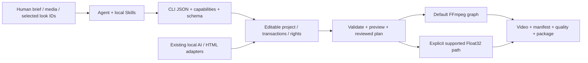

# agent editor kit

**An open-source local video-editing CLI for Agents.** Turn structured plans into editable projects, previews, video, quality reports and recoverable deliveries, retaining real artifacts and provenance.

[简体中文](README.md) · [繁體中文](README.zh-TW.md) · [English](README.en.md) · [Repository](https://github.com/copypasteltd/agent-editor-kit) · [Docs](docs/README.md)

**Public release: v0.1.0-alpha.3 prerelease · CLI 0.1.2 · 500 looks · 1 unified Skill / 17 internal modules.** Downloads provide a complete runtime ZIP, Agent kit, optional gallery and checksums. The verified runtime bytes are unchanged; portable installation and a runnable example are added. Complete Jianying/CapCut parity remains an unaccepted development target.

This page includes functional modules, services/dependencies, installation/usage, Skill inputs/outputs, real cases and verification. Long raw acceptance logs remain archived; practical feature descriptions and case access are restored here.


<!-- unified-skill-registration -->

**One registered entry: `$agent-ffmpeg-local-editor`.** The current local GPU extension uses the [r5 Skill kit](docs/skills/agent-editor-kit-community-unified-skill-r5.zip) and matching [local bundle/model installation](docs/product/COMMUNITY_LOCAL_DELIVERY.md). Its 17 internal modules are loaded as needed. The historical r1 kit remains paired with the unchanged public alpha.3 runtime below.

<!-- /unified-skill-registration -->

<!-- community-materials-gpu -->

**Local installed extension: CLI 0.1.6, GPU voice/translation and 359 bundled open resources.** The public alpha.3 attachments remain unchanged. Invoke the single `$agent-ffmpeg-local-editor` entry; its updated local registration prefers configured GPU packs, records the actual device/fallback, and retains CPU compatibility.

[Complete workflow and limits](docs/product/COMMUNITY_MATERIALS.en.md) · [Resource catalog](docs/product/COMMUNITY_MATERIAL_CATALOG.md) · [103 named voices and actual audition scope](docs/product/COMMUNITY_VOICES.md) · [CPU evidence](docs/validation/evidence/community-materials-20261025-r1/cpu/verification.json) · [GPU evidence](docs/validation/evidence/community-materials-20261025-r1/gpu/verification.json).

| Extension | Actual implementation | Limits |
|---|---|---|
| F44 / M01 | 44 BGM, 85 jingles, 228 unique SFX, 2 OFL Noto fonts | Source licenses/attribution remain separate; no stock subscription |
| F45 / M02 | Chinese/English speech, 103 named voices, text files/speed/WAV | Three voices generated for audition; no cloning or universal voice-quality approval |
| F46 / M03 | Offline bidirectional translation, bilingual SRT, glossary | Cue order/milliseconds retained; translation and pronunciation need review |
| F47 / G01 | CUDA voice/translation, auto/cpu/cuda, free-VRAM preflight | RTX 3060 tested; strict CUDA and explicit CPU fallback; optional NVIDIA runtime terms |
| F48 / M04–M05 | Real BGM trim/loop/fades, speech/music mix and ducking | Preserved stems; no composition or automatic seam repair |
| F49 / C01 | Native window/desktop/region/camera/microphone capture CLI, CPU/NVENC and cancellation | Actual owned-window evidence; camera/microphone, AV sync and long capture unaccepted |
| F50 / V01 | Offline image/text embeddings, Chinese/English/reference-image queries, previews and editable source points; auto/cpu/cuda | Small static-image acceptance; negation, open-set rejection, natural actions and audio recommendation remain open |

CPU 46 commands and GPU 15 commands are separate current tests. The real 12-second edit was fully decoded and package-round-tripped. Public examples omit speech whose publication rights remain unverified; local original stems and complete outputs remain available in delivery records. Human listening and full CapCut equivalence remain open.

<!-- /community-materials-gpu -->


<!-- independent-four-stems-r1 -->

## Local CLI 0.1.6: four independent stems and editable mixing

`audio separate-stems` retains independent HDemucs drums, bass, other and vocals estimates; `--apply` creates four assets and editable audio tracks. auto prefers an available NVIDIA GPU; explicit CPU/CUDA runs report actual devices. Register the existing native Torch/TorchAudio runtime and weights first. Neither the base ZIP nor the small kit includes them.

[Workflow / 完整流程](docs/product/FOUR_STEM_SEPARATION.md) · [Validation / 全部实测与失败](docs/validation/独立四轨音源分离实测_2026-10-25.md) · [Matching installation / 安装包](docs/product/COMMUNITY_LOCAL_DELIVERY.md)

```powershell
# Existing project/source asset and explicitly registered four-source adapter required.
& $avk audio separate-stems --project $project --asset-id music --adapter-id music_four --prefix edit --apply --dry-run
& $avk audio separate-stems --project $project --asset-id music --adapter-id music_four --prefix edit --apply --device auto --timeout-seconds 600
& $avk validate --project $project
```

18 development CLI calls, 18 separate installed calls and 11 real unified-Skill calls were executed. Controlled CPU/GPU improvement thresholds, four-track mixing and editable roundtrips pass. Absolute other SI-SDR is only about 1.71dB; natural music, dereverberation and human listening remain unaccepted. Experimental model rights are unverified; audio/packages stay local. The image below is a silent numeric diagnostic from the actual render, not an audio audition.


<!-- /independent-four-stems-r1 -->

<!-- semantic-retrieval-r1 -->

## Local CLI 0.1.5: find footage by description or reference image

Build real SigLIP2 embeddings for explicitly selected local images and video samples. Chinese, English and reference-image queries return previews, source times and editable references through the same `$agent-ffmpeg-local-editor` entry.

The base ZIP excludes Torch and the approximately 1.5GB weights. Configure an existing native environment, read semantic_config from runtime.json, explicitly register it per project, then index. No implicit downloads.

[Workflow / 登记与命令](docs/product/SEMANTIC_RETRIEVAL.md) · [Validation / 实测](docs/validation/离线语义检索实测_2026-10-25.md) · [All 20 queries / 全部结果](docs/assets/semantic-20261025-r1/all-query-results.png)

```powershell
# Existing project, registered local adapter and ingested source IDs required.
& $avk semantic index --project $project --index-id campaign-v1 --adapter-id siglip2 --all-visual-assets --sample-interval-seconds 2 --device auto
& $avk semantic search --project $project --index-id campaign-v1 --query '木桌上的一杯咖啡' --limit 5 --device auto
& $avk semantic search --project $project --index-id campaign-v1 --image $referenceImage --kind image --device cpu
```

On the pre-frozen small set, development CPU/GPU positive top-1 and mean asset recall@3 are 1.0 for 16 ordinary queries; the installed Skill separately exercises all 20 text queries and a CPU reference image. Chinese negation chooses coffee incorrectly and both out-of-library shark queries return grass. Reliable rejection, natural-action understanding and automatic direction remain open.


<!-- /semantic-retrieval-r1 -->

<!-- native-capture-r1 -->

## Local CLI 0.1.4: capture and audio fixes

The new package retains GPU speech/translation and all 359 resources. See the [capture workflow and limits](docs/product/NATIVE_CAPTURE.md), [actual CPU MP4](docs/assets/native-capture-20261025-r1/cpu-window.mp4), [GPU MP4/GIF](docs/assets/native-capture-20261025-r1/preview.gif) and [implementation evidence](docs/validation/补齐实施首批实测_2026-10-25.md). Configure the matching runtime through the [local installation guide](docs/product/COMMUNITY_LOCAL_DELIVERY.md), then use the same Skill. R3 now preserves proven exact copied/inverted/silent source-channel relationships. General stereo phase, four-millisecond pitch quality and human listening remain open.

```powershell
& $avk project init './workspace/capture-demo'
& $avk capture devices
& $avk capture record --project './workspace/capture-demo' --kind window --window-title 'Your application title' --duration-seconds 5 --encoder auto --asset-id take-01 --dry-run
& $avk capture record --project './workspace/capture-demo' --kind window --window-title 'Your application title' --duration-seconds 5 --encoder auto --asset-id take-01
& $avk validate --project './workspace/capture-demo'
```


<!-- /native-capture-r1 -->

## Public alpha.3: download and render your first video

**Requirements: Windows x64, existing CPython 3.13 x64 and FFmpeg/ffprobe on PATH.** The basic workflow needs no model, Node or browser. Installation uses no Docker, WSL, virtual environment or global pip. Adjust the Python path for your installation.

| Download | Purpose |
|---|---|
| [agent-editor-kit-v0.1.0-alpha.3-cp313-win_amd64.zip](https://github.com/copypasteltd/agent-editor-kit/releases/download/v0.1.0-alpha.3/agent-editor-kit-v0.1.0-alpha.3-cp313-win_amd64.zip) | Required: app and eight pinned wheels, about 196 MB. |
| [agent-editor-kit-unified-skill-r1.zip](https://github.com/copypasteltd/agent-editor-kit/raw/refs/heads/main/docs/skills/agent-editor-kit-unified-skill-r1.zip) | Required: offline installer, one Skill with 17 internal modules, registration and runnable example. |
| [agent-editor-kit-v0.1.0-alpha.3-gallery.zip](https://github.com/copypasteltd/agent-editor-kit/releases/download/v0.1.0-alpha.3/agent-editor-kit-v0.1.0-alpha.3-gallery.zip) | Optional: original, 500 real look samples, offline selection page and client-board assets. |
| [SHA256SUMS.txt](https://github.com/copypasteltd/agent-editor-kit/releases/download/v0.1.0-alpha.3/SHA256SUMS.txt) | Verify downloads; the installer also enforces the runtime ZIP hash. |

**1. Install.** Download both required ZIPs to `E:/Downloads/` and choose a new tool directory. Leave the runtime ZIP intact for the installer to validate and extract.

```powershell
$avkPython = 'C:/Python313/python.exe'
$avkHome = 'E:/tools/agent-editor-kit-unified'
$avkArchive = 'E:/Downloads/agent-editor-kit-v0.1.0-alpha.3-cp313-win_amd64.zip'
Expand-Archive -LiteralPath 'E:/Downloads/agent-editor-kit-unified-skill-r1.zip' -DestinationPath $avkHome
Set-Location $avkHome
& $avkPython -I -B -X utf8 ./install.py --archive $avkArchive
```

**2. Register Skills and inspect support.** After installation returns `ok: true`, register the Skills. Conflicting directories are preserved. Existing repository installations can keep their current launcher. Open a new conversation if the client has not discovered the Skills yet.

```powershell
powershell.exe -NoProfile -ExecutionPolicy Bypass -File ./register-agent-ffmpeg-local-skills.ps1
$avk = Join-Path $avkHome 'skills/agent-ffmpeg-local-editor/scripts/run.ps1'
& $avk version
& $avk doctor
& $avk capabilities
& $avk schema show
```

**3. Run the example.** No extra media is needed. Included CC0 artwork and synthetic audio pass through actual editing, motion, a look, preview, render, quality checks and project-package export/import. The output directory must not already exist.

```powershell
& $avkPython -I -B -X utf8 ./run-example.py --output 'E:/video-work/aek-first-demo'
```

Outputs include editable `project/project.json`, `project/renders/demo.mp4` (6 seconds, 360×640, 30 fps, 180 frames and audio), `demo.aevpkg.zip`, `restored/`, per-command responses and `verification.json`. This demonstrates installation and the editing chain; natural-media quality and listening remain separate acceptance work.

**4. Edit your own media with an Agent.** Supply media paths, goals, duration, canvas and audio intent. The Agent checks actual support and provenance before creating a timeline, previews and delivery.

```text
$agent-ffmpeg-local-editor Make a 15-second vertical ad from E:/media/product.mp4.
Inspect support and media first, explicitly retain source audio, show look candidates, then deliver previews, video, quality reports and an editable project package.
```

**5. Add the optional gallery.** Extract `gallery.zip` into the same `$avkHome` and open `docs/assets/looks-n002-20261024-r1/index.html`, or use the Skill helper below to export a candidate board. Close unused browser tabs afterwards.

[Release](https://github.com/copypasteltd/agent-editor-kit/releases/tag/v0.1.0-alpha.3) · [Full installation and workflow](docs/skills/UNIFIED_SKILL.en.md) · [Scope and limits](docs/releases/v0.1.0-alpha.3/RELEASE.md)

The new kit consolidates Skill organization and uses the same alpha.3 runtime. Its checksum is in the [package record](docs/skills/unified-skill-package.json); the original release’s 17-Skill kit remains immutable.

## See real output: 500 looks on one supplied still

Every tile below comes from the supplied N002 still processed by the installed CLI. The original plus eleven looks are an entry point; all 500 have individual samples and profiles.


[**Open the interactive 500-look gallery**](docs/assets/looks-n002-20261024-r1/index.html) · [Numbered samples](docs/local/FILTER_GALLERY.en.md) · [Measured profiles](docs/local/LOOK_PRESETS.en.md) · [Original PNG](docs/assets/looks-n002-20261024-r1/source.png) · [Sources/licenses](docs/assets/looks-n002-20261024-r1/SOURCE_AND_LICENSES.md)

The gallery supports three languages, number/name/ID/description search, category/license filters, an original-image split, shortlisting and JSON export. It loads 40 thumbnails per page and a full-size image for the active look. GitHub does not execute repository HTML; extract the optional gallery ZIP and open the HTML locally, without a server or network.

**Sample contract:** 1672×940 source, strength 1.0 and tetrahedral interpolation throughout. All 500 full-size lossless WebPs exactly match decoded CLI PNG RGB; the 500 thumbnails are resized WebP. No color profile is embedded in the source, so this is an encoded-SDR-RGB trial rather than camera/HDR calibration. The user supplied the image and requested these examples; it is not declared MIT/CC0.

## Architecture and complete execution logic



The implementation is **Python CLI + Agent Project schema + FFmpeg**, with an explicitly selected Float32 subset. Concat was an early architecture research candidate; the release is not a Concat binary with its GUI deleted. Adopted OpenFilm caption segmentation, frame-clock and HTML/template work retains provenance/licenses and needs no OpenFilm online service.

1. Read version/doctor/capabilities/schema to determine actual local support and dependencies.
2. Turn the brief into a plan covering assets, canvas, duration, cuts, audio, captions, motion, looks and delivery evidence.
3. Create an owned project, ingest local media, and author edit JSON using actual asset IDs and integer ticks; add audio explicitly.
4. Apply transactional compose/edit/apply operations with snapshots, validate, then preview important frames/ranges.
5. For selection, show the original and a small candidate set, record final IDs/strength/scope and trial them on target media.
6. Render to a new project-owned path, inspect the encoded output, manifest, warnings, A/V and rights, then export the project package.

## 43 base functional modules, plus F44–F50 above

IDs locate documentation groups with dependencies/overlap; they are not 43 independent kernels or a completion score. The table describes behavior, commands and limits. The [complete machine capability manual](docs/product/CAPABILITIES.en.md) retains every field.

| ID | Module | Behavior and input → output | Entry | Dependency/limit |
|---|---|---|---|---|
| F01 | Agent command protocol | Task arguments → JSON responses, exit codes, errors, warnings, artifacts and provenance; queryable capabilities and schema. | `version; doctor; capabilities; schema show` | Skills guide the task; the CLI executes it. No hosted Agent service. |
| F02 | Editable projects | Create/inspect Agent Projects with assets, sequences, tracks, tick clocks, output settings and rights references. | `project init/inspect` | Source media and metadata are separate; relocation requires relinking and evidence-path review. |
| F03 | Transactions, recovery and snapshots | Pre-write snapshots, restore, migration, locks and operation records; recover interrupted metadata transactions. | `project snapshot/restore/migrate/recover; operation inspect` | Failure evidence remains. Metadata snapshots do not back up all external media. |
| F04 | Media ingestion and relinking | Local images/video/audio/fonts → probe results, stable asset IDs, hashes and provenance. | `media ingest/relink` | No online-media fetching; ingestion does not establish commercial rights. |
| F05 | Proxies, thumbnails and waveforms | Media → lightweight proxies, thumbnails, waveforms and auditable contact sheets. | `media prepare/contact-sheet` | Contact sheets are samples, not exhaustive visual understanding. |
| F06 | Scene, silence and highlight analysis | Local video/audio → scene, silence, beat or heuristic highlight candidates and timing evidence. | `media understand/highlights` | Heuristic candidates require Agent or registered-adapter review for semantics. |
| F07 | Rough cuts and ad plans | Reviewed silence/transcript segments or an ad brief → edit plan → editable rough cut. | `media smart-cut; ad plan/apply` | Planning and applying are separate; no automatic directing or campaign-performance guarantee. |
| F08 | Beat cuts and multicamera sync | Beat anchors/local camera audio → cuts or offset/explicit affine clocks and switch plans. | `media beat-cut/multicam` | Low confidence, coverage shortfalls and nonlinear drift require refusal or explicit treatment; audio tracks remain explicit. |
| F09 | Multitrack editing | Edit JSON → tracks, insertion, updates, split/delete, duration/placement edits and canvas settings. | `timeline compose/edit` | Track locks, integer ticks, asset duration and advertised contracts apply. |
| F10 | Range and output-window edits | Explicit ranges → trim/delete/ripple edits while preserving author time and source mapping. | `timeline edit` | Check contracts for complex retiming/nesting combinations rather than assuming universal support. |
| F11 | Source handles, slip and slide | Source in/out points and neighbors → reversible source edits, handle transitions and cut adjustments. | `timeline edit/transition` | Insufficient source handles are reported rather than silently inventing coverage. |
| F12 | Magnetic tracks and linked edits | Primary-track block reordering, linked IDs and attached audio → structured edits preserving relationships. | `timeline edit` | Locks, boundaries and link-selection rules constrain ambiguous edits. |
| F13 | Compound and nested sequences | Child sequences → independent canvases, parent transforms/opacity, nested clocks and freezes. | `timeline compose/edit` | Independent spatial canvases do not imply independent color/fps; some group spatial transitions remain unsupported. |
| F14 | Retiming, reverse and freeze | Explicit speed/curves/Bezier/freeze points → video clocks and audio mapping. | `timeline edit; render` | Audio-retime backends differ; optional Rubber Band R3 requires existing native tools. |
| F15 | Keyframes and easing | Position, anchor, scale, rotation, opacity, crop, masks, volume and pan → frame-evaluated animation. | `timeline compose; schema show` | hold/linear/ease_in/ease_out/ease_in_out/bezier; enum/boolean channels are not assumed continuous. |
| F16 | 12 camera/motion presets | Push/pull, four pan directions, Ken Burns, rotation, fades and shake → editable keyframes. | `motion list/inspect/apply` | Bounded keyframe presets, not AI 3D cameras or an entire commercial motion library. |
| F17 | Transitions and cut effects | Adjacent clips and handles → declared fades, wipes, slides, black/white fades, circular and other transitions. | `timeline transition; capabilities` | Support depends on renderer and layer context; later Float32 transition candidates are not bundled. |
| F18 | Geometric masks and frame corrections | Rectangles/circles/ellipses/paths/polygons → inversion, feathering, animation, encoded masks and corrections. | `timeline compose; media mask-edit; quality mask` | Point topology and sampling are bounded; geometric checks do not prove semantic identity. |
| F19 | Layer compositing and blending | Visual layers → normal/multiply/screen/overlay/difference/addition/softlight/hardlight. | `timeline compose; capabilities` | The default path mainly uses encoded 8-bit RGB, without general linear-light/HDR equivalence. |
| F20 | 46 processing operators | Blur/sharpen, denoise, tone, curves, HSL, keying, vignette, noise and more → configurable chains. | `effects list/inspect` | Inspect animated parameters and backends individually; 46 operators and 500 LUT looks are separate inventories. |
| F21 | 500 offline looks | Name/ID/category/license search → details, still previews, clip/global application and provenance copies. | `look list/inspect/preview/apply` | 500 distinct transforms include related curve variants; creative SDR mapping, not 500 unrelated families. |
| F22 | Custom LUTs and color automation | Local .cube/.3dl/.csp/.dat → registration/inspection; supported 3D LUT strength and color channels follow automation contracts. | `lut register/list/inspect; effects inspect` | Registration does not imply complete parsing on every path; full CUBE data is required for the corresponding intensity/float features. |
| F23 | Explicit Float32 pixel pipeline | Declared source/working/output signals, ordering and budgets → float color, LUT/shaper, selected spatial processing and surfaces. | `render; preview; surface export/inspect` | Explicit float32-native-v1 selection; a bounded subset that refuses unsupported features, not a complete HDR/ICC pipeline. |
| F24 | Subtitles, text and segmentation | SRT/VTT/ASS/SSA/TTML or text → normalization, segmentation, bilingual text, layers, word highlighting and text animation. | `subtitle validate/normalize/segment; timeline compose` | Fonts must exist locally; complex layout, bidi shaping and some clock/animation combinations have explicit approximations or refusals. |
| F25 | Offline transcription and alignment | Audio + existing Whisper/CTC weights/corrected text → transcripts, captions, word/character timings and CER evaluation. | `asr adapter; subtitle transcribe/align/evaluate` | Weights are not bundled; segment timestamps are not precise word alignment, and the dated CTC quality gate failed. |
| F26 | Multitrack audio and buses | Explicit audio tracks → mixing/buses, volume/pan, mute/solo, fades, EQ, compression, denoise, loudness and ducking. | `audio extract; timeline compose; quality check` | A video containing sound does not automatically author an audio track; PCM/LUFS checks do not replace listening. |
| F27 | Local speech synthesis | Existing flite or registered SoulX weights/authorized voice references → WAV assets and optional audio tracks. | `tts adapter/voice; tts synthesize` | flite depends on the FFmpeg build and is ASCII-English only; SoulX needs CUDA/native dependencies, not bundled voices. |
| F28 | Four-source and two-source separation | Audio → independent drums/bass/other/vocals estimates, float WAV assets and editable tracks; existing two-source and mid/side retained. | `audio separate-stems; audio separate; audio adapter` | Native runtime/weights supplied separately; controlled CPU/GPU tested; natural quality, listening and model rights open. |
| F29 | Tracking, binding and reframing | Template/model/encoded-mask tracks → anchored text/stickers, crop and subject-reframe keyframes. | `media track/track-bind/reframe` | Choose the object explicitly; confidence/masks do not guarantee identity, and supported transforms/clocks must be checked. |
| F30 | OCR anchors and face retouch | Existing PP-OCR/OpenSeeFace models → text polygons, anchor camera keys, landmarks and bounded retouch. | `ocr adapter/scan/anchors; face adapter/scan/retouch` | Existing ONNX CPU runtime and weights; not full UI action detection, makeup, body sculpting or face generation. |
| F31 | Human matting and object segmentation | Existing RVM/SAM2 + points/boxes → alpha video, object masks and editable derived assets. | `media adapter; media matting` | RVM human matting and SAM2 segmentation differ; probability masks are not physical hair mattes and require motion/occlusion review. |
| F32 | Inpainting, generative edits and outpainting | Existing LaMa/VACE + masks/prompts → repairs or expanded canvases with provenance and replayable recipes. | `media inpaint/outpaint; media adapter` | Framewise LaMa has no temporal guarantee; VACE needs CUDA and joint windows only; broad natural texture/temporal quality remains unaccepted. |
| F33 | HTML/CSS/SVG/Canvas motion | Trusted local source/assets/fonts → editable controls, alpha titles, stroke motion, layout diagnostics and timeline compositing. | `motion html-*; motion stroke-source` | Requires existing Node/Playwright/Chromium; not an arbitrary-page sandbox and does not download a browser. |
| F34 | Parameterized templates and variants | Local JSON templates + typed variables → editable variants, batch inputs and template snapshots. | `template apply/batch` | Includes asset/color/enum types; complex conditional graphs and expression evaluation are pending. |
| F35 | Asset indexing and reusable fragments | Asset folders/edited clips → search, duplicates/similarity, cross-project fragments and dependency closure. | `library index/search/duplicates/similar; fragment` | User-owned libraries; no bundled commercial stock subscription or licensed-music catalog. |
| F36 | Frame/range preview and caching | Projects + explicit frames/ranges → PNG/short video/cache and verifiable sample evidence. | `preview frame/range; cache; preview cache-*` | Preview does not validate the entire delivery; renderer/color path and cache signatures must match. |
| F37 | Delivery, encoding and hardware probes | Projects → MP4/WebM/MKV, codec/pixel/audio configuration, alpha output and manifests. | `render` | Codecs depend on local FFmpeg; hardware is probed, CPU effects are not globally GPU-ported, and real-time/4K performance is not guaranteed. |
| F38 | Persistent queues, retry and cancel | Frozen snapshots → local jobs, bounded workers, explicit retry/cancel and serialized metadata commits. | `queue enqueue/list/inspect/run/cancel` | Sequential by default; concurrency has gates and is not distributed cloud rendering. |
| F39 | Output, scopes and golden checks | Actual encoded files → stream/fps/canvas/duration, loudness/black frames, scopes, masks and golden differences. | `quality check/scopes/mask/golden` | Automatic checks, static review, playback and listening are recorded separately, without general creative-quality certification. |
| F40 | Rights ledger and local policy | Media/font/LUT/model/template evidence → dependency ledger, history, impact/retraction and publish gates. | `rights; policy audit; render --publish` | --publish checks local rights without uploading; the ledger does not adjudicate copyright. |
| F41 | Project and timeline interchange | Agent JSON/package, OTIO, Kdenlive MLT and lawful local plaintext drafts → import/export and loss reports. | `convert import/export` | Per-feature Exact/Approximate/Unsupported/Failed reports; plaintext drafts neither run Jianying nor decrypt/fetch proprietary resources. |
| F42 | Pipeline diagnostics and failure artifacts | Failed operations → bounded logs, diagnostic manifests, explicit exports and inspectable errors. | `diagnostics list/show/export; operation inspect` | A failure/refusal is not a successful render; review local-path information before sharing diagnostics. |
| F43 | Creative, content and campaign guidance | Supplied products, audiences, references or campaign tables → scripts, structure, variant suggestions and analysis. | `ad plan/apply; advisory Skills` | Advisory Skills do not supply ad-platform connectors, automatic buying, live data or performance guarantees. |

## Supported service modules and dependencies

“Service” here means a local processing module or adapter. The base package supplies the CLI, projects and rendering; models, browser runtimes, fonts and user assets follow the conditions below.

| ID | Service module | Execution | Needs/provides | Entry | Scope |
|---|---|---|---|---|---|
| S01 | Local Agent tool interface | Native process/JSON | Python 3.13 + installed package; callable by an Agent shell or Skill. | `version / capabilities / schema show` | No built-in SaaS, HTTP API or MCP server; callers may wrap the CLI. |
| S02 | Project and operation storage | Local files/transactions | Agent Projects, snapshots, locks, operations and recovery records. | `project / operation` | Not a multiuser cloud collaboration database. |
| S03 | Media processing and default rendering | On-demand processing | Existing FFmpeg/ffprobe and local media. | `media / timeline / render` | Codec/filter availability depends on the installed FFmpeg build. |
| S04 | Explicit float pixel engine | Explicit opt-in | NumPy and declared signals/budgets; checked separately from the default pipeline. | `surface / render / preview` | A supported subset, not a complete replacement for every FFmpeg/Jianying operation. |
| S05 | Captions and speech | Base parsing + optional models | Subtitle parsing is direct; Whisper/CTC/SoulX need registered existing runtimes. | `subtitle / asr / tts` | No default cloud transcription or voice provider. |
| S06 | Visual AI and repair | Optional local adapters | Per-adapter native dependencies and weights for RVM/SAM2/LaMa/VACE/tracking/OCR/faces. | `media adapter / ocr / face` | No bundled model weights; an unconfigured adapter is not an executed capability. |
| S07 | HTML motion rendering | Optional local runtime | Explicitly registered existing Node, Playwright, Chromium, templates, images and fonts. | `motion html-*` | No OpenFilm online service dependency or automatic browser installation. |
| S08 | Assets, templates and looks | Bundled catalog + user libraries | 500 bundled LUTs; media, fonts, music and templates are registered/provided by users. | `look / lut / template / library / fragment` | No complete commercial stock/template subscription library. |
| S09 | Local render queue and cache | Persistent job files | Single-process sequential default, with gated bounded local workers and caches. | `queue / preview / cache` | No cross-machine orchestration, cloud rendering or remote billing. |
| S10 | Quality checks and diagnostics | Local artifact checks | FFmpeg decode/scopes, PNG/JSON reports, goldens and failure diagnostics. | `quality / diagnostics` | Objective checks and subjective acceptance remain distinct. |
| S11 | Rights and interchange | Local evidence and file exchange | Ledger/policy/package hashes/loss reports without invoking a proprietary editor. | `rights / policy / convert` | Does not grant commercial rights to third-party media/models. |
| S12 | Creative and campaign assistance | Agent task guidance | Uses supplied business information and data to produce scripts/suggestions/analysis. | `$agent-ffmpeg-local-editor` / K01–K17 | No ad-account integration, buying or automatic data collection. |
| S13 | Bundled community resources | Offline catalog | 359 source/license-pinned music/jingle/SFX/font files | `materials list/inspect/verify/ingest` | Per-resource rights; no commercial stock subscription |
| S14 | Local speech/translation | Native model workers | Four optional pinned CPU/CUDA packs; 103 voice mappings and OPUS text/subtitles | `voice / translate / model-pack` | Three audition voices generated; human review remains separate |
| S15 | BGM preparation and mixing | Native FFmpeg audio | Explicit trim/loop/fades, independent voice/music stems and ducking | `music prepare/mix` | No composition, voice truncation or seam-repair promise |
| S16 | GPU compatibility | Native NVIDIA libraries | `auto/cpu/cuda`, free-VRAM check, explicit provider/fallback | `gpu inspect; --device` | RTX 3060 tested; optional NVIDIA/Intel terms preserved |
| S17 | Native Windows capture | FFmpeg gdigrab / DirectShow | Explicit source/device IDs, finite duration, full decode and asset registration | `capture devices/record` | Actual CPU/GPU window test; camera/microphone/AV sync pending |
| S18 | Visual semantic retrieval | Explicit native SigLIP2 worker | Existing Torch/Transformers/model; actual GPU/CPU and source/preview/vector integrity | `semantic adapter-register/index/search/verify` | Cold-start and large-library performance open; cosine is not probability |
| S19 | Independent four-source separation | Native Torch/TorchAudio HDemucs worker | Explicit native Python, weights/evidence/implementation hashes; auto/cpu/cuda, four float WAV/tracks | `audio adapter; audio separate-stems` | Torch/weights excluded from base ZIP; natural listening and weight licensing remain open |

**Observed local environment:** this update’s doctor sees native Python 3.13.1, FFmpeg/ffprobe 8.1 and Node; this does not establish registration of every model/browser adapter. doctor merely discovers Docker/WSL executable paths and does not run them. This project uses native tools without invoking Docker/WSL/virtual environments.

### What the optional AI modules actually provide

| Stack | Capability and prerequisite | Commands |
|---|---|---|
| Whisper / CTC | Transcription/captions/corrected-text alignment/CER; existing weights/native runtime required. | asr adapter; subtitle transcribe/align/evaluate |
| flite / SoulX | Basic English speech or authorized-reference voice synthesis; SoulX requires existing CUDA BF16 runtime. | tts adapter/voice/synthesize |
| HDemucs | Vocal/accompaniment separation, distinct from model-free mid/side approximation. | audio adapter; audio separate |
| Tracking / YOLOv10 ONNX | Template/native ONNX/command-JSON tracking for binding/reframing; explicitly choose objects. | media adapter/track/track-bind/reframe |
| PP-OCRv4 / OpenSeeFace | OCR polygons/camera anchors, 66-point faces and bounded retouch; existing ONNX CPU dependencies. | ocr; face |
| RVM / SAM2 | Human soft-alpha matting / prompted object segmentation; review models, prompts, cuts and masks. | media adapter; media matting |
| LaMa / VACE | Framewise repair / CUDA joint-window generative edits and outpainting, retaining temporal/texture acceptance limits. | media inpaint/outpaint |

These interfaces do not mean the base bundle contains the weights. A historical model execution does not establish configuration of the current project; inspect its registry and results. Model, voice and media licenses are separate from software MIT.

## 46 effect operators and 12 motion presets

| Effect category | Actual discoverable operators |
|---|---|
| blur | `avgblur`, `blur`, `box_blur`, `smartblur` |
| color | `brightness`, `color_balance`, `color`, `color_contrast`, `color_levels`, `color_temperature`, `color_wheel`, `contrast`, `curves`, `exposure`, `gamma`, `hsl`, `histeq`, `hue`, `lut3d`, `rgb_curves`, `selective_hsl`, `saturation` |
| keying | `chroma_key` |
| repair | `deband`, `deflicker`, `deshake`, `dctdnoiz`, `gradfun`, `hqdn3d` |
| overlay | `draw_box` |
| stylize | `edgedetect`, `grayscale`, `invert`, `noise`, `posterize`, `sepia`, `solarize`, `threshold`, `vignette` |
| motion | `frame_interpolation` |
| transform | `hflip`, `vflip` |
| distortion | `lens_correction` |
| detail | `sharpen` |
| temporal | `tblend`, `tmix` |

12 motion presets: `zoom_in`, `zoom_out`, `pan_left`, `pan_right`, `pan_up`, `pan_down`, `ken_burns`, `rotate_in`, `rotate_out`, `fade_in`, `fade_out`, `shake`.

See [every effect’s parameters](docs/product/EFFECTS.en.md) for defaults, bounds, keyframe support and backend. LUTs map color; grain, vignette, blur, geometry, masks and AI repair are separate operations and are not automatically added by selecting a look.

## 500 looks: names, detail and client selection

001–100 retain `sp-`/`t3-`; 101–500 use source prefixes `nt-`/`fl-`. Names retain upstream film/style/curve variants; stable IDs are the command identifiers. The 500 distinct transforms include related upstream curves and do not count strength/format copies or imply 500 unrelated families.

| Category | Count |
|---|---|
| cinema | 39 |
| creative | 135 |
| film-bw | 37 |
| film-negative | 112 |
| film-slide | 41 |
| infrared | 2 |
| instant-consumer | 54 |
| instant-pro | 65 |
| landscape | 10 |
| lomography | 5 |

Each profile includes original/localized names, ID/category, measured gray/skin/RGB values, trial use/strength, cautions, creator, source commit, conversion error, LUT hash/license, this N002 sample and dated synthetic-card PNG/video.

| Numbers | Profiles and supplied-image samples |
|---|---|
| 001–100 | [Profiles](docs/local/look-profiles/001-100.en.md) · [N002 samples](docs/local/filter-gallery/001-100.en.md) |
| 101–200 | [Profiles](docs/local/look-profiles/101-200.en.md) · [N002 samples](docs/local/filter-gallery/101-200.en.md) |
| 201–300 | [Profiles](docs/local/look-profiles/201-300.en.md) · [N002 samples](docs/local/filter-gallery/201-300.en.md) |
| 301–400 | [Profiles](docs/local/look-profiles/301-400.en.md) · [N002 samples](docs/local/filter-gallery/301-400.en.md) |
| 401–500 | [Profiles](docs/local/look-profiles/401-500.en.md) · [N002 samples](docs/local/filter-gallery/401-500.en.md) |

Sources/licenses: Striped Purple 49 + t3mujinpack 51 (MIT), Natron 267 (CC BY-SA 4.0), FreshLUTs 133 (CC0). Natron Hald-to-CUBE approximation is disclosed per entry. Community film/product names are not official Leica/CapCut/manufacturer algorithms. `fl-0000228-science-fiction-for-flog` has an ambiguous Rec.709 label versus FLog title; use only for experimental creative comparison, not verified camera-log conversion.

**Client workflow:** show the original plus 3–6 relevant actual samples, identifying number, name, stable ID, strength, color change and license. Clients can filter/export candidates or give numbers. Render selected strengths on the actual target media, record final ID/strength/clip-or-global scope, then dry-run/apply. The split slider changes the original comparison region and does not simulate strength.

```powershell
$avkHome = 'E:/tools/agent-editor-kit-unified'
$avk = Join-Path $avkHome 'skills/agent-ffmpeg-local-editor/scripts/run.ps1'
$aekGallery = Join-Path $avkHome 'skills/agent-ffmpeg-local-editor/scripts/look_gallery.py'
& 'C:/Python313/python.exe' -I -S -B -X utf8 $aekGallery --query '黑白' --limit 6
& 'C:/Python313/python.exe' -I -S -B -X utf8 $aekGallery --ids t3-fuji-superia-800 nt-bw-agfa-apx-100 fl-0000634-darkblue --output 'E:/video-work/client-look-options'
& $avk look inspect --id t3-fuji-superia-800
& $avk look preview --id t3-fuji-superia-800 --input 'E:/media/client-frame.png' --output 'E:/video-work/client-strength-065.png' --strength 0.65
& $avk look apply --project 'E:/video-work/my-ad' --id t3-fuji-superia-800 --clip-id clip_1 --strength 0.65 --dry-run
& $avk look apply --project 'E:/video-work/my-ad' --id t3-fuji-superia-800 --clip-id clip_1 --strength 0.65
```

Use a new output directory and replace `clip_1` with an actual clip ID. The helper writes only `board.jpg` and `selection.json`, without project edits; samples are at 100%. `look apply` replaces built-in looks in scope while preserving manual effects; stacking requires `--append`, and `--global` affects every sequence. Static strength mixes encoded RGB. Prepare Float32/Log/HDR through a separate color contract before creative SDR looks.

## Multipart fallback, bundle contents and repository installation

Prerequisites: native Windows x64, existing CPython 3.13 and FFmpeg/ffprobe. Eight pinned wheels contain the app, NumPy, Pillow and schema dependencies, installed offline to a target folder without a virtual environment or global site-packages changes. Python, FFmpeg, Node/Chromium, model weights and commercial fonts/music are not bundled.

[Download all parts/metadata](docs/releases/v0.1.0-alpha.3/artifacts/) · [Installation manual](docs/releases/v0.1.0-alpha.3/USAGE.md) · [Checksums](docs/releases/v0.1.0-alpha.3/artifacts/SHA256SUMS.txt). Parts are not standalone ZIPs: assemble before extracting. Hashes verify content, not publisher signatures.

```powershell
$avkPython = 'C:/Python313/python.exe'
# Run from the directory containing every .partNN and the supplied metadata.
& $avkPython -I -B -X utf8 ./assemble.py --output E:/tools/agent-editor-kit-unified.zip
Expand-Archive E:/tools/agent-editor-kit-unified.zip E:/tools/agent-editor-kit-unified
Set-Location E:/tools/agent-editor-kit-unified
$avkManifest = (Get-Content ./version.json -Raw | ConvertFrom-Json).manifest_sha256
& $avkPython -I -B -X utf8 ./bundle/install.py --target E:/tools/aek-alpha3-installed --manifest-sha256 $avkManifest
& $avkPython -I -S -B -X utf8 E:/tools/aek-alpha3-installed/run.py doctor
```

This host already has `E:/dev/sandbox/AI广告剪辑/local/agent-ffmpeg/v0.1.0-alpha.3/installed/`. The one entry, scripts and 17 task modules live in `skills/agent-ffmpeg-local-editor/`; Codex registers only that directory junction. Re-register after relocation; unrelated conflicting directories are preserved.

```powershell
Set-Location 'E:/dev/sandbox/AI广告剪辑'
./register-agent-ffmpeg-local-skills.ps1
$avk = 'E:/dev/sandbox/AI广告剪辑/skills/agent-ffmpeg-local-editor/scripts/run.ps1'
& $avk version
& $avk doctor
& $avk capabilities
& $avk schema show
& $avk COMMAND --help
```

The Skill launcher checks the installation receipt and launcher hash, then invokes the pinned release with `-I -S`; missing installation fails without silent source fallback. N002 samples and selection assets are a separate optional gallery ZIP. Extract it into the Agent kit home for the Skill helper to use. The runtime ZIP itself is unchanged.

## Commands and project structure: start to delivery

```powershell
$avkHome = 'E:/tools/agent-editor-kit-unified'
$avk = Join-Path $avkHome 'skills/agent-ffmpeg-local-editor/scripts/run.ps1'
$aekProject = 'E:/video-work/first-ad'
& $avk project init $aekProject --name 'First ad'
& $avk media ingest --project $aekProject --input 'E:/media/product.mp4'
# Read returned data.asset.id; author changes.json using actual IDs and source ranges.
& $avk timeline compose --project $aekProject --input 'E:/video-work/changes.json'
& $avk validate --project $aekProject
& $avk rights check --project $aekProject
& $avk policy audit --project $aekProject
& $avk preview frame --project $aekProject --frame 0
& $avk render --project $aekProject --output 'E:/video-work/first-ad/renders/ad.mp4'
& $avk quality check --project $aekProject --input 'E:/video-work/first-ad/renders/ad.mp4'
& $avk convert export --help
```

Media/changes.json paths are placeholders requiring real files and IDs. Default author timebase is 90,000 ticks/second and display rate 30/1; source time, author time, frame number and native PTS differ. Video tracks do not automatically add audio; author audio tracks explicitly. See the [executed ad edit JSON](docs/validation/evidence/release-v0.1.0-alpha.1-r2/changes.json).

```text
project/
  project.json         # editable settings, assets, sequences and tracks
  rights-ledger.json   # source, license and dependency evidence
  assets/              # imported/derived assets, LUTs and notices
  history/             # snapshots
  operations/          # operations, diagnostics and render queue
  renders/             # delivered files and manifests
  cache/               # disposable derived previews/analysis
```

Responses contain `ok/command/request_id/operation_id/status/data/artifacts/warnings/errors/provenance`. Check exit status and response, not merely file existence. A dry run is a plan rather than a render; idempotency applies only to advertised writes.

Imported rights default to unverified; supply actual source/license/evidence before commercial delivery and `rights check`/`render --publish`. `--publish` is a local gate, not a platform upload. Interchange reports Exact/Approximate/Unsupported/Failed losses and cannot promise lossless plaintext-draft effects.

## One Skill, 17 internal modules: responsibility, inputs/outputs and limits

K01–K17 are internal modules, not separate registrations. Describe the outcome; the entry selects the relevant planning, analysis, timeline, template, quality and delivery references.

| ID | Internal module | Responsibility | Input → output | Commands | Dependency/limit |
|---|---|---|---|---|---|
| K01 | [`$agent-ffmpeg-local-editor`](skills/agent-ffmpeg-local-editor/SKILL.md) | Editing and delivery entrypoint | brief + local media → plan, project, video, manifest | `project init; timeline compose; look; render` | Routes by capability, including client look selection; needs the base CLI. |
| K02 | [`timeline`](skills/agent-ffmpeg-local-editor/references/modules/timeline/module.md) | Timeline, keys and motion | Edit JSON → tracks/motion/transitions/nesting | `timeline compose/edit; motion apply` | Explicit track/clip targets and author clocks. |
| K03 | [`quality`](skills/agent-ffmpeg-local-editor/references/modules/quality/module.md) | Output and pixel review | Video + manifest + reference → reports/scopes/differences | `quality check/scopes/mask/golden` | Separate static review/playback/listening; review look selections. |
| K04 | [`project-ops`](skills/agent-ffmpeg-local-editor/references/modules/project-ops/module.md) | Project operations, recovery and queues | Projects + jobs → snapshots/recovery/relink/results | `project snapshot/recover; media relink; queue` | Preserve sources/failures; not a cloud scheduler. |
| K05 | [`local-policy`](skills/agent-ffmpeg-local-editor/references/modules/local-policy/module.md) | Local execution policy | Project references → audit/structured refusal | `policy audit` | Remote references refused; not an OS sandbox. |
| K06 | [`rights-ledger`](skills/agent-ffmpeg-local-editor/references/modules/rights-ledger/module.md) | Media and model rights evidence | Source/license/local evidence → ledger/impact/gates | `rights list/check/update/impact` | Treat image and LUT rights separately; no automatic legal determination. |
| K07 | [`local-models`](skills/agent-ffmpeg-local-editor/references/modules/local-models/module.md) | Existing offline model registration | Native runtime + weights/hashes/licenses → adapters/artifacts | `audio adapter; audio separate-stems; media adapter; asr adapter; ocr; face; tts` | No weight downloads; check capability/runtime before execution. |
| K08 | [`video-understand`](skills/agent-ffmpeg-local-editor/references/modules/video-understand/module.md) | Scene/silence, semantic retrieval and video evidence | Local video/images/text/reference → analysis, previews, source times and candidates | `media understand/contact-sheet; subtitle transcribe; semantic index/search` | [Retrieval reference](skills/agent-ffmpeg-local-editor/references/semantic-retrieval.md); sample points provide no event duration; review candidates. |
| K09 | [`template-library`](skills/agent-ffmpeg-local-editor/references/modules/template-library/module.md) | Templates and reusable fragments | Templates/variables/library → editable variants/index | `template apply/batch; library; fragment` | User-provided assets and per-resource licenses. |
| K10 | [`long-to-short`](skills/agent-ffmpeg-local-editor/references/modules/long-to-short/module.md) | Long video to short clips | Local lesson/talk + reviewed text → rough cuts/short projects | `media highlights/smart-cut; timeline compose` | Review candidate segments; no autonomous semantic-director claim. |
| K11 | [`screen-demo`](skills/agent-ffmpeg-local-editor/references/modules/screen-demo/module.md) | Screen demos and camera anchors | Recording + action anchors → zoom/return/caption demo | `timeline compose; ocr anchors; preview range` | OCR needs existing models; text boxes are not clickable-control bounds. |
| K12 | [`reference-remake`](skills/agent-ffmpeg-local-editor/references/modules/reference-remake/module.md) | Reference pacing/layout remake | Local reference + replacement assets → editable remake | `media understand; timeline compose` | Rebuild structure; no automatic acquisition or rights grant. |
| K13 | [`ffmpeg`](skills/agent-ffmpeg-local-editor/references/modules/ffmpeg/module.md) | Native media tools | Local files + settings → conversion/resize/extraction/compression | `native ffmpeg / ffprobe` | Native tools; inspect codec availability. |
| K14 | [`video-edit`](skills/agent-ffmpeg-local-editor/references/modules/video-edit/module.md) | General video-edit workflows | Local files + edit instructions → trims/concat/overlays | `native ffmpeg; installed CLI` | Use timeline/editor for complex editable projects. |
| K15 | [`ad-creative`](skills/agent-ffmpeg-local-editor/references/modules/ad-creative/module.md) | Ad creative and variants | Product/audience/evidence → hooks/copy/scripts/variants | `advisory; ad plan` | Advisory instructions without bundled media-generation models. |
| K16 | [`video-content-strategist`](skills/agent-ffmpeg-local-editor/references/modules/video-content-strategist/module.md) | Video content strategy | Goals/audience/supplied references → direction/series/scripts | `advisory Skill` | No live trends, platform accounts or crawler. |
| K17 | [`campaign-analytics`](skills/agent-ffmpeg-local-editor/references/modules/campaign-analytics/module.md) | Supplied campaign-data analysis | Local campaign tables → ROAS/CPA/funnel/suggestions | `advisory Skill` | No ad-platform connector; metrics depend on data/attribution assumptions. |

Typical routing: creative/content strategy → editor → understanding → timeline/template → quality → project operations. Rights/policy check relevant dependencies; local-models is used when actual inference is needed. The editor presents/records look choices and quality reviews the target-media result.

```text
$agent-ffmpeg-local-editor 用本地素材做 6 秒竖屏广告，保留工程、音轨、权利证据和成片核验。
$agent-ffmpeg-local-editor 用 N002 图册向客户展示暖色胶片、黑白、冷色电影各两套；给编号/ID/强度/许可和对照板，等客户选型后再试目标素材。
$agent-ffmpeg-local-editor 给 clip_1 添加可编辑推近和关键帧，预览首中末帧。
$agent-ffmpeg-local-editor 用提供的本地产品图和变量生成一个可编辑模板变体。
$agent-ffmpeg-local-editor 对实际输出、manifest 和 Scope 复核，分别说明自动检查、目检、播放和听审。
```

[Current full Skill manual](docs/product/SKILLS.en.md) · [Client selection workflow](skills/agent-ffmpeg-local-editor/references/client-look-selection.md) · [Registration/install](docs/local/INSTALLATION.md). Skills are task instructions, without additional model/stock subscriptions or automatic ad-platform access.

## Complete cases, original inputs, actual output and GIFs

### C15: four independent audio tracks → exact mixing → editable roundtrip

The installed runtime generates 6s/180 frames and 48kHz PCM; four-track mix error is zero, with identical audio/pixels after package roundtrip. [Case/silent diagnostic GIF](docs/product/CASES.md#c15-four-stems) and [raw responses](docs/validation/evidence/four-stems-20261025-r1/demo-r2/verification.json) are retained. Audio/project packages remain local; no human-listening acceptance.

### C14: actual retrieval candidates → editable clips → installed output

Explicitly select cat, coffee and astronaut video candidates from actual frozen-query responses, preserving overall returned ranks and source times. Author one second per clip. Eleven installed CLI calls build the project/captions, render, check, export/import and rerender: 3s, 640×360, 30fps/90 frames, with identical decoded roundtrip pixels. The input is a sequence of natural stills, not an acceptance test for natural motion or ad quality; audio and human review are recorded separately.


[Input MP4](docs/assets/semantic-20261025-r1/asset_v1.mp4) · [Output MP4](docs/assets/semantic-20261025-r1/demo-installed-r1-workflow/semantic-cut.mp4) · [Candidate/output board](docs/assets/semantic-20261025-r1/demo-installed-r1-workflow/candidate-to-output.png) · [Editable package](docs/assets/semantic-20261025-r1/demo-installed-r1-workflow/editable-project.aevpkg.zip) · [Full case](docs/product/CASES.md#c14-semantic-retrieval)

<!-- community-cases -->

**C10–C12: actual local extension cases.** C10 retains three speech WAVs, bilingual captions, BGM/ducked stems, an editable project and a corrected 12-second video locally. C11 actually invokes the registered Skill with default GPU speech/translation, while retaining explicit CPU. C12 is the publishable music/SFX/font example below; the GIF is silent and the MP4 includes licensed music/SFX. Generated speech is kept in local review records.


[MP4](docs/assets/community-materials-20261025-r2/community-resources.mp4) · [Original art](docs/assets/release-v0.1.0-alpha.3-r1/input/card-1.png) · [Sources/licenses](docs/assets/community-materials-20261025-r2/SOURCE_AND_LICENSES.md) · [Steps and limits](docs/product/COMMUNITY_MATERIALS.en.md) · [Acceptance and remaining product gaps](docs/product/COMMUNITY_ACCEPTANCE.md).

<!-- /community-cases -->

| ID | Scenario and actual scope | Original/output/evidence |
|---|---|---|
| C01 | Six-second FIELD ad: original cards + synthetic audio → 360×640/30 fps/180 frames. | [Input](docs/assets/release-v0.1.0-alpha.1-r2/input.mp4) · [MP4](docs/assets/release-v0.1.0-alpha.1-r2/field.mp4) · [GIF](docs/assets/release-v0.1.0-alpha.1-r2/field.gif) · [JSON](docs/validation/evidence/release-v0.1.0-alpha.1-r2/changes.json) |
| C02 | Three-second template variant: real asset/duration variables → editable silent output. | [Template](docs/validation/evidence/release-v0.1.0-alpha.1-r2/template.json) · [Variables](docs/validation/evidence/release-v0.1.0-alpha.1-r2/variables.json) · [MP4](docs/assets/release-v0.1.0-alpha.1-r2/variant.mp4) · [GIF](docs/assets/release-v0.1.0-alpha.1-r2/variant.gif) |
| C03 | Dated Float32 1D/shaper + 3D LUT color-chain, source-clock and independent-preview execution. | [Input](docs/assets/float-shaper-20261023-installed-r1/original.mp4) · [Output](docs/assets/float-shaper-20261023-installed-r1/edited.mp4) · [GIF](docs/assets/float-shaper-20261023-installed-r1/formal-comparison.gif) |
| C04 | Package export/restore and actual remote-reference refusal, with complete CLI responses. | [Export](docs/validation/evidence/release-v0.1.0-alpha.1-r2/export-package.stdout.json) · [Restored validation](docs/validation/evidence/release-v0.1.0-alpha.1-r2/restored-validate.stdout.json) · [Refusal](docs/validation/evidence/release-v0.1.0-alpha.1-r2/remote-refused.stdout.json) |
| C05 | New N002 × 500: 500 installed previews with 500 full-size lossless pixel matches. | [Source](docs/assets/looks-n002-20261024-r1/source.png) · [Gallery](docs/assets/looks-n002-20261024-r1/index.html) · [All samples](docs/local/FILTER_GALLERY.en.md) · [GIF](docs/assets/looks-n002-20261024-r1/look-selection.gif) |
| C06 | Client board: original plus selected stable IDs, names, licenses and returnable selection.json. | [Board](docs/assets/looks-n002-20261024-r1/client-shortlist-example/board.jpg) · [JSON](docs/assets/looks-n002-20261024-r1/client-shortlist-example/selection.json) |
| C07 | Real gallery: desktop/mobile screenshots, actual interaction recording and assertions. | [Desktop](docs/assets/looks-n002-20261024-r1/gallery-desktop.png) · [Mobile](docs/assets/looks-n002-20261024-r1/gallery-mobile.png) · [WebM](docs/assets/looks-n002-20261024-r1/gallery-walkthrough.webm) |
| H01 / V35 | Source-handle transitions: authored input, actual two-cut result and independent pixel reference. | [Input](docs/assets/source-transitions-20261017/authored-input.mp4) · [Output](docs/assets/source-transitions-20261017/C01-actual.mp4) · [GIF](docs/assets/source-transitions-20261017/comparison.gif) |
| H02 / V41 | Native HTML motion: editable source, alpha titles and timeline composition with an existing browser runtime. | [Source](docs/assets/html-motion-20261018/source.mp4) · [HTML](docs/assets/html-motion-20261018/template/index.html) · [Output](docs/assets/html-motion-20261018/S03-timeline.mp4) · [GIF](docs/assets/html-motion-20261018/native-comparison.gif) |
| H03 / V43 | Frame mask corrections: selected/clear errors corrected; geometry passes while natural LaMa repair still smears. | [Source](docs/assets/mask-edits-20261018/source.mp4) · [Before](docs/assets/mask-edits-20261018/mask-input.mov) · [After](docs/assets/mask-edits-20261018/mask-edited.mov) · [GIF](docs/assets/mask-edits-20261018/comparison.gif) |
| H04 / V37 | Cross-project fragments: transitions, captions, LUTs, child sequences and linked dependencies. | [Input](docs/assets/fragments-20261018/source-a.mp4) · [Output](docs/assets/fragments-20261018/C01-actual.mp4) · [GIF](docs/assets/fragments-20261018/comparison.gif) |
| H05 / V34 | Caption segmentation/bilingual text: authored timings, actual output and reference; not an ASR demonstration. | [Input](docs/assets/subtitle-segments-20261017/source.mp4) · [Output](docs/assets/subtitle-segments-20261017/S01-segmented.mp4) · [GIF](docs/assets/subtitle-segments-20261017/comparison.gif) |
| H06 / V49 | Actual offline CTC: model-timed captions; 258.1875 ms boundary error fails the 66.6667 ms gate. | [Input audio](docs/assets/ctc-alignment-20261018/input.wav) · [Output](docs/assets/ctc-alignment-20261018/result.mp4) · [GIF](docs/assets/ctc-alignment-20261018/comparison.gif) |
| H07 / V53 | Magnetic primary-track reorder: A/B/C/D → C/A/B/D with linked audio and author constraints. | [Input](docs/assets/magnetic-reorder-v53-r5-20261018/source-preview.mp4) · [Output](docs/assets/magnetic-reorder-v53-r5-20261018/MR01.mp4) · [GIF](docs/assets/magnetic-reorder-v53-r5-20261018/reorder-before-after.gif) |

<!-- unified-skill-demo -->

### C09: actual delivery through the unified Skill kit

This update installs the unified kit offline in a fresh E-drive path with Chinese characters/spaces, registers one entry, then runs 20 real CLI calls for a six-second 360×640/30 fps/180-frame video with audio, quality checks and package recovery. Separate receipts cover four expected refusals, 17→1 migration and repeat registration; there is no new model inference. The GIF is a reduced silent preview of the new MP4 (48 frames/6.01 seconds), not an editing-GUI recording. A still was reviewed; continuous playback and listening were not reviewed.

[MP4](docs/assets/unified-skill-20261024-r1/demo.mp4) · [GIF](docs/assets/unified-skill-20261024-r1/demo.gif) · [Inputs](docs/assets/release-v0.1.0-alpha.1-r2/input/) · [Commands](docs/validation/evidence/unified-skill-20261024-r1/native-r2/demo-commands.json) · [Verification](docs/validation/evidence/unified-skill-20261024-r1/verification.json) · [Media hashes](docs/assets/unified-skill-20261024-r1/manifest.json)


<!-- /unified-skill-demo -->

### C08: from downloaded kit to actual delivery

This release is installed into a fresh E-drive path with Chinese characters/spaces, registers 17 Skills, then runs 20 actual CLI calls: two CC0 images and synthetic audio → motion and a 0.65-strength look → video/quality checks → project-package export, import and restored validation.

[MP4](docs/assets/release-v0.1.0-alpha.3-r1/demo.mp4) · [GIF](docs/assets/release-v0.1.0-alpha.3-r1/demo.gif) · [Changes](docs/validation/evidence/release-v0.1.0-alpha.3-r1/demo/changes.json) · [Commands](docs/validation/evidence/release-v0.1.0-alpha.3-r1/demo/commands.json) · [Verification](docs/validation/evidence/release-v0.1.0-alpha.3-r1/verification.json)


Actual desktop screenshot of the selection page, with original comparison and shortlist export:


Below is the actual CLI-rendered FIELD ad. The casebook retains source cards/audio, edit JSON, responses and stream data. GIF is silent; inspect the MP4 for audio.


Dated execution of editable HTML motion and timeline compositing:


Dated actual keyframe/camera/mask/title/transition/audio composition:


[**Complete casebook: all restored functional demos, inputs/outputs, metrics and failures**](docs/product/CASES.md) · [Release reproduction steps](docs/releases/v0.1.0-alpha.1/CASES.md). N002 gallery and this fresh-directory installation example retain separate evidence. Other cases keep their dates and are not counted as new inference/regression. Experimental temporal repair remains separately labeled unintegrated/unaccepted.

## Troubleshooting, recovery and delivery

| Symptom | Action |
|---|---|
| Missing FFmpeg/model/browser | Run doctor/inspect and supply existing native dependencies; no automatic download or undeclared fallback. |
| Output exists / outside project | Choose a new absolute project-owned path; preserve earlier results/failures. |
| Project locked/interrupted | Inspect operations/queue, cancel or recover through supported commands; do not blindly remove locks. |
| Publish gate blocks | Supply actual per-media/font/LUT/model license and local evidence, then recheck rights. |
| Unsupported effect/float combination | Read the capability contract and revise the reviewed plan/renderer, without silent degradation. |
| Gallery without runtime | The gallery can be browsed offline; new strengths and project edits require the pinned CLI installation. |

## Functional verification and release evidence

<!-- community-supplementary-checks -->

Additional checks stay separate: [22 existing subtitle regression tests](docs/validation/evidence/community-materials-20261025-r1/subtitle-regression.json) pass against the installed package; [five actual calls from the extracted small kit](docs/validation/evidence/community-materials-20261025-r1/kit/verification.json) verify its own configuration, isolated registration and default CUDA translation. These are not additional voices or a full historical regression rerun.

<!-- /community-supplementary-checks -->

R01–R24 retain their original versions/dates; R25–R28 record the N002 gallery and full-manual restoration; R29, R38 and R43 retain the goal assessments and read-only installed inventories from their respective dates. Each row keeps its evidence date. Historical checks were not rerun for documentation updates; counts are not added or used to claim complete CapCut parity.

R30 records portable installation and the full example; separate receipts retain optional-gallery extraction and reproducibility of all ten attachments from Git files. [Gallery check](docs/validation/evidence/release-v0.1.0-alpha.3-r1/gallery-portable/verification.json) · [Reproduction](docs/validation/evidence/release-v0.1.0-alpha.3-r1/git-reproduction.json).

R31 records the public GitHub prerelease and actual download/hash verification of all ten attachments.

| # | Verification | Actual result | Evidence and scope |
|---|---|---|---|
| R01 | Baseline full regression | **2,930 passed; 0 skipped**, 6991.508 s | [2026-10-23 receipt](docs/validation/evidence/float-shaper-20261023-lab/full-r1.json); this release rechecks identical 331 frozen inputs, rather than claiming a new full run  Frozen alpha.1 scope only; the new code has the separate checks below. |
| R02 | Previous V112 fresh installation | **118 methods; 197 product resources** | [Receipt](docs/validation/evidence/float-shaper-20261023-lab/installed-r1/verification.json); overlaps the full suite, not additive |
| R03 | Newly rebuilt and installed release | Eight pinned wheels, isolated `-I -S` launch | [Release gate](docs/validation/evidence/release-v0.1.0-alpha.1-r2/release-verification.json); Windows/CPython 3.13 x64 |
| R04 | New ad and template cases | Real inputs, encoded outputs, GIFs, responses and package round trip | [New case receipt](docs/validation/evidence/release-v0.1.0-alpha.1-r2/verification.json); synthetic media, zero new inference |
| R05 | Local policy refusal | Nonzero exit and structured error for remote provenance | [Actual response](docs/validation/evidence/release-v0.1.0-alpha.1-r2/remote-refused.stdout.json) |
| R06 | Documentation UI and recording | Desktop/mobile captures, interaction checks, log replay | [Browser receipt](docs/validation/evidence/release-v0.1.0-alpha.1-r2/browser-verification.json); documentation UI, not an editor GUI or live terminal recording |
| R07 | Skills and links | All 17 entry formats and release-document local links checked | [Gate](docs/validation/evidence/release-v0.1.0-alpha.1-r2/release-verification.json); format validation is not behavioral quality proof |
| R08 | Preserved failed first case run | Incorrect relative output path in the case driver | [Failure](docs/validation/evidence/release-v0.1.0-alpha.1-r1/failure.json); corrected to an absolute in-project path before rerunning |
| R09 | Public release and download verification | **GitHub prerelease published; all six downloaded assets match local SHA-256** | [Publication receipt](docs/validation/evidence/release-v0.1.0-alpha.1-r2/publication.json) · [Actual native installation receipt](docs/validation/evidence/release-v0.1.0-alpha.1-r2/installation-receipt.json); 2026-10-24 local date |
| R10 | Permanent local installation on E: | **Pinned ZIP verified; eight native offline wheels installed** | [Installation receipt](docs/validation/evidence/local-install-20261024-r1/installation/installation.json); 2026-10-24, 1,430 files / 81,845,972 bytes, no virtual environment |
| R11 | New namespace and actual Skill execution | **17 Skills registered/validated; eight launcher commands: seven successes, one expected refusal** | [Skill receipt](docs/validation/evidence/local-install-20261024-r1/skills/verification.json); Codex junction calls the installed release, Chinese/space path render is byte-identical to direct execution; not a full Agent behavior benchmark |
| R12 | Fresh installed-case reproduction | **28 commands: 27 successes, one expected refusal; ad/template renders and project-package round trip** | [Case receipt](docs/validation/evidence/local-install-20261024-r1/cases/verification.json) · [GIF](docs/assets/local-install-20261024-r1/field.gif) · [Static review](docs/validation/evidence/local-install-20261024-r1/review.json); zero new inference, no continuous playback or human listening; separate from historical suite counts |
| R13 | Installed filter/LUT capability review | **46 catalog entries; registration help lists four extensions** | [Current query receipt](docs/validation/evidence/filter-capabilities-20261024-r1/verification.json) · [Workflow and limits](docs/local/FILTERS.md); 2026-10-24, catalog/help/source review only, zero new renders; 1D shaper requires explicit Float32, with dated render evidence linked separately |
| R14 | Historical alpha.1 look inventory | **No Leica/Fuji/Kodak named presets; zero LUT assets in the installed app** | [Inventory](docs/validation/evidence/filter-library-20261024-r1/inventory.json); 2026-10-24, excludes project assets/test fixtures; nine stylize operators are not a finished look library; zero new renders |
| R15 | Open LUT/look source research | **Ten projects, captured stars/commits/trees/notices** | [Ranking and assessment](docs/research/OPEN_LOOK_LIBRARY_20261024.md) · [Snapshots](docs/validation/evidence/lut-research-20261024-r1/upstreams.json); 2026-10-24, file counts are not deduplicated, cleared or accepted looks |
| R16 | Installed-release community MIT CUBE probe | **13 successful CLI calls in the final workflow; three seconds/36 actual frames** | [Verification and warnings](docs/validation/evidence/lut-research-20261024-r1/probe/verification.json) · [GIF](docs/assets/lut-research-20261024-r1/comparison.gif); 2026-10-24, 0.65 strength, decode/quality/silent PCM checks pass, approximation warning and prior check failures retained; synthetic input/first-frame inspection, no continuous playback or natural-footage acceptance, no integrated catalog/Hald conversion |
| R17 | Alpha.2 look catalog and targeted regressions | **100 distinct transforms; 83 methods passed** | [Tests](docs/validation/evidence/look-presets-20261024-r1/unit-tests.txt); catalog/assets, native-depth Hald axes, apply semantics, transactions, package portability, LUT and offline installer regressions; no new full 2,930-method run |
| R18 | New local package and registered Skills | **Eight wheels installed; 17 Skills validated; 14 real launcher calls: 13 successes + one expected refusal** | [Install](docs/validation/evidence/look-presets-20261024-r1/install/installation.json) · [Skill receipt](docs/validation/evidence/look-presets-20261024-r1/skills/verification.json); E: installation, real look preview/apply/render, retained alpha.1 |
| R19 | All-100 installed native rendering | **100 previews + 100 videos; 425 isolated CLI calls, two expected refusals** | [Receipt](docs/validation/evidence/look-presets-20261024-r1/installed/verification.json) · [GIF](docs/assets/look-presets-20261024-r1/motion-comparison.gif); every video decodes to 12 frames / 1 s / 480×300; 100 distinct preview/frame hashes; upstream comparisons and package first-frame pixels checked; synthetic inputs, no natural-footage/listening acceptance |
| R20 | New repository, product name and three README languages | **Complete Simplified Chinese / Traditional Chinese / English READMEs; push destination and documentation checks passed** | [Maintenance](docs/maintenance/REPOSITORY_AND_READMES.md) · [Receipt](docs/validation/evidence/readme-rebrand-20261024-r1/verification.json); 2026-10-24, documentation links, code blocks, numbered coverage and push configuration only; zero new renders; historical package names/hashes explained in the maintenance record |
| R21 | All-100 detailed look documentation and numerical analysis | **100 profiles; 100 installed LUTs compared with 100 historical native PNGs; two palette charts** | [Detailed profiles (Chinese)](docs/local/LOOK_PRESET_DETAILS.md) · [Analysis and checks](docs/validation/evidence/look-profiles-20261024-r1/verification.json); 2026-10-24, 43,200,000 channel comparisons, maximum one byte-code difference; scene/strength guidance is advisory; zero new videos, natural-footage reviews or product regressions |
| R22 | 500-look catalog and focused regression | **500 unique signatures/previews; 90 tests passed** | [Regression](docs/validation/evidence/look500-20261024-r1/regression-policy.json) · [Sources](docs/validation/evidence/look500-sources-20261024-r1/compilation.json); initial package-marker failure corrected; full historical suite not rerun |
| R23 | Installed 500-look real execution | **1,000 installed in-process CLI calls; 500 PNGs + 500 native filter videos; 25 selected project renders** | [Exact scope](docs/validation/evidence/look500-20261024-r1/installed/verification.json) · [GIF](docs/assets/look500-20261024-r1/motion-comparison.gif); each native video decodes 12 frames; 500 upstream comparisons; synthetic input, no natural-footage/listening acceptance |
| R24 | New package, Skills and three-language manual | **17 Skill formats; 24 launcher calls; 500 detailed profiles per language** | [Installation](docs/validation/evidence/look500-20261024-r1/install/installation.json) · [Skills](docs/validation/evidence/look500-20261024-r1/skills/verification.json) · [Docs](docs/validation/evidence/look500-20261024-r1/docs-verification.json); native E: install, real new-license previews/renders, one expected refusal; old packages retained |
| R25 | Actual N002 outputs for every look | 500 installed CLI executions; 500 full-size lossless images + 500 thumbnails, with 500 unique pixel hashes. | [Render receipt](docs/validation/evidence/looks-n002-20261024-r1/render-verification.json) · Source hash unchanged; no new video/inference or general natural-video quality acceptance. |
| R26 | Gallery, screenshots and actual recording | Native-browser interaction, three languages, search/filter/export/mobile checks pass. | [Browser receipt](docs/validation/evidence/looks-n002-20261024-r1/browser-verification.json) · Zero remote requests; all owned test tabs closed. |
| R27 | Skill client selection and local registration | 17 Skill format/junction checks; actual shortlist board, search and refusal protection. | [Skill workflow receipt](docs/validation/evidence/looks-n002-20261024-r1/skill-verification.json) · No timeline edits; sample strength 1.0. |
| R28 | Complete three-language docs and sample links | Modules/services/Skills/cases/500 samples, capability fields and local-link checks. | [Documentation receipt](docs/validation/evidence/looks-n002-20261024-r1/docs-verification.json) · Historical 2,930-test full kernel suite not rerun. |
| R29 | Goal gaps and installed inventory | 4 successful installed read-only CLI calls; 68 capability contracts match the manual; 38 gap groups have explicit acceptance conditions. | [Assessment](docs/product/GOAL_GAPS_20261024.md) · [Inventory](docs/validation/evidence/goal-gaps-20261024-r1/inventory.json) · Zero renders/inference in this assessment; prior accuracy failures and open acceptance remain. |
| R30 | Portable Agent kit installation and complete example | Native E-drive installation in a Chinese/spaced path; 17 Skills registered; 20 actual CLI calls edit, render, check quality and round-trip a project package. | [Release gate](docs/validation/evidence/release-v0.1.0-alpha.3-r1/verification.json) · [Demo video](docs/assets/release-v0.1.0-alpha.3-r1/demo.mp4) · 6 seconds/180 frames fully decoded; no full kernel rerun, model inference or listening review. |
| R31 | GitHub prerelease and all attachment downloads | Alpha.3 prerelease is public; native Windows publication workflow succeeds; all 10 attachments are actually downloaded and SHA-256 checked. | [Release](https://github.com/copypasteltd/agent-editor-kit/releases/tag/v0.1.0-alpha.3) · [Publication receipt](docs/validation/evidence/release-v0.1.0-alpha.3-r1/publication.json) · Original runtime ZIP unchanged; complete CapCut and natural-media acceptance remain open. |
| R32 | Unified Skill and actual registration migration | **One entry / 17 modules; native fresh-directory installation, 17→1 migration, repeat registration and four expected refusals pass; the demo runs 20 CLI calls and fully decodes 180 frames.** | [Verification](docs/validation/evidence/unified-skill-20261024-r1/verification.json) · [Guide](docs/skills/UNIFIED_SKILL.en.md) · 2026-10-24; zero new model inference, no independent Agent behavior benchmark or listening review; historical 17-Skill receipts are retained. |
| R33 | Installed community/CPU extension | 46 actual commands; 359 assets, three generated voices, 12 s / 360 decoded frames, subtitle timing and package round trip | [Evidence](docs/validation/evidence/community-materials-20261025-r1/cpu/verification.json); human listening/semantic acceptance open |
| R34 | Installed CUDA extension | 15 actual commands; GPU voice and translation, strict failure, CPU/worker fallback | [Evidence](docs/validation/evidence/community-materials-20261025-r1/gpu/verification.json); RTX 3060 only, cold/warm times separate |
| R35 | Portable model installation | Four actual model ZIPs; eight install/refusal calls in a Chinese/spaced path | [Evidence](docs/validation/evidence/community-materials-20261025-r1/portable/verification.json); original files preserved, failed staging cleaned |
| R36 | Real registered Skill with GPU defaults | 11 actual CLI calls; one discovery entry, default CUDA speech/translation and explicit CPU | [Evidence](docs/validation/evidence/community-materials-20261025-r1/skill/verification.json); installed runtime only |
| R37 | Corrected presentation and public example | Eight follow-up layout calls, no new inference; 14 separate public-example calls; both decode 360 frames | [Layout](docs/validation/evidence/community-materials-20261025-r1/cpu/presentation-correction/verification.json) · [MP4/GIF](docs/assets/community-materials-20261025-r2/verification.json); first cropped-text case retained, no human listening |
| R38 | Current full-goal reassessment | Six successful installed read-only CLI calls; 71 declarations, with the previous 68 unchanged and three bounded community groups added; 38 gap groups updated | [Gap table, Chinese with English scope](docs/product/GOAL_GAPS_20261025.md) · [Raw responses](docs/validation/evidence/goal-gaps-20261025-r1/inventory.json); 2026-10-25, no fresh renders/inference; prior failures, human review and advanced-AI gaps remain open |
| R39 | Exact channel relationships and audio regression | Separate 23-method targeted and 168-method broader passes; another 23-method installed pass. Targeted/broader scopes overlap and are not added | [Evidence](docs/validation/补齐实施首批实测_2026-10-25.md); 2026-10-25, real R3 antiphase retains L+R=0; 4ms pitch/general phase/listening remain open |
| R40 | Native capture CLI | 10 contract tests; 10 development CLI calls and separately 10 installed calls; actual CPU/NVENC captures are 2s/30 frames each, with cancellation/existing output/missing window checks | [Workflow and MP4/GIF](docs/product/NATIVE_CAPTURE.md); 2026-10-25, owned test window only; no camera/microphone or AV-sync acceptance |
| R41 | Native Qwen alignment candidate | Two actual CUDA BF16 forwards; original/independent maximum errors 220ms/161ms both fail the unchanged 66.6667ms gate | [Independent score](docs/validation/evidence/implementation-20261025-r1/native-aligner-research/quality.json); 2026-10-25, failure preserved; not registered as a production alignment engine |
| R42 | CLI 0.1.4 native installation and unified Skill | New local bundle, eight wheels, four existing model packs verified and actual discovery entry checked; previous archives/public assets preserved | [Delivery and hashes](docs/product/COMMUNITY_LOCAL_DELIVERY.md) · [Entry evidence](docs/validation/evidence/implementation-20261025-r1/skill/verification.json); 2026-10-25, same host; full goal remains incomplete |
| R43 | Fresh current-goal review | Six actual discovery-entry read-only calls passed; CLI 0.1.4 has 72 declarations: 20 implemented, 44 limited, seven local-adapter-only and one degraded; all 38 gap groups retain open gates | [Current gaps](docs/product/GOAL_GAPS_20261025.md) · [Fresh responses](docs/validation/evidence/goal-gaps-20261025-r2/inventory.json) · [Evidence review](docs/validation/evidence/goal-gaps-20261025-r2/review.json); 2026-10-25, zero fresh renders/inference/listening; G26 vector retrieval is undelivered and the public package remains alpha.3 |
| R44 | Latest goal review separates installed and candidate work | Six more actual discovery-entry read-only calls passed; installed CLI remains 0.1.4 / 72 declarations. The separate candidate has 25 contract tests, 13 setup calls and two actual GPU image forwards, none establishing retrieval relevance | [38 gaps](docs/product/GOAL_GAPS_20261025.md) · [New inventory](docs/validation/evidence/goal-gaps-20261025-r3/inventory.json) · [Evidence scope](docs/validation/evidence/goal-gaps-20261025-r3/review.json) · [Candidate index](docs/validation/evidence/goal-gaps-20261025-r3/candidate-progress.json); 2026-10-25, no new installed renders/inference or human listening; public package stays alpha.3 and G01–G38 retain open gates |
| R45 | Actual semantic relevance | Development index: two CUDA image forwards; five search CLI calls: eleven forwards; CPU/GPU 16-positive top-1/mean recall@3 both 1.0, with six timestamps, reference image, renamed duplicate and read-only gates passing | [All 20 scored queries](docs/validation/evidence/semantic-20261025-r1/development-r1/queries/quality.json) · [Failures included](docs/assets/semantic-20261025-r1/all-query-results.png); 2026-10-25, Chinese negation fails and both OOD queries lack rejection; no natural-action/unseen-training acceptance |
| R46 | Retrieval contracts, adverse paths and regression | 25 development and separately 25 installed contract tests; 122 CLI and 34 offline-policy tests pass separately; eight actual adverse CLI calls and a live worker canceled/exited in about 0.21s | [Validation](docs/validation/离线语义检索实测_2026-10-25.md); 2026-10-25, overlapping scopes are not added; cancellation covers startup/integrity only |
| R47 | Pinned CLI 0.1.5 and one Skill | New eight-wheel bundle, every product Python source byte compared, four existing packs reverified; nine actual registered-entry calls including GPU text batch and CPU reference; r4 kit separately checked | [Delivery hashes](docs/product/COMMUNITY_LOCAL_DELIVERY.md) · [Actual Skill evidence](docs/validation/evidence/semantic-20261025-r1/skill-r1/verification.json); 2026-10-25, same physical host, no new public Release claim |
| R48 | Editable retrieval demonstration | Eleven development CLI calls and separately eleven installed calls; actual 3s/90-frame renders, full decode and identical package-roundtrip pixels | [MP4/GIF/editable package](docs/product/CASES.md#c14-semantic-retrieval) · [Installed evidence](docs/validation/evidence/semantic-20261025-r1/installed-r1/demo/verification.json); 2026-10-25, still sequence and explicitly authored 1s ranges; no inferred event extent/natural-action or human-listening acceptance |
| R49 | Actual independent four-source separation | Development: 18 CLI calls/six forwards; installed: another 18/six; real Skill: 11/two. Controlled per-source CPU/GPU improvement≥3dB and numerical tolerances pass; separate natural excerpt executed | [Full validation](docs/validation/独立四轨音源分离实测_2026-10-25.md); 2026-10-25, absolute other SI-SDR about 1.71dB; natural quality/listening/dereverberation/model rights unaccepted |
| R50 | Four-source contracts, legacy and adverse paths | Separate passes: development 15, installed 15, legacy two-source 22, CLI 122, offline 34; actual cancellation about 0.419s, worker exits/new job files cleaned | [Scopes and retained failures](docs/validation/独立四轨音源分离实测_2026-10-25.md#失败保留与恢复差距); 2026-10-25, overlapping scopes not added; startup cancellation only, forced termination leaves cache and G33 open |
| R51 | Pinned CLI 0.1.6 and one Skill | New eight-wheel bundle; 192 product Python files byte-identical; one Skill/17 modules, eleven actual-entry CLI calls, independent r5 registration/read-only checks | [Installation audit](docs/validation/evidence/four-stems-20261025-r1/installation/verification.json) · [r5 kit](docs/validation/evidence/four-stems-20261025-r1/kit-r1/verification.json); 2026-10-25, same physical host, no new public Release |
| R52 | Editable four-track mixing case | Installed 6s/180-frame render, 48kHz/288,000 PCM frames; maximum error versus summed tracks zero, exact PCM/decoded pixels after package roundtrip | [C15/actual silent GIF](docs/product/CASES.md#c15-four-stems) · [Responses](docs/validation/evidence/four-stems-20261025-r1/demo-r2/verification.json); 2026-10-25, original numeric diagnostic public, audio/package local; no human listening |
| R53 | Current complete-goal assessment | Six separate registered-entry read-only calls; 74 declarations: 20 implemented/46 limited/seven adapter-only/one degraded; all 38 groups retain unmet conditions | [Numbered gaps](docs/product/GOAL_GAPS_20261025.md) · [Raw inventory/API](docs/validation/evidence/goal-gaps-20261025-r5/inventory.json); 2026-10-25, assessment adds no inference/render; public remains alpha.3 / CLI 0.1.2 |

## Current limits and development direction

The deliverable is an offline, editable and auditable Agent CLI workflow with explicit contracts. Openly licensed asset/template ecosystems, agreed AI/beauty/layout features, complete color processing, actual quality for supported draft profiles, broad natural-media acceptance and long-form resource performance remain open. Consumer GUI, accounts, cloud collaboration and arbitrary lossless private-draft interchange are outside current core acceptance. Later R113/R114 Float32 transition/runtime-closure candidates are not included in this release.

The [2026-10-25 current goal-gap assessment](docs/product/GOAL_GAPS_20261025.md) updates 38 groups against local CLI 0.1.6: the single Skill, 359 resources, GPU TTS and English/Chinese translation are delivered within their documented limits; advanced AI, natural-media quality, complex combinations, performance/reliability and a new public package remain open. First address known alignment/audio failures, actual Agent tasks, human quality acceptance, long-form resources and clean-host installation; then expand content/templates and the remaining AI scope. The evidence does not establish an overall completion percentage. The [2026-10-24 assessment](docs/product/GOAL_GAPS_20261024.md) remains an alpha.3 historical snapshot.

Exact audio-channel relationship protection and native capture remain delivered within their documented scope. Extremely short-window pitch, precise alignment, actual camera/microphone recording and AV synchronization remain unaccepted. CLI 0.1.5 adds limited visual semantic retrieval; neither the 500 looks nor the 74 declarations establish an overall completion percentage.

Use real client media and minimal reproducible projects to identify gaps, implement/check them individually and publish new versions without replacing prior bundles/digests/tags. Record actual successful artifacts rather than inferred completion.

**Latest delivery (R45–R48, 2026-10-25):** local CLI 0.1.5 / alpha.4-local.3 has 74 declarations: 20 implemented, 45 limited, seven adapter-only and one degraded; these are not a completion percentage. G26 now has actual CPU/GPU comparisons, a pinned installed runtime/one Skill and editable roundtrip output. Negation, open-set rejection, natural actions/identity/audio recommendation, large libraries and persistent model reuse remain open. All 38 gap groups retain unmet conditions. Public release remains alpha.3 / CLI 0.1.2.

## Documentation, provenance and maintenance

- [Current capability manual](docs/product/CAPABILITIES.en.md) · [Effect parameters](docs/product/EFFECTS.en.md) · [Skills](docs/product/SKILLS.en.md) · [Complete demonstrations](docs/product/CASES.md).
- [Filter workflow](docs/local/FILTERS.en.md) · [500 profiles](docs/local/LOOK_PRESETS.en.md) · [N002 gallery guide](docs/local/FILTER_GALLERY.en.md) · [Installed setup](docs/local/INSTALLATION.md).
- [Alpha.3 usage](docs/releases/v0.1.0-alpha.3/USAGE.md) · [Base workflow](docs/releases/v0.1.0-alpha.1/USAGE.md) · [Release scope](docs/releases/v0.1.0-alpha.1/RELEASE.md).
- [Requirements/roadmap](docs/产品需求与开发路线基线_2026-10-12.md) · [Architecture](docs/architecture/系统边界与模块契约_v0.1_2026-10-13.md) · [JSON schema](docs/specs/agent-project.schema.json).
- [Historical numbered acceptance](docs/releases/v0.1.0-alpha.1/history/README.zh.pre-release.md) · [Historical document catalog](docs/releases/v0.1.0-alpha.1/history/docs-index.pre-release.md) · [README restoration record](docs/maintenance/README_RESTORATION_20261024.md).
- [Software MIT](LICENSE) · [Base third-party notices](docs/releases/v0.1.0-alpha.1/THIRD_PARTY.md) · [500 LUT notices](docs/releases/v0.1.0-alpha.3/THIRD_PARTY.md) · [Supplied-image rights](docs/assets/looks-n002-20261024-r1/SOURCE_AND_LICENSES.md).

Own code is MIT; third-party Skills, models, fonts, LUTs and media retain their own terms. Inclusion does not make the supplied image MIT/CC0. Report issues with version, minimal project, actual commands/errors and manifest. Functional updates maintain all three READMEs on main and use normal pushes after verification.
