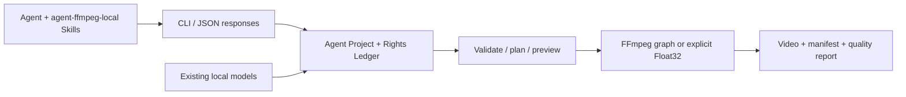

# agent editor kit

**Local video editing CLI for Agents.** Editable JSON timelines, explicit contracts and actual render evidence.

[简体中文](README.md) · [繁體中文](README.zh-TW.md) · [English](README.en.md) · [Repository](https://github.com/copypasteltd/agent-editor-kit) · [Download parts](docs/releases/v0.1.0-alpha.3/artifacts) · [Install](docs/releases/v0.1.0-alpha.3/USAGE.md) · [Documentation](docs/README.md)

**Current local release: v0.1.0-alpha.3, CLI 0.1.2, 500 built-in looks.** Installed on E:, with all 17 local Skills updated. Download every binary part and reassemble the ordinary ZIP. No new GitHub Release was created; the tested package is committed with this repository.


[500 numbered names and detailed effects](docs/local/LOOK_PRESETS.en.md) · [Functional filter README](docs/local/FILTERS.en.md) · [Original video](docs/assets/look500-20261024-r1/original.mp4) · [Verification](docs/validation/LOOK500_20261024.md).

## Architecture and operation



The shipped implementation is a Python CLI, Agent Project schema and FFmpeg, with an explicitly selected native Float32 processing path. Concat informed earlier research; this release is this repository's Python implementation. Reused OpenFilm subtitle segmentation, frame-clock and HTML motion/template modules retain their provenance and licenses. No OpenFilm online service is required.

An Agent uses Skills to turn a brief into an edit plan, reads `capabilities` and `schema show`, then invokes the CLI. Projects retain assets, authored sequences, a Rights Ledger, snapshots and operations. Outputs include manifests and quality reports. The default renderer uses the existing FFmpeg graph. `settings.pixel_pipeline.engine = "float32-native-v1"`, with complete source/signal/budget declarations, explicitly selects its advertised subset; unsupported effects must be refused. The two paths have different coverage.

## Included capabilities

| # | Capability | Entry point | Release boundary |
|---|---|---|---|
| F01 | Projects, transactions, snapshots, recovery, relinking | `project` / `media relink` | Local projects with operation evidence |
| F02 | Ingest, probes, scenes/silence, thumbnails/waveforms | `media ingest/understand/prepare` | Local files; semantic tasks need explicit adapters |
| F03 | Multitrack, trim/split, range and linked edits, nesting | `timeline compose/edit` | Integer author ticks, clocks, locks and transactions |
| F04 | Keyframes, scale/pan/rotation, camera presets, effects | `effects list` + edit JSON | Advertised properties; not CapCut's full preset catalog |
| F05 | Source-handle transitions, speed curves, reverse, freeze | Timeline contracts | Implemented default-render combinations; newer Float32 transition candidates excluded |
| F06 | Masks, composition, color, HSL, LUT/1D shapers | Effects / `lut` / `surface` | Explicit Float32 source/working/delivery signals; no complete HDR/ICC claim |
| F07 | Subtitles, segmentation, word highlighting, HTML motion | `subtitle` / `motion` / timeline | Some commands need existing Node/Chromium |
| F08 | Audio extraction/mixing/buses/ducking, multicam sync | `audio` / audio tracks / `media multicam` | Author audio explicitly; perceptual audio review is separate |
| F09 | Template variables/batches, fragments, asset indexing | `template` / `fragment` / `library` | Existing local assets; no subscription library |
| F10 | Optional ASR/OCR/tracking/matting/repair adapters | Model registration and related commands | Weights and large inference runtimes are not bundled |
| F11 | Frame/range previews, queues, cancellation, scopes | `preview` / `queue` / `quality` | Budgets are not peak-RSS or real-time guarantees |
| F12 | Project packages, JSON, OTIO, MLT/plain draft exchange | `convert import/export` | Format-specific Exact/Approximate/Unsupported/Failed reports |
| F13 | 500 named offline looks (alpha.3) | `look list/inspect/preview/apply` | Per-look measurements, preview, source and MIT/CC0/CC-BY-SA license; creative SDR RGB |

Use bundled `capabilities`, `schema show` and `COMMAND --help` for the exact supported contract. Plain draft adapters operate on existing authorized local JSON, do not run CapCut, and do not promise lossless compatibility with every proprietary effect. [Detailed manual](docs/releases/v0.1.0-alpha.1/USAGE.md).


## Installed looks and local Skills

500 distinct numeric looks: 100 existing MIT, 267 Natron CC-BY-SA and 133 FreshLUTs CC0. The count includes related original curve variants, not 500 unrelated families; runtime strengths and format copies are excluded. All names/IDs, actual gray/skin/RGB effects, scenes, trial strength, source/license and PNG/video are listed in the complete manual.

| Category | Count |
|---|---:|
| `cinema` | 39 |
| `creative` | 135 |
| `landscape` | 10 |
| `infrared` | 2 |
| `lomography` | 5 |
| `film-bw` | 37 |
| `film-negative` | 112 |
| `film-slide` | 41 |
| `instant-consumer` | 54 |
| `instant-pro` | 65 |

Select with `look list`, read measured descriptions and license with `inspect`, compare previews, then apply to an explicit clip or global scope. Replace is default; append is explicit. Creative encoded SDR RGB only; LUTs do not generate grain, glow or beauty effects. Per-resource terms and project evidence are preserved.

```powershell
$avk = 'E:/dev/sandbox/AI广告剪辑/skills/agent-ffmpeg-local-editor/scripts/run.ps1'
& $avk look list --query '黑白'
& $avk look list --query 'CC0-1.0'
& $avk look inspect --id fl-0000001-action-magenta-01
& $avk look preview --id fl-0000001-action-magenta-01 --output 'E:/video-work/magenta-preview.png' --strength 0.65
& $avk look apply --project 'E:/video-work/my-ad' --id fl-0000001-action-magenta-01 --global --strength 0.65 --dry-run
& $avk look apply --project 'E:/video-work/my-ad' --id fl-0000001-action-magenta-01 --global --strength 0.65
```

**`$agent-ffmpeg-local-editor`** · 17 Skills · `E:/dev/sandbox/AI广告剪辑/local/agent-ffmpeg/v0.1.0-alpha.3/installed/`. [Install and Skill details](docs/local/INSTALLATION.md).

## Installation

Native Windows x64 + existing CPython 3.13 and FFmpeg/ffprobe. Eight pinned wheels include the app, NumPy and Pillow. Installation is offline, creates no virtual environment and leaves global site-packages unchanged. Python, FFmpeg and model runtimes are separate prerequisites.

[Download all parts and read assembly/install commands](docs/releases/v0.1.0-alpha.3/USAGE.md). [SHA256SUMS](docs/releases/v0.1.0-alpha.3/artifacts/SHA256SUMS.txt). Hashes verify content, not publisher identity.

## Minimal workflow

```powershell
$avkPython = 'C:/Python313/python.exe'
$avkRun = 'E:/tools/aek-alpha3-installed/run.py'
$avkProject = 'E:\video-work\first-ad'
& $avkPython -I -S -B -X utf8 $avkRun project init $avkProject --name 'First ad'
& $avkPython -I -S -B -X utf8 $avkRun media ingest --project $avkProject --input E:\media\product.mp4
# Inspect returned data.asset.id, then put that ID in changes.json.
& $avkPython -I -S -B -X utf8 $avkRun timeline compose --project $avkProject --input E:\video-work\changes.json
& $avkPython -I -S -B -X utf8 $avkRun validate --project $avkProject
& $avkPython -I -S -B -X utf8 $avkRun preview frame --project $avkProject --frame 0
& $avkPython -I -S -B -X utf8 $avkRun render --project $avkProject --output E:\video-work\first-ad\renders\ad.mp4
& $avkPython -I -S -B -X utf8 $avkRun quality check --project $avkProject --input E:\video-work\first-ad\renders\ad.mp4
```

Ingested rights default to unverified. Provide local license/provenance evidence before a commercial delivery, then run `rights check` and `render --publish`. **`--publish` is a local rights gate; it does not upload media.** The source and edit JSON in this example are supplied by you. [Reproducible cases](docs/releases/v0.1.0-alpha.1/CASES.md) include generated inputs, actual IDs, all commands and complete responses.

Agents must inspect the process exit code plus JSON `ok`, `status`, `errors`, `warnings` and `artifacts`. A dry plan is not a render. Use `--idempotency-key` only for commands implementing it; command-specific semantics remain authoritative.

## Real cases

| Case | Input → output | Complete artifacts |
|---|---|---|
| C01 / FIELD vertical ad | Original fictional-product cards + synthetic pulse → 6 s, 360×640 MP4 | [Input](docs/assets/release-v0.1.0-alpha.1-r2/input.mp4) · [Output](docs/assets/release-v0.1.0-alpha.1-r2/field.mp4) · [GIF](docs/assets/release-v0.1.0-alpha.1-r2/field.gif) · [Edit JSON](docs/validation/evidence/release-v0.1.0-alpha.1-r2/changes.json) · [Response](docs/validation/evidence/release-v0.1.0-alpha.1-r2/render.stdout.json) |
| C02 / Template variant | Parameterized template + replacement card → 3 s variant | [Template](docs/validation/evidence/release-v0.1.0-alpha.1-r2/template.json) · [Variables](docs/validation/evidence/release-v0.1.0-alpha.1-r2/variables.json) · [Output](docs/assets/release-v0.1.0-alpha.1-r2/variant.mp4) · [GIF](docs/assets/release-v0.1.0-alpha.1-r2/variant.gif) |
| C03 / Float32 color chain | Dated V112 synthetic source → 1D LUT/shaper and 3D LUT | [Input](docs/assets/float-shaper-20261023-installed-r1/original.mp4) · [Output](docs/assets/float-shaper-20261023-installed-r1/edited.mp4) · [Comparison](docs/assets/float-shaper-20261023-installed-r1/formal-comparison.gif) · [Receipt](docs/validation/evidence/float-shaper-20261023-lab/installed-r1/verification.json) |
| C04 / Delivery and refusal | Package export/import/validation and a rejected remote reference | [Export](docs/validation/evidence/release-v0.1.0-alpha.1-r2/export-package.stdout.json) · [Restored validation](docs/validation/evidence/release-v0.1.0-alpha.1-r2/restored-validate.stdout.json) · [Refusal](docs/validation/evidence/release-v0.1.0-alpha.1-r2/remote-refused.stdout.json) |


These new assets are locally generated graphics and synthetic audio, with zero new model inferences. C03 is dated historical evidence. GIFs carry no sound; automated decoding, static review, continuous playback and human listening are reported separately. [Provenance, hashes, inputs and reproduction](docs/releases/v0.1.0-alpha.1/CASES.md).

## 17 installed-release Agent Skills

| # | Skill | Purpose |
|---|---|---|
| 1 | `$agent-ffmpeg-local-editor` | Route editing work, initialize projects and deliver outputs |
| 2 | `$agent-ffmpeg-local-timeline` | Author timelines, keyframes, camera moves, transitions and nesting |
| 3 | `$agent-ffmpeg-local-quality` | Review pixels, masks, scopes and render evidence |
| 4 | `$agent-ffmpeg-local-project-ops` | Manage snapshots, recovery, relinking and render queues |
| 5 | `$agent-ffmpeg-local-local-policy` | Audit local-only execution and remote references |
| 6 | `$agent-ffmpeg-local-rights-ledger` | Record and check media, font, model and template rights |
| 7 | `$agent-ffmpeg-local-local-models` | Register and run existing offline model adapters |
| 8 | `$agent-ffmpeg-local-video-understand` | Analyze scenes, silence, frame evidence and transcripts |
| 9 | `$agent-ffmpeg-local-template-library` | Apply templates, index assets and reuse edited clip groups |
| 10 | `$agent-ffmpeg-local-long-to-short` | Turn talks or lessons into reviewed short clips |
| 11 | `$agent-ffmpeg-local-screen-demo` | Edit screen demos with action anchors and zooms |
| 12 | `$agent-ffmpeg-local-reference-remake` | Rebuild reference pacing and layout using replacement assets |
| 13 | `$agent-ffmpeg-local-ffmpeg` | Perform general local FFmpeg media operations |
| 14 | `$agent-ffmpeg-local-video-edit` | Trim, concatenate, resize and compress local media |
| 15 | `$agent-ffmpeg-local-ad-creative` | Plan ad copy, hooks and creative variants |
| 16 | `$agent-ffmpeg-local-video-content-strategist` | Plan content direction, scripts and channel strategy |
| 17 | `$agent-ffmpeg-local-campaign-analytics` | Analyze supplied campaign data |

```powershell
.\register-agent-ffmpeg-local-skills.ps1
```

Install the local release before registration. Windows junctions expose Skill sources on E: to Codex while preserving unrelated conflicts. New names become discoverable on the next turn. Legacy `video-cut-` entries and published ZIP assets remain unchanged; the new namespace ships with this main-branch update. Skills provide guidance without extra models or subscription assets. [Current Skill details and setup](docs/local/INSTALLATION.md) · [Original release-name catalog](docs/releases/v0.1.0-alpha.1/SKILLS.md).

## Verification

| ID | Check | Observed result | Evidence and limits |
|---|---|---|---|
| R01 | Baseline full regression | **2,930 passed; 0 skipped**, 6991.508 s | [2026-10-23 receipt](docs/validation/evidence/float-shaper-20261023-lab/full-r1.json); this release rechecks identical 331 frozen inputs, rather than claiming a new full run  Frozen alpha.1 scope only; the new code has the separate checks below. |
| R02 | Previous V112 fresh installation | **118 methods; 197 product resources** | [Receipt](docs/validation/evidence/float-shaper-20261023-lab/installed-r1/verification.json); overlaps the full suite, not additive |
| R03 | Newly rebuilt and installed release | Eight pinned wheels, isolated `-I -S` launch | [Release gate](docs/validation/evidence/release-v0.1.0-alpha.1-r2/release-verification.json); Windows/CPython 3.13 x64 |
| R04 | New ad and template cases | Real inputs, encoded outputs, GIFs, responses and package round trip | [New case receipt](docs/validation/evidence/release-v0.1.0-alpha.1-r2/verification.json); synthetic media, zero new inference |
| R05 | Local policy refusal | Nonzero exit and structured error for remote provenance | [Actual response](docs/validation/evidence/release-v0.1.0-alpha.1-r2/remote-refused.stdout.json) |
| R06 | Documentation UI and recording | Desktop/mobile captures, interaction checks, log replay | [Browser receipt](docs/validation/evidence/release-v0.1.0-alpha.1-r2/browser-verification.json); documentation UI, not an editor GUI or live terminal recording |
| R07 | Skills and links | All 17 entry formats and release-document local links checked | [Gate](docs/validation/evidence/release-v0.1.0-alpha.1-r2/release-verification.json); format validation is not behavioral quality proof |
| R08 | Preserved failed first case run | Incorrect relative output path in the case driver | [Failure](docs/validation/evidence/release-v0.1.0-alpha.1-r1/failure.json); corrected to an absolute in-project path before rerunning |
| R09 | Public release and download verification | **GitHub prerelease published; all six downloaded assets match local SHA-256** | [Publication receipt](docs/validation/evidence/release-v0.1.0-alpha.1-r2/publication.json) · [Actual native installation receipt](docs/validation/evidence/release-v0.1.0-alpha.1-r2/installation-receipt.json); 2026-10-24 local date |
| R10 | Permanent local installation on E: | **Pinned ZIP verified; eight native offline wheels installed** | [Installation receipt](docs/validation/evidence/local-install-20261024-r1/installation/installation.json); 2026-10-24, 1,430 files / 81,845,972 bytes, no virtual environment |
| R11 | New namespace and actual Skill execution | **17 Skills registered/validated; eight launcher commands: seven successes, one expected refusal** | [Skill receipt](docs/validation/evidence/local-install-20261024-r1/skills/verification.json); Codex junction calls the installed release, Chinese/space path render is byte-identical to direct execution; not a full Agent behavior benchmark |
| R12 | Fresh installed-case reproduction | **28 commands: 27 successes, one expected refusal; ad/template renders and project-package round trip** | [Case receipt](docs/validation/evidence/local-install-20261024-r1/cases/verification.json) · [GIF](docs/assets/local-install-20261024-r1/field.gif) · [Static review](docs/validation/evidence/local-install-20261024-r1/review.json); zero new inference, no continuous playback or human listening; separate from historical suite counts |
| R13 | Installed filter/LUT capability review | **46 catalog entries; registration help lists four extensions** | [Current query receipt](docs/validation/evidence/filter-capabilities-20261024-r1/verification.json) · [Workflow and limits](docs/local/FILTERS.md); 2026-10-24, catalog/help/source review only, zero new renders; 1D shaper requires explicit Float32, with dated render evidence linked separately |
| R14 | Historical alpha.1 look inventory | **No Leica/Fuji/Kodak named presets; zero LUT assets in the installed app** | [Inventory](docs/validation/evidence/filter-library-20261024-r1/inventory.json); 2026-10-24, excludes project assets/test fixtures; nine stylize operators are not a finished look library; zero new renders |
| R15 | Open LUT/look source research | **Ten projects, captured stars/commits/trees/notices** | [Ranking and assessment](docs/research/OPEN_LOOK_LIBRARY_20261024.md) · [Snapshots](docs/validation/evidence/lut-research-20261024-r1/upstreams.json); 2026-10-24, file counts are not deduplicated, cleared or accepted looks |
| R16 | Installed-release community MIT CUBE probe | **13 successful CLI calls in the final workflow; three seconds/36 actual frames** | [Verification and warnings](docs/validation/evidence/lut-research-20261024-r1/probe/verification.json) · [GIF](docs/assets/lut-research-20261024-r1/comparison.gif); 2026-10-24, 0.65 strength, decode/quality/silent PCM checks pass, approximation warning and prior check failures retained; synthetic input/first-frame inspection, no continuous playback or natural-footage acceptance, no integrated catalog/Hald conversion |
| R17 | Alpha.2 look catalog and targeted regressions | **100 distinct transforms; 83 methods passed** | [Tests](docs/validation/evidence/look-presets-20261024-r1/unit-tests.txt); catalog/assets, native-depth Hald axes, apply semantics, transactions, package portability, LUT and offline installer regressions; no new full 2,930-method run |
| R18 | New local package and registered Skills | **Eight wheels installed; 17 Skills validated; 14 real launcher calls: 13 successes + one expected refusal** | [Install](docs/validation/evidence/look-presets-20261024-r1/install/installation.json) · [Skill receipt](docs/validation/evidence/look-presets-20261024-r1/skills/verification.json); E: installation, real look preview/apply/render, retained alpha.1 |
| R19 | All-100 installed native rendering | **100 previews + 100 videos; 425 isolated CLI calls, two expected refusals** | [Receipt](docs/validation/evidence/look-presets-20261024-r1/installed/verification.json) · [GIF](docs/assets/look-presets-20261024-r1/motion-comparison.gif); every video decodes to 12 frames / 1 s / 480×300; 100 distinct preview/frame hashes; upstream comparisons and package first-frame pixels checked; synthetic inputs, no natural-footage/listening acceptance |
| R20 | New repository, product name and three README languages | **Complete Simplified Chinese / Traditional Chinese / English READMEs; push destination and documentation checks passed** | [Maintenance](docs/maintenance/REPOSITORY_AND_READMES.md) · [Receipt](docs/validation/evidence/readme-rebrand-20261024-r1/verification.json); 2026-10-24, documentation links, code blocks, numbered coverage and push configuration only; zero new renders; historical package names/hashes explained in the maintenance record |
| R21 | All-100 detailed look documentation and numerical analysis | **100 profiles; 100 installed LUTs compared with 100 historical native PNGs; two palette charts** | [Detailed profiles (Chinese)](docs/local/LOOK_PRESET_DETAILS.md) · [Analysis and checks](docs/validation/evidence/look-profiles-20261024-r1/verification.json); 2026-10-24, 43,200,000 channel comparisons, maximum one byte-code difference; scene/strength guidance is advisory; zero new videos, natural-footage reviews or product regressions |
| R22 | 500-look catalog and focused regression | **500 unique signatures/previews; 90 tests passed** | [Regression](docs/validation/evidence/look500-20261024-r1/regression-policy.json) · [Sources](docs/validation/evidence/look500-sources-20261024-r1/compilation.json); initial package-marker failure corrected; full historical suite not rerun |
| R23 | Installed 500-look real execution | **1,000 installed in-process CLI calls; 500 PNGs + 500 native filter videos; 25 selected project renders** | [Exact scope](docs/validation/evidence/look500-20261024-r1/installed/verification.json) · [GIF](docs/assets/look500-20261024-r1/motion-comparison.gif); each native video decodes 12 frames; 500 upstream comparisons; synthetic input, no natural-footage/listening acceptance |
| R24 | New package, Skills and three-language manual | **17 Skill formats; 24 launcher calls; 500 detailed profiles per language** | [Installation](docs/validation/evidence/look500-20261024-r1/install/installation.json) · [Skills](docs/validation/evidence/look500-20261024-r1/skills/verification.json) · [Docs](docs/validation/evidence/look500-20261024-r1/docs-verification.json); native E: install, real new-license previews/renders, one expected refusal; old packages retained |

## Limitations and next milestones

This alpha supports reproducible local workflows in the stated environment. Full CapCut effect/transition/library coverage, broad natural-media picture and audio quality, HDR/ICC, long-form peak memory and interactive performance, other platforms/ABIs and universal lossless draft compatibility remain unaccepted.

Next priorities are renderer capability consistency, natural-media playback and perceptual review, performance/cancellation/recovery, then broader templates and model coverage. R113/R114 Float32 transition/runtime-closure candidates and later adjustment experiments are excluded. [Release scope, gates, risks and roadmap](docs/releases/v0.1.0-alpha.1/RELEASE.md).

## Documentation, contributions and licensing

- [Manual](docs/releases/v0.1.0-alpha.1/USAGE.md), [Skills](docs/local/INSTALLATION.md), [cases](docs/releases/v0.1.0-alpha.1/CASES.md), [release notes](docs/releases/v0.1.0-alpha.1/RELEASE.md), and [all documentation](docs/README.md). Release-specific guides are bilingual; older research/specifications are primarily Chinese.
- [Product baseline](docs/产品需求与开发路线基线_2026-10-12.md), [system architecture](docs/architecture/系统边界与模块契约_v0.1_2026-10-13.md), and [machine-readable schema](docs/specs/agent-project.schema.json).
- [Complete historical numbered verification log](docs/releases/v0.1.0-alpha.1/history/README.zh.pre-release.md) and [historical index](docs/releases/v0.1.0-alpha.1/history/docs-index.pre-release.md). Dated counts are retained rather than added together.
- Original code/documentation is [MIT licensed](LICENSE). Vendored projects, Skills, models, fonts and media retain their separate terms. [Third-party notices](docs/releases/v0.1.0-alpha.1/THIRD_PARTY.md). The Rights Ledger records evidence and gates work; it does not automatically establish legal clearance.
- Issues should include version, a minimal shareable project, actual command/error, manifests and tool versions. Changes maintain `main`, all three READMEs and evidence. See the manual for the native frozen-regression entrypoint.
