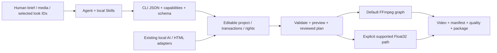

# agent editor kit

**面向 Agent 的开源、本地视频编辑 CLI。** 从结构化编辑计划到可编辑工程、预览、成片、质量报告和可恢复交付；保留每一步的真实输出与来源。

[简体中文](README.md) · [繁體中文](README.zh-TW.md) · [English](README.en.md) · [Repository](https://github.com/copypasteltd/agent-editor-kit) · [Docs](docs/README.md)

**公开发行版本：v0.1.0-alpha.3 预发布版 · CLI 0.1.2 · 500 套风格 · 1 个统一 Skill / 17 项内部模块。** 提供完整运行 ZIP、Agent kit、可选图册及校验摘要。运行内核保持原已验包字节；新增可移植安装和可执行示例。完整剪映等价仍是开发目标，尚未验收。

本页包含完整功能模块、服务与依赖、安装与使用逻辑、Skill 输入输出、真实案例和核验表。长篇原始验收日志继续留档，功能说明与案例入口恢复到首页。


<!-- unified-skill-registration -->

**只注册一个入口：`$agent-ffmpeg-local-editor`。** 当前本机 GPU 扩展使用 [r8 Skill kit](docs/skills/agent-editor-kit-community-unified-skill-r8.zip) 与匹配的[本地运行包/模型安装流程](docs/product/COMMUNITY_LOCAL_DELIVERY.md)，17 项内部模块按需加载。历史 r1 kit 继续匹配下方保持原版的公开 alpha.3 运行包。

<!-- /unified-skill-registration -->

<!-- community-materials-gpu -->

**本机新增已安装扩展：CLI 0.1.9，GPU 配音/翻译与 359 项内置开源资源。** 公开 alpha.3 附件保持原版。外层只指定 `$agent-ffmpeg-local-editor`；本机登记 GPU 包后默认优先 GPU，明确返回实际设备/回退原因，保留 CPU 兼容。

[完整流程与边界](docs/product/COMMUNITY_MATERIALS.md) · [逐项素材目录](docs/product/COMMUNITY_MATERIAL_CATALOG.md) · [103 音色与实际试听范围](docs/product/COMMUNITY_VOICES.md) · [CPU 实测](docs/validation/evidence/community-materials-20261025-r1/cpu/verification.json) · [GPU 实测](docs/validation/evidence/community-materials-20261025-r1/gpu/verification.json)。

| 扩展编号 | 已实现 | 边界 |
|---|---|---|
| F44 / M01 | 44 首 BGM、85 个短乐、228 个独立音效、2 个 OFL Noto 字体 | 分别保留来源/许可，不是商业素材订阅库 |
| F45 / M02 | 中英配音、103 具名音色、文本文件/语速/WAV | 至少 7 个音色有真实生成，未完成人类听审，不克隆、不宣称全音色听审 |
| F46 / M03 | 本地双向翻译、双语 SRT、显式术语表 | cue 顺序/毫秒保留，语义/发音仍需校对 |
| F47 / G01 | CUDA 配音/翻译、auto/cpu/cuda、显存预检 | RTX 3060 实测，严格 CUDA/CPU 回退分明，NVIDIA 依赖许可另列 |
| F48 / M04–M05 | 真实 BGM 截取/循环/淡入淡出、配音混合和闪避 | 保留原分轨，不代表作曲或自动接缝修复 |
| F49 / C01 | 原生窗口/屏幕/区域/摄像头/麦克风采集 CLI，CPU/NVENC 编码和取消 | 实测自身测试窗口；相机/麦克风、联合音画同步及长录制待验 |
| F50 / V01 | 离线图文语义索引、中文/英文/参考图查询、预览与可编辑时间点，auto/cpu/cuda | 小型静态图集实测；否定/库外拒识/自然动作/音频推荐仍未完成 |
| F51 / D01 | 中英字幕翻译、批量完整配音、实际 WAV 时窗、显式音色/混音和原子入轨 | 仅普通 SRT / 中英；cue 级时间，语义/听感/口型未验收 |

CPU 46 条、GPU 15 条为本轮独立实测。12 秒真实成片已完整解码、工程往返。未确认发布权利的生成配音不随公共页面再分发，本地原始分轨/完整成片见交付记录。人工听审与完整剪映等价仍未完成。

<!-- /community-materials-gpu -->


<!-- subtitle-dubbing-r1 -->

## 本机 CLI 0.1.9：字幕翻译、完整配音与可编辑交付

`dub subtitles` 联合 OPUS 中英翻译、Kokoro 批量配音、实际 WAV 时窗检查和原子工程提交。一次 voice batch 只初始化一次模型；逐段保留原文、译文、完整声音、所有语速尝试及原 cue 时间。默认超窗拒绝；显式加速会完整重生成，最多三次，不截台词。

先按[完整流程](docs/product/SUBTITLE_DUBBING.md)准备源 SRT、字体及明确的 audio/subtitle 目标轨道，再运行：

```powershell
& $avk dub subtitles --project $project --input $sourceSrt --from en --to zh-Hans --device auto --fit reject --apply --audio-track-id track_audio_1 --subtitle-track-id captions --font-asset-id caption_font --dry-run
& $avk dub subtitles --project $project --input $sourceSrt --from en --to zh-Hans --device auto --fit reject --apply --audio-track-id track_audio_1 --subtitle-track-id captions --font-asset-id caption_font
& $avk validate --project $project
```

安装版 GPU 22 次 CLI、CPU 另 9 次、真实统一 Skill 另 9 次，分别留档；27 项安装专项、122 项 CLI 回归通过，另验运行中取消/超时及三个强制中断边界。19 秒/570 帧成片的工程往返 PCM/解码 RGB 相同。第三段实际译文“以秒数创建另一个版本 。”仍不自然，原结果保留；没有据技术通过宣布语义、听感、逐字或口型达标。

[实际结果与失败](docs/validation/字幕翻译配音联合流程实测_2026-10-25.md) · [C18 / 原输入、实际输出、工程与 GIF](docs/product/CASES.md#c18-subtitle-dubbing)。下图是实际成片的无声诊断；配音权利未核验，完整音画和可编辑包保留本地。


<!-- /subtitle-dubbing-r1 -->

<!-- ctc-activity-r1 -->

## 本机 CLI 0.1.8：保留原时码的词活动边界

显式 `--boundary-mode activity --granularity whitespace` 使用实际 PCM 改善有静音分隔的词起止，并保留原 CTC 字符/词时间。须先明确登记已有原生 CTC Python/权重；Kokoro/OPUS 包不提供此模型。默认 `ctc` 不变，CPU/CUDA 分别选择。

开发和固定安装版分别执行 6 组实际 GPU 推理：最大误差 4.3125–4.9375ms，原 66.6667ms 门槛不变；v1/v2 失败保留。受控合成词块不证明自然连续语音、中文、歌词或重叠声音精度，G15 仍开放。

```powershell
# Existing project/source and explicitly registered native CTC adapter required.
& $avk subtitle align --project $project --asset-id speech --adapter-id ctc --transcript $text --output assets/alignment/words.json --granularity whitespace --boundary-mode activity --dry-run
& $avk subtitle align --project $project --asset-id speech --adapter-id ctc --transcript $text --output assets/alignment/words.json --granularity whitespace --boundary-mode activity
```

[Workflow / 使用流程](docs/product/CTC_ACTIVITY_ALIGNMENT.md) · [Actual checks / 实测](docs/validation/CTC声学边界实测_2026-10-25.md) · [C17 / source, output and package](docs/product/CASES.md#c17-ctc-activity).


<!-- /ctc-activity-r1 -->

<!-- job-recovery-r1 -->

## 本地 CLI 0.1.7：原生中断恢复与保留规则

新四轨任务记录持久化工作目录与输出意图；共享 helper 管理原生子进程树。恢复先回滚待提交元数据，再检查归属：仅回收匹配身份/摘要且未引用的输出，保留提交后的四轨资产、活跃/变化/未知项和旧非管理缓存。

```powershell
& $avk project recover --project $project --cleanup-jobs --dry-run
& $avk project recover --project $project --cleanup-jobs
& $avk validate --project $project
```

已在真实安装版的 worker 启动、首个输出发布、元数据待提交与已提交四个位置强制结束 owner 并恢复；其中三个位置仅注入观察暂停，真实模型与恢复代码未替换。旧缓存、其他模型路径、断电/磁盘不足/长并发仍未全面验收，G33 不关闭。

[Workflow / 完整使用流程](docs/product/JOB_RECOVERY.md) · [Actual validation / 实测](docs/validation/任务中断恢复实测_2026-10-25.md) · [C16 / actual output](docs/product/CASES.md#c16-job-recovery)

<!-- /job-recovery-r1 -->

<!-- independent-four-stems-r1 -->

## 本地 CLI 0.1.6：独立四轨分离与可编辑混音

`audio separate-stems` 保留鼓、贝斯、其他乐器、人声四个独立 HDemucs 预测；`--apply` 新建四个资产与四条音轨。auto 默认优先可用 NVIDIA GPU，显式 CPU/CUDA 路径分别记录实际设备。先按下方完整流程登记已有原生 Torch/TorchAudio 与权重；基础 ZIP 和小型 kit 不包含它们。

[Workflow / 完整流程](docs/product/FOUR_STEM_SEPARATION.md) · [Validation / 全部实测与失败](docs/validation/独立四轨音源分离实测_2026-10-25.md) · [Matching installation / 安装包](docs/product/COMMUNITY_LOCAL_DELIVERY.md)

```powershell
# Existing project/source asset and explicitly registered four-source adapter required.
& $avk audio separate-stems --project $project --asset-id music --adapter-id music_four --prefix edit --apply --dry-run
& $avk audio separate-stems --project $project --asset-id music --adapter-id music_four --prefix edit --apply --device auto --timeout-seconds 600
& $avk validate --project $project
```

开发源 18 次、安装版另 18 次、真实统一 Skill 另 11 次 CLI 已执行；受控 CPU/GPU 改善门槛和四轨混音/工程往返通过。other 绝对 SI-SDR 仅约 1.71dB；自然音乐、去混响和人工听审未验收。实验权重权利 unverified，音频/工程包仅留本地；下图是原创数值图的真实渲染无声诊断，不能当试听。


<!-- /independent-four-stems-r1 -->

<!-- semantic-retrieval-r1 -->

## 本地 CLI 0.1.5：按描述或参考图检索素材

使用已有离线 SigLIP2 模型，对选定图片和视频采样帧建立向量索引；按中文、英文或本地参考图返回候选预览、源时间和可编辑引用。仍使用一个 `$agent-ffmpeg-local-editor`。

基础 ZIP 不含 Torch 或约 1.5GB 权重。先按本地交付配置已有原生环境，读取 runtime.json 的 semantic_config，明确登记到工程，再建立索引；不隐式下载。

[Workflow / 登记与命令](docs/product/SEMANTIC_RETRIEVAL.md) · [Validation / 实测](docs/validation/离线语义检索实测_2026-10-25.md) · [All 20 queries / 全部结果](docs/assets/semantic-20261025-r1/all-query-results.png)

```powershell
# Existing project, registered local adapter and ingested source IDs required.
& $avk semantic index --project $project --index-id campaign-v1 --adapter-id siglip2 --all-visual-assets --sample-interval-seconds 2 --device auto
& $avk semantic search --project $project --index-id campaign-v1 --query '木桌上的一杯咖啡' --limit 5 --device auto
& $avk semantic search --project $project --index-id campaign-v1 --image $referenceImage --kind image --device cpu
```

在预先冻结的小样本中，开发版 CPU/GPU 的 16 条常规查询首选及 mean asset recall@3 均为 1.0；安装版真实 Skill 另验相同 20 条文本与 CPU 参考图。中文否定误选咖啡，两条库外鲨鱼查询仍返回草地；不是可靠拒识、动作理解或自动导演。


<!-- /semantic-retrieval-r1 -->

<!-- native-capture-r1 -->

## 本地 CLI 0.1.4：新增采集与音频修复

新包与原有 GPU 配音/翻译、359 项素材兼容。采集的 [完整流程与边界](docs/product/NATIVE_CAPTURE.md)、[实际 CPU MP4](docs/assets/native-capture-20261025-r1/cpu-window.mp4)、[GPU MP4/GIF](docs/assets/native-capture-20261025-r1/preview.gif) 和 [首批补齐证据](docs/validation/补齐实施首批实测_2026-10-25.md) 已提供。先按[本地安装流程](docs/product/COMMUNITY_LOCAL_DELIVERY.md)配置对应运行包，再通过同一个 Skill 调用。R3 精确相同/反相/静音声道关系已修复；一般立体声相位、4ms 极短窗音高与自然听审继续开放。

```powershell
& $avk project init './workspace/capture-demo'
& $avk capture devices
& $avk capture record --project './workspace/capture-demo' --kind window --window-title 'Your application title' --duration-seconds 5 --encoder auto --asset-id take-01 --dry-run
& $avk capture record --project './workspace/capture-demo' --kind window --window-title 'Your application title' --duration-seconds 5 --encoder auto --asset-id take-01
& $avk validate --project './workspace/capture-demo'
```


<!-- /native-capture-r1 -->

## 公开 alpha.3：下载并跑通第一条视频

**环境：Windows x64、已有 CPython 3.13 x64、FFmpeg/ffprobe 在 PATH。** 基础流程不需要模型、Node 或浏览器；安装不使用 Docker、WSL、虚拟环境或全局 pip。Python 路径按实际安装位置修改。

| 下载附件 | 用途 |
|---|---|
| [agent-editor-kit-v0.1.0-alpha.3-cp313-win_amd64.zip](https://github.com/copypasteltd/agent-editor-kit/releases/download/v0.1.0-alpha.3/agent-editor-kit-v0.1.0-alpha.3-cp313-win_amd64.zip) | 必需：应用和 8 个固定 wheel，约 196 MB。 |
| [agent-editor-kit-unified-skill-r1.zip](https://github.com/copypasteltd/agent-editor-kit/raw/refs/heads/main/docs/skills/agent-editor-kit-unified-skill-r1.zip) | 必需：离线安装入口、1 个统一 Skill、17 项内部模块、注册脚本与可运行示例。 |
| [agent-editor-kit-v0.1.0-alpha.3-gallery.zip](https://github.com/copypasteltd/agent-editor-kit/releases/download/v0.1.0-alpha.3/agent-editor-kit-v0.1.0-alpha.3-gallery.zip) | 可选：原图、500 套真实样例、离线选型页和客户对照板资源。 |
| [SHA256SUMS.txt](https://github.com/copypasteltd/agent-editor-kit/releases/download/v0.1.0-alpha.3/SHA256SUMS.txt) | 核对下载文件；安装入口还会强制验证运行 ZIP 哈希。 |

**1. 安装。** 将两个必需 ZIP 下载到 `E:/Downloads/`，选择新的工具目录；保留运行 ZIP 原样，由安装入口校验并解包。

```powershell
$avkPython = 'C:/Python313/python.exe'
$avkHome = 'E:/tools/agent-editor-kit-unified'
$avkArchive = 'E:/Downloads/agent-editor-kit-v0.1.0-alpha.3-cp313-win_amd64.zip'
Expand-Archive -LiteralPath 'E:/Downloads/agent-editor-kit-unified-skill-r1.zip' -DestinationPath $avkHome
Set-Location $avkHome
& $avkPython -I -B -X utf8 ./install.py --archive $avkArchive
```

**2. 加载 Skill 并检查环境。** 安装响应 `ok: true` 后注册；脚本保留同名冲突目录。已有本仓库本机安装的用户可继续使用原入口。客户端尚未发现 Skill 时，重新打开会话。

```powershell
powershell.exe -NoProfile -ExecutionPolicy Bypass -File ./register-agent-ffmpeg-local-skills.ps1
$avk = Join-Path $avkHome 'skills/agent-ffmpeg-local-editor/scripts/run.ps1'
& $avk version
& $avk doctor
& $avk capabilities
& $avk schema show
```

**3. 跑通示例。** 无需额外素材；随包 CC0 图片与合成音频经过实际剪辑、运镜、滤镜、预览、渲染、质检及工程包导入导出。输出目录必须尚不存在。

```powershell
& $avkPython -I -B -X utf8 ./run-example.py --output 'E:/video-work/aek-first-demo'
```

主要产物：`project/project.json` 可编辑工程、`project/renders/demo.mp4`（6 秒、360×640、30 fps、180 帧及音轨）、`demo.aevpkg.zip`、`restored/`、逐次响应和 `verification.json`。此示例核验安装与功能链路；自然画质和听审仍需独立验收。

**4. 用 Agent 编辑自己的素材。** 明确素材路径、目标、时长、画幅及音轨；Agent 先检查真实能力和来源，再形成时间线、预览和交付。

```text
$agent-ffmpeg-local-editor 用 E:/media/product.mp4 制作 15 秒竖屏广告。
先检查能力和素材，明确保留原声音轨，展示滤镜候选；生成预览、成片、质检报告和可编辑工程包。
```

**5. 按需安装图册。** 将可选 `gallery.zip` 解压到同一个 `$avkHome`，打开 `docs/assets/looks-n002-20261024-r1/index.html`；也可用下方 Skill helper 输出候选对照板。使用完关闭不用的浏览器标签。

[Release](https://github.com/copypasteltd/agent-editor-kit/releases/tag/v0.1.0-alpha.3) · [完整安装与使用流程](docs/skills/UNIFIED_SKILL.md) · [范围与限制](docs/releases/v0.1.0-alpha.3/RELEASE.md)

统一 kit 是本轮新增的 Skill 组织包，使用同一个 alpha.3 内核。新 kit 的摘要见 [包清单](docs/skills/unified-skill-package.json)；原 Release 的 17 Skill kit 不覆盖。

## 先看实际效果：同一母图的 500 套滤镜

以下每一格都来自用户提供的 N002 母图，经已安装 CLI 实际处理。原图 + 11 套示例只是入口；全部 500 套均有独立样例和详情。


[**打开全部 500 套交互选型页**](docs/assets/looks-n002-20261024-r1/index.html) · [全部编号样例](docs/local/FILTER_GALLERY.md) · [逐项实际效果](docs/local/LOOK_PRESETS.md) · [原始 PNG](docs/assets/looks-n002-20261024-r1/source.png) · [来源与许可](docs/assets/looks-n002-20261024-r1/SOURCE_AND_LICENSES.md)

选型页支持简体/繁体/英文、编号/名称/ID/描述搜索、类别与许可筛选、原图滑杆、候选勾选和 JSON 导出。每页仅加载 40 张小图，选中时再加载原尺寸大图。GitHub 文件页不执行 HTML，请下载仓库后直接双击该 HTML；无需服务或联网。

**样例口径：** 原图 1672×940，统一强度 1.0、四面体插值；500 张原尺寸无损 WebP 与实际 CLI PNG 的解码 RGB 逐像素一致，500 张小图为缩放的 WebP。母图没有嵌入色彩配置，按编码 SDR RGB 试片，不推断为相机/HDR 校准。母图使用依据为用户本次提供与展示指令，未将其标为 MIT/CC0。

## 产品方案与完整执行逻辑



当前实现是 **Python CLI + Agent Project schema + FFmpeg**，并有显式的 Float32 处理子集。Concat 是早期路线研究对象，发行包不是“删除 Concat GUI 的二进制”。已采用的 OpenFilm 字幕分段、帧时钟、HTML 动效/模板等复用保留来源与许可；当前运行不依赖 OpenFilm 在线服务。

1. 读取 version/doctor/capabilities/schema，确定本机真实可用的能力与依赖。
2. 把 brief 写成计划：素材、画幅、时长、镜头、音轨、字幕、运镜、风格、交付与证据。
3. 创建独立工程，导入本地素材，用真实 asset ID 与整数 ticks 编写编辑 JSON；音轨明确添加。
4. 通过事务 compose/edit/apply 写入时间线，保留快照；先校验，再预览关键帧和区间。
5. 若需要选型，展示原图与少量候选，记录最终 ID/强度/作用域；在目标素材上复试。
6. 渲染至工程内新路径，检查实际编码文件、manifest、warning、音画与权利，再导出项目包。

## 43 个基础功能模块，以及上方 F44–F51 扩展

编号用于定位文档；各模块有依赖与交叉，不是“43 个独立内核”或完成率。下表直接写明行为、入口与限制；[完整机器能力清单及每项契约](docs/product/CAPABILITIES.md)保留全部字段。

| 编号 | 功能模块 | 具体行为与输入 → 输出 | 入口 | 依赖/边界 |
|---|---|---|---|---|
| F01 | Agent 调用协议 | 任务参数 → JSON 响应、退出码、错误、warning、产物与 provenance；能力与 schema 可查询。 | `version; doctor; capabilities; schema show` | Skill 组织任务，CLI 执行；没有后台云端 Agent 服务。 |
| F02 | 可编辑项目 | 创建/检查 Agent Project，保存资产、序列、轨道、ticks 时钟、输出配置和权利引用。 | `project init/inspect` | 源媒体与项目元数据分离，移动工程后需重链并复核证据路径。 |
| F03 | 事务、恢复与快照 | 元数据事务/快照；原生子进程树归属；显式恢复四轨持久化工作目录和未提交输出。 | `project snapshot/restore/migrate/recover; operation inspect` | 已提交资产保留；变化/活跃/未知/旧缓存保留。仅受管四轨工作目录，不是完整媒体备份或模型续算。 |
| F04 | 素材导入与重链 | 本地图片/视频/音频/字体 → 探测结果、稳定资产 ID、哈希和来源记录。 | `media ingest/relink` | 不抓取在线素材；导入不自动证明商业授权。 |
| F05 | 代理、缩略图与波形 | 素材 → 轻量代理、图片缩略图、音频波形、可核查联系表。 | `media prepare/contact-sheet` | 联系表是抽样证据；不代表逐帧视觉理解。 |
| F06 | 镜头、静音与高光分析 | 本地视频/音频 → 切镜、静音、节拍或启发式高光候选与时间证据。 | `media understand/highlights` | 高光是启发式候选，语义判断需要 Agent/已注册适配器复核。 |
| F07 | 智能粗剪与广告计划 | 经检查的静音/文本片段或广告 brief → 编辑计划 → 可编辑粗剪。 | `media smart-cut; ad plan/apply` | 计划与实际 apply 分开；不承诺自动导演效果或投放表现。 |
| F08 | 节拍剪辑与多机同步 | 节拍锚点/本地多机音轨 → 剪切或 offset/显式 affine 时钟及切机计划。 | `media beat-cut/multicam` | 低置信度、覆盖不足、非线性漂移需拒绝/显式处理；不自动添加音轨。 |
| F09 | 多轨基础剪辑 | 编辑 JSON → 加轨、插入、更新、拆分、删除、时长/位置修改与画幅设置。 | `timeline compose/edit` | 遵守轨道锁、整数 ticks、资产时长与实际能力契约。 |
| F10 | 范围与输出窗口编辑 | 明确区间 → 裁切/删除/波纹等范围编辑，保留作者时间与源映射。 | `timeline edit` | 复杂变速与嵌套的组合需按具体契约检查，不推断所有组合均可用。 |
| F11 | 源句柄、滑移与滑动 | 源入出点与邻接片段 → 可逆源编辑、源句柄转场和剪口调整。 | `timeline edit/transition` | 源句柄不足会报错；不以静默复制帧替代。 |
| F12 | 磁吸、主轨与关联音画 | 主轨块重排、关联 ID、音画附着 → 结构化编辑并保持相对关系。 | `timeline edit` | 锁、边界和关联选择规则会阻止不明确编辑；不是拖拽式 GUI。 |
| F13 | 复合与嵌套序列 | 子序列 → 独立画布合成、父变换/透明度、嵌套时钟与定格。 | `timeline compose/edit` | 独立空间不代表独立色彩/帧率；部分组级空间转场未接受。 |
| F14 | 变速、倒放与定格 | 显式速度/曲线/Bezier/定格点 → 视频时钟与音频映射。 | `timeline edit; render` | 变速音频后端各有边界；可选 Rubber Band R3 需要已有原生工具。 |
| F15 | 关键帧与缓动 | 位置、锚点、缩放、旋转、透明度、裁切、蒙版、音量/声像 → 逐帧动画。 | `timeline compose; schema show` | hold/linear/ease_in/ease_out/ease_in_out/bezier；枚举/布尔值不推断为连续动画。 |
| F16 | 12 套运镜预设 | 推拉、上下左右平移、Ken Burns、旋入/旋出、淡入/淡出、shake → 可编辑关键帧。 | `motion list/inspect/apply` | 参数有界；是明确关键帧预设，不是 AI 三维相机或全部商业运镜库。 |
| F17 | 转场与剪口效果 | 相邻片段与源句柄 → 淡化、擦除、滑动、黑/白场、圆形等已声明转场。 | `timeline transition; capabilities` | 以默认渲染路径和具体层级为准；Float32 后续转场候选未随本版提供。 |
| F18 | 几何蒙版与逐帧修正 | 矩形/圆/椭圆/路径/多边形 → 反选、羽化、动画、编码蒙版与修正。 | `timeline compose; media mask-edit; quality mask` | 路径点数和采样受限；几何通过不等于语义分割/身份正确。 |
| F19 | 图层合成与混合 | 多轨视觉层 → normal/multiply/screen/overlay/difference/addition/softlight/hardlight。 | `timeline compose; capabilities` | 默认路径主要为编码 8-bit RGB；不宣称线性光/HDR 合成等价。 |
| F20 | 46 个效果处理算子 | 模糊/锐化、降噪、色调、曲线、HSL、色键、暗角、颗粒等 → 可配置效果链。 | `effects list/inspect` | 可动画参数与实际后端逐项查询；46 算子与 500 成品 LUT 是不同统计。 |
| F21 | 500 套离线风格 | 名称/ID/类别/许可检索 → 详情、图片预览、片段或全局应用与来源副本。 | `look list/inspect/preview/apply` | 500 个不同数值变换含同系列曲线；SDR 创意映射，不是 500 个独立家族。 |
| F22 | 自定义 LUT 与色彩自动化 | 本地 .cube/.3dl/.csp/.dat → 登记、检查；支持的 3D LUT 强度与色彩参数按契约动画。 | `lut register/list/inspect; effects inspect` | 格式登记不等于所有路径都完整解析；完整 CUBE 才有对应强度/浮点支持。 |
| F23 | 显式 Float32 像素路径 | 声明输入/工作/输出信号、顺序与预算 → 原生浮点色彩、LUT/shaper、选定空间处理和 surface。 | `render; preview; surface export/inspect` | 必须显式选择 float32-native-v1；能力子集，拒绝不支持项，非完整 HDR/ICC 管线。 |
| F24 | 字幕、文字与分段 | SRT/VTT/ASS/SSA/TTML 或文字 → 规范化、分段、双语、文字层、逐字高亮和文字动画。 | `subtitle validate/normalize/segment; timeline compose` | 字体需本地可用；复杂排版、双向 shaping 与部分动画/时钟有明确近似或拒绝。 |
| F25 | 离线转写与字词对齐 | 音频 + 已有 Whisper/CTC 模型/校正文 → 转写、字幕、字词时码与 CER 评估。 | `asr adapter; subtitle transcribe/align/evaluate` | 基础包不带权重；activity 保留原 CTC 并通过 6 组受控词块门槛；自然连续语音、中文和歌词精度仍未验收。[流程](docs/product/CTC_ACTIVITY_ALIGNMENT.md) |
| F26 | 多轨音频与总线 | 显式音轨 → 混音、总线、音量/声像、静音/solo、淡化、EQ、压缩、降噪、响度与闪避。 | `audio extract; timeline compose; quality check` | 视频资产有声音不代表时间线自动出声；自动 PCM/LUFS 检查不代替听审。 |
| F27 | 本地语音合成 | 已有本地 flite 或登记 SoulX 权重/授权参考声 → WAV 资产与可选音轨。 | `tts adapter/voice; tts synthesize` | flite 取决于 FFmpeg 构建且限 ASCII 英文；SoulX 需 CUDA/原生依赖，非基础包自带配音库。 |
| F28 | 独立四轨与双轨分离 | 音频 → drums/bass/other/vocals 四个模型预测、float WAV 与可编辑音轨；保留原双轨和 mid/side。 | `audio separate-stems; audio separate; audio adapter` | 另供原生环境/权重；受控 CPU/GPU 实测，自然质量/听审/模型权利仍待验。 |
| F29 | 跟踪、绑定与重构图 | 模板/模型/已编码蒙版轨迹 → 文字/贴纸锚定、裁切与主体重构图关键帧。 | `media track/track-bind/reframe` | 多目标须明确对象；置信度/蒙版不等于身份保证，支持的变换与时钟需检查。 |
| F30 | OCR 锚点与人脸修饰 | 已有 PP-OCR/OpenSeeFace 模型 → OCR 框/文字、锚点运镜、人脸点位与受限修饰。 | `ocr adapter/scan/anchors; face adapter/scan/retouch` | 已有 ONNX CPU 环境与权重；不是完整 UI 行为识别、美妆、瘦身或脸部生成。 |
| F31 | 人像抠像与对象分割 | 已有 RVM/SAM2 + 提示点/框 → 透明视频、对象 mask 和可编辑派生资产。 | `media adapter; media matting` | RVM 人像与 SAM2 对象分割不同；概率 mask 不是物理发丝 matte，需检查运动/遮挡。 |
| F32 | 修复、生成编辑与扩画 | 已有 LaMa/VACE + 蒙版/提示 → 修复或扩大画布，保留来源与可重放 recipe。 | `media inpaint/outpaint; media adapter` | LaMa 逐帧不保证时序；VACE 需 CUDA 且仅窗口联合；自然纹理/时序质量未普遍验收。 |
| F33 | HTML/CSS/SVG/Canvas 动效 | 受信任本地源码/素材/字体 → 可编辑模板控件、透明标题、逐笔描线、布局诊断与时间线合成。 | `motion html-*; motion stroke-source` | 另需已有 Node/Playwright/Chromium；非任意网页沙箱，不自动下载浏览器。 |
| F34 | 参数模板与批量变体 | 本地 JSON 模板 + 类型变量 → 可编辑项目变体、批量输入与模板快照。 | `template apply/batch` | 支持 asset/color/enum 等类型；复杂条件图和表达式执行未实现。 |
| F35 | 素材索引与片段组复用 | 素材目录/已编辑片段 → 检索、重复/相似检查、跨项目片段组与依赖闭包。 | `library index/search/duplicates/similar; fragment` | 用户自建资源库，未内置商业素材订阅/正版音乐库存。 |
| F36 | 帧、区间与缓存预览 | 工程 + 明确帧/区间 → PNG/短视频/缓存与可验证采样证据。 | `preview frame/range; cache; preview cache-*` | 预览不是完整成片核验；色彩路径与缓存签名需一致。 |
| F37 | 输出、编码与硬件探测 | 工程 → MP4/WebM/MKV、编码/像素/音频配置、透明输出与 manifest。 | `render` | 编码器取决于本地 FFmpeg；硬件实际探测，CPU 效果未整体 GPU 化，无实时/4K 性能保证。 |
| F38 | 持久队列、重试与取消 | 冻结项目快照 → 本地排队、有限 worker、显式重试/取消与串行元数据提交。 | `queue enqueue/list/inspect/run/cancel` | 默认串行；并发需满足门禁，不是分布式云渲染服务。 |
| F39 | 成片、Scope 与 golden 核验 | 实际编码文件 → 音画/帧率/画幅/时长、响度/黑场、色彩 Scope、蒙版和 golden 差异报告。 | `quality check/scopes/mask/golden` | 自动检查、静态目检、连续播放、人工听审分别记录；不等于商业成片质量认证。 |
| F40 | 权利台账与本地策略 | 素材/字体/LUT/模型/模板证据 → 依赖台账、变更历史、影响/撤回与发布门禁。 | `rights; policy audit; render --publish` | --publish 只检查本地权利，不上传；台账不自动裁定版权。 |
| F41 | 项目与时间线交换 | Agent JSON/package、OTIO、Kdenlive MLT、已有合法明文草稿 → 导入/导出与损失报告。 | `convert import/export` | Exact/Approximate/Unsupported/Failed 逐项报告；明文草稿不调用剪映，不解密或下载专有资源。 |
| F42 | 管道诊断与错误交付 | 失败操作 → 有界日志、diagnostic manifest、显式导出和可复查错误信息。 | `diagnostics list/show/export; operation inspect` | 失败/拒绝不是成功渲染；包含本地路径的诊断需按交付范围处理。 |
| F43 | 创意、内容与投放分析 | 用户提供的产品、受众、参考片或投放表 → 脚本、结构、变体建议与分析。 | `ad plan/apply; advisory Skills` | 策略 Skill 不提供广告平台连接、自动投放、实时数据或效果保证。 |

## 支持的服务模块与依赖

这里的“服务”指本地处理模块与适配器。基础包提供 CLI/项目/渲染能力；模型、浏览器、字体与用户素材按下面条件提供。

| 编号 | 服务模块 | 运行形式 | 需要什么/提供什么 | 入口 | 范围 |
|---|---|---|---|---|---|
| S01 | 本地 Agent 工具服务 | 原生进程/JSON | Python 3.13 + 已安装包；Agent 可通过命令行或 Skill 调用。 | `version / capabilities / schema show` | 不内置 SaaS、HTTP API 或 MCP server；可由调用方自行封装。 |
| S02 | 项目与操作存储 | 本地文件/事务 | Agent Project、快照、锁、操作与恢复记录。 | `project / operation` | 不是多人云协作数据库。 |
| S03 | 媒体处理与默认渲染 | 随功能调用 | 已有 FFmpeg/ffprobe，素材均来自本地。 | `media / timeline / render` | 实际编码器/滤镜可用性取决于当前 FFmpeg。 |
| S04 | 显式浮点像素内核 | 选择性启用 | NumPy 与声明的 signal/预算；与默认管线分开检查。 | `surface / render / preview` | 子集实现，非通用 FFmpeg 或剪映内核的完整替代。 |
| S05 | 字幕与语音 | 基础解析 + 可选模型 | 字幕文件解析可直接用；Whisper/CTC/SoulX 需已有注册环境。 | `subtitle / asr / tts` | 无默认云转写/配音供应商。 |
| S06 | 视觉 AI 与修复 | 可选本地适配器 | RVM/SAM2/LaMa/VACE/跟踪/OCR/人脸的各自原生依赖与权重。 | `media adapter / ocr / face` | 基础包无模型权重，未配置不能声明已执行。 |
| S07 | HTML 动效生成 | 可选本地运行时 | 明确登记已有 Node、Playwright、Chromium、模板、图片和字体。 | `motion html-*` | 不依赖 OpenFilm 在线服务；不自动安装浏览器。 |
| S08 | 资源、模板与风格目录 | 随包目录 + 用户库 | 500 LUT 随包；素材、字体、音乐、模板由用户登记或自建。 | `look / lut / template / library / fragment` | 不存在完整商业素材/模板订阅库。 |
| S09 | 本地渲染队列与缓存 | 持久作业文件 | 单进程默认串行，明确条件下有限本地 worker 与缓存。 | `queue / preview / cache` | 无跨机器调度、云渲染或远端计费服务。 |
| S10 | 质量检查与诊断 | 本地产物服务 | FFmpeg 解码/Scope、PNG/JSON 报告、golden、失败诊断。 | `quality / diagnostics` | 客观检查与主观质量验收分开。 |
| S11 | 权利与交换服务 | 本地证据与文件交换 | 台账/策略/包哈希/损失报告，不调用专有编辑器。 | `rights / policy / convert` | 不自动授予第三方素材/模型商业权利。 |
| S12 | 创意与运营支持 | Agent 任务指导 | 依赖调用方提供业务信息与数据，产出脚本/建议/分析。 | `$agent-ffmpeg-local-editor` / K01–K17 | 不包含广告平台账号接入、投放或自动采集数据。 |
| S13 | 内置社区素材服务 | 离线目录 | 359 项有来源/许可的 BGM、短乐、音效、字体 | `materials list/inspect/verify/ingest` | 逐项权利，不是商业素材订阅库 |
| S14 | 本地配音/翻译 | 原生模型 worker | 4 个可选 CPU/CUDA 包，103 音色映射和 OPUS 文本/字幕 | `voice / translate / model-pack` | 累计至少 7 个不同音色有真实输出；103 音色完整试听及人工验收未完成 |
| S15 | 配乐准备与混音 | 原生 FFmpeg 音频 | 显式截取/循环/淡化、独立人声/配乐、闪避 | `music prepare/mix` | 不作曲、不静默裁人声、不承诺接缝修复 |
| S16 | GPU 兼容服务 | 原生 NVIDIA 运行库 | auto/cpu/cuda、显存预检、实际 provider/回退 | `gpu inspect; --device` | RTX 3060 实测，NVIDIA/Intel 依赖许可另列 |
| S17 | 原生 Windows 采集 | FFmpeg gdigrab / DirectShow | 明确来源、设备 ID、有限时长、完整解码与素材登记 | `capture devices/record` | 真实窗口 CPU/GPU 已验；相机/麦克风/同步未验 |
| S18 | 图文语义检索 | 显式登记的原生 SigLIP2 worker | 已有 Torch/Transformers/模型；实际 GPU/CPU、源/预览/向量完整性 | `semantic adapter-register/index/search/verify` | 冷启动和大库性能未收口；分数不是概率 |
| S19 | 独立四轨分离 | 原生 Torch/TorchAudio HDemucs worker | 显式登记原生 Python、权重/证据/实现哈希；auto/cpu/cuda，4 float WAV/轨道 | `audio adapter; audio separate-stems` | 不随基本 ZIP 分发 Torch/权重；自然听感与权重许可未闭 |
| S20 | 字幕翻译配音联合服务 | 既有 OPUS / Kokoro 原生 worker + 受管工程事务 | 普通 SRT、明确语言/音色/轨道，CPU/CUDA/auto，批内复用 | `dub subtitles` | [完整流程](docs/product/SUBTITLE_DUBBING.md)；保留全句和重试，字词/口型/自然质量未闭 |

**本机查询与交付状态：** 本轮 doctor 检测到原生 Python 3.13.1、FFmpeg/ffprobe 8.1 和 Node；这不证明每个模型或浏览器适配器均已注册。doctor 只查到系统存在 Docker/WSL 可执行路径，没有运行它们。本项目始终使用原生工具，不调度 Docker/WSL/虚拟环境。

### 可选 AI 模块具体支持什么

| 体系 | 功能与前提 | 命令 |
|---|---|---|
| Whisper / CTC | 转写、字幕、校正文强制对齐、CER；需已有 safetensors/原生环境。 | asr adapter; subtitle transcribe/align/evaluate |
| flite / SoulX | 英文基础语音或授权参考音色合成；SoulX 需已有 CUDA BF16 环境。 | tts adapter/voice/synthesize |
| HDemucs | 人声/伴奏分离，区别于无需模型的 mid/side 声道近似。 | audio adapter; audio separate |
| Tracking / YOLOv10 ONNX | 模板/原生 ONNX/命令 JSON 轨迹，驱动绑定与重构图，须选明确对象。 | media adapter/track/track-bind/reframe |
| PP-OCRv4 / OpenSeeFace | OCR 文字框与相机锚点、66 点人脸与受限修饰；需现有 ONNX CPU 依赖。 | ocr; face |
| RVM / SAM2 | 人像软透明抠像 / 提示式对象分割；模型、提示、场景切换与 mask 都需检查。 | media adapter; media matting |
| LaMa / VACE | 逐帧修复 / CUDA 窗口联合生成编辑与扩画；保留时序/纹理未验收边界。 | media inpaint/outpaint |

以上接口不代表这些权重随基础包分发。历史某模型实测也不等于当前工程已配置；应读取实际 registry 和命令结果。外部模型、音色和素材的许可分别核验，软件 MIT 不覆盖它们。

## 46 个效果算子与 12 个运镜预设

| 效果类别 | 可查询的实际算子 |
|---|---|
| blur | `avgblur`, `blur`, `box_blur`, `smartblur` |
| color | `brightness`, `color_balance`, `color`, `color_contrast`, `color_levels`, `color_temperature`, `color_wheel`, `contrast`, `curves`, `exposure`, `gamma`, `hsl`, `histeq`, `hue`, `lut3d`, `rgb_curves`, `selective_hsl`, `saturation` |
| keying | `chroma_key` |
| repair | `deband`, `deflicker`, `deshake`, `dctdnoiz`, `gradfun`, `hqdn3d` |
| overlay | `draw_box` |
| stylize | `edgedetect`, `grayscale`, `invert`, `noise`, `posterize`, `sepia`, `solarize`, `threshold`, `vignette` |
| motion | `frame_interpolation` |
| transform | `hflip`, `vflip` |
| distortion | `lens_correction` |
| detail | `sharpen` |
| temporal | `tblend`, `tmix` |

12 套运镜：`zoom_in`, `zoom_out`, `pan_left`, `pan_right`, `pan_up`, `pan_down`, `ken_burns`, `rotate_in`, `rotate_out`, `fade_in`, `fade_out`, `shake`.

数值参数、默认值、范围、是否可关键帧和后端逐项见 [全部效果参数](docs/product/EFFECTS.md)。LUT 负责颜色映射；颗粒、暗角、模糊、几何、蒙版和 AI 修复是各自独立处理，不因选择风格而自动加入。

## 500 套滤镜：命名、详情与客户选型

001–100 保留 `sp-`/`t3-`，101–500 使用 `nt-`/`fl-` 来源前缀。名称保留上游胶片/风格与曲线变体；稳定 ID 才是调用标识。目录含 500 个不同数值变换，包含相关上游曲线，不按运行强度或文件格式重复计数，也不代表 500 个互不相关的风格家族。

| Category | Count |
|---|---|
| cinema | 39 |
| creative | 135 |
| film-bw | 37 |
| film-negative | 112 |
| film-slide | 41 |
| infrared | 2 |
| instant-consumer | 54 |
| instant-pro | 65 |
| landscape | 10 |
| lomography | 5 |

每套详情包含：原名/简繁名称/ID/类别、实际灰阶与肤色/RGB 数值、建议场景、试用强度、注意事项、作者、来源 commit、转换误差、LUT 哈希、独立许可、本次 N002 样例以及历史合成卡 PNG/视频。

| 编号 | 详情与母图样例 |
|---|---|
| 001–100 | [Profiles](docs/local/look-profiles/001-100.md) · [N002 samples](docs/local/filter-gallery/001-100.md) |
| 101–200 | [Profiles](docs/local/look-profiles/101-200.md) · [N002 samples](docs/local/filter-gallery/101-200.md) |
| 201–300 | [Profiles](docs/local/look-profiles/201-300.md) · [N002 samples](docs/local/filter-gallery/201-300.md) |
| 301–400 | [Profiles](docs/local/look-profiles/301-400.md) · [N002 samples](docs/local/filter-gallery/301-400.md) |
| 401–500 | [Profiles](docs/local/look-profiles/401-500.md) · [N002 samples](docs/local/filter-gallery/401-500.md) |

来源与许可：Striped Purple 49 + t3mujinpack 51（MIT），Natron 267（CC BY-SA 4.0），FreshLUTs 133（CC0）。Natron Hald 转 CUBE 的数值近似逐项披露；社区胶片/产品名不代表官方徕卡、剪映或厂商算法。`fl-0000228-science-fiction-for-flog` 的 Rec.709 标签与 FLog 标题存在歧义，仅做实验创意比较，不能作为已验证的相机 Log 转换。

**面向客户的流程：** Agent 先展示原图 + 3–6 套符合需求的实际样例，并写清编号、名称、稳定 ID、强度、色彩变化与许可；客户可在选型页筛选并导出候选，或直接报编号。Agent 再对真实目标素材生成选定强度预览，记录最终 ID、强度与片段/全局作用域，再 dry-run/apply。对照滑杆只改变原图显示区域，不模拟滤镜强度。

```powershell
$avkHome = 'E:/tools/agent-editor-kit-unified'
$avk = Join-Path $avkHome 'skills/agent-ffmpeg-local-editor/scripts/run.ps1'
$aekGallery = Join-Path $avkHome 'skills/agent-ffmpeg-local-editor/scripts/look_gallery.py'
& 'C:/Python313/python.exe' -I -S -B -X utf8 $aekGallery --query '黑白' --limit 6
& 'C:/Python313/python.exe' -I -S -B -X utf8 $aekGallery --ids t3-fuji-superia-800 nt-bw-agfa-apx-100 fl-0000634-darkblue --output 'E:/video-work/client-look-options'
& $avk look inspect --id t3-fuji-superia-800
& $avk look preview --id t3-fuji-superia-800 --input 'E:/media/client-frame.png' --output 'E:/video-work/client-strength-065.png' --strength 0.65
& $avk look apply --project 'E:/video-work/my-ad' --id t3-fuji-superia-800 --clip-id clip_1 --strength 0.65 --dry-run
& $avk look apply --project 'E:/video-work/my-ad' --id t3-fuji-superia-800 --clip-id clip_1 --strength 0.65
```

上例输出目录必须是新目录；`clip_1` 应替换为真实片段 ID。helper 只输出 `board.jpg` 与 `selection.json`，不改工程；样例均为 100% 强度。`look apply` 默认替换该作用域的内置风格并保留手工效果，`--append` 才叠加；`--global` 作用于全部序列。静态强度混合的是编码 RGB。仅创意 SDR，Float32/Log/HDR 应先按独立色彩契约准备。

## 分卷备用安装、包内容与仓库本机入口

基础环境：原生 Windows x64、已有 CPython 3.13、FFmpeg/ffprobe。发行包含 8 个固定 wheel（应用、NumPy、Pillow 及 schema 依赖），采用目标目录离线安装，不创建虚拟环境、不改全局 site-packages。Python、FFmpeg、Node/Chromium、模型权重、商业字体/音乐不包含在基础包。

[下载所有分卷与元数据](docs/releases/v0.1.0-alpha.3/artifacts/) · [安装手册](docs/releases/v0.1.0-alpha.3/USAGE.md) · [摘要](docs/releases/v0.1.0-alpha.3/artifacts/SHA256SUMS.txt)。分卷不是独立 ZIP；先合成后解压。哈希验证内容一致性，不是发布者签名。

```powershell
$avkPython = 'C:/Python313/python.exe'
# Run from the directory containing every .partNN and the supplied metadata.
& $avkPython -I -B -X utf8 ./assemble.py --output E:/tools/agent-editor-kit-unified.zip
Expand-Archive E:/tools/agent-editor-kit-unified.zip E:/tools/agent-editor-kit-unified
Set-Location E:/tools/agent-editor-kit-unified
$avkManifest = (Get-Content ./version.json -Raw | ConvertFrom-Json).manifest_sha256
& $avkPython -I -B -X utf8 ./bundle/install.py --target E:/tools/aek-alpha3-installed --manifest-sha256 $avkManifest
& $avkPython -I -S -B -X utf8 E:/tools/aek-alpha3-installed/run.py doctor
```

本机当前安装到 `E:/dev/sandbox/AI广告剪辑/local/agent-ffmpeg/v0.1.0-alpha.4-local.7/final-r2/installed/`，CLI 0.1.9；上面的公开 alpha.3 下载包保留 CLI 0.1.2 及对应旧手册。唯一入口正文/脚本及 17 项模块位于 `skills/agent-ffmpeg-local-editor/`，Codex 仅注册该目录的联接。移动仓库后重新登记；注册脚本保护同名无关目录。

```powershell
Set-Location 'E:/dev/sandbox/AI广告剪辑'
./register-agent-ffmpeg-local-skills.ps1
$avk = 'E:/dev/sandbox/AI广告剪辑/skills/agent-ffmpeg-local-editor/scripts/run.ps1'
& $avk version
& $avk doctor
& $avk capabilities
& $avk schema show
& $avk COMMAND --help
```

Skill 启动器验证本地安装回执与 launcher 哈希，再以 `-I -S` 调用固定发行版；安装缺失时明确报错，不静默回退源码。500 套 N002 展示图片和选型页单独提供在可选图册 ZIP；解压到 Agent kit 的工具目录即可供 Skill helper 使用。运行 ZIP 本身保持不变。

## 从零到交付的命令与工程结构

```powershell
$avkHome = 'E:/tools/agent-editor-kit-unified'
$avk = Join-Path $avkHome 'skills/agent-ffmpeg-local-editor/scripts/run.ps1'
$aekProject = 'E:/video-work/first-ad'
& $avk project init $aekProject --name 'First ad'
& $avk media ingest --project $aekProject --input 'E:/media/product.mp4'
# Read returned data.asset.id; author changes.json using actual IDs and source ranges.
& $avk timeline compose --project $aekProject --input 'E:/video-work/changes.json'
& $avk validate --project $aekProject
& $avk rights check --project $aekProject
& $avk policy audit --project $aekProject
& $avk preview frame --project $aekProject --frame 0
& $avk render --project $aekProject --output 'E:/video-work/first-ad/renders/ad.mp4'
& $avk quality check --project $aekProject --input 'E:/video-work/first-ad/renders/ad.mp4'
& $avk convert export --help
```

素材与 changes.json 是示例路径，需要用真实文件与 ID。默认时基 90,000 ticks/秒、显示帧率 30/1；源时间、作者时间、帧号与原生 PTS 不可混用。视频轨不会自动导入音轨，需明确写入 audio track。[可复现广告的真实编辑 JSON](docs/validation/evidence/release-v0.1.0-alpha.1-r2/changes.json)。

```text
project/
  project.json         # editable settings, assets, sequences and tracks
  rights-ledger.json   # source, license and dependency evidence
  assets/              # imported/derived assets, LUTs and notices
  history/             # snapshots
  operations/          # operations, diagnostics and render queue
  renders/             # delivered files and manifests
  cache/               # disposable derived previews/analysis
```

响应包含 `ok/command/request_id/operation_id/status/data/artifacts/warnings/errors/provenance`。同时检查进程退出码与响应，不能只看文件存在；`--dry-run` 是计划，不能当作实际渲染，幂等语义只用于声明支持的写操作。

默认导入权利为未核验；商业交付前补全真实来源、许可和证据，再使用 `rights check`/`render --publish`。`--publish` 是本地门禁，不上传到任何平台。转换输出携带 Exact/Approximate/Unsupported/Failed 损失报告，明文草稿交换不保证全部效果无损。

## 一个 Skill、17 项内部模块：职责、输入输出与使用边界

| 编号 | 内部模块 | 职责 | 输入 → 输出 | 相关命令 | 依赖/边界 |
|---|---|---|---|---|---|
| K01 | [`$agent-ffmpeg-local-editor`](skills/agent-ffmpeg-local-editor/SKILL.md) | 项目总入口与交付 | brief + 本地素材 → 计划、可编辑工程、成片、manifest | `project init; timeline compose; look; render` | 按能力路由，包含滤镜客户选型；需要基础 CLI。 |
| K02 | [`timeline`](skills/agent-ffmpeg-local-editor/references/modules/timeline/module.md) | 时间线、关键帧与运镜 | 编辑 JSON → 多轨/运镜/转场/嵌套 | `timeline compose/edit; motion apply` | 明确目标轨道/片段与作者时钟。 |
| K03 | [`quality`](skills/agent-ffmpeg-local-editor/references/modules/quality/module.md) | 成片与像素核验 | 成片 + manifest + 参考 → 报告/Scope/差异 | `quality check/scopes/mask/golden` | 区分目检/播放/听审；支持滤镜样例选型复核。 |
| K04 | [`project-ops`](skills/agent-ffmpeg-local-editor/references/modules/project-ops/module.md) | 工程运维、恢复与队列 | 工程 + 作业 → 快照/恢复/重链/运行结果 | `project snapshot/recover; media relink; queue` | 保留旧源与失败；不是云任务调度器。 |
| K05 | [`local-policy`](skills/agent-ffmpeg-local-editor/references/modules/local-policy/module.md) | 本地执行约束 | 工程引用 → 审计/结构化拒绝 | `policy audit` | 运行时禁止远程引用；不推断为 OS 沙箱。 |
| K06 | [`rights-ledger`](skills/agent-ffmpeg-local-editor/references/modules/rights-ledger/module.md) | 素材与模型权利证据 | 来源/许可/本地证据 → 台账/影响/门禁 | `rights list/check/update/impact` | 分别处理母图与 LUT 许可；不自动认定版权。 |
| K07 | [`local-models`](skills/agent-ffmpeg-local-editor/references/modules/local-models/module.md) | 已有离线模型登记 | 原生环境 + 权重/哈希/许可 → 适配器与推理产物 | `audio adapter; audio separate-stems; media adapter; asr adapter; ocr; face; tts` | 无权重下载；先核对能力/环境，再调用。 |
| K08 | [`video-understand`](skills/agent-ffmpeg-local-editor/references/modules/video-understand/module.md) | 镜头/静音、图文语义检索与视频证据 | 本地视频/图片/描述/参考图 → 分析、预览、源时间与候选 | `media understand/contact-sheet; subtitle transcribe; semantic index/search` | [检索说明](skills/agent-ffmpeg-local-editor/references/semantic-retrieval.md)；采样点不定义片段时长，候选需复核。 |
| K09 | [`template-library`](skills/agent-ffmpeg-local-editor/references/modules/template-library/module.md) | 模板与片段组复用 | 模板/变量/素材库 → 可编辑变体与索引 | `template apply/batch; library; fragment` | 用户自有素材，按资源许可复用。 |
| K10 | [`long-to-short`](skills/agent-ffmpeg-local-editor/references/modules/long-to-short/module.md) | 长视频转短片 | 本地课程/口播 + 核对文本 → 粗剪与短片工程 | `media highlights/smart-cut; timeline compose` | 候选段需复核，不声称全自动语义导演。 |
| K11 | [`screen-demo`](skills/agent-ffmpeg-local-editor/references/modules/screen-demo/module.md) | 录屏与锚点运镜 | 录屏 + 操作锚点 → 放大/回全景/字幕演示 | `timeline compose; ocr anchors; preview range` | OCR 需要已有模型，文本框不等于可点击控件。 |
| K12 | [`reference-remake`](skills/agent-ffmpeg-local-editor/references/modules/reference-remake/module.md) | 参考片节奏与布局重建 | 本地参考 + 原创替换素材 → 可编辑重制 | `media understand; timeline compose` | 重建结构，不自动获取或授权参考素材。 |
| K13 | [`ffmpeg`](skills/agent-ffmpeg-local-editor/references/modules/ffmpeg/module.md) | 原生音视频工具 | 本地文件 + 参数 → 转码/缩放/提取/压缩 | `native ffmpeg / ffprobe` | 直接原生工具；先检查编解码器。 |
| K14 | [`video-edit`](skills/agent-ffmpeg-local-editor/references/modules/video-edit/module.md) | 通用视频剪切流程 | 本地文件 + 剪辑要求 → 修剪/拼接/叠加结果 | `native ffmpeg; installed CLI` | 复杂可编辑项目交给 timeline/editor。 |
| K15 | [`ad-creative`](skills/agent-ffmpeg-local-editor/references/modules/ad-creative/module.md) | 广告创意与变体 | 产品/受众/证据 → hook/文案/脚本/变体 | `advisory; ad plan` | 策略任务说明，不自带媒体生成模型。 |
| K16 | [`video-content-strategist`](skills/agent-ffmpeg-local-editor/references/modules/video-content-strategist/module.md) | 视频内容策略 | 目标/受众/提供的参考 → 内容定位/系列/脚本 | `advisory Skill` | 不自带实时趋势、平台账号或抓取器。 |
| K17 | [`campaign-analytics`](skills/agent-ffmpeg-local-editor/references/modules/campaign-analytics/module.md) | 提供数据的投放分析 | 本地投放表 → ROAS/CPA/漏斗/建议 | `advisory Skill` | 无广告平台连接；指标依赖原始数据与归因假设。 |

以下 K01–K17 均为统一入口内部模块，不需要另行注册。你只需描述目标，入口会读取相关模块，再按需组合创意、分析、时间线、模板、质检和交付。

```text
$agent-ffmpeg-local-editor 用本地素材做 6 秒竖屏广告，保留工程、音轨、权利证据和成片核验。
$agent-ffmpeg-local-editor 用 N002 图册向客户展示暖色胶片、黑白、冷色电影各两套；给编号/ID/强度/许可和对照板，等客户选型后再试目标素材。
$agent-ffmpeg-local-editor 给 clip_1 添加可编辑推近和关键帧，预览首中末帧。
$agent-ffmpeg-local-editor 用提供的本地产品图和变量生成一个可编辑模板变体。
$agent-ffmpeg-local-editor 对实际输出、manifest 和 Scope 复核，分别说明自动检查、目检、播放和听审。
```

[当前完整 Skill 手册](docs/product/SKILLS.md) · [客户选型工作流](skills/agent-ffmpeg-local-editor/references/client-look-selection.md) · [注册与本地安装](docs/local/INSTALLATION.md)。Skill 是任务指导，不自带额外模型/素材订阅，也不自动连接广告平台。

## 完整案例、原输入、实际输出与 GIF

### C15：四条独立音轨 → 精确混音 → 可编辑工程往返

实际安装版生成 6 秒/180 帧及 48kHz PCM；四轨混音误差 0，工程往返音画相同。[完整案例/无声诊断 GIF](docs/product/CASES.md#c15-four-stems)及[原始响应](docs/validation/evidence/four-stems-20261025-r1/demo-r2/verification.json)保留。音频/工程包只在本地，未做人类听审。

### C14：实际检索候选 → 可编辑片段 → 安装版成片

冻结查询的真实返回中，明确选择猫、咖啡、宇航员三个视频候选，保留其原排名和源时间；每段人工规则指定 1 秒。安装版 11 次 CLI 完成工程、字幕、渲染、质检、工程包导出/导入和重渲染：3 秒、640×360、30fps/90 帧，往返解码画面相同。输入为自然静态图组成的序列，不能推断自然运动或广告质量；音轨与人工视听范围单列。


[Input MP4](docs/assets/semantic-20261025-r1/asset_v1.mp4) · [Output MP4](docs/assets/semantic-20261025-r1/demo-installed-r1-workflow/semantic-cut.mp4) · [Candidate/output board](docs/assets/semantic-20261025-r1/demo-installed-r1-workflow/candidate-to-output.png) · [Editable package](docs/assets/semantic-20261025-r1/demo-installed-r1-workflow/editable-project.aevpkg.zip) · [Full case](docs/product/CASES.md#c14-semantic-retrieval)

<!-- community-cases -->

**C10–C12：本轮真实案例。** C10 在本机保留 3 个音色 WAV、双语字幕、BGM/闪避分轨、可编辑工程和修正后的 12 秒成片；C11 从真正注册入口执行默认 GPU 配音/翻译并验证显式 CPU；C12 为下方可公开音乐/音效/字体演示。GIF 无声，MP4 含有明确来源的音乐/音效；生成配音保留在本地审阅记录中。


[MP4](docs/assets/community-materials-20261025-r2/community-resources.mp4) · [原始图片](docs/assets/release-v0.1.0-alpha.3-r1/input/card-1.png) · [来源/许可](docs/assets/community-materials-20261025-r2/SOURCE_AND_LICENSES.md) · [完整步骤与边界](docs/product/COMMUNITY_MATERIALS.md) · [验收与总产品剩余差距](docs/product/COMMUNITY_ACCEPTANCE.md)。

<!-- /community-cases -->

| 编号 | 场景与实测范围 | 原始文件、输出与证据 |
|---|---|---|
| C01 | 6 秒 FIELD 竖屏广告：原创产品卡 + 合成音 → 360×640/30 fps/180 帧。 | [Input](docs/assets/release-v0.1.0-alpha.1-r2/input.mp4) · [MP4](docs/assets/release-v0.1.0-alpha.1-r2/field.mp4) · [GIF](docs/assets/release-v0.1.0-alpha.1-r2/field.gif) · [JSON](docs/validation/evidence/release-v0.1.0-alpha.1-r2/changes.json) |
| C02 | 3 秒模板换款：真实 asset ID/时长变量 → 可编辑静音变体。 | [Template](docs/validation/evidence/release-v0.1.0-alpha.1-r2/template.json) · [Variables](docs/validation/evidence/release-v0.1.0-alpha.1-r2/variables.json) · [MP4](docs/assets/release-v0.1.0-alpha.1-r2/variant.mp4) · [GIF](docs/assets/release-v0.1.0-alpha.1-r2/variant.gif) |
| C03 | Float32 1D/shaper + 3D LUT：有序色彩链、源时钟和独立预览的历史实测。 | [Input](docs/assets/float-shaper-20261023-installed-r1/original.mp4) · [Output](docs/assets/float-shaper-20261023-installed-r1/edited.mp4) · [GIF](docs/assets/float-shaper-20261023-installed-r1/formal-comparison.gif) |
| C04 | 项目包导出/恢复 + 真实远程引用拒绝；保留完整 CLI 响应。 | [Export](docs/validation/evidence/release-v0.1.0-alpha.1-r2/export-package.stdout.json) · [Restored validation](docs/validation/evidence/release-v0.1.0-alpha.1-r2/restored-validate.stdout.json) · [Refusal](docs/validation/evidence/release-v0.1.0-alpha.1-r2/remote-refused.stdout.json) |
| C05 | 本轮 N002 × 500：500 次安装版预览，500 张全尺寸无损图逐像素一致。 | [Source](docs/assets/looks-n002-20261024-r1/source.png) · [Gallery](docs/assets/looks-n002-20261024-r1/index.html) · [All samples](docs/local/FILTER_GALLERY.md) · [GIF](docs/assets/looks-n002-20261024-r1/look-selection.gif) |
| C06 | 客户候选板：原图 + 指定稳定 ID、名称、许可与可回传 selection.json。 | [Board](docs/assets/looks-n002-20261024-r1/client-shortlist-example/board.jpg) · [JSON](docs/assets/looks-n002-20261024-r1/client-shortlist-example/selection.json) |
| C07 | 真实选型页：桌面/手机截图、实际操作录屏和交互断言。 | [Desktop](docs/assets/looks-n002-20261024-r1/gallery-desktop.png) · [Mobile](docs/assets/looks-n002-20261024-r1/gallery-mobile.png) · [WebM](docs/assets/looks-n002-20261024-r1/gallery-walkthrough.webm) |
| H01 / V35 | 源句柄转场：作者输入、双剪口实际输出、独立像素参考。 | [Input](docs/assets/source-transitions-20261017/authored-input.mp4) · [Output](docs/assets/source-transitions-20261017/C01-actual.mp4) · [GIF](docs/assets/source-transitions-20261017/comparison.gif) |
| H02 / V41 | HTML 原生动效：保留源码、透明标题与时间线合成；已有浏览器环境。 | [Source](docs/assets/html-motion-20261018/source.mp4) · [HTML](docs/assets/html-motion-20261018/template/index.html) · [Output](docs/assets/html-motion-20261018/S03-timeline.mp4) · [GIF](docs/assets/html-motion-20261018/native-comparison.gif) |
| H03 / V43 | 逐帧蒙版修正：缺选/误选修正，几何通过但自然 LaMa 修复仍有涂抹。 | [Source](docs/assets/mask-edits-20261018/source.mp4) · [Before](docs/assets/mask-edits-20261018/mask-input.mov) · [After](docs/assets/mask-edits-20261018/mask-edited.mov) · [GIF](docs/assets/mask-edits-20261018/comparison.gif) |
| H04 / V37 | 片段组跨项目复用：转场、字幕、LUT、子序列与关联依赖。 | [Input](docs/assets/fragments-20261018/source-a.mp4) · [Output](docs/assets/fragments-20261018/C01-actual.mp4) · [GIF](docs/assets/fragments-20261018/comparison.gif) |
| H05 / V34 | 字幕分段与双语：人工标记源文本、实际输出和参考；不是模型转写演示。 | [Input](docs/assets/subtitle-segments-20261017/source.mp4) · [Output](docs/assets/subtitle-segments-20261017/S01-segmented.mp4) · [GIF](docs/assets/subtitle-segments-20261017/comparison.gif) |
| H06 / V49 | 真实离线 CTC：模型时间驱动字幕，边界偏差 258.1875 ms，未通过 66.6667 ms 门槛。 | [Input audio](docs/assets/ctc-alignment-20261018/input.wav) · [Output](docs/assets/ctc-alignment-20261018/result.mp4) · [GIF](docs/assets/ctc-alignment-20261018/comparison.gif) |
| H07 / V53 | 磁吸主轨重排：A/B/C/D → C/A/B/D，保持关联音画与作者约束。 | [Input](docs/assets/magnetic-reorder-v53-r5-20261018/source-preview.mp4) · [Output](docs/assets/magnetic-reorder-v53-r5-20261018/MR01.mp4) · [GIF](docs/assets/magnetic-reorder-v53-r5-20261018/reorder-before-after.gif) |

<!-- unified-skill-demo -->

### C09：统一 Skill 的新目录实际交付

本轮从统一 kit 在 E 盘中文/空格路径离线安装，只注册一个入口，实际执行 20 次 CLI，完成 6 秒/360×640/30 fps/180 帧含音轨视频、质检及工程包往返。4 项预期拒绝、17→1 迁移和重复注册另有原始回执；0 新模型推理。下面 GIF 为本轮实际 MP4 的缩小无声预览，48 帧/6.01 秒，非剪辑 GUI 录像；检查过静态帧，未做连续播放和人工听审。

[MP4](docs/assets/unified-skill-20261024-r1/demo.mp4) · [GIF](docs/assets/unified-skill-20261024-r1/demo.gif) · [Inputs](docs/assets/release-v0.1.0-alpha.1-r2/input/) · [Commands](docs/validation/evidence/unified-skill-20261024-r1/native-r2/demo-commands.json) · [Verification](docs/validation/evidence/unified-skill-20261024-r1/verification.json) · [Media hashes](docs/assets/unified-skill-20261024-r1/manifest.json)


<!-- /unified-skill-demo -->

### C08：从下载包首次安装到实际交付

本次在新的 E 盘中文/空格路径安装 Agent kit，注册 17 个 Skill，再执行随包示例的 20 次实际 CLI：两张 CC0 图片 + 合成音 → 运镜与 0.65 强度风格 → 实际视频/质检 → 工程包导出、导入和恢复验证。

[MP4](docs/assets/release-v0.1.0-alpha.3-r1/demo.mp4) · [GIF](docs/assets/release-v0.1.0-alpha.3-r1/demo.gif) · [Changes](docs/validation/evidence/release-v0.1.0-alpha.3-r1/demo/changes.json) · [Commands](docs/validation/evidence/release-v0.1.0-alpha.3-r1/demo/commands.json) · [Verification](docs/validation/evidence/release-v0.1.0-alpha.3-r1/verification.json)


本轮实际选型页桌面截图，支持原图对照与候选导出：


下面是实际 CLI 渲染的 FIELD 广告；所有源卡片、音频、编辑 JSON、响应与流信息见案例手册。GIF 无声，原 MP4 可检查音轨。


已保留的 HTML 动效源码与时间线合成实测：


关键帧、运镜、动态蒙版、标题、转场和音频组合的既有实际演示：


[**完整案例册：恢复全部既有功能演示、输入/输出、指标与失败**](docs/product/CASES.md) · [首版完整复现步骤](docs/releases/v0.1.0-alpha.1/CASES.md)。N002 图册与本次新目录安装示例分别保留核验记录；其他案例保留日期，不累计为本次新模型或新回归。研究性的时序修复仍单列为未集成/未验收。

## 故障、恢复与交付注意点

| 现象 | 处理方式 |
|---|---|
| 缺少 FFmpeg / 模型 / 浏览器 | 先 doctor/inspect，提供已有原生依赖；不自动联网下载或改用不声明的后端。 |
| 输出已存在 / 路径在工程外 | 选择新的工程内绝对路径；保留原结果与失败证据。 |
| 项目锁或中断 | 查看 operation/queue，按支持入口取消或恢复；不盲删锁。 |
| 发布门禁阻止 | 补全每个素材、字体、LUT、模型的真实许可和本地证据，重新 rights check。 |
| 效果/浮点组合不支持 | 读取能力契约，调整明确计划与所选渲染路径；不悄悄降级。 |
| 只有图册，没有运行能力 | 图册可以纯本地浏览；生成新强度和编辑工程需要另行安装并加载固定 CLI。 |

## 功能核验与发布证据

<!-- community-supplementary-checks -->

附加检查单独记录：[22 项既有字幕回归](docs/validation/evidence/community-materials-20261025-r1/subtitle-regression.json)在安装版通过；[小型 Skill kit 解包后的 5 次实际调用](docs/validation/evidence/community-materials-20261025-r1/kit/verification.json)验证了独立配置、隔离发现目录注册与默认 CUDA 翻译。不计作新增音色或历史全量重跑。

<!-- /community-supplementary-checks -->

R01–R24 保留对应版本/日期核验；R25–R28 记录 N002 图册与完整文档恢复；R29、R38、R43 分别保留对应时点的目标评估与安装版只读核对。各行按原证据日期理解，历史核验未因文档更新重跑；计数不相加，也不据此宣称完整剪映等价。

R30 记录本次可移植安装与完整示例；图册独立解包及 10 个附件从 Git 文件重建一致性另有原始回执。 [Gallery check](docs/validation/evidence/release-v0.1.0-alpha.3-r1/gallery-portable/verification.json) · [Reproduction](docs/validation/evidence/release-v0.1.0-alpha.3-r1/git-reproduction.json).

R31 记录已经公开的 GitHub 预发布和 10 个附件的实际下载哈希核对。

| # | 核验 | 实际结果 | 证据与边界 |
|---|---|---|---|
| R01 | 基线完整回归 | **2,930 通过，0 跳过** | [原始记录](docs/validation/evidence/float-shaper-20261023-lab/full-r1.json)；2026-10-23，6991.508 秒；仅代表 alpha.1 的 331 项冻结输入，不代表本轮新增代码的全量回归 |
| R02 | 已有 V112 新离线安装专项 | **118 通过，197 个产品资源** | [隔离安装记录](docs/validation/evidence/float-shaper-20261023-lab/installed-r1/verification.json)；该专项与全量有重叠，不相加 |
| R03 | 本轮发布包重新构建与安装 | 8 个固定 wheel，`-I -S` 启动 | [本轮清单](docs/validation/evidence/release-v0.1.0-alpha.1-r2/release-verification.json)；原生 Windows/CPython 3.13 x64 |
| R04 | 本轮竖屏广告与模板 | 实际输入、输出、GIF、JSON、包导出/导入 | [案例核验](docs/validation/evidence/release-v0.1.0-alpha.1-r2/verification.json)；合成素材，0 新模型推理 |
| R05 | 本地策略拒绝 | 远程来源返回非零退出与结构化错误 | [真实失败响应](docs/validation/evidence/release-v0.1.0-alpha.1-r2/remote-refused.stdout.json)；不是上传功能 |
| R06 | 文档页与响应演示 | 桌面/移动截图、交互检查、响应回放录制 | [页面核验](docs/validation/evidence/release-v0.1.0-alpha.1-r2/browser-verification.json)；本地文档页，不是剪辑 GUI；录制为真实日志回放 |
| R07 | Skill 与链接 | 17 个入口格式核验、发布文档本地链接核验 | [门禁结果](docs/validation/evidence/release-v0.1.0-alpha.1-r2/release-verification.json)；格式验证不等于 Agent 决策质量 |
| R08 | 留存失败 | 首轮案例输出路径错误 | [失败记录](docs/validation/evidence/release-v0.1.0-alpha.1-r1/failure.json)；脚本已改绝对项目内路径后重跑 |
| R09 | 远端发布与下载回验 | **GitHub 预发布成功，6 个附件逐个下载 SHA-256 一致** | [发布与下载记录](docs/validation/evidence/release-v0.1.0-alpha.1-r2/publication.json) · [实际安装回执](docs/validation/evidence/release-v0.1.0-alpha.1-r2/installation-receipt.json)；2026-10-24 本地时间 |
| R10 | 本机 E 盘正式安装 | **固定 ZIP 校验通过，8 个 wheels 原生离线安装** | [安装回执](docs/validation/evidence/local-install-20261024-r1/installation/installation.json)；2026-10-24，1,430 文件 / 81,845,972 字节；未创建虚拟环境 |
| R11 | 新命名空间与真实 Skill 调用 | **17 个 Skill 注册/格式通过；8 次入口命令，7 成功 + 1 预期拒绝** | [Skill 核验](docs/validation/evidence/local-install-20261024-r1/skills/verification.json)；从 Codex 联接调用实际安装版，中文空格路径渲染，输出与直接运行 SHA-256 一致；未验收全部 Agent 决策质量 |
| R12 | 正式安装版新案例 | **28 次命令，27 成功 + 1 预期拒绝；广告/模板两个成片与项目包往返** | [案例记录](docs/validation/evidence/local-install-20261024-r1/cases/verification.json) · [GIF](docs/assets/local-install-20261024-r1/field.gif) · [抽帧目检](docs/validation/evidence/local-install-20261024-r1/review.json)；0 新模型推理，未连续播放/人工听审；不累计旧回归数 |
| R13 | 已安装版滤镜与 LUT 能力核对 | **目录 46 项，LUT 登记帮助包含 4 种扩展名** | [本轮查询记录](docs/validation/evidence/filter-capabilities-20261024-r1/verification.json) · [加载逻辑与边界](docs/local/FILTERS.md)；2026-10-24，仅目录/帮助/代码核对，0 新渲染；1D shaper 为显式 Float32 能力，既有 GIF 单列为历史证据 |
| R14 | 历史 alpha.1 风格库存 | **无徕卡/富士/柯达命名预设；已安装应用内 LUT 文件 0 个** | [库存核对](docs/validation/evidence/filter-library-20261024-r1/inventory.json)；2026-10-24，排除用户工程和测试夹具，9 个 stylize 算子不等于成品风格库；0 新渲染 |
| R15 | 开源 LUT/风格资源研究 | **10 个项目，Star/commit/文件树/许可留档** | [排序与判断](docs/research/OPEN_LOOK_LIBRARY_20261024.md) · [快照](docs/validation/evidence/lut-research-20261024-r1/upstreams.json)；2026-10-24，文件数未去重，不等于可分发/已验收风格数 |
| R16 | 社区 MIT CUBE 安装版接入小样 | **最终流程 13 次 CLI 成功；3 秒/36 帧真实输出** | [核验与警告](docs/validation/evidence/lut-research-20261024-r1/probe/verification.json) · [GIF](docs/assets/lut-research-20261024-r1/comparison.gif)；2026-10-24，0.65 强度，解码/质量/静音采样通过，保留强度近似警告与先前检查失败；合成输入/首帧目检，未连续播放或验收自然画面，当时未集成整库/Hald 转换 |
| R17 | alpha.2 预设库与定向回归 | **100 个独立色彩变换；83 项测试通过** | [原始日志](docs/validation/evidence/look-presets-20261024-r1/unit-tests.txt)；目录/许可/哈希、Hald 原生位深与色轴、应用语义、事务、项目包、LUT 与离线安装器回归；未重跑 2,930 项全量 |
| R18 | 新本地包与 Skill 同步 | **8 wheels 离线安装；17 个 Skill 格式通过；14 次入口调用：13 成功 + 1 预期拒绝** | [安装](docs/validation/evidence/look-presets-20261024-r1/install/installation.json) · [Skill 核验](docs/validation/evidence/look-presets-20261024-r1/skills/verification.json)；E 盘原生安装，真实预览/应用/渲染，保留 alpha.1 |
| R19 | 安装版逐一实测 100 个预设 | **100 个预览 + 100 个成片；425 次隔离 CLI 调用，含 2 次预期拒绝** | [核验](docs/validation/evidence/look-presets-20261024-r1/installed/verification.json) · [动态 GIF](docs/assets/look-presets-20261024-r1/motion-comparison.gif)；逐片解码 12 帧/1 秒/480×300，预览与首帧各 100 个不同哈希，上游对照与包往返首帧像素通过；合成输入，未做自然素材/听审验收 |
| R20 | 新仓库、产品名与三语 README | **简体中文 / 繁體中文 / English 完整入口；推送目标与文档检查通过** | [维护说明](docs/maintenance/REPOSITORY_AND_READMES.md) · [检查回执](docs/validation/evidence/readme-rebrand-20261024-r1/verification.json)；2026-10-24，仅文档链接、代码块、编号一致性与推送配置检查，0 新渲染；历史包名和哈希见维护说明 |
| R21 | 100 预设逐项效果文档与数值分析 | **100 份详细解释；100 安装版 LUT 与 100 张既有原生 PNG 对照；2 张色块图** | [完整详情](docs/local/LOOK_PRESET_DETAILS.md) · [测量与检查](docs/validation/evidence/look-profiles-20261024-r1/verification.json)；2026-10-24，43,200,000 个通道值对照，最大误差 1 码值；场景/强度为建议，0 新成片、0 自然素材验收、0 产品回归 |
| R22 | 500 风格目录与定向回归 | **500 个独立签名/预览；90 项通过** | [回归](docs/validation/evidence/look500-20261024-r1/regression-policy.json) · [构建](docs/validation/evidence/look500-sources-20261024-r1/compilation.json)；修复首轮项目包标记错误，保留失败记录；未重跑历史全量 |
| R23 | 安装版 500 项实际输出 | **1,000 次安装版进程内 CLI 调用；500 PNG + 500 原生滤镜成片；25 项完整项目渲染** | [明确范围](docs/validation/evidence/look500-20261024-r1/installed/verification.json) · [GIF](docs/assets/look500-20261024-r1/motion-comparison.gif)；每片解码 12 帧，500 项上游对照；合成输入，未做自然素材/听审验收 |
| R24 | 新包、Skill 与三语完整手册 | **17 个 Skill 格式通过；24 次入口调用；每种语言 500 份详情** | [安装](docs/validation/evidence/look500-20261024-r1/install/installation.json) · [Skill](docs/validation/evidence/look500-20261024-r1/skills/verification.json) · [文档](docs/validation/evidence/look500-20261024-r1/docs-verification.json)；E 盘原生安装，新增许可预设真实应用/渲染，1 次预期拒绝；保留旧包 |
| R25 | N002 全部滤镜的真实产出 | 500 次安装版 CLI；500 全尺寸无损图 + 500 小图，500 个独立像素哈希。 | [Render receipt](docs/validation/evidence/looks-n002-20261024-r1/render-verification.json) · 原图哈希不变；无新视频/模型推理，不是全自然视频质量验收。 |
| R26 | 选型页、截图与实际录像 | 原生浏览器交互、三语、搜索/筛选/候选下载/手机布局检查通过。 | [Browser receipt](docs/validation/evidence/looks-n002-20261024-r1/browser-verification.json) · 0 远程请求；测试标签全部关闭。 |
| R27 | Skill 客户选型与本地加载 | 17 个 Skill 格式/联接核验；真实候选对照板、搜索与失败保护。 | [Skill workflow receipt](docs/validation/evidence/looks-n002-20261024-r1/skill-verification.json) · 不修改时间线；示例强度 1.0。 |
| R28 | 三语完整文档与样例链接 | 功能/服务/Skill/案例/500 项图册、能力字段与本地链接核对。 | [Documentation receipt](docs/validation/evidence/looks-n002-20261024-r1/docs-verification.json) · 未重跑历史 2,930 项内核全量。 |
| R29 | 完整目标差距与安装版核对 | 4 次安装版只读 CLI 成功；68 项能力声明与手册一致；38 组差距分别列出收口条件。 | [Assessment](docs/product/GOAL_GAPS_20261024.md) · [Inventory](docs/validation/evidence/goal-gaps-20261024-r1/inventory.json) · 本轮 0 渲染/0 推理；既有精度失败与未验收项保留。 |
| R30 | 可移植 Agent kit 安装与完整示例 | 原生 E 盘中文/空格路径安装；17 个 Skill 注册；20 次真实 CLI 完成剪辑、渲染、质检与工程包往返。 | [Release gate](docs/validation/evidence/release-v0.1.0-alpha.3-r1/verification.json) · [Demo video](docs/assets/release-v0.1.0-alpha.3-r1/demo.mp4) · 6 秒/180 帧完整解码；未重跑内核全量或模型推理，未做听审。 |
| R31 | GitHub 预发布与全部附件下载核对 | alpha.3 预发布已公开；原生 Windows 发布任务成功；10 个附件逐项实际下载并比对 SHA-256。 | [Release](https://github.com/copypasteltd/agent-editor-kit/releases/tag/v0.1.0-alpha.3) · [Publication receipt](docs/validation/evidence/release-v0.1.0-alpha.3-r1/publication.json) · 原运行 ZIP 不变；不代表完整剪映或自然视听门禁关闭。 |
| R32 | 统一 Skill 与真实注册迁移 | **1 个入口 / 17 项模块；原生新目录安装、17→1 迁移、重复注册和 4 项预期拒绝通过；实际示例 20 次 CLI、180 帧完整解码。** | [Verification](docs/validation/evidence/unified-skill-20261024-r1/verification.json) · [Guide](docs/skills/UNIFIED_SKILL.md) · 2026-10-24；0 新模型推理；非独立 Agent 行为评测，未做人工听审；历史 17 Skill 收据保留。 |
| R33 | 新安装社区素材/CPU 扩展 | 46 条实际命令；359 素材、3 音色、12 秒 / 360 帧完整解码、字幕时间及工程往返 | [证据](docs/validation/evidence/community-materials-20261025-r1/cpu/verification.json)；人工听审/语义接受未完成 |
| R34 | 新安装 CUDA 扩展 | 15 条实际命令；GPU 配音与翻译、严格失败、CPU/worker 回退 | [证据](docs/validation/evidence/community-materials-20261025-r1/gpu/verification.json)；仅 RTX 3060，冷启动/持续推理分列 |
| R35 | 可移动模型安装 | 4 个模型 ZIP；中文/空格路径下 8 条安装/拒绝命令 | [证据](docs/validation/evidence/community-materials-20261025-r1/portable/verification.json)；原文件不变、失败 staging 清理 |
| R36 | 真正注册入口与 GPU 默认值 | 11 条实际 CLI；1 个发现入口，默认配音/翻译 CUDA，显式 CPU | [证据](docs/validation/evidence/community-materials-20261025-r1/skill/verification.json)；只调用已安装版 |
| R37 | 排版修正与公开样例 | 8 条修正命令、0 新推理；另 14 条公开案例命令；均完整解码 360 帧 | [排版](docs/validation/evidence/community-materials-20261025-r1/cpu/presentation-correction/verification.json) · [MP4/GIF](docs/assets/community-materials-20261025-r2/verification.json)；保留首次文字溢出，未做人工听审 |
| R38 | 当前完整目标重新评估 | 6 次安装版只读 CLI 成功；71 项声明，原 68 项未变＋3 项社区扩展；38 组差距按当前版本更新 | [差距表](docs/product/GOAL_GAPS_20261025.md) · [原始响应](docs/validation/evidence/goal-gaps-20261025-r1/inventory.json)；2026-10-25，0 新渲染/0 新推理；已知失败、人工听审与高级 AI 未完成边界保留 |
| R39 | 精确声道关系修复与音频回归 | 23 项专项、168 项更广回归各自通过；安装版另跑 23 项通过。专项与更广回归有重叠，不相加 | [首批实测](docs/validation/补齐实施首批实测_2026-10-25.md)；2026-10-25，真实 R3 反相保持 L+R=0，4ms 音高/一般相位/听审未关闭 |
| R40 | 原生采集 CLI | 10 项契约测试；开发版 10 次 CLI，安装版另 10 次 CLI；CPU/NVENC 各真实采集 2 秒/30 帧，取消/重复输出/窗口缺失通过 | [采集流程与 MP4/GIF](docs/product/NATIVE_CAPTURE.md)；2026-10-25，仅自身测试窗口，未录相机/麦克风、未验音画同步 |
| R41 | Qwen 原生格式边界候选 | CUDA BF16 实际 2 次前向，原/独立样例最大误差 220ms / 161ms，均未过 66.6667ms | [独立评分](docs/validation/evidence/implementation-20261025-r1/native-aligner-research/quality.json)；2026-10-25，失败保留、未接入正式对齐引擎 |
| R42 | CLI 0.1.4 原生离线安装与统一 Skill | 新本地包、8 wheel、4 既有模型包校验，实际注册入口核对；旧包/公开附件保留 | [交付与摘要](docs/product/COMMUNITY_LOCAL_DELIVERY.md) · [本轮入口记录](docs/validation/evidence/implementation-20261025-r1/skill/verification.json)；2026-10-25，仍为同一主机，完整目标未完成 |
| R43 | 当前目标差距再次复核 | 真实注册入口 6 次只读调用通过；CLI 0.1.4，72 项能力声明：20 已实现、44 有限制、7 需本地适配器、1 降级；38 组均有待关闭条件 | [最新差距表](docs/product/GOAL_GAPS_20261025.md) · [本次响应](docs/validation/evidence/goal-gaps-20261025-r2/inventory.json) · [证据复核](docs/validation/evidence/goal-gaps-20261025-r2/review.json)；2026-10-25，0 新渲染/推理/听审；G26 向量检索尚未交付，公开包仍为 alpha.3 |
| R44 | 最新目标差距与开发候选分层复核 | 真实注册入口另 6 次只读调用通过，安装版仍为 CLI 0.1.4 / 72 项声明；开发候选 25 项契约测试、13 次准备命令另列，GPU 索引 2 次实际前向不冒充检索质量 | [38 组差距](docs/product/GOAL_GAPS_20261025.md) · [新核对](docs/validation/evidence/goal-gaps-20261025-r3/inventory.json) · [证据边界](docs/validation/evidence/goal-gaps-20261025-r3/review.json) · [开发索引](docs/validation/evidence/goal-gaps-20261025-r3/candidate-progress.json)；2026-10-25，无新增安装版渲染/推理或人工听审；公开包仍为 alpha.3，G01–G38 均有未关闭条件 |
| R45 | 真实图文语义相关性 | 开发索引 2 次 CUDA 图像前向；5 次查询 CLI 共 11 次前向；CPU/GPU 常规 16 条 top-1/mean recall@3 均 1.0，6 时间点、参考图、同图改名与只读门禁通过 | [全部 20 条评分](docs/validation/evidence/semantic-20261025-r1/development-r1/queries/quality.json) · [失败也展示](docs/assets/semantic-20261025-r1/all-query-results.png)；2026-10-25，中文否定错选、2 条库外未拒识；非自然动作/未见训练集验收 |
| R46 | 检索契约、异常与回归 | 开发 25 项和安装版另 25 项契约测试；CLI 122 项、离线策略 34 项分别通过；8 次实际异常 CLI、存活 worker 取消约 0.21 秒并退出 | [本轮实测](docs/validation/离线语义检索实测_2026-10-25.md)；2026-10-25，测试范围有重叠，不相加；取消仅验启动/完整性阶段 |
| R47 | CLI 0.1.5 固定安装与单一 Skill | 新 8-wheel 包及全部产品 Python 源字节核对；4 既有模型包重验；真实注册入口 9 次 CLI，包含实际 GPU 批量文本和 CPU 参考图；r4 kit 独立入口另验 | [安装摘要](docs/product/COMMUNITY_LOCAL_DELIVERY.md) · [入口实测](docs/validation/evidence/semantic-20261025-r1/skill-r1/verification.json)；2026-10-25，单台物理主机，不冒充公开新 Release |
| R48 | 检索候选的可编辑案例 | 开发版 11 次 CLI、安装版另 11 次 CLI；3 秒/90 帧实际渲染、完整解码、工程往返像素相同 | [实际 MP4/GIF/工程包](docs/product/CASES.md#c14-semantic-retrieval) · [安装证据](docs/validation/evidence/semantic-20261025-r1/installed-r1/demo/verification.json)；2026-10-25，静态图序列、明确选 1 秒，非自动事件边界/自然动作或人工听审 |
| R49 | 独立四轨真实模型分离 | 开发 18 次 CLI/6 次前向、安装版另 18/6、真实 Skill 11/2；受控 CPU/GPU 各源改善≥3dB、数值差门槛通过，另有自然音乐执行 | [完整实测](docs/validation/独立四轨音源分离实测_2026-10-25.md)；2026-10-25，other 绝对 SI-SDR 约 1.71dB，自然质量/听审/去混响/模型权利未验收 |
| R50 | 四轨契约、旧功能与异常 | 开发 15、安装另 15、旧双轨 22、CLI 122、离线 34 项分别通过；实际取消约 0.419 秒且 worker 退出/新目录清理 | [范围和保留失败](docs/validation/独立四轨音源分离实测_2026-10-25.md#失败保留与恢复差距)；2026-10-25，不相加，启动阶段取消；强制结束留下缓存，G33 未闭 |
| R51 | CLI 0.1.6 固定安装与单一 Skill | 新 8-wheel 包、192 个产品 Python 文件逐字节相同；1 Skill/17 模块，真实入口 11 次 CLI，r5 kit 独立注册/只读核对 | [安装审计](docs/validation/evidence/four-stems-20261025-r1/installation/verification.json) · [r5 kit](docs/validation/evidence/four-stems-20261025-r1/kit-r1/verification.json)；2026-10-25，仍同一物理主机，无新公开 Release |
| R52 | 四音轨可编辑混音案例 | 安装版真实渲染 6 秒/180 帧、48kHz/288,000 PCM 帧；与各轨求和最大差 0，工程包往返 PCM/解码画面相同 | [C15/实际无声 GIF](docs/product/CASES.md#c15-four-stems) · [响应](docs/validation/evidence/four-stems-20261025-r1/demo-r2/verification.json)；2026-10-25，公开原创数值图诊断，声音和包留本地；无人工听审 |
| R53 | 最新完整目标差距评估 | 真实注册入口另 6 次只读核对；74 项声明：20 已实现/46 有限制/7 适配器/1 降级；38 组均有未关闭条件 | [编号差距](docs/product/GOAL_GAPS_20261025.md) · [原始响应/API](docs/validation/evidence/goal-gaps-20261025-r5/inventory.json)；2026-10-25，盘点 0 新推理/渲染；公开仍 alpha.3 / CLI 0.1.2 |
| R54 | 原生生命周期与恢复回归 | 开发/安装版各 17 项专项通过；四轨各 15、旧双轨 22、CLI 122、离线 34 分别通过 | [全部范围与失败保留](docs/validation/任务中断恢复实测_2026-10-25.md)；2026-10-25，0 skip、执行前后冻结摘要一致，各套件不相加 |
| R55 | 真实安装版强制中断 | 4 个模型任务仅强制结束 owner；另 17 次正常 CLI/6 次 GPU 前向；未提交输出回收，已提交四轨保留 | [4 阶段实际记录](docs/validation/evidence/job-recovery-20261025-r1/faults-r1/verification.json)；2026-10-25，三阶段有观察暂停；旧缓存/断电/磁盘/长并发未闭 |
| R56 | CLI 0.1.7 真实推理与成片 | 开发 11 次 CLI/2 前向、安装版 16/4、统一入口另 11/2；成片另 9 次 CLI，6 秒/180 帧，混音最大差 0，工程包往返 PCM/画面相同 | [C16/GIF](docs/product/CASES.md#c16-job-recovery) · [实际成片](docs/validation/evidence/job-recovery-20261025-r1/demo-r1/verification.json)；2026-10-25，受控音频留本地，无自然质量或听审验收 |
| R57 | 固定安装与单一 Skill r6 | 新 8-wheel 离线包、194 个产品 Python 文件逐字节相同；r6 79 文件，隔离注册/只读/恢复 dry-run 8 次进程调用 | [安装](docs/validation/evidence/job-recovery-20261025-r1/installation/verification.json) · [r6 kit](docs/validation/evidence/job-recovery-20261025-r1/kit-r1/verification.json)；2026-10-25，仍同一物理主机，未新建公开 Release |
| R58 | 当前完整目标复核 | 实际统一入口另 6 次只读盘点；74 项声明与全部 38 组剩余条件保留 | [完整编号差距](docs/product/GOAL_GAPS_20261025.md) · [原始响应/API](docs/validation/evidence/goal-gaps-20261025-r6/inventory.json)；2026-10-25，0 新推理/渲染，公开 alpha.3 / CLI 0.1.2 |
| R59 | 最新差距与安装一致性复核 | 实际 Skill 新增 6 次只读调用；194 个已提交 Python 文件与安装版字节一致；38 组原关闭条件保留 | [完整差距](docs/product/GOAL_GAPS_20261025.md) · [本次响应/API](docs/validation/evidence/goal-gaps-20261025-r7/inventory.json) · [独立复核](docs/validation/evidence/goal-gaps-20261025-r7/review.json)；2026-10-25，对齐活动边界仅未集成草稿，0 新模型/渲染/听审，不新增已验收能力 |
| R60 | 受控字词对齐修复 | 开发/安装版分别 36 次 CLI、6 次真实 GPU 前向；6 组全词起止均过原门槛 | [Development](docs/validation/evidence/ctc-activity-20261025-r1/development-v3-r1/state.json) · [Installed](docs/validation/evidence/ctc-activity-20261025-r1/installed-r1/state.json); 2026-10-25; authored blocks, not phonetic truth; v1/v2 failures retained |
| R61 | 安装版专项与回归 | 活动边界 17、CTC 25、ASR 22 分别通过；CLI 首轮 121/122，1 项开发路径假设失败，修正测试后源码/安装各 1 项定向通过 | [Tests / retained failure](docs/validation/CTC声学边界实测_2026-10-25.md) · [Targeted installed recheck](docs/validation/evidence/ctc-activity-20261025-r1/installed-runtime-recheck-r1/verification.json); 2026-10-25; neither the full 122 nor historical 2,930 rerun after test correction |
| R62 | CPU、分窗与取消 | CPU 另 12 次 CLI/2 前向；兼容异常另 7/5，默认原值、47 秒分窗、SRT 绝对时钟及取消/超时保留元数据 | [CPU](docs/validation/evidence/ctc-activity-20261025-r1/cpu-v3-r1/state.json) · [Compatibility](docs/validation/evidence/ctc-activity-20261025-r1/extended-r1/verification.json); 2026-10-25; long-window structure is not precision acceptance |
| R63 | 实际字幕成片和工程包 | 10 次 CLI/1 前向，236 帧；工程往返 PCM/逐帧 RGB 相同 | [C17 / GIF](docs/product/CASES.md#c17-ctc-activity) · [Actual render](docs/validation/evidence/ctc-activity-20261025-r1/demo-r1/verification.json); 2026-10-25; silent diagnostic, no human listening/continuous playback |
| R64 | 统一 Skill r7 | 81 文件/63 Skill 文件，1 注册入口/17 内部模块；隔离核验 8 次进程调用 | [Actual Skill](docs/validation/evidence/ctc-activity-20261025-r1/skill-r1/state.json) · [r7 kit](docs/validation/evidence/ctc-activity-20261025-r1/kit-r1/verification.json); 2026-10-25; same physical host, weights separate |
| R65 | 最新完整目标评估 | 真实注册入口另 6 次只读；74 项声明/38 组差距保留，全部原关闭条件不变 | [38 numbered gaps](docs/product/GOAL_GAPS_20261025.md) · [Read-only inventory/API](docs/validation/evidence/goal-gaps-20261025-r8/inventory.json); 2026-10-25; public alpha.3 / CLI 0.1.2; no full CapCut acceptance |
| R66 | 当前目标差距再次核对 | 实际统一 Skill 6 次只读调用成功；CLI 0.1.8，195 个源码/安装版 Python 文件一致；38 组仍有未满足条件 | [完整编号差距与关闭条件](docs/product/GOAL_GAPS_20261025.md) · [实际响应与官方发行 API](docs/validation/evidence/goal-gaps-20261025-r9/inventory.json) · [文档审计](docs/validation/evidence/goal-gaps-20261025-r9/documentation-audit.json)；2026-10-25，0 新渲染/推理/听审，未重跑历史回归；公开仍 alpha.3 / CLI 0.1.2 |
| R67 | 最终安装版专项与回归 | 新配音专项 27/27、CLI 122/122，无 skip；197 个产品 Python 文件等于源码 | [Evidence](docs/validation/evidence/subtitle-dubbing-20261025-r1/tests/installed-r2/verification.json) · [Separate scope](docs/validation/evidence/subtitle-dubbing-20261025-r1/tests/installed-cli-r2/verification.json); 2026-10-25; 契约测试与真实模型分开；未重跑历史 2930 |
| R68 | 真实字幕翻译配音 | GPU 22 次 CLI / 6 流水线 / 11 次完整声音生成；CPU 另 9 / 2 / 4，含原始译文与超窗拒绝 | [Evidence](docs/validation/evidence/subtitle-dubbing-20261025-r1/installed-gpu-r2/verification.json) · [Separate scope](docs/validation/evidence/subtitle-dubbing-20261025-r1/installed-cpu-r2/verification.json); 2026-10-25; 保留错译，无人工听审/语义接受/口型结论 |
| R69 | 配音运行控制与崩溃恢复 | 实际 worker 取消/总超时、三个 owner 强制结束；提交前回滚，提交后声音/字幕/模型许可保留 | [Evidence](docs/validation/evidence/subtitle-dubbing-20261025-r1/control-r1/verification.json) · [Separate scope](docs/validation/evidence/subtitle-dubbing-20261025-r1/crashes-r1/verification.json); 2026-10-25; 只有受管路径；其他缓存、断电/磁盘/长并发仍开放 |
| R70 | 实际双语成片与工程包 | 8 次 CLI，19 秒/570 帧；原声音摆放 PCM 最大差 0，工程往返 PCM/RGB 相同 | [Evidence](docs/validation/evidence/subtitle-dubbing-20261025-r1/demo-r1/verification.json) · [Separate scope](docs/validation/evidence/subtitle-dubbing-20261025-r1/demo-r1/executed-generator.py); 2026-10-25; C18 无声诊断，原错译保留；不是自然视听验收 |
| R71 | 统一 Skill r8 与本地加载 | 一个注册入口/17 内部模块；真实 Skill 另 9 次 CLI、两个 CUDA 任务；小型 kit 独立清单/注册核验 | [Evidence](docs/validation/evidence/subtitle-dubbing-20261025-r1/skill-r1/verification.json) · [Separate scope](docs/validation/evidence/subtitle-dubbing-20261025-r1/kit-r1/verification.json); 2026-10-25; 同一物理主机；旧 kit/公开 alpha.3 未覆盖 |
| R72 | G01–G38 当前目标差距 | CLI 0.1.9，75 项声明；38 组原关闭条件全部保留 | [完整编号评估](docs/product/GOAL_GAPS_20261025.md) · [真实入口/API](docs/validation/evidence/goal-gaps-20261025-r10/inventory.json) · [历史行/链接审计](docs/validation/evidence/goal-gaps-20261025-r10/documentation-audit.json)；2026-10-25，只读盘点与模型/渲染分开，无总体完成百分比 |
| R73 | 当前目标与交付状态复核 | 统一 Skill 另 6 次只读调用成功；197 个源码/安装文件一致；75 项声明、38 组未关闭条件不变；修正当前安装路径、页尾版本及累计音色说明 | [当前差距/关闭条件](docs/product/GOAL_GAPS_20261025.md) · [实际响应/API](docs/validation/evidence/goal-gaps-20261025-r11/inventory.json) · [历史保留/链接审计](docs/validation/evidence/goal-gaps-20261025-r11/documentation-audit.json)；2026-10-25，0 新渲染/推理/听审，历史 R01–R72 保留，公开仍 alpha.3 |

## 当前边界与开发方向

当前可交付的是有明确契约、离线可运行、可编辑、可复查的 Agent CLI 闭环。完整开源素材/模板生态、约定的 AI 特效/美颜/排版、完整色彩管线、指定草稿版本的真实转换质量、广泛自然视听和长片资源性能仍需开发与验收。消费级 GUI、账号、云协作及任意私有版本无损转换不属于当前内核收口门槛。后续 Float32 转场/运行时闭包候选 R113/R114 未随本版提供。

[当前完整目标差距表](docs/product/GOAL_GAPS_20261025.md)按 CLI 0.1.9 更新全部 G01–G38。单一 Skill、500 风格/预览、359 资源、GPU 配音/翻译、字幕配音联合流程、四轨/恢复及受控词活动边界已交付；自然视听、复杂组合、高级 AI、内容模板、Agent 自主任务、长片可靠性和新版公开包仍开放。R67–R72 分别记录真实执行及限制，不给出总体完成率。[2026-10-24 评估](docs/product/GOAL_GAPS_20261024.md)是历史快照。


下一步以真实客户素材与最小可复现工程收集缺口，逐项补齐、实测、发布新版本；不覆盖既有发布包/摘要/标签。只按实际成功产物更新核验。

**当前交付与复核（R67–R73，2026-10-25）：** 本地 CLI 0.1.9 / alpha.4-local.7、r8 kit，1 Skill/17 内部模块。字幕翻译配音联合流程、受管恢复、安装版及工程往返已实测；自然质量、其他故障路径、长片性能和 Agent 自主任务仍待验收。75 项声明为 20 已实现、47 有限制、7 适配器、1 降级，不是完成率。R73 仅复核当前状态，全部 38 组原关闭条件和历史失败仍保留；公开仍 alpha.3 / CLI 0.1.2。

## 文档体系、来源与维护

- [Current capability manual](docs/product/CAPABILITIES.md) · [Effect parameters](docs/product/EFFECTS.md) · [Skills](docs/product/SKILLS.md) · [Complete demonstrations](docs/product/CASES.md).
- [Filter workflow](docs/local/FILTERS.md) · [500 profiles](docs/local/LOOK_PRESETS.md) · [N002 gallery guide](docs/local/FILTER_GALLERY.md) · [Installed setup](docs/local/INSTALLATION.md).
- [Alpha.3 usage](docs/releases/v0.1.0-alpha.3/USAGE.md) · [Base workflow](docs/releases/v0.1.0-alpha.1/USAGE.md) · [Release scope](docs/releases/v0.1.0-alpha.1/RELEASE.md).
- [Requirements/roadmap](docs/产品需求与开发路线基线_2026-10-12.md) · [Architecture](docs/architecture/系统边界与模块契约_v0.1_2026-10-13.md) · [JSON schema](docs/specs/agent-project.schema.json).
- [Historical numbered acceptance](docs/releases/v0.1.0-alpha.1/history/README.zh.pre-release.md) · [Historical document catalog](docs/releases/v0.1.0-alpha.1/history/docs-index.pre-release.md) · [README restoration record](docs/maintenance/README_RESTORATION_20261024.md).
- [Software MIT](LICENSE) · [Base third-party notices](docs/releases/v0.1.0-alpha.1/THIRD_PARTY.md) · [500 LUT notices](docs/releases/v0.1.0-alpha.3/THIRD_PARTY.md) · [Supplied-image rights](docs/assets/looks-n002-20261024-r1/SOURCE_AND_LICENSES.md).

自有代码按 MIT 分发；第三方 Skill、模型、字体、LUT 与媒体分别保留各自许可，用户母图不因进入仓库而获得 MIT/CC0 授权。提交问题时提供版本、最小工程、实际命令、错误与 manifest。后续功能更新同步简体/繁体/英文 README，维护 `main`，通过检查后普通推送到本仓库。
