# agent editor kit

**源码CLI61完整403项服务契约已通过，零失败／错误／跳过，应用与测试冻结一致；独立安装与正式Skill升级仍需另验。** [Evidence](docs/validation/CLI61完整源码验收_2026-10-29.md)

**当前开发状态：源码 CLI0.1.61 修复口型任务在媒体预处理与模型管道阶段的超时错误码不一致；验证以新终态收据为准。CLI60 安装完整契约实际为 399 通过、1 失败，禁止正式升级。正式注册仍 CLI59／local57／r57。** [修复说明与验收边界](docs/validation/CLI61口型超时修复_2026-10-29.md)。

**当前本地版本：CLI0.1.59 / local57 / r57统一Skill工具包。** 唯一入口 `$agent-ffmpeg-local-editor`，17内部模块、93文件。源码与安装版各31／19／57／104／400五组分别通过；候选及真实C盘入口的实际CUDA降噪、完整1124160字节PCM工程重放分别通过。完整剪映等价仍未完成。

[繁體中文](README.zh-TW.md) · [English](README.en.md) · [r57 Skill ZIP](docs/skills/agent-editor-kit-community-unified-skill-r57.zip) · [完整交付与流程](docs/validation/CLI59统一Skill切换_2026-10-29.md) · [500滤镜母图预览](docs/assets/looks-n002-20261024-r1/index.html)

```powershell
$skill = 'C:/Users/carzy/.codex/skills/agent-ffmpeg-local-editor'
& "$skill/scripts/run.ps1" version
& "$skill/scripts/run.ps1" capabilities
```

确认版本为 `0.1.59`；按[安装使用流程](docs/validation/CLI59独立安装交付_2026-10-29.md)准备匹配应用包及原生依赖，再登记素材与权利、建立工程、执行选材与预览、渲染并导出可编辑工程包。`unique_content`默认按精确SHA256去重；[选材规则与实际案例](docs/product/AD_CONTENT_UNIQUENESS.md)说明继承、复用、查询分配及感知重复边界。

r57已在独立中文／空格目录解包、配置四个模型包、独立注册并实际重渲染；完整589824字节YUV、307200字节PCM与参考及工程包重放相同，PNG也逐字节相同。此工具包验收没有新增模型推理，不代替自然视听质量或干净机器验收。


母图滤镜、功能／服务模块、Skill内部模块和完整案例说明均保留在下方；完整开发历史可展开查看。

新增可编辑谱面解析合成：8类音色、4类电子音效、5分轨实际案例与完整PCM重合成。正式Skill59已真实生成；不是神经文本生曲。先检查谱面／dry-run，再生成、试听、挂接、渲染及导出工程包。[完整JSON与命令](docs/product/MUSIC_SCORE.md) · [C75真实WAV／MP4／GIF及可编辑工程](docs/product/CASES.md#c75-source59-editable-score)。独立r57工具包也通过实际配乐生成，3072000字节PCM与源码相同。

新增103音色本地试听流程：先按语言／音色ID听样音，确认后再用于配音。全量WAV已实际生成，听感、发音、情绪及输出权利仍待审核。 [Workflow / 逐音色数据](docs/validation/CLI61全音色试听_2026-10-29.md)

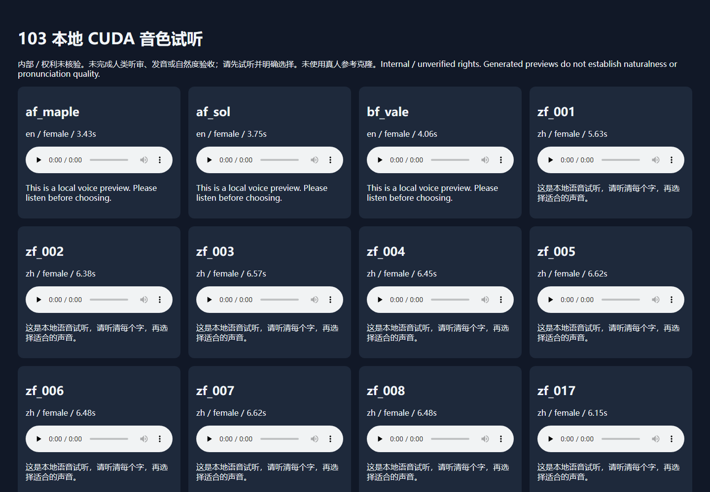

<!-- aek-history-summary -->
<details>
<summary>完整开发历史（保留全部原文，点击展开）</summary>

**CLI59安装候选完整音画复核通过**：16秒／5分轨的全部PCM、480帧画面及成片音频与源码和工程包重放一致；实际CUDA降噪4次前向的完整PCM也一致。单入口Skill候选已通过真实PowerShell生成配乐。安装400继续，正式注册仍CLI58。[安装版流程及边界](docs/validation/CLI59独立安装交付_2026-10-29.md)。


**CLI59/local57 离线候选现已原生安装**：1706载荷／282模块／8原生资源精确一致；安装31／19配乐／19控制／57选材／104语义分别通过。未注册单入口Skill已真实生成配乐，完整PCM与源码一致；安装400及完整案例验收仍单独进行，正式Skill仍CLI58。[安装版使用流程](docs/validation/CLI59独立安装交付_2026-10-29.md)。


**CLI59 源码验证更新：400项服务契约已全部通过；PID测试标记改为原子发布后，正式19项控制回归重新通过。** 之前失败收据保留。源码新配乐仍待独立安装及Skill59交付；已注册入口仍CLI58。[本轮证据](docs/validation/CLI59谱面合成_2026-10-29.md)。


**开发源码CLI0.1.59新增可编辑谱面合成与4类程序音效**：8种解析乐器、分轨、时间线挂接及谱面工程包重合成；19项专项、31入口／57选材／104语义分组分别通过。C75实际16秒／5轨、完整PCM重合成及成片音画重放通过。控制回归有1个PID测试标记空读错误，400项仍运行；正式Skill保持CLI58，不自动调用源码。

[Score workflow / 谱面流程](docs/product/MUSIC_SCORE.md) · [C75 WAV / MP4 / editable package](docs/product/CASES.md#c75-source59-editable-score)

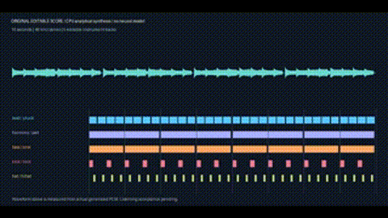

**当前本地版本：CLI0.1.58 / local56 / r56统一Skill工具包。** 唯一入口 `$agent-ffmpeg-local-editor`，17内部模块、93文件。源码与安装版各31／19／57／104／400五组分别通过；候选及真实C盘入口的实际CUDA降噪、完整1124160字节PCM工程重放分别通过。完整剪映等价仍未完成。

[繁體中文](README.zh-TW.md) · [English](README.en.md) · [r56 Skill ZIP](docs/skills/agent-editor-kit-community-unified-skill-r56.zip) · [完整交付与流程](docs/validation/CLI58统一Skill切换_2026-10-29.md) · [500滤镜母图预览](docs/assets/looks-n002-20261024-r1/index.html)

```powershell
$skill = 'C:/Users/carzy/.codex/skills/agent-ffmpeg-local-editor'
& "$skill/scripts/run.ps1" version
& "$skill/scripts/run.ps1" capabilities
```

确认版本为 `0.1.58`；按[安装使用流程](docs/validation/CLI58独立安装交付_2026-10-29.md)准备匹配应用包及原生依赖，再登记素材与权利、建立工程、执行选材与预览、渲染并导出可编辑工程包。`unique_content`默认按精确SHA256去重；[选材规则与实际案例](docs/product/AD_CONTENT_UNIQUENESS.md)说明继承、复用、查询分配及感知重复边界。

r56已在独立中文／空格目录解包、配置四个模型包、独立注册并实际重渲染；完整589824字节YUV、307200字节PCM与参考及工程包重放相同，PNG也逐字节相同。此工具包验收没有新增模型推理，不代替自然视听质量或干净机器验收。

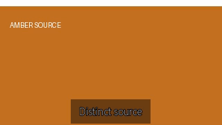

母图滤镜、功能／服务模块、Skill内部模块和完整案例说明均保留在下方；完整开发历史可展开查看。


CLI58／local56独立候选已原生安装：1705载荷、281模块及8原生资源一致；安装31／19／57／104分组分别通过。实际CUDA完整PCM与源码一致；去重成片120帧完整RGBA与源码及工程重放一致。安装400项继续运行，正式Skill仍56／r55。 [Local package / usage](docs/validation/CLI58独立安装交付_2026-10-29.md)

源码CLI0.1.58完整400项服务契约已通过：零失败／错误／跳过，源码与测试冻结一致。独立离线包已构建并原生安装；安装版及正式Skill仍另验。 [400-test evidence](docs/validation/evidence/ad-content-uniqueness-20261029-r1/source58-contracts-r1/verification.json)

C74 精确内容去重已完成真实媒体闭环：两个ID导入同一蓝图，默认选择琥珀图与蓝图；显式仅ID策略允许两个蓝图别名。120帧完整RGBA工程重放一致。检索响应是显式合成数据，不计AI语义质量通过。 [C74 video / evidence](docs/validation/CLI58内容去重实测_2026-10-29.md)


源码58实际DF3 CUDA复核已通过：4次神经前向，完整1124160字节PCM工程重放一致；受控MSE改善12.25dB，无自然质量／人工听审结论。 [CUDA evidence](docs/validation/CLI58真实CUDA复核_2026-10-29.md)

当前开发源码 **CLI0.1.58**：新增精确内容SHA256去重选材，修复Windows自有进程同步回收与补帧预处理超时映射。57／19／31／104项源码分组及3项超时专项分别通过，完整400项已通过。正式加载仍CLI56／local54／r55；CLI57候选安装398项出现1失败／1错误，未提升版本，原失败保留。[58实现与核验](docs/validation/CLI58开发核验_2026-10-29.md)。

独立安装57第三类实际模型MuseTalk已通过CUDA与完整成片重放：67次UNet，原生133帧／25fps，成片160帧／30fps。自然口型质量与其余12类实际模型仍另验。[C73影片／来源／证据](docs/product/CASES.md#c73-installed57-musetalk)。


当前本机 CLI56／local54 已安装并注册为唯一 `$agent-ffmpeg-local-editor`：1入口／17模块／93文件。源码、独立安装与真实C盘入口的CUDA选材及两画幅完整音画工程重放分别通过；四个原配音／翻译包已重新核验。r55工具包独立解包／配置／注册及完整ACES音画重放已通过。

CLI57／local55 独立离线候选已安装：1705载荷、281模块及8原生资源一致；源码398项、安装31项回归及安装版真实CUDA降噪／完整PCM与源码、工程重放一致均已通过。安装398项已失败（1失败／1错误），58修复另验，正式Skill保持CLI56／r55。 [CLI57 delivery / usage](docs/validation/CLI57独立安装交付_2026-10-29.md)

CLI57源码及独立安装版真实CUDA降噪均已通过，受控噪声MSE改善12.25dB；完整PCM逐字节一致。398项源码重跑已通过，首轮测试环境失败记录保留。 [C71 actual audio / waveforms](docs/product/CASES.md#c71-source57-native-worker-gpu)

## 当前使用流程与核验

以下命令使用本机已注册安装；新机器请先按交付日志准备匹配应用包与原生依赖。选材前登记素材／权利、模型、索引和设备校准，dry-run后实际选材，再构建分镜、逐变体预览／渲染及工程包重放。

```powershell
$agentEditor = 'C:/Users/carzy/.codex/skills/agent-ffmpeg-local-editor/scripts/run.ps1'
& $agentEditor version
& $agentEditor doctor
& $agentEditor capabilities
```

[CLI56 delivery / usage](docs/validation/CLI56原生交付_2026-10-29.md) · [Functional modules](#feature-modules) · [Unified Skill](docs/skills/UNIFIED_SKILL.md) · [C70 videos / GIF / receipts](docs/product/CASES.md#c70-registered-semantic-selection)


源码CLI57已正式修复15类原生入口的依赖遮蔽，31项引导回归通过；更广服务契约与真实模型任务仍在核验。正式Skill继续使用CLI56／r55。 [Native worker diagnosis](docs/product/NATIVE_WORKER_BOOTSTRAP.md)

CLI57安装版第二类实际模型RIFE也已通过：89次CUDA前向、96／36帧锚点与既有基线一致，完整音画工程重放相同。 [C72](docs/product/CASES.md#c72-installed57-rife)

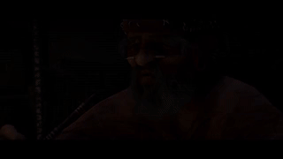


**当前本地 CLI56／local54 已安装并注册，唯一 `$agent-ffmpeg-local-editor` 保持1入口／17模块／93文件。** 源码与独立安装版各1／15／45／104四组通过，二者实际CUDA选材及两画幅完整RGB／非静音PCM重放均通过；安装版与源码输出也逐字节一致。四个原有配音／翻译模型包已重新核验。真实C盘入口的完整GPU案例仍在运行，新正式工具包另验。[实际交付与使用流程](docs/validation/CLI56原生交付_2026-10-29.md)。以下较早版本段落保留为历史记录，以顶部当前状态为准。

**CLI56 源码实际CUDA选材与两画幅完整音画重放已通过。** 重新建立11来源索引／校准，3条固定查询与预期标签一致；横竖版各90帧，导出／导入后完整RGB与非静音PCM分别相同。[C69影片、GIF与截图](docs/product/CASES.md#c69-source56-semantic-selection)。安装版实际GPU任务正在运行，正式Skill仍53／r54。


**CLI56 独立安装版1／15／45／104四组均已通过。** 新统一Skill候选保持1入口／17模块／93文件，实际PowerShell入口已核验；这些元数据检查没有模型推理，候选仍未注册，正式入口保持53／r54。[完整交付记录与使用流程](docs/validation/CLI56原生交付_2026-10-29.md)。

**CLI56 完整候选已原生离线安装。** 1705载荷精确，281模块／8原生资源一致；安装版1项引导回归、15项进程控制、45项选材／分镜已通过，安装版104项语义兼容及完整11素材GPU流程继续运行。正式Skill仍53／r54。[本地包、摘要与实际入口](docs/validation/CLI56原生交付_2026-10-29.md)。

**源码 CLI56 已修复语义工作进程依赖遮蔽。** 仅在固定自身应用包时临时置顶应用路径，随后恢复模型环境的依赖搜索顺序，保留版本／路径指纹检查。1项真实原生引导回归、15项进程控制、45项选材／分镜、104项语义兼容分别通过；完整新包与11素材GPU流程正在执行，安装版及正式Skill尚未验收。正式入口仍53／r54。[根因、修复与证据](docs/product/SEMANTIC_WORKER_ISOLATION.md)。

**CLI55 安装版实际GPU验收发现依赖遮蔽问题，尚未通过。** 模型环境原本的NumPy／Pillow被应用安装site里的不同版本覆盖，指纹检查返回SEMANTIC_RUNTIME_CHANGED；没有安装版成片。已保留原始失败并用独立原生进程重现根因，正在修复；正式Skill保持53／r54。[问题、证据及修复路径](docs/product/SEMANTIC_WORKER_ISOLATION.md)。

**CLI55 源码的实际 CUDA 选材与完整音画重放已通过。** 11项素材建立索引／校准，3条固定查询选中预期素材；横竖版各90帧，工程导出后重放的完整RGB与非静音PCM分别一致。[C68案例、视频、GIF及边界](docs/product/CASES.md#c68-source-semantic-ad-selection)。独立安装版同范围任务正在运行，正式Skill仍53／r54；[统一Skill切换流程](docs/validation/CLI55统一Skill切换_2026-10-29.md)已实现缺失案例时拒绝改动。


**当前 CLI55 完整候选已原生离线安装，源码与安装版各自通过15／45／104分组核验。** 281模块／8原生资源一致；新统一Skill候选保持1入口／17模块／93文件，实际PowerShell入口已核验，但尚未激活。完整11素材的GPU注册／索引／校准、实际选材与音画重放继续独立验收。正式入口仍CLI53／r54。[候选包、摘要与实际使用入口](docs/validation/CLI55原生交付_2026-10-29.md)。

**源码 CLI55：修复原生子进程继承命令预算。** 等待期间检查外层期限与取消文件，并关闭自有进程作业、回收读取线程；15项控制、45项选材／分镜、104项语义兼容分组分别通过。CLI54真实选材尝试超时且未产生成片，失败保留；CLI55新包与完整GPU流程另验。正式Skill仍CLI53／r54。[行为、原生前后对照与边界](docs/product/PROCESS_OPERATION_BUDGET.md)。

**CLI54 完整候选包已原生离线安装，尚未切换 Skill。** 已修复安装驱动超时参数，保留首次失败；1705个Wheel载荷文件、281个运行时模块及8个原生资源核验一致。安装版45项选材／分镜专项通过；真实CUDA校准、选材和成片重放另验。[安装恢复与实际入口](docs/validation/CLI54安装恢复_2026-10-29.md)。

**源码 CLI0.1.54：校准语义选材已接入广告分镜。** 新增 `ad select`，按全部变体的来源长度、明确源音和已核验权利过滤候选，并联合分配素材，生成可编辑计划及逐镜头依据；45项源码测试通过，实际CUDA整链路另验。当前安装与唯一Skill仍CLI53／r54。[方案与使用](docs/product/AD_SEMANTIC_SELECTION.md)。

**当前本地 CLI0.1.53 / local.51 已安装并注册。** 源码和安装版各自通过 18 项 ACES、46 项测量／Schema、373 项兼容性回归。唯一 `$agent-ffmpeg-local-editor` 保持 1 个入口／17 个模块／92 个文件；[C67 实际注册入口案例](docs/product/CASES.md#c67-registered-aces-timeline)已核验完整视频、音频、预览和工程包往返。[正式 r54 包](docs/skills/agent-editor-kit-community-unified-skill-r54.zip)已通过独立解包、配置、注册及完整音画重放验收。[使用与安装流程](docs/releases/CLI_0.1.53_LOCAL.md)。

候选阶段历史核验：新版统一 Skill 候选入口已实际通过 7 次 CLI53 调用（含原生配置、PNG16 预览和逐帧测量），保持 1 个入口／17 个模块／92 个文件；原注册入口与配置未改变。两组兼容性现已通过，正式入口已升级。

<!-- aces-timeline-source53 -->

**源码 CLI0.1.53：ACES 时间线与预览已接通。** 正式交付、逐帧测量、单次显示变换后的线性缩图，以及 HDR 母版的独立 SDR 视图；18 项专项和 46 项测量／Schema 回归分别通过。[使用流程](docs/product/ACES_TIMELINE.md) · [C65：视频、GIF、PNG16、工程包](docs/product/CASES.md#c65-source-aces-timeline)。此段保留早期源码阶段记录；当前入口已升级 CLI53，ACES 仍为 CPU，完整目标继续开放。


CLI53 当前入口快速核实（ACES 使用前先枚举实际配置／显示／视图；完整工程流程见上方使用文档）：

```powershell
$aekSkill = 'C:/Users/carzy/.codex/skills/agent-ffmpeg-local-editor/scripts/run.ps1'
& $aekSkill version
& $aekSkill capabilities
& $aekSkill surface ocio-configs --config aces-2.1
```

安装版另外独立通过 **18 项 ACES + 46 项测量／Schema**；[C66：实际影片、GIF、PNG16 与工程包](docs/product/CASES.md#c66-installed-aces-timeline)已核验完整视频／音频往返一致。两组 373 项广泛兼容性和正式注册切换现已完成。

<!-- aces-native-kernel-source -->

**内核首轮记录（历史阶段）：原生 ACES 内核与配置发现。** 固定 OCIO 2.6.0，支持 ACES 1.3/2.0/2.1 显示视图及场景曝光；当前仍为源码阶段，尚未接入时间线、预览和已安装 Skill。[使用流程、证据与待办](docs/product/ACES_NATIVE.md)。

**面向 Agent 的开源、本地视频编辑 CLI。** 从结构化编辑计划到可编辑工程、预览、成片、质量报告和可恢复交付；保留每一步的真实输出与来源。

[简体中文](README.md) · [繁體中文](README.zh-TW.md) · [English](README.en.md) · [Repository](https://github.com/copypasteltd/agent-editor-kit) · [Docs](docs/README.md)


开发轮次汇报：每轮结束均提供编号完成项与待办表，列明验证依据及未完成边界，见[汇报规范](docs/DEVELOPMENT_REPORTING.md)。

**公开发行版本：v0.1.0-alpha.3 预发布版 · CLI 0.1.2 · 500 套风格 · 17 个历史拆分 Skill。** 提供完整运行 ZIP、Agent kit、可选图册及校验摘要。运行内核保持原已验包字节；新增可移植安装和可执行示例。完整剪映等价仍是开发目标，尚未验收。

本页包含完整功能模块、服务与依赖、安装与使用逻辑、Skill 输入输出、真实案例和核验表。长篇原始验收日志继续留档，功能说明与案例入口恢复到首页。


<!-- gpu-gamut-installed-current -->

**CLI0.1.52 / local.50 / r53 kit · 1 Skill / 17 modules / 91 files.**

[Verified small kit](docs/skills/agent-editor-kit-community-unified-skill-r53.zip) · [SHA256 / inventory](docs/skills/community-unified-skill-package-0.1.52-r53.json)

本地统一Skill已升级CLI52：GPU执行亮度肩部与OKLab缩色度，信号转换与ICC仍由CPU处理。源码与安装版各70项专项、各352项兼容分别通过；C64由实际注册入口完成GPU成片/预览及完整音画工程包重放。

[Workflow](docs/product/GPU_GAMUT.md) · [Install / usage](docs/releases/CLI_0.1.52_LOCAL.md) · [C64](docs/product/CASES.md#c64-installed-gpu-gamut)


<!-- /gpu-gamut-installed-current -->

<!-- gpu-gamut-source-history -->

Historical source/candidate stage; superseded by installed CLI52 above.

**Development source CLI0.1.52 · installed Skill CLI0.1.51 / local.49 / r52 unchanged.**

源码CLI52新增实际GPU亮度肩部及OKLab缩色度，信号转换与ICC仍由CPU处理。70项专项、12项控制管道测试、4K单表面独立参考及C63完整音画/工程包重放通过；本地注册Skill仍CLI51/local49/r52。352项兼容回归及新版安装交付另行验收。

[Workflow](docs/product/GPU_GAMUT.md) · [Source release](docs/releases/CLI_0.1.52_SOURCE.md) · [C63](docs/product/CASES.md#c63-source-gpu-gamut) · [Evidence](docs/validation/GPU色域映射源码实测_2026-10-29.md)

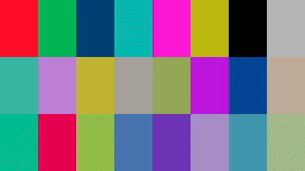

候选安装版70项专项已通过；源码与安装版352项兼容回归仍在运行，统一Skill尚未切换。

<!-- /gpu-gamut-source-history -->

<!-- oklab-installed-history -->

Historical installed CLI51; superseded by CLI52 above.

**CLI0.1.51 / local.49 / r52 kit · 1 Skill / 17 modules / 90 files.**

本地安装CLI51已接通明确OKLab缩色度、正式SDR交付映射继承及映射后线性预览缩小。显式preview_mapping仍优先。实际统一Skill执行C62，完整像素/PCM工程包重放通过；CPU色彩内核，不等于完整剪映/ACES/物理监看。

[Workflow](docs/product/OKLAB_GAMUT.md) · [Install](docs/releases/CLI_0.1.51_LOCAL.md) · [C62](docs/product/CASES.md#c62-installed-oklab)


<!-- /oklab-installed-history -->

<!-- oklab-gamut-source-history -->

Historical source/candidate stage; superseded by the installed workflow above.


本轮已修复正式SDR映射的预览继承，CLI51候选r2完成源码/安装版专项及实际工程包往返；统一Skill仍50，完整兼容与新kit待完成。 [Fix / evidence / C61 errata](docs/validation/SDR预览映射修复_2026-10-29.md).

**源码 CLI0.1.51 新增明确可选的 OKLab 保感知明度/色相缩色度，用于 HDR→BT.709 SDR 交付及预览。当前安装 Skill 仍 CLI0.1.50/local.48/r51，新安装包与独立安装验收待完成。**

[Workflow](docs/product/OKLAB_GAMUT.md) · [Source release](docs/releases/CLI_0.1.51_SOURCE.md) · [C61](docs/product/CASES.md#c61-oklab-gamut) · [Evidence](docs/validation/OKLab色域映射源码实测_2026-10-29.md)

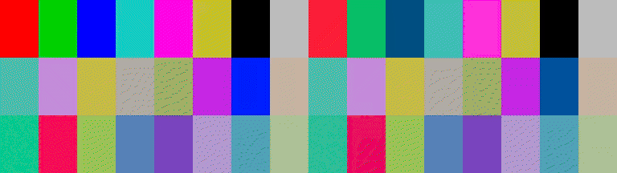

专项62/62；兼容初跑351/352，文档Schema副本同步后专项17/17通过；C61两种真实成片、全帧独立参考和工程包完整音画重放留证。数值图卡不代替自然画面与物理HDR监看验收。

<!-- /oklab-gamut-source-history -->

<!-- native-hdr-media-history -->

Historical CLI50 delivery; current CLI51 is described above.

**CLI0.1.50 / alpha.4-local.48 / r51 kit · 1 Skill / 17 modules / 89 files.**

新增**编码后原生成片光量复核**：实际原生PTS/曝光、明确RGB与YCbCr解释、MaxRGB/CIE Y、越界与裁切计数、完整解码像素/时钟摘要。保留编码前 `surface measure`，新增 `surface measure-media`，两种测量边界分别报告。

[Workflow](docs/product/HDR_MEDIA_MEASUREMENT.md) · [C60](docs/product/CASES.md#c60-post-codec-hdr420) · [Install](docs/releases/CLI_0.1.50_LOCAL.md) · [Evidence](docs/validation/编码后成片安装与跨编码实测_2026-10-29.md)


安装版29项专项、42项边界回归与352项兼容回归分别通过。C60由真实本地统一Skill执行PQ/HLG H.265 Main10 4:2:0渲染；两条48帧成片逐像素独立核验，HLG可编辑工程包重放像素与完整PCM一致。GIF为作者时间线的明确SDR查看副本，非编码后或物理HDR监看验收。

C59/R331计数更正：384000个PCM总标量中383999非零；旧历史行保留，[当前纠正与证据](docs/validation/编码后成片安装与跨编码实测_2026-10-29.md)。

<!-- /native-hdr-media-history -->

<!-- native-hdr-measure-history -->

**CLI0.1.49 / alpha.4-local.47 / r50 kit · 1 Skill / 17 modules.**

新增**全帧 HDR 光量测量与色彩裁切汇总**：实际作者时间线、明确nit、MaxRGB与CIE Y分别报告、峰值位置/最大帧平均/精确时长加权、可选有效画面范围。测量与正式渲染共用实际RGB16输入路径；中间包补齐所有帧的转换收据。

[Workflow](docs/product/HDR_MEASUREMENT.md) · [C59](docs/product/CASES.md#c59-native-hdr-measurement) · [Install](docs/releases/CLI_0.1.49_LOCAL.md) · [Evidence](docs/validation/全帧HDR光量与裁切汇总实测_2026-10-29.md)

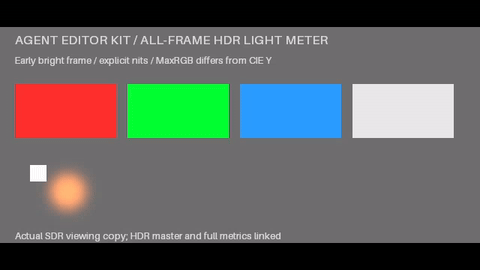

19项源码专项、19项安装专项和352项安装兼容分别通过。C59以独立公式核对全部48帧/11059200像素与RGB16输入摘要，真实PQ成片完整音画及测量工程包重放一致；另验48次实际GPU Bloom与原生ICC软打样的测量/渲染输入相同。不是编码后峰值、物理显示器或艺术质量验收。

<!-- /native-hdr-measure-history -->

<!-- native-icc-output-history -->

**CLI0.1.48 / alpha.4-local.46 / r49 kit · 1 Skill / 17 modules.**

新增**原生 RGB ICC 输出、16位内嵌配置 PNG 序列与软打样**：实际B2A查找表、四意图/BPC、明确亮度缩放、作者时间线逐帧交付和同步PCM；普通渲染/预览原生模拟，配置依赖可移植。

[Workflow / usage](docs/product/ICC_OUTPUT.md) · [C58](docs/product/CASES.md#c58-native-icc-output) · [Install](docs/releases/CLI_0.1.48_LOCAL.md) · [Evidence](docs/validation/原生ICC输出与软打样实测_2026-10-29.md)

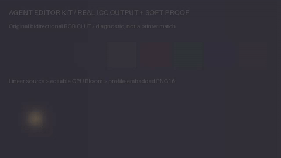

17项源码专项、17项安装专项与335项安装兼容分别通过。C58逐帧内嵌ICC，独立核对384组B2A色块及384组软打样Y/Cb/Cr；全48帧PNG像素/文件、66355200字节软打样成片及384000非零PCM标量工程包重放相同，每次序列48次实际GPU Bloom。ICC用CPU，支持的剪辑算子用GPU；合成诊断配置不等于打印机/显示器校准或艺术质量验收。

<!-- /native-icc-output-history -->

<!-- native-hlg-black-history -->

**CLI0.1.47 / alpha.4-local.45 / r48 kit · 1 Skill / 17 modules.**

新增**HLG 非零显示黑位和完整信号 JSON CLI**：明确黑位、峰值、伽马和参考白亮度，贯通源/输出、浮点中间包、预览与工程包；低于目标黑位严格拒绝或显式裁切计数。

[Workflow / usage](docs/product/HLG_BLACK_LEVEL.md) · [C57](docs/product/CASES.md#c57-hlg-display-black) · [Install](docs/releases/CLI_0.1.47_LOCAL.md) · [Evidence](docs/validation/HLG显示黑位实测_2026-10-28.md)

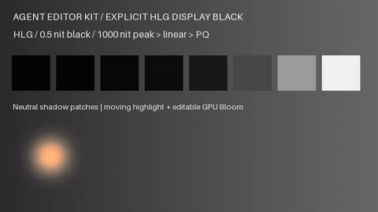

21项源码专项、21项安装专项与314项安装兼容分别通过。C57核对230400个工作域像素、384组编码色块及完整48帧/384000个非零PCM标量工程包重放；每次48次实际GPU Bloom。色彩数学使用CPU，支持的合成使用GPU。0.5nit黑位是诊断声明，不是屏幕校准；动态HDR、完整ACES与自然监看仍未验收。

<!-- /native-hlg-black-history -->

<!-- native-icc-history -->

**CLI0.1.46 / alpha.4-local.44 / r47 kit · 1 Skill / 17 modules.**

新增**原生 ICC 色彩管理**：明确本地 RGB ICC v2/v4、SHA、四种渲染意图与黑点补偿，由 LittleCMS 2.19.1 直接转换到线性工作 RGB；贯通素材、浮点导出、预览缓存和可编辑工程包。

[Workflow / usage](docs/product/ICC_PROFILES.md) · [C56](docs/product/CASES.md#c56-native-icc-profiles) · [Install](docs/releases/CLI_0.1.46_LOCAL.md) · [Evidence](docs/validation/原生ICC色彩管理实测_2026-10-28.md)


26项源码专项、26项安装专项和287项安装兼容检查分别通过。C56独立核对首帧230400像素、全48帧色块与完整非静音音画工程包重放；每次48次实际GPU Bloom。ICC CMM使用CPU，支持的合成/光晕使用原生GPU。范围是RGB源配置：任意ICC输出、软打样、CMYK、内嵌配置自动识别、完整ACES和自然HDR监看仍待补齐，38项原目标关闭条件保留。

<!-- /native-icc-history -->

<!-- native-chromatic-history -->

**CLI0.1.45 / alpha.4-local.43 / r46 kit · 1 Skill / 17 modules.**

新增**Bradford 白点适应、ProPhoto RGB D50 和线性 ACES AP1 D60**：贯通来源、工作域、效果信号、浮点中间包、实际预览和可编辑工程包；光晕按声明白点计算亮度，现有 D65 行为保留。

[Workflow / usage](docs/product/CHROMATIC_ADAPTATION.md) · [C55](docs/product/CASES.md#c55-native-chromatic-adaptation) · [Install](docs/releases/CLI_0.1.45_LOCAL.md) · [Evidence](docs/validation/明确白点色适应实测_2026-10-28.md)

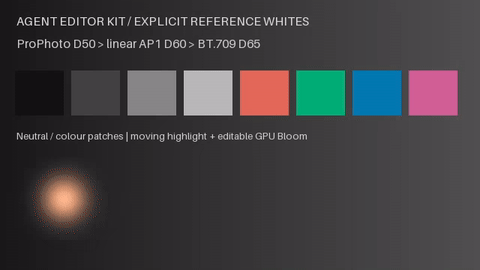

[Actual MP4](docs/assets/native-chromatic-20261028-r3/actual-preview.mp4) · [Signals](docs/assets/native-chromatic-20261028-r3/signals.json) · [Comparison](docs/assets/native-chromatic-20261028-r3/comparison.png) · [Editable package](docs/assets/native-chromatic-20261028-r3/editable-chromatic.aevpkg.zip)

20项源码专项、20项安装专项和267项安装兼容检查分别通过。C55独立对照首帧230400像素及全48帧色块，实际GPU Bloom与完整音画包重放通过。颜色数学CPU，合成/光晕可用GPU；最终BT.709/BT.2100交付D65。参考白点转换不是ICC解析、自动物理白平衡或完整ACES输出变换；感知色域映射、自然HDR监看及38项完整目标继续开发。

<!-- /native-chromatic-history -->

<!-- native-hdr-metadata-history -->

**CLI0.1.44 / alpha.4-local.42 / r45 kit · 1 Skill / 17 modules.**

新增**HDR10母版显示与MaxCLL/MaxFALL静态元数据**：明确xy/nit单位，实际写入HEVC SEI，发布前核验解码帧；支持可编辑工程包，继续使用GPU合成和独立SDR预览。

[Workflow / usage](docs/product/HDR_METADATA.md) · [C54](docs/product/CASES.md#c54-native-hdr10-metadata) · [Install](docs/releases/CLI_0.1.44_LOCAL.md) · [Evidence](docs/validation/HDR10静态元数据实测_2026-10-28.md)

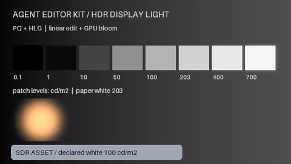

[HDR10 master](docs/assets/native-hdr-metadata-20261028-r2/hdr10-master.mkv) · [SDR preview](docs/assets/native-hdr-metadata-20261028-r2/sdr-preview.mp4) · [Declared values](docs/assets/native-hdr-metadata-20261028-r2/declaration.json) · [Editable package](docs/assets/native-hdr-metadata-20261028-r2/editable-hdr10.aevpkg.zip)

21项源码、21项安装版专项与105项安装版兼容检查分别通过。C54独立核对全部48帧SEI；工程包重放全部视频帧和384000个PCM标量相同。产品默认核验前32个视频包解出的帧；数值为作者声明，不是自动峰值测量。x265编码CPU、合成GPU。动态HDR、ICC/监看、自然质量及原38项完整目标继续建设。

<!-- /native-hdr-metadata-history -->

<!-- native-speech-enhancement-history -->

**CLI0.1.43 / alpha.4-local.41 / r44 kit · 1 Skill / 17 modules.**

新增**真实本地 CUDA DeepFilterNet3 对白降噪**：原生采样时钟、单/双声道、独立增强资产与可编辑音轨、强度/衰减上限、分段重叠、配方重跑、工程包和取消回滚。

[Workflow / usage](docs/product/SPEECH_ENHANCEMENT.md) · [C53](docs/product/CASES.md#c53-native-speech-enhancement) · [Install](docs/releases/CLI_0.1.43_LOCAL.md) · [Evidence](docs/validation/本地对白增强实测_2026-10-27.md)

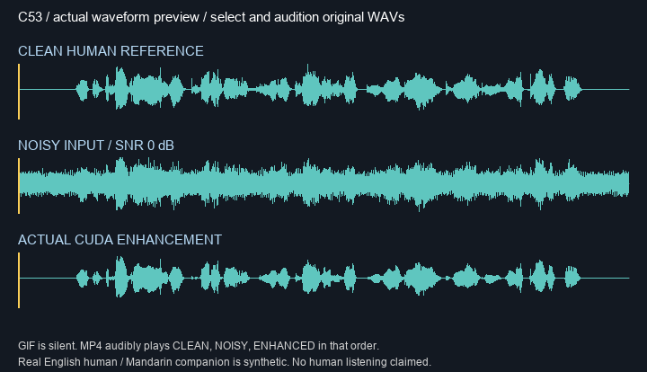

[Listen: clean → noisy → actual enhanced](docs/assets/native-speech-enhancement-20261027-r2/audible-comparison.mp4) · [Original16k human source](docs/assets/native-speech-enhancement-20261027-r2/original-human-16k.flac) · [Enhanced WAV](docs/assets/native-speech-enhancement-20261027-r2/english-enhanced.wav) · [Scientific spectra](docs/assets/native-speech-enhancement-20261027-r2/spectra-and-waveforms.png)

33项源码、33项安装版专项和156项安装版兼容回归分别通过。C53英语真人录音从0 dB输入提升至SNR 12.25 dB，中文合成人声提升至9.69 dB；完整原生样本数与工程包PCM相同。保留干净对白损伤、混响控制和首轮临时文件竞态失败。未做人类听审；分段状态重置、前端CPU/神经图CUDA；完整去混响/音乐保真和38原目标关闭条件继续开发。

<!-- /native-speech-enhancement-history -->

<!-- native-interpolation-history -->

**CLI0.1.42 / alpha.4-local.40 / r43 kit · 1 Skill / 17 modules.**

新增**真实本地 CUDA RIFE4.25 神经补帧与可编辑慢动作**：保留CFR/VFR原生PTS、每帧持续时间、全部源RGBA帧及原音轨；2..8倍补帧、显式切镜保持、预乘alpha、可重跑配方和关联双轨。

[Workflow / usage](docs/product/NEURAL_INTERPOLATION.md) · [C52](docs/product/CASES.md#c52-native-neural-interpolation) · [Install](docs/releases/CLI_0.1.42_LOCAL.md) · [Evidence](docs/validation/本地神经补帧实测_2026-10-27.md)

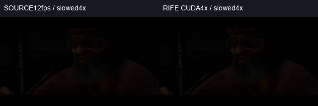

37项安装版补帧检查和143项安装版兼容回归通过；37项源码检查单列。C52动画24→96帧，另12→36帧透明VFR与105840个原始PCM标量完整保留，工程包完整音画重放相同。23张独立保留参考帧平均MSE：模型12.28／重复24.36／线性混合14.87；**末段模型重影失败保留**，显式保持以停顿换取去重影。未做人工连续播放／听审；自然质量、HDR模型与完整目标继续建设。

[Actual retained failure and explicit hold](docs/assets/native-interpolation-20261027-r1/failure-and-hold.png) · [Held-out per-frame measurements](docs/validation/evidence/native-interpolation-20261027-r1/case-r1/verification.json)

<!-- /native-interpolation-history -->

<!-- native-lip-sync-history -->

**CLI0.1.41 / alpha.4-local.39 / r42 kit · 1 Skill / 17 modules.**

新增**真实本地 CUDA 神经口型同步**：使用 MuseTalk 1.5、Whisper-tiny、VAE 和 BiSeNet，让指定图片／视频随独立语音生成口型。支持25FPS人脸框关键帧、完整PCM保留、可重跑配方，以及分别可编辑的视频／音频关联片段。

[Workflow / usage](docs/product/LIP_SYNC.md) · [C51](docs/product/CASES.md#c51-native-lip-sync) · [Install](docs/releases/CLI_0.1.41_LOCAL.md) · [Evidence](docs/validation/本地神经口型实测_2026-10-27.md)

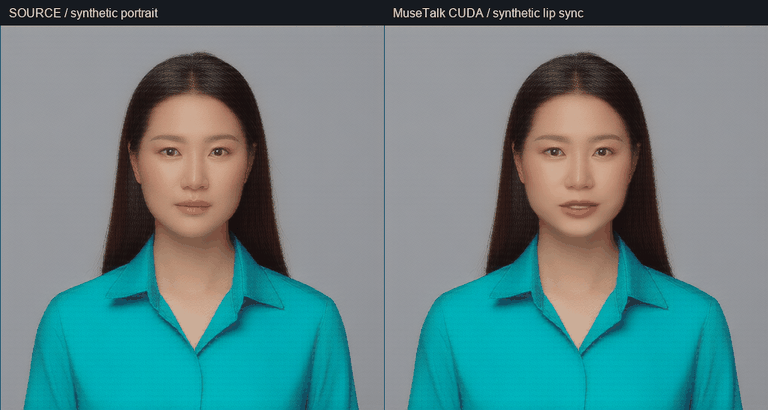

本批 **28项安装版检查通过，零失败／错误／跳过**；另177项既有服务源码兼容回归通过，源码与安装版248文件一致。C51实际生成133帧，原始126795个PCM标量、全部alpha及区域外RGB保留，完整音画在工程包迁移后相同。既有993项HDR整轮记录保留为历史结果。脸部模型256×256；完整身体／表演、自动跟踪、自然口型／听审、HDR推理及完整目标仍需建设。

另有30帧移动视频/人脸框实测；实际模型输出后取消任务，三个子进程回收、工程回滚和诊断均通过。 [Evidence](docs/validation/evidence/native-lipsync-20261027-r1/video-and-cancel-r1/verification.json).

<!-- /native-lip-sync-history -->

<!-- hdr-display-history -->

**CLI0.1.40 / alpha.4-local.38 / r41 kit · 1 Skill / 17 modules.**

新增**原生 PQ／HLG HDR 信号、明确 nit 单位、10-bit BT.2020 交付和独立 SDR 预览**。HLG 包含 RGB 联动 OOTF；不同参考白的 SDR 图形与 HDR 高光可在线性光域合成。明确选择输入／输出截断、SDR 映射及其色域策略，保留作者时钟、效果和可编辑工程。

[Workflow / usage](docs/product/HDR_DISPLAY.md) · [C50](docs/product/CASES.md#c50-native-hdr) · [Install](docs/releases/CLI_0.1.40_LOCAL.md) · [Evidence](docs/validation/HDR显示光实测_2026-10-27.md)

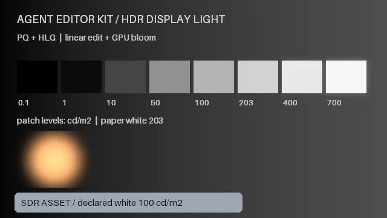

安装版单轮 **993 项回归通过，零失败／错误／跳过**：保留上轮734项，加入20项HDR数值／实际工程核验及239项相关色彩兼容检查。C50 为实际注册 Skill 输出，48帧／12FPS／4秒，非静音双声道384000个Float32 PCM标量及全部10bit帧在包迁移后相同。色彩传递数学当前CPU，已接通合成／光效继续实际GPU；HDR监看、自然质量、ICC、非零黑位HLG、母版／动态元数据及完整目标继续建设。

<!-- /hdr-display-history -->

<!-- highlight-glow-history -->

**CLI0.1.39 / alpha.4-local.37 / r40 kit · 1 Skill / 17 modules.**

新增 **Bloom 高光扩散与 Halation 胶片光晕**：从画面真实高光提取亮源，在明确线性 RGB 域执行软膝阈值、分离高斯邻域扩散、核心抑制与着色叠加。支持作者时钟关键帧、片段及根调整层，CPU 参考和真实 GPU 四阶段实现同步交付。

[Workflow / usage](docs/product/HIGHLIGHT_GLOW.md) · [C49](docs/product/CASES.md#c49-highlight-glow) · [Install](docs/releases/CLI_0.1.39_LOCAL.md) · [Evidence](docs/validation/高光扩散实测_2026-10-27.md)

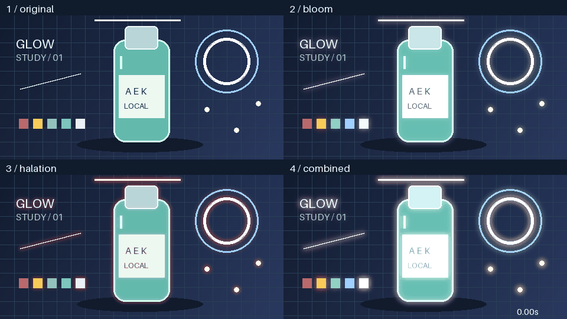

安装版单轮 734 项回归通过、零失败/错误/跳过；新增 21 数值、3 真实 GPU、6 工程集成，共30项。C49四格保留六条数值轨道，工程包往返全48个10bit帧与384000个Float32 PCM相同；每次内容渲染192个glow操作、768个设备kernel（另计启动探测）。真实素材质量、物理胶片、HDR、实时/4K长片、完整效果库及原38项关闭条件继续开发。既有265条核验逐行保留。

<!-- /highlight-glow-history -->

<!-- optical-effects-history -->

**CLI0.1.38 / alpha.4-local.36 / r39 kit · 1 Skill / 17 modules.**

新增可编辑 **镜头眩光、漏光和色差**：线性光浮点运算、参数关键帧、原作者时钟、片段及选定序列调整层；CPU参考与实际OpenCL GPU路径已接通。通过 `effects list --query optical` / `effects inspect` 查询约束，用 `timeline compose` 保留参数与动画。四格案例含原图、去除效果的对照和真实GPU输出。

[Workflow / usage](docs/product/OPTICAL_EFFECTS.md) · [C48](docs/product/CASES.md#c48-optical-effects) · [Install](docs/releases/CLI_0.1.38_LOCAL.md) · [Evidence](docs/validation/光学效果实测_2026-10-27.md)

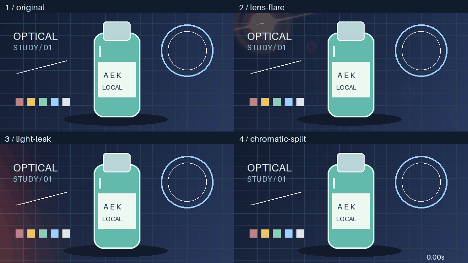

安装版最终704项不同用例通过：全量702项通过，另2项旧目录断言更新后定向重测通过，产品文件未变、无跳过。C48保留9条动画轨，全部48个10bit解码帧及384000个Float32 PCM采样在工程包往返后相同，GIF为实际解码帧、4000ms。艺术化光效已接通；真实镜头求解、自动亮源检测、bloom/halation/深度和完整剪映效果库继续开发。全部259项既有核验及38项原关闭条件保留。

<!-- /optical-effects-history -->

<!-- emitter-animation-history -->

**CLI0.1.37 / alpha.4-local.35 / r38 kit · 1 Skill / 17 modules.**

新增 **21 项发射器属性关键帧**：积分发射率、出生时的运动/寿命、源时间上的颜色/大小/形状等外观，支持六种插值和可暂停发射。`vfx animation-properties` 查询约束，`vfx animate` 添加、显式替换或移除单条属性；原始源时钟贯穿裁切、倒放、嵌套、预览、队列和工程包。四格案例由已注册安装版 Skill 实际 GPU 渲染。

[Workflow / usage](docs/product/EMITTER_ANIMATION.md) · [C47](docs/product/CASES.md#c47-emitter-animation) · [Install](docs/releases/CLI_0.1.37_LOCAL.md) · [Evidence](docs/validation/发射器关键帧实测_2026-10-27.md)

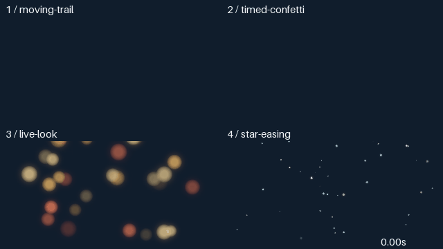

安装版 679 项回归通过、零跳过；C47 的 14 条属性轨道和全部 48 个 10bit 解码帧、384000 个 Float32 PCM 采样在工程包回读后相同。GIF 为实际渲染帧，4 秒。二维发射器动画已接通；3D、碰撞、深度、流体及完整剪映特效库仍待补齐。保留全部 253 项历史核验与 38 项原关闭条件。

<!-- /emitter-animation-history -->

<!-- gpu-dispatch-history -->

**CLI0.1.36 / alpha.4-local.34 / r37 kit · 1 Skill / 17 modules.**

原生Float32 GPU控制改为任务自有本机管道，消除每个算子的控制文件写盘与轮询。相同48帧工程通过实际注册安装版对照：**133.95s → 35.19s (3.81×)**；全部10bit解码帧和384000个Float32音频采样相同，数值内核字节保持。

[Workflow / usage](docs/product/GPU_DISPATCH.md) · [C46](docs/product/CASES.md#c46-gpu-dispatch) · [Install](docs/releases/CLI_0.1.36_LOCAL.md) · [Evidence](docs/validation/GPU管道调度实测_2026-10-27.md)

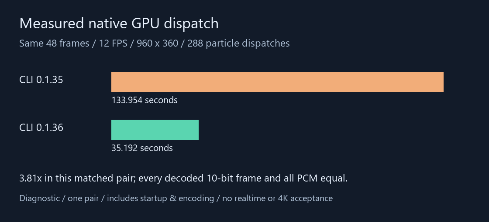

单个960×360诊断工程的同机一次配对，包含启动、编码及核验；不是实时、4K长片或跨设备保证。完整剪映等价仍未完成；所有38项原关闭条件与247项历史核验保留。

<!-- /gpu-dispatch-history -->

<!-- procedural-particles-history -->

**CLI0.1.35 / alpha.4-local.33 / r36 kit · 1 Skill / 17 modules.**

新增可编辑程序化粒子：雪、彩纸、余烬、光斑、斜雨、星芒。源参数、seed和独立帧率直接保存在工程；原生Float32合成、真实OpenCL栅格化、普通关键帧/裁切/倒放、预览、队列及工程包/OTIO回读已接通。六宫格为已注册安装版Skill实际渲染，未使用模型或第三方影像。

```powershell
$aekSkills = if ($env:CODEX_HOME) { Join-Path $env:CODEX_HOME 'skills' } else { Join-Path $env:USERPROFILE '.codex/skills' }
$avk = Join-Path $aekSkills 'agent-ffmpeg-local-editor/scripts/run.ps1'
$avkProject = 'E:/dev/sandbox/particle-demo'
& $avk project init $avkProject
& $avk vfx list
& $avk vfx inspect --name snow
& $avk vfx apply --project $avkProject --preset snow --seed 73 --clip-id snow --duration-tick 360000 --enable-native --dry-run
& $avk vfx apply --project $avkProject --preset snow --seed 73 --clip-id snow --duration-tick 360000 --enable-native
& $avk vfx show --project $avkProject --clip-id snow
```

[Workflow / parameters](docs/product/PROCEDURAL_PARTICLES.md) · [C45](docs/product/CASES.md#c45-procedural-particles) · [Install](docs/releases/CLI_0.1.35_LOCAL.md) · [Evidence](docs/validation/可编辑粒子实测_2026-10-27.md)

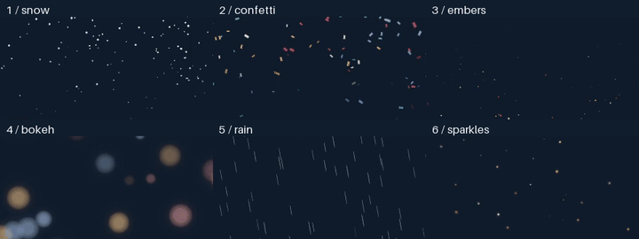

CLI0.1.35当时为二维诊断效果，未包含发射器参数关键帧；CLI0.1.37已补齐。三维碰撞、深度遮挡和流体仍未实现。旧FFmpeg图会明确拒绝此源；完整剪映等价与全部38项原关闭条件继续保留。

<!-- /procedural-particles-history -->

<!-- model-session-history -->

**CLI0.1.34 / alpha.4-local.32 / r35 kit · 1 Skill / 17 modules.**

新增原生 GPU 模型会话：显式启动、查询、停止，连续生成复用权重和同一提示词嵌入；每个任务重置调度器、前窗上下文与统计。实际同机首条生成 654.27 秒，后两条 35.46/28.48 秒；会话全模型校验另计 480.42 秒。相同 seed 的 17 帧逐像素相同，实际去噪取消可回滚并退出所属进程。

```powershell
$sessionStart = & $avk media model-session start --project $avkProject --adapter-id $vaceAdapterId | ConvertFrom-Json
if (-not $sessionStart.ok) { throw 'Model session failed to start' }
try {
  & $avk media generate --project $avkProject --adapter-id $vaceAdapterId `
    --model-session $sessionStart.data.session_id --asset-id variant-01 `
    --prompt $reviewedPrompt --width 256 --height 144 --frames 17 --fps 12
  if ($LASTEXITCODE -ne 0) { throw 'Generation failed' }
} finally {
  & $avk media model-session stop --project $avkProject --session-id $sessionStart.data.session_id
}
```

[Workflow / try-finally](docs/product/MODEL_SESSIONS.md) · [C44](docs/product/CASES.md#c44-model-sessions) · [Install](docs/releases/CLI_0.1.34_LOCAL.md) · [Evidence](docs/validation/原生GPU模型常驻实测_2026-10-27.md)

这是单机单次冷热观测，首次登记/完整校验/加载成本全部保留；更换正负提示词或 token 预算须新建会话，只允许串行任务。自然质量、模型与输出权利、总进程 RAM/VRAM 配额、多 GPU 和完整剪映等价仍未验收；静态检查已发现生成中间帧彩边、背景块状伪影和异常碎片；实际模型视频/GIF与工程包保留本机。下图仅展示实际耗时数据。

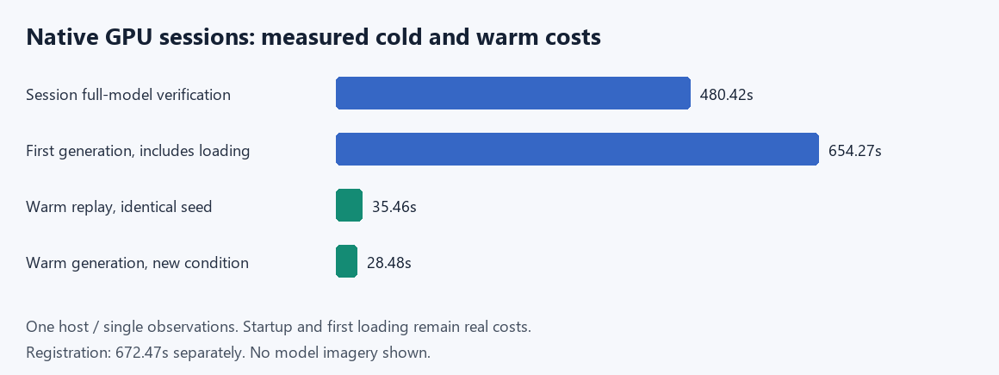

<!-- /model-session-history -->

<!-- video-generation-current -->

**Historical / 历史 / 歷史：CLI0.1.33 / alpha.4-local.31 / r34 kit · 1 Skill / 17 modules.**

新增本地 GPU 文生、图生、尾帧与首尾帧视频生成：显式条件、原文提示词、seed/采样和窗口参数，产出无声视频资产，并可直接作为普通可编辑片段入轨。复用现有 VACE 原生内核、GPU 内存准入、权利依赖与事务恢复。

```powershell
& $avk media generate --project $avkProject --adapter-id $vaceAdapterId `
  --asset-id generated-shot-01 --mode first-last-to-video `
  --first-asset-id $firstAssetId --last-asset-id $lastAssetId `
  --width 256 --height 144 --frames 17 --fps 12 --image-fit contain `
  --prompt $reviewedPrompt --inference-steps 18 --window-frames 17 `
  --window-overlap 4 --apply --track-id track_video_1
```

[Workflow](docs/product/VIDEO_GENERATION.md) · [C43](docs/product/CASES.md#c43-video-generation) · [Install](docs/releases/CLI_0.1.33_LOCAL.md) · [Evidence](docs/validation/本地GPU视频生成实测_2026-10-26.md)

四种模式均有真实 CUDA 输出、全部17帧解码与工程包往返记录；每个端点另做解码哈希核验。保留端点不证明模型运动/身份质量；模型与生成内容权利、自然质量、完整播放及完整剪映等价仍未验收。模型成片/GIF/工程包保留本机；下图仅是自行绘制的 CC0 条件图，不是生成输出。


<!-- /video-generation-current -->

<!-- tracking-bake-current -->

**Historical / 历史 / 歷史：CLI0.1.32 / alpha.4-local.30 / r33 kit · 1 Skill / 17 modules.**

原生 PTS 跟踪现可烘焙为普通 hold 关键帧：保留真实帧时钟、遮罩和转场可见度，对烘焙前后全部 Float32 显示帧逐帧比较，再导出工程。原始绑定另存旁车；普通工程包继续保留动态绑定。

```powershell
& $avk convert export --project $avkProject --target-format package `
  --bake-tracking --output $bakedPackagePath
& $avk convert import --input $bakedPackagePath --output $newProjectDirectory
```

[Workflow](docs/product/TRACKING_BAKE.md) · [C42](docs/product/CASES.md#c42-tracking-bake) · [Install](docs/releases/CLI_0.1.32_LOCAL.md) · [Evidence](docs/validation/跟踪原生烘焙导出实测_2026-10-26.md)

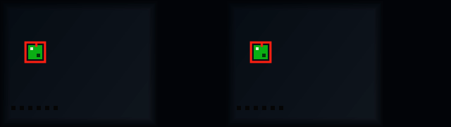

C42 实际注册 Skill：36 帧 Float32 核验、工程包重导入后的36个解码帧与完整144000双声道采样一致；5种格式导出/回读，严格草稿和源文件覆盖拒绝通过。GPU 两轮帧运算及资源关闭有记录。外部播放器、自然质量、连续播放和人工听审未验收；38项原关闭条件继续保留。

GIF 为 24 帧、实际 3.01 秒（10ms 延时单位）；MP4 保留原始 3 秒时钟。

<!-- /tracking-bake-current -->

<!-- tracking-visibility-current -->

**Historical / 历史 / 歷史：CLI0.1.31 / alpha.4-local.29 / r32 kit · 1 Skill / 17 modules.**

实际源像素/效果alpha和5类遮罩已接入跟踪；59种入出场/双源转场传递锚点及ROI足迹，连续转场保留完整密度，生成黑白幕不伪造来源；独立空间入出场可共享变速。

[Workflow](docs/product/TRACKING_VISIBILITY.md) · [C41](docs/product/CASES.md#c41-tracking-visibility) · [Install](docs/releases/CLI_0.1.31_LOCAL.md) · [Evidence](docs/validation/跟踪实际可见度实测_2026-10-26.md)

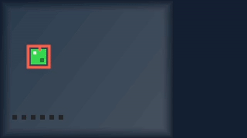

C41：45次跟踪求值对照独立整数滑动参考，全部36帧Float32及解码画面对照无绑定参考工程，完整144000双声道采样、包往返、队列分别核验。实际GPU投影/合成及清理留证。仅受控素材/静态抽帧，未验收自然遮挡、身份、连续播放或人工听感；38项原关闭条件保留。

<!-- /tracking-visibility-current -->

<!-- tracking-retime-current -->

**Historical / 历史 / 歷史：CLI0.1.30 / alpha.4-local.28 / r31 kit · 1 Skill / 17 modules.**

跟踪源、标签与关联音轨支持完整输出变速。依赖闭包保存在共享作者子序列，各父层只选择自己的输出；保留原始观察、原生PTS、ROI基准、裁切/运镜、透明度和外部叠放顺序。

[Workflow](docs/product/TRACKING_RETIME.md) · [C40](docs/product/CASES.md#c40-tracking-retime) · [Install](docs/releases/CLI_0.1.30_LOCAL.md) · [Evidence](docs/validation/跟踪共享变速实测_2026-10-26.md)


实际2倍速案例：全部18帧Float32与解码画面对应原片偶数帧；完整72000双声道采样与独立FFmpeg tempo输出逐样本相等。工程包重导入与队列另行核验。合成诊断素材，未作自然质量、连续播放或人工听审验收。

<!-- /tracking-retime-current -->

<!-- tracking-magnetic-current -->

**Historical / 历史 / 歷史：CLI0.1.29 / alpha.4-local.27 / r30 kit · 1 Skill / 17 modules.**

磁性重排支持跟踪源、标签与关联音轨跨主轨剪口同步拆分；从剪切前的完整作者工程重建源引用，保留原始观察、ROI基准、每分片偏移及完整处理时钟。

[Workflow](docs/product/TRACKING_MAGNETIC.md) · [C39](docs/product/CASES.md#c39-tracking-magnetic) · [Install](docs/releases/CLI_0.1.29_LOCAL.md) · [Evidence](docs/validation/跟踪磁性重排实测_2026-10-26.md)

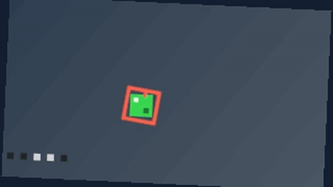

36帧Float32像素、原生PTS和动态跟踪几何均按独立指定的原帧顺序保持；完整144000双声道采样误差0。合成诊断素材，无自然质量、连续播放或人工听审验收。

<!-- /tracking-magnetic-current -->

<!-- tracking-source-edits-current -->

**Historical / 历史 / 歷史：CLI0.1.28 / alpha.4-local.26 / r29 kit · 1 Skill / 17 modules.**

跟踪源可滑移、真实头尾外扩及使用真实句柄roll/slide；原始观察保留，每个分片独立保留作者偏移，关联音轨同步源编辑，锁定引用冲突整体拒绝。修复分段恒速曲线在帧边界的浮点误选。

[Workflow](docs/product/TRACKING_SOURCE_EDITS.md) · [C38](docs/product/CASES.md#c38-tracking-source-edits) · [Local install](docs/releases/CLI_0.1.28_LOCAL.md) · [Evidence](docs/validation/跟踪源编辑实测_2026-10-26.md)


36帧Float32像素与独立无绑定工程一致，逐项核验原生索引及完整144000双声道采样。本例使用合成诊断素材；未作自然画质、连续播放或人工听审验收。

<!-- /tracking-source-edits-current -->

<!-- tracking-edits-current -->

**Historical / 历史 / 歷史：CLI0.1.27 / alpha.4-local.25 / r28 kit · 1 Skill / 17 modules.**

带跟踪绑定的原生剪辑已接通：源与标签可分割、裁切、波纹插入/删除及范围编辑；自动重规划保留源分片，固定ROI缩放/旋转基准，源删除后跟随层隐藏，锁定引用冲突整体拒绝。统一Skill实跑C37：36帧剪为30帧，全部保留Float32像素/PTS/绑定坐标一致，完整120000双声道采样误差0，可编辑包重导入相同。

[Workflow](docs/product/TRACKING_EDITS.md) · [C37](docs/product/CASES.md#c37-tracking-edits) · [Local install](docs/releases/CLI_0.1.27_LOCAL.md) · [Evidence](docs/validation/跟踪剪辑实测_2026-10-26.md)


核验编码明确采用8bit H.264 CRF0；本机10bit同参数并非逐像素无损，反例保留。源slip/真实外扩、容器变速、磁性裁切及中间格式原生烘焙继续有边界；完整目标仍在开发。

<!-- /tracking-edits-current -->

<!-- float-tracking-history -->

**Historical / 历史 / 歷史：CLI0.1.26 / alpha.4-local.24 / r27 kit · 1 Skill / 17 modules.**

原生 PTS 跟踪绑定已接入安装版：贴图/标签复用实际视频帧时钟及 crop/fit/TRS 坐标，支持倒放、变速、定格、嵌套和作者窗口；叠加序列保留声音。统一 Skill 实跑36帧/3秒案例，动画裁切与旋转下逐帧核对锚点和标记像素，取消恢复/队列完整画面时钟与PCM一致，可编辑包保留原始观测。

[Workflow](docs/product/FLOAT_TRACKING.md) · [C36](docs/product/CASES.md#c36-float-tracking) · [Local install](docs/releases/CLI_0.1.26_LOCAL.md) · [Evidence](docs/validation/原生PTS跟踪实测_2026-10-26.md)

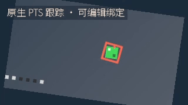

模板匹配的采样/置信度单独记录；坐标CPU，符合条件的投影/合成/文字用GPU。遮挡、mask/转场可见性、自然身份质量与原生绑定的MLT/OTIO烘焙仍有边界，完整目标继续开发。

<!-- /float-tracking-history -->

<!-- float-adjustments-history -->

**Historical / 历史 / 歷史：CLI0.1.25 / alpha.4-local.23 / r26 kit · 1 Skill / 17 modules.**

全局和区间 Float32 调整层已进入安装版：LUT 与曝光、效果链顺序、六类关键帧插值、选中序列只应用一次。统一 Skill 实跑6秒/72帧工程，组合GPU字幕/投影、倒放子序列、转场及关联声音；取消恢复与队列全部帧时钟/完整PCM一致。项目包带LUT原字节，重导入的帧与范围预览一致。

[Workflow](docs/product/FLOAT_ADJUSTMENTS.md) · [C35](docs/product/CASES.md#c35-float-adjustments) · [Local install](docs/releases/CLI_0.1.25_LOCAL.md) · [Evidence](docs/validation/Float32调整层实测_2026-10-26.md)


调整层为CPU Float32计算，可与已支持的GPU合成组合；本轮未新增模型推理或性能承诺。自然素材视听、HDR/ICC及完整目标继续验收。

<!-- /float-adjustments-history -->

<!-- float-gpu-history -->

**Historical / 历史 / 歷史：CLI0.1.24 / alpha.4-local.22 / r25 kit · 1 Skill / 17 modules.**

原生 Windows 浮点 GPU 执行层已接入正式渲染、预览、队列和恢复：仿射投影、普通叠加、文字颜色与逐词选择。已安装 CLI 完成6秒/72帧混剪；注册的统一 Skill 完成4K/8帧动画与混剪包重新导入预览。相同4K工程单次成对实测 CPU 296.712秒 → GPU 139.938秒（2.120×）；全部帧时钟/完整PCM相同，解码码差≤1。

[Workflow](docs/product/FLOAT_GPU.md) · [C33/C34](docs/product/CASES.md#c33-float-gpu) · [Local install](docs/releases/CLI_0.1.24_LOCAL.md) · [Evidence](docs/validation/浮点GPU执行层实测_2026-10-26.md)


完整解码最大8bit码差为 0（门槛≤1）。 本机RTX3060；单对实测、非独占主机，不是中位数或通用速度承诺。字形栅格、转场/效果/crop/其他混合等仍在CPU；覆盖率8bit/颜色Float32。准入配额不等于峰值RSS或可用显存预留，完整目标继续开放。

<!-- /float-gpu-history -->

<!-- float-text-coverage-history -->

**Historical / 历史 / 歷史：CLI0.1.23 / alpha.4-local.21 / r24 kit · 1 Skill / 17 modules.**

字形栅格已改为原生字节覆盖率，颜色按块浮点合成；相同前缀与段落几何复用缓存，保留原作者时钟。实际统一Skill完成4K/8帧标题动画和含转场/关联音轨的6秒/72帧案例。CPU文字，覆盖率8bit、颜色Float32。 该4K案例的CPU渲染调用耗时692.895秒，速度仍需改善。

[Workflow](docs/product/FLOAT_TEXT_COVERAGE.md) · [C31/C32](docs/product/CASES.md#c31-float-text-coverage) · [Local install](docs/releases/CLI_0.1.23_LOCAL.md) · [Evidence](docs/validation/文字覆盖率分块与复用实测_2026-10-26.md)

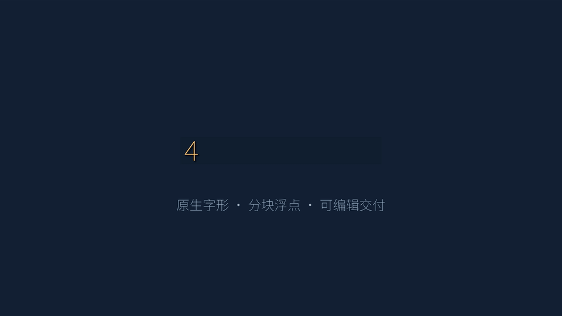

文字由CPU合成，字形覆盖率为8bit；工作区准入估算、实时速度、长片和完整目标分别验收。

<!-- /float-text-coverage-history -->

<!-- float-text-history -->

**Historical / 历史 / 歷史：CLI0.1.22 / alpha.4-local.20 / r23 kit · 1 Skill / 17 modules.**

线性浮点管线已接入独立文字、片段内字幕、打字机/逐词高亮联动及纯文本SRT；保留原作者时钟、裁切偏移和父级倒放边界。四组件颜色与alpha独立核对，实际统一Skill完成含转场与关联音轨的6秒/72帧案例。文字合成为CPU，字形覆盖率8位、颜色与合成Float32。

[Workflow / 使用流程](docs/product/FLOAT_TEXT.md) · [C30](docs/product/CASES.md#c30-float-text) · [Local install](docs/releases/CLI_0.1.22_LOCAL.md) · [Evidence](docs/validation/Float32文字字幕实测_2026-10-26.md)


Historical CLI0.1.22:plain SRT/explicit font;CPU text;4K text was rejected by its workspace admission. Full original target conditions remain open.

<!-- /float-text-history -->

<!-- float-transition-history -->

**Historical / 历史 / 歷史：CLI0.1.21 / alpha.4-local.19 / r22 kit · 1 Skill / 17 modules.**

显式线性 Float32 管线新增 57 种 xfade 图案与黑/白 dip，真实源句柄、关联音轨及组级空间进出场已接入。实际统一 Skill 完成 6秒/72帧案例，倒放、预览、取消恢复、队列与逐样本音频核对通过。CPU 执行；默认路径与 GPU 投影沿用各自契约。

[Workflow / 使用流程](docs/product/FLOAT_TRANSITIONS.md) · [C29](docs/product/CASES.md#c29-float-transitions) · [Local install](docs/releases/CLI_0.1.21_LOCAL.md) · [Evidence](docs/validation/Float32转场实测_2026-10-26.md)


CPU Float32; source-handle types and overlap/edge patterns are distinct. Natural audiovisual, HDR, long-form and all original target conditions remain open.

<!-- /float-transition-history -->

<!-- opencl-projection-history -->

**Historical / 历史 / 歷史：CLI0.1.20 / alpha.4-local.18 / r21 kit** · 1 Skill / 17 modules. 原生 GPU 动态裁切、仿射运镜及子画布双线性/面积投影已交付。相同编码与工程三轮中位数 77.85→12.51秒（6.22×），六次全部120帧、时钟和PCM相同；默认CPU，显式策略决定使用/回退。

[Install / 固定安装](docs/releases/CLI_0.1.20_LOCAL.md) · [GPU workflow / 使用流程](docs/product/OPENCL_PROJECTION.md) · [C28](docs/product/CASES.md#c28-opencl-projection) · [Evidence](docs/validation/OpenCL原生投影实测_2026-10-26.md)

```powershell
& $avk validate --project $project
& $avk render --project $project --output $output --projection-acceleration prefer --projection-device 0.0 --projection-memory-mib 1024 --sequence-sampling area --sequence-memory-mib 1024 --hardware-encode off
```


仅本机RTX3060设备实测；其余特效/字幕仍CPU。1080p/4K单帧像素对照已过，通用4K实时、长片与自然视听继续验收。

<!-- /opencl-projection-history -->

<!-- projection-scanline-history -->

**Historical / 历史 / 歷史：CLI 0.1.19 / alpha.4-local.17 / r20 kit** · 1 Skill / 17 modules. 动态裁切及嵌套crop/fit/TRS支持扫描行复用，双线性/面积采样保持精度；同组合工程三轮中位数327.62→88.41秒（3.71×），六次120帧及PCM相同。

[Install / 固定0.1.19](docs/releases/CLI_0.1.19_LOCAL.md) · [Workflow / 使用流程](docs/product/PROJECTION_RENDERING.md) · [C27](docs/product/CASES.md#c27-projection-scanline) · [Evidence](docs/validation/裁切与序列投影实测_2026-10-26.md)

```powershell
& $avk validate --project $project
& $avk render --project $project --sequence-sampling area --sequence-memory-mib 1024 --output $output --hardware-encode off
```


CPU合成；GPU编码单独选择。本次为384×216/4秒组合实测，完整4K/长片和自然质量继续验收。

<!-- /projection-scanline-history -->

<!-- affine-scanline-history -->

**Historical / 历史 / 歷史：CLI 0.1.17 / alpha.4-local.15 / r17 kit** · 208 product Python files · 1 Skill / 17 modules. 固定画布旋转/缩放自动复用扫描行参数；同工程三轮中位数 95.03 → 30.27 秒（3.14×），六次全部120帧及PCM相同。CPU合成，GPU编码仍显式选择。

[Workflow / 使用流程](docs/product/AFFINE_RENDERING.md) · [C26](docs/product/CASES.md#c26-affine-scanline) · [Evidence](docs/validation/仿射扫描行复用实测_2026-10-25.md)

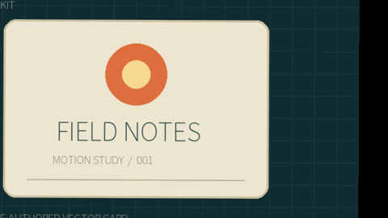

相同640×360/30fps/4秒素材与编码设置，子进程统一使用4个逻辑CPU；动态crop/fit投影、完整4K/长片和自然素材质量继续验收。

<!-- /affine-scanline-history -->

<!-- motion-pack-history -->

**Historical / 历史 / 歷史：CLI 0.1.16 / alpha.4-local.14 / r16 kit** · 208 product Python files · 1 Skill / 17 modules. 新增可复用运镜包：六套参数路径、已有动画捕获、跨时长/画幅复用、明确冲突和作者时钟；结果保留为可编辑关键帧。

[Workflow / 使用流程](docs/product/MOTION_PACKS.md) · [C25 / Original + six previews](docs/product/CASES.md#c25-motion-packs) · [Evidence](docs/validation/可复用运镜包实测_2026-10-25.md)

```powershell
& $avk motion pack list
& $avk motion pack inspect --name arc_push
& $avk motion pack apply --project $project --sequence-id $sequence --clip-id $clip --name arc_push --param travel=0.18 --param zoom=0.12 --dry-run
# Review the returned property conflicts, then apply without --dry-run.
```

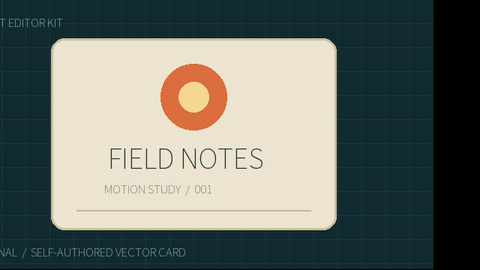

每条 4 秒/120 帧；六套 MP4/GIF 均完整解码。原生裁切/嵌套倒放、捕获复用、工程包和真实 Skill 的逐帧对照通过。空间路径为 65 点折线；带旋转样例耗时约 65 秒，CPU 合成性能/自然素材与主体跟随仍待补齐。

<!-- /motion-pack-history -->

<!-- semantic-upgrade-history -->

**Historical / 历史 / 歷史：CLI 0.1.15 / alpha.4-local.13 / r14 kit** · 206 product Python files · 1 Skill / 17 modules. 新增 `project upgrade-semantic`：安装路径改变时，逐文件校验相同实现/依赖，派生新适配器、索引和校准，无需重复模型推理。旧记录、素材、阈值和原错误保留。

[Workflow / 使用流程](docs/product/SEMANTIC_RUNTIME_UPGRADE.md) · [C24](docs/product/CASES.md#c24-semantic-upgrade) · [Evidence / 实测](docs/validation/语义运行时升级实测_2026-10-25.md)

```powershell
# Use actual source IDs and unused destination IDs; inspect returned mappings.
& $avk project upgrade-semantic --project $project --adapter-id siglip2 --new-adapter-id siglip2_current --id-prefix current --dry-run
& $avk project upgrade-semantic --project $project --adapter-id siglip2 --new-adapter-id siglip2_current --id-prefix current --idempotency-key runtime-upgrade-1
```

CPU/CUDA: 80 decisions each preserved before/after; three known errors retained. Zero new model forwards in the upgrade itself.

<!-- /semantic-upgrade-history -->

<!-- ad-storyboard-history -->

**Historical / 历史 / 歷史：CLI 0.1.14 / alpha.4-local.12 / r13 kit** · 205 product Python files · 1 Skill / 17 modules. 已实现广告 brief→多画幅/时长→独立可编辑轨道→指定镜头返工→工程包迁移。新增 `ad storyboard/build/revise`；同语种 GPU 批量配音保留原文，3 句只初始化一次模型。实际生成竖屏 12 秒、横屏/方形各 9 秒。横屏只改最后 3 秒，前 180 帧与声音 PCM 不变；真实注册 Skill 再次返工通过。

[Workflow / 使用流程](docs/product/AD_STORYBOARD.md) · [C23 / 原输入与实际输出](docs/product/CASES.md#c23-ad-storyboard) · [Evidence / 实测与边界](docs/validation/可编辑广告分镜与返工实测_2026-10-25.md)

```powershell
# Ingest actual assets and prepare the reviewed brief first; use the pinned Skill launcher below.
& $avk ad storyboard --project $project --input "$project/brief.json" --output "$project/validation/ad-plan.json" --dry-run
& $avk ad storyboard --project $project --input "$project/brief.json" --output "$project/validation/ad-plan.json"
& $avk ad build --project $project --input "$project/validation/ad-plan.json"
& $avk render --project $project --sequence-id ad_product_wide_sequence --output "$project/renders/wide.mp4"
& $avk ad revise --project $project --input "$project/revision.json" --output "$project/validation/revision-1.json"
& $avk ad build --project $project --input "$project/validation/revision-1.json"
```


调用者明确提供文案与素材选择；本例是自制产品图卡广告，不是自然素材广告质量或 Agent 自主成功率验收。完整目标继续进行。

旧安装路径直接复用的拒绝保留；CLI 0.1.15 现在提供[显式升级](docs/product/SEMANTIC_RUNTIME_UPGRADE.md)。全部实现/依赖字节相同时可复用向量，改变内容仍须重新建立索引和校准，不改旧 pin。

<!-- /ad-storyboard-history -->

<!-- semantic-control-history -->

**Historical / 历史 / 歷史：CLI 0.1.13 / alpha.4-local.11 / r12 kit** · 203 product Python files · 1 Skill / 17 modules. 完整性读取现在响应超时/取消，部分摘要丢弃，原生读锁和恢复保护保留。1 秒超时三例完整 CLI 实测 2.500 / 2.354 / 2.426 秒；取消后退出 0.188 / 0.054 秒。模型仍逐命令加载，三条原查询错误及完整目标保持开放。

[实际耗时/原始诊断](docs/validation/完整性校验超时取消实测_2026-10-25.md)

<!-- /semantic-control-history -->

<!-- unified-skill-registration -->

**只注册一个入口：`$agent-ffmpeg-local-editor`。** 当前本机 GPU 扩展使用 [r50 Skill kit](docs/skills/agent-editor-kit-community-unified-skill-r50.zip) 与匹配的[本地运行包/模型安装流程](docs/product/COMMUNITY_LOCAL_DELIVERY.md)，17 项内部模块按需加载。历史 r1 kit 继续匹配下方保持原版的公开 alpha.3 运行包。

<!-- /unified-skill-registration -->

<!-- community-materials-gpu -->

**本机新增已安装扩展：CLI 0.1.21，GPU 配音/翻译与 359 项内置开源资源。** 公开 alpha.3 附件保持原版。外层只指定 `$agent-ffmpeg-local-editor`；本机登记 GPU 包后默认优先 GPU，明确返回实际设备/回退原因，保留 CPU 兼容。

[完整流程与边界](docs/product/COMMUNITY_MATERIALS.md) · [逐项素材目录](docs/product/COMMUNITY_MATERIAL_CATALOG.md) · [103 音色与实际试听范围](docs/product/COMMUNITY_VOICES.md) · [CPU 实测](docs/validation/evidence/community-materials-20261025-r1/cpu/verification.json) · [GPU 实测](docs/validation/evidence/community-materials-20261025-r1/gpu/verification.json)。

| 扩展编号 | 已实现 | 边界 |
|---|---|---|
| M01 / F44 | 44 首 BGM、85 个短乐、228 个独立音效、2 个 OFL Noto 字体 | 分别保留来源/许可，不是商业素材订阅库 |
| M02 / F45 | 中英配音、103 具名音色、文本文件/语速/WAV | 至少 7 个音色有真实生成，未完成人类听审，不克隆、不宣称全音色听审 |
| M03 / F46 | 本地双向翻译、双语 SRT、显式术语表 | cue 顺序/毫秒保留，语义/发音仍需校对 |
| G01 / F47 | CUDA 配音/翻译、auto/cpu/cuda、显存预检 | RTX 3060 实测，严格 CUDA/CPU 回退分明，NVIDIA 依赖许可另列 |
| M04–M05 / F48 | 真实 BGM 截取/循环/淡入淡出、配音混合和闪避 | 保留原分轨，不代表作曲或自动接缝修复 |
| C01 / F49 | 原生窗口/屏幕/区域/摄像头/麦克风采集 CLI，CPU/NVENC 编码和取消 | 实测自身测试窗口；相机/麦克风、联合音画同步及长录制待验 |
| V01 / F50 | 条件检索、设备绑定经验校准、实际预览与可迁移工程 | 同机 CPU/CUDA/Skill 各 80 条迁移结果一致；仍有两条误接受、一条误拒；外部运行时另备，G26/G31 开放 |
| D01 / F51 | 中英字幕翻译、批量完整配音、实际 WAV 时窗、显式音色/混音和原子入轨 | 仅普通 SRT / 中英；cue 级时间，语义/听感/口型未验收 |

CPU 46 条、GPU 15 条属于素材/GPU 扩展历史批次的独立实测，本次语义恢复未重跑它们。该批 12 秒真实成片已完整解码、工程往返。未确认发布权利的生成配音不随公共页面再分发，本地原始分轨/完整成片见交付记录。人工听审与完整剪映等价仍未完成。

<!-- /community-materials-gpu -->


<!-- semantic-recovery-r1 -->

## CLI 0.1.12 历史功能：语义任务恢复与诊断

登记、索引、校准和检索纳入受管任务；发布前写入身份/SHA，提交引用保护整棵目录。7 类真实故障/清理用例通过结构恢复检查，但 1 秒超时响应延后至约 81.739 秒；完整性能与恢复目标未完成。

[Workflow](docs/product/SEMANTIC_JOB_RECOVERY.md) · [Real evidence and limitations](docs/validation/语义任务中断恢复实测_2026-10-25.md) · [C21](docs/product/CASES.md#c21-semantic-recovery) · [r11 Skill kit](docs/skills/agent-editor-kit-community-unified-skill-r11.zip)

```powershell
& $avk project recover --project $project --cleanup-jobs --dry-run
& $avk project recover --project $project --cleanup-jobs
& $avk validate --project $project
```

Inspect the dry-run and retain required diagnostics first. Cleanup preserves committed references, active jobs, changed/unknown files and legacy caches. It does not resume inference.

CLI 0.1.13 subsequently fixed integrity-read timeout/cancellation; actual timing and preserved boundaries are recorded in [R97/R98](docs/validation/完整性校验超时取消实测_2026-10-25.md).

<!-- /semantic-recovery-r1 -->

<!-- semantic-package-r1 -->

## 历史 CLI 0.1.11：可迁移的检索与校准工程

新导出保留语义目录，必要时只改写路径派生绑定；导入先核验内部索引、素材、向量、预览、校准与权利，再发布目标工程。向量、原观察、阈值、设备和模型 pin 保留。

同一主机的真实 CPU/GPU/Skill 各 80 条迁移后结果与原工程一致；保留两条误接受和一条钟表误拒。旧 0.1.10 损坏包拒绝导入，从完好原工程重新导出。完整 G01–G38 仍有未闭条件。

[Workflow](docs/product/SEMANTIC_PROJECT_PACKAGE.md) · [Actual checks and limits](docs/validation/语义工程包迁移实测_2026-10-25.md) · [All 80 results](docs/assets/semantic-package-20261025-r1/installed-r1/index.html) · [C20](docs/product/CASES.md#c20-semantic-package) · [r10 kit](docs/skills/agent-editor-kit-community-unified-skill-r10.zip)

```powershell
& $avk convert export --project $sourceProject --target-format package --output $projectZip
& $avk convert import --input $projectZip --output $restoredProject
& $avk semantic search --project $restoredProject --index-id images-v1 --query "a cat" --kind image --calibration-id accept-cuda --device cuda
```

Use actual paths/index/profile IDs and the pinned Skill launcher shown below. Native model/runtime dependencies remain separate; inspect conversion warnings and run the real query.

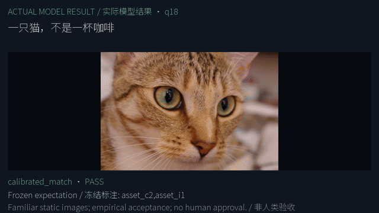

<!-- /semantic-package-r1 -->

<!-- semantic-decision-r1 -->

## 历史 CLI 0.1.10：明确条件、校准选择与完整失败预览

中文“一只猫，不是一杯咖啡”和显式 `include`/`exclude` 在同一采样帧比较；可用索引/设备绑定的经验校准返回匹配或无匹配。先明确重新登记模型、重建索引，再准备 32–128 条（至少 16 正向、16 库外）人工核对的校准 JSON。查询标签不传模型。

```powershell
# Existing project/index, explicit native adapter and reviewed calibration JSON required.
& $avk semantic calibrate --project $project --index-id images-v1 --calibration-id accept-cuda --kind image --input $calibrationJson --device cuda
& $avk semantic search --project $project --index-id images-v1 --query '一只猫，不是一杯咖啡' --kind image --calibration-id accept-cuda --device cuda --limit 3
& $avk semantic calibration-list --project $project
```

安装版 CPU/GPU 与真实 Skill 的另组 60 条均为正向 20/20、否定 20/20、库外拒绝 18/20；原 20 条新模式正向 15/16、否定 2/2、库外拒绝 2/2。原 raw 否定 1/2、库外拒绝 0/2 仍可复现。阈值是本索引经验值；全部结果需复核，复杂否定/自然动作/身份/音频/大库仍未完成。

C19 六张卡片各 2 秒，真实 12 秒/360 帧 MP4 和 60 帧 GIF，包含全部三条查询错误；卡片工程往返像素相同。另一个新索引/校准工程在导入后检索报 `SEMANTIC_INDEX_INVALID`，该迁移失败保留，不宣称可搬迁或已关闭 G31。

[Workflow](docs/product/SEMANTIC_RETRIEVAL.md) · [Actual checks and failures](docs/validation/语义条件与校准拒识实测_2026-10-25.md) · [All 80 results](docs/assets/semantic-decision-20261025-r1/installed-r1/index.html) · [C19](docs/product/CASES.md#c19-semantic-decisions)


<!-- /semantic-decision-r1 -->

<!-- subtitle-dubbing-r1 -->

## 本机 CLI 0.1.9：字幕翻译、完整配音与可编辑交付

`dub subtitles` 联合 OPUS 中英翻译、Kokoro 批量配音、实际 WAV 时窗检查和原子工程提交。一次 voice batch 只初始化一次模型；逐段保留原文、译文、完整声音、所有语速尝试及原 cue 时间。默认超窗拒绝；显式加速会完整重生成，最多三次，不截台词。

先按[完整流程](docs/product/SUBTITLE_DUBBING.md)准备源 SRT、字体及明确的 audio/subtitle 目标轨道，再运行：

```powershell
& $avk dub subtitles --project $project --input $sourceSrt --from en --to zh-Hans --device auto --fit reject --apply --audio-track-id track_audio_1 --subtitle-track-id captions --font-asset-id caption_font --dry-run
& $avk dub subtitles --project $project --input $sourceSrt --from en --to zh-Hans --device auto --fit reject --apply --audio-track-id track_audio_1 --subtitle-track-id captions --font-asset-id caption_font
& $avk validate --project $project
```

安装版 GPU 22 次 CLI、CPU 另 9 次、真实统一 Skill 另 9 次，分别留档；27 项安装专项、122 项 CLI 回归通过，另验运行中取消/超时及三个强制中断边界。19 秒/570 帧成片的工程往返 PCM/解码 RGB 相同。第三段实际译文“以秒数创建另一个版本 。”仍不自然，原结果保留；没有据技术通过宣布语义、听感、逐字或口型达标。

[实际结果与失败](docs/validation/字幕翻译配音联合流程实测_2026-10-25.md) · [C18 / 原输入、实际输出、工程与 GIF](docs/product/CASES.md#c18-subtitle-dubbing)。下图是实际成片的无声诊断；配音权利未核验，完整音画和可编辑包保留本地。

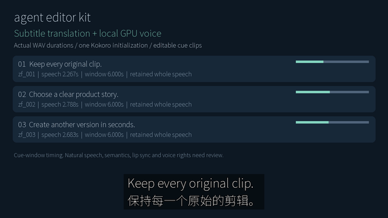

<!-- /subtitle-dubbing-r1 -->

<!-- ctc-activity-r1 -->

## 本机 CLI 0.1.8：保留原时码的词活动边界

显式 `--boundary-mode activity --granularity whitespace` 使用实际 PCM 改善有静音分隔的词起止，并保留原 CTC 字符/词时间。须先明确登记已有原生 CTC Python/权重；Kokoro/OPUS 包不提供此模型。默认 `ctc` 不变，CPU/CUDA 分别选择。

开发和固定安装版分别执行 6 组实际 GPU 推理：最大误差 4.3125–4.9375ms，原 66.6667ms 门槛不变；v1/v2 失败保留。受控合成词块不证明自然连续语音、中文、歌词或重叠声音精度，G15 仍开放。

```powershell
# Existing project/source and explicitly registered native CTC adapter required.
& $avk subtitle align --project $project --asset-id speech --adapter-id ctc --transcript $text --output assets/alignment/words.json --granularity whitespace --boundary-mode activity --dry-run
& $avk subtitle align --project $project --asset-id speech --adapter-id ctc --transcript $text --output assets/alignment/words.json --granularity whitespace --boundary-mode activity
```

[Workflow / 使用流程](docs/product/CTC_ACTIVITY_ALIGNMENT.md) · [Actual checks / 实测](docs/validation/CTC声学边界实测_2026-10-25.md) · [C17 / source, output and package](docs/product/CASES.md#c17-ctc-activity).

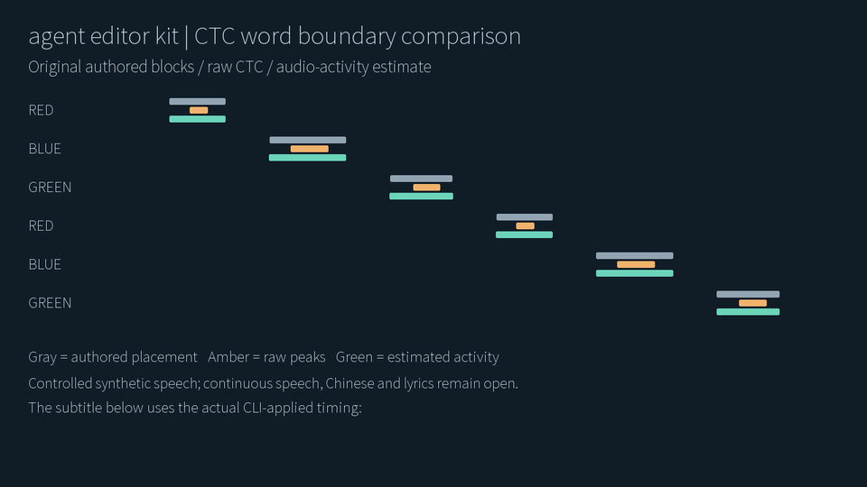

<!-- /ctc-activity-r1 -->

<!-- job-recovery-r1 -->

## 本地 CLI 0.1.7：原生中断恢复与保留规则

新四轨任务记录持久化工作目录与输出意图；共享 helper 管理原生子进程树。恢复先回滚待提交元数据，再检查归属：仅回收匹配身份/摘要且未引用的输出，保留提交后的四轨资产、活跃/变化/未知项和旧非管理缓存。

```powershell
& $avk project recover --project $project --cleanup-jobs --dry-run
& $avk project recover --project $project --cleanup-jobs
& $avk validate --project $project
```

已在真实安装版的 worker 启动、首个输出发布、元数据待提交与已提交四个位置强制结束 owner 并恢复；其中三个位置仅注入观察暂停，真实模型与恢复代码未替换。旧缓存、其他模型路径、断电/磁盘不足/长并发仍未全面验收，G33 不关闭。

[Workflow / 完整使用流程](docs/product/JOB_RECOVERY.md) · [Actual validation / 实测](docs/validation/任务中断恢复实测_2026-10-25.md) · [C16 / actual output](docs/product/CASES.md#c16-job-recovery)

<!-- /job-recovery-r1 -->

<!-- independent-four-stems-r1 -->

## 本地 CLI 0.1.6：独立四轨分离与可编辑混音

`audio separate-stems` 保留鼓、贝斯、其他乐器、人声四个独立 HDemucs 预测；`--apply` 新建四个资产与四条音轨。auto 默认优先可用 NVIDIA GPU，显式 CPU/CUDA 路径分别记录实际设备。先按下方完整流程登记已有原生 Torch/TorchAudio 与权重；基础 ZIP 和小型 kit 不包含它们。

[Workflow / 完整流程](docs/product/FOUR_STEM_SEPARATION.md) · [Validation / 全部实测与失败](docs/validation/独立四轨音源分离实测_2026-10-25.md) · [Matching installation / 安装包](docs/product/COMMUNITY_LOCAL_DELIVERY.md)

```powershell
# Existing project/source asset and explicitly registered four-source adapter required.
& $avk audio separate-stems --project $project --asset-id music --adapter-id music_four --prefix edit --apply --dry-run
& $avk audio separate-stems --project $project --asset-id music --adapter-id music_four --prefix edit --apply --device auto --timeout-seconds 600
& $avk validate --project $project
```

开发源 18 次、安装版另 18 次、真实统一 Skill 另 11 次 CLI 已执行；受控 CPU/GPU 改善门槛和四轨混音/工程往返通过。other 绝对 SI-SDR 仅约 1.71dB；自然音乐、去混响和人工听审未验收。实验权重权利 unverified，音频/工程包仅留本地；下图是原创数值图的真实渲染无声诊断，不能当试听。

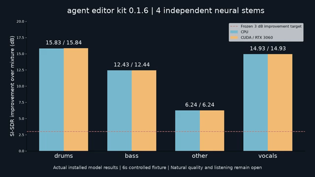

<!-- /independent-four-stems-r1 -->

<!-- semantic-retrieval-r1 -->

## 本地 CLI 0.1.5：按描述或参考图检索素材

使用已有离线 SigLIP2 模型，对选定图片和视频采样帧建立向量索引；按中文、英文或本地参考图返回候选预览、源时间和可编辑引用。仍使用一个 `$agent-ffmpeg-local-editor`。

基础 ZIP 不含 Torch 或约 1.5GB 权重。先按本地交付配置已有原生环境，读取 runtime.json 的 semantic_config，明确登记到工程，再建立索引；不隐式下载。

[Workflow / 登记与命令](docs/product/SEMANTIC_RETRIEVAL.md) · [Validation / 实测](docs/validation/离线语义检索实测_2026-10-25.md) · [All 20 queries / 全部结果](docs/assets/semantic-20261025-r1/all-query-results.png)

```powershell
# Existing project, registered local adapter and ingested source IDs required.
& $avk semantic index --project $project --index-id campaign-v1 --adapter-id siglip2 --all-visual-assets --sample-interval-seconds 2 --device auto
& $avk semantic search --project $project --index-id campaign-v1 --query '木桌上的一杯咖啡' --limit 5 --device auto
& $avk semantic search --project $project --index-id campaign-v1 --image $referenceImage --kind image --device cpu
```

在预先冻结的小样本中，开发版 CPU/GPU 的 16 条常规查询首选及 mean asset recall@3 均为 1.0；安装版真实 Skill 另验相同 20 条文本与 CPU 参考图。中文否定误选咖啡，两条库外鲨鱼查询仍返回草地；不是可靠拒识、动作理解或自动导演。

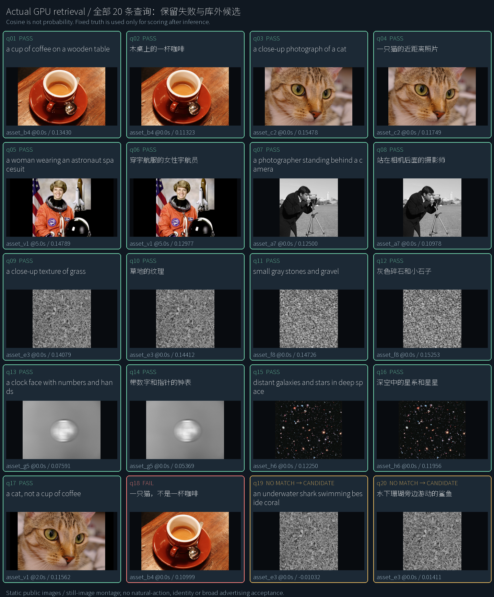

<!-- /semantic-retrieval-r1 -->

<!-- native-capture-r1 -->

## 本地 CLI 0.1.4：新增采集与音频修复

新包与原有 GPU 配音/翻译、359 项素材兼容。采集的 [完整流程与边界](docs/product/NATIVE_CAPTURE.md)、[实际 CPU MP4](docs/assets/native-capture-20261025-r1/cpu-window.mp4)、[GPU MP4/GIF](docs/assets/native-capture-20261025-r1/preview.gif) 和 [首批补齐证据](docs/validation/补齐实施首批实测_2026-10-25.md) 已提供。先按[本地安装流程](docs/product/COMMUNITY_LOCAL_DELIVERY.md)配置对应运行包，再通过同一个 Skill 调用。R3 精确相同/反相/静音声道关系已修复；一般立体声相位、4ms 极短窗音高与自然听审继续开放。

```powershell
& $avk project init './workspace/capture-demo'
& $avk capture devices
& $avk capture record --project './workspace/capture-demo' --kind window --window-title 'Your application title' --duration-seconds 5 --encoder auto --asset-id take-01 --dry-run
& $avk capture record --project './workspace/capture-demo' --kind window --window-title 'Your application title' --duration-seconds 5 --encoder auto --asset-id take-01
& $avk validate --project './workspace/capture-demo'
```

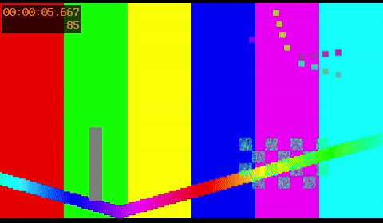

<!-- /native-capture-r1 -->


</details>

## 公开 alpha.3：下载并跑通第一条视频

**环境：Windows x64、已有 CPython 3.13 x64、FFmpeg/ffprobe 在 PATH。** 基础流程不需要模型、Node 或浏览器；安装不使用 Docker、WSL、虚拟环境或全局 pip。Python 路径按实际安装位置修改。

| 下载附件 | 用途 |
|---|---|
| [agent-editor-kit-v0.1.0-alpha.3-cp313-win_amd64.zip](https://github.com/copypasteltd/agent-editor-kit/releases/download/v0.1.0-alpha.3/agent-editor-kit-v0.1.0-alpha.3-cp313-win_amd64.zip) | 必需：应用和 8 个固定 wheel，约 196 MB。 |
| [agent-editor-kit-unified-skill-r1.zip](https://github.com/copypasteltd/agent-editor-kit/raw/refs/heads/main/docs/skills/agent-editor-kit-unified-skill-r1.zip) | 必需：离线安装入口、1 个统一 Skill、17 项内部模块、注册脚本与可运行示例。 |
| [agent-editor-kit-v0.1.0-alpha.3-gallery.zip](https://github.com/copypasteltd/agent-editor-kit/releases/download/v0.1.0-alpha.3/agent-editor-kit-v0.1.0-alpha.3-gallery.zip) | 可选：原图、500 套真实样例、离线选型页和客户对照板资源。 |
| [SHA256SUMS.txt](https://github.com/copypasteltd/agent-editor-kit/releases/download/v0.1.0-alpha.3/SHA256SUMS.txt) | 核对下载文件；安装入口还会强制验证运行 ZIP 哈希。 |

**1. 安装。** 将两个必需 ZIP 下载到 `E:/Downloads/`，选择新的工具目录；保留运行 ZIP 原样，由安装入口校验并解包。

```powershell
$avkPython = 'C:/Python313/python.exe'
$avkHome = 'E:/tools/agent-editor-kit-unified'
$avkArchive = 'E:/Downloads/agent-editor-kit-v0.1.0-alpha.3-cp313-win_amd64.zip'
Expand-Archive -LiteralPath 'E:/Downloads/agent-editor-kit-unified-skill-r1.zip' -DestinationPath $avkHome
Set-Location $avkHome
& $avkPython -I -B -X utf8 ./install.py --archive $avkArchive
```

**2. 加载 Skill 并检查环境。** 安装响应 `ok: true` 后注册；脚本保留同名冲突目录。已有本仓库本机安装的用户可继续使用原入口。客户端尚未发现 Skill 时，重新打开会话。

```powershell
powershell.exe -NoProfile -ExecutionPolicy Bypass -File ./register-agent-ffmpeg-local-skills.ps1
$avk = Join-Path $avkHome 'skills/agent-ffmpeg-local-editor/scripts/run.ps1'
& $avk version
& $avk doctor
& $avk capabilities
& $avk schema show
```

**3. 跑通示例。** 无需额外素材；随包 CC0 图片与合成音频经过实际剪辑、运镜、滤镜、预览、渲染、质检及工程包导入导出。输出目录必须尚不存在。

```powershell
& $avkPython -I -B -X utf8 ./run-example.py --output 'E:/video-work/aek-first-demo'
```

主要产物：`project/project.json` 可编辑工程、`project/renders/demo.mp4`（6 秒、360×640、30 fps、180 帧及音轨）、`demo.aevpkg.zip`、`restored/`、逐次响应和 `verification.json`。此示例核验安装与功能链路；自然画质和听审仍需独立验收。

**4. 用 Agent 编辑自己的素材。** 明确素材路径、目标、时长、画幅及音轨；Agent 先检查真实能力和来源，再形成时间线、预览和交付。

```text
$agent-ffmpeg-local-editor 用 E:/media/product.mp4 制作 15 秒竖屏广告。
先检查能力和素材，明确保留原声音轨，展示滤镜候选；生成预览、成片、质检报告和可编辑工程包。
```

**5. 按需安装图册。** 将可选 `gallery.zip` 解压到同一个 `$avkHome`，打开 `docs/assets/looks-n002-20261024-r1/index.html`；也可用下方 Skill helper 输出候选对照板。使用完关闭不用的浏览器标签。

[Release](https://github.com/copypasteltd/agent-editor-kit/releases/tag/v0.1.0-alpha.3) · [完整安装与使用流程](docs/skills/UNIFIED_SKILL.md) · [范围与限制](docs/releases/v0.1.0-alpha.3/RELEASE.md)

统一 kit 是本轮新增的 Skill 组织包，使用同一个 alpha.3 内核。新 kit 的摘要见 [包清单](docs/skills/unified-skill-package.json)；原 Release 的 17 Skill kit 不覆盖。

## 先看实际效果：同一母图的 500 套滤镜

以下每一格都来自用户提供的 N002 母图，经已安装 CLI 实际处理。原图 + 11 套示例只是入口；全部 500 套均有独立样例和详情。

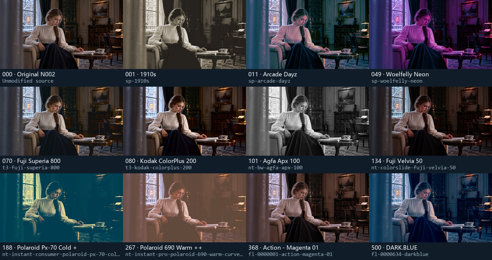

[**打开全部 500 套交互选型页**](docs/assets/looks-n002-20261024-r1/index.html) · [全部编号样例](docs/local/FILTER_GALLERY.md) · [逐项实际效果](docs/local/LOOK_PRESETS.md) · [原始 PNG](docs/assets/looks-n002-20261024-r1/source.png) · [来源与许可](docs/assets/looks-n002-20261024-r1/SOURCE_AND_LICENSES.md)

选型页支持简体/繁体/英文、编号/名称/ID/描述搜索、类别与许可筛选、原图滑杆、候选勾选和 JSON 导出。每页仅加载 40 张小图，选中时再加载原尺寸大图。GitHub 文件页不执行 HTML，请下载仓库后直接双击该 HTML；无需服务或联网。

**样例口径：** 原图 1672×940，统一强度 1.0、四面体插值；500 张原尺寸无损 WebP 与实际 CLI PNG 的解码 RGB 逐像素一致，500 张小图为缩放的 WebP。母图没有嵌入色彩配置，按编码 SDR RGB 试片，不推断为相机/HDR 校准。母图使用依据为用户本次提供与展示指令，未将其标为 MIT/CC0。

## 产品方案与完整执行逻辑

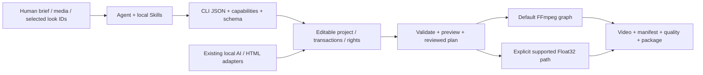

当前实现是 **Python CLI + Agent Project schema + FFmpeg**，并有显式的 Float32 处理子集。Concat 是早期路线研究对象，发行包不是“删除 Concat GUI 的二进制”。已采用的 OpenFilm 字幕分段、帧时钟、HTML 动效/模板等复用保留来源与许可；当前运行不依赖 OpenFilm 在线服务。

1. 读取 version/doctor/capabilities/schema，确定本机真实可用的能力与依赖。
2. 把 brief 写成计划：素材、画幅、时长、镜头、音轨、字幕、运镜、风格、交付与证据。
3. 创建独立工程，导入本地素材，用真实 asset ID 与整数 ticks 编写编辑 JSON；音轨明确添加。
4. 通过事务 compose/edit/apply 写入时间线，保留快照；先校验，再预览关键帧和区间。
5. 若需要选型，展示原图与少量候选，记录最终 ID/强度/作用域；在目标素材上复试。
6. 渲染至工程内新路径，检查实际编码文件、manifest、warning、音画与权利，再导出项目包。

<a id="feature-modules"></a>

## 功能模块与实际支持边界

编号用于定位文档；各模块有依赖与交叉，不是“43 个独立内核”或完成率。下表直接写明行为、入口与限制；[完整机器能力清单及每项契约](docs/product/CAPABILITIES.md)保留全部字段。

| 编号 | 功能模块 | 具体行为与输入 → 输出 | 入口 | 依赖/边界 |
|---|---|---|---|---|
| F01 | Agent 调用协议 | 任务参数 → JSON 响应、退出码、错误、warning、产物与 provenance；能力与 schema 可查询。 | `version; doctor; capabilities; schema show` | Skill 组织任务，CLI 执行；没有后台云端 Agent 服务。 |
| F02 | 可编辑项目 | 创建/检查 Agent Project，保存资产、序列、轨道、ticks 时钟、输出配置和权利引用。 | `project init/inspect` | 源媒体与项目元数据分离，移动工程后需重链并复核证据路径。 |
| F03 | 事务、恢复与快照 | 元数据事务/快照；原生子进程树归属；显式恢复四轨及字幕配音的持久化工作目录和未提交输出。  新增语义登记/索引/校准/检索的受管任务。| `project snapshot/restore/migrate/recover; operation inspect` | 整棵已引用语义目录保护；活跃/变化/未知/旧缓存保留。仅已接入任务，不是模型续算；当前完整性读取已响应超时/取消；其他 worker/OS 阻塞 I/O 仍有边界。 |
| F04 | 素材导入与重链 | 本地图片/视频/音频/字体 → 探测结果、稳定资产 ID、哈希和来源记录。 | `media ingest/relink` | 不抓取在线素材；导入不自动证明商业授权。 |
| F05 | 代理、缩略图与波形 | 素材 → 轻量代理、图片缩略图、音频波形、可核查联系表。 | `media prepare/contact-sheet` | 联系表是抽样证据；不代表逐帧视觉理解。 |
| F06 | 镜头、静音与高光分析 | 本地视频/音频 → 切镜、静音、节拍或启发式高光候选与时间证据。 | `media understand/highlights` | 高光是启发式候选，语义判断需要 Agent/已注册适配器复核。 |
| F07 | 智能粗剪与广告计划 | 经检查的静音/文本片段或广告 brief → 编辑计划 → 可编辑粗剪。 | `media smart-cut; ad plan/apply` | 计划与实际 apply 分开；不承诺自动导演效果或投放表现。 |
| F08 | 节拍剪辑与多机同步 | 节拍锚点/本地多机音轨 → 剪切或 offset/显式 affine 时钟及切机计划。 | `media beat-cut/multicam` | 低置信度、覆盖不足、非线性漂移需拒绝/显式处理；不自动添加音轨。 |
| F09 | 多轨基础剪辑 | 编辑 JSON → 加轨、插入、更新、拆分、删除、时长/位置修改与画幅设置。 | `timeline compose/edit` | 遵守轨道锁、整数 ticks、资产时长与实际能力契约。 |
| F10 | 范围与输出窗口编辑 | 明确区间 → 裁切/删除/波纹等范围编辑，保留作者时间与源映射。 | `timeline edit` | 复杂变速与嵌套的组合需按具体契约检查，不推断所有组合均可用。 |
| F11 | 源句柄、滑移与滑动 | 源入出点与邻接片段 → 可逆源编辑、源句柄转场和剪口调整。 | `timeline edit/transition` | 源句柄不足会报错；不以静默复制帧替代。 |
| F12 | 磁吸、主轨与关联音画 | 主轨重排、原生跟踪跨剪口同步拆分、区域关联ID和音画附着。 | `timeline edit` | 显式同步及拆分策略；锁、转场端点和资源门禁；非原生跟踪跨剪口继续受限。 |
| F13 | 复合与嵌套序列 | 子序列 → 独立画布合成、父变换/透明度、嵌套时钟与定格。 | `timeline compose/edit` | 独立空间不代表独立色彩/帧率；部分组级空间转场未接受。 |
| F14 | 变速、倒放与定格 | 共享完整作者时钟、逐层输出和单次声音；原生独立空间入出场可保留。 | `timeline edit; render` | 跨片段转场仍需完整上级；ripple/retime、锁、预算和音频后端边界保留。 |
| F15 | 关键帧与缓动 | 位置、锚点、缩放、旋转、透明度、裁切、蒙版、音量/声像 → 逐帧动画。 | `timeline compose; schema show` | hold/linear/ease_in/ease_out/ease_in_out/bezier；枚举/布尔值不推断为连续动画。 |
| F16 | 12 套运镜预设 | 推拉、上下左右平移、Ken Burns、旋入/旋出、淡入/淡出、shake → 可编辑关键帧。 | `motion list/inspect/apply` | 参数有界；是明确关键帧预设，不是 AI 三维相机或全部商业运镜库。 |
| F17 | 转场与剪口效果 | 相邻片段与源句柄 → 淡化、擦除、滑动、黑/白场、圆形等已声明转场。 | `timeline transition; capabilities` | 按渲染路径和层级选择；显式 Float32 已提供 F55 的转场子集，CPU 执行，支持范围见其独立契约。 |
| F18 | 几何蒙版与逐帧修正 | 矩形/圆/椭圆/路径/多边形 → 反选、羽化、动画、编码蒙版与修正。 | `timeline compose; media mask-edit; quality mask` | 路径点数和采样受限；几何通过不等于语义分割/身份正确。 |
| F19 | 图层合成与混合 | 多轨视觉层 → normal/multiply/screen/overlay/difference/addition/softlight/hardlight。 | `timeline compose; capabilities` | 默认路径主要为编码 8-bit RGB；不宣称线性光/HDR 合成等价。 |
| F20 | 51 个效果处理算子 | 模糊/锐化、降噪、色调、曲线、HSL、色键、暗角、颗粒等 → 可配置效果链。 | `effects list/inspect` | 可动画参数与实际后端逐项查询；51 算子与 500 成品 LUT 是不同统计。 |
| F21 | 500 套离线风格 | 名称/ID/类别/许可检索 → 详情、图片预览、片段或全局应用与来源副本。 | `look list/inspect/preview/apply` | 500 个不同数值变换含同系列曲线；SDR 创意映射，不是 500 个独立家族。 |
| F22 | 自定义 LUT 与色彩自动化 | 本地 .cube/.3dl/.csp/.dat → 登记、检查；支持的 3D LUT 强度与色彩参数按契约动画。 | `lut register/list/inspect; effects inspect` | 格式登记不等于所有路径都完整解析；完整 CUBE 才有对应强度/浮点支持。 |
| F23 | 显式 Float32 像素路径 | 声明输入/工作/输出信号、顺序与预算 → 原生浮点色彩、LUT/shaper、选定空间处理和 surface。 | `render; preview; surface export/inspect` | 必须显式选择 float32-native-v1；能力子集，拒绝不支持项，非完整 HDR/ICC 管线。 |
| F24 | 字幕、文字与分段 | SRT/VTT/ASS/SSA/TTML 或文字 → 规范化、分段、双语、文字层、逐字高亮和文字动画。 | `subtitle validate/normalize/segment; timeline compose` | 字体需本地可用；复杂排版、双向 shaping 与部分动画/时钟有明确近似或拒绝。 |
| F25 | 离线转写与字词对齐 | 音频 + 已有 Whisper/CTC 模型/校正文 → 转写、字幕、字词时码与 CER 评估。 | `asr adapter; subtitle transcribe/align/evaluate` | 基础包不带权重；activity 保留原 CTC 并通过 6 组受控词块门槛；自然连续语音、中文和歌词精度仍未验收。[流程](docs/product/CTC_ACTIVITY_ALIGNMENT.md) |
| F26 | 多轨音频与总线 | 显式音轨 → 混音、总线、音量/声像、静音/solo、淡化、EQ、压缩、降噪、响度与闪避。 | `audio extract; timeline compose; quality check` | 视频资产有声音不代表时间线自动出声；自动 PCM/LUFS 检查不代替听审。 |
| F27 | 本地语音合成 | 已有本地 flite 或登记 SoulX 权重/授权参考声 → WAV 资产与可选音轨。 | `tts adapter/voice; tts synthesize` | flite 取决于 FFmpeg 构建且限 ASCII 英文；SoulX 需 CUDA/原生依赖，非基础包自带配音库。 |
| F28 | 独立四轨与双轨分离 | 音频 → drums/bass/other/vocals 四个模型预测、float WAV 与可编辑音轨；保留原双轨和 mid/side。 | `audio separate-stems; audio separate; audio adapter` | 另供原生环境/权重；受控 CPU/GPU 实测，自然质量/听审/模型权利仍待验。 |
| F29 | 跟踪、绑定与重构图 | 模板/模型/已编码蒙版轨迹 → 文字/贴纸锚定、裁切与主体重构图关键帧。 | `media track/track-bind/reframe` | 多目标须明确对象；置信度/蒙版不等于身份保证，支持的变换与时钟需检查。 |
| F30 | OCR 锚点与人脸修饰 | 已有 PP-OCR/OpenSeeFace 模型 → OCR 框/文字、锚点运镜、人脸点位与受限修饰。 | `ocr adapter/scan/anchors; face adapter/scan/retouch` | 已有 ONNX CPU 环境与权重；不是完整 UI 行为识别、美妆、瘦身或脸部生成。 |
| F31 | 人像抠像与对象分割 | 已有 RVM/SAM2 + 提示点/框 → 透明视频、对象 mask 和可编辑派生资产。 | `media adapter; media matting` | RVM 人像与 SAM2 对象分割不同；概率 mask 不是物理发丝 matte，需检查运动/遮挡。 |
| F32 | 修复、生成编辑与扩画 | 已有 LaMa/VACE + 蒙版/提示 → 修复或扩大画布，保留来源与可重放 recipe。 | `media inpaint/outpaint; media adapter` | LaMa 逐帧不保证时序；VACE 需 CUDA 且仅窗口联合；自然纹理/时序质量未普遍验收。 |
| F33 | HTML/CSS/SVG/Canvas 动效 | 受信任本地源码/素材/字体 → 可编辑模板控件、透明标题、逐笔描线、布局诊断与时间线合成。 | `motion html-*; motion stroke-source` | 另需已有 Node/Playwright/Chromium；非任意网页沙箱，不自动下载浏览器。 |
| F34 | 参数模板与批量变体 | 本地 JSON 模板 + 类型变量 → 可编辑项目变体、批量输入与模板快照。 | `template apply/batch` | 支持 asset/color/enum 等类型；复杂条件图和表达式执行未实现。 |
| F35 | 素材索引与片段组复用 | 素材目录/已编辑片段 → 检索、重复/相似检查、跨项目片段组与依赖闭包。 | `library index/search/duplicates/similar; fragment` | 用户自建资源库，未内置商业素材订阅/正版音乐库存。 |
| F36 | 帧、区间与缓存预览 | 工程 + 明确帧/区间 → PNG/短视频/缓存与可验证采样证据。 | `preview frame/range; cache; preview cache-*` | 预览不是完整成片核验；色彩路径与缓存签名需一致。 |
| F37 | 输出、编码与GPU投影 | 工程 → MP4/WebM/MKV、显式OpenCL裁切/仿射/子画布投影、编解码探测与manifest。 | `render --projection-acceleration; render` | 原生GPU需双精度/纹理预检；CPU默认，其他特效仍CPU，无实时/通用4K保证。 |
| F38 | 持久队列、重试与取消 | 冻结项目快照 → 本地排队、有限worker、显式重试/取消与串行元数据提交。 | `queue enqueue/list/inspect/run/cancel` | GPU投影策略逐作业传递，拒绝其 --reuse-identical 绕过探测；不是云渲染。 |
| F39 | 成片、Scope 与 golden 核验 | 实际编码文件 → 音画/帧率/画幅/时长、响度/黑场、色彩 Scope、蒙版和 golden 差异报告。 | `quality check/scopes/mask/golden` | 自动检查、静态目检、连续播放、人工听审分别记录；不等于商业成片质量认证。 |
| F40 | 权利台账与本地策略 | 素材/字体/LUT/模型/模板证据 → 依赖台账、变更历史、影响/撤回与发布门禁。 | `rights; policy audit; render --publish` | --publish 只检查本地权利，不上传；台账不自动裁定版权。 |
| F41 | 项目与时间线交换 | Agent JSON/package、OTIO、Kdenlive MLT、已有合法明文草稿 → 导入/导出与损失报告。 | `convert import/export` | Exact/Approximate/Unsupported/Failed 逐项报告；明文草稿不调用剪映，不解密或下载专有资源。 |
| F42 | 管道诊断与错误交付 | 失败操作 → 有界日志、diagnostic manifest、显式导出和可复查错误信息。 | `diagnostics list/show/export; operation inspect` | 失败/拒绝不是成功渲染；包含本地路径的诊断需按交付范围处理。 |
| F43 | 创意、内容与投放分析 | 用户提供的产品、受众、参考片或投放表 → 脚本、结构、变体建议与分析。 | `ad plan/apply; advisory Skills` | 策略 Skill 不提供广告平台连接、自动投放、实时数据或效果保证。 |
| F44 | 内置开源素材库 | 359 项逐项具名 BGM/短乐/音效/简繁字体 → 查询、检查、权利登记与项目资产。 | `materials list/inspect/verify/ingest` | 44 BGM、85 短乐、228 音效、2 字体；每项保留来源/许可，视频/贴纸和行业覆盖不足。 |
| F45 | Kokoro 中英配音库 | 文本、103 具名音色和语速 → 完整 WAV、实际时长与可编辑声音资产。 | `voice list/synthesize; model-pack` | 可选 CPU/CUDA 包；累计至少 7 个音色实际生成，完整试听、情绪/方言与人类听审未验收。 |
| F46 | 中英翻译与双语字幕 | 文本或普通 SRT → 中英双向译文、简繁转换、双语 SRT与显式术语译后替换。 | `translate text/subtitles` | OPUS 需本地模型；保留 cue 顺序/毫秒，错译仍保留，不能替代人工语义接受。 |
| F47 | GPU 配音与翻译选择 | 明确 CPU/CUDA/auto 和显存预检 → 实际 provider、设备与明确回退/失败。 | `gpu inspect; voice; translate; --device` | RTX 3060 实测；配音 CUDA 13 / 翻译 CUDA 12、配音当前仅设备 0，其他滤镜不因此 GPU 化。 |
| F48 | 配乐准备与声音混合 | 实际音乐/人声资产 → 截取、循环、淡入淡出、显式增益和人声闪避混音。 | `music prepare/mix` | 保留原分轨，不静默裁人声；不作曲、不自动修复循环接缝或保证画面语义匹配。 |
| F49 | 原生采集 | 明确窗口/屏幕/区域/相机/麦克风 → 有限录制、CPU/NVENC、取消和项目资产登记。 | `capture devices/record` | 真实窗口 CPU/GPU 已验；相机/麦克风、联合音画同步、设备故障和长录制未验。 |
| F50 | 离线图文语义检索与条件选择 | 本地索引、中英/参考图、同帧正负条件、经验校准档案、实际预览/源时间及可编辑引用。 | `semantic adapter-register/index/calibrate/calibration-list/search/verify` | 工程包按需派生路径绑定；同机 80 条迁移决策保留，仍有 3 条已知错误；运行时另备，G26/G31 开放 |
| F51 | 字幕翻译配音联合流程 | 普通中英 SRT、显式音色/轨道 → 译文或保留同语种原文、完整批量 WAV、实际时窗、可编辑声音/字幕和原子提交。 | `dub subtitles` | 同语种只初始化配音模型；保留原声/重试/错译；cue 时窗不证明字词精度、自然韵律或口型同步。 |
| F52 | 可编辑广告分镜与返工 | 已确认 brief/实际素材 → 多画幅与时长的画面/字幕/配音/源音/配乐独立轨道；按镜头与变体局部改稿。 | `ad storyboard/build/revise` | 整帧分配、原素材字节锁、实际字体排版和完整配音时窗；不自动创造卖点或决定素材语义。 |
| F53 | 语义运行时升级 | 旧适配器/索引/校准 → 新安装路径下的新 ID，复制向量/预览/数据集且保留拟合和原观察。 | `project upgrade-semantic` | 全部 19 个实现与外部依赖须字节相同；零新模型前向，原记录不改；内容变化拒绝并要求重建。 |
| F54 | 可复用参数运镜 | 本地版本化 JSON / 已有作者曲线 → 普通关键帧、参数/摘要/快照、跨工程复用。六套真实预览供选型。 | `motion pack list/inspect/create/capture/apply` | 65 点采样、transform 属性；默认拒绝冲突，显式替换整条属性轨；跟踪绑定拒绝，CPU 合成/自然质量未闭。 |
| F55 | 线性浮点转场与组级进出场 | 显式 Float32 工程 → 57 xfade图案+2 dip、预乘alpha混合、真实句柄/原作者时钟、关联音轨、组级擦除/推移与实际预览成片。 | `timeline transition; preview; render; queue` | CPU；12种真实句柄声明，其他图案用显式重叠/边缘；normal双源混合；风噪有平台差异，HDR/自然质量未闭。 |
| F56 | 线性浮点文字与字幕 | 独立/内嵌/SRT、联合逐词/打字机 → 原生字节覆盖率、可复用字形、分块线性合成、原作者时钟、4K标题和实际交付。 | `timeline compose; preview; render; queue` | 明确本地字体；CPU/显式GPU；覆盖率8bit/颜色Float32；工作区准入非峰值RSS；富ASS/Bidi/自然质量未闭。 |
| F57 | 原生Float32 GPU执行 | 仿射、普通合成、文字组件/逐词、粒子栅格及光学/高光扩散效果；任务自有管道/共享像素，贯通渲染/预览/队列/恢复。 | `projection_acceleration; render; preview; queue` | off/prefer/require；binary64精度/次正规探测，粒子保持Float32；有界控制及所属进程/线程/流清理，其他算子CPU。 |
| F58 | Float32全局/区间调整层 | 全轨含字幕合成后按顺序调色/光效；既有浮点效果与光学/高光扩散效果、六种插值，选中根只应用一次。 | `settings.adjustments; preview; render; queue` | 明确线性工作域/效果信号；光学/高光扩散可GPU，其余CPU；LUT持锁/包迁移，原作者区间时钟，非完整HDR。 |
| F59 | 原生PTS跟踪与叠加轨 | 保存源观测→按实际原生帧求跟随位置；共享crop/TRS、ROI缩放/相对旋转、透明度、窗口与嵌套声音。 | `media track-bind; preview; render; queue; package` | 显式Float32，原生PTS不烘焙显示键；预算/循环门禁；模板漂移与遮挡另审，中间格式烘焙未接通。 |
| F60 | 原生跟踪与烘焙交付 | 实际alpha/5类遮罩/59转场足迹；剪辑与共享变速保留观察；原生烘焙逐帧核验并保留源旁车。 | `media track-bind; timeline compose/edit; convert export --bake-tracking` | 当前冻结图/FPS；20,000帧/256,000求值；无法表达的整数步进拒绝；外部播放器及自然身份/遮挡待验收。 |
| F61 | 本地GPU视频生成 | 文生、图生、尾帧/首尾帧；原文提示/采样、真实模型窗口、可编辑入轨、端点核验、可移植配方和受管恢复。 | `media adapter; media generate` | 已有原生VACE/CUDA依赖；无声8bit SDR；条件端点合成保留；自然质量/生成权利/全部剪映AI待验收。 |
| F62 | 原生GPU模型会话 | 同工程/适配器/提示词复用权重与嵌入；每任务重置，活连接传递持锁摘要；取消、期限、空闲及任务数退出。 | `media model-session; media generate --model-session` | 原生Windows VACE；首条仍载入；新提示词须新会话，串行执行；非全局显存预留/多GPU。 |
| F63 | 可编辑程序化粒子与发射器动画 | 六种原创建效配方、五形状、seed/独立CFR；21属性源时钟关键帧、六种缓动、发射暂停；真实GPU栅格化。剪辑/预览/队列/包/本地OTIO贯通。 | `vfx list/inspect/apply/update/show/animation-properties/animate` | CPU积分与出生采样，GPU绘制；64点/属性、16发射器、4096预留活粒子；无3D/碰撞/深度。 |
| F64 | 可编辑光学效果与GPU运算 | 眩光核心/条纹/光晕/鬼影、旋转椭圆漏光、径向红蓝色差；全部数值通道关键帧、原作者时钟、片段/区间调整层，CPU/OpenCL。 | `effects list/inspect` → `timeline compose` → preview/render | 明确线性RGB；原alpha位保留，透明隐藏色不渗出；ghosts/edge静态，非物理镜头/自动亮源/bloom。 |
| F65 | 真实高光 Bloom / 胶片 Halation | 软膝阈值提取实际高光→分离高斯扩散→核心抑制/线性着色；可编辑数值轨道和原作者时钟，片段或根区间调整层。 | `effects list/inspect; timeline compose; preview; render; queue` | sigma0…32输入像素；透明/复制边界、原alpha位保持；实际四kernel GPU/CPU参考，有界空间/访问预算；非物理胶片/HDR验收。 |
| F66 | 原生 PQ／HLG HDR 与 SDR 显示 | 明确参考白及HLG峰值/gamma，解码至显示线性光；不同nit素材、普通效果/合成、10-bit BT.2020 NCL交付，单独选择SDR trim及PNG/MP4预览。  源码51另增OKLab保感知明度/色相缩色度；安装50尚未包含。| `timeline compose; validate; preview; render; convert` | 传递CPU，已有合成/光效可GPU；拒绝8-bit/标签不符/缺单位；alpha位保留。非ICC/动态元数据或HDR监看验收。 |
| F67 | 本地神经口型同步 | 图片／视频＋独立声音→真实CUDA MuseTalk口型；25FPS人脸框关键帧、语义下半脸混合、完整PCM及alpha保留，可复用配方并视频/音频关联入轨。 | `lipsync adapter register/list/inspect; lipsync generate` | 本地safetensors及已有原生Torch依赖；脸部256×256、明确8bit SDR与源运镜、无CPU回退；自然口型、完整数字人仍未验收。 |
| F68 | CUDA神经补帧与慢动作 | 原生CFR/VFR、每源帧RGBA、预乘alpha、完整PCM；2..8倍、切镜保持、关联慢放双轨、配方重跑及工程包。 | `interpolate adapter; interpolate generate` | 显式RIFE4.25 safetensors＋原生CUDA Python；无CPU回退；困难运动/遮挡/自然质量/HDR未广泛验收。 |
| F69 | CUDA对白降噪与增强 | 原生采样时钟/单双声道、真实模型、干湿强度/衰减、可编辑独立音轨、配方重跑/工程包、取消回滚。 | `audio enhancement-adapter; audio enhance` | DeepFilterNet3固定safetensors＋已有原生CUDA依赖；分段状态重置、CPU前端；不是完整去混响/音乐保真。 |
| F70 | HDR10静态元数据交付 | 母版RGB/白点xy、最小/最大nit、MaxCLL/MaxFALL → 实际HEVC SEI与解码核验清单。 | `settings.output.hdr10; validate; render; convert` | 明确原生PQ/BT2020 NCL有限量程、libx265/10bit420/MP4或MKV；作者声明、前32包核验。 |
| F71 | 白点适应与宽色域工作配置 | ProPhoto D50／AP1 D60／明确xy → 线性XYZ Bradford、nit缩放、实际D65预览与工程包。 | `native_chromatic_adaptation; render; preview; surface export; convert` | CPU色彩数学，GPU光晕按声明白点；不含ICC解析／完整ACES／自动白平衡。 |
| F72 | 原生ICC来源色彩管理 | RGB ICC v2/v4矩阵/CLUT、明确SHA/意图/BPC → 线性RGB工作域，Float32/alpha、实际预览与工程包依赖闭合。 | `native_icc_source_profiles; surface inspect-profile; surface export; render; preview; convert` | 固定MIT LittleCMS原生CPU；不含任意输出ICC/软打样/CMYK/自动内嵌推断。 |
| F73 | HLG显示黑位与完整信号CLI | BT.2100黑位提升/逆变换、明确nit与黑位、零黑位原数值路径、完整RGB/HDR/ICC JSON与显式域策略。 | `native_hlg_black_level; surface export; render; preview; convert` | 不推测屏幕；nominal0..1；超限拒绝或明确裁切；不含动态HDR/完整ACES。 |
| F74 | 原生ICC输出与软打样 | RGB v2/v4矩阵/B2A CLUT、四意图/BPC、明确nits、逐帧内嵌ICC的RGBA16 PNG及作者PCM、真实SOFTPROOFING和完整交付检查。 | `native_icc_output_profiles; surface render; surface inspect-output; render; preview; convert` | CPU CMM；GPU剪辑独立；8GiB产物预算；无CMYK/ICC5/物理设备校准。 |
| F75 | 编码前后HDR光量与转换收据 | 明确nit；实际作者RGB16输入与编码后原生RGB/YCbCr分别测量，MaxRGB/CIE Y、位置/时长、完整像素与时钟摘要、全帧裁切账本。 | `native_hdr_light_measurement; surface measure; surface measure-media; surface export; render` | CPU测量；不推断显示器、不自动写SEI；原生曝光缺口/重叠不填补。 |
| F76 | 原生 ACES 时间线与显示视图 | 固定ACES1.3/2.0/2.1；AP1/D60场景输入、曝光、正式SDR/PQ/HLG输出、独立观看视图、显示线性缩图与测量。 | `native_aces_display; surface ocio-configs; render; preview; surface measure` | 源码CLI53、CPU；不是自动相机IDT/AMF/LMT/GPU或物理监看；安装Skill已53。 |
| F77 | 校准语义广告联合选材 | 单批真实语义接口、全变体来源窗口／源音／权利筛选、全局去重分配、可移植逐镜头依据和普通分镜计划。 | `ad select; ad build; ad revise` | 源码CLI54；45项测试通过，实际CUDA／安装／Skill另验；不证明整段语义或自然广告质量。 |
| F78 | 原生子进程继承预算 | 在预算上下文内，启动／等待／返回时检查外层期限和取消标记，中断时关闭自有Job并回收读取线程。 | `run_process / operation_budget` | 源码CLI55；15项控制回归通过；不承诺OS阻塞调用硬实时抢占。 |
| F79 | 语义模型原生依赖隔离 | 工作进程固定自己的应用包后恢复模型Python的依赖搜索顺序，保留版本／模块路径／摘要检查，避免安装site覆盖模型NumPy／Pillow。 | `semantic / ad select / project upgrade-semantic` | CLI56源码／安装原生回归与实际CUDA案例通过；新实现须重新登记绑定，非任意环境兼容保证。 |
| F80 | 15类原生工作进程依赖隔离 | 临时固定所属应用包后恢复模型Python依赖搜索顺序，拒绝预加载外部同名包，保留原版本／路径／摘要校验。 | 原生ASR／CTC／分割／抠像／跟踪／修复／生成／口型／补帧／降噪／分离等入口 | CLI57源码31项子进程回归通过；安装和实际模型另验，正式Skill仍CLI56。 |
| F81 | 精确内容去重选材 | 规范SHA256内容分组、全局联合分配，支持显式ID去重或复用。 | ad select；不同ID相同文件；非感知去重 | 源码58选材／分镜57项通过；[规则与证据](docs/product/AD_CONTENT_UNIQUENESS.md)，58安装另验。 |
| F82 | 自有原生进程同步回收 | 持有自有成员句柄并等待退出，独立Job互不影响，保留外层预算异常。 | Windows模型／工具子进程及补帧预处理超时 | 源码58控制19项、超时3项分别通过；[行为与证据](docs/product/OWNED_PROCESS_CLEANUP.md)。 |
| F83 | 可编辑谱面与程序音效（正式CLI59） | 谱面拍点／MIDI音高／8解析乐器 → 48kHz双声道WAV、分轨和可编辑工程；4种电子音效。 | `music inspect-score/compose/effect` | [实际内容、命令、配器与限制](docs/product/MUSIC_SCORE.md)；不是神经生曲，正式Skill59已支持。 |
| F84 | 循环接缝交叠修复（开发CLI60） | 样本时钟、双曲线、可编辑配方、权利继承、取消与事务回滚；周期明确缩短。 | `music repair-loop` | [流程与C76试听](docs/product/MUSIC_LOOP.md)；正式Skill仍59，未计自然听感验收。 |

## 支持的服务模块与依赖

这里的“服务”指本地处理模块与适配器。基础包提供 CLI/项目/渲染能力；模型、浏览器、字体与用户素材按下面条件提供。

| 编号 | 服务模块 | 运行形式 | 需要什么/提供什么 | 入口 | 范围 |
|---|---|---|---|---|---|
| S01 | 本地 Agent 工具服务 | 原生进程/JSON | Python 3.13 + 已安装包；Agent 可通过命令行或 Skill 调用。 | `version / capabilities / schema show` | 不内置 SaaS、HTTP API 或 MCP server；可由调用方自行封装。 |
| S02 | 项目与操作存储 | 本地文件/事务 | Agent Project、快照、锁、操作与恢复记录。 | `project / operation` | 不是多人云协作数据库。 |
| S03 | 媒体处理与默认渲染 | 随功能调用 | 已有 FFmpeg/ffprobe，素材均来自本地。 | `media / timeline / render` | 实际编码器/滤镜可用性取决于当前 FFmpeg。 |
| S04 | 显式浮点像素内核 | 选择性启用 | NumPy 与声明的 signal/预算；与默认管线分开检查。 | `surface / render / preview` | 子集实现，非通用 FFmpeg 或剪映内核的完整替代。 |
| S05 | 字幕与语音 | 基础解析 + 可选模型 | 字幕文件解析可直接用；Whisper/CTC/SoulX 需已有注册环境。 | `subtitle / asr / tts` | 无默认云转写/配音供应商。 |
| S06 | 视觉 AI 与修复 | 可选本地适配器 | RVM/SAM2/LaMa/VACE/跟踪/OCR/人脸的各自原生依赖与权重。 | `media adapter / ocr / face` | 基础包无模型权重，未配置不能声明已执行。 |
| S07 | HTML 动效生成 | 可选本地运行时 | 明确登记已有 Node、Playwright、Chromium、模板、图片和字体。 | `motion html-*` | 不依赖 OpenFilm 在线服务；不自动安装浏览器。 |
| S08 | 资源、模板与风格目录 | 随包目录 + 用户库 | 500 LUT 随包；素材、字体、音乐、模板由用户登记或自建。 | `look / lut / template / library / fragment` | 不存在完整商业素材/模板订阅库。 |
| S09 | 本地渲染队列与缓存 | 持久作业文件 | 单进程默认串行，明确条件下有限本地 worker 与缓存。 | `queue / preview / cache` | 无跨机器调度、云渲染或远端计费服务。 |
| S10 | 质量检查与诊断 | 本地产物服务 | FFmpeg 解码/Scope、PNG/JSON 报告、golden、失败诊断。 | `quality / diagnostics` | 客观检查与主观质量验收分开。 |
| S11 | 权利与交换服务 | 本地证据与文件交换 | 台账/策略/包哈希/损失报告，不调用专有编辑器。 | `rights / policy / convert` | 不自动授予第三方素材/模型商业权利。 |
| S12 | 创意与运营支持 | Agent 任务指导 | 依赖调用方提供业务信息与数据，产出脚本/建议/分析。 | `$agent-ffmpeg-local-editor` / K01–K17 | 不包含广告平台账号接入、投放或自动采集数据。 |
| S13 | 内置社区素材服务 | 离线目录 | 359 项有来源/许可的 BGM、短乐、音效、字体 | `materials list/inspect/verify/ingest` | 逐项权利，不是商业素材订阅库 |
| S14 | 本地配音/翻译 | 原生模型 worker | 4 个可选 CPU/CUDA 包，103 音色映射和 OPUS 文本/字幕 | `voice / translate / model-pack` | 累计至少 7 个不同音色有真实输出；103 音色完整试听及人工验收未完成 |
| S15 | 配乐准备与混音 | 原生 FFmpeg 音频 | 显式截取/循环/淡化、独立人声/配乐、闪避 | `music prepare/mix` | 不作曲、不静默裁人声、不承诺接缝修复 |
| S16 | GPU兼容服务 | 已有原生OpenCL ICD / NVIDIA模型库 | 图投影及独立Float32仿射/普通叠加/字色/逐词/粒子/光学/高光扩散；off/prefer/require，模型auto/cpu/cuda；实际探测/预算/清理 | `render --projection-acceleration; gpu inspect; --device` | RTX3060实测；字形/其他效果/转场等CPU，系统库许可另列。 |
| S17 | 原生 Windows 采集 | FFmpeg gdigrab / DirectShow | 明确来源、设备 ID、有限时长、完整解码与素材登记 | `capture devices/record` | 真实窗口 CPU/GPU 已验；相机/麦克风/同步未验 |
| S18 | 图文语义与经验校准 | 明确登记的原生 SigLIP2 worker | 已有 Torch/Transformers/权重；档案绑定索引/实现/类型/实际设备 | `semantic adapter-register/index/calibrate/calibration-list/search/verify` | 分数非概率；冷启动/大库与校准工程迁移仍有限制 |
| S19 | 独立四轨分离 | 原生 Torch/TorchAudio HDemucs worker | 显式登记原生 Python、权重/证据/实现哈希；auto/cpu/cuda，4 float WAV/轨道 | `audio adapter; audio separate-stems` | 不随基本 ZIP 分发 Torch/权重；自然听感与权重许可未闭 |
| S20 | 字幕翻译配音联合服务 | 既有 OPUS / Kokoro 原生 worker + 受管工程事务 | 普通 SRT、明确语言/音色/轨道，CPU/CUDA/auto，批内复用 | `dub subtitles` | [完整流程](docs/product/SUBTITLE_DUBBING.md)；保留全句和重试，字词/口型/自然质量未闭 |
| S21 | 本地GPU常驻推理会话 | 原生进程、认证Windows命名管道、JSON/原始帧、重叠拒写锁和生命周期看门狗。 | 已有本地VACE适配器；同一提示词多方案。 | `media model-session start/status/stop` | 不开放网络端口；同工程串行，首条加载及其他模型复用仍有限。 |
| S22 | MuseTalk CUDA 神经口型服务 | 本地Whisper-tiny音频特征、MuseTalk1.5 UNet、SD VAE与BiSeNet；固定safetensors与拒写锁、原生任务回收。 | 显式已有Torch/Diffusers/Transformers/OpenCV原生依赖及模型证据；无自动安装。 | `lipsync adapter; lipsync generate` | 模型256×256，25FPS；授权、自然度、完整数字人及HDR另行验收。 |
| S23 | RIFE CUDA补帧服务 | 固定五阶段IFNet/158个FP32推理张量、严格本地摘要、实际CUDA；不执行模型目录代码/Pickle。 | 已有原生Torch＋safetensors依赖和MIT模型证据；无自动安装。 | `interpolate adapter; interpolate generate` | 原生时间细分、全帧/PCM往返；阈值不是语义切镜；自然质量仍须复核。 |
| S24 | DeepFilterNet3对白服务 | 固定133张量/48kHz全带宽模型；神经推理CUDA、NumPy前端CPU、FFmpeg重采样。 | 显式本地权重/原生Torch/safetensors及MIT OR Apache-2.0证据。 | `audio enhancement-adapter; audio enhance` | 8..96kHz、1/2声道、完整源≤1800秒/选区≤600秒；无自动下载/依赖安装/CPU回退。 |
| S25 | x265 HDR10静态SEI服务 | 固定语法参数写入＋原生ffprobe解码逐有理数核对，发布前失败关闭。 | 已有原生FFmpeg/libx265/ffprobe；无新模型。 | `render` | 编码CPU；观察解码前缀，非全片认证/峰值测量。 |
| S26 | 明确白点RGB转换服务 | 原生分块Float64计算／Float32表面、ProPhoto分段传递、Bradford矩阵及白点几何校验。 | 已有NumPy；无新增模型／服务。 | `render; preview; surface` | 编码交付D65，alpha保位；不推断素材ICC或场景光源。 |
| S27 | 原生ICC CMM服务 | 固定LittleCMS2.19.1 Windows x64 DLL、私有上下文、分块Float32、持锁/取消/关闭、实际配置字节核验。 | 包内原生DLL与MIT许可；无需新模型/全局安装。 | `surface; render; preview; convert` | 16MiB/4096标签及表面预算；CPU转换，GPU合成独立选择。 |
| S28 | 明确HLG黑位服务 | 分块Float32/alpha、beta校验、源/目标黑位、输出域计数与原生时钟中间包。 | 包内原生Windows CPU数学；既有GPU合成独立配置。 | `surface; render; preview; convert` | 无新增模型/全局安装；不替代屏幕测量或HDR监看验收。 |
| S29 | ICC交付与模拟服务 | 逐帧ICC设备输出、标准电影软打样、原生CMM句柄/字节持锁、PNG CRC与完整像素/PCM核验。 | 固定MIT LittleCMS原生Windows；无需新模型。 | `surface render; surface inspect-output; render; preview; convert` | 配置自身映射和程序裁切分开；PNG序列与PCM，不把任意ICC RGB冒充标准YUV。 |
| S30 | 编码前后光量诊断与全帧色彩审计 | 只读原生时间线与成片、可取消分块测量、RGB16/解码RGBA与原生时钟摘要、所有帧转换收据及进程线程回收。 | 既有FFmpeg/NumPy与可选OpenCL；不下载模型。 | `surface measure; surface measure-media; surface export; render` | 明确色彩/逐行YCbCr与正原生时长；部分有效区域不代表整片全画布；768MiB算子估算非总RSS。 |
| S31 | 本地原生 ACES 色彩服务 | 固定Windows CPython3.13 x64运行库、配置/处理器摘要、透明度保留、取消与关闭、原生/数值依赖核验。 | 随包OCIO2.6.0 BSD-3-Clause与第三方许可；无GUI/全局安装/联网LUT。 | `surface ocio-configs; aces_display; aces_preview` | 源码CLI53；HLG限定1000nit/gamma1.2/零黑位；ICC复合与安装交付另验。 |

**本机查询与交付状态：** 本轮 doctor 检测到原生 Python 3.13.1、FFmpeg/ffprobe 8.1 和 Node；这不证明每个模型或浏览器适配器均已注册。doctor 只查到系统存在 Docker/WSL 可执行路径，没有运行它们。本项目始终使用原生工具，不调度 Docker/WSL/虚拟环境。

### 可选 AI 模块具体支持什么

| 体系 | 功能与前提 | 命令 |
|---|---|---|
| Whisper / CTC | 转写、字幕、校正文强制对齐、CER；需已有 safetensors/原生环境。 | asr adapter; subtitle transcribe/align/evaluate |
| flite / SoulX | 英文基础语音或授权参考音色合成；SoulX 需已有 CUDA BF16 环境。 | tts adapter/voice/synthesize |
| HDemucs | 人声/伴奏分离，区别于无需模型的 mid/side 声道近似。 | audio adapter; audio separate |
| Tracking / YOLOv10 ONNX | 模板/原生 ONNX/命令 JSON 轨迹，驱动绑定与重构图，须选明确对象。 | media adapter/track/track-bind/reframe |
| PP-OCRv4 / OpenSeeFace | OCR 文字框与相机锚点、66 点人脸与受限修饰；需现有 ONNX CPU 依赖。 | ocr; face |
| RVM / SAM2 | 人像软透明抠像 / 提示式对象分割；模型、提示、场景切换与 mask 都需检查。 | media adapter; media matting |
| LaMa / VACE | 逐帧修复 / CUDA 窗口联合生成编辑与扩画；保留时序/纹理未验收边界。 | media inpaint/outpaint |

以上接口不代表这些权重随基础包分发。历史某模型实测也不等于当前工程已配置；应读取实际 registry 和命令结果。外部模型、音色和素材的许可分别核验，软件 MIT 不覆盖它们。

## 51 个效果算子与 12 个运镜预设

| 效果类别 | 可查询的实际算子 |
|---|---|
| blur | `avgblur`, `blur`, `box_blur`, `smartblur` |
| color | `brightness`, `color_balance`, `color`, `color_contrast`, `color_levels`, `color_temperature`, `color_wheel`, `contrast`, `curves`, `exposure`, `gamma`, `hsl`, `histeq`, `hue`, `lut3d`, `rgb_curves`, `selective_hsl`, `saturation` |
| keying | `chroma_key` |
| repair | `deband`, `deflicker`, `deshake`, `dctdnoiz`, `gradfun`, `hqdn3d` |
| overlay | `draw_box` |
| stylize | `edgedetect`, `grayscale`, `invert`, `noise`, `posterize`, `sepia`, `solarize`, `threshold`, `vignette` |
| motion | `frame_interpolation` |
| transform | `hflip`, `vflip` |
| distortion | `lens_correction` |
| detail | `sharpen` |
| temporal | `tblend`, `tmix` |

12 套运镜：`zoom_in`, `zoom_out`, `pan_left`, `pan_right`, `pan_up`, `pan_down`, `ken_burns`, `rotate_in`, `rotate_out`, `fade_in`, `fade_out`, `shake`.

数值参数、默认值、范围、是否可关键帧和后端逐项见 [全部效果参数](docs/product/EFFECTS.md)。LUT 负责颜色映射；颗粒、暗角、模糊、几何、蒙版和 AI 修复是各自独立处理，不因选择风格而自动加入。

## 500 套滤镜：命名、详情与客户选型

001–100 保留 `sp-`/`t3-`，101–500 使用 `nt-`/`fl-` 来源前缀。名称保留上游胶片/风格与曲线变体；稳定 ID 才是调用标识。目录含 500 个不同数值变换，包含相关上游曲线，不按运行强度或文件格式重复计数，也不代表 500 个互不相关的风格家族。

| Category | Count |
|---|---|
| cinema | 39 |
| creative | 135 |
| film-bw | 37 |
| film-negative | 112 |
| film-slide | 41 |
| infrared | 2 |
| instant-consumer | 54 |
| instant-pro | 65 |
| landscape | 10 |
| lomography | 5 |

每套详情包含：原名/简繁名称/ID/类别、实际灰阶与肤色/RGB 数值、建议场景、试用强度、注意事项、作者、来源 commit、转换误差、LUT 哈希、独立许可、本次 N002 样例以及历史合成卡 PNG/视频。

| 编号 | 详情与母图样例 |
|---|---|
| 001–100 | [Profiles](docs/local/look-profiles/001-100.md) · [N002 samples](docs/local/filter-gallery/001-100.md) |
| 101–200 | [Profiles](docs/local/look-profiles/101-200.md) · [N002 samples](docs/local/filter-gallery/101-200.md) |
| 201–300 | [Profiles](docs/local/look-profiles/201-300.md) · [N002 samples](docs/local/filter-gallery/201-300.md) |
| 301–400 | [Profiles](docs/local/look-profiles/301-400.md) · [N002 samples](docs/local/filter-gallery/301-400.md) |
| 401–500 | [Profiles](docs/local/look-profiles/401-500.md) · [N002 samples](docs/local/filter-gallery/401-500.md) |

来源与许可：Striped Purple 49 + t3mujinpack 51（MIT），Natron 267（CC BY-SA 4.0），FreshLUTs 133（CC0）。Natron Hald 转 CUBE 的数值近似逐项披露；社区胶片/产品名不代表官方徕卡、剪映或厂商算法。`fl-0000228-science-fiction-for-flog` 的 Rec.709 标签与 FLog 标题存在歧义，仅做实验创意比较，不能作为已验证的相机 Log 转换。

**面向客户的流程：** Agent 先展示原图 + 3–6 套符合需求的实际样例，并写清编号、名称、稳定 ID、强度、色彩变化与许可；客户可在选型页筛选并导出候选，或直接报编号。Agent 再对真实目标素材生成选定强度预览，记录最终 ID、强度与片段/全局作用域，再 dry-run/apply。对照滑杆只改变原图显示区域，不模拟滤镜强度。

```powershell
$avkHome = 'E:/tools/agent-editor-kit-unified'
$avk = Join-Path $avkHome 'skills/agent-ffmpeg-local-editor/scripts/run.ps1'
$aekGallery = Join-Path $avkHome 'skills/agent-ffmpeg-local-editor/scripts/look_gallery.py'
& 'C:/Python313/python.exe' -I -S -B -X utf8 $aekGallery --query '黑白' --limit 6
& 'C:/Python313/python.exe' -I -S -B -X utf8 $aekGallery --ids t3-fuji-superia-800 nt-bw-agfa-apx-100 fl-0000634-darkblue --output 'E:/video-work/client-look-options'
& $avk look inspect --id t3-fuji-superia-800
& $avk look preview --id t3-fuji-superia-800 --input 'E:/media/client-frame.png' --output 'E:/video-work/client-strength-065.png' --strength 0.65
& $avk look apply --project 'E:/video-work/my-ad' --id t3-fuji-superia-800 --clip-id clip_1 --strength 0.65 --dry-run
& $avk look apply --project 'E:/video-work/my-ad' --id t3-fuji-superia-800 --clip-id clip_1 --strength 0.65
```

上例输出目录必须是新目录；`clip_1` 应替换为真实片段 ID。helper 只输出 `board.jpg` 与 `selection.json`，不改工程；样例均为 100% 强度。`look apply` 默认替换该作用域的内置风格并保留手工效果，`--append` 才叠加；`--global` 作用于全部序列。静态强度混合的是编码 RGB。仅创意 SDR，Float32/Log/HDR 应先按独立色彩契约准备。

## 分卷备用安装、包内容与仓库本机入口

基础环境：原生 Windows x64、已有 CPython 3.13、FFmpeg/ffprobe。发行包含 8 个固定 wheel（应用、NumPy、Pillow 及 schema 依赖），采用目标目录离线安装，不创建虚拟环境、不改全局 site-packages。Python、FFmpeg、Node/Chromium、模型权重、商业字体/音乐不包含在基础包。

[下载所有分卷与元数据](docs/releases/v0.1.0-alpha.3/artifacts/) · [安装手册](docs/releases/v0.1.0-alpha.3/USAGE.md) · [摘要](docs/releases/v0.1.0-alpha.3/artifacts/SHA256SUMS.txt)。分卷不是独立 ZIP；先合成后解压。哈希验证内容一致性，不是发布者签名。

```powershell
$avkPython = 'C:/Python313/python.exe'
# Run from the directory containing every .partNN and the supplied metadata.
& $avkPython -I -B -X utf8 ./assemble.py --output E:/tools/agent-editor-kit-unified.zip
Expand-Archive E:/tools/agent-editor-kit-unified.zip E:/tools/agent-editor-kit-unified
Set-Location E:/tools/agent-editor-kit-unified
$avkManifest = (Get-Content ./version.json -Raw | ConvertFrom-Json).manifest_sha256
& $avkPython -I -B -X utf8 ./bundle/install.py --target E:/tools/aek-alpha3-installed --manifest-sha256 $avkManifest
& $avkPython -I -S -B -X utf8 E:/tools/aek-alpha3-installed/run.py doctor
```

本机当前安装到 `E:/dev/sandbox/AI广告剪辑/local/agent-ffmpeg/v0.1.0-alpha.4-local.47/final-r1/installed/`，CLI 0.1.49；上面的公开 alpha.3 下载包保留 CLI 0.1.2 及对应旧手册。唯一入口正文/脚本及 17 项模块位于 `skills/agent-ffmpeg-local-editor/`，Codex 仅注册该目录的联接。移动仓库后重新登记；注册脚本保护同名无关目录。

```powershell
Set-Location 'E:/dev/sandbox/AI广告剪辑'
./register-agent-ffmpeg-local-skills.ps1
$avk = 'E:/dev/sandbox/AI广告剪辑/skills/agent-ffmpeg-local-editor/scripts/run.ps1'
& $avk version
& $avk doctor
& $avk capabilities
& $avk schema show
& $avk COMMAND --help
```

Skill 启动器验证本地安装回执与 launcher 哈希，再以 `-I -S` 调用固定发行版；安装缺失时明确报错，不静默回退源码。500 套 N002 展示图片和选型页单独提供在可选图册 ZIP；解压到 Agent kit 的工具目录即可供 Skill helper 使用。运行 ZIP 本身保持不变。

## 从零到交付的命令与工程结构

```powershell
$avkHome = 'E:/tools/agent-editor-kit-unified'
$avk = Join-Path $avkHome 'skills/agent-ffmpeg-local-editor/scripts/run.ps1'
$aekProject = 'E:/video-work/first-ad'
& $avk project init $aekProject --name 'First ad'
& $avk media ingest --project $aekProject --input 'E:/media/product.mp4'
# Read returned data.asset.id; author changes.json using actual IDs and source ranges.
& $avk timeline compose --project $aekProject --input 'E:/video-work/changes.json'
& $avk validate --project $aekProject
& $avk rights check --project $aekProject
& $avk policy audit --project $aekProject
& $avk preview frame --project $aekProject --frame 0
& $avk render --project $aekProject --output 'E:/video-work/first-ad/renders/ad.mp4'
& $avk quality check --project $aekProject --input 'E:/video-work/first-ad/renders/ad.mp4'
& $avk convert export --help
```

素材与 changes.json 是示例路径，需要用真实文件与 ID。默认时基 90,000 ticks/秒、显示帧率 30/1；源时间、作者时间、帧号与原生 PTS 不可混用。视频轨不会自动导入音轨，需明确写入 audio track。[可复现广告的真实编辑 JSON](docs/validation/evidence/release-v0.1.0-alpha.1-r2/changes.json)。

```text
project/
  project.json         # editable settings, assets, sequences and tracks
  rights-ledger.json   # source, license and dependency evidence
  assets/              # imported/derived assets, LUTs and notices
  history/             # snapshots
  operations/          # operations, diagnostics and render queue
  renders/             # delivered files and manifests
  cache/               # disposable derived previews/analysis
```

响应包含 `ok/command/request_id/operation_id/status/data/artifacts/warnings/errors/provenance`。同时检查进程退出码与响应，不能只看文件存在；`--dry-run` 是计划，不能当作实际渲染，幂等语义只用于声明支持的写操作。

默认导入权利为未核验；商业交付前补全真实来源、许可和证据，再使用 `rights check`/`render --publish`。`--publish` 是本地门禁，不上传到任何平台。转换输出携带 Exact/Approximate/Unsupported/Failed 损失报告，明文草稿交换不保证全部效果无损。

## 一个 Skill、17 项内部模块：职责、输入输出与使用边界

| 编号 | 内部模块 | 职责 | 输入 → 输出 | 相关命令 | 依赖/边界 |
|---|---|---|---|---|---|
| K01 | [`$agent-ffmpeg-local-editor`](skills/agent-ffmpeg-local-editor/SKILL.md) | 项目总入口与交付 | brief + 本地素材 → 计划、可编辑工程、成片、manifest | `project init; timeline compose; look; render` | 按能力路由，包含滤镜客户选型；需要基础 CLI。 |
| K02 | [`timeline`](skills/agent-ffmpeg-local-editor/references/modules/timeline/module.md) | 时间线、关键帧与运镜 | 编辑 JSON → 多轨/运镜/转场/嵌套 | `timeline compose/edit; motion apply; motion pack list/inspect/create/capture/apply` | 明确目标轨道/片段与作者时钟。 |
| K03 | [`quality`](skills/agent-ffmpeg-local-editor/references/modules/quality/module.md) | 成片与像素核验 | 成片 + manifest + 参考 → 报告/Scope/差异 | `quality check/scopes/mask/golden` | 区分目检/播放/听审；支持滤镜样例选型复核。 |
| K04 | [`project-ops`](skills/agent-ffmpeg-local-editor/references/modules/project-ops/module.md) | 工程运维、恢复与队列 | 工程 + 作业 → 快照/恢复/重链/运行结果 | `project snapshot/recover; media relink; queue` | 保留旧源与失败；不是云任务调度器。 |
| K05 | [`local-policy`](skills/agent-ffmpeg-local-editor/references/modules/local-policy/module.md) | 本地执行约束 | 工程引用 → 审计/结构化拒绝 | `policy audit` | 运行时禁止远程引用；不推断为 OS 沙箱。 |
| K06 | [`rights-ledger`](skills/agent-ffmpeg-local-editor/references/modules/rights-ledger/module.md) | 素材与模型权利证据 | 来源/许可/本地证据 → 台账/影响/门禁 | `rights list/check/update/impact` | 分别处理母图与 LUT 许可；不自动认定版权。 |
| K07 | [`local-models`](skills/agent-ffmpeg-local-editor/references/modules/local-models/module.md) | 已有离线模型登记 | 原生环境 + 权重/哈希/许可 → 适配器与推理产物 | `audio adapter; audio separate-stems; media adapter; asr adapter; ocr; face; tts` | 无权重下载；先核对能力/环境，再调用。 |
| K08 | [`video-understand`](skills/agent-ffmpeg-local-editor/references/modules/video-understand/module.md) | 镜头/静音、图文语义检索与视频证据 | 本地视频/图片/描述/参考图 → 分析、预览、源时间与候选 | `media understand/contact-sheet; subtitle transcribe; semantic index/calibrate/calibration-list/search; project upgrade-semantic` | [检索说明](skills/agent-ffmpeg-local-editor/references/semantic-retrieval.md)；采样点不定义片段时长，候选需复核。 |
| K09 | [`template-library`](skills/agent-ffmpeg-local-editor/references/modules/template-library/module.md) | 模板与片段组复用 | 模板/变量/素材库 → 可编辑变体与索引 | `template apply/batch; library; fragment` | 用户自有素材，按资源许可复用。 |
| K10 | [`long-to-short`](skills/agent-ffmpeg-local-editor/references/modules/long-to-short/module.md) | 长视频转短片 | 本地课程/口播 + 核对文本 → 粗剪与短片工程 | `media highlights/smart-cut; timeline compose` | 候选段需复核，不声称全自动语义导演。 |
| K11 | [`screen-demo`](skills/agent-ffmpeg-local-editor/references/modules/screen-demo/module.md) | 录屏与锚点运镜 | 录屏 + 操作锚点 → 放大/回全景/字幕演示 | `timeline compose; ocr anchors; preview range` | OCR 需要已有模型，文本框不等于可点击控件。 |
| K12 | [`reference-remake`](skills/agent-ffmpeg-local-editor/references/modules/reference-remake/module.md) | 参考片节奏与布局重建 | 本地参考 + 原创替换素材 → 可编辑重制 | `media understand; timeline compose` | 重建结构，不自动获取或授权参考素材。 |
| K13 | [`ffmpeg`](skills/agent-ffmpeg-local-editor/references/modules/ffmpeg/module.md) | 原生音视频工具 | 本地文件 + 参数 → 转码/缩放/提取/压缩 | `native ffmpeg / ffprobe` | 直接原生工具；先检查编解码器。 |
| K14 | [`video-edit`](skills/agent-ffmpeg-local-editor/references/modules/video-edit/module.md) | 通用视频剪切流程 | 本地文件 + 剪辑要求 → 修剪/拼接/叠加结果 | `native ffmpeg; installed CLI` | 复杂可编辑项目交给 timeline/editor。 |
| K15 | [`ad-creative`](skills/agent-ffmpeg-local-editor/references/modules/ad-creative/module.md) | 广告创意、可编辑分镜与变体 | 产品/受众/审核文案/实际资产 → 计划、独立序列与局部返工 | `advisory; ad plan; ad storyboard/build/revise` | 创意选择与卖点证据明确提供；不自带生成视频模型。 |
| K16 | [`video-content-strategist`](skills/agent-ffmpeg-local-editor/references/modules/video-content-strategist/module.md) | 视频内容策略 | 目标/受众/提供的参考 → 内容定位/系列/脚本 | `advisory Skill` | 不自带实时趋势、平台账号或抓取器。 |
| K17 | [`campaign-analytics`](skills/agent-ffmpeg-local-editor/references/modules/campaign-analytics/module.md) | 提供数据的投放分析 | 本地投放表 → ROAS/CPA/漏斗/建议 | `advisory Skill` | 无广告平台连接；指标依赖原始数据与归因假设。 |

以下 K01–K17 均为统一入口内部模块，不需要另行注册。你只需描述目标，入口会读取相关模块，再按需组合创意、分析、时间线、模板、质检和交付。

```text
$agent-ffmpeg-local-editor 用本地素材做 6 秒竖屏广告，保留工程、音轨、权利证据和成片核验。
$agent-ffmpeg-local-editor 用 N002 图册向客户展示暖色胶片、黑白、冷色电影各两套；给编号/ID/强度/许可和对照板，等客户选型后再试目标素材。
$agent-ffmpeg-local-editor 给 clip_1 添加可编辑推近和关键帧，预览首中末帧。
$agent-ffmpeg-local-editor 用提供的本地产品图和变量生成一个可编辑模板变体。
$agent-ffmpeg-local-editor 对实际输出、manifest 和 Scope 复核，分别说明自动检查、目检、播放和听审。
```

[当前完整 Skill 手册](docs/product/SKILLS.md) · [客户选型工作流](skills/agent-ffmpeg-local-editor/references/client-look-selection.md) · [注册与本地安装](docs/local/INSTALLATION.md)。Skill 是任务指导，不自带额外模型/素材订阅，也不自动连接广告平台。

## 完整案例、原输入、实际输出与 GIF

### C15：四条独立音轨 → 精确混音 → 可编辑工程往返

实际安装版生成 6 秒/180 帧及 48kHz PCM；四轨混音误差 0，工程往返音画相同。[完整案例/无声诊断 GIF](docs/product/CASES.md#c15-four-stems)及[原始响应](docs/validation/evidence/four-stems-20261025-r1/demo-r2/verification.json)保留。音频/工程包只在本地，未做人类听审。

### C14：实际检索候选 → 可编辑片段 → 安装版成片

冻结查询的真实返回中，明确选择猫、咖啡、宇航员三个视频候选，保留其原排名和源时间；每段人工规则指定 1 秒。安装版 11 次 CLI 完成工程、字幕、渲染、质检、工程包导出/导入和重渲染：3 秒、640×360、30fps/90 帧，往返解码画面相同。输入为自然静态图组成的序列，不能推断自然运动或广告质量；音轨与人工视听范围单列。

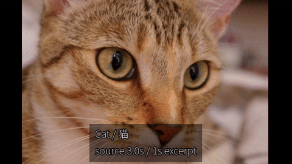

[Input MP4](docs/assets/semantic-20261025-r1/asset_v1.mp4) · [Output MP4](docs/assets/semantic-20261025-r1/demo-installed-r1-workflow/semantic-cut.mp4) · [Candidate/output board](docs/assets/semantic-20261025-r1/demo-installed-r1-workflow/candidate-to-output.png) · [Editable package](docs/assets/semantic-20261025-r1/demo-installed-r1-workflow/editable-project.aevpkg.zip) · [Full case](docs/product/CASES.md#c14-semantic-retrieval)

<!-- community-cases -->

**C10–C12：本轮真实案例。** C10 在本机保留 3 个音色 WAV、双语字幕、BGM/闪避分轨、可编辑工程和修正后的 12 秒成片；C11 从真正注册入口执行默认 GPU 配音/翻译并验证显式 CPU；C12 为下方可公开音乐/音效/字体演示。GIF 无声，MP4 含有明确来源的音乐/音效；生成配音保留在本地审阅记录中。

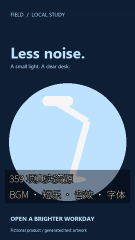

[MP4](docs/assets/community-materials-20261025-r2/community-resources.mp4) · [原始图片](docs/assets/release-v0.1.0-alpha.3-r1/input/card-1.png) · [来源/许可](docs/assets/community-materials-20261025-r2/SOURCE_AND_LICENSES.md) · [完整步骤与边界](docs/product/COMMUNITY_MATERIALS.md) · [验收与总产品剩余差距](docs/product/COMMUNITY_ACCEPTANCE.md)。

<!-- /community-cases -->

| 编号 | 场景与实测范围 | 原始文件、输出与证据 |
|---|---|---|
| C01 | 6 秒 FIELD 竖屏广告：原创产品卡 + 合成音 → 360×640/30 fps/180 帧。 | [Input](docs/assets/release-v0.1.0-alpha.1-r2/input.mp4) · [MP4](docs/assets/release-v0.1.0-alpha.1-r2/field.mp4) · [GIF](docs/assets/release-v0.1.0-alpha.1-r2/field.gif) · [JSON](docs/validation/evidence/release-v0.1.0-alpha.1-r2/changes.json) |
| C02 | 3 秒模板换款：真实 asset ID/时长变量 → 可编辑静音变体。 | [Template](docs/validation/evidence/release-v0.1.0-alpha.1-r2/template.json) · [Variables](docs/validation/evidence/release-v0.1.0-alpha.1-r2/variables.json) · [MP4](docs/assets/release-v0.1.0-alpha.1-r2/variant.mp4) · [GIF](docs/assets/release-v0.1.0-alpha.1-r2/variant.gif) |
| C03 | Float32 1D/shaper + 3D LUT：有序色彩链、源时钟和独立预览的历史实测。 | [Input](docs/assets/float-shaper-20261023-installed-r1/original.mp4) · [Output](docs/assets/float-shaper-20261023-installed-r1/edited.mp4) · [GIF](docs/assets/float-shaper-20261023-installed-r1/formal-comparison.gif) |
| C04 | 项目包导出/恢复 + 真实远程引用拒绝；保留完整 CLI 响应。 | [Export](docs/validation/evidence/release-v0.1.0-alpha.1-r2/export-package.stdout.json) · [Restored validation](docs/validation/evidence/release-v0.1.0-alpha.1-r2/restored-validate.stdout.json) · [Refusal](docs/validation/evidence/release-v0.1.0-alpha.1-r2/remote-refused.stdout.json) |
| C05 | 本轮 N002 × 500：500 次安装版预览，500 张全尺寸无损图逐像素一致。 | [Source](docs/assets/looks-n002-20261024-r1/source.png) · [Gallery](docs/assets/looks-n002-20261024-r1/index.html) · [All samples](docs/local/FILTER_GALLERY.md) · [GIF](docs/assets/looks-n002-20261024-r1/look-selection.gif) |
| C06 | 客户候选板：原图 + 指定稳定 ID、名称、许可与可回传 selection.json。 | [Board](docs/assets/looks-n002-20261024-r1/client-shortlist-example/board.jpg) · [JSON](docs/assets/looks-n002-20261024-r1/client-shortlist-example/selection.json) |
| C07 | 真实选型页：桌面/手机截图、实际操作录屏和交互断言。 | [Desktop](docs/assets/looks-n002-20261024-r1/gallery-desktop.png) · [Mobile](docs/assets/looks-n002-20261024-r1/gallery-mobile.png) · [WebM](docs/assets/looks-n002-20261024-r1/gallery-walkthrough.webm) |
| H01 / V35 | 源句柄转场：作者输入、双剪口实际输出、独立像素参考。 | [Input](docs/assets/source-transitions-20261017/authored-input.mp4) · [Output](docs/assets/source-transitions-20261017/C01-actual.mp4) · [GIF](docs/assets/source-transitions-20261017/comparison.gif) |
| H02 / V41 | HTML 原生动效：保留源码、透明标题与时间线合成；已有浏览器环境。 | [Source](docs/assets/html-motion-20261018/source.mp4) · [HTML](docs/assets/html-motion-20261018/template/index.html) · [Output](docs/assets/html-motion-20261018/S03-timeline.mp4) · [GIF](docs/assets/html-motion-20261018/native-comparison.gif) |
| H03 / V43 | 逐帧蒙版修正：缺选/误选修正，几何通过但自然 LaMa 修复仍有涂抹。 | [Source](docs/assets/mask-edits-20261018/source.mp4) · [Before](docs/assets/mask-edits-20261018/mask-input.mov) · [After](docs/assets/mask-edits-20261018/mask-edited.mov) · [GIF](docs/assets/mask-edits-20261018/comparison.gif) |
| H04 / V37 | 片段组跨项目复用：转场、字幕、LUT、子序列与关联依赖。 | [Input](docs/assets/fragments-20261018/source-a.mp4) · [Output](docs/assets/fragments-20261018/C01-actual.mp4) · [GIF](docs/assets/fragments-20261018/comparison.gif) |
| H05 / V34 | 字幕分段与双语：人工标记源文本、实际输出和参考；不是模型转写演示。 | [Input](docs/assets/subtitle-segments-20261017/source.mp4) · [Output](docs/assets/subtitle-segments-20261017/S01-segmented.mp4) · [GIF](docs/assets/subtitle-segments-20261017/comparison.gif) |
| H06 / V49 | 真实离线 CTC：模型时间驱动字幕，边界偏差 258.1875 ms，未通过 66.6667 ms 门槛。 | [Input audio](docs/assets/ctc-alignment-20261018/input.wav) · [Output](docs/assets/ctc-alignment-20261018/result.mp4) · [GIF](docs/assets/ctc-alignment-20261018/comparison.gif) |
| H07 / V53 | 磁吸主轨重排：A/B/C/D → C/A/B/D，保持关联音画与作者约束。 | [Input](docs/assets/magnetic-reorder-v53-r5-20261018/source-preview.mp4) · [Output](docs/assets/magnetic-reorder-v53-r5-20261018/MR01.mp4) · [GIF](docs/assets/magnetic-reorder-v53-r5-20261018/reorder-before-after.gif) |

<!-- unified-skill-demo -->

### C09：统一 Skill 的新目录实际交付

本轮从统一 kit 在 E 盘中文/空格路径离线安装，只注册一个入口，实际执行 20 次 CLI，完成 6 秒/360×640/30 fps/180 帧含音轨视频、质检及工程包往返。4 项预期拒绝、17→1 迁移和重复注册另有原始回执；0 新模型推理。下面 GIF 为本轮实际 MP4 的缩小无声预览，48 帧/6.01 秒，非剪辑 GUI 录像；检查过静态帧，未做连续播放和人工听审。

[MP4](docs/assets/unified-skill-20261024-r1/demo.mp4) · [GIF](docs/assets/unified-skill-20261024-r1/demo.gif) · [Inputs](docs/assets/release-v0.1.0-alpha.1-r2/input/) · [Commands](docs/validation/evidence/unified-skill-20261024-r1/native-r2/demo-commands.json) · [Verification](docs/validation/evidence/unified-skill-20261024-r1/verification.json) · [Media hashes](docs/assets/unified-skill-20261024-r1/manifest.json)


<!-- /unified-skill-demo -->

### C08：从下载包首次安装到实际交付

本次在新的 E 盘中文/空格路径安装 Agent kit，注册 17 个 Skill，再执行随包示例的 20 次实际 CLI：两张 CC0 图片 + 合成音 → 运镜与 0.65 强度风格 → 实际视频/质检 → 工程包导出、导入和恢复验证。

[MP4](docs/assets/release-v0.1.0-alpha.3-r1/demo.mp4) · [GIF](docs/assets/release-v0.1.0-alpha.3-r1/demo.gif) · [Changes](docs/validation/evidence/release-v0.1.0-alpha.3-r1/demo/changes.json) · [Commands](docs/validation/evidence/release-v0.1.0-alpha.3-r1/demo/commands.json) · [Verification](docs/validation/evidence/release-v0.1.0-alpha.3-r1/verification.json)

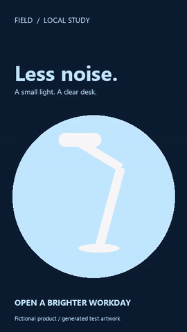

本轮实际选型页桌面截图，支持原图对照与候选导出：


下面是实际 CLI 渲染的 FIELD 广告；所有源卡片、音频、编辑 JSON、响应与流信息见案例手册。GIF 无声，原 MP4 可检查音轨。


已保留的 HTML 动效源码与时间线合成实测：


关键帧、运镜、动态蒙版、标题、转场和音频组合的既有实际演示：


[**完整案例册：恢复全部既有功能演示、输入/输出、指标与失败**](docs/product/CASES.md) · [首版完整复现步骤](docs/releases/v0.1.0-alpha.1/CASES.md)。N002 图册与本次新目录安装示例分别保留核验记录；其他案例保留日期，不累计为本次新模型或新回归。研究性的时序修复仍单列为未集成/未验收。

## 故障、恢复与交付注意点

| 现象 | 处理方式 |
|---|---|
| 缺少 FFmpeg / 模型 / 浏览器 | 先 doctor/inspect，提供已有原生依赖；不自动联网下载或改用不声明的后端。 |
| 输出已存在 / 路径在工程外 | 选择新的工程内绝对路径；保留原结果与失败证据。 |
| 项目锁或中断 | 查看 operation/queue，按支持入口取消或恢复；不盲删锁。 |
| 发布门禁阻止 | 补全每个素材、字体、LUT、模型的真实许可和本地证据，重新 rights check。 |
| 效果/浮点组合不支持 | 读取能力契约，调整明确计划与所选渲染路径；不悄悄降级。 |
| 只有图册，没有运行能力 | 图册可以纯本地浏览；生成新强度和编辑工程需要另行安装并加载固定 CLI。 |

## 功能核验与发布证据

<!-- community-supplementary-checks -->

附加检查单独记录：[22 项既有字幕回归](docs/validation/evidence/community-materials-20261025-r1/subtitle-regression.json)在安装版通过；[小型 Skill kit 解包后的 5 次实际调用](docs/validation/evidence/community-materials-20261025-r1/kit/verification.json)验证了独立配置、隔离发现目录注册与默认 CUDA 翻译。不计作新增音色或历史全量重跑。

<!-- /community-supplementary-checks -->

R01–R24 保留对应版本/日期核验；R25–R28 记录 N002 图册与完整文档恢复；R29、R38、R43 分别保留对应时点的目标评估与安装版只读核对。各行按原证据日期理解，历史核验未因文档更新重跑；计数不相加，也不据此宣称完整剪映等价。

R30 记录本次可移植安装与完整示例；图册独立解包及 10 个附件从 Git 文件重建一致性另有原始回执。 [Gallery check](docs/validation/evidence/release-v0.1.0-alpha.3-r1/gallery-portable/verification.json) · [Reproduction](docs/validation/evidence/release-v0.1.0-alpha.3-r1/git-reproduction.json).

R31 记录已经公开的 GitHub 预发布和 10 个附件的实际下载哈希核对。

| # | 核验 | 实际结果 | 证据与边界 |
|---|---|---|---|
| R01 | 基线完整回归 | **2,930 通过，0 跳过** | [原始记录](docs/validation/evidence/float-shaper-20261023-lab/full-r1.json)；2026-10-23，6991.508 秒；仅代表 alpha.1 的 331 项冻结输入，不代表本轮新增代码的全量回归 |
| R02 | 已有 V112 新离线安装专项 | **118 通过，197 个产品资源** | [隔离安装记录](docs/validation/evidence/float-shaper-20261023-lab/installed-r1/verification.json)；该专项与全量有重叠，不相加 |
| R03 | 本轮发布包重新构建与安装 | 8 个固定 wheel，`-I -S` 启动 | [本轮清单](docs/validation/evidence/release-v0.1.0-alpha.1-r2/release-verification.json)；原生 Windows/CPython 3.13 x64 |
| R04 | 本轮竖屏广告与模板 | 实际输入、输出、GIF、JSON、包导出/导入 | [案例核验](docs/validation/evidence/release-v0.1.0-alpha.1-r2/verification.json)；合成素材，0 新模型推理 |
| R05 | 本地策略拒绝 | 远程来源返回非零退出与结构化错误 | [真实失败响应](docs/validation/evidence/release-v0.1.0-alpha.1-r2/remote-refused.stdout.json)；不是上传功能 |
| R06 | 文档页与响应演示 | 桌面/移动截图、交互检查、响应回放录制 | [页面核验](docs/validation/evidence/release-v0.1.0-alpha.1-r2/browser-verification.json)；本地文档页，不是剪辑 GUI；录制为真实日志回放 |
| R07 | Skill 与链接 | 17 个入口格式核验、发布文档本地链接核验 | [门禁结果](docs/validation/evidence/release-v0.1.0-alpha.1-r2/release-verification.json)；格式验证不等于 Agent 决策质量 |
| R08 | 留存失败 | 首轮案例输出路径错误 | [失败记录](docs/validation/evidence/release-v0.1.0-alpha.1-r1/failure.json)；脚本已改绝对项目内路径后重跑 |
| R09 | 远端发布与下载回验 | **GitHub 预发布成功，6 个附件逐个下载 SHA-256 一致** | [发布与下载记录](docs/validation/evidence/release-v0.1.0-alpha.1-r2/publication.json) · [实际安装回执](docs/validation/evidence/release-v0.1.0-alpha.1-r2/installation-receipt.json)；2026-10-24 本地时间 |
| R10 | 本机 E 盘正式安装 | **固定 ZIP 校验通过，8 个 wheels 原生离线安装** | [安装回执](docs/validation/evidence/local-install-20261024-r1/installation/installation.json)；2026-10-24，1,430 文件 / 81,845,972 字节；未创建虚拟环境 |
| R11 | 新命名空间与真实 Skill 调用 | **17 个 Skill 注册/格式通过；8 次入口命令，7 成功 + 1 预期拒绝** | [Skill 核验](docs/validation/evidence/local-install-20261024-r1/skills/verification.json)；从 Codex 联接调用实际安装版，中文空格路径渲染，输出与直接运行 SHA-256 一致；未验收全部 Agent 决策质量 |
| R12 | 正式安装版新案例 | **28 次命令，27 成功 + 1 预期拒绝；广告/模板两个成片与项目包往返** | [案例记录](docs/validation/evidence/local-install-20261024-r1/cases/verification.json) · [GIF](docs/assets/local-install-20261024-r1/field.gif) · [抽帧目检](docs/validation/evidence/local-install-20261024-r1/review.json)；0 新模型推理，未连续播放/人工听审；不累计旧回归数 |
| R13 | 已安装版滤镜与 LUT 能力核对 | **目录 46 项，LUT 登记帮助包含 4 种扩展名** | [本轮查询记录](docs/validation/evidence/filter-capabilities-20261024-r1/verification.json) · [加载逻辑与边界](docs/local/FILTERS.md)；2026-10-24，仅目录/帮助/代码核对，0 新渲染；1D shaper 为显式 Float32 能力，既有 GIF 单列为历史证据 |
| R14 | 历史 alpha.1 风格库存 | **无徕卡/富士/柯达命名预设；已安装应用内 LUT 文件 0 个** | [库存核对](docs/validation/evidence/filter-library-20261024-r1/inventory.json)；2026-10-24，排除用户工程和测试夹具，9 个 stylize 算子不等于成品风格库；0 新渲染 |
| R15 | 开源 LUT/风格资源研究 | **10 个项目，Star/commit/文件树/许可留档** | [排序与判断](docs/research/OPEN_LOOK_LIBRARY_20261024.md) · [快照](docs/validation/evidence/lut-research-20261024-r1/upstreams.json)；2026-10-24，文件数未去重，不等于可分发/已验收风格数 |
| R16 | 社区 MIT CUBE 安装版接入小样 | **最终流程 13 次 CLI 成功；3 秒/36 帧真实输出** | [核验与警告](docs/validation/evidence/lut-research-20261024-r1/probe/verification.json) · [GIF](docs/assets/lut-research-20261024-r1/comparison.gif)；2026-10-24，0.65 强度，解码/质量/静音采样通过，保留强度近似警告与先前检查失败；合成输入/首帧目检，未连续播放或验收自然画面，当时未集成整库/Hald 转换 |
| R17 | alpha.2 预设库与定向回归 | **100 个独立色彩变换；83 项测试通过** | [原始日志](docs/validation/evidence/look-presets-20261024-r1/unit-tests.txt)；目录/许可/哈希、Hald 原生位深与色轴、应用语义、事务、项目包、LUT 与离线安装器回归；未重跑 2,930 项全量 |
| R18 | 新本地包与 Skill 同步 | **8 wheels 离线安装；17 个 Skill 格式通过；14 次入口调用：13 成功 + 1 预期拒绝** | [安装](docs/validation/evidence/look-presets-20261024-r1/install/installation.json) · [Skill 核验](docs/validation/evidence/look-presets-20261024-r1/skills/verification.json)；E 盘原生安装，真实预览/应用/渲染，保留 alpha.1 |
| R19 | 安装版逐一实测 100 个预设 | **100 个预览 + 100 个成片；425 次隔离 CLI 调用，含 2 次预期拒绝** | [核验](docs/validation/evidence/look-presets-20261024-r1/installed/verification.json) · [动态 GIF](docs/assets/look-presets-20261024-r1/motion-comparison.gif)；逐片解码 12 帧/1 秒/480×300，预览与首帧各 100 个不同哈希，上游对照与包往返首帧像素通过；合成输入，未做自然素材/听审验收 |
| R20 | 新仓库、产品名与三语 README | **简体中文 / 繁體中文 / English 完整入口；推送目标与文档检查通过** | [维护说明](docs/maintenance/REPOSITORY_AND_READMES.md) · [检查回执](docs/validation/evidence/readme-rebrand-20261024-r1/verification.json)；2026-10-24，仅文档链接、代码块、编号一致性与推送配置检查，0 新渲染；历史包名和哈希见维护说明 |
| R21 | 100 预设逐项效果文档与数值分析 | **100 份详细解释；100 安装版 LUT 与 100 张既有原生 PNG 对照；2 张色块图** | [完整详情](docs/local/LOOK_PRESET_DETAILS.md) · [测量与检查](docs/validation/evidence/look-profiles-20261024-r1/verification.json)；2026-10-24，43,200,000 个通道值对照，最大误差 1 码值；场景/强度为建议，0 新成片、0 自然素材验收、0 产品回归 |
| R22 | 500 风格目录与定向回归 | **500 个独立签名/预览；90 项通过** | [回归](docs/validation/evidence/look500-20261024-r1/regression-policy.json) · [构建](docs/validation/evidence/look500-sources-20261024-r1/compilation.json)；修复首轮项目包标记错误，保留失败记录；未重跑历史全量 |
| R23 | 安装版 500 项实际输出 | **1,000 次安装版进程内 CLI 调用；500 PNG + 500 原生滤镜成片；25 项完整项目渲染** | [明确范围](docs/validation/evidence/look500-20261024-r1/installed/verification.json) · [GIF](docs/assets/look500-20261024-r1/motion-comparison.gif)；每片解码 12 帧，500 项上游对照；合成输入，未做自然素材/听审验收 |
| R24 | 新包、Skill 与三语完整手册 | **17 个 Skill 格式通过；24 次入口调用；每种语言 500 份详情** | [安装](docs/validation/evidence/look500-20261024-r1/install/installation.json) · [Skill](docs/validation/evidence/look500-20261024-r1/skills/verification.json) · [文档](docs/validation/evidence/look500-20261024-r1/docs-verification.json)；E 盘原生安装，新增许可预设真实应用/渲染，1 次预期拒绝；保留旧包 |
| R25 | N002 全部滤镜的真实产出 | 500 次安装版 CLI；500 全尺寸无损图 + 500 小图，500 个独立像素哈希。 | [Render receipt](docs/validation/evidence/looks-n002-20261024-r1/render-verification.json) · 原图哈希不变；无新视频/模型推理，不是全自然视频质量验收。 |
| R26 | 选型页、截图与实际录像 | 原生浏览器交互、三语、搜索/筛选/候选下载/手机布局检查通过。 | [Browser receipt](docs/validation/evidence/looks-n002-20261024-r1/browser-verification.json) · 0 远程请求；测试标签全部关闭。 |
| R27 | Skill 客户选型与本地加载 | 17 个 Skill 格式/联接核验；真实候选对照板、搜索与失败保护。 | [Skill workflow receipt](docs/validation/evidence/looks-n002-20261024-r1/skill-verification.json) · 不修改时间线；示例强度 1.0。 |
| R28 | 三语完整文档与样例链接 | 功能/服务/Skill/案例/500 项图册、能力字段与本地链接核对。 | [Documentation receipt](docs/validation/evidence/looks-n002-20261024-r1/docs-verification.json) · 未重跑历史 2,930 项内核全量。 |
| R29 | 完整目标差距与安装版核对 | 4 次安装版只读 CLI 成功；68 项能力声明与手册一致；38 组差距分别列出收口条件。 | [Assessment](docs/product/GOAL_GAPS_20261024.md) · [Inventory](docs/validation/evidence/goal-gaps-20261024-r1/inventory.json) · 本轮 0 渲染/0 推理；既有精度失败与未验收项保留。 |
| R30 | 可移植 Agent kit 安装与完整示例 | 原生 E 盘中文/空格路径安装；17 个 Skill 注册；20 次真实 CLI 完成剪辑、渲染、质检与工程包往返。 | [Release gate](docs/validation/evidence/release-v0.1.0-alpha.3-r1/verification.json) · [Demo video](docs/assets/release-v0.1.0-alpha.3-r1/demo.mp4) · 6 秒/180 帧完整解码；未重跑内核全量或模型推理，未做听审。 |
| R31 | GitHub 预发布与全部附件下载核对 | alpha.3 预发布已公开；原生 Windows 发布任务成功；10 个附件逐项实际下载并比对 SHA-256。 | [Release](https://github.com/copypasteltd/agent-editor-kit/releases/tag/v0.1.0-alpha.3) · [Publication receipt](docs/validation/evidence/release-v0.1.0-alpha.3-r1/publication.json) · 原运行 ZIP 不变；不代表完整剪映或自然视听门禁关闭。 |
| R32 | 统一 Skill 与真实注册迁移 | **1 个入口 / 17 项模块；原生新目录安装、17→1 迁移、重复注册和 4 项预期拒绝通过；实际示例 20 次 CLI、180 帧完整解码。** | [Verification](docs/validation/evidence/unified-skill-20261024-r1/verification.json) · [Guide](docs/skills/UNIFIED_SKILL.md) · 2026-10-24；0 新模型推理；非独立 Agent 行为评测，未做人工听审；历史 17 Skill 收据保留。 |
| R33 | 新安装社区素材/CPU 扩展 | 46 条实际命令；359 素材、3 音色、12 秒 / 360 帧完整解码、字幕时间及工程往返 | [证据](docs/validation/evidence/community-materials-20261025-r1/cpu/verification.json)；人工听审/语义接受未完成 |
| R34 | 新安装 CUDA 扩展 | 15 条实际命令；GPU 配音与翻译、严格失败、CPU/worker 回退 | [证据](docs/validation/evidence/community-materials-20261025-r1/gpu/verification.json)；仅 RTX 3060，冷启动/持续推理分列 |
| R35 | 可移动模型安装 | 4 个模型 ZIP；中文/空格路径下 8 条安装/拒绝命令 | [证据](docs/validation/evidence/community-materials-20261025-r1/portable/verification.json)；原文件不变、失败 staging 清理 |
| R36 | 真正注册入口与 GPU 默认值 | 11 条实际 CLI；1 个发现入口，默认配音/翻译 CUDA，显式 CPU | [证据](docs/validation/evidence/community-materials-20261025-r1/skill/verification.json)；只调用已安装版 |
| R37 | 排版修正与公开样例 | 8 条修正命令、0 新推理；另 14 条公开案例命令；均完整解码 360 帧 | [排版](docs/validation/evidence/community-materials-20261025-r1/cpu/presentation-correction/verification.json) · [MP4/GIF](docs/assets/community-materials-20261025-r2/verification.json)；保留首次文字溢出，未做人工听审 |
| R38 | 当前完整目标重新评估 | 6 次安装版只读 CLI 成功；71 项声明，原 68 项未变＋3 项社区扩展；38 组差距按当前版本更新 | [差距表](docs/product/GOAL_GAPS_20261025.md) · [原始响应](docs/validation/evidence/goal-gaps-20261025-r1/inventory.json)；2026-10-25，0 新渲染/0 新推理；已知失败、人工听审与高级 AI 未完成边界保留 |
| R39 | 精确声道关系修复与音频回归 | 23 项专项、168 项更广回归各自通过；安装版另跑 23 项通过。专项与更广回归有重叠，不相加 | [首批实测](docs/validation/补齐实施首批实测_2026-10-25.md)；2026-10-25，真实 R3 反相保持 L+R=0，4ms 音高/一般相位/听审未关闭 |
| R40 | 原生采集 CLI | 10 项契约测试；开发版 10 次 CLI，安装版另 10 次 CLI；CPU/NVENC 各真实采集 2 秒/30 帧，取消/重复输出/窗口缺失通过 | [采集流程与 MP4/GIF](docs/product/NATIVE_CAPTURE.md)；2026-10-25，仅自身测试窗口，未录相机/麦克风、未验音画同步 |
| R41 | Qwen 原生格式边界候选 | CUDA BF16 实际 2 次前向，原/独立样例最大误差 220ms / 161ms，均未过 66.6667ms | [独立评分](docs/validation/evidence/implementation-20261025-r1/native-aligner-research/quality.json)；2026-10-25，失败保留、未接入正式对齐引擎 |
| R42 | CLI 0.1.4 原生离线安装与统一 Skill | 新本地包、8 wheel、4 既有模型包校验，实际注册入口核对；旧包/公开附件保留 | [交付与摘要](docs/product/COMMUNITY_LOCAL_DELIVERY.md) · [本轮入口记录](docs/validation/evidence/implementation-20261025-r1/skill/verification.json)；2026-10-25，仍为同一主机，完整目标未完成 |
| R43 | 当前目标差距再次复核 | 真实注册入口 6 次只读调用通过；CLI 0.1.4，72 项能力声明：20 已实现、44 有限制、7 需本地适配器、1 降级；38 组均有待关闭条件 | [最新差距表](docs/product/GOAL_GAPS_20261025.md) · [本次响应](docs/validation/evidence/goal-gaps-20261025-r2/inventory.json) · [证据复核](docs/validation/evidence/goal-gaps-20261025-r2/review.json)；2026-10-25，0 新渲染/推理/听审；G26 向量检索尚未交付，公开包仍为 alpha.3 |
| R44 | 最新目标差距与开发候选分层复核 | 真实注册入口另 6 次只读调用通过，安装版仍为 CLI 0.1.4 / 72 项声明；开发候选 25 项契约测试、13 次准备命令另列，GPU 索引 2 次实际前向不冒充检索质量 | [38 组差距](docs/product/GOAL_GAPS_20261025.md) · [新核对](docs/validation/evidence/goal-gaps-20261025-r3/inventory.json) · [证据边界](docs/validation/evidence/goal-gaps-20261025-r3/review.json) · [开发索引](docs/validation/evidence/goal-gaps-20261025-r3/candidate-progress.json)；2026-10-25，无新增安装版渲染/推理或人工听审；公开包仍为 alpha.3，G01–G38 均有未关闭条件 |
| R45 | 真实图文语义相关性 | 开发索引 2 次 CUDA 图像前向；5 次查询 CLI 共 11 次前向；CPU/GPU 常规 16 条 top-1/mean recall@3 均 1.0，6 时间点、参考图、同图改名与只读门禁通过 | [全部 20 条评分](docs/validation/evidence/semantic-20261025-r1/development-r1/queries/quality.json) · [失败也展示](docs/assets/semantic-20261025-r1/all-query-results.png)；2026-10-25，中文否定错选、2 条库外未拒识；非自然动作/未见训练集验收 |
| R46 | 检索契约、异常与回归 | 开发 25 项和安装版另 25 项契约测试；CLI 122 项、离线策略 34 项分别通过；8 次实际异常 CLI、存活 worker 取消约 0.21 秒并退出 | [本轮实测](docs/validation/离线语义检索实测_2026-10-25.md)；2026-10-25，测试范围有重叠，不相加；取消仅验启动/完整性阶段 |
| R47 | CLI 0.1.5 固定安装与单一 Skill | 新 8-wheel 包及全部产品 Python 源字节核对；4 既有模型包重验；真实注册入口 9 次 CLI，包含实际 GPU 批量文本和 CPU 参考图；r4 kit 独立入口另验 | [安装摘要](docs/product/COMMUNITY_LOCAL_DELIVERY.md) · [入口实测](docs/validation/evidence/semantic-20261025-r1/skill-r1/verification.json)；2026-10-25，单台物理主机，不冒充公开新 Release |
| R48 | 检索候选的可编辑案例 | 开发版 11 次 CLI、安装版另 11 次 CLI；3 秒/90 帧实际渲染、完整解码、工程往返像素相同 | [实际 MP4/GIF/工程包](docs/product/CASES.md#c14-semantic-retrieval) · [安装证据](docs/validation/evidence/semantic-20261025-r1/installed-r1/demo/verification.json)；2026-10-25，静态图序列、明确选 1 秒，非自动事件边界/自然动作或人工听审 |
| R49 | 独立四轨真实模型分离 | 开发 18 次 CLI/6 次前向、安装版另 18/6、真实 Skill 11/2；受控 CPU/GPU 各源改善≥3dB、数值差门槛通过，另有自然音乐执行 | [完整实测](docs/validation/独立四轨音源分离实测_2026-10-25.md)；2026-10-25，other 绝对 SI-SDR 约 1.71dB，自然质量/听审/去混响/模型权利未验收 |
| R50 | 四轨契约、旧功能与异常 | 开发 15、安装另 15、旧双轨 22、CLI 122、离线 34 项分别通过；实际取消约 0.419 秒且 worker 退出/新目录清理 | [范围和保留失败](docs/validation/独立四轨音源分离实测_2026-10-25.md#失败保留与恢复差距)；2026-10-25，不相加，启动阶段取消；强制结束留下缓存，G33 未闭 |
| R51 | CLI 0.1.6 固定安装与单一 Skill | 新 8-wheel 包、192 个产品 Python 文件逐字节相同；1 Skill/17 模块，真实入口 11 次 CLI，r5 kit 独立注册/只读核对 | [安装审计](docs/validation/evidence/four-stems-20261025-r1/installation/verification.json) · [r5 kit](docs/validation/evidence/four-stems-20261025-r1/kit-r1/verification.json)；2026-10-25，仍同一物理主机，无新公开 Release |
| R52 | 四音轨可编辑混音案例 | 安装版真实渲染 6 秒/180 帧、48kHz/288,000 PCM 帧；与各轨求和最大差 0，工程包往返 PCM/解码画面相同 | [C15/实际无声 GIF](docs/product/CASES.md#c15-four-stems) · [响应](docs/validation/evidence/four-stems-20261025-r1/demo-r2/verification.json)；2026-10-25，公开原创数值图诊断，声音和包留本地；无人工听审 |
| R53 | 最新完整目标差距评估 | 真实注册入口另 6 次只读核对；74 项声明：20 已实现/46 有限制/7 适配器/1 降级；38 组均有未关闭条件 | [编号差距](docs/product/GOAL_GAPS_20261025.md) · [原始响应/API](docs/validation/evidence/goal-gaps-20261025-r5/inventory.json)；2026-10-25，盘点 0 新推理/渲染；公开仍 alpha.3 / CLI 0.1.2 |
| R54 | 原生生命周期与恢复回归 | 开发/安装版各 17 项专项通过；四轨各 15、旧双轨 22、CLI 122、离线 34 分别通过 | [全部范围与失败保留](docs/validation/任务中断恢复实测_2026-10-25.md)；2026-10-25，0 skip、执行前后冻结摘要一致，各套件不相加 |
| R55 | 真实安装版强制中断 | 4 个模型任务仅强制结束 owner；另 17 次正常 CLI/6 次 GPU 前向；未提交输出回收，已提交四轨保留 | [4 阶段实际记录](docs/validation/evidence/job-recovery-20261025-r1/faults-r1/verification.json)；2026-10-25，三阶段有观察暂停；旧缓存/断电/磁盘/长并发未闭 |
| R56 | CLI 0.1.7 真实推理与成片 | 开发 11 次 CLI/2 前向、安装版 16/4、统一入口另 11/2；成片另 9 次 CLI，6 秒/180 帧，混音最大差 0，工程包往返 PCM/画面相同 | [C16/GIF](docs/product/CASES.md#c16-job-recovery) · [实际成片](docs/validation/evidence/job-recovery-20261025-r1/demo-r1/verification.json)；2026-10-25，受控音频留本地，无自然质量或听审验收 |
| R57 | 固定安装与单一 Skill r6 | 新 8-wheel 离线包、194 个产品 Python 文件逐字节相同；r6 79 文件，隔离注册/只读/恢复 dry-run 8 次进程调用 | [安装](docs/validation/evidence/job-recovery-20261025-r1/installation/verification.json) · [r6 kit](docs/validation/evidence/job-recovery-20261025-r1/kit-r1/verification.json)；2026-10-25，仍同一物理主机，未新建公开 Release |
| R58 | 当前完整目标复核 | 实际统一入口另 6 次只读盘点；74 项声明与全部 38 组剩余条件保留 | [完整编号差距](docs/product/GOAL_GAPS_20261025.md) · [原始响应/API](docs/validation/evidence/goal-gaps-20261025-r6/inventory.json)；2026-10-25，0 新推理/渲染，公开 alpha.3 / CLI 0.1.2 |
| R59 | 最新差距与安装一致性复核 | 实际 Skill 新增 6 次只读调用；194 个已提交 Python 文件与安装版字节一致；38 组原关闭条件保留 | [完整差距](docs/product/GOAL_GAPS_20261025.md) · [本次响应/API](docs/validation/evidence/goal-gaps-20261025-r7/inventory.json) · [独立复核](docs/validation/evidence/goal-gaps-20261025-r7/review.json)；2026-10-25，对齐活动边界仅未集成草稿，0 新模型/渲染/听审，不新增已验收能力 |
| R60 | 受控字词对齐修复 | 开发/安装版分别 36 次 CLI、6 次真实 GPU 前向；6 组全词起止均过原门槛 | [Development](docs/validation/evidence/ctc-activity-20261025-r1/development-v3-r1/state.json) · [Installed](docs/validation/evidence/ctc-activity-20261025-r1/installed-r1/state.json); 2026-10-25; authored blocks, not phonetic truth; v1/v2 failures retained |
| R61 | 安装版专项与回归 | 活动边界 17、CTC 25、ASR 22 分别通过；CLI 首轮 121/122，1 项开发路径假设失败，修正测试后源码/安装各 1 项定向通过 | [Tests / retained failure](docs/validation/CTC声学边界实测_2026-10-25.md) · [Targeted installed recheck](docs/validation/evidence/ctc-activity-20261025-r1/installed-runtime-recheck-r1/verification.json); 2026-10-25; neither the full 122 nor historical 2,930 rerun after test correction |
| R62 | CPU、分窗与取消 | CPU 另 12 次 CLI/2 前向；兼容异常另 7/5，默认原值、47 秒分窗、SRT 绝对时钟及取消/超时保留元数据 | [CPU](docs/validation/evidence/ctc-activity-20261025-r1/cpu-v3-r1/state.json) · [Compatibility](docs/validation/evidence/ctc-activity-20261025-r1/extended-r1/verification.json); 2026-10-25; long-window structure is not precision acceptance |
| R63 | 实际字幕成片和工程包 | 10 次 CLI/1 前向，236 帧；工程往返 PCM/逐帧 RGB 相同 | [C17 / GIF](docs/product/CASES.md#c17-ctc-activity) · [Actual render](docs/validation/evidence/ctc-activity-20261025-r1/demo-r1/verification.json); 2026-10-25; silent diagnostic, no human listening/continuous playback |
| R64 | 统一 Skill r7 | 81 文件/63 Skill 文件，1 注册入口/17 内部模块；隔离核验 8 次进程调用 | [Actual Skill](docs/validation/evidence/ctc-activity-20261025-r1/skill-r1/state.json) · [r7 kit](docs/validation/evidence/ctc-activity-20261025-r1/kit-r1/verification.json); 2026-10-25; same physical host, weights separate |
| R65 | 最新完整目标评估 | 真实注册入口另 6 次只读；74 项声明/38 组差距保留，全部原关闭条件不变 | [38 numbered gaps](docs/product/GOAL_GAPS_20261025.md) · [Read-only inventory/API](docs/validation/evidence/goal-gaps-20261025-r8/inventory.json); 2026-10-25; public alpha.3 / CLI 0.1.2; no full CapCut acceptance |
| R66 | 当前目标差距再次核对 | 实际统一 Skill 6 次只读调用成功；CLI 0.1.8，195 个源码/安装版 Python 文件一致；38 组仍有未满足条件 | [完整编号差距与关闭条件](docs/product/GOAL_GAPS_20261025.md) · [实际响应与官方发行 API](docs/validation/evidence/goal-gaps-20261025-r9/inventory.json) · [文档审计](docs/validation/evidence/goal-gaps-20261025-r9/documentation-audit.json)；2026-10-25，0 新渲染/推理/听审，未重跑历史回归；公开仍 alpha.3 / CLI 0.1.2 |
| R67 | 最终安装版专项与回归 | 新配音专项 27/27、CLI 122/122，无 skip；197 个产品 Python 文件等于源码 | [Evidence](docs/validation/evidence/subtitle-dubbing-20261025-r1/tests/installed-r2/verification.json) · [Separate scope](docs/validation/evidence/subtitle-dubbing-20261025-r1/tests/installed-cli-r2/verification.json); 2026-10-25; 契约测试与真实模型分开；未重跑历史 2930 |
| R68 | 真实字幕翻译配音 | GPU 22 次 CLI / 6 流水线 / 11 次完整声音生成；CPU 另 9 / 2 / 4，含原始译文与超窗拒绝 | [Evidence](docs/validation/evidence/subtitle-dubbing-20261025-r1/installed-gpu-r2/verification.json) · [Separate scope](docs/validation/evidence/subtitle-dubbing-20261025-r1/installed-cpu-r2/verification.json); 2026-10-25; 保留错译，无人工听审/语义接受/口型结论 |
| R69 | 配音运行控制与崩溃恢复 | 实际 worker 取消/总超时、三个 owner 强制结束；提交前回滚，提交后声音/字幕/模型许可保留 | [Evidence](docs/validation/evidence/subtitle-dubbing-20261025-r1/control-r1/verification.json) · [Separate scope](docs/validation/evidence/subtitle-dubbing-20261025-r1/crashes-r1/verification.json); 2026-10-25; 只有受管路径；其他缓存、断电/磁盘/长并发仍开放 |
| R70 | 实际双语成片与工程包 | 8 次 CLI，19 秒/570 帧；原声音摆放 PCM 最大差 0，工程往返 PCM/RGB 相同 | [Evidence](docs/validation/evidence/subtitle-dubbing-20261025-r1/demo-r1/verification.json) · [Separate scope](docs/validation/evidence/subtitle-dubbing-20261025-r1/demo-r1/executed-generator.py); 2026-10-25; C18 无声诊断，原错译保留；不是自然视听验收 |
| R71 | 统一 Skill r8 与本地加载 | 一个注册入口/17 内部模块；真实 Skill 另 9 次 CLI、两个 CUDA 任务；小型 kit 独立清单/注册核验 | [Evidence](docs/validation/evidence/subtitle-dubbing-20261025-r1/skill-r1/verification.json) · [Separate scope](docs/validation/evidence/subtitle-dubbing-20261025-r1/kit-r1/verification.json); 2026-10-25; 同一物理主机；旧 kit/公开 alpha.3 未覆盖 |
| R72 | G01–G38 当前目标差距 | CLI 0.1.9，75 项声明；38 组原关闭条件全部保留 | [完整编号评估](docs/product/GOAL_GAPS_20261025.md) · [真实入口/API](docs/validation/evidence/goal-gaps-20261025-r10/inventory.json) · [历史行/链接审计](docs/validation/evidence/goal-gaps-20261025-r10/documentation-audit.json)；2026-10-25，只读盘点与模型/渲染分开，无总体完成百分比 |
| R73 | 当前目标与交付状态复核 | 统一 Skill 另 6 次只读调用成功；197 个源码/安装文件一致；75 项声明、38 组未关闭条件不变；修正当前安装路径、页尾版本及累计音色说明 | [当前差距/关闭条件](docs/product/GOAL_GAPS_20261025.md) · [实际响应/API](docs/validation/evidence/goal-gaps-20261025-r11/inventory.json) · [历史保留/链接审计](docs/validation/evidence/goal-gaps-20261025-r11/documentation-audit.json)；2026-10-25，0 新渲染/推理/听审，历史 R01–R72 保留，公开仍 alpha.3 |
| R74 | 本次完整目标/交付评估 | 另 6 次实际只读 Skill 调用；197 安装文件匹配已提交基线；工作区 193 相同、4 修改、2 新增；三语手册补齐 51 功能/20 服务及 75 项安装字段 | [38 组差距](docs/product/GOAL_GAPS_20261025.md) · [入口/API/差异](docs/validation/evidence/goal-gaps-20261025-r12/inventory.json) · [文档审计](docs/validation/evidence/goal-gaps-20261025-r12/final-documentation-r3/documentation-audit.json)；2026-10-25，本次 0 新推理/渲染/听审，公开仍 alpha.3，历史 R01–R73 保留 |
| R75 | 检索候选进展，未入安装版 | 既有开发实测快照：48 契约测试；GPU 40 校准/60 另组措辞/20 原查询及独立 raw；另组库外误接受 2 条、原正向误拒 1 条均保留 | [逐项结果与失败](docs/validation/evidence/goal-gaps-20261025-r12/candidate-progress.json) · [冻结协议](docs/validation/evidence/goal-gaps-20261025-r12/candidate-snapshot/protocol.json)；2026-10-25，熟悉静态素材；未计作安装/CPU/Skill 验收，G26 未关闭 |
| R76 | 条件与校准契约 / Clause and calibration contracts | Source 48/48, zero skips; bounded grammar, empirical cutoff, rollback/device/hash guards; model substitutes are contracts only | [2026-10-25 evidence](docs/validation/evidence/semantic-decision-20261025-r1/tests/development-r3/verification.json) · [Full scope](docs/validation/语义条件与校准拒识实测_2026-10-25.md) |
| R77 | 固定安装回归 / Installed regressions | Separate installed 48/48 + CLI 122/122, zero skips; not all historical tests | [2026-10-25 evidence](docs/validation/evidence/semantic-decision-20261025-r1/tests/installed-r1/verification.json) · [Full scope](docs/validation/语义条件与校准拒识实测_2026-10-25.md) |
| R78 | 实际 CPU/CUDA 模型 / Actual CPU/CUDA | Separate device profiles, 40 calibration each; held-out 20/20 positive, 20/20 negation, 18/20 rejection; original positive 15/16; errors retained | [2026-10-25 evidence](docs/validation/evidence/semantic-decision-20261025-r1/installed-r1/heldout-cuda/verification.json) · [Full scope](docs/validation/语义条件与校准拒识实测_2026-10-25.md) |
| R79 | 实际统一入口与拒绝 / Registered Skill and refusals | Actual Skill 60-query batch retains errors; 9 installed controls preserve metadata/rights/profiles; no universal semantics acceptance | [2026-10-25 evidence](docs/validation/evidence/semantic-decision-20261025-r1/controls-r1/verification.json) · [Full scope](docs/validation/语义条件与校准拒识实测_2026-10-25.md) |
| R80 | C19 实际视频与迁移失败 / Media and migration failure | 80 result cards; six editable clips, two renders, 360 decoded frames equal; retrieval package search fails after import; failure retained | [2026-10-25 evidence](docs/validation/evidence/semantic-decision-20261025-r1/demo-finalization-r1/verification.json) · [Full scope](docs/validation/语义条件与校准拒识实测_2026-10-25.md) |
| R81 | 当前离线安装与 r9 / Current installation and r9 | 199 product files equal installed CLI 0.1.10; one Skill / 17 modules / 64 Skill files; isolated r9 activation, not clean-host acceptance | [2026-10-25 evidence](docs/validation/evidence/semantic-decision-20261025-r1/kit-r1/verification.json) · [Full scope](docs/validation/语义条件与校准拒识实测_2026-10-25.md) |
| R82 | 源码契约与 CLI / Source checks | 65/65 semantic + 122/122 CLI, zero skips; initial fixture and embedded-runtime failures retained | [2026-10-25 evidence](docs/validation/evidence/semantic-package-20261025-r1/tests/development-r3/verification.json) · [Full scope](docs/validation/语义工程包迁移实测_2026-10-25.md) |
| R83 | 固定安装版 / Installed checks | 200 source-identical product files; separate 65/65 semantic + 122/122 CLI; same native host | [2026-10-25 evidence](docs/validation/evidence/semantic-package-20261025-r1/tests/installed-r1/verification.json) · [Full scope](docs/validation/语义工程包迁移实测_2026-10-25.md) |
| R84 | 真实迁移 / Actual model roundtrip | CPU/CUDA/Skill each 80 decisions and ordered hits identical after source paths unavailable; 3 known errors retained | [2026-10-25 evidence](docs/validation/evidence/semantic-package-20261025-r1/installed-r1/after-cuda/verification.json) · [Full scope](docs/validation/语义工程包迁移实测_2026-10-25.md) |
| R85 | 旧损坏包 / Legacy invalid package | Actual 0.1.10 flattened package rejected before destination publication; old bytes retained; no automatic repair | [2026-10-25 evidence](docs/validation/evidence/semantic-package-20261025-r1/installed-r1/legacy-cuda/verification.json) · [Full scope](docs/validation/语义工程包迁移实测_2026-10-25.md) |
| R86 | C20 可视案例 / Visual example | 12s/360 frames MP4; 60-frame GIF; editable card package decoded frames identical; no human continuous review | [2026-10-25 evidence](docs/validation/evidence/semantic-package-20261025-r1/demo-installed-r1/verification.json) · [Full scope](docs/validation/语义工程包迁移实测_2026-10-25.md) |
| R87 | 单入口交付 / Single-entry delivery | CLI 0.1.11 / local.9 / r10; one Skill, 17 modules, 65 pinned files; all 38 original gap conditions remain | [2026-10-25 evidence](docs/validation/evidence/semantic-package-20261025-r1/kit-r1/verification.json) · [Full scope](docs/validation/语义工程包迁移实测_2026-10-25.md) |
| R88 | 源码范围 / Source checks | 150 related contracts; separate 122 CLI; zero skips; 22 tree cases included, not added | [2026-10-25 evidence](docs/validation/evidence/semantic-recovery-20261025-r1/tests/development-r1/verification.json) · [Scope](docs/validation/语义任务中断恢复实测_2026-10-25.md) |
| R89 | 固定安装 / Installed checks | 202 source-identical Python files; separate 150 related contracts / 122 CLI; zero skips | [2026-10-25 evidence](docs/validation/evidence/semantic-recovery-20261025-r1/tests/installed-r1/verification.json) · [Scope](docs/validation/语义任务中断恢复实测_2026-10-25.md) |
| R90 | 实际恢复 / Real recovery | 7 actual native model fault/cleanup cases; owned worker exit and pre/post-commit invariants; no power-loss claim | [2026-10-25 evidence](docs/validation/evidence/semantic-recovery-20261025-r1/faults-r1/calibration-commit/verification.json) · [Scope](docs/validation/语义任务中断恢复实测_2026-10-25.md) |
| R91 | 语义回归 / Query regression | CPU/CUDA/registered Skill each preserve all 80 decisions after migration; known 3 errors retained | [2026-10-25 evidence](docs/validation/evidence/semantic-recovery-20261025-r1/installed-r1/skill-cuda/verification.json) · [Scope](docs/validation/语义任务中断恢复实测_2026-10-25.md) |
| R92 | 性能失败保留 / Timing limitation | 1-second timeout actually 81.739s; imports/hash/load/inference observable; no persistent service or deadline pass | [2026-10-25 evidence](docs/validation/evidence/semantic-recovery-20261025-r1/faults-r1/search-timeout/verification.json) · [Scope](docs/validation/语义任务中断恢复实测_2026-10-25.md) |
| R93 | 单入口交付 / Single-entry delivery | CLI 0.1.12 / local.10 / r11; 1 Skill / 17 modules; same-host isolated kit, no clean-machine claim | [2026-10-25 evidence](docs/validation/evidence/semantic-recovery-20261025-r1/kit-r2/verification.json) · [Scope](docs/validation/语义任务中断恢复实测_2026-10-25.md) |
| R94 | 完整目标复核 / Full goal review | All G01–G38 original closure conditions and R01–R87 retained; public release/API checked separately; no overall percentage | [2026-10-25 evidence](docs/validation/evidence/semantic-recovery-20261025-r1/final-delivery-r2/verification.json) · [Scope](docs/validation/语义任务中断恢复实测_2026-10-25.md) |
| R95 | 当前完整目标差距评估 | 真实统一 Skill 另 6 次只读调用；CLI 0.1.12、202 个源码/安装文件一致、75 项能力与 38 组原关闭条件保留；官方 API 仍 alpha.3 / CLI 0.1.2 | [编号差距与验收条件](docs/product/GOAL_GAPS_20261025.md) · [本次原始响应/API](docs/validation/evidence/goal-gaps-20261025-r13/inventory.json) · [历史保留/链接核对](docs/validation/evidence/goal-gaps-20261025-r13/documentation-audit.json)；2026-10-25，本次 0 新推理/渲染/听审，不给出总体完成百分比；R01–R94 保留 |
| R96 | 完整性读取控制 | 源码/安装版相关契约各 168/168；有界内存摘要各 5/5，源码 CLI 122/122；范围分别记录，不相加 | [2026-10-25 evidence](docs/validation/evidence/semantic-control-20261025-r1/tests/installed-r1/verification.json) · [Scope](docs/validation/完整性校验超时取消实测_2026-10-25.md) |
| R97 | 真实超时修复 | 搜索/适配器检查/索引核验各请求 1 秒；完整 CLI 实测 2.500 / 2.354 / 2.426 秒，均返回 PROCESS_TIMEOUT | [2026-10-25 evidence](docs/validation/evidence/semantic-control-20261025-r1/faults-r1/verification.json) · [Scope](docs/validation/完整性校验超时取消实测_2026-10-25.md) |
| R98 | 真实读取中取消 | 观察实际读取超过 64MiB 后发取消；搜索/检查在 0.188 / 0.054 秒内退出，保留 CANCELLED 和部分摘要诊断 | [2026-10-25 evidence](docs/validation/evidence/semantic-control-20261025-r1/faults-r1/verification.json) · [Scope](docs/validation/完整性校验超时取消实测_2026-10-25.md) |
| R99 | CPU/GPU 与统一 Skill 回归 | CPU/CUDA/真实 Skill 各 80 决策在迁移后与原工程一致、分数差 0；原三条检索错误保留 | [2026-10-25 evidence](docs/validation/evidence/semantic-control-20261025-r1/installed-r1/skill-cuda/verification.json) · [Scope](docs/validation/完整性校验超时取消实测_2026-10-25.md) |
| R100 | 新版安装与本地加载 | CLI 0.1.13 / local.11 / r12；203 产品文件一致，1 Skill/17 模块，4 原模型包重验；同机独立工具包验证 | [2026-10-25 evidence](docs/validation/evidence/semantic-control-20261025-r1/kit-r1/verification.json) · [Scope](docs/validation/完整性校验超时取消实测_2026-10-25.md) |
| R101 | 当前交付核对 | 保留全部原 38 组关闭条件及 R01–R95；本批无新自然质量/人工听审结论，公开仍 alpha.3 | [2026-10-25 evidence](docs/validation/evidence/semantic-control-20261025-r1/final-delivery-r2/verification.json) · [Scope](docs/validation/完整性校验超时取消实测_2026-10-25.md) |
| R102 | 安装包一致性 | CLI 0.1.14 / local.12；205 产品 Python 文件与固定安装包一致，旧包保留 | [2026-10-25 evidence](docs/validation/evidence/ad-storyboard-20261025-r1/installation-r2/verification.json) · [Scope](docs/validation/可编辑广告分镜与返工实测_2026-10-25.md) |
| R103 | 代码与安装回归 | 最终源码相关契约 226/226；最终安装专项 55/55；安装 CLI 122/122；分别记录，不相加 | [2026-10-25 evidence](docs/validation/evidence/ad-storyboard-20261025-r1/tests/installed-r2/verification.json) · [Scope](docs/validation/可编辑广告分镜与返工实测_2026-10-25.md) |
| R104 | 真实同语种 GPU 配音 | 3 句原文保持，CUDA 配音一次初始化/3 次生成，无翻译 worker；完整声音保留本地 | [2026-10-25 evidence](docs/validation/evidence/ad-storyboard-20261025-r1/setup-finalize-r1/verification.json) · [Scope](docs/validation/可编辑广告分镜与返工实测_2026-10-25.md) |
| R105 | 实际多画幅编码 | 竖 12 秒/360 帧、横/方各 9 秒/270 帧；另验 NVENC 270 帧；不宣称全部效果 GPU 化 | [2026-10-25 evidence](docs/validation/evidence/ad-storyboard-20261025-r1/render-continue-r1/verification.json) · [Scope](docs/validation/可编辑广告分镜与返工实测_2026-10-25.md) |
| R106 | 指定镜头返工 | 安装版与真实注册 Skill 分别改横屏末镜；前 180 帧/解码 PCM/未选序列/原素材保持 | [2026-10-25 evidence](docs/validation/evidence/ad-storyboard-20261025-r1/skill-r1/verification.json) · [Scope](docs/validation/可编辑广告分镜与返工实测_2026-10-25.md) |
| R107 | 可编辑包迁移 | 原工程路径不可用后导入，3 序列可编辑，重渲染 RGB/PCM 与修改后原片一致 | [2026-10-25 evidence](docs/validation/evidence/ad-storyboard-20261025-r1/roundtrip-r1/verification.json) · [Scope](docs/validation/可编辑广告分镜与返工实测_2026-10-25.md) |
| R108 | 单一 Skill 与工具包 | 1 Skill/17 模块、66 Skill 文件；r13 独立中文/空格目录验证，同物理主机 | [2026-10-25 evidence](docs/validation/evidence/ad-storyboard-20261025-r1/kit-r2/verification.json) · [Scope](docs/validation/可编辑广告分镜与返工实测_2026-10-25.md) |
| R109 | 交付与失败保留 | R01–R101 和全部 38 原关闭条件保留；同语种旧拒绝/记录器错误/NVENC 缺码率失败均留档，无自然质量/听审结论 | [2026-10-25 evidence](docs/validation/evidence/ad-storyboard-20261025-r1/final-delivery-r1/verification.json) · [Scope](docs/validation/可编辑广告分镜与返工实测_2026-10-25.md) |
| R110 | 固定安装 | CLI 0.1.15 / local.13；206 产品文件与发行 ZIP 安装版一致 | [2026-10-25 evidence](docs/validation/evidence/semantic-upgrade-20261025-r1/installation-r3/verification.json) · [Scope](docs/validation/语义运行时升级实测_2026-10-25.md) |
| R111 | 代码与安装回归 | 源码契约 122/122、安装契约 122/122、安装 CLI 122/122，0 skip；分范围记录，不相加 | [2026-10-25 evidence](docs/validation/evidence/semantic-upgrade-20261025-r1/tests/installed-contracts-r3/verification.json) · [Scope](docs/validation/语义运行时升级实测_2026-10-25.md) |
| R112 | 显式零推理升级 | 案例独有旧安装移走后直接查询拒绝；显式迁移 1 索引/2 设备校准，19 实现 SHA 相同、0 新模型前向；原数据保留 | [2026-10-25 evidence](docs/validation/evidence/semantic-upgrade-20261025-r1/upgrade-r2/verification.json) · [Scope](docs/validation/语义运行时升级实测_2026-10-25.md) |
| R113 | 真实 CPU 与 CUDA 对照 | 升级前后各 80 查询的决定/排序相同，分数误差 ≤1e-6；三条原语义错误保留，不计质量改进 | [2026-10-25 evidence](docs/validation/evidence/semantic-upgrade-20261025-r1/after-cuda-r2/verification.json) · [Scope](docs/validation/语义运行时升级实测_2026-10-25.md) |
| R114 | 升级后工程包 | 导出/导入保留全部资产字节/语义元数据；移走原工程后验证与真实注册 Skill 查询通过 | [2026-10-25 evidence](docs/validation/evidence/semantic-upgrade-20261025-r1/roundtrip-r2/verification.json) · [Scope](docs/validation/语义运行时升级实测_2026-10-25.md) |
| R115 | 真实超时与取消 | 原生 1 秒/5 秒预算、64MiB 早期/512MiB 读取中取消；读取中断丢弃部分摘要，元数据/资产保持 | [2026-10-25 evidence](docs/validation/evidence/semantic-upgrade-20261025-r1/faults-r3/verification.json) · [Scope](docs/validation/语义运行时升级实测_2026-10-25.md) |
| R116 | 单一 Skill 与独立工具包 | 1 Skill/17 模块、66 Skill 文件、r14 kit；独立中文/空格目录配置/注册/升级 dry-run 等 8 调用 | [2026-10-25 evidence](docs/validation/evidence/semantic-upgrade-20261025-r1/kit-r1/verification.json) · [Scope](docs/validation/语义运行时升级实测_2026-10-25.md) |
| R117 | 交付与历史保持 | R01–R109 原文及全部 38 原关闭条件保持；本地加载/三语文档更新，公开旧版不覆盖 | [2026-10-25 evidence](docs/validation/evidence/semantic-upgrade-20261025-r1/final-delivery-r1/verification.json) · [Scope](docs/validation/语义运行时升级实测_2026-10-25.md) |
| R118 | 2026-10-25 固定安装 | CLI 0.1.16 / local.14，208 产品文件与固定 ZIP 安装版逐字节一致 | [Evidence](docs/validation/evidence/motion-pack-20261025-r1/installation-r2/verification.json) |
| R119 | 2026-10-25 新增契约与原生像素 | 源码/安装契约各 22/22、原生像素各 5/5，0 skip；范围分开，非完成率 | [Evidence](docs/validation/evidence/motion-pack-20261025-r1/tests/installed-native-r2/verification.json) |
| R120 | 2026-10-25 真实运镜预览 | 7 条原生渲染含原图对照，另产品 NVENC 120 帧；六套 4 秒 MP4/GIF、实际源/参数/哈希；带旋转样例约 65 秒 | [Evidence](docs/validation/evidence/motion-pack-20261025-r1/render-r1/verification.json) |
| R121 | 2026-10-25 捕获复用与工程包 | 外部包及原工程不可用后，捕获复用/导入工程各 120 帧与原结果相同，JSON/资产保持 | [Evidence](docs/validation/evidence/motion-pack-20261025-r1/reuse-r1/verification.json) |
| R122 | 2026-10-25 真实注册 Skill | 唯一入口 dry-run、正式 apply、render、validate 通过；120 帧与基准相同，17 模块保持 | [Evidence](docs/validation/evidence/motion-pack-20261025-r1/skill-r2/verification.json) |
| R123 | 2026-10-25 保留失败与回归 | 122/122 安装 CLI 回归；首轮夹具漏源时码、演示脚本传入不支持的 canvas.background 两条失败保留 | [Evidence](docs/validation/evidence/motion-pack-20261025-r1/tests/installed-cli-r2/verification.json) |
| R124 | 2026-10-25 本地加载与三语文档 | r16 kit/参数/预览/功能手册同步；R01–R117 与 38 原关闭条件保留，公开旧附件不覆盖 | [Evidence](docs/validation/evidence/motion-pack-20261025-r1/final-delivery-r2/verification.json) |
| R125 | 2026-10-25 固定安装 | CLI0.1.17/local.15，208产品文件与发行ZIP安装版一致 | [Evidence](docs/validation/evidence/affine-scanline-20261025-r1/installation-r1/verification.json) |
| R126 | 2026-10-25 像素与透明采样 | 源码/安装各8项新像素、5项运镜和17项透明采样通过；各范围独立 | [Evidence](docs/validation/evidence/affine-scanline-20261025-r1/tests/affine-installed-r1/verification.json) |
| R127 | 2026-10-25 交错性能实测 | 同工程三轮中位数95.034→30.274秒（3.139×），六次120帧与完整PCM相同；4逻辑CPU亲和性，非GPU比值 | [Evidence](docs/validation/evidence/affine-scanline-20261025-r1/verify-r2/verification.json) |
| R128 | 2026-10-25 真实注册Skill | 实际渲染/validate；120帧和PCM与旧安装相同，单入口17模块 | [Evidence](docs/validation/evidence/affine-scanline-20261025-r1/skill-r2/verification.json) |
| R129 | 2026-10-25 时钟与CLI回归 | 安装版嵌套时钟及122项CLI通过，0skip；未重跑全部历史套件 | [Evidence](docs/validation/evidence/affine-scanline-20261025-r1/tests/cli-installed-r1/verification.json) |
| R130 | 2026-10-25 保留失败与范围 | 测量脚本编码名称失败保留；CPU优化，仅固定画布仿射，完整4K/长片/自然质量未验收 | [Evidence](docs/validation/evidence/affine-scanline-20261025-r1/benchmark-r1/verification.json) |
| R131 | 2026-10-25 kit与完整文档 | r17 kit独立登记/调用通过；三语README、C26和实测同步，124历史行及38原关闭条件保持 | [Evidence](docs/validation/evidence/affine-scanline-20261025-r1/final-delivery-r2/verification.json) |
| R132 | 2026-10-26 固定安装 | CLI0.1.19/local.17，208产品文件与固定ZIP安装版相同 | [Evidence](docs/validation/evidence/projection-scanline-20261026-r1/installation-final-r1/verification.json) |
| R133 | 2026-10-26 裁切与寄存器压力 | 13项安装版专项通过；新增全部裁切/变换通道同时动画，旧12项记录保留 | [Evidence](docs/validation/evidence/projection-scanline-20261026-r1/tests/projection-final-r1/verification.json) |
| R134 | 2026-10-26 序列/透明/时钟回归 | 63项序列、45项时钟、17项透明、8项仿射及122项CLI分别通过，0skip | [Evidence](docs/validation/evidence/projection-scanline-20261026-r1/tests/sequence-final-r1/verification.json) |
| R135 | 2026-10-26 组合工程交错计时 | 动态crop/反向子序列/arc_push/area，旧新各3次中位数327.615→88.412秒；六次全120帧与PCM相同 | [Evidence](docs/validation/evidence/projection-scanline-20261026-r1/benchmark-r3/verification.json) |
| R136 | 2026-10-26 实际注册Skill | 真实入口渲染与validate通过；120帧/PCM与旧安装相同，68文件/17模块 | [Evidence](docs/validation/evidence/projection-scanline-20261026-r1/skill-r3/verification.json) |
| R137 | 2026-10-26 实际案例与媒体 | 自制原图、可编辑工程包、MP4/GIF完整解码及抽帧目检；首轮编排字段拒绝保留；未做连续播放/听审 | [Evidence](docs/validation/evidence/projection-scanline-20261026-r1/preview-r4/verification.json) |
| R138 | 2026-10-26 kit与完整文档 | r20 kit独立登记/调用；三语README、C27、使用流程及证据同步，保留131历史行/38原关闭条件 | [Evidence](docs/validation/evidence/projection-scanline-20261026-r1/final-delivery-r1/verification.json) |
| R139 | 2026-10-26 固定离线安装 | CLI0.1.20/local.18-final-r2；209产品文件与ZIP安装版逐字节一致，旧包保留 | [Evidence](docs/validation/evidence/opencl-projection-20261026-r1/installation-final-r2/verification.json) |
| R140 | 2026-10-26 原生GPU与4K像素 | 18项真实GPU专项0skip；1080p/4K仿射整帧、4K源面积缩小、透明/时钟/全部通道/独立几何与积分通过 | [Evidence](docs/validation/evidence/opencl-projection-20261026-r1/tests/native-final-r1/verification.json) |
| R141 | 2026-10-26 渲染/队列/Schema回归 | 119项渲染策略/采样/透明/时钟/硬件、63项序列、47项队列/Schema、122项CLI分别通过，0skip | [Evidence](docs/validation/evidence/opencl-projection-20261026-r1/tests/regression-final-r1/verification.json) |
| R142 | 2026-10-26 相同编码交错计时 | CPU/GPU各3次；中位数77.846→12.513秒，6.221×；六次120帧/时钟/完整PCM相同，非4K实时保证 | [Evidence](docs/validation/evidence/opencl-projection-20261026-r1/benchmark-r2/verification.json) |
| R143 | 2026-10-26 失败、取消、恢复与队列 | 错误设备require明确失败；启动前取消后原设置恢复、真实GPU队列及quality通过；两次120帧/PCM相同 | [Evidence](docs/validation/evidence/opencl-projection-20261026-r1/controls-r1/verification.json) |
| R144 | 2026-10-26 真实统一Skill | 唯一注册入口调用最终安装版GPU投影；120帧/PCM相同，69文件/17内部模块，无源码回落 | [Evidence](docs/validation/evidence/opencl-projection-20261026-r1/skill-r2/verification.json) |
| R145 | 2026-10-26 案例媒体与使用流程 | 自制原图、实际GPU MP4/GIF、可编辑包、SHA和完整解码；未做连续播放/听审，自然质量仍开放 | [Evidence](docs/validation/evidence/opencl-projection-20261026-r1/preview-r2/verification.json) |
| R146 | 2026-10-26 三语文档与独立kit | 三语README、完整功能/服务、Skill说明、C28与r21独立kit同步；保留138历史核验行和38原关闭条件 | [Evidence](docs/validation/evidence/opencl-projection-20261026-r1/final-delivery-r1/verification.json) |
| R147 | 2026-10-26 Float32 transitions | CLI0.1.21/local.19-final-r1，211产品文件与新ZIP安装版逐字节一致；70 Skill文件，1入口/17模块 | [Evidence](docs/validation/evidence/float-transition-20261026-r1/installation-final-r1/verification.json) |
| R148 | 2026-10-26 Float32 transitions | 25项专项0skip；预乘alpha、全部59图案/不同分块、真实句柄、奇数剪口、VFR、倒放/裁切/定格/非线性父时钟、取消通过 | [Evidence](docs/validation/evidence/float-transition-20261026-r1/kernel-installed-final-r1/verification.json) |
| R149 | 2026-10-26 Float32 transitions | 57图案实际独立FFmpeg对照；53个非风噪图案误差最多1个16位码值；4风噪记录平台哈希差异，不声称逐位相同 | [Evidence](docs/validation/evidence/float-transition-20261026-r1/xfade-r1/verification.json) |
| R150 | 2026-10-26 Float32 transitions | 安装版3840×2160淡化/逐行模糊/擦除完整帧核对；512MiB分配估算，最大误差5.96e-8；非实时/峰值RSS验收 | [Evidence](docs/validation/evidence/float-transition-20261026-r1/4k-r1/verification.json) |
| R151 | 2026-10-26 Float32 transitions | 分别通过98浮点、64音频/源句柄/嵌套、44安装版预览/渲染及191CLI/默认预览/队列/Schema，全部0skip，不合并计数 | [Evidence](docs/validation/evidence/float-transition-20261026-r1/render-installed-r1/verification.json) |
| R152 | 2026-10-26 Float32 transitions | 实际注册Skill完成6秒/72帧、5组真实句柄及配对音轨、子序列倒放、组级空间边缘；288000双声道采样误差3.72529029846e-09 | [Evidence](docs/validation/evidence/float-transition-20261026-r1/case-r3/verification.json) |
| R153 | 2026-10-26 Float32 transitions | 编码器启动后取消，再按原操作恢复；队列显式MKV/PCM，同一成片全部帧/时钟/PCM一致；quality通过，作者数据/权利台账不改 | [Evidence](docs/validation/evidence/float-transition-20261026-r1/case-r3/verification.json) |
| R154 | 2026-10-26 Float32 transitions | 三语55功能/20服务/17模块与75能力字段同步；C29 MP4/GIF/可编辑包、r22独立kit；保留146历史行和38原关闭条件 | [Evidence](docs/validation/evidence/float-transition-20261026-r1/final-delivery-r2/verification.json) |
| R155 | 2026-10-26 Float32 text | CLI0.1.22/local.20-final-r2；213产品文件与新离线安装一致；单一Skill/17模块/71文件 | [Evidence](docs/validation/evidence/float-text-20261026-r1/installation-final-r2/verification.json) |
| R156 | 2026-10-26 Float32 text | 19项文字专项、0skip：独立颜色/alpha、四组件、逐词/打字机、SRT、倒放、窗口/定格、缓存、变更和原生取消清理 | [Evidence](docs/validation/evidence/float-text-20261026-r1/text-installed-final-r1/verification.json) |
| R157 | 2026-10-26 Float32 text | 全部256覆盖率码值重建误差0；sRGB EOTF/alpha误差≤3e-7；未覆盖原媒体逐位保持且保留>256级灰阶 | [Evidence](docs/validation/evidence/float-text-20261026-r1/text-installed-final-r1/text_receipts.json) |
| R158 | 2026-10-26 Float32 text | 分别98浮点/64音频源句柄嵌套/44标准预览渲染，全部0skip，不合并计数 | [Evidence](docs/validation/evidence/float-text-20261026-r1/float-installed-final-r1/verification.json) |
| R159 | 2026-10-26 Float32 text | 分别72默认文字/191CLI预览队列Schema，全部0skip；旧未知生成器拒绝错误码保留 | [Evidence](docs/validation/evidence/float-text-20261026-r1/text-legacy-installed-final-r1/verification.json) |
| R160 | 2026-10-26 Float32 text | 真实注册Skill6秒/72帧：中文SRT、打字机+逐词、旋转/内嵌字、父倒放/真实句柄；288000双声道采样误差3.72529029846e-09 | [Evidence](docs/validation/evidence/float-text-20261026-r1/case-r3/verification.json) |
| R161 | 2026-10-26 Float32 text | 编码器启动后取消/同操作恢复/显式MKV队列，全部帧/时钟/PCM相同；quality和原作者/权利不变；可编辑包保留字体许可 | [Evidence](docs/validation/evidence/float-text-20261026-r1/case-r3/verification.json) |
| R162 | 2026-10-26 Float32 text | 三语56功能/20服务/17模块/75能力、C30原素材/MP4/GIF/工程包、r23独立kit；保留154历史行及38原关闭条件 | [Evidence](docs/validation/evidence/float-text-20261026-r1/final-delivery-r4/verification.json) |
| R163 | 2026-10-26 Native coverage/4K | CLI0.1.23/local.21-final-r2，214产品文件与离线安装一致；71 Skill文件、1入口/17模块 | [Evidence](docs/validation/evidence/float-text-coverage-20261026-r1/installation-final-r2/verification.json) |
| R164 | 2026-10-26 Native coverage/4K | 26文字专项0skip：4K四组件独立覆盖率/Float64公式误差≤3e-7，256原生码值准确，小预算前置拒绝 | [Evidence](docs/validation/evidence/float-text-coverage-20261026-r1/text-installed-final-r1/verification.json) |
| R165 | 2026-10-26 Native coverage/4K | 相同字素前缀/普通活动段落共享不可写字形；原时钟不取整；32MiB工作区缩小缓存后小画幅可用；数值AST/取消验证 | [Evidence](docs/validation/evidence/float-text-coverage-20261026-r1/text-installed-final-r1/text_receipts.json) |
| R166 | 2026-10-26 Native coverage/4K | 分别98浮点/64音频源句柄嵌套/44预览渲染/191CLI队列Schema/72默认文字，全部0skip，不合并计数 | [Evidence](docs/validation/evidence/float-text-coverage-20261026-r1/render-installed-final-r1/verification.json) |
| R167 | 2026-10-26 Native coverage/4K | 真实注册Skill6秒/72帧：字幕/逐词/打字机/旋转/父倒放/真实句柄，288000双声道采样误差3.72529029846e-09；恢复/队列逐帧与PCM相同 | [Evidence](docs/validation/evidence/float-text-coverage-20261026-r1/case-r1/verification.json) |
| R168 | 2026-10-26 Native coverage/4K | 真实注册Skill3840×2160/4fps/2秒/8帧、三字层、四组件、淡入和逐词打字机；完整解码/质检/可编辑包/MP4/GIF；CPU渲染调用耗时692.895秒，非实时 | [Evidence](docs/validation/evidence/float-text-coverage-20261026-r1/4k-r2/verification.json) |
| R169 | 2026-10-26 Native coverage/4K | 同工程320×180、6次交错成片，4逻辑CPU亲和，中位数138.511→120.379秒（1.151×）；全部72帧时钟/PCM相同，解码10bit码差≤1；非独占主机 | [Evidence](docs/validation/evidence/float-text-coverage-20261026-r1/benchmark-r1/verification.json) |
| R170 | 2026-10-26 Native coverage/4K | 三语56功能/20服务/17模块/75能力，C31/C32、r24独立kit；保留162历史行与38原关闭条件 | [Evidence](docs/validation/evidence/float-text-coverage-20261026-r1/final-delivery-r2/verification.json) |
| R171 | 2026-10-26 Float32 GPU | 离线ZIP安装，217产品文件逐字节一致，CLI0.1.24/local.22-final-r4；统一Skill/17模块/71文件 | [Evidence](docs/validation/evidence/float-gpu-20261026-r1/installation-final-r4/verification.json) |
| R172 | 2026-10-26 Float32 GPU | 23项实际GPU/控制/编码/取消恢复检查，0skip；65,536级灰阶、次正规alpha位值、120次控制替换、异常/预算与已有目录保护 | [Evidence](docs/validation/evidence/float-gpu-20261026-r1/gpu-installed-final-r1/verification.json) |
| R173 | 2026-10-26 Float32 GPU | 分别26文字/98浮点/64音频句柄嵌套/44预览渲染/191CLI队列Schema/72默认文字；各组0skip，不合并历史计数 | [Evidence](docs/validation/evidence/float-gpu-20261026-r1/render-installed-final-r1/verification.json) |
| R174 | 2026-10-26 Float32 GPU | 实际安装CLI6秒/72帧：GPU字色/投影/逐词、转场/倒放/SRT与关联音轨；288000双声道采样误差3.72529029846e-09；取消恢复/队列全帧与PCM相同 | [Evidence](docs/validation/evidence/float-gpu-20261026-r1/case-r1/verification.json) |
| R175 | 2026-10-26 Float32 GPU | 实际统一Skill3840×2160/4fps/2秒/8帧、三字层/四组件/逐词打字机；GPU实际算子与清理、完整解码/质检/MP4/GIF/可编辑包 | [Evidence](docs/validation/evidence/float-gpu-20261026-r1/4k-r1/verification.json) |
| R176 | 2026-10-26 Float32 GPU | 同4K工程完整成片单对 CPU 296.712→GPU 139.938秒（2.120×）；4逻辑CPU亲和、空工程缓存、全部帧时钟/PCM相同，最大8bit码差≤1，非独占/非中位数 | [Evidence](docs/validation/evidence/float-gpu-20261026-r1/benchmark-r1/verification.json) |
| R177 | 2026-10-26 Float32 GPU | 可编辑包实际导入，三帧RGBA64解码相同；字体许可保留；r25独立kit注册/计划/验证 · [r25 kit](docs/validation/evidence/float-gpu-20261026-r1/kit-r1/verification.json) | [Evidence](docs/validation/evidence/float-gpu-20261026-r1/package-r1/verification.json) |
| R178 | 2026-10-26 Float32 GPU | 三语57功能/20服务/17模块/75能力；170历史核验行和38原关闭条件保持；最终安装/Skill/文档字节核验 | [Evidence](docs/validation/evidence/float-gpu-20261026-r1/final-delivery-r3/verification.json) |
| R179 | 2026-10-26 Float32 adjustments | 离线ZIP安装、218产品文件逐字节一致；CLI0.1.25/local.23-final-r1；统一Skill/17模块/72文件 | [Evidence](docs/validation/evidence/float-adjustments-20261026-r1/installation-final-r1/verification.json) |
| R180 | 2026-10-26 Float32 adjustments | 14项调整层检查，含独立像素/时钟公式、实际10bit编码、完整原PCM、RGBA16帧预览、Windows LUT读锁与释放 | [Evidence](docs/validation/evidence/float-adjustments-20261026-r1/adjustments-installed-r1/verification.json) |
| R181 | 2026-10-26 Float32 adjustments | 安装版各组分别通过且0skip：adjustments=14, effects=219, float=98, audio=64, render=44, legacy=191, text=98, gpu=23；不合并历史计数 | [Evidence](docs/validation/evidence/float-adjustments-20261026-r1/effects-installed-r1/verification.json) |
| R182 | 2026-10-26 Float32 adjustments | 统一Skill6秒/72帧；全局LUT+曝光与区间动画共108次层应用；完整288000双声道采样误差3.72529029846e-09；恢复/队列全帧和PCM相同 | [Evidence](docs/validation/evidence/float-adjustments-20261026-r1/case-r1/verification.json) |
| R183 | 2026-10-26 Float32 adjustments | 可编辑包实际导入，LUT原字节/字体许可保留，3帧RGBA64与12帧Float32范围/48000双声道PCM完全相同 | [Evidence](docs/validation/evidence/float-adjustments-20261026-r1/package-r1/verification.json) |
| R184 | 2026-10-26 Float32 adjustments | r26独立kit解包/登记/计划/校验，真实发现目录保持；唯一Skill17模块72文件 | [Evidence](docs/validation/evidence/float-adjustments-20261026-r1/kit-r2/verification.json) |
| R185 | 2026-10-26 Float32 adjustments | 三语58功能/20服务/17模块/75声明；178历史核验行、38原关闭条件保持；最终交付字节与链接核验 | [Evidence](docs/validation/evidence/float-adjustments-20261026-r1/final-delivery-r1/verification.json) |
| R186 | 2026-10-26 Native PTS tracking | 离线ZIP安装219产品文件/随包schema一致；CLI0.1.26/local.24-final-r2；统一Skill17模块73文件 | [Evidence](docs/validation/evidence/float-tracking-20261026-r1/installation-final-r2/verification.json) |
| R187 | 2026-10-26 Native PTS tracking | 18项原生跟踪检查：真实像素、VFR/非零起点/大PTS、裁切TRS、变速/倒放/定格/窗口/嵌套、alpha、绑定链/循环 | [Evidence](docs/validation/evidence/float-tracking-20261026-r1/tracking-installed-r2/verification.json) |
| R188 | 2026-10-26 Native PTS tracking | 安装版各组分别通过且0skip：tracking=18, bindings=71, float=98, effects=219, adjustments=14, audio=65, render=46, legacy=192, text=98, gpu=23；不合并历史次数 | [Evidence](docs/validation/evidence/float-tracking-20261026-r1/effects-installed-r2/verification.json) |
| R189 | 2026-10-26 Native PTS tracking | 统一Skill36帧/3秒：真实模板分析36观测、父级倒放叠加轨；独立锚点误差≤0.018046262px，标记质心≤0.42361414px；完整144000双声道PCM误差0，恢复/队列相同 | [Evidence](docs/validation/evidence/float-tracking-20261026-r1/case-r5/verification.json) |
| R190 | 2026-10-26 Native PTS tracking | 实际项目包重导入，观测/引用摘要与字体许可保留；3帧RGBA64及12帧Float32范围/48000完整双声道采样相同 | [Evidence](docs/validation/evidence/float-tracking-20261026-r1/package-r1/verification.json) |
| R191 | 2026-10-26 Native PTS tracking | r27独立kit实际解包/登记/计划/校验；唯一Skill17模块73文件，真实发现目录保持 | [Evidence](docs/validation/evidence/float-tracking-20261026-r1/kit-r2/verification.json) |
| R192 | 2026-10-26 Native PTS tracking | 三语59功能/20服务/17模块/75实际声明；185历史核验行和38原关闭条件保留；最终交付字节/链接核验 | [Evidence](docs/validation/evidence/float-tracking-20261026-r1/final-delivery-r2/verification.json) |
| R193 | 2026-10-26 Native PTS tracking | 开发失败保留：首轮overlay schema漏接已修复；另两轮案例插值/图片起点声明错误及原生PTS参照公式已修正；早期71项测试0断言失败但代码变更破坏冻结，不计最终验收 | [Evidence](docs/validation/evidence/float-tracking-20261026-r1/development-attempts-r1/verification.json) |
| R194 | 2026-10-26 Native tracking edits | 离线ZIP安装220产品文件/随包Schema一致；CLI0.1.27/local.25-final-r4，唯一Skill17模块73文件; final-r4 fixes wheel metadata only, 220 executable files and all resource bytes equal tested final-r3; [distribution proof](docs/validation/evidence/tracking-edits-20261026-r1/distribution-r1/verification.json) | [Evidence](docs/validation/evidence/tracking-edits-20261026-r1/installation-final-r4/verification.json) |
| R195 | 2026-10-26 Native tracking edits | 安装版分别33跟踪/195编辑/71绑定/192默认CLI预览队列Schema/46原生渲染/65音频/98浮点检查通过，全部0skip；不合并历史计数 | [Evidence](docs/validation/evidence/tracking-edits-20261026-r1/tracking-installed-r3/verification.json) |
| R196 | 2026-10-26 Native tracking edits | C37实际统一Skill：30保留帧的全部Float32像素/PTS/绑定坐标相同；8bit核验编码解码相同，完整120000双声道PCM误差0；包重导入/队列相同 | [Evidence](docs/validation/evidence/tracking-edits-20261026-r1/case-r3/verification.json) |
| R197 | 2026-10-26 Native tracking edits | r28独立kit解包、单入口登记、实际CLI计划/校验；73Skill文件/17模块，包内文档与源一致 | [Evidence](docs/validation/evidence/tracking-edits-20261026-r1/kit-r2/verification.json) |
| R198 | 2026-10-26 Native tracking edits | 三语60功能/20服务/17模块/75实际声明；193历史核验行与全部38关闭条件保持；源码/安装/kit/链接交付核验 | [Evidence](docs/validation/evidence/tracking-edits-20261026-r1/final-delivery-r3/verification.json) |
| R199 | 2026-10-26 Native tracking edits | 失败保留：首安装2个旧最小绑定读取异常已修复重建；首视频误把本机10bit CRF0当作无损，保留SPS/实际像素反例，最终8bit及全部Float32核验通过 ；链式绑定的当前姿态与ROI基准已分开求值，新增实际像素反例后修复通过。| [Evidence](docs/validation/evidence/tracking-edits-20261026-r1/development-attempts-r1/verification.json) |
| R200 | 2026-10-26 原生跟踪源编辑 | 离线 ZIP 已安装；220 个产品 Python 文件及 schema 与源码逐字节一致；CLI0.1.28/local.26-final-r1；1 个 Skill、17 个模块、73 个文件。 | [Evidence](docs/validation/evidence/tracking-source-edits-20261026-r1/installation-final-r1/verification.json) |
| R201 | 2026-10-26 原生跟踪源编辑 | 安装版分组验证：跟踪/源编辑46项、编辑195项、绑定71项、Float32合成98项、渲染46项、音频65项、旧CLI192项；均无跳过，各组独立计数。 | [Evidence](docs/validation/evidence/tracking-source-edits-20261026-r1/tracking-installed-r1/verification.json) |
| R202 | 2026-10-26 原生跟踪源编辑 | C38真实统一Skill执行视频与关联音轨滑移及头尾外扩：36帧Float32像素与独立无绑定工程一致；逐项核对原PTS索引；完整144000双声道采样误差0；可编辑工程包往返。 | [Evidence](docs/validation/evidence/tracking-source-edits-20261026-r1/case-r3/verification.json) |
| R203 | 2026-10-26 原生跟踪源编辑 | r29工具包独立注册：唯一入口、17模块、73个Skill文件；实际源滑移dry-run与验证，原作者工程及素材不变，实际Codex发现入口不变。 | [Evidence](docs/validation/evidence/tracking-source-edits-20261026-r1/kit-r1/verification.json) |
| R204 | 2026-10-26 原生跟踪源编辑 | 安装版、Skill、媒体、文档及暂存字节核验；保留199条历史R记录和38项原关闭条件；60项功能、20类服务、75组实际能力声明。 | [Evidence](docs/validation/evidence/tracking-source-edits-20261026-r1/final-delivery-r1/verification.json) |
| R205 | 2026-10-26 原生跟踪源编辑 | 保留失败反例：不足真实源句柄的测试输入、恒速曲线两帧误选、案例脚本错误入口及误用标称fps的独立参照；分别修复，未增加epsilon或降低像素精度。 | [Evidence](docs/validation/evidence/tracking-source-edits-20261026-r1/development-attempts-r1/verification.json) |
| R206 | 2026-10-26 原生跟踪磁性重排 | 离线安装CLI0.1.29/local.27-final-r1，220个产品Python文件和schema与源码一致；唯一Skill、17模块、73文件。 | [Evidence](docs/validation/evidence/tracking-magnetic-20261026-r1/installation-final-r1/verification.json) |
| R207 | 2026-10-26 原生跟踪磁性重排 | 安装版分组核验：跟踪61、磁性编辑66、编辑195、绑定71、Float32合成98、渲染46、音频65、旧CLI192；各组独立，无跳过。 | [Evidence](docs/validation/evidence/tracking-magnetic-20261026-r1/tracking-installed-r1/verification.json) |
| R208 | 2026-10-26 原生跟踪磁性重排 | C39统一Skill实际跨剪口重排视频/标签/音轨：36帧Float32像素、原生PTS和动态几何按原帧重排；完整144000双声道采样误差0；工程包及队列复现。 | [Evidence](docs/validation/evidence/tracking-magnetic-20261026-r1/case-r1/verification.json) |
| R209 | 2026-10-26 原生跟踪磁性重排 | r30独立工具包：唯一注册、17模块、73个Skill文件；真实磁性重排dry-run、绑定改写和工程验证；作者工程及素材不变，实际发现入口不变。 | [Evidence](docs/validation/evidence/tracking-magnetic-20261026-r1/kit-r1/verification.json) |
| R210 | 2026-10-26 原生跟踪磁性重排 | 安装版/Skill/媒体/三语文档/暂存字节核验；保留205条历史R记录及38项原关闭条件；60功能、20服务、75组实际能力声明。 | [Evidence](docs/validation/evidence/tracking-magnetic-20261026-r1/final-delivery-r2/verification.json) |
| R211 | 2026-10-26 原生跟踪磁性重排 | 保留开发失败：新测试请求的片段ID a与资产ID a冲突，正确拒绝；改用shot_a/shot_b/shot_c，未降低像素门槛或移除产品门禁。 | [Evidence](docs/validation/evidence/tracking-magnetic-20261026-r1/development-attempts-r1/verification.json) |
| R212 | 2026-10-26 原生跟踪共享变速 | 离线安装CLI0.1.30/local.28-final-r1，222个产品Python文件/schema与源码一致；唯一Skill、17模块、73文件。 | [Evidence](docs/validation/evidence/tracking-retime-20261026-r1/installation-final-r1/verification.json) |
| R213 | 2026-10-26 原生跟踪共享变速 | 安装版分组核验：跟踪79、磁性66、编辑195、绑定71、Float32合成98、渲染46、音频65、旧CLI192；各组独立，无跳过。 | [Evidence](docs/validation/evidence/tracking-retime-20261026-r1/tracking-installed-r1/verification.json) |
| R214 | 2026-10-26 原生跟踪共享变速 | C40统一Skill实际2倍速：共享作者依赖图、逐层输出；全部18帧Float32/PTS/几何与原偶数帧一致；完整72000双声道采样与独立tempo误差0；包及队列复现。 | [Evidence](docs/validation/evidence/tracking-retime-20261026-r1/case-r1/verification.json) |
| R215 | 2026-10-26 原生跟踪共享变速 | r31独立工具包：唯一注册、17模块、73个Skill文件；真实共享变速dry-run、原观察保持和工程验证，作者工程及素材不变。 | [Evidence](docs/validation/evidence/tracking-retime-20261026-r1/kit-r1/verification.json) |
| R216 | 2026-10-26 原生跟踪共享变速 | 安装版/Skill/媒体/三语完整文档及暂存字节核验；保留211条历史R记录及38项原关闭条件；60功能、20服务、75组实际能力声明。 | [Evidence](docs/validation/evidence/tracking-retime-20261026-r1/final-delivery-r1/verification.json) |
| R217 | 2026-10-26 原生跟踪共享变速 | 保留开发失败：重复嵌套变速的额外alpha取整和缺少显式sync_content:retime的测试场景；修复共享输出路径/明确请求后通过，未放宽逐像素门槛。 | [Evidence](docs/validation/evidence/tracking-retime-20261026-r1/development-attempts-r1/verification.json) |
| R218 | 2026-10-26 native tracking visibility | Installed native CLI0.1.31/local.29:224 product files/schema match source; one Skill,17 modules,73 files,4 existing model packs. Separate frozen installed groups: tracking=125, magnetic=66, editing=195, bindings=71, float=98, render=46, audio=65, legacy=192, effects=219, text=98. | [Evidence](docs/validation/evidence/tracking-visibility-20261026-r1/tracking-installed-r1/verification.json) |
| R219 | 2026-10-26 native tracking visibility | C41 actual registered Skill:45 binding rows/36 Float32+decoded frames against independent slide and unbound-transform oracle;144000 complete stereo samples unchanged; package roundtrip passed. | [Evidence](docs/validation/evidence/tracking-visibility-20261026-r1/case-r2/verification.json) |
| R220 | 2026-10-26 native tracking visibility | Independent queue reproduces36 complete decoded frames and144000 stereo samples; author graph/assets/settings/rights retained; actual GPU worker/shared handles closed. | [Evidence](docs/validation/evidence/tracking-visibility-20261026-r1/queue-r1/verification.json) |
| R221 | 2026-10-26 native tracking visibility | Fresh r32 kit:111 files, one registration/17 modules/73 Skill files; actual isolated CLI and inverse C40 retime dry-run, current visibility protocol checked; no source fallback/inference. | [Evidence](docs/validation/evidence/tracking-visibility-20261026-r1/kit-r1/verification.json) |
| R222 | 2026-10-26 native tracking visibility | Current complete trilingual READMEs/manuals/capability JSON/Skill/media and staged-byte audit;217 historical R rows and38 original closure cells retained;60 functions/20 services/75 actual declarations. | [Evidence](docs/validation/evidence/tracking-visibility-20261026-r1/final-delivery-r2/verification.json) |
| R223 | 2026-10-26 native tracking visibility | Development failures retained separately:old scalar-only alpha assertion,Fraction progress validation,slide direction/oracle precision,missing probe/edge guard and invalid first C41 request. Final thresholds and goal boundaries remain explicit. | [Evidence](docs/validation/evidence/tracking-visibility-20261026-r1/development-attempts-r1/verification.json) |
| R224 | 2026-10-26 native tracking bake | CLI0.1.32/local.30：225个产品文件及schema与源码一致；唯一Skill/17模块/73文件/4个已有模型包。安装版分组：跟踪149、转换83、旧流程192；失败、错误、跳过均为0。 | [Evidence](docs/validation/evidence/tracking-bake-20261026-r1/installation-final-r3/verification.json) |
| R225 | 2026-10-26 native tracking bake | C42实际安装Skill：45次原生绑定求值、36个Float32帧精确一致；烘焙包导入后全部36个解码帧及完整144000双声道采样保留。 | [Evidence](docs/validation/evidence/tracking-bake-20261026-r1/case-r5/verification.json) |
| R226 | 2026-10-26 native tracking bake | 5条导出/回读路径：package、agent-json、OTIO、MLT、draft。旁车保留原始观察，严格草稿与源文件覆盖拒绝；逐次转换核验源文件字节不变，外部渲染器等价未验收。 | [Evidence](docs/validation/evidence/tracking-bake-20261026-r1/case-r5/format-exports.json) |
| R227 | 2026-10-26 native tracking bake | 每轮纯帧操作实际GPU affine90/over81；来源、worker及共享资源均关闭。prepared传输状态与编码成片质量分开留证。 | [Evidence](docs/validation/evidence/tracking-bake-20261026-r1/case-r5/native-bake-proof.json) |
| R228 | 2026-10-26 native tracking bake | 新r33 kit共112文件，唯一Skill/17模块/73 Skill文件；独立注册及实际CLI/help/烘焙dry-run已验证，无渲染或源码回退。 | [Evidence](docs/validation/evidence/tracking-bake-20261026-r1/kit-r1/verification.json) |
| R229 | 2026-10-26 native tracking bake | 完整三语README、60功能/20服务/75声明、使用流程、案例/GIF、Skill及字节核验同步；223条历史R记录及38项原关闭条件保留，开发失败独立留证。 | [Evidence](docs/validation/evidence/tracking-bake-20261026-r1/development-attempts-r4/verification.json) |
| R230 | 2026-10-26 local GPU generation | CLI0.1.33/local.31：227产品文件/schema与源码一致；安装版生成14、转换83、旧流程192通过；另有源码VACE/修复/抠像/恢复160通过，分组不合并计数。 | [Evidence](docs/validation/evidence/video-generation-20261026-r1/installation-final-r1/verification.json) |
| R231 | 2026-10-26 local GPU generation | C43四种模式各实际CUDA推理1个17帧窗口，全部68个RGBA帧独立解码；输入形状、provider、GPU准入、采样与冷启动耗时留证；合成协议worker不计真实生成。 | [Evidence](docs/validation/evidence/video-generation-20261026-r1/case-r1/verification.json) |
| R232 | 2026-10-26 local GPU generation | 首/尾/双端点共4个条件帧独立解码摘要一致；可编辑入轨、权利/配方工程包往返；已注册Skill实际渲染原/迁移工程，30FPS的170帧逐帧解码摘要相同；片段组重用会重绑图像ID/配方摘要。 | [Evidence](docs/validation/evidence/video-generation-20261026-r1/render-roundtrip-r1/verification.json) |
| R233 | 2026-10-26 local GPU generation | 模型和输出权利保持unverified/internal，rights.check预期拒绝；实际MP4/GIF和可编辑工程包保留本机，公开目录只含自行绘制CC0条件图，不以输入图冒充生成结果。 | [Evidence](docs/validation/evidence/video-generation-20261026-r1/case-r1/rights-expected-reject.stdout.json) |
| R234 | 2026-10-26 local GPU generation | 统一Skill新增按需生成工作流，维持1入口/17模块；74 Skill文件和r34 kit114文件；独立注册/安装版核验；模型包校验期限可配置，强制超时保留此前两份配置，无源码回退。 | [Evidence](docs/validation/evidence/video-generation-20261026-r1/kit-r2/verification.json) |
| R235 | 2026-10-26 local GPU generation | 三语README及61功能/20服务/75声明、使用流程、案例/模型限制和安装包同步；229历史R记录与38项原关闭条件保留，开发失败独立留证。 | [Evidence](docs/validation/evidence/video-generation-20261026-r1/development-attempts-r1/verification.json) |
| R236 | 2026-10-27 native GPU sessions | CLI0.1.34/local.32：230产品文件/schema与固定安装包一致；安装版会话/读锁19、生成14、VACE/修复/恢复161、旧流程192通过，分组保留，不合并宣传等价。 | [Evidence](docs/validation/evidence/model-session-20261027-r1/installation-final-r3/verification.json) |
| R237 | 2026-10-27 native GPU sessions | C44实际CUDA连续3任务，51个RGBA帧独立解码；同seed重放17帧像素相同，权重/文字编码器各加载一次。首次生成654.27s、复用35.46/28.48s，全量校验480.42s另计，非多轮基准。 | [Evidence](docs/validation/evidence/model-session-20261027-r1/case-r1/verification.json) |
| R238 | 2026-10-27 native GPU sessions | 真实去噪启动后取消，项目/权利文件逐字节回滚、无未完成资产、所属会话退出；原生worker RAM与整卡显存抽样分开记，非全进程硬配额。 | [Evidence](docs/validation/evidence/model-session-20261027-r1/resources-r1/verification.json) |
| R239 | 2026-10-27 native GPU sessions | 已注册统一Skill渲染原/迁移工程，全部128个30FPS帧解码一致；51个12FPS源帧、作者4.25秒与编码128/30秒分开记录；实际GIF/包保留本机。 | [Evidence](docs/validation/evidence/model-session-20261027-r1/render-roundtrip-r2/verification.json) |
| R240 | 2026-10-27 native GPU sessions | 一个入口/17内部模块/75 Skill文件；r35 kit116文件，独立目录解包/登记/当前声明/帮助/旧图渲染计划与包校验超时保护，未改变真实发现目录。 | [Evidence](docs/validation/evidence/model-session-20261027-r1/kit-r3/verification.json) |
| R241 | 2026-10-27 native GPU sessions | 三语62功能/21服务/75声明、完整流程、C44/实测/版本摘要与Skill同步；235历史R列及38原关闭条件保留；开发失败及未接纳候选单独留证。 | [Evidence](docs/validation/evidence/model-session-20261027-r1/development-attempts-r2/verification.json) |
| R242 | 2026-10-27 editable particles | CLI0.1.35/local.33：233产品文件/Schema与新离线包一致；最终安装版粒子19、GPU1、集成5及旧流程192分别通过。原生回归427在首候选通过；最终文件读取/幂等修复及231文件字节对应另行核验。 | [Evidence](docs/validation/evidence/procedural-particles-20261027-r1/installation-final-r2/verification.json) |
| R243 | 2026-10-27 editable particles | 真实RTX/OpenCL：六配方18帧加五形状5帧共23次栅格化，预乘颜色/alpha与CPU独立后端对照；种子、随机访问、边角、透明度与资源准入均有独立数值测试。 | [Evidence](docs/validation/evidence/procedural-particles-20261027-r1/installed-particle-gpu-r3/verification.json) |
| R244 | 2026-10-27 editable particles | C45由实际注册Skill生成48帧/12FPS六宫格，288次粒子GPU调度；可编辑包迁移后所有解码帧一致。GIF额外加了编号/英文标签；原片、原始纯色背景和配方均保留。 | [Evidence](docs/validation/evidence/procedural-particles-20261027-r1/case-r3/verification.json) |
| R245 | 2026-10-27 editable particles | 安装版真实编码/完整PCM、预览命中与seed失效、队列、分割及嵌套倒放、工程包/OTIO往返通过；OTIO背景色遗漏已修复。原生时钟与核验范围分开记。 | [Evidence](docs/validation/evidence/procedural-particles-20261027-r1/installed-integration-r2/verification.json) |
| R246 | 2026-10-27 editable particles | 一个入口/17内部模块/76 Skill文件；r36 kit独立目录解包/登记、vfx查询/帮助和既有原生渲染计划实测；未切换真实发现目录，不含应用和模型大包。 | [Evidence](docs/validation/evidence/procedural-particles-20261027-r1/kit-r1/verification.json) |
| R247 | 2026-10-27 editable particles | 三语63功能/21服务/76能力、完整流程、C45媒体、安装摘要与Skill同步；241历史R列和38原关闭条件保留。参数文件读取失败及未接纳候选原样留证。 | [Evidence](docs/validation/evidence/procedural-particles-20261027-r1/development-attempts-r1/verification.json) |
| R248 | 2026-10-27 GPU dispatch | CLI0.1.36/local.34离线包：234产品文件与源码一致；最终安装版656项回归通过、零跳过，包含12协议、23原生GPU及粒子/真实编码/PCM/预览/队列/编辑/旧流程。 | [Evidence](docs/validation/evidence/gpu-dispatch-20261027-r1/installed-regression-r1/verification.json) |
| R249 | 2026-10-27 GPU dispatch | 真实注册Skill、相同素材包/作者图/FFmpeg、48帧12FPS：133.95s → 35.19s (3.81×)。48个10bit解码帧哈希及全部384000 PCM浮点采样相同；单次受控配对，不推断4K/实时。 | [Evidence](docs/validation/evidence/gpu-dispatch-20261027-r1/render-installed-r1/verification.json) |
| R250 | 2026-10-27 GPU dispatch | 独立记录32次小算子、3帧作者图及CPU/GPU误差；原GPU数值模块和worker execute/probe保持，227个旧产品文件字节相同。高频调用、整片与历史C45分别计时。 | [Evidence](docs/validation/evidence/gpu-dispatch-20261027-r1/kernel-identity-r1/verification.json) |
| R251 | 2026-10-27 GPU dispatch | 128KiB包/单槽读写队列、截断/非有限/重复键拒绝；实际满管道、破管道、120消息、取消/超时/恢复均测试。工程原子写盘不变；实际进程/线程/流/共享段回收留证。 | [Evidence](docs/validation/evidence/gpu-dispatch-20261027-r1/installed-regression-r1/receipts.json) |
| R252 | 2026-10-27 GPU dispatch | r37独立工具包：一个入口/17模块/76 Skill文件、119包文件；独立目录解包、完整模型校验、注册及23次调用，实际发现联接保持。 | [Evidence](docs/validation/evidence/gpu-dispatch-20261027-r1/kit-r1/verification.json) |
| R253 | 2026-10-27 GPU dispatch | 三语63功能/21服务及76能力快照、C46真实输出/耗时图、完整使用/安装/Skill手册更新；247历史核验和38原关闭条件保持。开发期两个测试辅助进程失败原样留证。 | [Evidence](docs/validation/evidence/gpu-dispatch-20261027-r1/final-delivery-r2/verification.json) |
| R254 | 2026-10-27 emitter animation | CLI0.1.37/local.35离线安装包：235产品文件与源码一致；679项安装版回归通过、零失败/错误/跳过，包含18项新数值/CLI、1项新实际GPU及4项新工程集成，不重复加总。 | [Evidence](docs/validation/evidence/emitter-animation-20261027-r1/installed-regression-r1/verification.json) |
| R255 | 2026-10-27 emitter animation | 21属性与原始源时钟：独立积分公式、六缓动、暂停/预热、精确同时出生与hold边界、跳帧/缓存一致、保守资源预算及取消已测；旧静态源恒值关键帧逐像素相同。 | [Evidence](docs/validation/evidence/emitter-animation-20261027-r1/source-emitters-r2/verification.json) |
| R256 | 2026-10-27 emitter animation | 实际注册Skill C47：14轨、4格、48帧/12FPS/640×360/4秒；导出回读所有轨道、48帧10bit与完整384000 Float32 PCM相同，实际GPU进程/线程/流/共享段关闭。 | [Evidence](docs/validation/evidence/emitter-animation-20261027-r1/case-r1/verification.json) |
| R257 | 2026-10-27 emitter animation | 单属性增改删、显式replace、轨道锁、快照、dry-run、文件内容幂等与失败原子性；真实编码CPU/GPU、工程包/本地OTIO、拆分/嵌套倒放、预览失效及持久队列已验。 | [Evidence](docs/validation/evidence/emitter-animation-20261027-r1/installed-regression-r1/receipts.json) |
| R258 | 2026-10-27 emitter animation | r38独立工具包：1入口/17模块/76 Skill文件/120包文件；新目录完整校验、隔离注册及25次调用，原Codex发现联接保持；无新推理或渲染。 | [Evidence](docs/validation/evidence/emitter-animation-20261027-r1/kit-r1/verification.json) |
| R259 | 2026-10-27 emitter animation | 三语README完整63功能/21服务、76能力快照、Skill、安装与C47案例/GIF/可编辑包已更新；253历史核验及38原关闭条件保持，总目标仍未完成。 | [Evidence](docs/validation/evidence/emitter-animation-20261027-r1/final-delivery-r1/verification.json) |
| R260 | 2026-10-27 optical effects | CLI0.1.38/local.36离线包：237产品文件与源码一致；最终704不同用例通过（全量702+目录契约定向重测2），无未解决失败/错误/跳过；新增16数值、3实际GPU、6工程集成共25项各计一次。 | [Evidence](docs/validation/evidence/optical-effects-20261027-r1/installed-regression-final-r2/verification.json) |
| R261 | 2026-10-27 optical effects | 三类光学效果独立高斯闭式、径向整数采样、预乘透明边缘、65536级alpha/次正规/符号零、六缓动、预算/取消/原子失败已验；同输入CPU/GPU光学实测完全相同。 | [Evidence](docs/validation/evidence/optical-effects-20261027-r1/source-optics-r2/verification.json) |
| R262 | 2026-10-27 optical effects | 注册安装版Skill C48：4格、9轨、48帧/12FPS/960×540/4秒；可编辑效果及全48帧10bit、384000 Float32 PCM往返相同；143次真实光学GPU派发及所属资源关闭。 | [Evidence](docs/validation/evidence/optical-effects-20261027-r1/case-r3/verification.json) |
| R263 | 2026-10-27 optical effects | 相同解码输入CPU/GPU编码误差≤1个10bit码值；粒子叠加独立保持≤3e-6浮点预算；拆分/倒放左极限、根调整区间、包/本地OTIO、预览失效与队列分别核验。 | [Evidence](docs/validation/evidence/optical-effects-20261027-r1/installed-regression-final-r2/receipts.json) |
| R264 | 2026-10-27 optical effects | r39独立工具包：1入口/17模块/77 Skill文件/122包文件；完整校验、隔离注册和29次调用；实际Codex发现联接保持，无新推理或渲染。 | [Evidence](docs/validation/evidence/optical-effects-20261027-r1/kit-r1/verification.json) |
| R265 | 2026-10-27 optical effects | 三语README完整64功能/21服务、77能力快照、Skill、安装和C48实际GIF/原图/对照/可编辑包同步；259既有核验和38原关闭条件保留，总目标继续开发。 | [Evidence](docs/validation/evidence/optical-effects-20261027-r1/final-delivery-r2/verification.json) |
| R266 | 2026-10-27 highlight glow | CLI0.1.39/local.37离线包239产品文件与源码逐字节相同；734安装版用例单轮全过，零失败/错误/跳过，含30新增项，旧704项保留。 | [Evidence](docs/validation/evidence/highlight-glow-20261027-r1/installed-regression-r2/verification.json) |
| R267 | 2026-10-27 highlight glow | 独立二维高斯冲激/软膝能量/基色亮度/阈值单调/胶片去核心、透明亮源与65536级alpha位、六缓动/分块/取消/配额/溢出21项通过。 | [Evidence](docs/validation/evidence/highlight-glow-20261027-r1/source-glow-r2/verification.json) |
| R268 | 2026-10-27 highlight glow | 3项实际GPU核验包含72组效果×边界×半径×基色；每个操作4kernel、原alpha位一致，CPU参考误差≤3e-6，无操作/非法请求原子拒绝和取消资源关闭通过。 | [Evidence](docs/validation/evidence/highlight-glow-20261027-r1/source-glow-gpu-r2/verification.json) |
| R269 | 2026-10-27 highlight glow | 6项集成验证同源编码≤1个10bit码、全部PCM、粒子组合≤3e-6、拆分/倒放左极限、包/本地OTIO、预览键失效/队列、根区间仅应用一次。 | [Evidence](docs/validation/evidence/highlight-glow-20261027-r1/installed-regression-r2/receipts.json) |
| R270 | 2026-10-27 highlight glow | 注册安装版Skill C49：原图/Bloom/Halation/组合四格，6数值轨、48帧/12FPS/4秒；全帧10bit和384000 PCM工程包往返相同，192glow内容操作及所属资源关闭。 | [Evidence](docs/validation/evidence/highlight-glow-20261027-r1/case-r1/verification.json) |
| R271 | 2026-10-27 highlight glow | r40独立工具包1入口/17模块/78 Skill文件/124包文件，完整校验/隔离注册32次调用；三语README65功能/21服务及全部265既有核验和38原关闭条件保留。 | [Evidence](docs/validation/evidence/highlight-glow-20261027-r1/kit-r1/verification.json) |
| R272 | 2026-10-27 native HDR | CLI0.1.40/local.38，240产品文件源码/安装一致；993安装版用例单轮全过，零失败/错误/跳过，保留原734项并加入20项HDR与239项色彩兼容核验。 | [Evidence](docs/validation/evidence/native-hdr-20261027-r1/installed-regression-r2/verification.json) |
| R273 | 2026-10-27 native HDR | 12数值项：独立50位Decimal PQ oracle、HLG彩色联动OOTF/逆变换、多峰值gamma、绝对nit换算、显式域/色域截断计数、alpha位、分块一致、取消及预算。 | [Evidence](docs/validation/evidence/native-hdr-20261027-r1/source-numeric-r4/verification.json) |
| R274 | 2026-10-27 native HDR | 8实际集成项：PQ/HLG原生10bit与VUI、PQ→HLG、独立标量SDR trim、真正10bit YCbCr输入、PNG/MP4预览、缺失映射/8bit/缺单位拒绝、schema及完整音画工程包。 | [Evidence](docs/validation/evidence/native-hdr-20261027-r1/installed-regression-r2/receipts.json) |
| R275 | 2026-10-27 native HDR | 239既有色彩/曲线/LUT/浮点包/色阶/三路平衡/色调专项回归通过，原有二字段相对信号、精度、资源及迁移约束保留。 | [Evidence](docs/validation/evidence/native-hdr-20261027-r1/source-compat-r1/verification.json) |
| R276 | 2026-10-27 native HDR | 注册安装版Skill C50实际混合100nit SDR图形与203nit参考白HDR；48帧、非静音双声道384000 PCM及10bit画面包往返相同，输出PQ/HLG母版、独立SDR trim和4000ms GIF。 | [Evidence](docs/validation/evidence/native-hdr-20261027-r1/case-r3/verification.json) |
| R277 | 2026-10-27 native HDR | r41工具包1入口/17模块/79 Skill文件/126包文件，完整校验与独立注册32次调用；三语F66/S21，271既有R记录及38原关闭条件保留。 | [Evidence](docs/validation/evidence/native-hdr-20261027-r1/kit-r1/verification.json) |
| R278 | 2026-10-27 native lip sync | CLI0.1.41/local.39离线构建与安装：248文件逐字节相同，80项能力；28项安装版检查全过，零失败/错误/跳过。 | [Evidence](docs/validation/evidence/native-lipsync-20261027-r1/installed-lipsync-r1/verification.json) |
| R279 | 2026-10-27 native lip sync | 28项源码检查：部分管道读取、蒙版/区域外/alpha0隐藏RGB、44.1k精确样本、配方摘要/迁移、真实FFmpeg、取消/超时、错误诊断和事务回滚。 | [Evidence](docs/validation/evidence/native-lipsync-20261027-r1/source-lipsync-r3/verification.json) |
| R280 | 2026-10-27 native lip sync | 177项既有抠像/分割/修复/生成/片段库/schema源码兼容检查全过；不与此前993项历史安装回归合并为本轮总数。 | [Evidence](docs/validation/evidence/native-lipsync-20261027-r1/source-service-compat-r1/verification.json) |
| R281 | 2026-10-27 native lip sync | 实际CUDA模型探针通过；首轮旧VAE参数名失败保留，修复使用严格显式映射。权重固定来源/哈希，weights_only转safetensors并逐张量回读。 | [Evidence](docs/validation/evidence/native-lipsync-20261027-r1/model-probe-r2/verification.json) |
| R282 | 2026-10-27 native lip sync | C51真实注册安装版Skill：133帧、全部126795个原始PCM标量/alpha/区域外RGB保留；关联可编辑入轨，工程包完整画面/声音重放相同，带合成人物/声音的MP4/GIF与来源。 | [Evidence](docs/validation/evidence/native-lipsync-20261027-r1/case-r1/verification.json) |
| R283 | 2026-10-27 native lip sync | r42单入口工具包：1 Skill/17模块/80 Skill文件/128ZIP项；完整哈希、独立注册及安装入口核验；三语F67/S22及全部277既有R记录和38原关闭条件保留。 | [Evidence](docs/validation/evidence/native-lipsync-20261027-r1/kit-r1/verification.json) |
| R284 | 2026-10-27 native interpolation | CLI0.1.42/local.40离线构建、安装和257程序文件逐字节一致，81能力；不修改公开alpha.3。 | [Evidence](docs/validation/evidence/native-interpolation-20261027-r1/installation-final-r1/verification.json) |
| R285 | 2026-10-27 native interpolation | 37项源码补帧检查：任意整数倍率/有理数VFR、部分管道、原帧/隐藏RGB、切镜/静态/末帧保持、PCM、配方迁移、真实FFmpeg、取消/超时及事务回滚。 | [Evidence](docs/validation/evidence/native-interpolation-20261027-r1/source-interpolation-r3/verification.json) |
| R286 | 2026-10-27 native interpolation | 37项安装版补帧检查通过；另143项安装版口型/原生时钟/抠像/片段库/schema兼容回归通过，独立记录，不与旧993/177合并。基础解释器缺依赖的失败轮保留。 | [Evidence](docs/validation/evidence/native-interpolation-20261027-r1/installed-compat-r2/verification.json) |
| R287 | 2026-10-27 native interpolation | 固定MIT上游代码、归档LFS摘要；官方Drive超时保留；158推理张量与独立镜像逐张量相同，再转safetensors回读，实际CUDA探针通过。 | [Evidence](docs/validation/evidence/native-interpolation-20261027-r1/weight-conversion.json) |
| R288 | 2026-10-27 native interpolation | C52安装版真实RIFE动画24→96帧、透明VFR12→36帧、全105840个PCM标量/原帧/nativePTS保留；完整工程包音画一致，带原片/结果/GIF/配方。 | [Evidence](docs/validation/evidence/native-interpolation-20261027-r1/case-r1/verification.json) |
| R289 | 2026-10-27 native interpolation | 保留实际末段重影失败，23张参考帧误差逐帧披露；显式保持减少该处重影但有停顿。真实CUDA输出后取消，三个子进程回收、无半成品、工程回滚和诊断通过。 | [Evidence](docs/validation/evidence/native-interpolation-20261027-r1/quality-and-cancel-r1/verification.json) |
| R290 | 2026-10-27 native interpolation | r43统一入口工具包，1 Skill/17模块/81 Skill文件/130 ZIP项；三语F68/S23及全部283既有R行和38原关闭条件保留。 | [Evidence](docs/validation/evidence/native-interpolation-20261027-r1/kit-r2/verification.json) |
| R291 | 2026-10-27 speech enhancement | CLI0.1.43/local.41修复版离线构建安装，266程序文件逐字节一致、82能力；原公开alpha.3保留。 | [Evidence](docs/validation/evidence/native-speech-enhancement-20261027-r1/installation-final-r3/verification.json) |
| R292 | 2026-10-27 speech enhancement | 33项源码专项：FFT原生尾部/独立声道/OLA/配方/Float32精确旁路/真实worker/取消超时、持久诊断及临时响应文件原子替换竞态。 | [Evidence](docs/validation/evidence/native-speech-enhancement-20261027-r1/source-enhancement-r6/verification.json) |
| R293 | 2026-10-27 speech enhancement | 33项安装版专项和156项安装版四轨/时钟/片段/schema/补帧回归分开记录，均零失败/错误/跳过；首轮安装和失败案例保留。 | [Evidence](docs/validation/evidence/native-speech-enhancement-20261027-r1/installed-compat-r3/verification.json) |
| R294 | 2026-10-27 speech enhancement | 固定官方DeepFilterNet3 commit/双许可证/133张量；weights_only开发转换、safetensors逐张量相同；真实CUDA和独立官方Windows CPU参考差异保留。 | [Evidence](docs/validation/evidence/native-speech-enhancement-20261027-r1/conversion.json) |
| R295 | 2026-10-27 speech enhancement | C53真实英语/中文合成人声加噪输入、实际增强、干净/混响控制、全原生样本、配方重跑和完整工程包PCM相同；含声音对照/频谱/GIF。 | [Evidence](docs/validation/evidence/native-speech-enhancement-20261027-r1/case-complete-r1/verification.json) |
| R296 | 2026-10-27 speech enhancement | 首轮真实双声道触发临时文件竞态已修复；实际神经段完成后取消，owned进程回收、原元数据回滚、无半成品；真实片段导入重绑通过。 | [Evidence](docs/validation/evidence/native-speech-enhancement-20261027-r1/quality-and-cancel-r4/verification.json) |
| R297 | 2026-10-27 speech enhancement | r44统一入口工具包：1 Skill/17模块/82 Skill文件/132 ZIP项；三语F69/S24，全部290既有R行和38原关闭条件保留。 | [Evidence](docs/validation/evidence/native-speech-enhancement-20261027-r1/kit-r2/verification.json) |
| R298 | 2026-10-28 HDR10 SEI | CLI0.1.44/local.42原生构建安装：267程序文件一致、83能力，旧公开版本保留。 | [Evidence](docs/validation/evidence/native-hdr-metadata-20261028-r1/installation-final-r1/verification.json) |
| R299 | 2026-10-28 HDR10 SEI | 21源码专项：单位/几何/未知亮度、实际MP4/MKV SEI、无SEI拒绝覆盖、预览与包迁移；初轮白点映射/测试时间戳错误修正并保留失败。 | [Evidence](docs/validation/evidence/native-hdr-metadata-20261028-r1/source-r3/verification.json) |
| R300 | 2026-10-28 HDR10 SEI | 最终安装版21专项通过，105既有HDR/渲染/预览/schema/队列兼容回归另列，零失败/错误/跳过。 | [Evidence](docs/validation/evidence/native-hdr-metadata-20261028-r1/installed-compat-r1/verification.json) |
| R301 | 2026-10-28 HDR10 SEI | C54真实Skill/GPU合成/CPU HEVC，默认前32包核验通过；独立检查全部48帧SEI与VUI。 | [Evidence](docs/validation/evidence/native-hdr-metadata-20261028-r1/case-r2/verification.json) |
| R302 | 2026-10-28 HDR10 SEI | C54工程包重放全部48帧与384000 PCM标量相同；独立SDR预览无HDR SEI，GIF24帧/4秒。 | [Evidence](docs/validation/evidence/native-hdr-metadata-20261028-r1/case-r2/verification.json) |
| R303 | 2026-10-28 HDR10 SEI | r45独立解包/配置/注册：1入口/17内部模块/83Skill文件/134ZIP项，现有297条R和38原关闭条件全部保留。 | [Evidence](docs/validation/evidence/native-hdr-metadata-20261028-r1/kit-r1/verification.json) |
| R304 | 2026-10-28 chromatic | CLI0.1.45/local.43原生离线构建安装：268程序文件一致、84能力；旧公开包保留。 | [Evidence](docs/validation/evidence/native-chromatic-20261028-r1/installation-final-r1/verification.json) |
| R305 | 2026-10-28 chromatic | 20源码专项：独立公开矩阵／标量传递、D50/D60/自定白、nit与alpha、实际GPU、surface CLI、成片／预览／工程包；初轮两项断言错误保留并修正。 | [Evidence](docs/validation/evidence/native-chromatic-20261028-r1/source-r3/verification.json) |
| R306 | 2026-10-28 chromatic | 安装版20专项通过，267项既有色彩／HDR10／光晕／LUT／曲线／渲染／预览／包／schema／队列兼容另列，零失败／错误／跳过。 | [Evidence](docs/validation/evidence/native-chromatic-20261028-r1/installed-compat-r1/verification.json) |
| R307 | 2026-10-28 chromatic | C55真实注册Skill：230400像素独立AP1对照、48帧8色块实际编码核对；每次48次GPU Bloom。首轮超出SDR整数范围正确拒绝，明确clip后交付。 | [Evidence](docs/validation/evidence/native-chromatic-20261028-r1/case-r3/verification.json) |
| R308 | 2026-10-28 chromatic | C55完整48帧与384000个非零PCM标量工程包重放相同；预览不改作者内容，实际GIF24帧／4秒；数学控制图明确标识。 | [Evidence](docs/validation/evidence/native-chromatic-20261028-r1/case-r3/verification.json) |
| R309 | 2026-10-28 chromatic | r46独立解包／配置／注册：1入口／17模块／84Skill文件／136ZIP项；全部303条旧R与38原关闭条件保留。 | [Evidence](docs/validation/evidence/native-chromatic-20261028-r1/kit-r1/verification.json) |
| R310 | 2026-10-28 ICC | CLI0.1.46/local.44离线包：269个Python文件与ICC DLL/许可逐字节一致，85能力；保留旧公开包。 | [Evidence](docs/validation/evidence/native-icc-20261028-r1/installation-final-r1/verification.json) |
| R311 | 2026-10-28 ICC | 26源码专项通过：真实v2/v4矩阵/非线性CLUT、四意图/BPC、独立矩阵和Pillow2.17 CMM对照、nits/alpha/负值、取消/持锁、surface CLI/缓存/工程包。初轮Gamma量化/版本查询和缺意图表失败保留。 | [Evidence](docs/validation/evidence/native-icc-20261028-r1/source-r3/verification.json) |
| R312 | 2026-10-28 ICC | 安装版26专项通过；另列287项既有白点/HDR10/光晕/色彩/曲线/LUT/浮点渲染/预览/工程包/schema/队列兼容，零失败/错误/跳过。 | [Evidence](docs/validation/evidence/native-icc-20261028-r1/installed-compat-r1/verification.json) |
| R313 | 2026-10-28 ICC | C56真实注册Skill：原创CC0 RGB ICC v4配置、230400像素独立工作域对照、48帧×8色块编码核对；每次48次实际GPU Bloom及CMM关闭收据。 | [Evidence](docs/validation/evidence/native-icc-20261028-r1/case-r1/verification.json) |
| R314 | 2026-10-28 ICC | C56工程包保留ICC原字节/信号；完整48帧66355200解码字节和384000个非零PCM标量重放一致，实际PNG/MP4/GIF和作者只读预览。 | [Evidence](docs/validation/evidence/native-icc-20261028-r1/case-r1/verification.json) |
| R315 | 2026-10-28 ICC | r47统一Skill：1入口/17内部模块/85文件、安装版固定摘要及独立解包注册/ICC工程计划；首次激活因清单更新先后被拦截，完成清单后重新成功。 | [Evidence](docs/validation/evidence/native-icc-20261028-r1/kit-r1/verification.json) |
| R316 | 2026-10-28 HLG | CLI0.1.47/local.45：270个Python文件与原生ICC依赖字节一致，86能力；旧包保留。 | [Evidence](docs/validation/evidence/native-hlg-black-20261028-r1/installation-final-r1/verification.json) |
| R317 | 2026-10-28 HLG | 21源码专项通过；保留初轮共享测试夹具污染与严格白点端点拒绝记录，未加入隐藏epsilon裁切。 | [Evidence](docs/validation/evidence/native-hlg-black-20261028-r1/source-r3/verification.json) |
| R318 | 2026-10-28 HLG | 21安装专项和另列314安装兼容通过，含27项ICC及旧有HDR/白点/渲染/预览/schema/队列；零失败/错误/跳过。 | [Evidence](docs/validation/evidence/native-hlg-black-20261028-r1/installed-compat-r1/verification.json) |
| R319 | 2026-10-28 HLG | C57：230400工作域像素独立对照、384编码色块，每次48次GPU Bloom；明确HLG黑位，不推测屏幕。 | [Evidence](docs/validation/evidence/native-hlg-black-20261028-r1/case-r1/verification.json) |
| R320 | 2026-10-28 HLG | C57：工程包48帧66355200视频字节与384000非零PCM标量逐字节重放，真实PNG/MP4/GIF、只读预览。 | [Evidence](docs/validation/evidence/native-hlg-black-20261028-r1/case-r1/verification.json) |
| R321 | 2026-10-28 HLG | r48统一Skill：1入口/17模块/86文件，固定安装包；独立解包配置/注册/HLG计划与作者只读核验。 | [Evidence](docs/validation/evidence/native-hlg-black-20261028-r1/kit-r1/verification.json) |
| R322 | 2026-10-29 ICC | CLI0.1.48/local.46：273个Python文件和原生CMM与受测源码逐字节一致；87能力。 | [Evidence](docs/validation/evidence/native-icc-output-20261028-r1/installation-final-r1/verification.json) |
| R323 | 2026-10-29 ICC | 17项源码专项通过：独立矩阵/曲线/B2A、意图/BPC、alpha全部65536码、PNG完整性、时间线/CLI/PCM。 | [Evidence](docs/validation/evidence/native-icc-output-20261028-r1/source-r2/verification.json) |
| R324 | 2026-10-29 ICC | 17安装专项及335兼容分别通过；原HLG/ICC/HDR/色适应/光晕/渲染/预览/Schema/队列继续验收。 | [Evidence](docs/validation/evidence/native-icc-output-20261028-r1/installed-compat-r1/verification.json) |
| R325 | 2026-10-29 ICC | C58：384组独立B2A色块、全48帧内嵌ICC输出/逐帧像素/CRC检查、每序列48次GPU Bloom。 | [Evidence](docs/validation/evidence/native-icc-output-20261028-r1/case-r3/verification.json) |
| R326 | 2026-10-29 ICC | C58：可移植软打样配置，工程包重放全部PNG文件/像素、66355200字节成片和384000非零PCM标量相同；实际PNG/MP4/GIF。 | [Evidence](docs/validation/evidence/native-icc-output-20261028-r1/case-r3/verification.json) |
| R327 | 2026-10-29 ICC | r49单Skill：1入口/17模组/87文件；固定本地安装，独立解包校验与安装版交付计划。 | [Evidence](docs/validation/evidence/native-icc-output-20261028-r1/kit-r1/verification.json) |
| R328 | 2026-10-29 HDR meter | CLI0.1.49/local.47：275个产品Python文件与受测安装版相同；88能力、1公开Skill/17模块/88文件。 | [Evidence](docs/validation/evidence/native-hdr-measure-20261028-r1/installation-final-r1/verification.json) |
| R329 | 2026-10-29 HDR meter | 19项源码专项：独立PQ/HLG/MaxRGB/CIE Y、时长/范围/alpha、真实CLI只读/取消、首帧裁切末帧正常。 | [Evidence](docs/validation/evidence/native-hdr-measure-20261028-r1/source-r4/verification.json) |
| R330 | 2026-10-29 HDR meter | 19项安装专项及352项安装兼容分别通过；显示映射/原生软打样测量与正式渲染RGB16摘要相同。 | [Evidence](docs/validation/evidence/native-hdr-measure-20261028-r1/installed-compat-r1/verification.json) |
| R331 | 2026-10-29 HDR meter | C59：独立全部48帧/11059200像素公式与RGB16输入摘要；真实PQ成片66355200视频字节和384000非零PCM标量。 | [Evidence](docs/validation/evidence/native-hdr-measure-20261028-r1/case-r2/verification.json) |
| R332 | 2026-10-29 HDR meter | C59：工程包全音画/所有测量重放相同；另有48帧真实GPU Bloom/原生软打样输入同正式渲染；实际MP4/GIF。 | [Evidence](docs/validation/evidence/native-hdr-measure-20261028-r1/case-r2/verification.json) |
| R333 | 2026-10-29 源码专项 | 编码后测量＋旧编码前回归29/29，0失败/错误/跳过；首轮27项有1错误已留档并修复。源码CLI0.1.50，未作安装版验收。 | [Evidence](docs/validation/evidence/native-hdr-media-measure-20261029-r1/source-r3/verification.json) |
| R334 | 2026-10-29 成片源码实测 | C59实际48帧/11,059,200像素独立RGBA摘要一致，光量最大误差1.14e-13 nit；原工程/成片未改。非安装Skill调用、非物理HDR监看。 | [Evidence](docs/validation/evidence/native-hdr-media-measure-20261029-r1/case-r2/verification.json) |
| R335 | 2026-10-29 源码边界回归 | 原生YCbCr、原生视频读取、schema契约42/42，0失败/错误/跳过；与29项专项分列，未执行新安装版回归。 | [Evidence](docs/validation/evidence/native-hdr-media-measure-20261029-r1/boundary-r2/verification.json) |
| R336 | 2026-10-29 CLI0.1.50 installed | 安装专项29/29，源码/安装276份Python文件相同。 | [Evidence](docs/validation/evidence/native-hdr-media-measure-20261029-r1/installed-r1/verification.json) |
| R337 | 2026-10-29 CLI0.1.50 installed | 安装边界回归42/42，原生YCbCr/视频读取/schema。 | [Evidence](docs/validation/evidence/native-hdr-media-measure-20261029-r1/installed-boundary-r1/verification.json) |
| R338 | 2026-10-29 CLI0.1.50 installed | 安装兼容回归352/352；与29/42专项分列，不累加历史次数。 | [Evidence](docs/validation/evidence/native-hdr-media-measure-20261029-r1/installed-compat-r1/verification.json) |
| R339 | 2026-10-29 CLI0.1.50 installed | C60真实注册Skill：PQ/HLG H.265 4:2:0两条48帧独立像素/光量核验，HLG工程包重放全像素与PCM一致。 | [Evidence](docs/validation/evidence/native-hdr-media-measure-20261029-r1/installed-case-r1/verification.json) |
| R340 | 2026-10-29 CLI0.1.50 installed | r51独立工具包核验，1入口/17模块/89 Skill文件；无源码回落。 | [Evidence](docs/validation/evidence/native-hdr-media-measure-20261029-r1/kit-r1/verification.json) |
| R341 | Source CLI0.1.51 OKLab/native HDR measurement | 62/62; 0fail/error/skip; source only | 2026-10-29 | [raw](docs/validation/evidence/oklab-gamut-20261029-r1/source-r3/verification.json) | CPU BT709/D65; not installed |
| R342 | Source CLI0.1.51 compatibility | 351/352 initially; documented-Schema mismatch fixed; Schema17/17 rerun passes | 2026-10-29 | [raw](docs/validation/evidence/oklab-gamut-20261029-r1/compat-r1/verification.json) | natural quality/long-form pending |
| R343 | C61 actual clip/OKLab encoded comparison + package replay | 10frames/384x216; full YUV/native reference; complete PCM | 2026-10-29 | [raw](docs/validation/evidence/oklab-gamut-20261029-r1/case-r3/verification.json) | source execution; SDR diagnostic; failed r1/r2 preserved |
| R344 | Source OKLab 4K operator | 8294400 pixels vs independent oracle; max linear RGB error 1.53837053e-07; 17.354s | 2026-10-29 | [raw](docs/validation/evidence/oklab-gamut-20261029-r1/4k-r1/verification.json) | one CPU surface; nonexclusive timing; not encoded/real-time/long-form |
| R345 | Valid-fixture SDR preview defect + historical C61 correction | Installed r1 fails frame/range after validate; C61 duplicate audio clip ID documented | 2026-10-29 | [errata](docs/validation/SDR预览映射修复_2026-10-29.md) | original raw evidence retained; invalid-fixture r1 is not defect proof |
| R346 | SDR delivery inheritance before display-linear preview resize | Source gamut15/15, HDR/measure64/64, preview18/18; independent PQ/PNG/Float32 oracle | 2026-10-29 | [source](docs/validation/evidence/oklab-gamut-20261029-r1/source-r5/verification.json) | 15 is a subset of64; not full compatibility352 |
| R347 | Native CLI51 candidate r2 offline build/install | 277 Python files byte-exact;88 capabilities; native ICC unchanged | 2026-10-29 | [build](docs/validation/evidence/oklab-gamut-20261029-r1/installation-final-r2/verification.json) | candidate only; registered Skill remains50 |
| R348 | Actual candidate-installed HDR/measure and preview regression | 64/64 and18/18, separate groups, zero skips | 2026-10-29 | [measure](docs/validation/evidence/oklab-gamut-20261029-r1/installed-measure-r1/verification.json), [preview](docs/validation/evidence/oklab-gamut-20261029-r1/installed-preview-r1/verification.json) | final full compatibility and unified kit pending |
| R349 | Actual installed valid C61 frame/range and corrected editable package | frame9 +10frame range; export/import/validate/preview; author JSON unchanged | 2026-10-29 | [CLI](docs/validation/evidence/oklab-gamut-20261029-r1/preview-probe-r3/verification.json), [outputs](docs/validation/SDR预览映射修复_2026-10-29.md) | isolated candidate -I -S; no registered-Skill or human-monitor claim |
| R350 | Final CLI51 installed compatibility | 352/352 with zero failures/errors/skips; frozen277 files | 2026-10-29 | [compat](docs/validation/evidence/oklab-gamut-20261029-r1/installed-compat-r2/verification.json) | separate from64/18 focused gates; not full product parity |
| R351 | Unified Skill51 pin, native activation and registration | 1 public Skill/17 modules/90 files; actual junction and4 existing packs verified | 2026-10-29 | [activation](docs/validation/evidence/oklab-gamut-20261029-r1/activation-final-r1/activation-and-registration.json) | no new model forwards; public alpha.3 unchanged |
| R352 | C62 actual registered-Skill OKLab render/preview/package | Full10frame YUV replay,384000byte complete PCM,frame9 independent RGB16 oracle | 2026-10-29 | [case](docs/validation/evidence/oklab-gamut-20261029-r1/registered-case-r2/verification.json) | diagnostic synthetic SDR; CPU; no natural/physical acceptance |
| R353 | Independent r52 kit extraction and real isolated registration | 148 entries/147 inventory/90 Skill files; actual OKLab frame/range and48-frame post-codec meter | 2026-10-29 | [kit](docs/validation/evidence/oklab-gamut-20261029-r1/kit-r1/verification.json), [digest](docs/skills/community-unified-skill-package-0.1.51-r52.json) | real discovery junction unchanged;1 Skill/17 modules; no clean-host claim |
| R354 | CLI52 source GPU + HDR/measurement | 70/70; frozen 278 source files | [raw](docs/validation/evidence/gpu-gamut-20261029-r1/source-r2/verification.json) | source, not installed-Skill acceptance |
| R355 | CLI52 native GPU control lifecycle | 12/12; no skipped tests | [raw](docs/validation/evidence/gpu-gamut-20261029-r1/gpu-control-r1/verification.json) | owned worker/pipes/shared handles; not GPU instruction preemption |
| R356 | Actual 3840×2160 GPU colour operator | all 8,294,400 pixels vs independent reference | [raw](docs/validation/evidence/gpu-gamut-20261029-r1/4k-r1/verification.json) | one surface; not encoded 4K, real-time or long-form |
| R357 | C63 source GPU full encoded media/package replay | 10 frames; 4,976,640 YUV bytes; 384,000 PCM bytes equal; PNG16 error 0 | [raw](docs/validation/evidence/gpu-gamut-20261029-r1/case-r2/verification.json) | source CLI52, synthetic SDR chart; installed Skill remains CLI51 |
| R358 | CLI52 native candidate installed HDR/GPU/measurement | 70/70; no failures/errors/skips; all 278 source files frozen | [raw](docs/validation/evidence/gpu-gamut-20261029-r1/installed-measure-r1/verification.json) | independent candidate installation; registered Skill remains CLI51; installed compatibility pending |
| R359 | CLI52 frozen source compatibility | 352/352; no failures/errors/skips | [raw](docs/validation/evidence/gpu-gamut-20261029-r1/compat-r1/verification.json) | separate source gate; contains 18 preview tests |
| R360 | CLI52 byte-matched installed compatibility | 352/352; 278 source modules equal | [raw](docs/validation/evidence/gpu-gamut-20261029-r1/installed-compat-r1/verification.json) | source and installed groups reported separately |
| R361 | C64 actual registered CLI52 GPU Skill | 2 renders; 10-frame YUV and complete PCM replay equal; frame9 PNG16 error 0 | [raw](docs/validation/evidence/gpu-gamut-20261029-r1/registered-case-r1/verification.json) | 1 Skill / 17 modules / 91 files; synthetic SDR; no full parity claim |
| R362 | Independent r53 kit extraction and real isolated registration | 150 entries/149 inventory/91 Skill files; actual GPU OKLab frame/range and48-frame post-codec meter | 2026-10-29 | [kit](docs/validation/evidence/gpu-gamut-20261029-r1/kit-r1/verification.json), [digest](docs/skills/community-unified-skill-package-0.1.52-r53.json) | real discovery junction unchanged;1 Skill/17 modules; no clean-host claim |
| R363 | Native OCIO ACES source kernel / configuration CLI | 9 native tests; 3 original-wheel process comparisons, exact pixels | [evidence](docs/validation/evidence/aces-kernel-20261029-r1/verification.json) | Source only; timeline/preview/installed Skill pending; G08/G32 remain open |
| R364 | Source CLI53 native ACES timeline/preview | 18 specialized tests, frozen final source, no failures/skips | [raw](docs/validation/evidence/aces-pipeline-20261029-r1/special-r4.json) | CPU; installed Skill52 unchanged; G08 remains open |
| R365 | Final-source metering and Schema regression | 46 tests, frozen final source, no failures/skips; relative-scene ACES metering fixed | [raw](docs/validation/evidence/aces-pipeline-20261029-r1/meter-r4.json) | Separate group; preliminary long compatibility run not final-source proof |
| R366 | C65 real source ACES media | 8-frame/800ms GIF; actual MP4/PNG16/editable project; PNG16 native reference error0 | [raw](docs/validation/evidence/aces-pipeline-20261029-r1/case-r1.json) | Numeric scene; pre-meter-fix render snapshot; no installed/GPU/natural/monitor acceptance |
| R367 | Exact-payload offline wheel reuse | 9 acceptance tests passed; rejects mismatched pins, payloads, metadata and unsafe destinations | [raw](docs/validation/evidence/aces-delivery-20261029-r1/wheel-reuse-tests-r1/verification.json) | Build infrastructure; no new rendering or model-inference claim |
| R368 | Preliminary ACES compatibility audit | 373 tests, no failures/errors/skips; final source differs in hdr_measure.py | [audit](docs/validation/evidence/aces-delivery-20261029-r1/compat-preliminary-audit-r1/verification.json) | Not final-source acceptance; final-source and installed 373-test runs remain pending |
| R369 | Complete CLI53 offline installation | ZIP305677502 bytes; 280 code modules and native resources byte-exact; CLI53 / 90 capabilities | [raw](docs/validation/evidence/aces-delivery-20261029-r1/installation-final-r2/verification.json) | Installed regressions and registered Skill activation remain pending |
| R370 | Actual installed OCIO DLL execution | Isolated/no-site process; actual loaded DLL path and hashes; Float32 transform equals direct native reference | [raw](docs/validation/evidence/aces-delivery-20261029-r1/installed-native-r1/verification.json) | Two-pixel native smoke; not complete-video, GPU or monitor acceptance |
| R371 | Frozen installed native OCIO / ACES timeline acceptance | 18 tests passed; zero failures/errors/skips; actual installed package and no source fallback | [raw](docs/validation/evidence/aces-delivery-20261029-r1/installed-special-r1/verification.json) | Separate from source tests; broad 373-test compatibility remains running |
| R372 | Frozen installed metering / post-codec / Schema acceptance | 46 tests passed; zero failures/errors/skips; isolated/no-site runtime and exact frozen files | [raw](docs/validation/evidence/aces-delivery-20261029-r1/installed-meter-r1/verification.json) | Separate group; not natural HDR, physical-monitor or full-product acceptance |
| R373 | C66 actual isolated installed ACES media and project replay | Full589824-byte YUV /307200-byte PCM equal across source case, installed output and replay; PNG16 decode equal | [raw](docs/validation/evidence/aces-delivery-20261029-r1/installed-case-r1/verification.json) | Installed CLI53; registered Skill unchanged; no new model forwards |
| R374 | C66 actual viewing-media verification | GIF288x384 / MP4 48x64; both8 frames/800ms; static PNG viewed | [raw](docs/validation/evidence/aces-delivery-20261029-r1/installed-case-media-r1/verification.json) | Numeric chart; no continuous human viewing/listening, natural quality or physical monitor acceptance |
| R375 | Actual unregistered CLI53 unified Skill candidate | 7 real pinned-launcher calls; PNG file byte-equal to C66; readonly all-frame measurement; 92 Skill files | [raw](docs/validation/evidence/aces-delivery-20261029-r1/candidate-skill-r1/verification.json) | One entry /17 modules; actual registered Skill and runtime unchanged; broad compatibility pending |
| R376 | Independently extracted/registered CLI53 Skill candidate kit | 153 entries /92 Skill files; actual E-drive registration; two ACES renders and complete YUV/PCM/PNG replay equal | [raw](docs/validation/evidence/aces-delivery-20261029-r1/candidate-kit-r1/verification.json) | Candidate only; original C-drive discovery/runtime unchanged; no new model inference |
| R377 | Staged Skill packaging source boundaries | Four actual CLI refusals; outside-root/parent escapes/backslash aliases create no output | [raw](docs/validation/evidence/aces-delivery-20261029-r1/packager-source-refusals-r1/verification.json) | Valid candidate packaging and independent runtime acceptance separately proven |
| R378 | Frozen final-source CLI53 broad compatibility | 373 tests passed; zero failures/errors/skips; unchanged final-source bytes and no source delta | [raw](docs/validation/evidence/aces-pipeline-20261029-r1/compat-r5.json) | Separate from preliminary r3 and installed compatibility, which remains running |
| R379 | Frozen installed CLI53 broad compatibility | 373 tests passed; zero failures/errors/skips; exact source/installed resources and tests frozen before/after | [raw](docs/validation/evidence/aces-delivery-20261029-r1/installed-compat-r1/verification.json) | Separate run from final-source373 and specialized18/metering46 groups |
| R380 | C67 actual C-drive registered CLI53 Skill | 1 entry/17 modules/92 files; two ACES renders; full589824-byte YUV/307200-byte PCM and PNG16 replay equal | [raw](docs/validation/evidence/aces-delivery-20261029-r1/registered-case-r1/verification.json) | Native CPU ACES; four existing model packs reverified; no new model inference or full-parity claim |
| R381 | Final r54 unified Skill independent installation | 153 entries; 1 entry/17 modules/92 Skill files; independent extraction, configuration, registration and two complete renders; YUV/PCM/PNG replay equal | [raw](docs/validation/evidence/aces-delivery-20261029-r1/final-kit-r1/verification.json) | CPU ACES; no source fallback; live registration unchanged; public alpha.3 remains historical |
| R382 | Source CLI54 semantic ad selection/controller | 45 selection/storyboard tests;100 random assignment graphs matched exhaustive oracle; actual CLI plans/builds and refusal paths tested | [raw](docs/validation/evidence/ad-selection-20261029-r1/tests-r1/verification.json) · [count](docs/validation/evidence/ad-selection-20261029-r1/tests-r1/test-count.json) | Includes service-mocked CLI unit tests; actual CUDA case separate; installed Skill remains53 |
| R383 | Source CLI54 semantic compatibility | 104 tests passed across retrieval, decisions, jobs, packages and runtime upgrades; frozen source bytes unchanged | [raw](docs/validation/evidence/ad-selection-20261029-r1/compat-r1/verification.json) | Separate from45 new-selection/storyboard tests and actual GPU workflow; no full-product coverage claim |
| R384 | CLI54 native offline installation recovery | First install rejected900s; corrected600s and independently extracted/installed the same hash-checked complete bundle;1705 wheel payload files exact,281 modules and8 native resources byte-equal | [failure](docs/validation/evidence/ad-selection-20261029-r1/installation-candidate-r1/install.stdout), [recovery](docs/validation/evidence/ad-selection-20261029-r1/installation-candidate-r2/verification.json) | Candidate CLI54 only; registered Skill remains53/r54; no model forward or render claimed |
| R385 | Installed CLI54 selection/storyboard gate | 45 passed; zero failures/errors/skips; isolated -I -S -B process;281 installed/source modules frozen equal | [raw](docs/validation/evidence/ad-selection-20261029-r1/installed-selection-r1/verification.json) | Separate from45 source tests; semantic-service mocks in CLI plumbing tests are not actual GPU inference |
| R386 | Source CLI54 actual CUDA image index | Native RTX3060 successfully indexed11 source records;10 content-deduplicated embeddings;768 dimensions;2 actual model forwards;network disabled | [raw and receipt](docs/validation/evidence/ad-selection-20261029-r1/gpu-index-completed-r1/verification.json) | Index only; familiar static images; not calibration/selection/render acceptance |
| R387 | Installed CLI54 semantic compatibility | 104 passed;zero failures/errors/skips;isolated installed package only;281 modules frozen equal before/after | [raw](docs/validation/evidence/ad-selection-20261029-r1/installed-semantic-r1/verification.json) | Retrieval/decisions/jobs/packages/runtime relocation; separate from45 installed selection tests and actual GPU workflow |
| R388 | Source CLI54 actual CUDA calibration | Full11-source static corpus restored;20/20 correct positive acceptances,1/20 false accepted negatives;5% empirical false-accept fit;source frozen equal | [raw](docs/validation/evidence/ad-selection-20261029-r1/complete-r2/verification.json), [fit](docs/validation/evidence/ad-selection-20261029-r1/complete-r2/calibrate-full.stdout) | Familiar static images/10 classes;not independent natural-action or no-error acceptance;first failed setup preserved |
| R389 | Unified CLI54 Skill candidate | E-drive unregistered candidate:1 entry,17 modules,93 files;Skill-format check and actual pinned installed version/capabilities calls passed | [raw](docs/validation/evidence/ad-selection-20261029-r1/skill-candidate-r1/verification.json) | Live registration remains CLI53/r54;zero new GPU forwards in these candidate checks;activation waits for installed actual case |
| R390 | Actual source CLI54 ad selection failure | Native attempt ended PROCESS_TIMEOUT during dependency loading;no selected plan and no rendered output | [failure](docs/validation/evidence/ad-selection-20261029-r1/case-r2/terminal.json) | Failed case preserved;prior index/calibration and45/104 tests do not prove actual selection |
| R391 | Inherited native-process budget defect and fix | Old0.2s outer budget allowed2.217s successful child completion;CLI55 same probe raised PROCESS_TIMEOUT at0.373s | [before](docs/validation/evidence/ad-selection-20261029-r1/nested-deadline-reproduction-r1/verification.json), [after](docs/validation/evidence/process-budget-20261029-r1/native-probe-r1/verification.json) | Cooperative checks;not hard real-time OS-call preemption |
| R392 | Source CLI55 native process-control gate | 15 passed:4 new actual subprocess tests and11 existing integrity/control tests;owned PID/reader cleanup verified | [raw](docs/validation/evidence/process-budget-20261029-r1/deadline-r1/verification.json) | Source only;candidate installation/Skill acceptance separate |
| R393 | Source CLI55 selection/storyboard compatibility | 45 passed;zero failures/errors/skips;281 source modules frozen equal | [raw](docs/validation/evidence/process-budget-20261029-r1/selection-r1/verification.json) | Separate fromCLI54 historical gates and actual GPU selection |
| R394 | Source CLI55 semantic compatibility | 104 passed across retrieval/decisions/jobs/packages/upgrades;frozen source unchanged | [raw](docs/validation/evidence/process-budget-20261029-r1/semantic-r1/verification.json) | Re-registration/index/calibration required after implementation change;no manual hash rebinding |
| R395 | CLI55 complete native offline candidate | Fresh1705-file wheel payload exact;complete ZIP independently extracted/installed;281 modules and8 native resources byte-equal;90 capability groups | [receipt](docs/validation/evidence/process-budget-20261029-r1/installation-candidate-r1/verification.json), [entry](docs/validation/CLI55原生交付_2026-10-29.md) | Candidate local53,not registered;no new GPU forward/render claimed by installation |
| R396 | Installed CLI55 process controls | 15 passed;zero failures/errors/skips;-I -S -B installed-only process;281 modules frozen equal | [raw](docs/validation/evidence/process-budget-20261029-r1/installed-deadline-r1/verification.json) |4 real native-process regressions plus11 existing controls;separate from source15 |
| R397 | Installed CLI55 selection/storyboard compatibility | 45 passed;zero failures/errors/skips;installed-only;source/installed bytes frozen equal | [raw](docs/validation/evidence/process-budget-20261029-r1/installed-selection-r1/verification.json) | Includes mocked semantic-service CLI plumbing;not actual GPU selection acceptance |
| R398 | Installed CLI55 semantic compatibility | 104 passed;zero failures/errors/skips;independent isolated installed package;281 modules frozen equal | [raw](docs/validation/evidence/process-budget-20261029-r1/installed-semantic-r1/verification.json) | Retrieval/decisions/jobs/packages/upgrades;actual new-runtime GPU flow remains separate |
| R399 | Unified CLI55 candidate actual PowerShell entry | Skill format valid;actual run.ps1→pinned installed version/capabilities passed;1 entry/17 modules/93 files;live namespace/runtime unchanged | [raw](docs/validation/evidence/process-budget-20261029-r1/skill-candidate-r1/verification.json) | Candidate unregistered;zero model forwards in these2 checks;live Skill remains53/r54 |
| R400 | Source CLI55 full11-source CUDA setup | Registration/index/calibration passed;281 source modules frozen | [raw](docs/validation/evidence/process-budget-20261029-r1/setup-r3/verification.json) | Empirical calibration;not universal rejection or natural quality |
| R401 | Source CLI55 actual semantic ad selection and replay | All3 fixed queries matched expected assets;4 renders;wide/vertical90frames each;complete RGB and finite non-silent PCM replay equal | [raw](docs/validation/evidence/process-budget-20261029-r1/case-r3/verification.json) | Familiar static scope;installed/registered cases separate;no independent Agent benchmark |
| R402 | Actual source55 demo media | Two unchanged source movies,two GIFs,two frame images and source/rights metadata | [media](docs/assets/ad-selection-source55-20261029-r1/SOURCE.json) | Technical small-resolution demo;no continuous human viewing/listening acceptance |
| R403 | Unified55 Skill pin preflight | Missing source/installed-case gates returned pending,exit2;namespace/runtime/all92 live files unchanged | [raw](docs/validation/evidence/process-budget-20261029-r1/skill-pin-preflight-r1/verification.json) | Refusal branch only;positive pin/activation/registration not yet accepted |
| R404 | Actual installed55 semantic case failure retained | Import and explicit migration passed;actual search rejected SEMANTIC_RUNTIME_CHANGED due to bundled NumPy/Pillow shadowing;zero renders | [raw](docs/validation/evidence/process-budget-20261029-r1/installed-case-r1/verification.json) | Failed;not installed GPU acceptance;registered Skill stays53 |
| R405 | Native worker dependency-shadow regression | Actual installed response and isolated bootstrap fixture reproduce model dependency displacement | [raw](docs/validation/evidence/process-budget-20261029-r1/installed-import-shadow-r1/verification.json) | Defect reproduced,not fixed;bootstrap fixture is not neural-quality evidence |
| R406 | Second existing native environment full11 CUDA setup | E-drive Torch2.14/Transformers5.17 registration/index/calibration passed;identical frozen corpus/queries/calibration source | [raw](docs/validation/evidence/process-budget-20261029-r1/setup-r4/verification.json) | Same host;actual case separate;no new dependency install or virtualization |
| R407 | Actual --apply refuses failed installed case | Rejected installed_case;no pin directory;namespace/runtime/all92 live files unchanged | [raw](docs/validation/evidence/process-budget-20261029-r1/skill-pin-preflight-r2/verification.json) | Refusal path only;successful pin/activation/registration remain unaccepted |
| R408 | Source CLI56 native worker isolation fix | Actual isolated subprocess resolves own application and native model dependency despite both name collisions;1 regression passed | [raw](docs/validation/evidence/semantic-worker-isolation-20261029-r1/bootstrap-r1/verification.json) | Bootstrap contract only;actual installed GPU workflow not yet accepted |
| R409 | Source CLI56 inherited process controls | 15 passed;zero failures/errors/skips;281 modules frozen | [raw](docs/validation/evidence/semantic-worker-isolation-20261029-r1/deadline-r1/verification.json) | Cooperative budgets,not hard real-time preemption |
| R410 | Source CLI56 selection/storyboard compatibility | 45 passed;zero failures/errors/skips;281 modules frozen | [raw](docs/validation/evidence/semantic-worker-isolation-20261029-r1/selection-r1/verification.json) | Mocked retrieval contract is separate from actual new-version inference |
| R411 | Source CLI56 semantic compatibility | 104 passed;zero failures/errors/skips;281 modules frozen | [raw](docs/validation/evidence/semantic-worker-isolation-20261029-r1/semantic-r1/verification.json) | Index/calibration/native installation and formal Skill separately accepted |
| R412 | Source CLI55 second native-runtime actual case | E environment passed same3 frozen labels;4renders;both90frames;fullRGB/non-silentPCM replay equal | [raw](docs/validation/evidence/process-budget-20261029-r1/case-r4/verification.json) | Same host and familiar static corpus;not installed55 acceptance or independent Agent benchmark |
| R413 | Native CLI56 full bundle and independent installation | 1705 exact payload files;281 modules/8 native artifacts match;version/capabilities passed;90 groups | [raw](docs/validation/evidence/semantic-worker-isolation-20261029-r1/installation-candidate-r1/verification.json) | Candidate installation;not registered Skill or actual GPU case acceptance |
| R414 | Installed CLI56 native bootstrap regression | 1 passed;isolated installed worker copied into collision fixture;own application/native model dependency both retained | [raw](docs/validation/evidence/semantic-worker-isolation-20261029-r1/installed-bootstrap-r1/verification.json) | Bootstrap mechanism only;real installed inference separate |
| R415 | Installed CLI56 process control | 15 passed;zero failures/errors/skips;281 modules frozen;no source fallback | [raw](docs/validation/evidence/semantic-worker-isolation-20261029-r1/installed-deadline-r1/verification.json) | Cooperative deadline/cancel control,not hard real-time |
| R416 | Installed CLI56 selection/storyboard compatibility | 45 passed;zero failures/errors/skips;isolated installed-only package;281 modules frozen | [raw](docs/validation/evidence/semantic-worker-isolation-20261029-r1/installed-selection-r1/verification.json) | Unit compatibility does not replace actual GPU selection and replay |
| R417 | Installed CLI56 semantic compatibility | 104 passed;zero failures/errors/skips;isolated installed-only package;281 modules frozen | [raw](docs/validation/evidence/semantic-worker-isolation-20261029-r1/installed-semantic-r1/verification.json) | Actual source/installed/registered GPU cases remain separate |
| R418 | Unified CLI56 candidate actual PowerShell entry | version/capabilities passed;1entry/17modules/93files;pinned installed56;live namespace/runtime/92files unchanged | [raw](docs/validation/evidence/semantic-worker-isolation-20261029-r1/skill-candidate-r1/verification.json) | Two metadata calls,zero model forwards;candidate unregistered |
| R419 | Unified CLI56 explicit apply refuses missing actual cases | pending/source_case+installed_case;exit2;no pin directory;namespace/runtime/all92 live files unchanged | [raw](docs/validation/evidence/semantic-worker-isolation-20261029-r1/skill-pin-preflight-r1/verification.json) | Refusal path only;positive pin/activation/registration remain open |
| R420 | Source CLI56 fresh full11-source CUDA setup | Registration/index/calibration passed;original corpus/queries/calibration source retained;281 modules frozen | [raw](docs/validation/evidence/semantic-worker-isolation-20261029-r1/setup-r5/verification.json) | New implementation binding;no hand-edited hashes;empirical calibration only |
| R421 | Source CLI56 actual GPU selection and complete replay | All3 labels matched;4renders;wide/vertical90frames;fullRGB and finite non-silentPCM equal after project replay | [raw](docs/validation/evidence/semantic-worker-isolation-20261029-r1/case-r5/verification.json) | Familiar static scope;not actual installed/registered acceptance or independent Agent benchmark |
| R422 | CLI56 actual demo media | Two unchanged source movies,twoGIFs,twoPNG frames,source/rights metadata;vertical PNG inspected | [media](docs/assets/ad-selection-source56-20261029-r1/SOURCE.json) | Technical contain layout,not natural ad aesthetic or continuous listening acceptance |
| R423 | Installed56 validation workspace collision preserved and driver repaired | Historical CLI55 work basename collision stopped before CLI/model execution;new workspaces include explicit CLI version;actual attempt r2 uses a new folder | [raw](docs/validation/evidence/semantic-worker-isolation-20261029-r1/installed-case-r1/preparation-failure.json) | Preparation failure retained;actual r2 result separately required |
| R424 | Actual isolated installed CLI56 GPU selection/replay | All3 frozen labels matched;4renders;both90frames;fullRGB and finite non-silentPCM replay equal;no source fallback | [raw](docs/validation/evidence/semantic-worker-isolation-20261029-r1/installed-case-r2/verification.json) | Familiar static corpus;registered entry and natural-quality acceptance remain separate |
| R425 | Actual installed native dependency and source/render parity | NumPy2.4.6/Pillow12.3.0 loaded from registered native model runtime;versions/paths match;complete RGB/PCM byte equal to source for both variants | [raw](docs/validation/evidence/semantic-worker-isolation-20261029-r1/installed-native-parity-r1/verification.json) | Exact observed runtime;not arbitrary host/dependency compatibility |
| R426 | Unified56 positive pin | All source/installed1/15/45/104 gates plus actual GPU cases verified;1entry/17modules/93files pinned to native56/local54 | [raw](docs/validation/evidence/semantic-worker-isolation-20261029-r1/skill-pin-r1/verification.json) | Pin receipt alone is not activation or registered-case acceptance |
| R427 | CLI56 activation and actual C discovery registration | Four existing CPU/GPU voice/translation packs integrity-verified;native runtime configured;single C junction/preflight verified;93Skill files | [raw](docs/validation/evidence/semantic-worker-isolation-20261029-r1/activation-r1/activation-and-registration.json) | Registration passed;full registered GPU case still running;no new voice/translation forwards in activation |
| R428 | Actual C-discovered CLI56 GPU selection/replay | All3 frozen labels;4renders;both90frames;complete RGB/finite non-silentPCM equal after package replay;281modules and live namespace frozen | [raw](docs/validation/evidence/semantic-worker-isolation-20261029-r1/installed-case-registered-r1/verification.json) | Familiar static corpus;not natural-motion quality or independent-Agent success |
| R429 | C70 actual registered media | Two actual MP4s,twoGIFs,twoPNGs with original image/music/font rights and hashes;verticalPNG inspected | [C70](docs/product/CASES.md#c70-registered-semantic-selection) | No continuous human viewing/listening or publication clearance inferred |
| R430 | Other15 native worker bootstrap failures reproduced | Source and installed15each:all30 actual entry probes load the controller dependency marker;original runtime281files unchanged | [raw](docs/validation/evidence/native-worker-bootstrap-20261029-r1/full-r1/verification.json) | Import-order fixture only;not neural quality or proof all registered models fail |
| R431 | Copied worker repair and foreign-package regression prototype | Proposed copies pass30 source/installed bootstrap probes;separate30-test prototype verifies native dependencies and preloaded foreign-package rejection | [candidate](docs/validation/evidence/native-worker-bootstrap-20261029-r1/full-proposed-r1/verification.json) · [prototype](docs/validation/evidence/native-worker-bootstrap-20261029-r1/prototype-tests-r1/verification.json) | Proposed copies only;not yet shipped source/installed repair;zero model forwards |
| R432 | Final r55 kit independently accepted | 157ZIP entries/156inventory/93Skill files;four packs configured;isolated E registration;2newACESrenders;complete589824YUV/307200PCM and PNG equal;live discovery unchanged | [proof](docs/validation/evidence/semantic-worker-isolation-20261029-r1/formal-kit-r1/verification.json) · [kit](docs/skills/agent-editor-kit-community-unified-skill-r55.zip) | Same-host native Windows;no new model forwards in kit test;public alpha.3 preserved |
| R433 | Source CLI57 native-worker dependency isolation | All15 remaining native entry bootstraps temporarily pin owned application and restore model dependency search order;reject already-loaded foreign packages;281module count unchanged | [change record](docs/validation/evidence/native-worker-bootstrap-20261029-r1/source57-apply-r1/verification.json) | Source repair;installed Skill remains accepted56/local54/r55;new model/installation gates separate |
| R434 | Source57 actual subprocess bootstrap regressions | 15native-dependency tests+15preloaded foreign-package rejection tests+original semantic regression;31tests,zero failures/errors/skips;source/test hashes frozen | [raw](docs/validation/evidence/native-worker-bootstrap-20261029-r1/source57-bootstrap-r1/verification.json) | Import ownership and dependency priority;not neural quality,all-model GPU or installed57 acceptance |
| R435 | Source57 actual native CUDA enhancement and C71 | FreshDF3 binding;RTX3060/4forwards;nativeNumPy2.4.6;fixed-noiseMSE improvement12.25446dB;complete1124160PCM package replay equal;281modules/liveSkill frozen | [raw](docs/validation/evidence/native-worker-bootstrap-20261029-r1/source57-gpu-r1/verification.json) · [C71 audio/waveforms](docs/product/CASES.md#c71-source57-native-worker-gpu) | Controlled English noise;no human listening,other14-model or installed57 acceptance |
| R436 | Broader57 first398-test run failed and retained | Four failures/12errors/zero skips;frozen code/tests;missingcv2 in controller pixel tests and missingNumPy in isolated synthetic transport child independently reproduced | [failed run](docs/validation/evidence/native-worker-bootstrap-20261029-r1/source57-contracts-r1/verification.json) · [diagnostic](docs/validation/evidence/native-worker-bootstrap-20261029-r1/source57-lipsync-diagnostic-r1/verification.json) | Preserved failure;not counted as passed;synthetic transport is not neural inference |
| R437 | Native contract-runner prerequisite guard | Checks dependencies inside the exact isolated child interpreter before loading broad contracts;newr2 uses the existing native model Python;no installs or weaker product checks | [runner](docs/validation/run_native_worker_regressions.py) | Complete398-test r2 result pending;driver preparation is not a passed functional test |
| R438 | Native CLI57 independent offline candidate | Fresh wheel/ZIP and native install;1705 payload files,281 app modules,8 native resources byte-equal;90 capabilities;live56 Skill/runtime frozen | [installation](docs/validation/evidence/native-worker-bootstrap-20261029-r1/installation-candidate-r1/verification.json) · [usage](docs/validation/CLI57独立安装交付_2026-10-29.md) | Candidate byte acceptance;not whole-model/Skill/release acceptance |
| R439 | Installed57 actual bootstrap regressions |31 tests passed;zero failures/errors/skips;isolated no-site interpreter loads installed package only;source/installed code and tests frozen | [raw](docs/validation/evidence/native-worker-bootstrap-20261029-r1/installed57-bootstrap-r1/verification.json) | Includes dependency priority/foreign-package rejection;not natural neural quality |
| R440 | Installed57 actual CUDA denoising and complete source parity | Fresh DF3 binding;RTX3060/4forwards/nativeNumPy2.4.6;1124160 Float32 PCM bytes identical to source57 and package replay;controlled MSE improvement12.25446dB | [raw](docs/validation/evidence/native-worker-bootstrap-20261029-r1/installed57-gpu-r1/verification.json) · [C71 audio](docs/product/CASES.md#c71-source57-native-worker-gpu) | One actual model;other14 models,full installed contracts,liveSkill switch and natural listening separate |
| R441 | Source57 complete native service-contract rerun |16 groups/398 tests;zero failures/errors/skips;source/tests frozen;existing native Python dependencies;original failed run preserved | [passed r2](docs/validation/evidence/native-worker-bootstrap-20261029-r1/source57-contracts-r2/verification.json) · [retained failed r1](docs/validation/evidence/native-worker-bootstrap-20261029-r1/source57-contracts-r1/verification.json) | Contract coverage,not all real-model or broad natural-quality acceptance;installed398 still running |
| R442 | Installed57 actual RIFE CUDA / C72 |Fresh bindings and ingest IDs;69+20 actual CUDA forwards;nativeNumPy2.4.6;96 animation/36 VFR-alpha frames retain every original anchor and match accepted baseline;full movie RGBA/PCM package replay equal | [raw](docs/validation/evidence/native-worker-bootstrap-20261029-r1/installed57-interpolation-r2/verification.json) · [C72 MP4/GIF](docs/product/CASES.md#c72-installed57-rife) · [retained harness failure](docs/validation/evidence/native-worker-bootstrap-20261029-r1/installed57-interpolation-r1/verification.json) | Revalidation of installed dependency repair;not newly invented interpolation capability or natural-motion/all-model/Skill acceptance |
| R443 | C73：独立安装57 MuseTalk实际CUDA | UNet67次、133帧原生master；成片160帧／30fps完整RGBA与PCM工程重放一致；无自然质量验收 |
| R444 | CLI57安装398项失败保留 | 1失败／1错误，未提升正式Skill；源码58修复原生清理与超时映射 |
| R445 | CLI58精确内容去重 | 57项源码选材／分镜通过，含12项新增与随机图独立最优解比较；非感知去重 |
| R446 | CLI58自有进程同步清理 | 修正后19项控制及3项超时专项分别通过；首次失败与旧实现20轮重现保留 |
| R447 | CLI58入口与语义兼容 | 31项及104项分别通过，完整400项仍在运行；58未安装、正式Skill仍56 |
| R448 | Source58 actual DF3 CUDA / 原生CUDA复核 | 4 forwards;complete1124160-byte PCM replay equal;controlled12.25dB MSE improvement;no natural-quality acceptance |
| R449 | C74 actual content-dedup render / 精确内容去重实测 | Real aliases/default vs ID-only selection;120frames,27648000 RGBA bytes equal after package replay;explicit synthetic search,no neural inference |
| R450 | CLI58 complete source contracts / 完整源码契约 | 400 tests passed;zero failures/errors/skips;source and tests frozen;independent installation still separate |
| R451 | CLI58 independent native bundle / 独立原生包 | local56 ZIP and installation verified;1705 payload files,281 modules,8 native resources;live Skill stays56 |
| R452 | CLI58 installed bootstrap/control/selection/semantic | 31/19/57/104 tests passed separately;zero failures/errors/skips;installed package only,source and tests frozen |
| R453 | CLI58 installed actual DF3 CUDA | 4 forwards;1124160-byte complete PCM equal to source and editable package replay;controlled quality only |
| R454 | CLI58 installed actual content case | All120 frames/27648000 RGBA bytes equal to source and package replay;explicit synthetic search,no semantic-quality acceptance |
| R455 | CLI58统一Skill切换工具 | 已准备候选入口、实际PowerShell CUDA和真实C入口核验及带备份切换；缺少前置收据时实际拒绝且95个受保护文件不变；尚未激活 |
| R456 | CLI58安装400项终态 | 400通过，零失败／错误／跳过，281源码与安装模块及测试冻结一致；[证据](docs/validation/evidence/ad-content-uniqueness-20261029-r1/installed58-contracts-r1/verification.json) |
| R457 | CLI58统一Skill实际切换 | 候选及真实C盘入口CUDA分别4次前向；完整PCM与源码及工程重放相同，1入口／17模块／93文件，旧版备份保留；[流程](docs/validation/CLI58统一Skill切换_2026-10-29.md) |
| R458 | r56独立工具包 | 159条目／158清单文件，四包配置、独立注册、两次渲染及完整YUV／PCM／PNG重放通过；首轮换行校验失败保留，无新增模型推理；[证据](docs/validation/evidence/ad-content-uniqueness-20261029-r1/formal-kit-r3/verification.json) |
| R459 | CLI59谱面核心与事务 | 19专项、31入口、57选材、104语义分组分别通过；首轮设备字段错误保留，修正后复验；[证据与范围](docs/validation/CLI59谱面合成_2026-10-29.md) |
| R460 | C75实际源码音频与成片 | 16秒5分轨、4种不同音效、完整3072000字节PCM重合成和110592000字节RGBA／6144000字节Float32 PCM重放一致；无神经推理或听审；[案例](docs/product/CASES.md#c75-source59-editable-score) |
| R461 | CLI59交付前检查边界 | 控制19项1个PID标记空读错误；原子发布夹具原型4项通过，未替换正式测试；400项运行中，正式安装／Skill仍58；旧手册版本已同步 |
| R462 | CLI59/local57独立安装候选 | 原生离线安装1706载荷／282模块／8原生资源逐字节一致；31入口／19配乐／19控制／57选材／104语义分别通过；正式Skill仍58 |
| R463 | C75安装版完整配乐重放 | r1验收脚本变量冲突失败保留，修复后r2完整重做；3072000字节原PCM、110592000字节RGBA、6144000字节成片PCM与源码和工程重放相同；不计听审 |
| R464 | CLI59源码及安装实际CUDA | 各4次DF3前向、完整1124160字节PCM相同并完成包重放；12.25dB受控噪声MSE改善，不计自然质量；源收据旧模块计数字段另有更正审计 |
| R465 | 单入口Skill59候选 | 1入口／17模块／93文件，静态验证及真实PowerShell配乐、5分轨、音效和只读预检通过；完整PCM与源码相同；尚未正式注册，安装400继续 |
| R466 | CLI59安装400项终态 | 400通过，零失败／错误／跳过，281源码与安装模块及测试冻结一致；[证据](docs/validation/evidence/music-score-20261029-r1/installed58-contracts-r1/verification.json) |
| R467 | CLI59统一Skill实际切换 | 候选及真实C盘入口CUDA分别4次前向；完整PCM与源码及工程重放相同，1入口／17模块／93文件，旧版备份保留；[流程](docs/validation/CLI59统一Skill切换_2026-10-29.md) |
| R468 | r57独立工具包 | 160条目／159清单文件，四包配置、独立注册、两次渲染及完整YUV／PCM／PNG重放通过；首轮换行校验失败保留，无新增模型推理；[证据](docs/validation/evidence/music-score-20261029-r1/formal-kit-r1/verification.json) |
| R469 | CLI60循环修复专项 | 18项新修复＋19项谱面回归全部通过；独立混合公式、完整中段、取消回滚、权利与工程包重做；[收据](docs/validation/evidence/music-loop-20261029-r1/targeted-r1/verification.json) |
| R470 | C76实际音乐接缝 | 13.37→13.32秒，50ms交叠；完整2557440字节PCM在导入后配方重做一致，前三／后三循环可试听；[案例](docs/product/MUSIC_LOOP.md)。CPU，无神经推理或听审 |
| R471 | CLI60完整源码契约终态 | 400通过，零失败／错误／跳过；283应用模块与192测试模块冻结一致；[收据](docs/validation/evidence/music-loop-20261029-r1/source60-contracts-r1/verification.json)。独立安装另验 |
| R472 | CLI60统一Skill交付拦截 | 缺少安装与真实案例前置收据时实际返回2，95个正式配置／Skill文件不变且不生成候选；[证据](docs/validation/evidence/music-loop-20261029-r1/stage-gate-check-r1/verification.json)。正式Skill仍59 |
| R473 | CLI60/local58独立原生候选 | 已从ZIP解包安装，1707载荷／283应用模块／8原生资源逐字节核对，版本和能力查询成功；[包位置、摘要与使用流程](docs/validation/CLI60独立安装交付_2026-10-29.md)。安装功能回归进行中，正式Skill仍59 |
| R474 | CLI60独立安装功能回归 | 安装目录实际31入口／37配乐／19控制／57选材／104语义分别通过，零失败／错误／跳过，283模块与源码相同；正式Skill仍59，安装400另验 |
| R475 | C76安装版与实际CUDA | 循环完整2557440字节PCM与源码及包重做相同；DF3实际4次CUDA前向，完整1124160字节PCM与源码／重放相同；[安装实测与音频](docs/validation/CLI60独立安装交付_2026-10-29.md)。不计自然质量或听审 |
| R476 | CLI60安装完整契约失败与CLI61修复 | 400项：399通过、1失败、0错误／跳过；预处理返回PROCESS_TIMEOUT而任务契约期望TIMEOUT。源码统一任务级错误、保留原异常链，新增三项清理／错误传播测试；[说明](docs/validation/CLI61口型超时修复_2026-10-29.md)。新测试终态另记，不激活Skill |
| R477 | CLI61 source timeout acceptance | 31项口型专项、31项隔离入口、37项循环／配乐分别通过；零失败／错误／跳过，应用与测试冻结一致。403项完整契约另行运行，不计通过。95个正式文件未变；CLI60草稿真实PowerShell循环及CUDA均通过，但不替代失败的400项安装回归。 [Evidence](docs/validation/CLI61口型超时修复_2026-10-29.md) |
| R478 | CLI61 native delivery | 控制19／选材57／语义104分别通过，零失败／错误／跳过，应用和测试冻结一致。 [Evidence](docs/validation/CLI61原生交付核验_2026-10-29.md) |
| R479 | CLI61 native delivery | 真实循环修复及工程包重做通过，完整2557440字节PCM与CLI60参考相同；真实DF3 CUDA完整1124160字节PCM工程重放通过，受控噪声MSE改善12.25446dB。 [Evidence](docs/validation/CLI61原生交付核验_2026-10-29.md) |
| R480 | CLI61 native delivery | 真实MuseTalk CUDA：133帧、67次UNet前向，无CPU回退；原alpha与区域外像素、选定PCM、关联可编辑音画、子进程回收及完整成片RGBA／PCM工程重放通过；不计自然口型或听审。 [Evidence](docs/validation/CLI61原生交付核验_2026-10-29.md) |
| R481 | CLI61 native delivery | 缺少完整403及真实案例证据时实际拒绝构建，95正式文件不变、未创建候选。r1检查脚本Windows路径比较失败保留，r2修正后通过。 [Evidence](docs/validation/CLI61原生交付核验_2026-10-29.md) |
| R482 | CLI61 full source contracts | 源码CLI61完整403项服务契约已通过，零失败／错误／跳过，应用与测试冻结一致；独立安装与正式Skill升级仍需另验。 [Evidence](docs/validation/CLI61完整源码验收_2026-10-29.md) |
| R483 | CLI61 actual frame review / G24 | 实际查看源图与第0／66／132帧：口形有变化，三张样本未见明显撕裂，但下半脸比源图明显柔化。仅内部抽帧目检，无人类播放／听审或自然质量验收。 [Details](docs/validation/CLI61口型抽帧目检_2026-10-29.md) |
| R484 | CLI61 native candidate | CLI61/local59原生ZIP已构建并独立安装；1707载荷／283模块／8项ICC与OCIO资源一致，版本与能力查询通过。 [Package / usage](docs/validation/CLI61独立安装交付_2026-10-29.md) |
| R485 | CLI61 native candidate | 安装31入口／37配乐／19控制／57选材分别通过，零失败／错误／跳过，源码与安装及测试冻结一致。语义104与完整403以独立终态为准，不重复汇总。 [Package / usage](docs/validation/CLI61独立安装交付_2026-10-29.md) |
| R486 | CLI61 native candidate | 缺证时实际请求生成Skill及--apply激活均被拒绝，95个正式文件不变。CLI61激活仍要求完整安装403及实际PowerShell循环／DF3／MuseTalk；正式仍CLI59。 [Package / usage](docs/validation/CLI61独立安装交付_2026-10-29.md) |
| R487 | CLI61 installed cases | 独立安装版语义104项全部通过，零失败／错误／跳过；283模块与源码及测试冻结一致。 [Evidence / workflow](docs/validation/CLI61安装版实际案例_2026-10-29.md) |
| R488 | CLI61 installed cases | 独立安装版DF3实际RTX3060 CUDA四次前向通过；完整1124160字节PCM与源码及工程包重放相同，无CPU回退。受控噪声MSE改善不等于自然听审。 [Evidence / workflow](docs/validation/CLI61安装版实际案例_2026-10-29.md) |
| R489 | CLI61 installed cases | 独立安装版循环修复完整2557440字节PCM、三次循环、未处理主体及工程包配方重做均一致；CPU DSP缩短每周期50ms，未宣称神经音乐或听感无缝。 [Evidence / workflow](docs/validation/CLI61安装版实际案例_2026-10-29.md) |
| R490 | CLI61 installed cases | 三个正式C盘入口案例和最终打包程序已实际验证缺少激活时提前停止；95正式文件不变，未创建案例／归档。正向入口及最终r58包仍须实际验收。 [Evidence / workflow](docs/validation/CLI61安装版实际案例_2026-10-29.md) |
| R491 | CLI61 installed MuseTalk | 安装版MuseTalk实际CUDA133帧／67次UNet通过，无CPU回退；主文件139460608字节RGBA及成片167772160字节RGBA和完整PCM与源码／工程包重放一致。下半脸柔化、自然口型、连续播放／听审仍未验收；正式Skill仍59，安装403另验。 [Evidence / limits](docs/validation/CLI61安装版实际案例_2026-10-29.md) |
| R492 | CLI61 voice delivery | 独立安装403项完整契约终态通过，零失败／错误／跳过；283应用模块与源码及测试冻结一致。实际CUDA口型及完整音画重放另列，不将契约数当自然质量通过数。 [Evidence / use](docs/validation/CLI61全音色试听_2026-10-29.md) |
| R493 | CLI61 voice delivery | 103音色已逐项实际生成WAV：中文100／英文3，显式CUDA及provider DLL加载、两批各一次初始化，无应用层CPU回退；完整32157758字节PCM工程包往返一致。新增本地逐音色试听页与逐项元数据，未听审／权利未核验。 [Evidence / use](docs/validation/CLI61全音色试听_2026-10-29.md) |
| R494 | CLI61 voice delivery | 真实原生Chrome截图展示本地103音色试听页；无头浏览器已退出，未留对应进程或交互标签页。截图不等于播放／听审，未将内部声音文件公开发布。 [Evidence / use](docs/validation/CLI61全音色试听_2026-10-29.md) |
| R495 | CLI61 Skill candidate | CLI61候选Skill已通过静态校验及实际PowerShell循环／DF3 CUDA：完整2557440／1124160字节PCM与源码及工程包重放一致；候选MuseTalk与正式切换仍另验。 [Evidence / sync](docs/validation/CLI61Skill音色说明同步_2026-10-29.md) |
| R496 | CLI61 Skill candidate | 103音色Skill说明同步已备妥并验证：只变更community-materials说明，其余92个已测试文件相同；静态及四类错误拒绝通过。新版激活仍拒绝缺少候选MuseTalk；95正式文件不变，未假称已同步注册。 [Evidence / sync](docs/validation/CLI61Skill音色说明同步_2026-10-29.md) |
| R497 | CLI62 source / CLI61 candidate failure | 修复口型同步容量观察与进度临时文件原子重命名的竞争；增加真实 FFmpeg 故障注入、完整 RGBA/PCM、错误传播及超预算清理回归。CLI61 候选实际 MuseTalk 失败保留，正式 Skill 仍 CLI59。新的完整交付门禁待完成。[改动与证据](docs/validation/CLI62口型存储竞争修复_2026-10-29.md) |
| R498 | CLI62 delivery gates | 控制/操作预算/进程回归19项通过；CLI62/local60构建入口在缺少当前版验收结果时实际拒绝，未创建安装候选，95个正式注册文件不变。406项完整合同、真实CUDA及其他回归另行执行，尚不宣称新包或Skill已交付。[证据](docs/validation/CLI62口型存储竞争修复_2026-10-29.md#后续交付门禁实测) |

### 开发预览：C76 循环接缝修复（源码CLI60）

[CLI60未注册统一Skill草稿实测](docs/validation/CLI60统一Skill草稿验收_2026-10-29.md)：真实PowerShell循环修复与完整PCM工程重做已通过；正式激活缺证拒绝已实测，95个正式文件不变。正式Skill仍59，完整安装400及C盘入口切换另验。


[修复前三循环](docs/assets/music-loop60-20261029-r1/before.wav) · [修复后三循环](docs/assets/music-loop60-20261029-r1/after.wav) · [可编辑配方](docs/assets/music-loop60-20261029-r1/recipe.json) · [可编辑工程包](docs/assets/music-loop60-20261029-r1/package.zip)。交叠50ms后每周期缩短50ms，中段PCM不变，工程包导入后重做完整PCM相同。图片是实际数据绘图，不是录屏；尚未人工听审。正式Skill仍59，使用开发源码60的方法见[命令与完整限制](docs/product/MUSIC_LOOP.md)及[本轮验收](docs/validation/CLI60循环修复_2026-10-29.md)。

## 当前边界与开发方向

当前可交付的是有明确契约、离线可运行、可编辑、可复查的 Agent CLI 闭环。完整开源素材/模板生态、约定的 AI 特效/美颜/排版、完整色彩管线、指定草稿版本的真实转换质量、广泛自然视听和长片资源性能仍需开发与验收。消费级 GUI、账号、云协作及任意私有版本无损转换不属于当前内核收口门槛。

[当前完整目标差距表](docs/product/GOAL_GAPS_20261025.md)按 CLI 0.1.27 更新全部 G01–G38。单一 Skill、500 风格/预览、359 资源、GPU 配音/翻译、字幕配音联合流程、四轨/恢复及受控词活动边界已交付；自然视听、复杂组合、高级 AI、内容模板、Agent 自主任务、长片可靠性和新版公开包仍开放。R67–R72 分别记录真实执行及限制，不给出总体完成率。[2026-10-24 评估](docs/product/GOAL_GAPS_20261024.md)是历史快照。


下一步以真实客户素材与最小可复现工程收集缺口，逐项补齐、实测、发布新版本；不覆盖既有发布包/摘要/标签。只按实际成功产物更新核验。

**Historical delivery / 历史交付 / 歷史交付（R110–R117，2026-10-25）：** CLI 0.1.15 / local.13 / r14; explicit byte-identical semantic runtime relocation, zero upgrade inference and preserved CPU/GPU/Skill results. Full goal remains active.

## 文档体系、来源与维护

- [Current capability manual](docs/product/CAPABILITIES.md) · [Effect parameters](docs/product/EFFECTS.md) · [Skills](docs/product/SKILLS.md) · [Complete demonstrations](docs/product/CASES.md).
- [Filter workflow](docs/local/FILTERS.md) · [500 profiles](docs/local/LOOK_PRESETS.md) · [N002 gallery guide](docs/local/FILTER_GALLERY.md) · [Installed setup](docs/local/INSTALLATION.md).
- [Alpha.3 usage](docs/releases/v0.1.0-alpha.3/USAGE.md) · [Base workflow](docs/releases/v0.1.0-alpha.1/USAGE.md) · [Release scope](docs/releases/v0.1.0-alpha.1/RELEASE.md).
- [Requirements/roadmap](docs/产品需求与开发路线基线_2026-10-12.md) · [Architecture](docs/architecture/系统边界与模块契约_v0.1_2026-10-13.md) · [JSON schema](docs/specs/agent-project.schema.json).
- [Historical numbered acceptance](docs/releases/v0.1.0-alpha.1/history/README.zh.pre-release.md) · [Historical document catalog](docs/releases/v0.1.0-alpha.1/history/docs-index.pre-release.md) · [README restoration record](docs/maintenance/README_RESTORATION_20261024.md).
- [Software MIT](LICENSE) · [Base third-party notices](docs/releases/v0.1.0-alpha.1/THIRD_PARTY.md) · [500 LUT notices](docs/releases/v0.1.0-alpha.3/THIRD_PARTY.md) · [Supplied-image rights](docs/assets/looks-n002-20261024-r1/SOURCE_AND_LICENSES.md).

自有代码按 MIT 分发；第三方 Skill、模型、字体、LUT 与媒体分别保留各自许可，用户母图不因进入仓库而获得 MIT/CC0 授权。提交问题时提供版本、最小工程、实际命令、错误与 manifest。后续功能更新同步简体/繁体/英文 README，维护 `main`，通过检查后普通推送到本仓库。

Float32 transition derivative: [LGPL-2.1-or-later notice](product/src/ai_ad_editor/float_transitions_NOTICE.txt) · [complete license](product/src/ai_ad_editor/COPYING.LGPLv2.1.txt). Other files retain their stated licenses.
