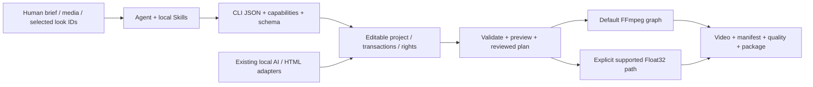

# agent editor kit

**面向 Agent 的开源、本地视频编辑 CLI。** 从结构化编辑计划到可编辑工程、预览、成片、质量报告和可恢复交付；保留每一步的真实输出与来源。

[简体中文](README.md) · [繁體中文](README.zh-TW.md) · [English](README.en.md) · [Repository](https://github.com/copypasteltd/agent-editor-kit) · [Docs](docs/README.md)

**发行版本：v0.1.0-alpha.3 预发布版 · CLI 0.1.2 · 500 套风格 · 1 个统一 Skill / 17 项内部模块。** 提供完整运行 ZIP、Agent kit、可选图册及校验摘要。运行内核保持原已验包字节；新增可移植安装和可执行示例。完整剪映等价仍是开发目标，尚未验收。

本页包含完整功能模块、服务与依赖、安装与使用逻辑、Skill 输入输出、真实案例和核验表。长篇原始验收日志继续留档，功能说明与案例入口恢复到首页。


<!-- unified-skill-registration -->

**当前注册入口已合并：只需 `$agent-ffmpeg-local-editor`。** 时间线、滤镜、模型、质检、创意和分析等 17 项能力按需读取内部说明。

本机已迁移为 1 个入口；[统一 Skill kit](https://github.com/copypasteltd/agent-editor-kit/raw/refs/heads/main/docs/skills/agent-editor-kit-unified-skill-r1.zip) · [安装/迁移/调用说明](docs/skills/UNIFIED_SKILL.md)。 原 alpha.3 Release 附件保留原 17 个入口，新 kit 继续使用相同的已验证内核。

<!-- /unified-skill-registration -->

## 下载并跑通第一条视频

**环境：Windows x64、已有 CPython 3.13 x64、FFmpeg/ffprobe 在 PATH。** 基础流程不需要模型、Node 或浏览器；安装不使用 Docker、WSL、虚拟环境或全局 pip。Python 路径按实际安装位置修改。

| 下载附件 | 用途 |
|---|---|
| [agent-editor-kit-v0.1.0-alpha.3-cp313-win_amd64.zip](https://github.com/copypasteltd/agent-editor-kit/releases/download/v0.1.0-alpha.3/agent-editor-kit-v0.1.0-alpha.3-cp313-win_amd64.zip) | 必需：应用和 8 个固定 wheel，约 196 MB。 |
| [agent-editor-kit-unified-skill-r1.zip](https://github.com/copypasteltd/agent-editor-kit/raw/refs/heads/main/docs/skills/agent-editor-kit-unified-skill-r1.zip) | 必需：离线安装入口、1 个统一 Skill、17 项内部模块、注册脚本与可运行示例。 |
| [agent-editor-kit-v0.1.0-alpha.3-gallery.zip](https://github.com/copypasteltd/agent-editor-kit/releases/download/v0.1.0-alpha.3/agent-editor-kit-v0.1.0-alpha.3-gallery.zip) | 可选：原图、500 套真实样例、离线选型页和客户对照板资源。 |
| [SHA256SUMS.txt](https://github.com/copypasteltd/agent-editor-kit/releases/download/v0.1.0-alpha.3/SHA256SUMS.txt) | 核对下载文件；安装入口还会强制验证运行 ZIP 哈希。 |

**1. 安装。** 将两个必需 ZIP 下载到 `E:/Downloads/`，选择新的工具目录；保留运行 ZIP 原样，由安装入口校验并解包。

```powershell
$avkPython = 'C:/Python313/python.exe'
$avkHome = 'E:/tools/agent-editor-kit-unified'
$avkArchive = 'E:/Downloads/agent-editor-kit-v0.1.0-alpha.3-cp313-win_amd64.zip'
Expand-Archive -LiteralPath 'E:/Downloads/agent-editor-kit-unified-skill-r1.zip' -DestinationPath $avkHome
Set-Location $avkHome
& $avkPython -I -B -X utf8 ./install.py --archive $avkArchive
```

**2. 加载 Skill 并检查环境。** 安装响应 `ok: true` 后注册；脚本保留同名冲突目录。已有本仓库本机安装的用户可继续使用原入口。客户端尚未发现 Skill 时，重新打开会话。

```powershell
powershell.exe -NoProfile -ExecutionPolicy Bypass -File ./register-agent-ffmpeg-local-skills.ps1
$avk = Join-Path $avkHome 'skills/agent-ffmpeg-local-editor/scripts/run.ps1'
& $avk version
& $avk doctor
& $avk capabilities
& $avk schema show
```

**3. 跑通示例。** 无需额外素材；随包 CC0 图片与合成音频经过实际剪辑、运镜、滤镜、预览、渲染、质检及工程包导入导出。输出目录必须尚不存在。

```powershell
& $avkPython -I -B -X utf8 ./run-example.py --output 'E:/video-work/aek-first-demo'
```

主要产物：`project/project.json` 可编辑工程、`project/renders/demo.mp4`（6 秒、360×640、30 fps、180 帧及音轨）、`demo.aevpkg.zip`、`restored/`、逐次响应和 `verification.json`。此示例核验安装与功能链路；自然画质和听审仍需独立验收。

**4. 用 Agent 编辑自己的素材。** 明确素材路径、目标、时长、画幅及音轨；Agent 先检查真实能力和来源，再形成时间线、预览和交付。

```text
$agent-ffmpeg-local-editor 用 E:/media/product.mp4 制作 15 秒竖屏广告。
先检查能力和素材，明确保留原声音轨，展示滤镜候选；生成预览、成片、质检报告和可编辑工程包。
```

**5. 按需安装图册。** 将可选 `gallery.zip` 解压到同一个 `$avkHome`，打开 `docs/assets/looks-n002-20261024-r1/index.html`；也可用下方 Skill helper 输出候选对照板。使用完关闭不用的浏览器标签。

[Release](https://github.com/copypasteltd/agent-editor-kit/releases/tag/v0.1.0-alpha.3) · [完整安装与使用流程](docs/skills/UNIFIED_SKILL.md) · [范围与限制](docs/releases/v0.1.0-alpha.3/RELEASE.md)

统一 kit 是本轮新增的 Skill 组织包，使用同一个 alpha.3 内核。新 kit 的摘要见 [包清单](docs/skills/unified-skill-package.json)；原 Release 的 17 Skill kit 不覆盖。

## 先看实际效果：同一母图的 500 套滤镜

以下每一格都来自用户提供的 N002 母图，经已安装 CLI 实际处理。原图 + 11 套示例只是入口；全部 500 套均有独立样例和详情。


[**打开全部 500 套交互选型页**](docs/assets/looks-n002-20261024-r1/index.html) · [全部编号样例](docs/local/FILTER_GALLERY.md) · [逐项实际效果](docs/local/LOOK_PRESETS.md) · [原始 PNG](docs/assets/looks-n002-20261024-r1/source.png) · [来源与许可](docs/assets/looks-n002-20261024-r1/SOURCE_AND_LICENSES.md)

选型页支持简体/繁体/英文、编号/名称/ID/描述搜索、类别与许可筛选、原图滑杆、候选勾选和 JSON 导出。每页仅加载 40 张小图，选中时再加载原尺寸大图。GitHub 文件页不执行 HTML，请下载仓库后直接双击该 HTML；无需服务或联网。

**样例口径：** 原图 1672×940，统一强度 1.0、四面体插值；500 张原尺寸无损 WebP 与实际 CLI PNG 的解码 RGB 逐像素一致，500 张小图为缩放的 WebP。母图没有嵌入色彩配置，按编码 SDR RGB 试片，不推断为相机/HDR 校准。母图使用依据为用户本次提供与展示指令，未将其标为 MIT/CC0。

## 产品方案与完整执行逻辑



当前实现是 **Python CLI + Agent Project schema + FFmpeg**，并有显式的 Float32 处理子集。Concat 是早期路线研究对象，发行包不是“删除 Concat GUI 的二进制”。已采用的 OpenFilm 字幕分段、帧时钟、HTML 动效/模板等复用保留来源与许可；当前运行不依赖 OpenFilm 在线服务。

1. 读取 version/doctor/capabilities/schema，确定本机真实可用的能力与依赖。
2. 把 brief 写成计划：素材、画幅、时长、镜头、音轨、字幕、运镜、风格、交付与证据。
3. 创建独立工程，导入本地素材，用真实 asset ID 与整数 ticks 编写编辑 JSON；音轨明确添加。
4. 通过事务 compose/edit/apply 写入时间线，保留快照；先校验，再预览关键帧和区间。
5. 若需要选型，展示原图与少量候选，记录最终 ID/强度/作用域；在目标素材上复试。
6. 渲染至工程内新路径，检查实际编码文件、manifest、warning、音画与权利，再导出项目包。

## 43 个功能说明模块

编号用于定位文档；各模块有依赖与交叉，不是“43 个独立内核”或完成率。下表直接写明行为、入口与限制；[完整机器能力清单及每项契约](docs/product/CAPABILITIES.md)保留全部字段。

| 编号 | 功能模块 | 具体行为与输入 → 输出 | 入口 | 依赖/边界 |
|---|---|---|---|---|
| F01 | Agent 调用协议 | 任务参数 → JSON 响应、退出码、错误、warning、产物与 provenance；能力与 schema 可查询。 | `version; doctor; capabilities; schema show` | Skill 组织任务，CLI 执行；没有后台云端 Agent 服务。 |
| F02 | 可编辑项目 | 创建/检查 Agent Project，保存资产、序列、轨道、ticks 时钟、输出配置和权利引用。 | `project init/inspect` | 源媒体与项目元数据分离，移动工程后需重链并复核证据路径。 |
| F03 | 事务、恢复与快照 | 写入前快照、恢复、迁移、锁和操作记录；中断后恢复项目元数据事务。 | `project snapshot/restore/migrate/recover; operation inspect` | 失败证据保留；快照不等于外部原始素材的完整备份。 |
| F04 | 素材导入与重链 | 本地图片/视频/音频/字体 → 探测结果、稳定资产 ID、哈希和来源记录。 | `media ingest/relink` | 不抓取在线素材；导入不自动证明商业授权。 |
| F05 | 代理、缩略图与波形 | 素材 → 轻量代理、图片缩略图、音频波形、可核查联系表。 | `media prepare/contact-sheet` | 联系表是抽样证据；不代表逐帧视觉理解。 |
| F06 | 镜头、静音与高光分析 | 本地视频/音频 → 切镜、静音、节拍或启发式高光候选与时间证据。 | `media understand/highlights` | 高光是启发式候选，语义判断需要 Agent/已注册适配器复核。 |
| F07 | 智能粗剪与广告计划 | 经检查的静音/文本片段或广告 brief → 编辑计划 → 可编辑粗剪。 | `media smart-cut; ad plan/apply` | 计划与实际 apply 分开；不承诺自动导演效果或投放表现。 |
| F08 | 节拍剪辑与多机同步 | 节拍锚点/本地多机音轨 → 剪切或 offset/显式 affine 时钟及切机计划。 | `media beat-cut/multicam` | 低置信度、覆盖不足、非线性漂移需拒绝/显式处理；不自动添加音轨。 |
| F09 | 多轨基础剪辑 | 编辑 JSON → 加轨、插入、更新、拆分、删除、时长/位置修改与画幅设置。 | `timeline compose/edit` | 遵守轨道锁、整数 ticks、资产时长与实际能力契约。 |
| F10 | 范围与输出窗口编辑 | 明确区间 → 裁切/删除/波纹等范围编辑，保留作者时间与源映射。 | `timeline edit` | 复杂变速与嵌套的组合需按具体契约检查，不推断所有组合均可用。 |
| F11 | 源句柄、滑移与滑动 | 源入出点与邻接片段 → 可逆源编辑、源句柄转场和剪口调整。 | `timeline edit/transition` | 源句柄不足会报错；不以静默复制帧替代。 |
| F12 | 磁吸、主轨与关联音画 | 主轨块重排、关联 ID、音画附着 → 结构化编辑并保持相对关系。 | `timeline edit` | 锁、边界和关联选择规则会阻止不明确编辑；不是拖拽式 GUI。 |
| F13 | 复合与嵌套序列 | 子序列 → 独立画布合成、父变换/透明度、嵌套时钟与定格。 | `timeline compose/edit` | 独立空间不代表独立色彩/帧率；部分组级空间转场未接受。 |
| F14 | 变速、倒放与定格 | 显式速度/曲线/Bezier/定格点 → 视频时钟与音频映射。 | `timeline edit; render` | 变速音频后端各有边界；可选 Rubber Band R3 需要已有原生工具。 |
| F15 | 关键帧与缓动 | 位置、锚点、缩放、旋转、透明度、裁切、蒙版、音量/声像 → 逐帧动画。 | `timeline compose; schema show` | hold/linear/ease_in/ease_out/ease_in_out/bezier；枚举/布尔值不推断为连续动画。 |
| F16 | 12 套运镜预设 | 推拉、上下左右平移、Ken Burns、旋入/旋出、淡入/淡出、shake → 可编辑关键帧。 | `motion list/inspect/apply` | 参数有界；是明确关键帧预设，不是 AI 三维相机或全部商业运镜库。 |
| F17 | 转场与剪口效果 | 相邻片段与源句柄 → 淡化、擦除、滑动、黑/白场、圆形等已声明转场。 | `timeline transition; capabilities` | 以默认渲染路径和具体层级为准；Float32 后续转场候选未随本版提供。 |
| F18 | 几何蒙版与逐帧修正 | 矩形/圆/椭圆/路径/多边形 → 反选、羽化、动画、编码蒙版与修正。 | `timeline compose; media mask-edit; quality mask` | 路径点数和采样受限；几何通过不等于语义分割/身份正确。 |
| F19 | 图层合成与混合 | 多轨视觉层 → normal/multiply/screen/overlay/difference/addition/softlight/hardlight。 | `timeline compose; capabilities` | 默认路径主要为编码 8-bit RGB；不宣称线性光/HDR 合成等价。 |
| F20 | 46 个效果处理算子 | 模糊/锐化、降噪、色调、曲线、HSL、色键、暗角、颗粒等 → 可配置效果链。 | `effects list/inspect` | 可动画参数与实际后端逐项查询；46 算子与 500 成品 LUT 是不同统计。 |
| F21 | 500 套离线风格 | 名称/ID/类别/许可检索 → 详情、图片预览、片段或全局应用与来源副本。 | `look list/inspect/preview/apply` | 500 个不同数值变换含同系列曲线；SDR 创意映射，不是 500 个独立家族。 |
| F22 | 自定义 LUT 与色彩自动化 | 本地 .cube/.3dl/.csp/.dat → 登记、检查；支持的 3D LUT 强度与色彩参数按契约动画。 | `lut register/list/inspect; effects inspect` | 格式登记不等于所有路径都完整解析；完整 CUBE 才有对应强度/浮点支持。 |
| F23 | 显式 Float32 像素路径 | 声明输入/工作/输出信号、顺序与预算 → 原生浮点色彩、LUT/shaper、选定空间处理和 surface。 | `render; preview; surface export/inspect` | 必须显式选择 float32-native-v1；能力子集，拒绝不支持项，非完整 HDR/ICC 管线。 |
| F24 | 字幕、文字与分段 | SRT/VTT/ASS/SSA/TTML 或文字 → 规范化、分段、双语、文字层、逐字高亮和文字动画。 | `subtitle validate/normalize/segment; timeline compose` | 字体需本地可用；复杂排版、双向 shaping 与部分动画/时钟有明确近似或拒绝。 |
| F25 | 离线转写与字词对齐 | 音频 + 已有 Whisper/CTC 模型/校正文 → 转写、字幕、字词时码与 CER 评估。 | `asr adapter; subtitle transcribe/align/evaluate` | 基础包不带权重；转写段时间不等于精确逐字对齐，既有 CTC 自然精度门槛未通过。 |
| F26 | 多轨音频与总线 | 显式音轨 → 混音、总线、音量/声像、静音/solo、淡化、EQ、压缩、降噪、响度与闪避。 | `audio extract; timeline compose; quality check` | 视频资产有声音不代表时间线自动出声；自动 PCM/LUFS 检查不代替听审。 |
| F27 | 本地语音合成 | 已有本地 flite 或登记 SoulX 权重/授权参考声 → WAV 资产与可选音轨。 | `tts adapter/voice; tts synthesize` | flite 取决于 FFmpeg 构建且限 ASCII 英文；SoulX 需 CUDA/原生依赖，非基础包自带配音库。 |
| F28 | 声道近似与模型分离 | 音频 → center/side 近似，或已有 HDemucs 适配器的人声/伴奏 stem。 | `audio separate; audio adapter` | mid/side 不是 AI 人声分离；真正模型分离需权重、环境与许可。 |
| F29 | 跟踪、绑定与重构图 | 模板/模型/已编码蒙版轨迹 → 文字/贴纸锚定、裁切与主体重构图关键帧。 | `media track/track-bind/reframe` | 多目标须明确对象；置信度/蒙版不等于身份保证，支持的变换与时钟需检查。 |
| F30 | OCR 锚点与人脸修饰 | 已有 PP-OCR/OpenSeeFace 模型 → OCR 框/文字、锚点运镜、人脸点位与受限修饰。 | `ocr adapter/scan/anchors; face adapter/scan/retouch` | 已有 ONNX CPU 环境与权重；不是完整 UI 行为识别、美妆、瘦身或脸部生成。 |
| F31 | 人像抠像与对象分割 | 已有 RVM/SAM2 + 提示点/框 → 透明视频、对象 mask 和可编辑派生资产。 | `media adapter; media matting` | RVM 人像与 SAM2 对象分割不同；概率 mask 不是物理发丝 matte，需检查运动/遮挡。 |
| F32 | 修复、生成编辑与扩画 | 已有 LaMa/VACE + 蒙版/提示 → 修复或扩大画布，保留来源与可重放 recipe。 | `media inpaint/outpaint; media adapter` | LaMa 逐帧不保证时序；VACE 需 CUDA 且仅窗口联合；自然纹理/时序质量未普遍验收。 |
| F33 | HTML/CSS/SVG/Canvas 动效 | 受信任本地源码/素材/字体 → 可编辑模板控件、透明标题、逐笔描线、布局诊断与时间线合成。 | `motion html-*; motion stroke-source` | 另需已有 Node/Playwright/Chromium；非任意网页沙箱，不自动下载浏览器。 |
| F34 | 参数模板与批量变体 | 本地 JSON 模板 + 类型变量 → 可编辑项目变体、批量输入与模板快照。 | `template apply/batch` | 支持 asset/color/enum 等类型；复杂条件图和表达式执行未实现。 |
| F35 | 素材索引与片段组复用 | 素材目录/已编辑片段 → 检索、重复/相似检查、跨项目片段组与依赖闭包。 | `library index/search/duplicates/similar; fragment` | 用户自建资源库，未内置商业素材订阅/正版音乐库存。 |
| F36 | 帧、区间与缓存预览 | 工程 + 明确帧/区间 → PNG/短视频/缓存与可验证采样证据。 | `preview frame/range; cache; preview cache-*` | 预览不是完整成片核验；色彩路径与缓存签名需一致。 |
| F37 | 输出、编码与硬件探测 | 工程 → MP4/WebM/MKV、编码/像素/音频配置、透明输出与 manifest。 | `render` | 编码器取决于本地 FFmpeg；硬件实际探测，CPU 效果未整体 GPU 化，无实时/4K 性能保证。 |
| F38 | 持久队列、重试与取消 | 冻结项目快照 → 本地排队、有限 worker、显式重试/取消与串行元数据提交。 | `queue enqueue/list/inspect/run/cancel` | 默认串行；并发需满足门禁，不是分布式云渲染服务。 |
| F39 | 成片、Scope 与 golden 核验 | 实际编码文件 → 音画/帧率/画幅/时长、响度/黑场、色彩 Scope、蒙版和 golden 差异报告。 | `quality check/scopes/mask/golden` | 自动检查、静态目检、连续播放、人工听审分别记录；不等于商业成片质量认证。 |
| F40 | 权利台账与本地策略 | 素材/字体/LUT/模型/模板证据 → 依赖台账、变更历史、影响/撤回与发布门禁。 | `rights; policy audit; render --publish` | --publish 只检查本地权利，不上传；台账不自动裁定版权。 |
| F41 | 项目与时间线交换 | Agent JSON/package、OTIO、Kdenlive MLT、已有合法明文草稿 → 导入/导出与损失报告。 | `convert import/export` | Exact/Approximate/Unsupported/Failed 逐项报告；明文草稿不调用剪映，不解密或下载专有资源。 |
| F42 | 管道诊断与错误交付 | 失败操作 → 有界日志、diagnostic manifest、显式导出和可复查错误信息。 | `diagnostics list/show/export; operation inspect` | 失败/拒绝不是成功渲染；包含本地路径的诊断需按交付范围处理。 |
| F43 | 创意、内容与投放分析 | 用户提供的产品、受众、参考片或投放表 → 脚本、结构、变体建议与分析。 | `ad plan/apply; advisory Skills` | 策略 Skill 不提供广告平台连接、自动投放、实时数据或效果保证。 |

## 支持的服务模块与依赖

这里的“服务”指本地处理模块与适配器。基础包提供 CLI/项目/渲染能力；模型、浏览器、字体与用户素材按下面条件提供。

| 编号 | 服务模块 | 运行形式 | 需要什么/提供什么 | 入口 | 范围 |
|---|---|---|---|---|---|
| S01 | 本地 Agent 工具服务 | 原生进程/JSON | Python 3.13 + 已安装包；Agent 可通过命令行或 Skill 调用。 | `version / capabilities / schema show` | 不内置 SaaS、HTTP API 或 MCP server；可由调用方自行封装。 |
| S02 | 项目与操作存储 | 本地文件/事务 | Agent Project、快照、锁、操作与恢复记录。 | `project / operation` | 不是多人云协作数据库。 |
| S03 | 媒体处理与默认渲染 | 随功能调用 | 已有 FFmpeg/ffprobe，素材均来自本地。 | `media / timeline / render` | 实际编码器/滤镜可用性取决于当前 FFmpeg。 |
| S04 | 显式浮点像素内核 | 选择性启用 | NumPy 与声明的 signal/预算；与默认管线分开检查。 | `surface / render / preview` | 子集实现，非通用 FFmpeg 或剪映内核的完整替代。 |
| S05 | 字幕与语音 | 基础解析 + 可选模型 | 字幕文件解析可直接用；Whisper/CTC/SoulX 需已有注册环境。 | `subtitle / asr / tts` | 无默认云转写/配音供应商。 |
| S06 | 视觉 AI 与修复 | 可选本地适配器 | RVM/SAM2/LaMa/VACE/跟踪/OCR/人脸的各自原生依赖与权重。 | `media adapter / ocr / face` | 基础包无模型权重，未配置不能声明已执行。 |
| S07 | HTML 动效生成 | 可选本地运行时 | 明确登记已有 Node、Playwright、Chromium、模板、图片和字体。 | `motion html-*` | 不依赖 OpenFilm 在线服务；不自动安装浏览器。 |
| S08 | 资源、模板与风格目录 | 随包目录 + 用户库 | 500 LUT 随包；素材、字体、音乐、模板由用户登记或自建。 | `look / lut / template / library / fragment` | 不存在完整商业素材/模板订阅库。 |
| S09 | 本地渲染队列与缓存 | 持久作业文件 | 单进程默认串行，明确条件下有限本地 worker 与缓存。 | `queue / preview / cache` | 无跨机器调度、云渲染或远端计费服务。 |
| S10 | 质量检查与诊断 | 本地产物服务 | FFmpeg 解码/Scope、PNG/JSON 报告、golden、失败诊断。 | `quality / diagnostics` | 客观检查与主观质量验收分开。 |
| S11 | 权利与交换服务 | 本地证据与文件交换 | 台账/策略/包哈希/损失报告，不调用专有编辑器。 | `rights / policy / convert` | 不自动授予第三方素材/模型商业权利。 |
| S12 | 创意与运营支持 | Agent 任务指导 | 依赖调用方提供业务信息与数据，产出脚本/建议/分析。 | `17 agent-ffmpeg-local-* Skills` | 不包含广告平台账号接入、投放或自动采集数据。 |

**本机查询与交付状态：** 本轮 doctor 检测到原生 Python 3.13.1、FFmpeg/ffprobe 8.1 和 Node；这不证明每个模型或浏览器适配器均已注册。doctor 只查到系统存在 Docker/WSL 可执行路径，没有运行它们。本项目始终使用原生工具，不调度 Docker/WSL/虚拟环境。

### 可选 AI 模块具体支持什么

| 体系 | 功能与前提 | 命令 |
|---|---|---|
| Whisper / CTC | 转写、字幕、校正文强制对齐、CER；需已有 safetensors/原生环境。 | asr adapter; subtitle transcribe/align/evaluate |
| flite / SoulX | 英文基础语音或授权参考音色合成；SoulX 需已有 CUDA BF16 环境。 | tts adapter/voice/synthesize |
| HDemucs | 人声/伴奏分离，区别于无需模型的 mid/side 声道近似。 | audio adapter; audio separate |
| Tracking / YOLOv10 ONNX | 模板/原生 ONNX/命令 JSON 轨迹，驱动绑定与重构图，须选明确对象。 | media adapter/track/track-bind/reframe |
| PP-OCRv4 / OpenSeeFace | OCR 文字框与相机锚点、66 点人脸与受限修饰；需现有 ONNX CPU 依赖。 | ocr; face |
| RVM / SAM2 | 人像软透明抠像 / 提示式对象分割；模型、提示、场景切换与 mask 都需检查。 | media adapter; media matting |
| LaMa / VACE | 逐帧修复 / CUDA 窗口联合生成编辑与扩画；保留时序/纹理未验收边界。 | media inpaint/outpaint |

以上接口不代表这些权重随基础包分发。历史某模型实测也不等于当前工程已配置；应读取实际 registry 和命令结果。外部模型、音色和素材的许可分别核验，软件 MIT 不覆盖它们。

## 46 个效果算子与 12 个运镜预设

| 效果类别 | 可查询的实际算子 |
|---|---|
| blur | `avgblur`, `blur`, `box_blur`, `smartblur` |
| color | `brightness`, `color_balance`, `color`, `color_contrast`, `color_levels`, `color_temperature`, `color_wheel`, `contrast`, `curves`, `exposure`, `gamma`, `hsl`, `histeq`, `hue`, `lut3d`, `rgb_curves`, `selective_hsl`, `saturation` |
| keying | `chroma_key` |
| repair | `deband`, `deflicker`, `deshake`, `dctdnoiz`, `gradfun`, `hqdn3d` |
| overlay | `draw_box` |
| stylize | `edgedetect`, `grayscale`, `invert`, `noise`, `posterize`, `sepia`, `solarize`, `threshold`, `vignette` |
| motion | `frame_interpolation` |
| transform | `hflip`, `vflip` |
| distortion | `lens_correction` |
| detail | `sharpen` |
| temporal | `tblend`, `tmix` |

12 套运镜：`zoom_in`, `zoom_out`, `pan_left`, `pan_right`, `pan_up`, `pan_down`, `ken_burns`, `rotate_in`, `rotate_out`, `fade_in`, `fade_out`, `shake`.

数值参数、默认值、范围、是否可关键帧和后端逐项见 [全部效果参数](docs/product/EFFECTS.md)。LUT 负责颜色映射；颗粒、暗角、模糊、几何、蒙版和 AI 修复是各自独立处理，不因选择风格而自动加入。

## 500 套滤镜：命名、详情与客户选型

001–100 保留 `sp-`/`t3-`，101–500 使用 `nt-`/`fl-` 来源前缀。名称保留上游胶片/风格与曲线变体；稳定 ID 才是调用标识。目录含 500 个不同数值变换，包含相关上游曲线，不按运行强度或文件格式重复计数，也不代表 500 个互不相关的风格家族。

| Category | Count |
|---|---|
| cinema | 39 |
| creative | 135 |
| film-bw | 37 |
| film-negative | 112 |
| film-slide | 41 |
| infrared | 2 |
| instant-consumer | 54 |
| instant-pro | 65 |
| landscape | 10 |
| lomography | 5 |

每套详情包含：原名/简繁名称/ID/类别、实际灰阶与肤色/RGB 数值、建议场景、试用强度、注意事项、作者、来源 commit、转换误差、LUT 哈希、独立许可、本次 N002 样例以及历史合成卡 PNG/视频。

| 编号 | 详情与母图样例 |
|---|---|
| 001–100 | [Profiles](docs/local/look-profiles/001-100.md) · [N002 samples](docs/local/filter-gallery/001-100.md) |
| 101–200 | [Profiles](docs/local/look-profiles/101-200.md) · [N002 samples](docs/local/filter-gallery/101-200.md) |
| 201–300 | [Profiles](docs/local/look-profiles/201-300.md) · [N002 samples](docs/local/filter-gallery/201-300.md) |
| 301–400 | [Profiles](docs/local/look-profiles/301-400.md) · [N002 samples](docs/local/filter-gallery/301-400.md) |
| 401–500 | [Profiles](docs/local/look-profiles/401-500.md) · [N002 samples](docs/local/filter-gallery/401-500.md) |

来源与许可：Striped Purple 49 + t3mujinpack 51（MIT），Natron 267（CC BY-SA 4.0），FreshLUTs 133（CC0）。Natron Hald 转 CUBE 的数值近似逐项披露；社区胶片/产品名不代表官方徕卡、剪映或厂商算法。`fl-0000228-science-fiction-for-flog` 的 Rec.709 标签与 FLog 标题存在歧义，仅做实验创意比较，不能作为已验证的相机 Log 转换。

**面向客户的流程：** Agent 先展示原图 + 3–6 套符合需求的实际样例，并写清编号、名称、稳定 ID、强度、色彩变化与许可；客户可在选型页筛选并导出候选，或直接报编号。Agent 再对真实目标素材生成选定强度预览，记录最终 ID、强度与片段/全局作用域，再 dry-run/apply。对照滑杆只改变原图显示区域，不模拟滤镜强度。

```powershell
$avkHome = 'E:/tools/agent-editor-kit-unified'
$avk = Join-Path $avkHome 'skills/agent-ffmpeg-local-editor/scripts/run.ps1'
$aekGallery = Join-Path $avkHome 'skills/agent-ffmpeg-local-editor/scripts/look_gallery.py'
& 'C:/Python313/python.exe' -I -S -B -X utf8 $aekGallery --query '黑白' --limit 6
& 'C:/Python313/python.exe' -I -S -B -X utf8 $aekGallery --ids t3-fuji-superia-800 nt-bw-agfa-apx-100 fl-0000634-darkblue --output 'E:/video-work/client-look-options'
& $avk look inspect --id t3-fuji-superia-800
& $avk look preview --id t3-fuji-superia-800 --input 'E:/media/client-frame.png' --output 'E:/video-work/client-strength-065.png' --strength 0.65
& $avk look apply --project 'E:/video-work/my-ad' --id t3-fuji-superia-800 --clip-id clip_1 --strength 0.65 --dry-run
& $avk look apply --project 'E:/video-work/my-ad' --id t3-fuji-superia-800 --clip-id clip_1 --strength 0.65
```

上例输出目录必须是新目录；`clip_1` 应替换为真实片段 ID。helper 只输出 `board.jpg` 与 `selection.json`，不改工程；样例均为 100% 强度。`look apply` 默认替换该作用域的内置风格并保留手工效果，`--append` 才叠加；`--global` 作用于全部序列。静态强度混合的是编码 RGB。仅创意 SDR，Float32/Log/HDR 应先按独立色彩契约准备。

## 分卷备用安装、包内容与仓库本机入口

基础环境：原生 Windows x64、已有 CPython 3.13、FFmpeg/ffprobe。发行包含 8 个固定 wheel（应用、NumPy、Pillow 及 schema 依赖），采用目标目录离线安装，不创建虚拟环境、不改全局 site-packages。Python、FFmpeg、Node/Chromium、模型权重、商业字体/音乐不包含在基础包。

[下载所有分卷与元数据](docs/releases/v0.1.0-alpha.3/artifacts/) · [安装手册](docs/releases/v0.1.0-alpha.3/USAGE.md) · [摘要](docs/releases/v0.1.0-alpha.3/artifacts/SHA256SUMS.txt)。分卷不是独立 ZIP；先合成后解压。哈希验证内容一致性，不是发布者签名。

```powershell
$avkPython = 'C:/Python313/python.exe'
# Run from the directory containing every .partNN and the supplied metadata.
& $avkPython -I -B -X utf8 ./assemble.py --output E:/tools/agent-editor-kit-unified.zip
Expand-Archive E:/tools/agent-editor-kit-unified.zip E:/tools/agent-editor-kit-unified
Set-Location E:/tools/agent-editor-kit-unified
$avkManifest = (Get-Content ./version.json -Raw | ConvertFrom-Json).manifest_sha256
& $avkPython -I -B -X utf8 ./bundle/install.py --target E:/tools/aek-alpha3-installed --manifest-sha256 $avkManifest
& $avkPython -I -S -B -X utf8 E:/tools/aek-alpha3-installed/run.py doctor
```

本机已经安装到 `E:/dev/sandbox/AI广告剪辑/local/agent-ffmpeg/v0.1.0-alpha.3/installed/`。唯一入口正文/脚本及 17 项模块位于 `skills/agent-ffmpeg-local-editor/`，Codex 仅注册该目录的联接。移动仓库后重新登记；注册脚本保护同名无关目录。

```powershell
Set-Location 'E:/dev/sandbox/AI广告剪辑'
./register-agent-ffmpeg-local-skills.ps1
$avk = 'E:/dev/sandbox/AI广告剪辑/skills/agent-ffmpeg-local-editor/scripts/run.ps1'
& $avk version
& $avk doctor
& $avk capabilities
& $avk schema show
& $avk COMMAND --help
```

Skill 启动器验证本地安装回执与 launcher 哈希，再以 `-I -S` 调用固定发行版；安装缺失时明确报错，不静默回退源码。500 套 N002 展示图片和选型页单独提供在可选图册 ZIP；解压到 Agent kit 的工具目录即可供 Skill helper 使用。运行 ZIP 本身保持不变。

## 从零到交付的命令与工程结构

```powershell
$avkHome = 'E:/tools/agent-editor-kit-unified'
$avk = Join-Path $avkHome 'skills/agent-ffmpeg-local-editor/scripts/run.ps1'
$aekProject = 'E:/video-work/first-ad'
& $avk project init $aekProject --name 'First ad'
& $avk media ingest --project $aekProject --input 'E:/media/product.mp4'
# Read returned data.asset.id; author changes.json using actual IDs and source ranges.
& $avk timeline compose --project $aekProject --input 'E:/video-work/changes.json'
& $avk validate --project $aekProject
& $avk rights check --project $aekProject
& $avk policy audit --project $aekProject
& $avk preview frame --project $aekProject --frame 0
& $avk render --project $aekProject --output 'E:/video-work/first-ad/renders/ad.mp4'
& $avk quality check --project $aekProject --input 'E:/video-work/first-ad/renders/ad.mp4'
& $avk convert export --help
```

素材与 changes.json 是示例路径，需要用真实文件与 ID。默认时基 90,000 ticks/秒、显示帧率 30/1；源时间、作者时间、帧号与原生 PTS 不可混用。视频轨不会自动导入音轨，需明确写入 audio track。[可复现广告的真实编辑 JSON](docs/validation/evidence/release-v0.1.0-alpha.1-r2/changes.json)。

```text
project/
  project.json         # editable settings, assets, sequences and tracks
  rights-ledger.json   # source, license and dependency evidence
  assets/              # imported/derived assets, LUTs and notices
  history/             # snapshots
  operations/          # operations, diagnostics and render queue
  renders/             # delivered files and manifests
  cache/               # disposable derived previews/analysis
```

响应包含 `ok/command/request_id/operation_id/status/data/artifacts/warnings/errors/provenance`。同时检查进程退出码与响应，不能只看文件存在；`--dry-run` 是计划，不能当作实际渲染，幂等语义只用于声明支持的写操作。

默认导入权利为未核验；商业交付前补全真实来源、许可和证据，再使用 `rights check`/`render --publish`。`--publish` 是本地门禁，不上传到任何平台。转换输出携带 Exact/Approximate/Unsupported/Failed 损失报告，明文草稿交换不保证全部效果无损。

## 一个 Skill、17 项内部模块：职责、输入输出与使用边界

| 编号 | 内部模块 | 职责 | 输入 → 输出 | 相关命令 | 依赖/边界 |
|---|---|---|---|---|---|
| K01 | [`$agent-ffmpeg-local-editor`](skills/agent-ffmpeg-local-editor/SKILL.md) | 项目总入口与交付 | brief + 本地素材 → 计划、可编辑工程、成片、manifest | `project init; timeline compose; look; render` | 按能力路由，包含滤镜客户选型；需要基础 CLI。 |
| K02 | [`timeline`](skills/agent-ffmpeg-local-editor/references/modules/timeline/module.md) | 时间线、关键帧与运镜 | 编辑 JSON → 多轨/运镜/转场/嵌套 | `timeline compose/edit; motion apply` | 明确目标轨道/片段与作者时钟。 |
| K03 | [`quality`](skills/agent-ffmpeg-local-editor/references/modules/quality/module.md) | 成片与像素核验 | 成片 + manifest + 参考 → 报告/Scope/差异 | `quality check/scopes/mask/golden` | 区分目检/播放/听审；支持滤镜样例选型复核。 |
| K04 | [`project-ops`](skills/agent-ffmpeg-local-editor/references/modules/project-ops/module.md) | 工程运维、恢复与队列 | 工程 + 作业 → 快照/恢复/重链/运行结果 | `project snapshot/recover; media relink; queue` | 保留旧源与失败；不是云任务调度器。 |
| K05 | [`local-policy`](skills/agent-ffmpeg-local-editor/references/modules/local-policy/module.md) | 本地执行约束 | 工程引用 → 审计/结构化拒绝 | `policy audit` | 运行时禁止远程引用；不推断为 OS 沙箱。 |
| K06 | [`rights-ledger`](skills/agent-ffmpeg-local-editor/references/modules/rights-ledger/module.md) | 素材与模型权利证据 | 来源/许可/本地证据 → 台账/影响/门禁 | `rights list/check/update/impact` | 分别处理母图与 LUT 许可；不自动认定版权。 |
| K07 | [`local-models`](skills/agent-ffmpeg-local-editor/references/modules/local-models/module.md) | 已有离线模型登记 | 原生环境 + 权重/哈希/许可 → 适配器与推理产物 | `media adapter; asr adapter; ocr; face; tts` | 无权重下载；先核对能力/环境，再调用。 |
| K08 | [`video-understand`](skills/agent-ffmpeg-local-editor/references/modules/video-understand/module.md) | 镜头/静音与视频证据 | 本地视频/音频 → 分析 JSON、帧、字幕候选 | `media understand/contact-sheet; subtitle transcribe` | 启发式与模型语义能力分开说明。 |
| K09 | [`template-library`](skills/agent-ffmpeg-local-editor/references/modules/template-library/module.md) | 模板与片段组复用 | 模板/变量/素材库 → 可编辑变体与索引 | `template apply/batch; library; fragment` | 用户自有素材，按资源许可复用。 |
| K10 | [`long-to-short`](skills/agent-ffmpeg-local-editor/references/modules/long-to-short/module.md) | 长视频转短片 | 本地课程/口播 + 核对文本 → 粗剪与短片工程 | `media highlights/smart-cut; timeline compose` | 候选段需复核，不声称全自动语义导演。 |
| K11 | [`screen-demo`](skills/agent-ffmpeg-local-editor/references/modules/screen-demo/module.md) | 录屏与锚点运镜 | 录屏 + 操作锚点 → 放大/回全景/字幕演示 | `timeline compose; ocr anchors; preview range` | OCR 需要已有模型，文本框不等于可点击控件。 |
| K12 | [`reference-remake`](skills/agent-ffmpeg-local-editor/references/modules/reference-remake/module.md) | 参考片节奏与布局重建 | 本地参考 + 原创替换素材 → 可编辑重制 | `media understand; timeline compose` | 重建结构，不自动获取或授权参考素材。 |
| K13 | [`ffmpeg`](skills/agent-ffmpeg-local-editor/references/modules/ffmpeg/module.md) | 原生音视频工具 | 本地文件 + 参数 → 转码/缩放/提取/压缩 | `native ffmpeg / ffprobe` | 直接原生工具；先检查编解码器。 |
| K14 | [`video-edit`](skills/agent-ffmpeg-local-editor/references/modules/video-edit/module.md) | 通用视频剪切流程 | 本地文件 + 剪辑要求 → 修剪/拼接/叠加结果 | `native ffmpeg; installed CLI` | 复杂可编辑项目交给 timeline/editor。 |
| K15 | [`ad-creative`](skills/agent-ffmpeg-local-editor/references/modules/ad-creative/module.md) | 广告创意与变体 | 产品/受众/证据 → hook/文案/脚本/变体 | `advisory; ad plan` | 策略任务说明，不自带媒体生成模型。 |
| K16 | [`video-content-strategist`](skills/agent-ffmpeg-local-editor/references/modules/video-content-strategist/module.md) | 视频内容策略 | 目标/受众/提供的参考 → 内容定位/系列/脚本 | `advisory Skill` | 不自带实时趋势、平台账号或抓取器。 |
| K17 | [`campaign-analytics`](skills/agent-ffmpeg-local-editor/references/modules/campaign-analytics/module.md) | 提供数据的投放分析 | 本地投放表 → ROAS/CPA/漏斗/建议 | `advisory Skill` | 无广告平台连接；指标依赖原始数据与归因假设。 |

以下 K01–K17 均为统一入口内部模块，不需要另行注册。你只需描述目标，入口会读取相关模块，再按需组合创意、分析、时间线、模板、质检和交付。

```text
$agent-ffmpeg-local-editor 用本地素材做 6 秒竖屏广告，保留工程、音轨、权利证据和成片核验。
$agent-ffmpeg-local-editor 用 N002 图册向客户展示暖色胶片、黑白、冷色电影各两套；给编号/ID/强度/许可和对照板，等客户选型后再试目标素材。
$agent-ffmpeg-local-editor 给 clip_1 添加可编辑推近和关键帧，预览首中末帧。
$agent-ffmpeg-local-editor 用提供的本地产品图和变量生成一个可编辑模板变体。
$agent-ffmpeg-local-editor 对实际输出、manifest 和 Scope 复核，分别说明自动检查、目检、播放和听审。
```

[当前完整 Skill 手册](docs/product/SKILLS.md) · [客户选型工作流](skills/agent-ffmpeg-local-editor/references/client-look-selection.md) · [注册与本地安装](docs/local/INSTALLATION.md)。Skill 是任务指导，不自带额外模型/素材订阅，也不自动连接广告平台。

## 完整案例、原输入、实际输出与 GIF

| 编号 | 场景与实测范围 | 原始文件、输出与证据 |
|---|---|---|
| C01 | 6 秒 FIELD 竖屏广告：原创产品卡 + 合成音 → 360×640/30 fps/180 帧。 | [Input](docs/assets/release-v0.1.0-alpha.1-r2/input.mp4) · [MP4](docs/assets/release-v0.1.0-alpha.1-r2/field.mp4) · [GIF](docs/assets/release-v0.1.0-alpha.1-r2/field.gif) · [JSON](docs/validation/evidence/release-v0.1.0-alpha.1-r2/changes.json) |
| C02 | 3 秒模板换款：真实 asset ID/时长变量 → 可编辑静音变体。 | [Template](docs/validation/evidence/release-v0.1.0-alpha.1-r2/template.json) · [Variables](docs/validation/evidence/release-v0.1.0-alpha.1-r2/variables.json) · [MP4](docs/assets/release-v0.1.0-alpha.1-r2/variant.mp4) · [GIF](docs/assets/release-v0.1.0-alpha.1-r2/variant.gif) |
| C03 | Float32 1D/shaper + 3D LUT：有序色彩链、源时钟和独立预览的历史实测。 | [Input](docs/assets/float-shaper-20261023-installed-r1/original.mp4) · [Output](docs/assets/float-shaper-20261023-installed-r1/edited.mp4) · [GIF](docs/assets/float-shaper-20261023-installed-r1/formal-comparison.gif) |
| C04 | 项目包导出/恢复 + 真实远程引用拒绝；保留完整 CLI 响应。 | [Export](docs/validation/evidence/release-v0.1.0-alpha.1-r2/export-package.stdout.json) · [Restored validation](docs/validation/evidence/release-v0.1.0-alpha.1-r2/restored-validate.stdout.json) · [Refusal](docs/validation/evidence/release-v0.1.0-alpha.1-r2/remote-refused.stdout.json) |
| C05 | 本轮 N002 × 500：500 次安装版预览，500 张全尺寸无损图逐像素一致。 | [Source](docs/assets/looks-n002-20261024-r1/source.png) · [Gallery](docs/assets/looks-n002-20261024-r1/index.html) · [All samples](docs/local/FILTER_GALLERY.md) · [GIF](docs/assets/looks-n002-20261024-r1/look-selection.gif) |
| C06 | 客户候选板：原图 + 指定稳定 ID、名称、许可与可回传 selection.json。 | [Board](docs/assets/looks-n002-20261024-r1/client-shortlist-example/board.jpg) · [JSON](docs/assets/looks-n002-20261024-r1/client-shortlist-example/selection.json) |
| C07 | 真实选型页：桌面/手机截图、实际操作录屏和交互断言。 | [Desktop](docs/assets/looks-n002-20261024-r1/gallery-desktop.png) · [Mobile](docs/assets/looks-n002-20261024-r1/gallery-mobile.png) · [WebM](docs/assets/looks-n002-20261024-r1/gallery-walkthrough.webm) |
| H01 / V35 | 源句柄转场：作者输入、双剪口实际输出、独立像素参考。 | [Input](docs/assets/source-transitions-20261017/authored-input.mp4) · [Output](docs/assets/source-transitions-20261017/C01-actual.mp4) · [GIF](docs/assets/source-transitions-20261017/comparison.gif) |
| H02 / V41 | HTML 原生动效：保留源码、透明标题与时间线合成；已有浏览器环境。 | [Source](docs/assets/html-motion-20261018/source.mp4) · [HTML](docs/assets/html-motion-20261018/template/index.html) · [Output](docs/assets/html-motion-20261018/S03-timeline.mp4) · [GIF](docs/assets/html-motion-20261018/native-comparison.gif) |
| H03 / V43 | 逐帧蒙版修正：缺选/误选修正，几何通过但自然 LaMa 修复仍有涂抹。 | [Source](docs/assets/mask-edits-20261018/source.mp4) · [Before](docs/assets/mask-edits-20261018/mask-input.mov) · [After](docs/assets/mask-edits-20261018/mask-edited.mov) · [GIF](docs/assets/mask-edits-20261018/comparison.gif) |
| H04 / V37 | 片段组跨项目复用：转场、字幕、LUT、子序列与关联依赖。 | [Input](docs/assets/fragments-20261018/source-a.mp4) · [Output](docs/assets/fragments-20261018/C01-actual.mp4) · [GIF](docs/assets/fragments-20261018/comparison.gif) |
| H05 / V34 | 字幕分段与双语：人工标记源文本、实际输出和参考；不是模型转写演示。 | [Input](docs/assets/subtitle-segments-20261017/source.mp4) · [Output](docs/assets/subtitle-segments-20261017/S01-segmented.mp4) · [GIF](docs/assets/subtitle-segments-20261017/comparison.gif) |
| H06 / V49 | 真实离线 CTC：模型时间驱动字幕，边界偏差 258.1875 ms，未通过 66.6667 ms 门槛。 | [Input audio](docs/assets/ctc-alignment-20261018/input.wav) · [Output](docs/assets/ctc-alignment-20261018/result.mp4) · [GIF](docs/assets/ctc-alignment-20261018/comparison.gif) |
| H07 / V53 | 磁吸主轨重排：A/B/C/D → C/A/B/D，保持关联音画与作者约束。 | [Input](docs/assets/magnetic-reorder-v53-r5-20261018/source-preview.mp4) · [Output](docs/assets/magnetic-reorder-v53-r5-20261018/MR01.mp4) · [GIF](docs/assets/magnetic-reorder-v53-r5-20261018/reorder-before-after.gif) |

<!-- unified-skill-demo -->

### C09：统一 Skill 的新目录实际交付

本轮从统一 kit 在 E 盘中文/空格路径离线安装，只注册一个入口，实际执行 20 次 CLI，完成 6 秒/360×640/30 fps/180 帧含音轨视频、质检及工程包往返。4 项预期拒绝、17→1 迁移和重复注册另有原始回执；0 新模型推理。下面 GIF 为本轮实际 MP4 的缩小无声预览，48 帧/6.01 秒，非剪辑 GUI 录像；检查过静态帧，未做连续播放和人工听审。

[MP4](docs/assets/unified-skill-20261024-r1/demo.mp4) · [GIF](docs/assets/unified-skill-20261024-r1/demo.gif) · [Inputs](docs/assets/release-v0.1.0-alpha.1-r2/input/) · [Commands](docs/validation/evidence/unified-skill-20261024-r1/native-r2/demo-commands.json) · [Verification](docs/validation/evidence/unified-skill-20261024-r1/verification.json) · [Media hashes](docs/assets/unified-skill-20261024-r1/manifest.json)


<!-- /unified-skill-demo -->

### C08：从下载包首次安装到实际交付

本次在新的 E 盘中文/空格路径安装 Agent kit，注册 17 个 Skill，再执行随包示例的 20 次实际 CLI：两张 CC0 图片 + 合成音 → 运镜与 0.65 强度风格 → 实际视频/质检 → 工程包导出、导入和恢复验证。

[MP4](docs/assets/release-v0.1.0-alpha.3-r1/demo.mp4) · [GIF](docs/assets/release-v0.1.0-alpha.3-r1/demo.gif) · [Changes](docs/validation/evidence/release-v0.1.0-alpha.3-r1/demo/changes.json) · [Commands](docs/validation/evidence/release-v0.1.0-alpha.3-r1/demo/commands.json) · [Verification](docs/validation/evidence/release-v0.1.0-alpha.3-r1/verification.json)


本轮实际选型页桌面截图，支持原图对照与候选导出：


下面是实际 CLI 渲染的 FIELD 广告；所有源卡片、音频、编辑 JSON、响应与流信息见案例手册。GIF 无声，原 MP4 可检查音轨。


已保留的 HTML 动效源码与时间线合成实测：


关键帧、运镜、动态蒙版、标题、转场和音频组合的既有实际演示：


[**完整案例册：恢复全部既有功能演示、输入/输出、指标与失败**](docs/product/CASES.md) · [首版完整复现步骤](docs/releases/v0.1.0-alpha.1/CASES.md)。N002 图册与本次新目录安装示例分别保留核验记录；其他案例保留日期，不累计为本次新模型或新回归。研究性的时序修复仍单列为未集成/未验收。

## 故障、恢复与交付注意点

| 现象 | 处理方式 |
|---|---|
| 缺少 FFmpeg / 模型 / 浏览器 | 先 doctor/inspect，提供已有原生依赖；不自动联网下载或改用不声明的后端。 |
| 输出已存在 / 路径在工程外 | 选择新的工程内绝对路径；保留原结果与失败证据。 |
| 项目锁或中断 | 查看 operation/queue，按支持入口取消或恢复；不盲删锁。 |
| 发布门禁阻止 | 补全每个素材、字体、LUT、模型的真实许可和本地证据，重新 rights check。 |
| 效果/浮点组合不支持 | 读取能力契约，调整明确计划与所选渲染路径；不悄悄降级。 |
| 只有图册，没有运行能力 | 图册可以纯本地浏览；生成新强度和编辑工程需要另行安装并加载固定 CLI。 |

## 功能核验与发布证据

R01–R24 保留对应版本/日期核验；R25–R28 记录 N002 图册与完整文档恢复；R29 记录本次目标差距及安装版只读核对。各行按原证据日期理解，历史核验未因文档更新重跑；计数不相加，也不据此宣称完整剪映等价。

R30 记录本次可移植安装与完整示例；图册独立解包及 10 个附件从 Git 文件重建一致性另有原始回执。 [Gallery check](docs/validation/evidence/release-v0.1.0-alpha.3-r1/gallery-portable/verification.json) · [Reproduction](docs/validation/evidence/release-v0.1.0-alpha.3-r1/git-reproduction.json).

R31 记录已经公开的 GitHub 预发布和 10 个附件的实际下载哈希核对。

| # | 核验 | 实际结果 | 证据与边界 |
|---|---|---|---|
| R01 | 基线完整回归 | **2,930 通过，0 跳过** | [原始记录](docs/validation/evidence/float-shaper-20261023-lab/full-r1.json)；2026-10-23，6991.508 秒；仅代表 alpha.1 的 331 项冻结输入，不代表本轮新增代码的全量回归 |
| R02 | 已有 V112 新离线安装专项 | **118 通过，197 个产品资源** | [隔离安装记录](docs/validation/evidence/float-shaper-20261023-lab/installed-r1/verification.json)；该专项与全量有重叠，不相加 |
| R03 | 本轮发布包重新构建与安装 | 8 个固定 wheel，`-I -S` 启动 | [本轮清单](docs/validation/evidence/release-v0.1.0-alpha.1-r2/release-verification.json)；原生 Windows/CPython 3.13 x64 |
| R04 | 本轮竖屏广告与模板 | 实际输入、输出、GIF、JSON、包导出/导入 | [案例核验](docs/validation/evidence/release-v0.1.0-alpha.1-r2/verification.json)；合成素材，0 新模型推理 |
| R05 | 本地策略拒绝 | 远程来源返回非零退出与结构化错误 | [真实失败响应](docs/validation/evidence/release-v0.1.0-alpha.1-r2/remote-refused.stdout.json)；不是上传功能 |
| R06 | 文档页与响应演示 | 桌面/移动截图、交互检查、响应回放录制 | [页面核验](docs/validation/evidence/release-v0.1.0-alpha.1-r2/browser-verification.json)；本地文档页，不是剪辑 GUI；录制为真实日志回放 |
| R07 | Skill 与链接 | 17 个入口格式核验、发布文档本地链接核验 | [门禁结果](docs/validation/evidence/release-v0.1.0-alpha.1-r2/release-verification.json)；格式验证不等于 Agent 决策质量 |
| R08 | 留存失败 | 首轮案例输出路径错误 | [失败记录](docs/validation/evidence/release-v0.1.0-alpha.1-r1/failure.json)；脚本已改绝对项目内路径后重跑 |
| R09 | 远端发布与下载回验 | **GitHub 预发布成功，6 个附件逐个下载 SHA-256 一致** | [发布与下载记录](docs/validation/evidence/release-v0.1.0-alpha.1-r2/publication.json) · [实际安装回执](docs/validation/evidence/release-v0.1.0-alpha.1-r2/installation-receipt.json)；2026-10-24 本地时间 |
| R10 | 本机 E 盘正式安装 | **固定 ZIP 校验通过，8 个 wheels 原生离线安装** | [安装回执](docs/validation/evidence/local-install-20261024-r1/installation/installation.json)；2026-10-24，1,430 文件 / 81,845,972 字节；未创建虚拟环境 |
| R11 | 新命名空间与真实 Skill 调用 | **17 个 Skill 注册/格式通过；8 次入口命令，7 成功 + 1 预期拒绝** | [Skill 核验](docs/validation/evidence/local-install-20261024-r1/skills/verification.json)；从 Codex 联接调用实际安装版，中文空格路径渲染，输出与直接运行 SHA-256 一致；未验收全部 Agent 决策质量 |
| R12 | 正式安装版新案例 | **28 次命令，27 成功 + 1 预期拒绝；广告/模板两个成片与项目包往返** | [案例记录](docs/validation/evidence/local-install-20261024-r1/cases/verification.json) · [GIF](docs/assets/local-install-20261024-r1/field.gif) · [抽帧目检](docs/validation/evidence/local-install-20261024-r1/review.json)；0 新模型推理，未连续播放/人工听审；不累计旧回归数 |
| R13 | 已安装版滤镜与 LUT 能力核对 | **目录 46 项，LUT 登记帮助包含 4 种扩展名** | [本轮查询记录](docs/validation/evidence/filter-capabilities-20261024-r1/verification.json) · [加载逻辑与边界](docs/local/FILTERS.md)；2026-10-24，仅目录/帮助/代码核对，0 新渲染；1D shaper 为显式 Float32 能力，既有 GIF 单列为历史证据 |
| R14 | 历史 alpha.1 风格库存 | **无徕卡/富士/柯达命名预设；已安装应用内 LUT 文件 0 个** | [库存核对](docs/validation/evidence/filter-library-20261024-r1/inventory.json)；2026-10-24，排除用户工程和测试夹具，9 个 stylize 算子不等于成品风格库；0 新渲染 |
| R15 | 开源 LUT/风格资源研究 | **10 个项目，Star/commit/文件树/许可留档** | [排序与判断](docs/research/OPEN_LOOK_LIBRARY_20261024.md) · [快照](docs/validation/evidence/lut-research-20261024-r1/upstreams.json)；2026-10-24，文件数未去重，不等于可分发/已验收风格数 |
| R16 | 社区 MIT CUBE 安装版接入小样 | **最终流程 13 次 CLI 成功；3 秒/36 帧真实输出** | [核验与警告](docs/validation/evidence/lut-research-20261024-r1/probe/verification.json) · [GIF](docs/assets/lut-research-20261024-r1/comparison.gif)；2026-10-24，0.65 强度，解码/质量/静音采样通过，保留强度近似警告与先前检查失败；合成输入/首帧目检，未连续播放或验收自然画面，当时未集成整库/Hald 转换 |
| R17 | alpha.2 预设库与定向回归 | **100 个独立色彩变换；83 项测试通过** | [原始日志](docs/validation/evidence/look-presets-20261024-r1/unit-tests.txt)；目录/许可/哈希、Hald 原生位深与色轴、应用语义、事务、项目包、LUT 与离线安装器回归；未重跑 2,930 项全量 |
| R18 | 新本地包与 Skill 同步 | **8 wheels 离线安装；17 个 Skill 格式通过；14 次入口调用：13 成功 + 1 预期拒绝** | [安装](docs/validation/evidence/look-presets-20261024-r1/install/installation.json) · [Skill 核验](docs/validation/evidence/look-presets-20261024-r1/skills/verification.json)；E 盘原生安装，真实预览/应用/渲染，保留 alpha.1 |
| R19 | 安装版逐一实测 100 个预设 | **100 个预览 + 100 个成片；425 次隔离 CLI 调用，含 2 次预期拒绝** | [核验](docs/validation/evidence/look-presets-20261024-r1/installed/verification.json) · [动态 GIF](docs/assets/look-presets-20261024-r1/motion-comparison.gif)；逐片解码 12 帧/1 秒/480×300，预览与首帧各 100 个不同哈希，上游对照与包往返首帧像素通过；合成输入，未做自然素材/听审验收 |
| R20 | 新仓库、产品名与三语 README | **简体中文 / 繁體中文 / English 完整入口；推送目标与文档检查通过** | [维护说明](docs/maintenance/REPOSITORY_AND_READMES.md) · [检查回执](docs/validation/evidence/readme-rebrand-20261024-r1/verification.json)；2026-10-24，仅文档链接、代码块、编号一致性与推送配置检查，0 新渲染；历史包名和哈希见维护说明 |
| R21 | 100 预设逐项效果文档与数值分析 | **100 份详细解释；100 安装版 LUT 与 100 张既有原生 PNG 对照；2 张色块图** | [完整详情](docs/local/LOOK_PRESET_DETAILS.md) · [测量与检查](docs/validation/evidence/look-profiles-20261024-r1/verification.json)；2026-10-24，43,200,000 个通道值对照，最大误差 1 码值；场景/强度为建议，0 新成片、0 自然素材验收、0 产品回归 |
| R22 | 500 风格目录与定向回归 | **500 个独立签名/预览；90 项通过** | [回归](docs/validation/evidence/look500-20261024-r1/regression-policy.json) · [构建](docs/validation/evidence/look500-sources-20261024-r1/compilation.json)；修复首轮项目包标记错误，保留失败记录；未重跑历史全量 |
| R23 | 安装版 500 项实际输出 | **1,000 次安装版进程内 CLI 调用；500 PNG + 500 原生滤镜成片；25 项完整项目渲染** | [明确范围](docs/validation/evidence/look500-20261024-r1/installed/verification.json) · [GIF](docs/assets/look500-20261024-r1/motion-comparison.gif)；每片解码 12 帧，500 项上游对照；合成输入，未做自然素材/听审验收 |
| R24 | 新包、Skill 与三语完整手册 | **17 个 Skill 格式通过；24 次入口调用；每种语言 500 份详情** | [安装](docs/validation/evidence/look500-20261024-r1/install/installation.json) · [Skill](docs/validation/evidence/look500-20261024-r1/skills/verification.json) · [文档](docs/validation/evidence/look500-20261024-r1/docs-verification.json)；E 盘原生安装，新增许可预设真实应用/渲染，1 次预期拒绝；保留旧包 |
| R25 | N002 全部滤镜的真实产出 | 500 次安装版 CLI；500 全尺寸无损图 + 500 小图，500 个独立像素哈希。 | [Render receipt](docs/validation/evidence/looks-n002-20261024-r1/render-verification.json) · 原图哈希不变；无新视频/模型推理，不是全自然视频质量验收。 |
| R26 | 选型页、截图与实际录像 | 原生浏览器交互、三语、搜索/筛选/候选下载/手机布局检查通过。 | [Browser receipt](docs/validation/evidence/looks-n002-20261024-r1/browser-verification.json) · 0 远程请求；测试标签全部关闭。 |
| R27 | Skill 客户选型与本地加载 | 17 个 Skill 格式/联接核验；真实候选对照板、搜索与失败保护。 | [Skill workflow receipt](docs/validation/evidence/looks-n002-20261024-r1/skill-verification.json) · 不修改时间线；示例强度 1.0。 |
| R28 | 三语完整文档与样例链接 | 功能/服务/Skill/案例/500 项图册、能力字段与本地链接核对。 | [Documentation receipt](docs/validation/evidence/looks-n002-20261024-r1/docs-verification.json) · 未重跑历史 2,930 项内核全量。 |
| R29 | 完整目标差距与安装版核对 | 4 次安装版只读 CLI 成功；68 项能力声明与手册一致；38 组差距分别列出收口条件。 | [Assessment](docs/product/GOAL_GAPS_20261024.md) · [Inventory](docs/validation/evidence/goal-gaps-20261024-r1/inventory.json) · 本轮 0 渲染/0 推理；既有精度失败与未验收项保留。 |
| R30 | 可移植 Agent kit 安装与完整示例 | 原生 E 盘中文/空格路径安装；17 个 Skill 注册；20 次真实 CLI 完成剪辑、渲染、质检与工程包往返。 | [Release gate](docs/validation/evidence/release-v0.1.0-alpha.3-r1/verification.json) · [Demo video](docs/assets/release-v0.1.0-alpha.3-r1/demo.mp4) · 6 秒/180 帧完整解码；未重跑内核全量或模型推理，未做听审。 |
| R31 | GitHub 预发布与全部附件下载核对 | alpha.3 预发布已公开；原生 Windows 发布任务成功；10 个附件逐项实际下载并比对 SHA-256。 | [Release](https://github.com/copypasteltd/agent-editor-kit/releases/tag/v0.1.0-alpha.3) · [Publication receipt](docs/validation/evidence/release-v0.1.0-alpha.3-r1/publication.json) · 原运行 ZIP 不变；不代表完整剪映或自然视听门禁关闭。 |
| R32 | 统一 Skill 与真实注册迁移 | **1 个入口 / 17 项模块；原生新目录安装、17→1 迁移、重复注册和 4 项预期拒绝通过；实际示例 20 次 CLI、180 帧完整解码。** | [Verification](docs/validation/evidence/unified-skill-20261024-r1/verification.json) · [Guide](docs/skills/UNIFIED_SKILL.md) · 2026-10-24；0 新模型推理；非独立 Agent 行为评测，未做人工听审；历史 17 Skill 收据保留。 |

## 当前边界与开发方向

当前可交付的是有明确契约、离线可运行、可编辑、可复查的 Agent CLI 闭环。完整开源素材/模板生态、约定的 AI 特效/美颜/排版、完整色彩管线、指定草稿版本的真实转换质量、广泛自然视听和长片资源性能仍需开发与验收。消费级 GUI、账号、云协作及任意私有版本无损转换不属于当前内核收口门槛。后续 Float32 转场/运行时闭包候选 R113/R114 未随本版提供。

[2026-10-24 完整目标差距表](docs/product/GOAL_GAPS_20261024.md)列出 38 组差距、当前实现与收口条件。优先关闭真实素材质量、字词对齐和音频已知失败、复杂编辑组合、长片资源与干净主机安装；随后建设素材/模板库，再扩展完整 AI 范围。当前没有足够依据给出整体完成百分比。

下一步以真实客户素材与最小可复现工程收集缺口，逐项补齐、实测、发布新版本；不覆盖既有发布包/摘要/标签。只按实际成功产物更新核验。

## 文档体系、来源与维护

- [Current capability manual](docs/product/CAPABILITIES.md) · [Effect parameters](docs/product/EFFECTS.md) · [Skills](docs/product/SKILLS.md) · [Complete demonstrations](docs/product/CASES.md).
- [Filter workflow](docs/local/FILTERS.md) · [500 profiles](docs/local/LOOK_PRESETS.md) · [N002 gallery guide](docs/local/FILTER_GALLERY.md) · [Installed setup](docs/local/INSTALLATION.md).
- [Alpha.3 usage](docs/releases/v0.1.0-alpha.3/USAGE.md) · [Base workflow](docs/releases/v0.1.0-alpha.1/USAGE.md) · [Release scope](docs/releases/v0.1.0-alpha.1/RELEASE.md).
- [Requirements/roadmap](docs/产品需求与开发路线基线_2026-10-12.md) · [Architecture](docs/architecture/系统边界与模块契约_v0.1_2026-10-13.md) · [JSON schema](docs/specs/agent-project.schema.json).
- [Historical numbered acceptance](docs/releases/v0.1.0-alpha.1/history/README.zh.pre-release.md) · [Historical document catalog](docs/releases/v0.1.0-alpha.1/history/docs-index.pre-release.md) · [README restoration record](docs/maintenance/README_RESTORATION_20261024.md).
- [Software MIT](LICENSE) · [Base third-party notices](docs/releases/v0.1.0-alpha.1/THIRD_PARTY.md) · [500 LUT notices](docs/releases/v0.1.0-alpha.3/THIRD_PARTY.md) · [Supplied-image rights](docs/assets/looks-n002-20261024-r1/SOURCE_AND_LICENSES.md).

自有代码按 MIT 分发；第三方 Skill、模型、字体、LUT 与媒体分别保留各自许可，用户母图不因进入仓库而获得 MIT/CC0 授权。提交问题时提供版本、最小工程、实际命令、错误与 manifest。后续功能更新同步简体/繁体/英文 README，维护 `main`，通过检查后普通推送到本仓库。
