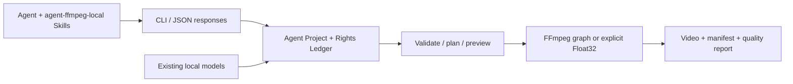

# agent editor kit

**面向 Agent 的本地视频编辑 CLI。** 用可编辑 JSON 时间线、固定能力契约和真实渲染证据，让 Agent 完成广告剪辑、模板变体、关键帧运镜与视频自动化。

[简体中文](README.md) · [繁體中文](README.zh-TW.md) · [English](README.en.md) · [源码仓库](https://github.com/copypasteltd/agent-editor-kit) · [下载安装包](docs/releases/v0.1.0-alpha.2/artifacts/agent-video-kit-v0.1.0-alpha.2-cp313-win_amd64.zip) · [文档入口](docs/README.md) · [使用手册](docs/releases/v0.1.0-alpha.1/USAGE.md) · [Skill 详情](docs/local/INSTALLATION.md) · [完整案例](docs/releases/v0.1.0-alpha.1/CASES.md)

**历史首版：`v0.1.0-alpha.1`，已在原仓库发布的 Windows 本地 CLI 预览版。** 首版范围已收口为“离线安装、结构化编辑、预览/渲染、核验与交付”的闭环。完整剪映功能、素材生态及自然画质/听感等价仍属于后续目标。[发布判定与未关闭需求](docs/releases/v0.1.0-alpha.1/RELEASE.md)。

**本轮本地更新：`v0.1.0-alpha.2`，100 预设。** 新包保存在本仓库并已安装到 E 盘；可通过上方安装包链接获取，新仓库尚未创建对应 GitHub Release。产品名为 **agent editor kit**，后续代码与更新统一维护于新仓库。


上图由原视频与三套实际成片逐帧合成，为静音对照。[100 项完整目录](docs/local/LOOK_PRESETS.md) · [新本地安装包](docs/releases/v0.1.0-alpha.2/artifacts/agent-video-kit-v0.1.0-alpha.2-cp313-win_amd64.zip)。首版案例文档页的[响应回放](docs/assets/release-v0.1.0-alpha.1-r2/workflow.gif)、[录制](docs/assets/release-v0.1.0-alpha.1-r2/workflow.mp4)、[截图](docs/assets/release-v0.1.0-alpha.1-r2/desktop.png)保留为历史证据。产品本体为 CLI。

## 方案与运行逻辑



核心是 Python CLI + Agent Project schema + FFmpeg，本版包含显式选择的 Float32 原生处理路径。Concat 是早期路线研究对象；当前发行物是本仓库的 Python 实现，并非删除 Concat GUI 后得到的二进制。已复用的 OpenFilm 字幕分段、帧时钟、HTML 动效/模板等模块保留来源与许可证；不依赖 OpenFilm 在线服务。

Agent 通过 Skill 把创意转换成编辑计划，读取 `capabilities` 和 `schema show`，再调用 CLI。项目保存源素材引用、时间线、权利台账、快照与操作记录；输出同时保存 manifest 和质量检查。默认使用 FFmpeg 图，只有工程明确设置 `settings.pixel_pipeline.engine = "float32-native-v1"` 并补全信号、源与预算配置才采用受限 Float32 路径；两条路径不承诺功能对等，也不会将不支持项悄悄降级。

## 本版功能范围

| # | 能力 | 使用入口 | 本版边界 |
|---|---|---|---|
| F01 | 项目、事务、快照、恢复、重链 | `project` / `media relink` | 本地项目；操作与失败留证 |
| F02 | 导入、探测、镜头/静音分析、缩略图/波形 | `media ingest/understand/prepare` | 本地文件；语义理解取决于显式适配器 |
| F03 | 多轨、修剪/拆分、范围编辑、关联编辑、嵌套 | `timeline compose/edit` | 整数 ticks、作者时钟、锁与事务约束 |
| F04 | 关键帧、缩放/平移/旋转、运镜预设与效果 | `effects list` + 编辑 JSON | 按已公布属性；不等于剪映全部预设/特效 |
| F05 | 源句柄转场、变速曲线、倒放、定格 | 时间线声明与契约 | 默认路径支持已实现组合；Float32 转场扩展候选未包含 |
| F06 | 蒙版、合成、色彩、HSL、LUT/1D shaper | 效果 JSON / `lut` / `surface` | Float32 源/工作/交付信号需显式声明；不宣称 HDR/ICC 完备 |
| F07 | 字幕、分段、逐字高亮、HTML 动效/模板 | `subtitle` / `motion` / 时间线 | 部分功能另需已有 Node/Chromium；不自动安装 |
| F08 | 音频提取、混音、总线、闪避、同步 | `audio` / 时间线音轨 / `media multicam` | 视频轨不自动代表音轨；自然听感需另审 |
| F09 | 模板变量、批量、片段组、素材库 | `template` / `fragment` / `library` | 用户提供可用本地素材与模板；无商业素材订阅库 |
| F10 | 模型接口：转写/OCR/跟踪/抠像/修复等 | 本地模型注册与对应命令 | 模型和大型推理环境不随基础包分发；不是开箱全功能 AI |
| F11 | 帧/区间预览、队列、取消、质量与 Scope | `preview` / `queue` / `quality` | 配额不等于峰值 RSS 或实时性能保证 |
| F12 | 项目包、JSON、OTIO、MLT/明文草稿交换 | `convert import/export` | 目标格式支持程度不同；保留 Exact/Approximate/Unsupported/Failed 损失报告 |
| F13 | 100 个离线 MIT 风格预设（alpha.2） | `look list/inspect/preview/apply` | 创意 SDR RGB；Hald 转换有采样误差，非官方品牌滤镜 |

精确参数以随包 `capabilities`、`schema show`、`COMMAND --help` 为准。[架构和完整使用逻辑](docs/releases/v0.1.0-alpha.1/USAGE.md)。明文草稿适配器只处理已有合法本地 JSON；不运行剪映，不读取私有在线资源，不保证全部字段或编辑效果无损往返。

## 本机已安装并加载 Skills（2026-10-24）

**本机已升级到 `v0.1.0-alpha.2`（CLI `0.1.1`）：100 个离线开源风格预设。** 覆盖黑白胶片 12、彩色负片 24、反转片 15、电影年代 8、风景 10、创意色彩 24、Lomo 5、红外 2。每个预设具备稳定 ID、独立 LUT、缩略图、来源和 MIT 许可，支持检索、预览、片段/全局应用及强度调节。[完整编号目录](docs/local/LOOK_PRESETS.md) · [使用与安装](docs/releases/v0.1.0-alpha.2/USAGE.md)。

**当前实现复用 t3mujinpack 的 51 个 Hald 与 Striped Purple 的 49 个 CUBE。** 原始数据锁定提交并核验哈希；CUBE 保留原始网格，Hald 按原生位深转换为 33³ CUBE，记录转换误差。17 个本地 Skills 已同步更新并绑定新安装版。历史研究与单 LUT 小样保留在[来源评估](docs/research/OPEN_LOOK_LIBRARY_20261024.md)。


[实际成片动态 GIF](docs/assets/look-presets-20261024-r1/motion-comparison.gif) · [100 个实际预览总览](docs/assets/look-presets-20261024-r1/contact-sheet.jpg) · [原始视频](docs/assets/look-presets-20261024-r1/original.mp4) · [逐个预览和成片](docs/local/LOOK_PRESETS.md) · [本轮验证记录](docs/validation/LOOK_PRESETS_20261024.md)。测试卡和声音均为合成素材；不是自然画面或完整剪映等价验收。

**滤镜已支持：** 可登记本地 LUT（`.cube/.3dl/.csp/.dat`），使用黑白、复古棕、颗粒、暗角及调色等效果，并为支持的参数设置关键帧。目录共 46 项效果；各格式和渲染路径的强度/1D 支持不同。[滤镜加载方式、格式边界与历史对照 GIF](docs/local/FILTERS.md)。

程序已从校验后的新本地 ZIP 安装到 `E:/dev/sandbox/AI广告剪辑/local/agent-ffmpeg/v0.1.0-alpha.2/installed/`。17 个本地 Skill 已按最新要求注册为 **`$agent-ffmpeg-local-xxx`**，下一条消息可调用主入口 **`$agent-ffmpeg-local-editor`**。

```powershell
$avk = 'E:/dev/sandbox/AI广告剪辑/skills/agent-ffmpeg-local-editor/scripts/run.ps1'
& $avk doctor
& $avk capabilities
& $avk look list --query '黑白'
& $avk look preview --id t3-kodak-gold-200 --output 'E:/video-work/gold-preview.png'
& $avk look apply --project 'E:/video-work/my-ad' --id t3-kodak-gold-200 --global --strength 0.65
```

Skill 启动器核对发行版本、安装回执和启动文件摘要，以 `-I -S` 调用安装包。当前原生 Python 和 FFmpeg 已可用；安装目录为 221 MB，临时文件也在 E 盘。[安装位置、17 个入口与复现](docs/local/INSTALLATION.md) · [本地发行 ZIP](docs/releases/v0.1.0-alpha.2/artifacts/agent-video-kit-v0.1.0-alpha.2-cp313-win_amd64.zip)。

首版历史安装完成 28 次案例命令，并经 Skill 入口完成 8 次命令，含实际渲染、中文空格路径与预期拒绝。[安装版原输入](docs/assets/local-install-20261024-r1/input.mp4) · [新成片](docs/assets/local-install-20261024-r1/field.mp4) · [新 GIF](docs/assets/local-install-20261024-r1/field.gif) · [模板变体](docs/assets/local-install-20261024-r1/variant.gif) · [原始响应与核验](docs/validation/evidence/local-install-20261024-r1/skills/verification.json)。具体范围见 R10–R12。

## 安装

首版验证平台为 **原生 Windows x64 + CPython 3.13**。已存在的 `ffmpeg`、`ffprobe` 必须在 `PATH`。发行包包含应用与 7 个依赖 wheel（含 NumPy、Pillow），安装时不联网、不创建虚拟环境、不修改全局 site-packages。Python、FFmpeg、Node、Chromium、CUDA 和模型权重均不随基础包分发。

```powershell
# Existing native CPython 3.13 x64 and ffmpeg/ffprobe on PATH are required.
# Extract the Windows release asset into E:\tools\agent-video-kit-v0.1.0-alpha.2.
Set-Location E:\tools\agent-video-kit-v0.1.0-alpha.2
$avkPython = 'C:\Python313\python.exe'
# Copy the exact manifest digest from the release's version.json / SHA256SUMS.txt.
$avkManifest = (Get-Content .\version.json -Raw | ConvertFrom-Json).manifest_sha256
& $avkPython -I -B -X utf8 .\bundle\install.py --target E:\tools\avk-alpha2 --manifest-sha256 $avkManifest
& $avkPython -I -S -B -X utf8 E:\tools\avk-alpha2\run.py doctor
& $avkPython -I -S -B -X utf8 E:\tools\avk-alpha2\run.py capabilities
```

先用[安装包目录](docs/releases/v0.1.0-alpha.2/artifacts)中的 `SHA256SUMS.txt` 校验 ZIP 和 `version.json`；manifest 哈希用于检测包内容变化，**不是作者数字签名**。本版支持并验证的是指定 ABI；`pyproject` 的 Python 下限不代表其他 Python/操作系统已经验证。

已有开发依赖时，可从源码执行 `./ai-ad-editor.ps1 doctor`。完整离线构建、安装、故障排查和回滚见[使用手册](docs/releases/v0.1.0-alpha.1/USAGE.md)。

## 最短使用闭环

```powershell
$avkRun = 'E:\tools\avk-alpha2\run.py'
$avkProject = 'E:\video-work\first-ad'
& $avkPython -I -S -B -X utf8 $avkRun project init $avkProject --name 'First ad'
& $avkPython -I -S -B -X utf8 $avkRun media ingest --project $avkProject --input E:\media\product.mp4
# Inspect returned data.asset.id, then put that ID in changes.json.
& $avkPython -I -S -B -X utf8 $avkRun timeline compose --project $avkProject --input E:\video-work\changes.json
& $avkPython -I -S -B -X utf8 $avkRun validate --project $avkProject
& $avkPython -I -S -B -X utf8 $avkRun preview frame --project $avkProject --frame 0
& $avkPython -I -S -B -X utf8 $avkRun render --project $avkProject --output E:\video-work\first-ad\renders\ad.mp4
& $avkPython -I -S -B -X utf8 $avkRun quality check --project $avkProject --input E:\video-work\first-ad\renders\ad.mp4
```

默认导入的权利状态是未核验。商业发布前补全来源、许可和本地证据，再使用 `rights check` 与 `render --publish`；`--publish` 只执行**本地权利门禁**，不会上传或发布到平台。上例中的源文件和编辑 JSON 需自行准备；[完整可复现案例](docs/releases/v0.1.0-alpha.1/CASES.md)包含生成脚本、真实 ID、命令和全部响应。

CLI 默认输出 JSON，Agent 应同时检查进程退出码、`ok`、`status`、`errors`、`warnings` 和 `artifacts`。失败不是空成功，`--dry-run` 的计划不是实际渲染；支持幂等的写操作可使用 `--idempotency-key`，不要给所有命令推断相同语义。

## 完整案例与原始媒体

| 案例 | 输入 → 输出 | 真实材料 |
|---|---|---|
| C01 / FIELD 竖屏广告 | 自绘产品卡 + 合成脉冲音 → 6 秒 360×640 MP4 | [原输入](docs/assets/release-v0.1.0-alpha.1-r2/input.mp4) · [输出](docs/assets/release-v0.1.0-alpha.1-r2/field.mp4) · [GIF](docs/assets/release-v0.1.0-alpha.1-r2/field.gif) · [编辑 JSON](docs/validation/evidence/release-v0.1.0-alpha.1-r2/changes.json) · [真实响应](docs/validation/evidence/release-v0.1.0-alpha.1-r2/render.stdout.json) |
| C02 / 模板换款 | 参数化模板 + 第三张产品卡 → 3 秒变体 | [模板](docs/validation/evidence/release-v0.1.0-alpha.1-r2/template.json) · [变量](docs/validation/evidence/release-v0.1.0-alpha.1-r2/variables.json) · [输出](docs/assets/release-v0.1.0-alpha.1-r2/variant.mp4) · [GIF](docs/assets/release-v0.1.0-alpha.1-r2/variant.gif) |
| C03 / Float32 色彩链 | 历史 V112 合成源 → 1D LUT/shaper + 3D LUT 输出 | [原输入](docs/assets/float-shaper-20261023-installed-r1/original.mp4) · [实际输出](docs/assets/float-shaper-20261023-installed-r1/edited.mp4) · [对照 GIF](docs/assets/float-shaper-20261023-installed-r1/formal-comparison.gif) · [原始安装核验](docs/validation/evidence/float-shaper-20261023-lab/installed-r1/verification.json) |
| C04 / 交付与拒绝 | 项目包导出/导入、校验；远程来源拒绝 | [导出响应](docs/validation/evidence/release-v0.1.0-alpha.1-r2/export-package.stdout.json) · [恢复验证](docs/validation/evidence/release-v0.1.0-alpha.1-r2/restored-validate.stdout.json) · [拒绝响应](docs/validation/evidence/release-v0.1.0-alpha.1-r2/remote-refused.stdout.json) |


素材是本仓库生成的虚构产品图和合成音，不是新增模型推理。C03 为带日期的既有实测，不计作本轮新执行。GIF 不含声音；自动解码、静态目检、连续播放、人工听审分别记录，不能互相替代。[所有案例步骤、权利、哈希与复现](docs/releases/v0.1.0-alpha.1/CASES.md)。

## 17 个本地发行版 Agent Skills

| # | Skill | 作用 |
|---|---|---|
| 1 | `$agent-ffmpeg-local-editor` | 总入口：计划、项目创建与交付 |
| 2 | `$agent-ffmpeg-local-timeline` | 时间线、关键帧、运镜、转场、嵌套 |
| 3 | `$agent-ffmpeg-local-quality` | 像素、蒙版、Scope、渲染证据核验 |
| 4 | `$agent-ffmpeg-local-project-ops` | 快照、恢复、重链和队列 |
| 5 | `$agent-ffmpeg-local-local-policy` | 本地运行规则与远程引用审计 |
| 6 | `$agent-ffmpeg-local-rights-ledger` | 素材、字体、模型和模板权利台账 |
| 7 | `$agent-ffmpeg-local-local-models` | 显式登记已有离线模型 |
| 8 | `$agent-ffmpeg-local-video-understand` | 镜头、静音、帧证据与转写 |
| 9 | `$agent-ffmpeg-local-template-library` | 模板变量、素材索引、片段组复用 |
| 10 | `$agent-ffmpeg-local-long-to-short` | 口播/课程长视频转短片 |
| 11 | `$agent-ffmpeg-local-screen-demo` | 录屏锚点、缩放与产品演示 |
| 12 | `$agent-ffmpeg-local-reference-remake` | 参考片结构复刻并替换原创素材 |
| 13 | `$agent-ffmpeg-local-ffmpeg` | 通用本地音视频处理 |
| 14 | `$agent-ffmpeg-local-video-edit` | 修剪、拼接、压缩等工具流程 |
| 15 | `$agent-ffmpeg-local-ad-creative` | 广告创意、文案和变体规划 |
| 16 | `$agent-ffmpeg-local-video-content-strategist` | 内容定位与脚本策略 |
| 17 | `$agent-ffmpeg-local-campaign-analytics` | 基于提供数据的投放分析 |

```powershell
.\register-agent-ffmpeg-local-skills.ps1
```

先安装本地发行包，再运行注册脚本。脚本为当前检出创建 Windows 目录联接；同名无关目录不会覆盖。Skill 正文和资源在 E 盘，Codex 发现目录仅保存联接；下一条消息可发现新名称。旧 `video-cut-` 入口与已发布附件保留，新命名空间随当前 `main` 提供。Skill 是任务指导，不包含额外模型或素材订阅。[新 Skill 详情与安装](docs/local/INSTALLATION.md) · [发行时的旧名目录](docs/releases/v0.1.0-alpha.1/SKILLS.md)。

## 功能核验与发布证据

| 编号 | 核验 | 实际结果 | 证据与边界 |
|---|---|---|---|
| R01 | 基线完整回归 | **2,930 通过，0 跳过** | [原始记录](docs/validation/evidence/float-shaper-20261023-lab/full-r1.json)；2026-10-23，6991.508 秒；仅代表 alpha.1 的 331 项冻结输入，不代表本轮新增代码的全量回归 |
| R02 | 已有 V112 新离线安装专项 | **118 通过，197 个产品资源** | [隔离安装记录](docs/validation/evidence/float-shaper-20261023-lab/installed-r1/verification.json)；该专项与全量有重叠，不相加 |
| R03 | 本轮发布包重新构建与安装 | 8 个固定 wheel，`-I -S` 启动 | [本轮清单](docs/validation/evidence/release-v0.1.0-alpha.1-r2/release-verification.json)；原生 Windows/CPython 3.13 x64 |
| R04 | 本轮竖屏广告与模板 | 实际输入、输出、GIF、JSON、包导出/导入 | [案例核验](docs/validation/evidence/release-v0.1.0-alpha.1-r2/verification.json)；合成素材，0 新模型推理 |
| R05 | 本地策略拒绝 | 远程来源返回非零退出与结构化错误 | [真实失败响应](docs/validation/evidence/release-v0.1.0-alpha.1-r2/remote-refused.stdout.json)；不是上传功能 |
| R06 | 文档页与响应演示 | 桌面/移动截图、交互检查、响应回放录制 | [页面核验](docs/validation/evidence/release-v0.1.0-alpha.1-r2/browser-verification.json)；本地文档页，不是剪辑 GUI；录制为真实日志回放 |
| R07 | Skill 与链接 | 17 个入口格式核验、发布文档本地链接核验 | [门禁结果](docs/validation/evidence/release-v0.1.0-alpha.1-r2/release-verification.json)；格式验证不等于 Agent 决策质量 |
| R08 | 留存失败 | 首轮案例输出路径错误 | [失败记录](docs/validation/evidence/release-v0.1.0-alpha.1-r1/failure.json)；脚本已改绝对项目内路径后重跑 |
| R09 | 远端发布与下载回验 | **GitHub 预发布成功，6 个附件逐个下载 SHA-256 一致** | [发布与下载记录](docs/validation/evidence/release-v0.1.0-alpha.1-r2/publication.json) · [实际安装回执](docs/validation/evidence/release-v0.1.0-alpha.1-r2/installation-receipt.json)；2026-10-24 本地时间 |
| R10 | 本机 E 盘正式安装 | **固定 ZIP 校验通过，8 个 wheels 原生离线安装** | [安装回执](docs/validation/evidence/local-install-20261024-r1/installation/installation.json)；2026-10-24，1,430 文件 / 81,845,972 字节；未创建虚拟环境 |
| R11 | 新命名空间与真实 Skill 调用 | **17 个 Skill 注册/格式通过；8 次入口命令，7 成功 + 1 预期拒绝** | [Skill 核验](docs/validation/evidence/local-install-20261024-r1/skills/verification.json)；从 Codex 联接调用实际安装版，中文空格路径渲染，输出与直接运行 SHA-256 一致；未验收全部 Agent 决策质量 |
| R12 | 正式安装版新案例 | **28 次命令，27 成功 + 1 预期拒绝；广告/模板两个成片与项目包往返** | [案例记录](docs/validation/evidence/local-install-20261024-r1/cases/verification.json) · [GIF](docs/assets/local-install-20261024-r1/field.gif) · [抽帧目检](docs/validation/evidence/local-install-20261024-r1/review.json)；0 新模型推理，未连续播放/人工听审；不累计旧回归数 |
| R13 | 已安装版滤镜与 LUT 能力核对 | **目录 46 项，LUT 登记帮助包含 4 种扩展名** | [本轮查询记录](docs/validation/evidence/filter-capabilities-20261024-r1/verification.json) · [加载逻辑与边界](docs/local/FILTERS.md)；2026-10-24，仅目录/帮助/代码核对，0 新渲染；1D shaper 为显式 Float32 能力，既有 GIF 单列为历史证据 |
| R14 | 历史 alpha.1 风格库存 | **无徕卡/富士/柯达命名预设；已安装应用内 LUT 文件 0 个** | [库存核对](docs/validation/evidence/filter-library-20261024-r1/inventory.json)；2026-10-24，排除用户工程和测试夹具，9 个 stylize 算子不等于成品风格库；0 新渲染 |
| R15 | 开源 LUT/风格资源研究 | **10 个项目，Star/commit/文件树/许可留档** | [排序与判断](docs/research/OPEN_LOOK_LIBRARY_20261024.md) · [快照](docs/validation/evidence/lut-research-20261024-r1/upstreams.json)；2026-10-24，文件数未去重，不等于可分发/已验收风格数 |
| R16 | 社区 MIT CUBE 安装版接入小样 | **最终流程 13 次 CLI 成功；3 秒/36 帧真实输出** | [核验与警告](docs/validation/evidence/lut-research-20261024-r1/probe/verification.json) · [GIF](docs/assets/lut-research-20261024-r1/comparison.gif)；2026-10-24，0.65 强度，解码/质量/静音采样通过，保留强度近似警告与先前检查失败；合成输入/首帧目检，未连续播放或验收自然画面，当时未集成整库/Hald 转换 |
| R17 | alpha.2 预设库与定向回归 | **100 个独立色彩变换；83 项测试通过** | [原始日志](docs/validation/evidence/look-presets-20261024-r1/unit-tests.txt)；目录/许可/哈希、Hald 原生位深与色轴、应用语义、事务、项目包、LUT 与离线安装器回归；未重跑 2,930 项全量 |
| R18 | 新本地包与 Skill 同步 | **8 wheels 离线安装；17 个 Skill 格式通过；14 次入口调用：13 成功 + 1 预期拒绝** | [安装](docs/validation/evidence/look-presets-20261024-r1/install/installation.json) · [Skill 核验](docs/validation/evidence/look-presets-20261024-r1/skills/verification.json)；E 盘原生安装，真实预览/应用/渲染，保留 alpha.1 |
| R19 | 安装版逐一实测 100 个预设 | **100 个预览 + 100 个成片；425 次隔离 CLI 调用，含 2 次预期拒绝** | [核验](docs/validation/evidence/look-presets-20261024-r1/installed/verification.json) · [动态 GIF](docs/assets/look-presets-20261024-r1/motion-comparison.gif)；逐片解码 12 帧/1 秒/480×300，预览与首帧各 100 个不同哈希，上游对照与包往返首帧像素通过；合成输入，未做自然素材/听审验收 |
| R20 | 新仓库、产品名与三语 README | **简体中文 / 繁體中文 / English 完整入口；推送目标与文档检查通过** | [维护说明](docs/maintenance/REPOSITORY_AND_READMES.md) · [检查回执](docs/validation/evidence/readme-rebrand-20261024-r1/verification.json)；2026-10-24，仅文档链接、代码块、编号一致性与推送配置检查，0 新渲染；历史包名和哈希见维护说明 |


## 已知限制与后续开发

本版是 alpha，可用于固定环境的本地试用与可复核工作流。完整剪映特效/转场/素材生态、普遍自然素材画质/听感、HDR/ICC、长片峰值内存/实时性能、其他平台和 ABI、第三方草稿全量无损兼容仍未验收。已实现接口、历史成功样例与生产级等价不是同一验收结论。

下一阶段优先补全渲染路径能力一致性、连续播放与自然素材质量、性能/取消/恢复可靠性，再扩展模板和模型覆盖。R113/R114 的 Float32 转场/运行时闭包候选及后续调节实验没有纳入本版。[范围判定、门禁、风险与路线图](docs/releases/v0.1.0-alpha.1/RELEASE.md)。

## 文档、复现与许可

- [双语使用手册](docs/releases/v0.1.0-alpha.1/USAGE.md)、[Skill 目录](docs/releases/v0.1.0-alpha.1/SKILLS.md)、[完整案例](docs/releases/v0.1.0-alpha.1/CASES.md)、[发布记录](docs/releases/v0.1.0-alpha.1/RELEASE.md)。
- [产品需求与路线基线](docs/产品需求与开发路线基线_2026-10-12.md)、[系统架构](docs/architecture/系统边界与模块契约_v0.1_2026-10-13.md)、[机器可读 schema](docs/specs/agent-project.schema.json)。
- [发布前完整编号核验历史](docs/releases/v0.1.0-alpha.1/history/README.zh.pre-release.md)、[历史文档索引](docs/releases/v0.1.0-alpha.1/history/docs-index.pre-release.md)、[全部文档](docs/README.md)。旧测试不累计为新增能力。
- 自有代码和文档按 [MIT](LICENSE) 分发；第三方快照、Skill、模型、字体、媒体保留各自许可，见[第三方通知](docs/releases/v0.1.0-alpha.1/THIRD_PARTY.md)。权利台账是证据记录与门禁，不是自动法律认定。
- 提交问题时附版本、最小可公开工程、实际命令/错误、manifest 与工具版本。功能更新维护 `main`、简体中文/繁體中文/English 三份 README 与证据；原生回归入口为 `scripts/run_frozen_regression.py`，使用说明见手册。
