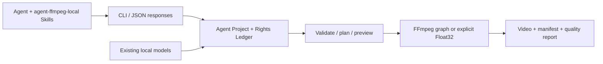

# agent editor kit

**面向 Agent 的本機影片編輯 CLI。** 用可編輯 JSON 時間軸、固定能力契約和真實渲染證據，讓 Agent 完成廣告剪輯、模板變體、關鍵影格運鏡與影片自動化。

[简体中文](README.md) · [繁體中文](README.zh-TW.md) · [English](README.en.md) · [原始碼儲存庫](https://github.com/copypasteltd/agent-editor-kit) · [下載安裝包](docs/releases/v0.1.0-alpha.2/artifacts/agent-video-kit-v0.1.0-alpha.2-cp313-win_amd64.zip) · [文件入口](docs/README.md) · [使用手冊](docs/releases/v0.1.0-alpha.1/USAGE.md) · [Skill 詳情](docs/local/INSTALLATION.md) · [完整案例](docs/releases/v0.1.0-alpha.1/CASES.md)

**歷史首版：`v0.1.0-alpha.1`，已在原儲存庫發佈的 Windows 本機 CLI 預覽版。** 首版範圍已確立為“離線安裝、結構化編輯、預覽/渲染、核驗與交付”的閉環。完整剪映功能、素材生態及自然畫質/聽感等價仍屬於後續目標。[發佈判定與未關閉需求](docs/releases/v0.1.0-alpha.1/RELEASE.md)。

**本輪本機更新：`v0.1.0-alpha.2`，100 預設。** 新包保存在本儲存庫並已安裝到 E 盤；可透過上方安裝包連結取得，新儲存庫尚未建立對應 GitHub Release。產品名為 **agent editor kit**，後續程式碼與更新統一維護於新儲存庫。


上圖由原影片與三套實際成片逐影格合成，為靜音對照。[100 項完整目錄](docs/local/LOOK_PRESETS.md) · [新本機安裝包](docs/releases/v0.1.0-alpha.2/artifacts/agent-video-kit-v0.1.0-alpha.2-cp313-win_amd64.zip)。首版案例文件頁的[回應回放](docs/assets/release-v0.1.0-alpha.1-r2/workflow.gif)、[錄製](docs/assets/release-v0.1.0-alpha.1-r2/workflow.mp4)、[截圖](docs/assets/release-v0.1.0-alpha.1-r2/desktop.png)保留為歷史證據。產品本體為 CLI。

## 方案與執行邏輯



核心是 Python CLI + Agent Project schema + FFmpeg，本版包含顯式選擇的 Float32 原生處理路徑。Concat 是早期路線研究對象；目前發行物是本儲存庫的 Python 實現，並非刪除 Concat GUI 後得到的二進位。已重用的 OpenFilm 字幕分段、影格時鐘、HTML 動效/模板等模組保留來源與授權條款；不需要 OpenFilm 線上服務。

Agent 透過 Skill 把創意轉換成編輯計劃，讀取 `capabilities` 和 `schema show`，再呼叫 CLI。專案保存來源素材引用、時間軸、權利臺帳、快照與操作記錄；輸出同時保存 manifest 和品質檢查。預設使用 FFmpeg 圖，只有工程明確設定 `settings.pixel_pipeline.engine = "float32-native-v1"` 並補全訊號、來源與預算設定才採用受限 Float32 路徑；兩條路徑不承諾功能對等，也不會將不支援項悄悄降級。

## 本版功能範圍

| # | 能力 | 使用入口 | 本版邊界 |
|---|---|---|---|
| F01 | 專案、事務、快照、還原、重新連結 | `project` / `media relink` | 本機專案；操作與失敗留證 |
| F02 | 匯入、探測、鏡頭/靜音分析、縮圖/波形 | `media ingest/understand/prepare` | 本機檔案；語意理解取決於顯式介接器 |
| F03 | 多軌、修剪/拆分、範圍編輯、關聯編輯、巢狀 | `timeline compose/edit` | 整數 ticks、作者時鐘、鎖與事務約束 |
| F04 | 關鍵影格、縮放/平移/旋轉、運鏡預設與效果 | `effects list` + 編輯 JSON | 按已公布屬性；不等於剪映全部預設/特效 |
| F05 | 來源餘量轉場、變速曲線、倒放、定格 | 時間軸聲明與契約 | 預設路徑支援已實現組合；Float32 轉場擴展候選未包含 |
| F06 | 蒙版、合成、色彩、HSL、LUT/1D shaper | 效果 JSON / `lut` / `surface` | Float32 來源/工作/交付訊號需顯式聲明；不宣稱 HDR/ICC 完備 |
| F07 | 字幕、分段、逐字醒目顯示、HTML 動效/模板 | `subtitle` / `motion` / 時間軸 | 部分功能另需已有 Node/Chromium；不自動安裝 |
| F08 | 音訊擷取、混音、匯流排、自動壓低音量、同步 | `audio` / 時間軸音軌 / `media multicam` | 影片軌不自動代表音軌；自然聽感需另審 |
| F09 | 模板變數、批次、片段組、素材庫 | `template` / `fragment` / `library` | 使用者提供可用本機素材與模板；無商業素材訂閱庫 |
| F10 | 模型介面：轉寫/OCR/追蹤/去背/修復等 | 本機模型註冊與對應指令 | 模型和大型推理環境不隨基礎包分發；不是開箱全功能 AI |
| F11 | 影格/區間預覽、佇列、取消、品質與 Scope | `preview` / `queue` / `quality` | 配額不等於峰值 RSS 或即時效能保證 |
| F12 | 專案包、JSON、OTIO、MLT/明文草稿交換 | `convert import/export` | 目標格式支援程度不同；保留 Exact/Approximate/Unsupported/Failed 損失報告 |
| F13 | 100 個離線 MIT 風格預設（alpha.2） | `look list/inspect/preview/apply` | 創意 SDR RGB；Hald 轉換有取樣誤差，非官方品牌濾鏡 |

精確參數以隨包 `capabilities`、`schema show`、`COMMAND --help` 為準。[架構和完整使用邏輯](docs/releases/v0.1.0-alpha.1/USAGE.md)。明文草稿介接器只處理已有合法本機 JSON；不執行剪映，不讀取私有線上資源，不保證全部欄位或編輯效果無損往返。

## 本機已安裝並載入 Skills（2026-10-24）

**本機已升級到 `v0.1.0-alpha.2`（CLI `0.1.1`）：100 個離線開源風格預設。** 覆蓋黑白膠片 12、彩色負片 24、反轉片 15、電影年代 8、風景 10、創意色彩 24、Lomo 5、紅外 2。每個預設具備穩定 ID、獨立 LUT、縮圖、來源和 MIT 授權，支援檢索、預覽、片段/全域應用及強度調節。[完整編號目錄](docs/local/LOOK_PRESETS.md) · [使用與安裝](docs/releases/v0.1.0-alpha.2/USAGE.md)。

**目前實現重用 t3mujinpack 的 51 個 Hald 與 Striped Purple 的 49 個 CUBE。** 原始資料鎖定提交並核驗雜湊；CUBE 保留原始網格，Hald 按原生位深轉換為 33³ CUBE，記錄轉換誤差。17 個本機 Skills 已同步更新並綁定新安裝版。歷史研究與單 LUT 小樣保留在[來源評估](docs/research/OPEN_LOOK_LIBRARY_20261024.md)。


[實際成片動態 GIF](docs/assets/look-presets-20261024-r1/motion-comparison.gif) · [100 個實際預覽總覽](docs/assets/look-presets-20261024-r1/contact-sheet.jpg) · [原始影片](docs/assets/look-presets-20261024-r1/original.mp4) · [逐個預覽和成片](docs/local/LOOK_PRESETS.md) · [本輪驗證記錄](docs/validation/LOOK_PRESETS_20261024.md)。測試卡和聲音均為合成素材；不是自然畫面或完整剪映等價驗收。

**濾鏡已支援：** 可登記本機 LUT（`.cube/.3dl/.csp/.dat`），使用黑白、復古棕、顆粒、暗角及調色等效果，並為支援的參數設定關鍵影格。目錄共 46 項效果；各格式和渲染路徑的強度/1D 支援不同。[濾鏡載入方式、格式邊界與歷史對照 GIF](docs/local/FILTERS.md)。

程式已從校驗後的新本機 ZIP 安裝到 `E:/dev/sandbox/AI广告剪辑/local/agent-ffmpeg/v0.1.0-alpha.2/installed/`。17 個本機 Skill 已按最新要求註冊為 **`$agent-ffmpeg-local-xxx`**，下一條訊息可呼叫主入口 **`$agent-ffmpeg-local-editor`**。

```powershell
$avk = 'E:/dev/sandbox/AI广告剪辑/skills/agent-ffmpeg-local-editor/scripts/run.ps1'
& $avk doctor
& $avk capabilities
& $avk look list --query '黑白'
& $avk look preview --id t3-kodak-gold-200 --output 'E:/video-work/gold-preview.png'
& $avk look apply --project 'E:/video-work/my-ad' --id t3-kodak-gold-200 --global --strength 0.65
```

Skill 啟動器核對發行版本、安裝回執和啟動檔案摘要，以 `-I -S` 呼叫安裝包。目前原生 Python 和 FFmpeg 已可用；安裝目錄為 221 MB，臨時檔案也在 E 盤。[安裝位置、17 個入口與重現](docs/local/INSTALLATION.md) · [本機發行 ZIP](docs/releases/v0.1.0-alpha.2/artifacts/agent-video-kit-v0.1.0-alpha.2-cp313-win_amd64.zip)。

首版歷史安裝完成 28 次案例指令，並經 Skill 入口完成 8 次指令，含實際渲染、中文空格路徑與預期拒絕。[安裝版原輸入](docs/assets/local-install-20261024-r1/input.mp4) · [新成片](docs/assets/local-install-20261024-r1/field.mp4) · [新 GIF](docs/assets/local-install-20261024-r1/field.gif) · [模板變體](docs/assets/local-install-20261024-r1/variant.gif) · [原始回應與核驗](docs/validation/evidence/local-install-20261024-r1/skills/verification.json)。具體範圍見 R10–R12。

## 安裝

首版驗證平台為 **原生 Windows x64 + CPython 3.13**。已存在的 `ffmpeg`、`ffprobe` 必須在 `PATH`。發行包包含應用與 7 個相依 wheel（含 NumPy、Pillow），安裝時不聯網、不建立虛擬環境、不修改全域 site-packages。Python、FFmpeg、Node、Chromium、CUDA 和模型權重均不隨基礎包分發。

```powershell
# Existing native CPython 3.13 x64 and ffmpeg/ffprobe on PATH are required.
# Extract the Windows release asset into E:\tools\agent-video-kit-v0.1.0-alpha.2.
Set-Location E:\tools\agent-video-kit-v0.1.0-alpha.2
$avkPython = 'C:\Python313\python.exe'
# Copy the exact manifest digest from the release's version.json / SHA256SUMS.txt.
$avkManifest = (Get-Content .\version.json -Raw | ConvertFrom-Json).manifest_sha256
& $avkPython -I -B -X utf8 .\bundle\install.py --target E:\tools\avk-alpha2 --manifest-sha256 $avkManifest
& $avkPython -I -S -B -X utf8 E:\tools\avk-alpha2\run.py doctor
& $avkPython -I -S -B -X utf8 E:\tools\avk-alpha2\run.py capabilities
```

先用[安裝包目錄](docs/releases/v0.1.0-alpha.2/artifacts)中的 `SHA256SUMS.txt` 校驗 ZIP 和 `version.json`；manifest 雜湊用於檢測包內容變化，**不是作者數位簽章**。本版支援並驗證的是指定 ABI；`pyproject` 的 Python 下限不代表其他 Python/作業系統已經驗證。

已有開發相依套件時，可從原始碼執行 `./ai-ad-editor.ps1 doctor`。完整離線構建、安裝、故障排查和復原見[使用手冊](docs/releases/v0.1.0-alpha.1/USAGE.md)。

## 最短使用閉環

```powershell
$avkRun = 'E:\tools\avk-alpha2\run.py'
$avkProject = 'E:\video-work\first-ad'
& $avkPython -I -S -B -X utf8 $avkRun project init $avkProject --name 'First ad'
& $avkPython -I -S -B -X utf8 $avkRun media ingest --project $avkProject --input E:\media\product.mp4
# Inspect returned data.asset.id, then put that ID in changes.json.
& $avkPython -I -S -B -X utf8 $avkRun timeline compose --project $avkProject --input E:\video-work\changes.json
& $avkPython -I -S -B -X utf8 $avkRun validate --project $avkProject
& $avkPython -I -S -B -X utf8 $avkRun preview frame --project $avkProject --frame 0
& $avkPython -I -S -B -X utf8 $avkRun render --project $avkProject --output E:\video-work\first-ad\renders\ad.mp4
& $avkPython -I -S -B -X utf8 $avkRun quality check --project $avkProject --input E:\video-work\first-ad\renders\ad.mp4
```

預設匯入的權利狀態是未核驗。商業發佈前補全來源、授權和本機證據，再使用 `rights check` 與 `render --publish`；`--publish` 只執行**本機權利檢核**，不會上傳或發佈到平台。上例中的來源檔案和編輯 JSON 需自行準備；[完整可重現案例](docs/releases/v0.1.0-alpha.1/CASES.md)包含產生腳本、真實 ID、指令和全部回應。

CLI 預設輸出 JSON，Agent 應同時檢查處理程序結束代碼、`ok`、`status`、`errors`、`warnings` 和 `artifacts`。失敗不是空成功，`--dry-run` 的計劃不是實際渲染；支援冪等的寫入操作可使用 `--idempotency-key`，不要給所有指令推斷相同語意。

## 完整案例與原始媒體

| 案例 | 輸入 → 輸出 | 真實材料 |
|---|---|---|
| C01 / FIELD 直式廣告 | 自繪產品卡 + 合成脈衝音 → 6 秒 360×640 MP4 | [原輸入](docs/assets/release-v0.1.0-alpha.1-r2/input.mp4) · [輸出](docs/assets/release-v0.1.0-alpha.1-r2/field.mp4) · [GIF](docs/assets/release-v0.1.0-alpha.1-r2/field.gif) · [編輯 JSON](docs/validation/evidence/release-v0.1.0-alpha.1-r2/changes.json) · [真實回應](docs/validation/evidence/release-v0.1.0-alpha.1-r2/render.stdout.json) |
| C02 / 模板換款 | 參數化模板 + 第三張產品卡 → 3 秒變體 | [模板](docs/validation/evidence/release-v0.1.0-alpha.1-r2/template.json) · [變數](docs/validation/evidence/release-v0.1.0-alpha.1-r2/variables.json) · [輸出](docs/assets/release-v0.1.0-alpha.1-r2/variant.mp4) · [GIF](docs/assets/release-v0.1.0-alpha.1-r2/variant.gif) |
| C03 / Float32 色彩鏈 | 歷史 V112 合成源 → 1D LUT/shaper + 3D LUT 輸出 | [原輸入](docs/assets/float-shaper-20261023-installed-r1/original.mp4) · [實際輸出](docs/assets/float-shaper-20261023-installed-r1/edited.mp4) · [對照 GIF](docs/assets/float-shaper-20261023-installed-r1/formal-comparison.gif) · [原始安裝核驗](docs/validation/evidence/float-shaper-20261023-lab/installed-r1/verification.json) |
| C04 / 交付與拒絕 | 專案包匯出/匯入、校驗；遠端來源拒絕 | [匯出回應](docs/validation/evidence/release-v0.1.0-alpha.1-r2/export-package.stdout.json) · [還原驗證](docs/validation/evidence/release-v0.1.0-alpha.1-r2/restored-validate.stdout.json) · [拒絕回應](docs/validation/evidence/release-v0.1.0-alpha.1-r2/remote-refused.stdout.json) |


素材是本儲存庫產生的虛構產品圖和合成音，不是新增模型推理。C03 為帶日期的既有實測，不計作本輪新執行。GIF 不含聲音；自動解碼、靜態目檢、連續播放、人工聽審分別記錄，不能互相替代。[所有案例步驟、權利、雜湊與重現](docs/releases/v0.1.0-alpha.1/CASES.md)。

## 17 個本機發行版 Agent Skills

| # | Skill | 作用 |
|---|---|---|
| 1 | `$agent-ffmpeg-local-editor` | 總入口：計劃、專案建立與交付 |
| 2 | `$agent-ffmpeg-local-timeline` | 時間軸、關鍵影格、運鏡、轉場、巢狀 |
| 3 | `$agent-ffmpeg-local-quality` | 像素、蒙版、Scope、渲染證據核驗 |
| 4 | `$agent-ffmpeg-local-project-ops` | 快照、還原、重新連結和佇列 |
| 5 | `$agent-ffmpeg-local-local-policy` | 本機執行規則與遠端引用稽核 |
| 6 | `$agent-ffmpeg-local-rights-ledger` | 素材、字型、模型和模板權利臺帳 |
| 7 | `$agent-ffmpeg-local-local-models` | 顯式登記已有離線模型 |
| 8 | `$agent-ffmpeg-local-video-understand` | 鏡頭、靜音、影格證據與轉寫 |
| 9 | `$agent-ffmpeg-local-template-library` | 模板變數、素材索引、片段組重用 |
| 10 | `$agent-ffmpeg-local-long-to-short` | 口播/課程長影片轉短片 |
| 11 | `$agent-ffmpeg-local-screen-demo` | 螢幕錄影錨點、縮放與產品示範 |
| 12 | `$agent-ffmpeg-local-reference-remake` | 參考片結構復刻並替換原創素材 |
| 13 | `$agent-ffmpeg-local-ffmpeg` | 通用本機影音處理 |
| 14 | `$agent-ffmpeg-local-video-edit` | 修剪、拼接、壓縮等工具流程 |
| 15 | `$agent-ffmpeg-local-ad-creative` | 廣告創意、文案和變體規劃 |
| 16 | `$agent-ffmpeg-local-video-content-strategist` | 內容定位與腳本策略 |
| 17 | `$agent-ffmpeg-local-campaign-analytics` | 基於提供資料的投放分析 |

```powershell
.\register-agent-ffmpeg-local-skills.ps1
```

先安裝本機發行包，再執行註冊腳本。腳本為目前檢出建立 Windows 目錄接合點；同名無關目錄不會覆蓋。Skill 內文和資源在 E 盤，Codex 發現目錄僅保存接合點；下一條訊息可發現新名稱。舊 `video-cut-` 入口與已發佈附件保留，新命名空間隨目前 `main` 提供。Skill 是任務指導，不包含額外模型或素材訂閱。[新 Skill 詳情與安裝](docs/local/INSTALLATION.md) · [發行時的舊名目錄](docs/releases/v0.1.0-alpha.1/SKILLS.md)。

## 功能核驗與發佈證據

| 編號 | 核驗 | 實際結果 | 證據與邊界 |
|---|---|---|---|
| R01 | 基線完整回歸 | **2,930 通過，0 跳過** | [原始記錄](docs/validation/evidence/float-shaper-20261023-lab/full-r1.json)；2026-10-23，6991.508 秒；僅代表 alpha.1 的 331 項凍結輸入，不代表本輪新增程式碼的全量回歸 |
| R02 | 已有 V112 新離線安裝專項 | **118 通過，197 個產品資源** | [隔離安裝記錄](docs/validation/evidence/float-shaper-20261023-lab/installed-r1/verification.json)；該專項與全量有重疊，不相加 |
| R03 | 本輪發佈包重新構建與安裝 | 8 個固定 wheel，`-I -S` 啟動 | [本輪清單](docs/validation/evidence/release-v0.1.0-alpha.1-r2/release-verification.json)；原生 Windows/CPython 3.13 x64 |
| R04 | 本輪直式廣告與模板 | 實際輸入、輸出、GIF、JSON、包匯出/匯入 | [案例核驗](docs/validation/evidence/release-v0.1.0-alpha.1-r2/verification.json)；合成素材，0 新模型推理 |
| R05 | 本機策略拒絕 | 遠端來源返回非零退出與結構化錯誤 | [真實失敗回應](docs/validation/evidence/release-v0.1.0-alpha.1-r2/remote-refused.stdout.json)；不是上傳功能 |
| R06 | 文件頁與回應示範 | 桌面／行動版截圖、交互檢查、回應回放錄製 | [頁面核驗](docs/validation/evidence/release-v0.1.0-alpha.1-r2/browser-verification.json)；本機文件頁，不是剪輯 GUI；錄製為真實日誌回放 |
| R07 | Skill 與連結 | 17 個入口格式核驗、發佈文件本機連結核驗 | [檢核結果](docs/validation/evidence/release-v0.1.0-alpha.1-r2/release-verification.json)；格式驗證不等於 Agent 決策品質 |
| R08 | 留存失敗 | 首輪案例輸出路徑錯誤 | [失敗記錄](docs/validation/evidence/release-v0.1.0-alpha.1-r1/failure.json)；腳本已改絕對專案內路徑後重跑 |
| R09 | 遠端發佈與下載回驗 | **GitHub 預發佈成功，6 個附件逐個下載 SHA-256 一致** | [發佈與下載記錄](docs/validation/evidence/release-v0.1.0-alpha.1-r2/publication.json) · [實際安裝回執](docs/validation/evidence/release-v0.1.0-alpha.1-r2/installation-receipt.json)；2026-10-24 本機時間 |
| R10 | 本機 E 盤正式安裝 | **固定 ZIP 校驗通過，8 個 wheels 原生離線安裝** | [安裝回執](docs/validation/evidence/local-install-20261024-r1/installation/installation.json)；2026-10-24，1,430 檔案 / 81,845,972 位元組；未建立虛擬環境 |
| R11 | 新命名空間與真實 Skill 呼叫 | **17 個 Skill 註冊/格式通過；8 次入口指令，7 成功 + 1 預期拒絕** | [Skill 核驗](docs/validation/evidence/local-install-20261024-r1/skills/verification.json)；從 Codex 接合點呼叫實際安裝版，中文空格路徑渲染，輸出與直接執行 SHA-256 一致；未驗收全部 Agent 決策品質 |
| R12 | 正式安裝版新案例 | **28 次指令，27 成功 + 1 預期拒絕；廣告/模板兩個成片與專案包往返** | [案例記錄](docs/validation/evidence/local-install-20261024-r1/cases/verification.json) · [GIF](docs/assets/local-install-20261024-r1/field.gif) · [擷取影格目檢](docs/validation/evidence/local-install-20261024-r1/review.json)；0 新模型推理，未連續播放/人工聽審；不累計舊回歸數 |
| R13 | 已安裝版濾鏡與 LUT 能力核對 | **目錄 46 項，LUT 登記說明包含 4 種副檔名** | [本輪查詢記錄](docs/validation/evidence/filter-capabilities-20261024-r1/verification.json) · [載入邏輯與邊界](docs/local/FILTERS.md)；2026-10-24，僅目錄/說明/程式碼核對，0 新渲染；1D shaper 為顯式 Float32 能力，既有 GIF 單列為歷史證據 |
| R14 | 歷史 alpha.1 風格庫存 | **無徠卡/富士/柯達命名預設；已安裝應用內 LUT 檔案 0 個** | [庫存核對](docs/validation/evidence/filter-library-20261024-r1/inventory.json)；2026-10-24，排除使用者工程和測試夾具，9 個 stylize 算子不等於成品風格庫；0 新渲染 |
| R15 | 開源 LUT/風格資源研究 | **10 個專案，Star/commit/檔案樹/授權留檔** | [排序與判斷](docs/research/OPEN_LOOK_LIBRARY_20261024.md) · [快照](docs/validation/evidence/lut-research-20261024-r1/upstreams.json)；2026-10-24，檔案數未去重，不等於可分發/已驗收風格數 |
| R16 | 社區 MIT CUBE 安裝版接入小樣 | **最終流程 13 次 CLI 成功；3 秒/36 影格真實輸出** | [核驗與警告](docs/validation/evidence/lut-research-20261024-r1/probe/verification.json) · [GIF](docs/assets/lut-research-20261024-r1/comparison.gif)；2026-10-24，0.65 強度，解碼/品質/靜音取樣通過，保留強度近似警告與先前檢查失敗；合成輸入/第一影格目檢，未連續播放或驗收自然畫面，當時未集成整庫/Hald 轉換 |
| R17 | alpha.2 預設庫與針對性回歸 | **100 個獨立色彩變換；83 項測試通過** | [原始日誌](docs/validation/evidence/look-presets-20261024-r1/unit-tests.txt)；目錄/授權/雜湊、Hald 原生位深與色軸、應用語意、事務、專案包、LUT 與離線安裝器回歸；未重跑 2,930 項全量 |
| R18 | 新本機包與 Skill 同步 | **8 wheels 離線安裝；17 個 Skill 格式通過；14 次入口呼叫：13 成功 + 1 預期拒絕** | [安裝](docs/validation/evidence/look-presets-20261024-r1/install/installation.json) · [Skill 核驗](docs/validation/evidence/look-presets-20261024-r1/skills/verification.json)；E 盤原生安裝，真實預覽/應用/渲染，保留 alpha.1 |
| R19 | 安裝版逐一實測 100 個預設 | **100 個預覽 + 100 個成片；425 次隔離 CLI 呼叫，含 2 次預期拒絕** | [核驗](docs/validation/evidence/look-presets-20261024-r1/installed/verification.json) · [動態 GIF](docs/assets/look-presets-20261024-r1/motion-comparison.gif)；逐片解碼 12 影格/1 秒/480×300，預覽與第一影格各 100 個不同雜湊，上游對照與包往返第一影格像素通過；合成輸入，未做自然素材/聽審驗收 |
| R20 | 新儲存庫、產品名與三語 README | **簡體中文 / 繁體中文 / English 完整入口；推送目標與文件檢查通過** | [維護說明](docs/maintenance/REPOSITORY_AND_READMES.md) · [檢查回執](docs/validation/evidence/readme-rebrand-20261024-r1/verification.json)；2026-10-24，僅文件連結、程式碼區塊、編號一致性與推送設定檢查，0 新渲染；歷史包名和雜湊見維護說明 |


## 已知限制與後續開發

本版是 alpha，可用於固定環境的本機試用與可複核工作流。完整剪映特效/轉場/素材生態、普遍自然素材畫質/聽感、HDR/ICC、長片峰值記憶體/即時效能、其他平台和 ABI、第三方草稿全量無損相容仍未驗收。已實現介面、歷史成功樣例與生產級等價不是同一驗收結論。

下一階段優先補全渲染路徑能力一致性、連續播放與自然素材品質、效能/取消/還原可靠性，再擴展模板和模型覆蓋。R113/R114 的 Float32 轉場/執行階段閉包候選及後續調節實驗沒有納入本版。[範圍判定、檢核關卡、風險與路線圖](docs/releases/v0.1.0-alpha.1/RELEASE.md)。

## 文件、重現與授權

- [雙語使用手冊](docs/releases/v0.1.0-alpha.1/USAGE.md)、[Skill 目錄](docs/releases/v0.1.0-alpha.1/SKILLS.md)、[完整案例](docs/releases/v0.1.0-alpha.1/CASES.md)、[發佈記錄](docs/releases/v0.1.0-alpha.1/RELEASE.md)。
- [產品需求與路線基線](docs/产品需求与开发路线基线_2026-10-12.md)、[系統架構](docs/architecture/系统边界与模块契约_v0.1_2026-10-13.md)、[機器可讀 schema](docs/specs/agent-project.schema.json)。
- [發佈前完整編號核驗歷史](docs/releases/v0.1.0-alpha.1/history/README.zh.pre-release.md)、[歷史文件索引](docs/releases/v0.1.0-alpha.1/history/docs-index.pre-release.md)、[全部文件](docs/README.md)。舊測試不累計為新增能力。
- 自有程式碼和文件按 [MIT](LICENSE) 分發；第三方快照、Skill、模型、字型、媒體保留各自授權，見[第三方通知](docs/releases/v0.1.0-alpha.1/THIRD_PARTY.md)。權利臺帳是證據記錄與檢核關卡，不是自動法律認定。
- 提交問題時附版本、最小可公開工程、實際指令/錯誤、manifest 與工具版本。功能更新維護 `main`、簡體中文/繁體中文/English 三份 README 與證據；原生回歸入口為 `scripts/run_frozen_regression.py`，使用說明見手冊。
