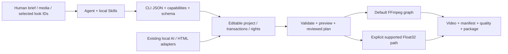

# agent editor kit

**面向 Agent 的開源、本地影片編輯 CLI。** 從結構化編輯計劃到可編輯工程、預覽、成片、品質報告和可恢復交付；保留每一步的真實輸出與來源。

[簡體中文](README.md) · [繁體中文](README.zh-TW.md) · [English](README.en.md) · [Repository](https://github.com/copypasteltd/agent-editor-kit) · [Docs](docs/README.md)

**公開發行版本：v0.1.0-alpha.3 預發布版 · CLI 0.1.2 · 500 套風格 · 1 個統一 Skill / 17 項內部模組。** 提供完整運行 ZIP、Agent kit、可選圖冊及校驗摘要。運行內核保持原已驗包位元組；新增可移植安裝和可執行示例。完整剪映等價仍是開發目標，尚未驗收。

本頁包含完整功能模塊、服務與依賴、安裝與使用邏輯、Skill 輸入輸出、真實案例和核驗表。長篇原始驗收日志繼續留檔，功能說明與案例入口恢復到首頁。


<!-- unified-skill-registration -->

**只註冊一個入口：`$agent-ffmpeg-local-editor`。** 當前本機 GPU 擴充套件使用 [r4 Skill kit](docs/skills/agent-editor-kit-community-unified-skill-r4.zip) 與匹配的[本地執行包/模型安裝流程](docs/product/COMMUNITY_LOCAL_DELIVERY.md)，17 項內部模組按需載入。歷史 r1 kit 繼續匹配下方保持原版的公開 alpha.3 執行包。

<!-- /unified-skill-registration -->

<!-- community-materials-gpu -->

**本機新增已安裝擴充套件：CLI 0.1.5，GPU 配音/翻譯與 359 項內建開源資源。** 公開 alpha.3 附件保持原版。外層只指定 `$agent-ffmpeg-local-editor`；本機登記 GPU 包後預設優先 GPU，明確返回實際裝置/回退原因，保留 CPU 相容。

[完整流程與邊界](docs/product/COMMUNITY_MATERIALS.zh-TW.md) · [逐項素材目錄](docs/product/COMMUNITY_MATERIAL_CATALOG.md) · [103 音色與實際試聽範圍](docs/product/COMMUNITY_VOICES.md) · [CPU 實測](docs/validation/evidence/community-materials-20261025-r1/cpu/verification.json) · [GPU 實測](docs/validation/evidence/community-materials-20261025-r1/gpu/verification.json)。

| 擴充套件編號 | 已實現 | 邊界 |
|---|---|---|
| F44 / M01 | 44 首 BGM、85 個短樂、228 個獨立音效、2 個 OFL Noto 字型 | 分別保留來源/許可，不是商業素材訂閱庫 |
| F45 / M02 | 中英配音、103 具名音色、文字檔案/語速/WAV | 實際常規生成試聽 3 音色，不克隆、不宣稱全音色聽審 |
| F46 / M03 | 本地雙向翻譯、雙語 SRT、顯式術語表 | cue 順序/毫秒保留，語義/發音仍需校對 |
| F47 / G01 | CUDA 配音/翻譯、auto/cpu/cuda、視訊記憶體預檢 | RTX 3060 實測，嚴格 CUDA/CPU 回退分明，NVIDIA 依賴許可另列 |
| F48 / M04–M05 | 真實 BGM 擷取/迴圈/淡入淡出、配音混合和閃避 | 保留原分軌，不代表作曲或自動接縫修復 |
| F49 / C01 | 原生視窗/螢幕/區域/攝影機/麥克風擷取 CLI，CPU/NVENC 編碼和取消 | 實測自身測試視窗；攝影機/麥克風、聯合音畫同步及長錄製待驗 |
| F50 / V01 | 離線圖文語義索引、中文/英文/參考圖查詢、預覽與可編輯時間點，auto/cpu/cuda | 小型靜態圖集實測；否定/庫外拒識/自然動作/音訊推薦仍未完成 |

CPU 46 條、GPU 15 條為本輪獨立實測。12 秒真實成片已完整解碼、工程往返。未確認釋出權利的生成配音不隨公共頁面再分發，本地原始分軌/完整成片見交付記錄。人工聽審與完整剪映等價仍未完成。

<!-- /community-materials-gpu -->

<!-- semantic-retrieval-r1 -->

## 本機 CLI 0.1.5：按描述或參考圖檢索素材

使用既有離線 SigLIP2 模型，對選定圖片與影片採樣畫面建立向量索引；按中文、英文或本機參考圖返回候選預覽、來源時間與可編輯引用。仍使用一個 `$agent-ffmpeg-local-editor`。

基礎 ZIP 不含 Torch 或約 1.5GB 權重。先按本機交付設定既有原生環境，讀取 runtime.json 的 semantic_config，明確登記至工程後再建立索引；不隱式下載。

[Workflow / 登记与命令](docs/product/SEMANTIC_RETRIEVAL.md) · [Validation / 实测](docs/validation/离线语义检索实测_2026-10-25.md) · [All 20 queries / 全部结果](docs/assets/semantic-20261025-r1/all-query-results.png)

```powershell
# Existing project, registered local adapter and ingested source IDs required.
& $avk semantic index --project $project --index-id campaign-v1 --adapter-id siglip2 --all-visual-assets --sample-interval-seconds 2 --device auto
& $avk semantic search --project $project --index-id campaign-v1 --query '木桌上的一杯咖啡' --limit 5 --device auto
& $avk semantic search --project $project --index-id campaign-v1 --image $referenceImage --kind image --device cpu
```

在預先凍結的小樣本中，開發版 CPU/GPU 的 16 條常規查詢首選及 mean asset recall@3 均為 1.0；安裝版真實 Skill 另驗相同 20 條文字與 CPU 參考圖。中文否定誤選咖啡，兩條庫外鯊魚查詢仍返回草地；尚無可靠拒識、動作理解或自動導演。


<!-- /semantic-retrieval-r1 -->

<!-- native-capture-r1 -->

## 本機 CLI 0.1.4：新增擷取與音訊修復

新套件與原有 GPU 配音/翻譯、359 項素材相容。已提供[完整擷取流程與邊界](docs/product/NATIVE_CAPTURE.md)、[實際 CPU MP4](docs/assets/native-capture-20261025-r1/cpu-window.mp4)、[GPU MP4/GIF](docs/assets/native-capture-20261025-r1/preview.gif) 和[首批補齊證據](docs/validation/补齐实施首批实测_2026-10-25.md)。先依[本機安裝流程](docs/product/COMMUNITY_LOCAL_DELIVERY.md)設定對應執行套件，再由同一 Skill 呼叫。R3 精確相同/反相/靜音聲道關係已修復；一般立體聲相位、4ms 極短窗音高與自然聽審仍待完成。

```powershell
& $avk project init './workspace/capture-demo'
& $avk capture devices
& $avk capture record --project './workspace/capture-demo' --kind window --window-title 'Your application title' --duration-seconds 5 --encoder auto --asset-id take-01 --dry-run
& $avk capture record --project './workspace/capture-demo' --kind window --window-title 'Your application title' --duration-seconds 5 --encoder auto --asset-id take-01
& $avk validate --project './workspace/capture-demo'
```


<!-- /native-capture-r1 -->

## 公開 alpha.3：下載並跑通第一條影片

**環境：Windows x64、已有 CPython 3.13 x64、FFmpeg/ffprobe 在 PATH。** 基礎流程不需要模型、Node 或瀏覽器；安裝不使用 Docker、WSL、虛擬環境或全局 pip。Python 路徑按實際安裝位置修改。

| 下載附件 | 用途 |
|---|---|
| [agent-editor-kit-v0.1.0-alpha.3-cp313-win_amd64.zip](https://github.com/copypasteltd/agent-editor-kit/releases/download/v0.1.0-alpha.3/agent-editor-kit-v0.1.0-alpha.3-cp313-win_amd64.zip) | 必需：應用和 8 個固定 wheel，約 196 MB。 |
| [agent-editor-kit-unified-skill-r1.zip](https://github.com/copypasteltd/agent-editor-kit/raw/refs/heads/main/docs/skills/agent-editor-kit-unified-skill-r1.zip) | 必需：離線安裝入口、1 個統一 Skill、17 項內部模塊、註冊腳本與可運行示例。 |
| [agent-editor-kit-v0.1.0-alpha.3-gallery.zip](https://github.com/copypasteltd/agent-editor-kit/releases/download/v0.1.0-alpha.3/agent-editor-kit-v0.1.0-alpha.3-gallery.zip) | 可選：原圖、500 套真實樣例、離線選型頁和客戶對照板資源。 |
| [SHA256SUMS.txt](https://github.com/copypasteltd/agent-editor-kit/releases/download/v0.1.0-alpha.3/SHA256SUMS.txt) | 核對下載文件；安裝入口還會強制驗證運行 ZIP 雜湊。 |

**1. 安裝。** 將兩個必需 ZIP 下載到 `E:/Downloads/`，選擇新的工具目錄；保留運行 ZIP 原樣，由安裝入口校驗並解包。

```powershell
$avkPython = 'C:/Python313/python.exe'
$avkHome = 'E:/tools/agent-editor-kit-unified'
$avkArchive = 'E:/Downloads/agent-editor-kit-v0.1.0-alpha.3-cp313-win_amd64.zip'
Expand-Archive -LiteralPath 'E:/Downloads/agent-editor-kit-unified-skill-r1.zip' -DestinationPath $avkHome
Set-Location $avkHome
& $avkPython -I -B -X utf8 ./install.py --archive $avkArchive
```

**2. 加載 Skill 並檢查環境。** 安裝響應 `ok: true` 後註冊；腳本保留同名沖突目錄。已有本倉庫本機安裝的用戶可繼續使用原入口。客戶端尚未發現 Skill 時，重新打開會話。

```powershell
powershell.exe -NoProfile -ExecutionPolicy Bypass -File ./register-agent-ffmpeg-local-skills.ps1
$avk = Join-Path $avkHome 'skills/agent-ffmpeg-local-editor/scripts/run.ps1'
& $avk version
& $avk doctor
& $avk capabilities
& $avk schema show
```

**3. 跑通示例。** 無需額外素材；隨包 CC0 圖片與合成音頻經過實際剪輯、運鏡、濾鏡、預覽、渲染、質檢及工程包導入導出。輸出目錄必須尚不存在。

```powershell
& $avkPython -I -B -X utf8 ./run-example.py --output 'E:/video-work/aek-first-demo'
```

主要產物：`project/project.json` 可編輯工程、`project/renders/demo.mp4`（6 秒、360×640、30 fps、180 影格及音軌）、`demo.aevpkg.zip`、`restored/`、逐次響應和 `verification.json`。此示例核驗安裝與功能鏈路；自然畫質和聽審仍需獨立驗收。

**4. 用 Agent 編輯自己的素材。** 明確素材路徑、目標、時長、畫幅及音軌；Agent 先檢查真實能力和來源，再形成時間線、預覽和交付。

```text
$agent-ffmpeg-local-editor 用 E:/media/product.mp4 制作 15 秒竖屏广告。
先检查能力和素材，明确保留原声音轨，展示滤镜候选；生成预览、成片、质检报告和可编辑工程包。
```

**5. 按需安裝圖冊。** 將可選 `gallery.zip` 解壓到同一個 `$avkHome`，打開 `docs/assets/looks-n002-20261024-r1/index.html`；也可用下方 Skill helper 輸出候選對照板。使用完關閉不用的瀏覽器標籤。

[Release](https://github.com/copypasteltd/agent-editor-kit/releases/tag/v0.1.0-alpha.3) · [完整安裝與使用流程](docs/skills/UNIFIED_SKILL.zh-TW.md) · [範圍與限制](docs/releases/v0.1.0-alpha.3/RELEASE.md)

統一 kit 是本輪新增的 Skill 組織包，使用同一個 alpha.3 內核。新 kit 的摘要見 [包清單](docs/skills/unified-skill-package.json)；原 Release 的 17 Skill kit 不覆蓋。

## 先看實際效果：同一母圖的 500 套濾鏡

以下每一格都來自用戶提供的 N002 母圖，經已安裝 CLI 實際處理。原圖 + 11 套示例只是入口；全部 500 套均有獨立樣例和詳情。


[**打開全部 500 套交互選型頁**](docs/assets/looks-n002-20261024-r1/index.html) · [全部編號樣例](docs/local/FILTER_GALLERY.zh-TW.md) · [逐項實際效果](docs/local/LOOK_PRESETS.zh-TW.md) · [原始 PNG](docs/assets/looks-n002-20261024-r1/source.png) · [來源與許可](docs/assets/looks-n002-20261024-r1/SOURCE_AND_LICENSES.md)

選型頁支持簡體/繁體/英文、編號/名稱/ID/描述搜索、類別與許可篩選、原圖滑桿、候選勾選和 JSON 導出。每頁僅加載 40 張小圖，選中時再加載原尺寸大圖。GitHub 文件頁不執行 HTML，請下載倉庫後直接雙擊該 HTML；無需服務或聯網。

**樣例口徑：** 原圖 1672×940，統一強度 1.0、四面體插值；500 張原尺寸無損 WebP 與實際 CLI PNG 的解碼 RGB 逐像素一致，500 張小圖為縮放的 WebP。母圖沒有嵌入色彩配置，按編碼 SDR RGB 試片，不推斷為相機/HDR 校準。母圖使用依據為用戶本次提供與展示指令，未將其標為 MIT/CC0。

## 產品方案與完整執行邏輯



當前實現是 **Python CLI + Agent Project schema + FFmpeg**，並有顯式的 Float32 處理子集。Concat 是早期路線研究對象，發行包不是“刪除 Concat GUI 的二進制”。已采用的 OpenFilm 字幕分段、影格時鐘、HTML 動效/模板等復用保留來源與許可；當前運行不依賴 OpenFilm 在線服務。

1. 讀取 version/doctor/capabilities/schema，確定本機真實可用的能力與依賴。
2. 把 brief 寫成計劃：素材、畫幅、時長、鏡頭、音軌、字幕、運鏡、風格、交付與證據。
3. 創建獨立工程，導入本地素材，用真實 asset ID 與整數 ticks 編寫編輯 JSON；音軌明確添加。
4. 通過事務 compose/edit/apply 寫入時間線，保留快照；先校驗，再預覽關鍵影格和區間。
5. 若需要選型，展示原圖與少量候選，記錄最終 ID/強度/作用域；在目標素材上復試。
6. 渲染至工程內新路徑，檢查實際編碼文件、manifest、warning、音畫與權利，再導出專案包。

## 43 個基礎功能模塊，以及上方 F44–F50 擴充

編號用於定位文件；各模塊有依賴與交叉，不是“43 個獨立內核”或完成率。下表直接寫明行為、入口與限制；[完整機器能力清單及每項契約](docs/product/CAPABILITIES.zh-TW.md)保留全部字段。

| 編號 | 功能模塊 | 具體行為與輸入 → 輸出 | 入口 | 依賴/邊界 |
|---|---|---|---|---|
| F01 | Agent 調用協議 | 任務參數 → JSON 響應、退出碼、錯誤、warning、產物與 provenance；能力與 schema 可查詢。 | `version; doctor; capabilities; schema show` | Skill 組織任務，CLI 執行；沒有後臺云端 Agent 服務。 |
| F02 | 可編輯專案 | 創建/檢查 Agent Project，保存資產、序列、軌道、ticks 時鐘、輸出配置和權利引用。 | `project init/inspect` | 源媒體與專案元資料分離，移動工程後需重鏈並復核證據路徑。 |
| F03 | 事務、恢復與快照 | 寫入前快照、恢復、遷移、鎖和操作記錄；中斷後恢復專案元資料事務。 | `project snapshot/restore/migrate/recover; operation inspect` | 失敗證據保留；快照不等於外部原始素材的完整備份。 |
| F04 | 素材導入與重鏈 | 本地圖片/影片/音頻/字體 → 探測結果、穩定資產 ID、雜湊和來源記錄。 | `media ingest/relink` | 不抓取在線素材；導入不自動證明商業授權。 |
| F05 | 代理、縮略圖與波形 | 素材 → 輕量代理、圖片縮略圖、音頻波形、可核查聯系表。 | `media prepare/contact-sheet` | 聯系表是抽樣證據；不代表逐影格視覺理解。 |
| F06 | 鏡頭、靜音與高光分析 | 本地影片/音頻 → 切鏡、靜音、節拍或啟發式高光候選與時間證據。 | `media understand/highlights` | 高光是啟發式候選，語義判斷需要 Agent/已註冊適配器復核。 |
| F07 | 智能粗剪與廣告計劃 | 經檢查的靜音/文本片段或廣告 brief → 編輯計劃 → 可編輯粗剪。 | `media smart-cut; ad plan/apply` | 計劃與實際 apply 分開；不承諾自動導演效果或投放表現。 |
| F08 | 節拍剪輯與多機同步 | 節拍錨點/本地多機音軌 → 剪切或 offset/顯式 affine 時鐘及切機計劃。 | `media beat-cut/multicam` | 低置信度、覆蓋不足、非線性漂移需拒絕/顯式處理；不自動添加音軌。 |
| F09 | 多軌基礎剪輯 | 編輯 JSON → 加軌、插入、更新、拆分、刪除、時長/位置修改與畫幅設置。 | `timeline compose/edit` | 遵守軌道鎖、整數 ticks、資產時長與實際能力契約。 |
| F10 | 範圍與輸出窗口編輯 | 明確區間 → 裁切/刪除/波紋等範圍編輯，保留作者時間與源映射。 | `timeline edit` | 復雜變速與嵌套的組合需按具體契約檢查，不推斷所有組合均可用。 |
| F11 | 源句柄、滑移與滑動 | 源入出點與鄰接片段 → 可逆源編輯、源句柄轉場和剪口調整。 | `timeline edit/transition` | 源句柄不足會報錯；不以靜默復制影格替代。 |
| F12 | 磁吸、主軌與關聯音畫 | 主軌塊重排、關聯 ID、音畫附著 → 結構化編輯並保持相對關系。 | `timeline edit` | 鎖、邊界和關聯選擇規則會阻止不明確編輯；不是拖拽式 GUI。 |
| F13 | 復合與嵌套序列 | 子序列 → 獨立畫布合成、父變換/透明度、嵌套時鐘與定格。 | `timeline compose/edit` | 獨立空間不代表獨立色彩/影格率；部分組級空間轉場未接受。 |
| F14 | 變速、倒放與定格 | 顯式速度/曲線/Bezier/定格點 → 影片時鐘與音頻映射。 | `timeline edit; render` | 變速音頻後端各有邊界；可選 Rubber Band R3 需要已有原生工具。 |
| F15 | 關鍵影格與緩動 | 位置、錨點、縮放、旋轉、透明度、裁切、蒙版、音量/聲像 → 逐影格動畫。 | `timeline compose; schema show` | hold/linear/ease_in/ease_out/ease_in_out/bezier；枚舉/布爾值不推斷為連續動畫。 |
| F16 | 12 套運鏡預設 | 推拉、上下左右平移、Ken Burns、旋入/旋出、淡入/淡出、shake → 可編輯關鍵影格。 | `motion list/inspect/apply` | 參數有界；是明確關鍵影格預設，不是 AI 三維相機或全部商業運鏡庫。 |
| F17 | 轉場與剪口效果 | 相鄰片段與源句柄 → 淡化、擦除、滑動、黑/白場、圓形等已聲明轉場。 | `timeline transition; capabilities` | 以預設渲染路徑和具體層級為準；Float32 後續轉場候選未隨本版提供。 |
| F18 | 幾何蒙版與逐影格修正 | 矩形/圓/橢圓/路徑/多邊形 → 反選、羽化、動畫、編碼蒙版與修正。 | `timeline compose; media mask-edit; quality mask` | 路徑點數和取樣受限；幾何通過不等於語義分割/身份正確。 |
| F19 | 圖層合成與混合 | 多軌視覺層 → normal/multiply/screen/overlay/difference/addition/softlight/hardlight。 | `timeline compose; capabilities` | 預設路徑主要為編碼 8-bit RGB；不宣稱線性光/HDR 合成等價。 |
| F20 | 46 個效果處理算子 | 模糊/銳化、降噪、色調、曲線、HSL、色鍵、暗角、顆粒等 → 可配置效果鏈。 | `effects list/inspect` | 可動畫參數與實際後端逐項查詢；46 算子與 500 成品 LUT 是不同統計。 |
| F21 | 500 套離線風格 | 名稱/ID/類別/許可檢索 → 詳情、圖片預覽、片段或全局應用與來源副本。 | `look list/inspect/preview/apply` | 500 個不同數值變換含同系列曲線；SDR 創意映射，不是 500 個獨立家族。 |
| F22 | 自定義 LUT 與色彩自動化 | 本地 .cube/.3dl/.csp/.dat → 登記、檢查；支持的 3D LUT 強度與色彩參數按契約動畫。 | `lut register/list/inspect; effects inspect` | 格式登記不等於所有路徑都完整解析；完整 CUBE 才有對應強度/浮點支持。 |
| F23 | 顯式 Float32 像素路徑 | 聲明輸入/工作/輸出信號、順序與預算 → 原生浮點色彩、LUT/shaper、選定空間處理和 surface。 | `render; preview; surface export/inspect` | 必須顯式選擇 float32-native-v1；能力子集，拒絕不支持項，非完整 HDR/ICC 管線。 |
| F24 | 字幕、文字與分段 | SRT/VTT/ASS/SSA/TTML 或文字 → 規范化、分段、雙語、文字層、逐字高亮和文字動畫。 | `subtitle validate/normalize/segment; timeline compose` | 字體需本地可用；復雜排版、雙向 shaping 與部分動畫/時鐘有明確近似或拒絕。 |
| F25 | 離線轉寫與字詞對齊 | 音頻 + 已有 Whisper/CTC 模型/校正文 → 轉寫、字幕、字詞時碼與 CER 評估。 | `asr adapter; subtitle transcribe/align/evaluate` | 基礎包不帶權重；轉寫段時間不等於精確逐字對齊，既有 CTC 自然精度門檻未通過。 |
| F26 | 多軌音頻與總線 | 顯式音軌 → 混音、總線、音量/聲像、靜音/solo、淡化、EQ、壓縮、降噪、響度與閃避。 | `audio extract; timeline compose; quality check` | 影片資產有聲音不代表時間線自動出聲；自動 PCM/LUFS 檢查不代替聽審。 |
| F27 | 本地語音合成 | 已有本地 flite 或登記 SoulX 權重/授權參考聲 → WAV 資產與可選音軌。 | `tts adapter/voice; tts synthesize` | flite 取決於 FFmpeg 構建且限 ASCII 英文；SoulX 需 CUDA/原生依賴，非基礎包自帶配音庫。 |
| F28 | 聲道近似與模型分離 | 音頻 → center/side 近似，或已有 HDemucs 適配器的人聲/伴奏 stem。 | `audio separate; audio adapter` | mid/side 不是 AI 人聲分離；真正模型分離需權重、環境與許可。 |
| F29 | 跟蹤、綁定與重構圖 | 模板/模型/已編碼蒙版軌跡 → 文字/貼紙錨定、裁切與主體重構圖關鍵影格。 | `media track/track-bind/reframe` | 多目標須明確對象；置信度/蒙版不等於身份保證，支持的變換與時鐘需檢查。 |
| F30 | OCR 錨點與人臉修飾 | 已有 PP-OCR/OpenSeeFace 模型 → OCR 框/文字、錨點運鏡、人臉點位與受限修飾。 | `ocr adapter/scan/anchors; face adapter/scan/retouch` | 已有 ONNX CPU 環境與權重；不是完整 UI 行為識別、美妝、瘦身或臉部生成。 |
| F31 | 人像摳像與對象分割 | 已有 RVM/SAM2 + 提示點/框 → 透明影片、對象 mask 和可編輯派生資產。 | `media adapter; media matting` | RVM 人像與 SAM2 對象分割不同；概率 mask 不是物理發絲 matte，需檢查運動/遮擋。 |
| F32 | 修復、生成編輯與擴畫 | 已有 LaMa/VACE + 蒙版/提示 → 修復或擴大畫布，保留來源與可重放 recipe。 | `media inpaint/outpaint; media adapter` | LaMa 逐影格不保證時序；VACE 需 CUDA 且僅窗口聯合；自然紋理/時序品質未普遍驗收。 |
| F33 | HTML/CSS/SVG/Canvas 動效 | 受信任本地源碼/素材/字體 → 可編輯模板控件、透明標題、逐筆描線、布局診斷與時間線合成。 | `motion html-*; motion stroke-source` | 另需已有 Node/Playwright/Chromium；非任意網頁沙箱，不自動下載瀏覽器。 |
| F34 | 參數模板與批量變體 | 本地 JSON 模板 + 類型變量 → 可編輯專案變體、批量輸入與模板快照。 | `template apply/batch` | 支持 asset/color/enum 等類型；復雜條件圖和表達式執行未實現。 |
| F35 | 素材索引與片段組復用 | 素材目錄/已編輯片段 → 檢索、重復/相似檢查、跨專案片段組與依賴閉包。 | `library index/search/duplicates/similar; fragment` | 用戶自建資源庫，未內置商業素材訂閱/正版音樂庫存。 |
| F36 | 影格、區間與緩存預覽 | 工程 + 明確影格/區間 → PNG/短影片/緩存與可驗證取樣證據。 | `preview frame/range; cache; preview cache-*` | 預覽不是完整成片核驗；色彩路徑與緩存簽名需一致。 |
| F37 | 輸出、編碼與硬件探測 | 工程 → MP4/WebM/MKV、編碼/像素/音頻配置、透明輸出與 manifest。 | `render` | 編碼器取決於本地 FFmpeg；硬件實際探測，CPU 效果未整體 GPU 化，無實時/4K 性能保證。 |
| F38 | 持久隊列、重試與取消 | 凍結專案快照 → 本地排隊、有限 worker、顯式重試/取消與串行元資料提交。 | `queue enqueue/list/inspect/run/cancel` | 預設串行；並發需滿足門禁，不是分布式云渲染服務。 |
| F39 | 成片、Scope 與 golden 核驗 | 實際編碼文件 → 音畫/影格率/畫幅/時長、響度/黑場、色彩 Scope、蒙版和 golden 差異報告。 | `quality check/scopes/mask/golden` | 自動檢查、靜態目檢、連續播放、人工聽審分別記錄；不等於商業成片品質認證。 |
| F40 | 權利臺賬與本地策略 | 素材/字體/LUT/模型/模板證據 → 依賴臺賬、變更歷史、影響/撤回與發布門禁。 | `rights; policy audit; render --publish` | --publish 只檢查本地權利，不上傳；臺賬不自動裁定版權。 |
| F41 | 專案與時間線交換 | Agent JSON/package、OTIO、Kdenlive MLT、已有合法明文草稿 → 導入/導出與損失報告。 | `convert import/export` | Exact/Approximate/Unsupported/Failed 逐項報告；明文草稿不調用剪映，不解密或下載專有資源。 |
| F42 | 管道診斷與錯誤交付 | 失敗操作 → 有界日志、diagnostic manifest、顯式導出和可復查錯誤資訊。 | `diagnostics list/show/export; operation inspect` | 失敗/拒絕不是成功渲染；包含本地路徑的診斷需按交付範圍處理。 |
| F43 | 創意、內容與投放分析 | 用戶提供的產品、受眾、參考片或投放表 → 腳本、結構、變體建議與分析。 | `ad plan/apply; advisory Skills` | 策略 Skill 不提供廣告平臺連接、自動投放、實時資料或效果保證。 |

## 支持的服務模塊與依賴

這裡的“服務”指本地處理模塊與適配器。基礎包提供 CLI/專案/渲染能力；模型、瀏覽器、字體與用戶素材按下面條件提供。

| 編號 | 服務模塊 | 運行形式 | 需要什么/提供什么 | 入口 | 範圍 |
|---|---|---|---|---|---|
| S01 | 本地 Agent 工具服務 | 原生進程/JSON | Python 3.13 + 已安裝包；Agent 可通過命令行或 Skill 調用。 | `version / capabilities / schema show` | 不內置 SaaS、HTTP API 或 MCP server；可由調用方自行封裝。 |
| S02 | 專案與操作存儲 | 本地文件/事務 | Agent Project、快照、鎖、操作與恢復記錄。 | `project / operation` | 不是多人云協作資料庫。 |
| S03 | 媒體處理與預設渲染 | 隨功能調用 | 已有 FFmpeg/ffprobe，素材均來自本地。 | `media / timeline / render` | 實際編碼器/濾鏡可用性取決於當前 FFmpeg。 |
| S04 | 顯式浮點像素內核 | 選擇性啟用 | NumPy 與聲明的 signal/預算；與預設管線分開檢查。 | `surface / render / preview` | 子集實現，非通用 FFmpeg 或剪映內核的完整替代。 |
| S05 | 字幕與語音 | 基礎解析 + 可選模型 | 字幕文件解析可直接用；Whisper/CTC/SoulX 需已有註冊環境。 | `subtitle / asr / tts` | 無預設云轉寫/配音供應商。 |
| S06 | 視覺 AI 與修復 | 可選本地適配器 | RVM/SAM2/LaMa/VACE/跟蹤/OCR/人臉的各自原生依賴與權重。 | `media adapter / ocr / face` | 基礎包無模型權重，未配置不能聲明已執行。 |
| S07 | HTML 動效生成 | 可選本地運行時 | 明確登記已有 Node、Playwright、Chromium、模板、圖片和字體。 | `motion html-*` | 不依賴 OpenFilm 在線服務；不自動安裝瀏覽器。 |
| S08 | 資源、模板與風格目錄 | 隨包目錄 + 用戶庫 | 500 LUT 隨包；素材、字體、音樂、模板由用戶登記或自建。 | `look / lut / template / library / fragment` | 不存在完整商業素材/模板訂閱庫。 |
| S09 | 本地渲染隊列與緩存 | 持久作業文件 | 單進程預設串行，明確條件下有限本地 worker 與緩存。 | `queue / preview / cache` | 無跨機器調度、云渲染或遠端計費服務。 |
| S10 | 品質檢查與診斷 | 本地產物服務 | FFmpeg 解碼/Scope、PNG/JSON 報告、golden、失敗診斷。 | `quality / diagnostics` | 客觀檢查與主觀品質驗收分開。 |
| S11 | 權利與交換服務 | 本地證據與文件交換 | 臺賬/策略/包雜湊/損失報告，不調用專有編輯器。 | `rights / policy / convert` | 不自動授予第三方素材/模型商業權利。 |
| S12 | 創意與運營支持 | Agent 任務指導 | 依賴調用方提供業務資訊與資料，產出腳本/建議/分析。 | `$agent-ffmpeg-local-editor` / K01–K17 | 不包含廣告平臺賬號接入、投放或自動采集資料。 |
| S13 | 內建社群素材服務 | 離線目錄 | 359 項有來源/許可的 BGM、短樂、音效、字型 | `materials list/inspect/verify/ingest` | 逐項權利，不是商業素材訂閱庫 |
| S14 | 本地配音/翻譯 | 原生模型 worker | 4 個可選 CPU/CUDA 包，103 音色對映和 OPUS 文字/字幕 | `voice / translate / model-pack` | 實際生成 3 音色試聽檔案，人工驗收另列 |
| S15 | 配樂準備與混音 | 原生 FFmpeg 音訊 | 顯式擷取/迴圈/淡化、獨立人聲/配樂、閃避 | `music prepare/mix` | 不作曲、不靜默裁人聲、不承諾接縫修復 |
| S16 | GPU 相容服務 | 原生 NVIDIA 執行庫 | auto/cpu/cuda、視訊記憶體預檢、實際 provider/回退 | `gpu inspect; --device` | RTX 3060 實測，NVIDIA/Intel 依賴許可另列 |
| S17 | 原生 Windows 擷取 | FFmpeg gdigrab / DirectShow | 明確來源、裝置 ID、有限時長、完整解碼與素材登記 | `capture devices/record` | 真實視窗 CPU/GPU 已驗；攝影機/麥克風/同步未驗 |
| S18 | 圖文語義檢索 | 明確登記的原生 SigLIP2 worker | 既有 Torch/Transformers/模型；實際 GPU/CPU、來源/預覽/向量完整性 | `semantic adapter-register/index/search/verify` | 冷啟動與大庫效能未收口；分數不是機率 |

**本機查詢與交付狀態：** 本輪 doctor 檢測到原生 Python 3.13.1、FFmpeg/ffprobe 8.1 和 Node；這不證明每個模型或瀏覽器適配器均已註冊。doctor 只查到系統存在 Docker/WSL 可執行路徑，沒有運行它們。本專案始終使用原生工具，不調度 Docker/WSL/虛擬環境。

### 可選 AI 模塊具體支持什么

| 體系 | 功能與前提 | 命令 |
|---|---|---|
| Whisper / CTC | 轉寫、字幕、校正文強制對齊、CER；需已有 safetensors/原生環境。 | asr adapter; subtitle transcribe/align/evaluate |
| flite / SoulX | 英文基礎語音或授權參考音色合成；SoulX 需已有 CUDA BF16 環境。 | tts adapter/voice/synthesize |
| HDemucs | 人聲/伴奏分離，區別於無需模型的 mid/side 聲道近似。 | audio adapter; audio separate |
| Tracking / YOLOv10 ONNX | 模板/原生 ONNX/命令 JSON 軌跡，驅動綁定與重構圖，須選明確對象。 | media adapter/track/track-bind/reframe |
| PP-OCRv4 / OpenSeeFace | OCR 文字框與相機錨點、66 點人臉與受限修飾；需現有 ONNX CPU 依賴。 | ocr; face |
| RVM / SAM2 | 人像軟透明摳像 / 提示式對象分割；模型、提示、場景切換與 mask 都需檢查。 | media adapter; media matting |
| LaMa / VACE | 逐影格修復 / CUDA 窗口聯合生成編輯與擴畫；保留時序/紋理未驗收邊界。 | media inpaint/outpaint |

以上接口不代表這些權重隨基礎包分發。歷史某模型實測也不等於當前工程已配置；應讀取實際 registry 和命令結果。外部模型、音色和素材的許可分別核驗，軟體 MIT 不覆蓋它們。

## 46 個效果算子與 12 個運鏡預設

| 效果類別 | 可查詢的實際算子 |
|---|---|
| blur | `avgblur`, `blur`, `box_blur`, `smartblur` |
| color | `brightness`, `color_balance`, `color`, `color_contrast`, `color_levels`, `color_temperature`, `color_wheel`, `contrast`, `curves`, `exposure`, `gamma`, `hsl`, `histeq`, `hue`, `lut3d`, `rgb_curves`, `selective_hsl`, `saturation` |
| keying | `chroma_key` |
| repair | `deband`, `deflicker`, `deshake`, `dctdnoiz`, `gradfun`, `hqdn3d` |
| overlay | `draw_box` |
| stylize | `edgedetect`, `grayscale`, `invert`, `noise`, `posterize`, `sepia`, `solarize`, `threshold`, `vignette` |
| motion | `frame_interpolation` |
| transform | `hflip`, `vflip` |
| distortion | `lens_correction` |
| detail | `sharpen` |
| temporal | `tblend`, `tmix` |

12 套運鏡：`zoom_in`, `zoom_out`, `pan_left`, `pan_right`, `pan_up`, `pan_down`, `ken_burns`, `rotate_in`, `rotate_out`, `fade_in`, `fade_out`, `shake`.

數值參數、預設值、範圍、是否可關鍵影格和後端逐項見 [全部效果參數](docs/product/EFFECTS.zh-TW.md)。LUT 負責顏色映射；顆粒、暗角、模糊、幾何、蒙版和 AI 修復是各自獨立處理，不因選擇風格而自動加入。

## 500 套濾鏡：命名、詳情與客戶選型

001–100 保留 `sp-`/`t3-`，101–500 使用 `nt-`/`fl-` 來源前綴。名稱保留上游膠片/風格與曲線變體；穩定 ID 才是調用標識。目錄含 500 個不同數值變換，包含相關上游曲線，不按運行強度或文件格式重復計數，也不代表 500 個互不相關的風格家族。

| Category | Count |
|---|---|
| cinema | 39 |
| creative | 135 |
| film-bw | 37 |
| film-negative | 112 |
| film-slide | 41 |
| infrared | 2 |
| instant-consumer | 54 |
| instant-pro | 65 |
| landscape | 10 |
| lomography | 5 |

每套詳情包含：原名/簡繁名稱/ID/類別、實際灰階與膚色/RGB 數值、建議場景、試用強度、注意事項、作者、來源 commit、轉換誤差、LUT 雜湊、獨立許可、本次 N002 樣例以及歷史合成卡 PNG/影片。

| 編號 | 詳情與母圖樣例 |
|---|---|
| 001–100 | [Profiles](docs/local/look-profiles/001-100.zh-TW.md) · [N002 samples](docs/local/filter-gallery/001-100.zh-TW.md) |
| 101–200 | [Profiles](docs/local/look-profiles/101-200.zh-TW.md) · [N002 samples](docs/local/filter-gallery/101-200.zh-TW.md) |
| 201–300 | [Profiles](docs/local/look-profiles/201-300.zh-TW.md) · [N002 samples](docs/local/filter-gallery/201-300.zh-TW.md) |
| 301–400 | [Profiles](docs/local/look-profiles/301-400.zh-TW.md) · [N002 samples](docs/local/filter-gallery/301-400.zh-TW.md) |
| 401–500 | [Profiles](docs/local/look-profiles/401-500.zh-TW.md) · [N002 samples](docs/local/filter-gallery/401-500.zh-TW.md) |

來源與許可：Striped Purple 49 + t3mujinpack 51（MIT），Natron 267（CC BY-SA 4.0），FreshLUTs 133（CC0）。Natron Hald 轉 CUBE 的數值近似逐項披露；社區膠片/產品名不代表官方徠卡、剪映或廠商算法。`fl-0000228-science-fiction-for-flog` 的 Rec.709 標籤與 FLog 標題存在歧義，僅做實驗創意比較，不能作為已驗證的相機 Log 轉換。

**面向客戶的流程：** Agent 先展示原圖 + 3–6 套符合需求的實際樣例，並寫清編號、名稱、穩定 ID、強度、色彩變化與許可；客戶可在選型頁篩選並導出候選，或直接報編號。Agent 再對真實目標素材生成選定強度預覽，記錄最終 ID、強度與片段/全局作用域，再 dry-run/apply。對照滑桿只改變原圖顯示區域，不模擬濾鏡強度。

```powershell
$avkHome = 'E:/tools/agent-editor-kit-unified'
$avk = Join-Path $avkHome 'skills/agent-ffmpeg-local-editor/scripts/run.ps1'
$aekGallery = Join-Path $avkHome 'skills/agent-ffmpeg-local-editor/scripts/look_gallery.py'
& 'C:/Python313/python.exe' -I -S -B -X utf8 $aekGallery --query '黑白' --limit 6
& 'C:/Python313/python.exe' -I -S -B -X utf8 $aekGallery --ids t3-fuji-superia-800 nt-bw-agfa-apx-100 fl-0000634-darkblue --output 'E:/video-work/client-look-options'
& $avk look inspect --id t3-fuji-superia-800
& $avk look preview --id t3-fuji-superia-800 --input 'E:/media/client-frame.png' --output 'E:/video-work/client-strength-065.png' --strength 0.65
& $avk look apply --project 'E:/video-work/my-ad' --id t3-fuji-superia-800 --clip-id clip_1 --strength 0.65 --dry-run
& $avk look apply --project 'E:/video-work/my-ad' --id t3-fuji-superia-800 --clip-id clip_1 --strength 0.65
```

上例輸出目錄必須是新目錄；`clip_1` 應替換為真實片段 ID。helper 只輸出 `board.jpg` 與 `selection.json`，不改工程；樣例均為 100% 強度。`look apply` 預設替換該作用域的內置風格並保留手工效果，`--append` 才疊加；`--global` 作用於全部序列。靜態強度混合的是編碼 RGB。僅創意 SDR，Float32/Log/HDR 應先按獨立色彩契約準備。

## 分卷備用安裝、包內容與倉庫本機入口

基礎環境：原生 Windows x64、已有 CPython 3.13、FFmpeg/ffprobe。發行包含 8 個固定 wheel（應用、NumPy、Pillow 及 schema 依賴），采用目標目錄離線安裝，不創建虛擬環境、不改全局 site-packages。Python、FFmpeg、Node/Chromium、模型權重、商業字體/音樂不包含在基礎包。

[下載所有分卷與元資料](docs/releases/v0.1.0-alpha.3/artifacts/) · [安裝手冊](docs/releases/v0.1.0-alpha.3/USAGE.md) · [摘要](docs/releases/v0.1.0-alpha.3/artifacts/SHA256SUMS.txt)。分卷不是獨立 ZIP；先合成後解壓。雜湊驗證內容一致性，不是發布者簽名。

```powershell
$avkPython = 'C:/Python313/python.exe'
# Run from the directory containing every .partNN and the supplied metadata.
& $avkPython -I -B -X utf8 ./assemble.py --output E:/tools/agent-editor-kit-unified.zip
Expand-Archive E:/tools/agent-editor-kit-unified.zip E:/tools/agent-editor-kit-unified
Set-Location E:/tools/agent-editor-kit-unified
$avkManifest = (Get-Content ./version.json -Raw | ConvertFrom-Json).manifest_sha256
& $avkPython -I -B -X utf8 ./bundle/install.py --target E:/tools/aek-alpha3-installed --manifest-sha256 $avkManifest
& $avkPython -I -S -B -X utf8 E:/tools/aek-alpha3-installed/run.py doctor
```

本機已經安裝到 `E:/dev/sandbox/AI广告剪辑/local/agent-ffmpeg/v0.1.0-alpha.3/installed/`。唯一入口正文/腳本及 17 項模組位於 `skills/agent-ffmpeg-local-editor/`，Codex 僅註冊該目錄的聯接。移動倉庫後重新登記；註冊腳本保護同名無關目錄。

```powershell
Set-Location 'E:/dev/sandbox/AI广告剪辑'
./register-agent-ffmpeg-local-skills.ps1
$avk = 'E:/dev/sandbox/AI广告剪辑/skills/agent-ffmpeg-local-editor/scripts/run.ps1'
& $avk version
& $avk doctor
& $avk capabilities
& $avk schema show
& $avk COMMAND --help
```

Skill 啟動器驗證本地安裝回執與 launcher 雜湊，再以 `-I -S` 調用固定發行版；安裝缺失時明確報錯，不靜默回退源碼。500 套 N002 展示圖片和選型頁單獨提供在可選圖冊 ZIP；解壓到 Agent kit 的工具目錄即可供 Skill helper 使用。運行 ZIP 本身保持不變。

## 從零到交付的命令與工程結構

```powershell
$avkHome = 'E:/tools/agent-editor-kit-unified'
$avk = Join-Path $avkHome 'skills/agent-ffmpeg-local-editor/scripts/run.ps1'
$aekProject = 'E:/video-work/first-ad'
& $avk project init $aekProject --name 'First ad'
& $avk media ingest --project $aekProject --input 'E:/media/product.mp4'
# Read returned data.asset.id; author changes.json using actual IDs and source ranges.
& $avk timeline compose --project $aekProject --input 'E:/video-work/changes.json'
& $avk validate --project $aekProject
& $avk rights check --project $aekProject
& $avk policy audit --project $aekProject
& $avk preview frame --project $aekProject --frame 0
& $avk render --project $aekProject --output 'E:/video-work/first-ad/renders/ad.mp4'
& $avk quality check --project $aekProject --input 'E:/video-work/first-ad/renders/ad.mp4'
& $avk convert export --help
```

素材與 changes.json 是示例路徑，需要用真實文件與 ID。預設時基 90,000 ticks/秒、顯示影格率 30/1；源時間、作者時間、影格號與原生 PTS 不可混用。影片軌不會自動導入音軌，需明確寫入 audio track。[可復現廣告的真實編輯 JSON](docs/validation/evidence/release-v0.1.0-alpha.1-r2/changes.json)。

```text
project/
  project.json         # editable settings, assets, sequences and tracks
  rights-ledger.json   # source, license and dependency evidence
  assets/              # imported/derived assets, LUTs and notices
  history/             # snapshots
  operations/          # operations, diagnostics and render queue
  renders/             # delivered files and manifests
  cache/               # disposable derived previews/analysis
```

響應包含 `ok/command/request_id/operation_id/status/data/artifacts/warnings/errors/provenance`。同時檢查進程退出碼與響應，不能只看文件存在；`--dry-run` 是計劃，不能當作實際渲染，冪等語義只用於聲明支持的寫操作。

預設導入權利為未核驗；商業交付前補全真實來源、許可和證據，再使用 `rights check`/`render --publish`。`--publish` 是本地門禁，不上傳到任何平臺。轉換輸出攜帶 Exact/Approximate/Unsupported/Failed 損失報告，明文草稿交換不保證全部效果無損。

## 一個 Skill、17 項內部模組：職責、輸入輸出與使用邊界

| 編號 | 內部模組 | 職責 | 輸入 → 輸出 | 相關命令 | 依賴/邊界 |
|---|---|---|---|---|---|
| K01 | [`$agent-ffmpeg-local-editor`](skills/agent-ffmpeg-local-editor/SKILL.md) | 專案總入口與交付 | brief + 本地素材 → 計劃、可編輯工程、成片、manifest | `project init; timeline compose; look; render` | 按能力路由，包含濾鏡客戶選型；需要基礎 CLI。 |
| K02 | [`timeline`](skills/agent-ffmpeg-local-editor/references/modules/timeline/module.md) | 時間線、關鍵影格與運鏡 | 編輯 JSON → 多軌/運鏡/轉場/嵌套 | `timeline compose/edit; motion apply` | 明確目標軌道/片段與作者時鐘。 |
| K03 | [`quality`](skills/agent-ffmpeg-local-editor/references/modules/quality/module.md) | 成片與像素核驗 | 成片 + manifest + 參考 → 報告/Scope/差異 | `quality check/scopes/mask/golden` | 區分目檢/播放/聽審；支持濾鏡樣例選型復核。 |
| K04 | [`project-ops`](skills/agent-ffmpeg-local-editor/references/modules/project-ops/module.md) | 工程運維、恢復與隊列 | 工程 + 作業 → 快照/恢復/重鏈/運行結果 | `project snapshot/recover; media relink; queue` | 保留舊源與失敗；不是云任務調度器。 |
| K05 | [`local-policy`](skills/agent-ffmpeg-local-editor/references/modules/local-policy/module.md) | 本地執行約束 | 工程引用 → 審計/結構化拒絕 | `policy audit` | 運行時禁止遠程引用；不推斷為 OS 沙箱。 |
| K06 | [`rights-ledger`](skills/agent-ffmpeg-local-editor/references/modules/rights-ledger/module.md) | 素材與模型權利證據 | 來源/許可/本地證據 → 臺賬/影響/門禁 | `rights list/check/update/impact` | 分別處理母圖與 LUT 許可；不自動認定版權。 |
| K07 | [`local-models`](skills/agent-ffmpeg-local-editor/references/modules/local-models/module.md) | 已有離線模型登記 | 原生環境 + 權重/雜湊/許可 → 適配器與推理產物 | `media adapter; asr adapter; ocr; face; tts` | 無權重下載；先核對能力/環境，再調用。 |
| K08 | [`video-understand`](skills/agent-ffmpeg-local-editor/references/modules/video-understand/module.md) | 鏡頭/靜音、圖文語義檢索與影片證據 | 本機影片/圖片/描述/參考圖 → 分析、預覽、來源時間與候選 | `media understand/contact-sheet; subtitle transcribe; semantic index/search` | [檢索說明](skills/agent-ffmpeg-local-editor/references/semantic-retrieval.md)；採樣點不定義片段長度，候選需複核。 |
| K09 | [`template-library`](skills/agent-ffmpeg-local-editor/references/modules/template-library/module.md) | 模板與片段組復用 | 模板/變量/素材庫 → 可編輯變體與索引 | `template apply/batch; library; fragment` | 用戶自有素材，按資源許可復用。 |
| K10 | [`long-to-short`](skills/agent-ffmpeg-local-editor/references/modules/long-to-short/module.md) | 長影片轉短片 | 本地課程/口播 + 核對文本 → 粗剪與短片工程 | `media highlights/smart-cut; timeline compose` | 候選段需復核，不聲稱全自動語義導演。 |
| K11 | [`screen-demo`](skills/agent-ffmpeg-local-editor/references/modules/screen-demo/module.md) | 錄屏與錨點運鏡 | 錄屏 + 操作錨點 → 放大/回全景/字幕演示 | `timeline compose; ocr anchors; preview range` | OCR 需要已有模型，文本框不等於可點擊控件。 |
| K12 | [`reference-remake`](skills/agent-ffmpeg-local-editor/references/modules/reference-remake/module.md) | 參考片節奏與布局重建 | 本地參考 + 原創替換素材 → 可編輯重制 | `media understand; timeline compose` | 重建結構，不自動獲取或授權參考素材。 |
| K13 | [`ffmpeg`](skills/agent-ffmpeg-local-editor/references/modules/ffmpeg/module.md) | 原生音影片工具 | 本地文件 + 參數 → 轉碼/縮放/提取/壓縮 | `native ffmpeg / ffprobe` | 直接原生工具；先檢查編解碼器。 |
| K14 | [`video-edit`](skills/agent-ffmpeg-local-editor/references/modules/video-edit/module.md) | 通用影片剪切流程 | 本地文件 + 剪輯要求 → 修剪/拼接/疊加結果 | `native ffmpeg; installed CLI` | 復雜可編輯專案交給 timeline/editor。 |
| K15 | [`ad-creative`](skills/agent-ffmpeg-local-editor/references/modules/ad-creative/module.md) | 廣告創意與變體 | 產品/受眾/證據 → hook/文案/腳本/變體 | `advisory; ad plan` | 策略任務說明，不自帶媒體生成模型。 |
| K16 | [`video-content-strategist`](skills/agent-ffmpeg-local-editor/references/modules/video-content-strategist/module.md) | 影片內容策略 | 目標/受眾/提供的參考 → 內容定位/系列/腳本 | `advisory Skill` | 不自帶實時趨勢、平臺賬號或抓取器。 |
| K17 | [`campaign-analytics`](skills/agent-ffmpeg-local-editor/references/modules/campaign-analytics/module.md) | 提供資料的投放分析 | 本地投放表 → ROAS/CPA/漏斗/建議 | `advisory Skill` | 無廣告平臺連接；指標依賴原始資料與歸因假設。 |

以下 K01–K17 均為統一入口內部模塊，不需要另行註冊。你只需描述目標，入口會讀取相關模塊，再按需組合創意、分析、時間線、模板、質檢和交付。

```text
$agent-ffmpeg-local-editor 用本地素材做 6 秒竖屏广告，保留工程、音轨、权利证据和成片核验。
$agent-ffmpeg-local-editor 用 N002 图册向客户展示暖色胶片、黑白、冷色电影各两套；给编号/ID/强度/许可和对照板，等客户选型后再试目标素材。
$agent-ffmpeg-local-editor 给 clip_1 添加可编辑推近和关键帧，预览首中末帧。
$agent-ffmpeg-local-editor 用提供的本地产品图和变量生成一个可编辑模板变体。
$agent-ffmpeg-local-editor 对实际输出、manifest 和 Scope 复核，分别说明自动检查、目检、播放和听审。
```

[當前完整 Skill 手冊](docs/product/SKILLS.zh-TW.md) · [客戶選型工作流](skills/agent-ffmpeg-local-editor/references/client-look-selection.md) · [註冊與本地安裝](docs/local/INSTALLATION.md)。Skill 是任務指導，不自帶額外模型/素材訂閱，也不自動連接廣告平臺。

## 完整案例、原輸入、實際輸出與 GIF

### C14：實際檢索候選 → 可編輯片段 → 安裝版成片

從凍結查詢的真實返回中，明確選擇貓、咖啡、太空人三個影片候選，保留原排名及來源時間；每段以明確規則指定 1 秒。安裝版 11 次 CLI 完成工程、字幕、渲染、質檢、工程包匯出/匯入及重渲染：3 秒、640×360、30fps/90 幀，往返解碼畫面相同。輸入為自然靜態圖片組成的序列，不能推論自然運動或廣告品質；音軌與人工視聽範圍另列。


[Input MP4](docs/assets/semantic-20261025-r1/asset_v1.mp4) · [Output MP4](docs/assets/semantic-20261025-r1/demo-installed-r1-workflow/semantic-cut.mp4) · [Candidate/output board](docs/assets/semantic-20261025-r1/demo-installed-r1-workflow/candidate-to-output.png) · [Editable package](docs/assets/semantic-20261025-r1/demo-installed-r1-workflow/editable-project.aevpkg.zip) · [Full case](docs/product/CASES.md#c14-semantic-retrieval)

<!-- community-cases -->

**C10–C12：本輪真實案例。** C10 在本機保留 3 個音色 WAV、雙語字幕、BGM/閃避分軌、可編輯工程和修正後的 12 秒成片；C11 從真正註冊入口執行預設 GPU 配音/翻譯並驗證顯式 CPU；C12 為下方可公開音樂/音效/字型演示。GIF 無聲，MP4 含有明確來源的音樂/音效；生成配音保留在本地審閱記錄中。


[MP4](docs/assets/community-materials-20261025-r2/community-resources.mp4) · [原始圖片](docs/assets/release-v0.1.0-alpha.3-r1/input/card-1.png) · [來源/許可](docs/assets/community-materials-20261025-r2/SOURCE_AND_LICENSES.md) · [完整步驟與邊界](docs/product/COMMUNITY_MATERIALS.zh-TW.md) · [驗收與總產品剩餘差距](docs/product/COMMUNITY_ACCEPTANCE.md)。

<!-- /community-cases -->

| 編號 | 場景與實測範圍 | 原始文件、輸出與證據 |
|---|---|---|
| C01 | 6 秒 FIELD 豎屏廣告：原創產品卡 + 合成音 → 360×640/30 fps/180 影格。 | [Input](docs/assets/release-v0.1.0-alpha.1-r2/input.mp4) · [MP4](docs/assets/release-v0.1.0-alpha.1-r2/field.mp4) · [GIF](docs/assets/release-v0.1.0-alpha.1-r2/field.gif) · [JSON](docs/validation/evidence/release-v0.1.0-alpha.1-r2/changes.json) |
| C02 | 3 秒模板換款：真實 asset ID/時長變量 → 可編輯靜音變體。 | [Template](docs/validation/evidence/release-v0.1.0-alpha.1-r2/template.json) · [Variables](docs/validation/evidence/release-v0.1.0-alpha.1-r2/variables.json) · [MP4](docs/assets/release-v0.1.0-alpha.1-r2/variant.mp4) · [GIF](docs/assets/release-v0.1.0-alpha.1-r2/variant.gif) |
| C03 | Float32 1D/shaper + 3D LUT：有序色彩鏈、源時鐘和獨立預覽的歷史實測。 | [Input](docs/assets/float-shaper-20261023-installed-r1/original.mp4) · [Output](docs/assets/float-shaper-20261023-installed-r1/edited.mp4) · [GIF](docs/assets/float-shaper-20261023-installed-r1/formal-comparison.gif) |
| C04 | 專案包導出/恢復 + 真實遠程引用拒絕；保留完整 CLI 響應。 | [Export](docs/validation/evidence/release-v0.1.0-alpha.1-r2/export-package.stdout.json) · [Restored validation](docs/validation/evidence/release-v0.1.0-alpha.1-r2/restored-validate.stdout.json) · [Refusal](docs/validation/evidence/release-v0.1.0-alpha.1-r2/remote-refused.stdout.json) |
| C05 | 本輪 N002 × 500：500 次安裝版預覽，500 張全尺寸無損圖逐像素一致。 | [Source](docs/assets/looks-n002-20261024-r1/source.png) · [Gallery](docs/assets/looks-n002-20261024-r1/index.html) · [All samples](docs/local/FILTER_GALLERY.zh-TW.md) · [GIF](docs/assets/looks-n002-20261024-r1/look-selection.gif) |
| C06 | 客戶候選板：原圖 + 指定穩定 ID、名稱、許可與可回傳 selection.json。 | [Board](docs/assets/looks-n002-20261024-r1/client-shortlist-example/board.jpg) · [JSON](docs/assets/looks-n002-20261024-r1/client-shortlist-example/selection.json) |
| C07 | 真實選型頁：桌面/手機截圖、實際操作錄屏和交互斷言。 | [Desktop](docs/assets/looks-n002-20261024-r1/gallery-desktop.png) · [Mobile](docs/assets/looks-n002-20261024-r1/gallery-mobile.png) · [WebM](docs/assets/looks-n002-20261024-r1/gallery-walkthrough.webm) |
| H01 / V35 | 源句柄轉場：作者輸入、雙剪口實際輸出、獨立像素參考。 | [Input](docs/assets/source-transitions-20261017/authored-input.mp4) · [Output](docs/assets/source-transitions-20261017/C01-actual.mp4) · [GIF](docs/assets/source-transitions-20261017/comparison.gif) |
| H02 / V41 | HTML 原生動效：保留源碼、透明標題與時間線合成；已有瀏覽器環境。 | [Source](docs/assets/html-motion-20261018/source.mp4) · [HTML](docs/assets/html-motion-20261018/template/index.html) · [Output](docs/assets/html-motion-20261018/S03-timeline.mp4) · [GIF](docs/assets/html-motion-20261018/native-comparison.gif) |
| H03 / V43 | 逐影格蒙版修正：缺選/誤選修正，幾何通過但自然 LaMa 修復仍有涂抹。 | [Source](docs/assets/mask-edits-20261018/source.mp4) · [Before](docs/assets/mask-edits-20261018/mask-input.mov) · [After](docs/assets/mask-edits-20261018/mask-edited.mov) · [GIF](docs/assets/mask-edits-20261018/comparison.gif) |
| H04 / V37 | 片段組跨專案復用：轉場、字幕、LUT、子序列與關聯依賴。 | [Input](docs/assets/fragments-20261018/source-a.mp4) · [Output](docs/assets/fragments-20261018/C01-actual.mp4) · [GIF](docs/assets/fragments-20261018/comparison.gif) |
| H05 / V34 | 字幕分段與雙語：人工標記源文本、實際輸出和參考；不是模型轉寫演示。 | [Input](docs/assets/subtitle-segments-20261017/source.mp4) · [Output](docs/assets/subtitle-segments-20261017/S01-segmented.mp4) · [GIF](docs/assets/subtitle-segments-20261017/comparison.gif) |
| H06 / V49 | 真實離線 CTC：模型時間驅動字幕，邊界偏差 258.1875 ms，未通過 66.6667 ms 門檻。 | [Input audio](docs/assets/ctc-alignment-20261018/input.wav) · [Output](docs/assets/ctc-alignment-20261018/result.mp4) · [GIF](docs/assets/ctc-alignment-20261018/comparison.gif) |
| H07 / V53 | 磁吸主軌重排：A/B/C/D → C/A/B/D，保持關聯音畫與作者約束。 | [Input](docs/assets/magnetic-reorder-v53-r5-20261018/source-preview.mp4) · [Output](docs/assets/magnetic-reorder-v53-r5-20261018/MR01.mp4) · [GIF](docs/assets/magnetic-reorder-v53-r5-20261018/reorder-before-after.gif) |

<!-- unified-skill-demo -->

### C09：統一 Skill 的新目錄實際交付

本輪從統一 kit 在 E 盤中文/空格路徑離線安裝，只註冊一個入口，實際執行 20 次 CLI，完成 6 秒/360×640/30 fps/180 影格含音軌影片、質檢及工程包往返。4 項預期拒絕、17→1 遷移和重復註冊另有原始回執；0 新模型推理。下面 GIF 為本輪實際 MP4 的縮小無聲預覽，48 影格/6.01 秒，非剪輯 GUI 錄像；檢查過靜態影格，未做連續播放和人工聽審。

[MP4](docs/assets/unified-skill-20261024-r1/demo.mp4) · [GIF](docs/assets/unified-skill-20261024-r1/demo.gif) · [Inputs](docs/assets/release-v0.1.0-alpha.1-r2/input/) · [Commands](docs/validation/evidence/unified-skill-20261024-r1/native-r2/demo-commands.json) · [Verification](docs/validation/evidence/unified-skill-20261024-r1/verification.json) · [Media hashes](docs/assets/unified-skill-20261024-r1/manifest.json)


<!-- /unified-skill-demo -->

### C08：從下載包首次安裝到實際交付

本次在新的 E 盤中文/空格路徑安裝 Agent kit，註冊 17 個 Skill，再執行隨包示例的 20 次實際 CLI：兩張 CC0 圖片 + 合成音 → 運鏡與 0.65 強度風格 → 實際影片/質檢 → 工程包導出、導入和恢復驗證。

[MP4](docs/assets/release-v0.1.0-alpha.3-r1/demo.mp4) · [GIF](docs/assets/release-v0.1.0-alpha.3-r1/demo.gif) · [Changes](docs/validation/evidence/release-v0.1.0-alpha.3-r1/demo/changes.json) · [Commands](docs/validation/evidence/release-v0.1.0-alpha.3-r1/demo/commands.json) · [Verification](docs/validation/evidence/release-v0.1.0-alpha.3-r1/verification.json)


本輪實際選型頁桌面截圖，支持原圖對照與候選導出：


下面是實際 CLI 渲染的 FIELD 廣告；所有源卡片、音頻、編輯 JSON、響應與流資訊見案例手冊。GIF 無聲，原 MP4 可檢查音軌。


已保留的 HTML 動效源碼與時間線合成實測：


關鍵影格、運鏡、動態蒙版、標題、轉場和音頻組合的既有實際演示：


[**完整案例冊：恢復全部既有功能演示、輸入/輸出、指標與失敗**](docs/product/CASES.md) · [首版完整復現步驟](docs/releases/v0.1.0-alpha.1/CASES.md)。N002 圖冊與本次新目錄安裝示例分別保留核驗記錄；其他案例保留日期，不累計為本次新模型或新回歸。研究性的時序修復仍單列為未集成/未驗收。

## 故障、恢復與交付注意點

| 現象 | 處理方式 |
|---|---|
| 缺少 FFmpeg / 模型 / 瀏覽器 | 先 doctor/inspect，提供已有原生依賴；不自動聯網下載或改用不聲明的後端。 |
| 輸出已存在 / 路徑在工程外 | 選擇新的工程內絕對路徑；保留原結果與失敗證據。 |
| 專案鎖或中斷 | 查看 operation/queue，按支持入口取消或恢復；不盲刪鎖。 |
| 發布門禁阻止 | 補全每個素材、字體、LUT、模型的真實許可和本地證據，重新 rights check。 |
| 效果/浮點組合不支持 | 讀取能力契約，調整明確計劃與所選渲染路徑；不悄悄降級。 |
| 只有圖冊，沒有運行能力 | 圖冊可以純本地瀏覽；生成新強度和編輯工程需要另行安裝並加載固定 CLI。 |

## 功能核驗與發布證據

<!-- community-supplementary-checks -->

附加檢查單獨記錄：[22 項既有字幕迴歸](docs/validation/evidence/community-materials-20261025-r1/subtitle-regression.json)在安裝版透過；[小型 Skill kit 解包後的 5 次實際呼叫](docs/validation/evidence/community-materials-20261025-r1/kit/verification.json)驗證了獨立配置、隔離發現目錄註冊與預設 CUDA 翻譯。不計作新增音色或歷史全量重跑。

<!-- /community-supplementary-checks -->

R01–R24 保留對應版本/日期核驗；R25–R28 記錄 N002 圖冊與完整文件恢復；R29、R38、R43 分別保留對應時點的目標評估與安裝版唯讀核對。各行按原證據日期理解，歷史核驗未因文件更新重跑；計數不相加，也不據此宣稱完整剪映等價。

R30 記錄本次可移植安裝與完整示例；圖冊獨立解包及 10 個附件從 Git 文件重建一致性另有原始回執。 [Gallery check](docs/validation/evidence/release-v0.1.0-alpha.3-r1/gallery-portable/verification.json) · [Reproduction](docs/validation/evidence/release-v0.1.0-alpha.3-r1/git-reproduction.json).

R31 記錄已經公開的 GitHub 預發布和 10 個附件的實際下載雜湊核對。

| # | 核驗 | 實際結果 | 證據與邊界 |
|---|---|---|---|
| R01 | 基線完整回歸 | **2,930 通過，0 跳過** | [原始記錄](docs/validation/evidence/float-shaper-20261023-lab/full-r1.json)；2026-10-23，6991.508 秒；僅代表 alpha.1 的 331 項凍結輸入，不代表本輪新增程式碼的全量回歸 |
| R02 | 已有 V112 新離線安裝專項 | **118 通過，197 個產品資源** | [隔離安裝記錄](docs/validation/evidence/float-shaper-20261023-lab/installed-r1/verification.json)；該專項與全量有重疊，不相加 |
| R03 | 本輪發佈包重新構建與安裝 | 8 個固定 wheel，`-I -S` 啟動 | [本輪清單](docs/validation/evidence/release-v0.1.0-alpha.1-r2/release-verification.json)；原生 Windows/CPython 3.13 x64 |
| R04 | 本輪直式廣告與模板 | 實際輸入、輸出、GIF、JSON、包匯出/匯入 | [案例核驗](docs/validation/evidence/release-v0.1.0-alpha.1-r2/verification.json)；合成素材，0 新模型推理 |
| R05 | 本機策略拒絕 | 遠端來源返回非零退出與結構化錯誤 | [真實失敗回應](docs/validation/evidence/release-v0.1.0-alpha.1-r2/remote-refused.stdout.json)；不是上傳功能 |
| R06 | 文件頁與回應示範 | 桌面／行動版截圖、交互檢查、回應回放錄製 | [頁面核驗](docs/validation/evidence/release-v0.1.0-alpha.1-r2/browser-verification.json)；本機文件頁，不是剪輯 GUI；錄製為真實日誌回放 |
| R07 | Skill 與連結 | 17 個入口格式核驗、發佈文件本機連結核驗 | [檢核結果](docs/validation/evidence/release-v0.1.0-alpha.1-r2/release-verification.json)；格式驗證不等於 Agent 決策品質 |
| R08 | 留存失敗 | 首輪案例輸出路徑錯誤 | [失敗記錄](docs/validation/evidence/release-v0.1.0-alpha.1-r1/failure.json)；腳本已改絕對專案內路徑後重跑 |
| R09 | 遠端發佈與下載回驗 | **GitHub 預發佈成功，6 個附件逐個下載 SHA-256 一致** | [發佈與下載記錄](docs/validation/evidence/release-v0.1.0-alpha.1-r2/publication.json) · [實際安裝回執](docs/validation/evidence/release-v0.1.0-alpha.1-r2/installation-receipt.json)；2026-10-24 本機時間 |
| R10 | 本機 E 盤正式安裝 | **固定 ZIP 校驗通過，8 個 wheels 原生離線安裝** | [安裝回執](docs/validation/evidence/local-install-20261024-r1/installation/installation.json)；2026-10-24，1,430 檔案 / 81,845,972 位元組；未建立虛擬環境 |
| R11 | 新命名空間與真實 Skill 呼叫 | **17 個 Skill 註冊/格式通過；8 次入口指令，7 成功 + 1 預期拒絕** | [Skill 核驗](docs/validation/evidence/local-install-20261024-r1/skills/verification.json)；從 Codex 接合點呼叫實際安裝版，中文空格路徑渲染，輸出與直接執行 SHA-256 一致；未驗收全部 Agent 決策品質 |
| R12 | 正式安裝版新案例 | **28 次指令，27 成功 + 1 預期拒絕；廣告/模板兩個成片與專案包往返** | [案例記錄](docs/validation/evidence/local-install-20261024-r1/cases/verification.json) · [GIF](docs/assets/local-install-20261024-r1/field.gif) · [擷取影格目檢](docs/validation/evidence/local-install-20261024-r1/review.json)；0 新模型推理，未連續播放/人工聽審；不累計舊回歸數 |
| R13 | 已安裝版濾鏡與 LUT 能力核對 | **目錄 46 項，LUT 登記說明包含 4 種副檔名** | [本輪查詢記錄](docs/validation/evidence/filter-capabilities-20261024-r1/verification.json) · [載入邏輯與邊界](docs/local/FILTERS.md)；2026-10-24，僅目錄/說明/程式碼核對，0 新渲染；1D shaper 為顯式 Float32 能力，既有 GIF 單列為歷史證據 |
| R14 | 歷史 alpha.1 風格庫存 | **無徠卡/富士/柯達命名預設；已安裝應用內 LUT 檔案 0 個** | [庫存核對](docs/validation/evidence/filter-library-20261024-r1/inventory.json)；2026-10-24，排除使用者工程和測試夾具，9 個 stylize 算子不等於成品風格庫；0 新渲染 |
| R15 | 開源 LUT/風格資源研究 | **10 個專案，Star/commit/檔案樹/授權留檔** | [排序與判斷](docs/research/OPEN_LOOK_LIBRARY_20261024.md) · [快照](docs/validation/evidence/lut-research-20261024-r1/upstreams.json)；2026-10-24，檔案數未去重，不等於可分發/已驗收風格數 |
| R16 | 社區 MIT CUBE 安裝版接入小樣 | **最終流程 13 次 CLI 成功；3 秒/36 影格真實輸出** | [核驗與警告](docs/validation/evidence/lut-research-20261024-r1/probe/verification.json) · [GIF](docs/assets/lut-research-20261024-r1/comparison.gif)；2026-10-24，0.65 強度，解碼/品質/靜音取樣通過，保留強度近似警告與先前檢查失敗；合成輸入/第一影格目檢，未連續播放或驗收自然畫面，當時未集成整庫/Hald 轉換 |
| R17 | alpha.2 預設庫與針對性回歸 | **100 個獨立色彩變換；83 項測試通過** | [原始日誌](docs/validation/evidence/look-presets-20261024-r1/unit-tests.txt)；目錄/授權/雜湊、Hald 原生位深與色軸、應用語意、事務、專案包、LUT 與離線安裝器回歸；未重跑 2,930 項全量 |
| R18 | 新本機包與 Skill 同步 | **8 wheels 離線安裝；17 個 Skill 格式通過；14 次入口呼叫：13 成功 + 1 預期拒絕** | [安裝](docs/validation/evidence/look-presets-20261024-r1/install/installation.json) · [Skill 核驗](docs/validation/evidence/look-presets-20261024-r1/skills/verification.json)；E 盤原生安裝，真實預覽/應用/渲染，保留 alpha.1 |
| R19 | 安裝版逐一實測 100 個預設 | **100 個預覽 + 100 個成片；425 次隔離 CLI 呼叫，含 2 次預期拒絕** | [核驗](docs/validation/evidence/look-presets-20261024-r1/installed/verification.json) · [動態 GIF](docs/assets/look-presets-20261024-r1/motion-comparison.gif)；逐片解碼 12 影格/1 秒/480×300，預覽與第一影格各 100 個不同雜湊，上游對照與包往返第一影格像素通過；合成輸入，未做自然素材/聽審驗收 |
| R20 | 新儲存庫、產品名與三語 README | **簡體中文 / 繁體中文 / English 完整入口；推送目標與文件檢查通過** | [維護說明](docs/maintenance/REPOSITORY_AND_READMES.md) · [檢查回執](docs/validation/evidence/readme-rebrand-20261024-r1/verification.json)；2026-10-24，僅文件連結、程式碼區塊、編號一致性與推送設定檢查，0 新渲染；歷史包名和雜湊見維護說明 |
| R21 | 100 預設逐項效果文件與數值分析 | **100 份詳細解釋；100 安裝版 LUT 與 100 張既有原生 PNG 對照；2 張色塊圖** | [完整詳情](docs/local/LOOK_PRESET_DETAILS.zh-TW.md) · [測量與檢查](docs/validation/evidence/look-profiles-20261024-r1/verification.json)；2026-10-24，43,200,000 個通道值對照，最大誤差 1 碼值；場景/強度為建議，0 新成片、0 自然素材驗收、0 產品回歸 |
| R22 | 500 風格目錄與定向回歸 | **500 個獨立簽名/預覽；90 項通過** | [回歸](docs/validation/evidence/look500-20261024-r1/regression-policy.json) · [構建](docs/validation/evidence/look500-sources-20261024-r1/compilation.json)；修復首輪專案包標記錯誤，保留失敗記錄；未重跑歷史全量 |
| R23 | 安裝版 500 項實際輸出 | **1,000 次安裝版進程內 CLI 調用；500 PNG + 500 原生濾鏡成片；25 項完整專案渲染** | [明確範圍](docs/validation/evidence/look500-20261024-r1/installed/verification.json) · [GIF](docs/assets/look500-20261024-r1/motion-comparison.gif)；每片解碼 12 影格，500 項上游對照；合成輸入，未做自然素材/聽審驗收 |
| R24 | 新包、Skill 與三語完整手冊 | **17 個 Skill 格式通過；24 次入口調用；每種語言 500 份詳情** | [安裝](docs/validation/evidence/look500-20261024-r1/install/installation.json) · [Skill](docs/validation/evidence/look500-20261024-r1/skills/verification.json) · [文件](docs/validation/evidence/look500-20261024-r1/docs-verification.json)；E 盤原生安裝，新增許可預設真實應用/渲染，1 次預期拒絕；保留舊包 |
| R25 | N002 全部濾鏡的真實產出 | 500 次安裝版 CLI；500 全尺寸無損圖 + 500 小圖，500 個獨立像素雜湊。 | [Render receipt](docs/validation/evidence/looks-n002-20261024-r1/render-verification.json) · 原圖雜湊不變；無新影片/模型推理，不是全自然影片品質驗收。 |
| R26 | 選型頁、截圖與實際錄像 | 原生瀏覽器交互、三語、搜索/篩選/候選下載/手機布局檢查通過。 | [Browser receipt](docs/validation/evidence/looks-n002-20261024-r1/browser-verification.json) · 0 遠程請求；測試標籤全部關閉。 |
| R27 | Skill 客戶選型與本地加載 | 17 個 Skill 格式/聯接核驗；真實候選對照板、搜索與失敗保護。 | [Skill workflow receipt](docs/validation/evidence/looks-n002-20261024-r1/skill-verification.json) · 不修改時間線；示例強度 1.0。 |
| R28 | 三語完整文件與樣例連結 | 功能/服務/Skill/案例/500 項圖冊、能力字段與本地連結核對。 | [Documentation receipt](docs/validation/evidence/looks-n002-20261024-r1/docs-verification.json) · 未重跑歷史 2,930 項內核全量。 |
| R29 | 完整目標差距與安裝版核對 | 4 次安裝版只讀 CLI 成功；68 項能力聲明與手冊一致；38 組差距分別列出收口條件。 | [Assessment](docs/product/GOAL_GAPS_20261024.md) · [Inventory](docs/validation/evidence/goal-gaps-20261024-r1/inventory.json) · 本輪 0 渲染/0 推理；既有精度失敗與未驗收項保留。 |
| R30 | 可移植 Agent kit 安裝與完整示例 | 原生 E 盤中文/空格路徑安裝；17 個 Skill 註冊；20 次真實 CLI 完成剪輯、渲染、質檢與工程包往返。 | [Release gate](docs/validation/evidence/release-v0.1.0-alpha.3-r1/verification.json) · [Demo video](docs/assets/release-v0.1.0-alpha.3-r1/demo.mp4) · 6 秒/180 影格完整解碼；未重跑內核全量或模型推理，未做聽審。 |
| R31 | GitHub 預發布與全部附件下載核對 | alpha.3 預發布已公開；原生 Windows 發布任務成功；10 個附件逐項實際下載並比對 SHA-256。 | [Release](https://github.com/copypasteltd/agent-editor-kit/releases/tag/v0.1.0-alpha.3) · [Publication receipt](docs/validation/evidence/release-v0.1.0-alpha.3-r1/publication.json) · 原運行 ZIP 不變；不代表完整剪映或自然視聽門禁關閉。 |
| R32 | 統一 Skill 與真實註冊遷移 | **1 個入口 / 17 項模塊；原生新目錄安裝、17→1 遷移、重復註冊和 4 項預期拒絕通過；實際示例 20 次 CLI、180 影格完整解碼。** | [Verification](docs/validation/evidence/unified-skill-20261024-r1/verification.json) · [Guide](docs/skills/UNIFIED_SKILL.zh-TW.md) · 2026-10-24；0 新模型推理；非獨立 Agent 行為評測，未做人工聽審；歷史 17 Skill 收據保留。 |
| R33 | 新安裝社群素材/CPU 擴充套件 | 46 條實際命令；359 素材、3 音色、12 秒 / 360 幀完整解碼、字幕時間及工程往返 | [證據](docs/validation/evidence/community-materials-20261025-r1/cpu/verification.json)；人工聽審/語義接受未完成 |
| R34 | 新安裝 CUDA 擴充套件 | 15 條實際命令；GPU 配音與翻譯、嚴格失敗、CPU/worker 回退 | [證據](docs/validation/evidence/community-materials-20261025-r1/gpu/verification.json)；僅 RTX 3060，冷啟動/持續推理分列 |
| R35 | 可移動模型安裝 | 4 個模型 ZIP；中文/空格路徑下 8 條安裝/拒絕命令 | [證據](docs/validation/evidence/community-materials-20261025-r1/portable/verification.json)；原檔案不變、失敗 staging 清理 |
| R36 | 真正註冊入口與 GPU 預設值 | 11 條實際 CLI；1 個發現入口，預設配音/翻譯 CUDA，顯式 CPU | [證據](docs/validation/evidence/community-materials-20261025-r1/skill/verification.json)；只呼叫已安裝版 |
| R37 | 排版修正與公開樣例 | 8 條修正命令、0 新推理；另 14 條公開案例命令；均完整解碼 360 幀 | [排版](docs/validation/evidence/community-materials-20261025-r1/cpu/presentation-correction/verification.json) · [MP4/GIF](docs/assets/community-materials-20261025-r2/verification.json)；保留首次文字溢位，未做人工聽審 |
| R38 | 目前完整目標重新評估 | 6 次安裝版唯讀 CLI 成功；71 項聲明，原 68 項未變＋3 項社群擴充；38 組差距按目前版本更新 | [差距表](docs/product/GOAL_GAPS_20261025.md) · [原始回應](docs/validation/evidence/goal-gaps-20261025-r1/inventory.json)；2026-10-25，0 新渲染/0 新推論；既有失敗、人工聽審與進階 AI 未完成邊界保留 |
| R39 | 精確聲道關係修復與音訊回歸 | 23 項專項、168 項較廣回歸分別通過；安裝版另跑 23 項通過。專項與較廣回歸有重疊，不相加 | [首批實測](docs/validation/补齐实施首批实测_2026-10-25.md)；2026-10-25，真實 R3 反相保持 L+R=0，4ms 音高/一般相位/聽審未關閉 |
| R40 | 原生擷取 CLI | 10 項契約測試；開發版 10 次 CLI，安裝版另 10 次 CLI；CPU/NVENC 各真實擷取 2 秒/30 幀，取消/重複輸出/視窗不存在通過 | [流程與 MP4/GIF](docs/product/NATIVE_CAPTURE.md)；2026-10-25，僅自身測試視窗，未錄攝影機/麥克風、未驗音畫同步 |
| R41 | Qwen 原生格式邊界候選 | CUDA BF16 實際 2 次前向，原/獨立樣例最大誤差 220ms / 161ms，均未過 66.6667ms | [獨立評分](docs/validation/evidence/implementation-20261025-r1/native-aligner-research/quality.json)；2026-10-25，保留失敗、未接入正式對齊引擎 |
| R42 | CLI 0.1.4 原生離線安裝與統一 Skill | 新本機套件、8 wheel、4 個既有模型包校驗，實際註冊入口核對；舊套件/公開附件保留 | [交付與摘要](docs/product/COMMUNITY_LOCAL_DELIVERY.md) · [入口記錄](docs/validation/evidence/implementation-20261025-r1/skill/verification.json)；2026-10-25，仍為同一主機，完整目標未完成 |
| R43 | 目前目標差距再次複核 | 真實註冊入口 6 次唯讀調用通過；CLI 0.1.4，72 項能力聲明：20 已實現、44 有限制、7 需本地適配器、1 降級；38 組均有待關閉條件 | [最新差距表](docs/product/GOAL_GAPS_20261025.md) · [本次回應](docs/validation/evidence/goal-gaps-20261025-r2/inventory.json) · [證據複核](docs/validation/evidence/goal-gaps-20261025-r2/review.json)；2026-10-25，0 新渲染/推論/聽審；G26 向量檢索尚未交付，公開套件仍為 alpha.3 |
| R44 | 最新目標差距與開發候選分層複核 | 真實註冊入口另 6 次唯讀調用通過，安裝版仍為 CLI 0.1.4 / 72 項聲明；開發候選 25 項契約測試、13 次準備命令另列，GPU 索引 2 次實際前向不冒充檢索品質 | [38 組差距](docs/product/GOAL_GAPS_20261025.md) · [新核對](docs/validation/evidence/goal-gaps-20261025-r3/inventory.json) · [證據邊界](docs/validation/evidence/goal-gaps-20261025-r3/review.json) · [開發索引](docs/validation/evidence/goal-gaps-20261025-r3/candidate-progress.json)；2026-10-25，無新增安裝版渲染/推論或人工聽審；公開套件仍為 alpha.3，G01–G38 均有未關閉條件 |
| R45 | 真實圖文語義相關性 | 開發索引 2 次 CUDA 圖像前向；5 次查詢 CLI 共 11 次前向；CPU/GPU 常規 16 條 top-1/mean recall@3 均 1.0，6 時間點、參考圖、同圖改名與唯讀門禁通過 | [全部 20 條評分](docs/validation/evidence/semantic-20261025-r1/development-r1/queries/quality.json) · [失敗亦展示](docs/assets/semantic-20261025-r1/all-query-results.png)；2026-10-25，中文否定錯選、2 條庫外未拒識；非自然動作/未見訓練集驗收 |
| R46 | 檢索契約、異常與回歸 | 開發 25 項與安裝版另 25 項契約測試；CLI 122 項、離線策略 34 項分別通過；8 次實際異常 CLI、存活 worker 取消約 0.21 秒並退出 | [本輪實測](docs/validation/离线语义检索实测_2026-10-25.md)；2026-10-25，範圍重疊不相加；取消僅驗啟動/完整性階段 |
| R47 | CLI 0.1.5 固定安裝與單一 Skill | 新 8-wheel 包及全部產品 Python 原始碼位元核對；4 既有模型包重驗；真實註冊入口 9 次 CLI，包含實際 GPU 批量文字與 CPU 參考圖；r4 kit 獨立入口另驗 | [安裝摘要](docs/product/COMMUNITY_LOCAL_DELIVERY.md) · [入口實測](docs/validation/evidence/semantic-20261025-r1/skill-r1/verification.json)；2026-10-25，單台實體主機，不冒充公開新 Release |
| R48 | 檢索候選的可編輯案例 | 開發版 11 次 CLI、安裝版另 11 次 CLI；3 秒/90 幀實際渲染、完整解碼、工程往返像素相同 | [實際 MP4/GIF/工程包](docs/product/CASES.md#c14-semantic-retrieval) · [安裝證據](docs/validation/evidence/semantic-20261025-r1/installed-r1/demo/verification.json)；2026-10-25，靜態圖片序列、明確選 1 秒，非自動事件邊界/自然動作或人工聽審 |

## 當前邊界與開發方向

當前可交付的是有明確契約、離線可運行、可編輯、可復查的 Agent CLI 閉環。完整開源素材/模板生態、約定的 AI 特效/美顏/排版、完整色彩管線、指定草稿版本的真實轉換品質、廣泛自然視聽和長片資源性能仍需開發與驗收。消費級 GUI、賬號、云協作及任意私有版本無損轉換不屬於當前內核收口門檻。後續 Float32 轉場/運行時閉包候選 R113/R114 未隨本版提供。

[2026-10-25 目前完整目標差距表](docs/product/GOAL_GAPS_20261025.md)依本機 CLI 0.1.5 更新 38 組差距，明確列出單一 Skill、359 項資源、GPU 配音/中英翻譯已交付，以及進階 AI、自然視聽、複雜組合、效能可靠性和新版公開套件仍待完成。優先處理真實素材品質、字詞對齊和音訊既有失敗、Agent 實際任務、長片資源與乾淨主機安裝；隨後擴充內容與範本及完整 AI 範圍。目前沒有足夠依據給出整體完成百分比。[2026-10-24 評估](docs/product/GOAL_GAPS_20261024.md)保留為 alpha.3 的歷史快照。


下一步以真實客戶素材與最小可復現工程收集缺口，逐項補齊、實測、發布新版本；不覆蓋既有發布包/摘要/標籤。只按實際成功產物更新核驗。

**最新交付（R45–R48，2026-10-25）：** 本機升級 CLI 0.1.5 / alpha.4-local.3；73 項能力聲明為 20 已實作、45 有限制、7 本機適配器、1 降級，不是完成率。G26 圖文檢索已完成實際 CPU/GPU 對照、固定安裝包與統一 Skill 調用、可編輯成片往返；否定/庫外拒識、自然動作/身份/音訊推薦、大庫與模型常駐仍缺。完整 38 組差距均保留未關閉條件；公開發行仍為 alpha.3 / CLI 0.1.2。

## 文件體系、來源與維護

- [Current capability manual](docs/product/CAPABILITIES.zh-TW.md) · [Effect parameters](docs/product/EFFECTS.zh-TW.md) · [Skills](docs/product/SKILLS.zh-TW.md) · [Complete demonstrations](docs/product/CASES.md).
- [Filter workflow](docs/local/FILTERS.zh-TW.md) · [500 profiles](docs/local/LOOK_PRESETS.zh-TW.md) · [N002 gallery guide](docs/local/FILTER_GALLERY.zh-TW.md) · [Installed setup](docs/local/INSTALLATION.md).
- [Alpha.3 usage](docs/releases/v0.1.0-alpha.3/USAGE.md) · [Base workflow](docs/releases/v0.1.0-alpha.1/USAGE.md) · [Release scope](docs/releases/v0.1.0-alpha.1/RELEASE.md).
- [Requirements/roadmap](docs/产品需求与开发路线基线_2026-10-12.md) · [Architecture](docs/architecture/系统边界与模块契约_v0.1_2026-10-13.md) · [JSON schema](docs/specs/agent-project.schema.json).
- [Historical numbered acceptance](docs/releases/v0.1.0-alpha.1/history/README.zh.pre-release.md) · [Historical document catalog](docs/releases/v0.1.0-alpha.1/history/docs-index.pre-release.md) · [README restoration record](docs/maintenance/README_RESTORATION_20261024.md).
- [Software MIT](LICENSE) · [Base third-party notices](docs/releases/v0.1.0-alpha.1/THIRD_PARTY.md) · [500 LUT notices](docs/releases/v0.1.0-alpha.3/THIRD_PARTY.md) · [Supplied-image rights](docs/assets/looks-n002-20261024-r1/SOURCE_AND_LICENSES.md).

自有代碼按 MIT 分發；第三方 Skill、模型、字體、LUT 與媒體分別保留各自許可，用戶母圖不因進入倉庫而獲得 MIT/CC0 授權。提交問題時提供版本、最小工程、實際命令、錯誤與 manifest。後續功能更新同步簡體/繁體/英文 README，維護 `main`，通過檢查後普通推送到本倉庫。
