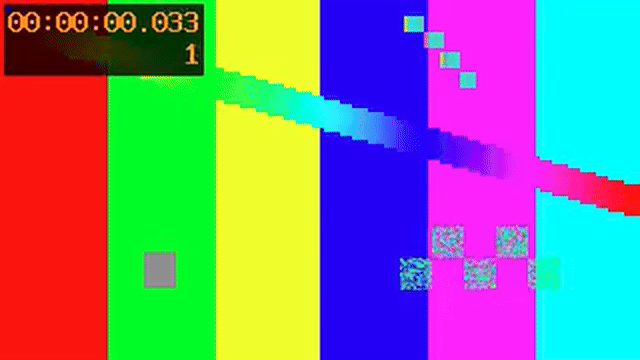
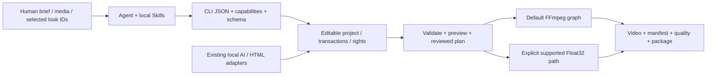
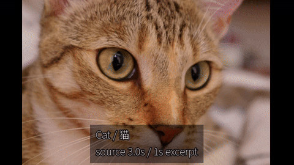
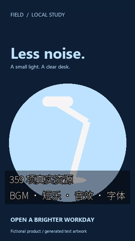
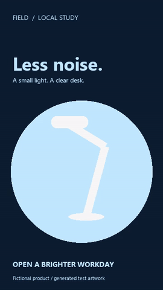

# agent editor kit

[简体中文](README.md) · [繁體中文](README.zh-TW.md) · [English](README.en.md)

面向Agent的開源影片剪輯與生成核心：透過一個Skill或原生CLI管理素材、可編輯時間軸、500套風格濾鏡、關鍵影格、字幕、聲音、AI模型任務與交付。以FFmpeg及明確登記的本機執行環境為基礎，直接處理自己的專案檔案。

**正式發行：v1.0.0；核心標識：CLI0.1.66；統一Skill：r60。** 發行版本與核心建置編號分別記錄。本版重新建置已驗收的66核心、離線相依套件、單Skill工具包與三語手冊，整合此前已實現的能力。這不代表所有剪映功能或自然影音品質已經達標。CLI67人像分區及獨立文字塑形/排版候選保留在開發區，未收入正式包。

[正式Release及所有附件](https://github.com/copypasteltd/agent-editor-kit/releases/tag/v1.0.0) · [發行說明](docs/releases/v1.0.0/RELEASE-NOTES.md) · [完整版本手冊](docs/releases/v1.0.0/README.zh-TW.md) · [原G01–G38與剩餘工作](docs/product/UNFINISHED_20261107.md)

## 安裝包與執行條件

| 編號 | 交付物 | 用途 |
|---|---|---|
| D01 | [Windows x64離線應用包](https://github.com/copypasteltd/agent-editor-kit/releases/download/v1.0.0/agent-editor-kit-v1.0.0-cp313-win_amd64.zip) | 原生應用wheel、固定離線相依套件、安裝器、第三方授權與分發清單；核心CLI0.1.66 |
| D02 | [統一Skill工具包r60](https://github.com/copypasteltd/agent-editor-kit/releases/download/v1.0.0/agent-editor-kit-v1.0.0-unified-skill-r60.zip) | 一個外層Skill、17內部模組、註冊/設定腳本及完整說明；與D01摘要綁定 |
| D03 | [SHA256SUMS.txt](https://github.com/copypasteltd/agent-editor-kit/releases/download/v1.0.0/SHA256SUMS.txt) | 核對附件位元組；另有簡體、繁體、英文快速開始與發行說明，共7附件 |

原生Windows x64、已有CPython3.13 x64及FFmpeg/ffprobe；基礎剪輯可使用CPU。包內不含Python、FFmpeg、驅動程式、模型權重或完整Torch/CUDA執行環境。可選AI功能需依下方服務表登記既有本機模型與相依套件；本專案不用Docker、WSL或虛擬環境。目前正式二進位交付與實測平台為Windows，不能把Python跨平台程式碼當成已驗證的Linux/macOS安裝包。

## 從下載到交付的完整流程

原生Windows CPython3.13 x64應用；唯一公開入口為 `$agent-ffmpeg-local-editor`，包含17個內部模組。應用ZIP不包含Python、FFmpeg／ffprobe、驅動、模型權重或完整音樂執行庫。先準備本機依賴；不使用Docker、WSL或虛擬環境。

1. 下載本次Release的兩個ZIP、SHA256SUMS.txt及本語言快速開始至同一目錄。將以下路徑改為實際路徑。逐項比較計算摘要與清單，全部相符後解壓縮至新目錄；後續安裝器還會核對應用內部清單。

```powershell
$downloads = "E:/video-tools/downloads"
$bundle = "E:/video-tools/application-bundle"
$kit = "E:/video-tools/skill-kit"
Get-Content -LiteralPath "$downloads/SHA256SUMS.txt"
Get-FileHash -LiteralPath "$downloads/agent-editor-kit-v1.0.0-cp313-win_amd64.zip" -Algorithm SHA256
Get-FileHash -LiteralPath "$downloads/agent-editor-kit-v1.0.0-unified-skill-r60.zip" -Algorithm SHA256
Expand-Archive -LiteralPath "$downloads/agent-editor-kit-v1.0.0-cp313-win_amd64.zip" -DestinationPath $bundle
Expand-Archive -LiteralPath "$downloads/agent-editor-kit-v1.0.0-unified-skill-r60.zip" -DestinationPath $kit
```

2. 離線安裝應用。目標目錄必須是新路徑。此步驟不下載模型；模型尚未準備時，可先透過安裝版入口執行version／doctor及基礎剪輯命令。

```powershell
$python = "C:/Python313/python.exe"
$installed = "E:/video-tools/application-installed"
& $python -E -B -X utf8 "$bundle/install.py" --bundle $bundle --target $installed --manifest-sha256 "sha256:8946cc2eedfab5b4f7c8f536b5277e3c6a636a0e700754a3cf25c76bfba9d0cd"
& $python -I -S -B -X utf8 "$installed/run.py" version
& $python -I -S -B -X utf8 "$installed/run.py" doctor
```

3. 設定基礎剪輯模式，將統一Skill綁定到上述安裝目錄。時間線、濾鏡、字幕、預覽與算圖可直接使用；配音、翻譯與語意模型按下一段另行設定。設定器先備份舊設定，再建立基礎綁定並清除舊機器模型路徑。

```powershell
& $python -E -B -X utf8 "$kit/scripts/activate_community_runtime.py" --installed $installed --base-only
```

選用模型：需要配音／翻譯時，先準備已核對的 `kokoro-zh-en-int8` 與 `opus-zh-en-cpu-int8` 兩個CPU套件；`kokoro-zh-en-cuda13` 與 `opus-zh-en-cuda12-int8` 為選用GPU套件。PACKS指向包含這四種解壓目錄的父目錄；設定器要求兩個CPU套件，逐一驗證後才寫入模型綁定。本次兩個ZIP未包含這些模型套件；來源、授權、預期摘要與重現工具見下方連結。

[Model catalog and pinned manifests](https://github.com/copypasteltd/agent-editor-kit/blob/main/product/src/ai_ad_editor/material_data/model-packs.json) · [CPU pack builder](https://github.com/copypasteltd/agent-editor-kit/blob/main/scripts/build_community_model_pack.py) · [GPU pack builder](https://github.com/copypasteltd/agent-editor-kit/blob/main/scripts/build_community_gpu_packs.py) · [Offline pack installer](https://github.com/copypasteltd/agent-editor-kit/blob/main/scripts/install_community_pack.py)

```powershell
$packs = "E:/video-tools/model-packs"
& $python -E -B -X utf8 "$kit/scripts/activate_community_runtime.py" --installed $installed --packs $packs
```

若使用GPU包，將設定命令替換為以下形式，並填入對應的實際DLL目錄。配音與翻譯的CUDA版本要求不同；不要混用兩個目錄。後續使用 `--device auto` 優先選擇設定的GPU，並檢查回傳的實際裝置／provider及CPU回落說明。

```powershell
& $python -E -B -X utf8 "$kit/scripts/activate_community_runtime.py" --installed $installed --packs $packs --voice-cuda-lib "E:/video-tools/cuda13/bin" --translation-cuda-lib "E:/video-tools/cuda12/bin"
```

4. 註冊唯一Skill並檢查實際安裝版本。已有同名入口且指向其他位置時，註冊器會保留並拒絕替換；升級請先閱讀隨包交付說明，不手動刪除不明目錄。Agent外層只需指定 `$agent-ffmpeg-local-editor`。

```powershell
powershell.exe -NoProfile -ExecutionPolicy Bypass -File "$kit/register-agent-ffmpeg-local-skills.ps1"
$entry = "$kit/skills/agent-ffmpeg-local-editor/scripts/run.ps1"
& $entry version
& $entry doctor
& $entry capabilities
& $entry model-pack list
& $entry gpu inspect
```

5. 建立專案並匯入自己的授權素材。以下影片、圖片、字幕、配音文字和changes.json必須實際存在。讀取匯入回傳的 `data.asset.id`，再依schema及說明編寫changes.json；不能照抄舊案例的隨機ID。影片與音訊軌須分別編排，先預覽實際濾鏡候選並記錄客戶選擇，再合成時間線。

```powershell
$aekProject = "E:/video-work/my-ad"
& $entry project init $aekProject --name "My ad"
& $entry media ingest --project $aekProject --input "E:/media/product.mp4"
& $entry schema show
& $entry timeline compose --help
& $entry look list --query "Kodak"
& $entry look inspect --id t3-kodak-gold-200
& $entry look preview --id t3-kodak-gold-200 --input "E:/media/still.png" --output "$aekProject/exports/film-preview.png" --strength 0.65
& $entry timeline compose --project $aekProject --input "E:/video-work/changes.json"
& $entry look apply --project $aekProject --id t3-kodak-gold-200 --global --strength 0.65 --dry-run
& $entry look apply --project $aekProject --id t3-kodak-gold-200 --global --strength 0.65
```

可選配音／翻譯範例會實際執行模型，須先準備輸入檔案、模型包與設定，並使用新的asset ID。完整音訊、發音、翻譯語意與時長仍須複核。生成後用實際音訊資產ID編寫voice-changes.json，將聲音明確編入音軌，再執行以下最後一條compose；翻譯字幕也須依目標軌道編排。

```powershell
& $entry voice list
& $entry voice synthesize --project $aekProject --voice zf_001 --input "E:/media/narration.txt" --device auto --asset-id asset_voice
& $entry translate subtitles --project $aekProject --from zh-Hans --to en --input "E:/media/captions.srt" --output exports/bilingual.srt --mode bilingual --device auto
& $entry timeline compose --project $aekProject --input "E:/video-work/voice-changes.json"
```

6. 驗證、預覽、算圖並檢查實際成片，再匯出可編輯專案包。匯入使用新的目標目錄；重新算圖後分別檢查畫面、完整音軌、時鐘與配方。JSON的ok／status／errors／warnings／artifacts與程序結束碼需要同時檢查，品質檢查不能代替完整播放及聽審。

```powershell
& $entry validate --project $aekProject
& $entry preview frame --project $aekProject --frame 0
& $entry render --project $aekProject --output "$aekProject/renders/ad.mp4"
& $entry quality check --project $aekProject --input "$aekProject/renders/ad.mp4"
& $entry convert export --project $aekProject --target-format package --output "$aekProject/exports/ad.aevpkg.zip"
& $entry convert import --input "$aekProject/exports/ad.aevpkg.zip" --output "E:/video-work/restored-ad"
& $entry render --project "E:/video-work/restored-ad" --output "E:/video-work/restored-ad/renders/replay.mp4"
& $entry rights check --project $aekProject
```

神經音樂是額外能力，需要明確登記既有本機適配器、原生執行庫與權重；上述四包不能替代音樂模型。先閱讀[神經音樂說明](https://github.com/copypasteltd/agent-editor-kit/blob/v1.0.0/skills/agent-ffmpeg-local-editor/references/neural-music.md)。一般譜面合成、循環修復與神經生曲的含義不同。

```powershell
& $entry music generate --help
& $entry delivery --help
```

[Skill詳情與17模組](https://github.com/copypasteltd/agent-editor-kit/blob/v1.0.0/skills/agent-ffmpeg-local-editor/SKILL.md) · [濾鏡客戶選型](https://github.com/copypasteltd/agent-editor-kit/blob/v1.0.0/skills/agent-ffmpeg-local-editor/references/client-look-selection.md) · [配音／翻譯／音訊](https://github.com/copypasteltd/agent-editor-kit/blob/v1.0.0/skills/agent-ffmpeg-local-editor/references/community-materials.md) · [升級、恢復及回滾](https://github.com/copypasteltd/agent-editor-kit/blob/v1.0.0/docs/product/DELIVERY_CONTROLLER.md)

發佈成片前補充素材／模型／聲音用途的權利證據，並執行rights check。render的--publish僅執行本機權利門檻，不上傳平台。模型生成內容仍須逐項審查；本包不附未審核模型音訊。同機新目錄驗收不等於乾淨主機或跨機器通過，完整剪映等價及原G01—G38條件繼續開放。

`v1.0.0` / CLI`0.1.66`


以下功能及案例保留各自證據日期；舊案例的CLI編號是實際執行版本，不表示本輪重新執行。正式1.0.0的安裝及呼叫以前述流程和R618–R620為準。

## 本版新安裝與專案重放的實際輸出

程式圖案及獨立測試音經真實安裝版剪輯、LUT與專案包重放；2秒、60幀、完整立體聲對照。此例核驗分發/渲染鏈路，真實素材及AI案例見後方完整案例表。



[MP4](docs/assets/release-v1-20261107/actual.mp4) · [PNG](docs/assets/release-v1-20261107/preview.png) · [Input video](docs/assets/release-v1-20261107/input-pattern.mp4) · [Input WAV](docs/assets/release-v1-20261107/input-tone.wav) · [Editable project](docs/assets/release-v1-20261107/editable.aevpkg.zip) · [Source and notices](docs/assets/release-v1-20261107/SOURCE_AND_LICENSES.md)

## 產品方案與完整執行邏輯



當前實現是 **Python CLI + Agent Project schema + FFmpeg**，並有顯式的 Float32 處理子集。Concat 是早期路線研究對象，發行包不是“刪除 Concat GUI 的二進制”。已采用的 OpenFilm 字幕分段、影格時鐘、HTML 動效/模板等復用保留來源與許可；當前運行不依賴 OpenFilm 在線服務。

1. 讀取 version/doctor/capabilities/schema，確定本機真實可用的能力與依賴。
2. 把 brief 寫成計劃：素材、畫幅、時長、鏡頭、音軌、字幕、運鏡、風格、交付與證據。
3. 創建獨立工程，導入本地素材，用真實 asset ID 與整數 ticks 編寫編輯 JSON；音軌明確添加。
4. 通過事務 compose/edit/apply 寫入時間線，保留快照；先校驗，再預覽關鍵影格和區間。
5. 若需要選型，展示原圖與少量候選，記錄最終 ID/強度/作用域；在目標素材上復試。
6. 渲染至工程內新路徑，檢查實際編碼文件、manifest、warning、音畫與權利，再導出專案包。

<a id="feature-modules"></a>

## 功能模組與實際支援邊界

編號用於定位文件；各模塊有依賴與交叉，不是“43 個獨立內核”或完成率。下表直接寫明行為、入口與限制；[完整機器能力清單及每項契約](docs/product/CAPABILITIES.zh-TW.md)保留全部字段。

**F45音色狀態補充（2026-11-06）：** 已有CLI61獨立安裝版實際產生的全部103音色WAV及完整PCM專案重播，中文100／英文3。下表F45保留早期「至少7個」證據下限；完整樣音可依[本機試聽流程](docs/validation/CLI61全音色试听_2026-10-29.md)選型。人類完整聽審、自然度、情緒／方言及輸出權利仍未驗收，本次未重新產生聲音。

| 編號 | 功能模塊 | 具體行為與輸入 → 輸出 | 入口 | 依賴/邊界 |
|---|---|---|---|---|
| F01 | Agent 調用協議 | 任務參數 → JSON 響應、退出碼、錯誤、warning、產物與 provenance；能力與 schema 可查詢。 | `version; doctor; capabilities; schema show` | Skill 組織任務，CLI 執行；沒有後臺云端 Agent 服務。 |
| F02 | 可編輯專案 | 創建/檢查 Agent Project，保存資產、序列、軌道、ticks 時鐘、輸出配置和權利引用。 | `project init/inspect` | 源媒體與專案元資料分離，移動工程後需重鏈並復核證據路徑。 |
| F03 | 事務、恢復與快照 | 中繼資料事務/快照；原生子程序樹歸屬；明確復原四軌及字幕配音持久化暫存與未提交輸出。  新增語義登記/索引/校準/檢索的受管任務。| `project snapshot/restore/migrate/recover; operation inspect` | 整棵已引用語義目錄保護；活躍/變化/未知/舊快取保留。僅已接入任務，不是模型續算；目前完整性讀取已回應逾時/取消；其他 worker/OS 阻塞 I/O 仍有邊界。 |
| F04 | 素材導入與重鏈 | 本地圖片/影片/音頻/字體 → 探測結果、穩定資產 ID、雜湊和來源記錄。 | `media ingest/relink` | 不抓取在線素材；導入不自動證明商業授權。 |
| F05 | 代理、縮略圖與波形 | 素材 → 輕量代理、圖片縮略圖、音頻波形、可核查聯系表。 | `media prepare/contact-sheet` | 聯系表是抽樣證據；不代表逐影格視覺理解。 |
| F06 | 鏡頭、靜音與高光分析 | 本地影片/音頻 → 切鏡、靜音、節拍或啟發式高光候選與時間證據。 | `media understand/highlights` | 高光是啟發式候選，語義判斷需要 Agent/已註冊適配器復核。 |
| F07 | 智能粗剪與廣告計劃 | 經檢查的靜音/文本片段或廣告 brief → 編輯計劃 → 可編輯粗剪。 | `media smart-cut; ad plan/apply` | 計劃與實際 apply 分開；不承諾自動導演效果或投放表現。 |
| F08 | 節拍剪輯與多機同步 | 節拍錨點/本地多機音軌 → 剪切或 offset/顯式 affine 時鐘及切機計劃。 | `media beat-cut/multicam` | 低置信度、覆蓋不足、非線性漂移需拒絕/顯式處理；不自動添加音軌。 |
| F09 | 多軌基礎剪輯 | 編輯 JSON → 加軌、插入、更新、拆分、刪除、時長/位置修改與畫幅設置。 | `timeline compose/edit` | 遵守軌道鎖、整數 ticks、資產時長與實際能力契約。 |
| F10 | 範圍與輸出窗口編輯 | 明確區間 → 裁切/刪除/波紋等範圍編輯，保留作者時間與源映射。 | `timeline edit` | 復雜變速與嵌套的組合需按具體契約檢查，不推斷所有組合均可用。 |
| F11 | 源句柄、滑移與滑動 | 源入出點與鄰接片段 → 可逆源編輯、源句柄轉場和剪口調整。 | `timeline edit/transition` | 源句柄不足會報錯；不以靜默復制影格替代。 |
| F12 | 磁吸、主軌與關聯音畫 | 主軌重排、原生追蹤跨剪口同步拆分、區域關聯ID及音畫附著。 | `timeline edit` | 明確同步及拆分策略；鎖、轉場端點及資源門禁；非原生追蹤跨剪口仍受限。 |
| F13 | 復合與嵌套序列 | 子序列 → 獨立畫布合成、父變換/透明度、嵌套時鐘與定格。 | `timeline compose/edit` | 獨立空間不代表獨立色彩/影格率；部分組級空間轉場未接受。 |
| F14 | 變速、倒放與定格 | 共享完整作者時鐘、逐層輸出和單次聲音；原生獨立空間進出場可保留。 | `timeline edit; render` | 跨片段轉場仍需完整上級；ripple/retime、鎖、預算和音訊後端邊界保留。 |
| F15 | 關鍵影格與緩動 | 位置、錨點、縮放、旋轉、透明度、裁切、蒙版、音量/聲像 → 逐影格動畫。 | `timeline compose; schema show` | hold/linear/ease_in/ease_out/ease_in_out/bezier；枚舉/布爾值不推斷為連續動畫。 |
| F16 | 12 套運鏡預設 | 推拉、上下左右平移、Ken Burns、旋入/旋出、淡入/淡出、shake → 可編輯關鍵影格。 | `motion list/inspect/apply` | 參數有界；是明確關鍵影格預設，不是 AI 三維相機或全部商業運鏡庫。 |
| F17 | 轉場與剪口效果 | 相鄰片段與源句柄 → 淡化、擦除、滑動、黑/白場、圓形等已聲明轉場。 | `timeline transition; capabilities` | 依算繪路徑和層級選擇；明確 Float32 已提供 F55 的轉場子集，CPU 執行，支援範圍見獨立契約。 |
| F18 | 幾何蒙版與逐影格修正 | 矩形/圓/橢圓/路徑/多邊形 → 反選、羽化、動畫、編碼蒙版與修正。 | `timeline compose; media mask-edit; quality mask` | 路徑點數和取樣受限；幾何通過不等於語義分割/身份正確。 |
| F19 | 圖層合成與混合 | 多軌視覺層 → normal/multiply/screen/overlay/difference/addition/softlight/hardlight。 | `timeline compose; capabilities` | 預設路徑主要為編碼 8-bit RGB；不宣稱線性光/HDR 合成等價。 |
| F20 | 51 個效果處理算子 | 模糊/銳化、降噪、色調、曲線、HSL、色鍵、暗角、顆粒等 → 可配置效果鏈。 | `effects list/inspect` | 可動畫參數與實際後端逐項查詢；51 算子與 500 成品 LUT 是不同統計。 |
| F21 | 500 套離線風格 | 名稱/ID/類別/許可檢索 → 詳情、圖片預覽、片段或全局應用與來源副本。 | `look list/inspect/preview/apply` | 500 個不同數值變換含同系列曲線；SDR 創意映射，不是 500 個獨立家族。 |
| F22 | 自定義 LUT 與色彩自動化 | 本地 .cube/.3dl/.csp/.dat → 登記、檢查；支持的 3D LUT 強度與色彩參數按契約動畫。 | `lut register/list/inspect; effects inspect` | 格式登記不等於所有路徑都完整解析；完整 CUBE 才有對應強度/浮點支持。 |
| F23 | 顯式 Float32 像素路徑 | 聲明輸入/工作/輸出信號、順序與預算 → 原生浮點色彩、LUT/shaper、選定空間處理和 surface。 | `render; preview; surface export/inspect` | 必須顯式選擇 float32-native-v1；能力子集，拒絕不支持項，非完整 HDR/ICC 管線。 |
| F24 | 字幕、文字與分段 | SRT/VTT/ASS/SSA/TTML 或文字 → 規范化、分段、雙語、文字層、逐字高亮和文字動畫。 | `subtitle validate/normalize/segment; timeline compose` | 字體需本地可用；復雜排版、雙向 shaping 與部分動畫/時鐘有明確近似或拒絕。 |
| F25 | 離線轉寫與字詞對齊 | 音頻 + 已有 Whisper/CTC 模型/校正文 → 轉寫、字幕、字詞時碼與 CER 評估。 | `asr adapter; subtitle transcribe/align/evaluate` | 基礎包不帶權重；activity 保留原 CTC 並通過 6 組受控詞塊門檻；自然連續語音、中文和歌詞精度仍未驗收。[流程](docs/product/CTC_ACTIVITY_ALIGNMENT.md) |
| F26 | 多軌音頻與總線 | 顯式音軌 → 混音、總線、音量/聲像、靜音/solo、淡化、EQ、壓縮、降噪、響度與閃避。 | `audio extract; timeline compose; quality check` | 影片資產有聲音不代表時間線自動出聲；自動 PCM/LUFS 檢查不代替聽審。 |
| F27 | 本地語音合成 | 已有本地 flite 或登記 SoulX 權重/授權參考聲 → WAV 資產與可選音軌。 | `tts adapter/voice; tts synthesize` | flite 取決於 FFmpeg 構建且限 ASCII 英文；SoulX 需 CUDA/原生依賴，非基礎包自帶配音庫。 |
| F28 | 獨立四軌與雙軌分離 | 音訊 → drums/bass/other/vocals 四個模型預測、float WAV 與可編輯音軌；保留原雙軌和 mid/side。 | `audio separate-stems; audio separate; audio adapter` | 另供原生環境/權重；受控 CPU/GPU 實測，自然品質/聽審/模型權利仍待驗。 |
| F29 | 跟蹤、綁定與重構圖 | 模板/模型/已編碼蒙版軌跡 → 文字/貼紙錨定、裁切與主體重構圖關鍵影格。 | `media track/track-bind/reframe` | 多目標須明確對象；置信度/蒙版不等於身份保證，支持的變換與時鐘需檢查。 |
| F30 | OCR 錨點與人臉修飾 | 已有 PP-OCR/OpenSeeFace 模型 → OCR 框/文字、錨點運鏡、人臉點位與受限修飾。 | `ocr adapter/scan/anchors; face adapter/scan/retouch` | 已有 ONNX CPU 環境與權重；不是完整 UI 行為識別、美妝、瘦身或臉部生成。 |
| F31 | 人像摳像與對象分割 | 已有 RVM/SAM2 + 提示點/框 → 透明影片、對象 mask 和可編輯派生資產。 | `media adapter; media matting` | RVM 人像與 SAM2 對象分割不同；概率 mask 不是物理發絲 matte，需檢查運動/遮擋。 |
| F32 | 修復、生成編輯與擴畫 | 已有 LaMa/VACE + 蒙版/提示 → 修復或擴大畫布，保留來源與可重放 recipe。 | `media inpaint/outpaint; media adapter` | LaMa 逐影格不保證時序；VACE 需 CUDA 且僅窗口聯合；自然紋理/時序品質未普遍驗收。 |
| F33 | HTML/CSS/SVG/Canvas 動效 | 受信任本地源碼/素材/字體 → 可編輯模板控件、透明標題、逐筆描線、布局診斷與時間線合成。 | `motion html-*; motion stroke-source` | 另需已有 Node/Playwright/Chromium；非任意網頁沙箱，不自動下載瀏覽器。 |
| F34 | 參數模板與批量變體 | 本地 JSON 模板 + 類型變量 → 可編輯專案變體、批量輸入與模板快照。 | `template apply/batch` | 支持 asset/color/enum 等類型；復雜條件圖和表達式執行未實現。 |
| F35 | 素材索引與片段組復用 | 素材目錄/已編輯片段 → 檢索、重復/相似檢查、跨專案片段組與依賴閉包。 | `library index/search/duplicates/similar; fragment` | 用戶自建資源庫，未內置商業素材訂閱/正版音樂庫存。 |
| F36 | 影格、區間與緩存預覽 | 工程 + 明確影格/區間 → PNG/短影片/緩存與可驗證取樣證據。 | `preview frame/range; cache; preview cache-*` | 預覽不是完整成片核驗；色彩路徑與緩存簽名需一致。 |
| F37 | 輸出、編碼與GPU投影 | 專案 → MP4/WebM/MKV、明確OpenCL裁切/仿射/子畫布投影、編解碼探測及manifest。 | `render --projection-acceleration; render` | 原生GPU需雙精度/紋理預檢；CPU預設，其餘特效仍CPU，無即時/通用4K保證。 |
| F38 | 持久佇列、重試與取消 | 凍結專案快照 → 本地排隊、有限worker、明確重試/取消及序列化提交。 | `queue enqueue/list/inspect/run/cancel` | GPU投影策略逐作業傳遞，拒絕其 --reuse-identical 繞過探測；不是雲渲染。 |
| F39 | 成片、Scope 與 golden 核驗 | 實際編碼文件 → 音畫/影格率/畫幅/時長、響度/黑場、色彩 Scope、蒙版和 golden 差異報告。 | `quality check/scopes/mask/golden` | 自動檢查、靜態目檢、連續播放、人工聽審分別記錄；不等於商業成片品質認證。 |
| F40 | 權利臺賬與本地策略 | 素材/字體/LUT/模型/模板證據 → 依賴臺賬、變更歷史、影響/撤回與發布門禁。 | `rights; policy audit; render --publish` | --publish 只檢查本地權利，不上傳；臺賬不自動裁定版權。 |
| F41 | 專案與時間線交換 | Agent JSON/package、OTIO、Kdenlive MLT、已有合法明文草稿 → 導入/導出與損失報告。 | `convert import/export` | Exact/Approximate/Unsupported/Failed 逐項報告；明文草稿不調用剪映，不解密或下載專有資源。 |
| F42 | 管道診斷與錯誤交付 | 失敗操作 → 有界日志、diagnostic manifest、顯式導出和可復查錯誤資訊。 | `diagnostics list/show/export; operation inspect` | 失敗/拒絕不是成功渲染；包含本地路徑的診斷需按交付範圍處理。 |
| F43 | 創意、內容與投放分析 | 用戶提供的產品、受眾、參考片或投放表 → 腳本、結構、變體建議與分析。 | `ad plan/apply; advisory Skills` | 策略 Skill 不提供廣告平臺連接、自動投放、實時資料或效果保證。 |
| F44 | 內建開源素材庫 | 359 項逐項具名 BGM/短樂/音效/簡繁字型 → 查詢、檢查、權利登記與專案資產。 | `materials list/inspect/verify/ingest` | 44 BGM、85 短樂、228 音效、2 字型；逐項保留來源/許可，影片/貼紙和產業覆蓋不足。 |
| F45 | Kokoro 中英配音庫 | 文字、103 具名音色和語速 → 完整 WAV、實際時長與可編輯聲音資產。 | `voice list/synthesize; model-pack` | 可選 CPU/CUDA 包；累計至少 7 個音色實際生成，完整試聽、情緒/方言與人類聽審未驗收。 |
| F46 | 中英翻譯與雙語字幕 | 文字或普通 SRT → 中英雙向譯文、簡繁轉換、雙語 SRT 與明確術語譯後替換。 | `translate text/subtitles` | OPUS 需本地模型；保留 cue 順序/毫秒，錯譯仍保留，不能代替人工語義接受。 |
| F47 | GPU 配音與翻譯選擇 | 明確 CPU/CUDA/auto 和視訊記憶體預檢 → 實際 provider、裝置與明確回退/失敗。 | `gpu inspect; voice; translate; --device` | RTX 3060 實測；配音 CUDA 13 / 翻譯 CUDA 12、配音目前僅裝置 0，其餘濾鏡不因此 GPU 化。 |
| F48 | 配樂準備與聲音混合 | 實際音樂/人聲資產 → 截取、循環、淡入淡出、明確增益與人聲閃避混音。 | `music prepare/mix` | 保留原分軌，不靜默裁人聲；譜面合成見F83，接縫交疊修復見F84，畫面語義匹配仍未完成。 |
| F49 | 原生擷取 | 明確視窗/螢幕/區域/攝影機/麥克風 → 有限錄製、CPU/NVENC、取消與專案資產登記。 | `capture devices/record` | 真實視窗 CPU/GPU 已驗；攝影機/麥克風、聯合音畫同步、裝置故障與長錄製未驗。 |
| F50 | 離線圖文語義檢索與條件選擇 | 本地索引、中英/參考圖、同影格正負條件、經驗校準檔案、實際預覽/來源時間及可編輯引用。 | `semantic adapter-register/index/calibrate/calibration-list/search/verify` | 專案包按需衍生路徑繫結；同機 80 條遷移決策保留，仍有 3 條已知錯誤；執行環境另備，G26/G31 開放 |
| F51 | 字幕翻譯配音聯合流程 | 普通中英 SRT、明確音色/軌道 → 譯文或保留同語種原文、完整批次 WAV、實際時窗、可編輯聲音/字幕及原子提交。 | `dub subtitles` | 同語種只初始化配音模型；保留原聲/重試/錯譯；cue 時窗不證明字詞精度、自然韻律或口型同步。 |
| F52 | 可編輯廣告分鏡與返工 | 已確認 brief/實際素材 → 多畫幅與時長的畫面/字幕/配音/源音/配樂獨立軌道；按鏡頭及變體局部改稿。 | `ad storyboard/build/revise` | 整影格分配、原素材位元組鎖、實際字型排版和完整配音時窗；不自動創造賣點或決定素材語義。 |
| F53 | 語義執行時升級 | 舊適配器/索引/校準 → 新安裝路徑的新 ID，複製向量/預覽/資料集並保留擬合及原觀察。 | `project upgrade-semantic` | 全部 19 個實作與外部依賴須位元組相同；零新模型前向，原記錄不改；內容變更拒絕並要求重建。 |
| F54 | 可復用參數運鏡 | 本地版本化 JSON / 既有作者曲線 → 一般關鍵影格、參數/摘要/快照、跨專案復用。六套實際預覽供選型。 | `motion pack list/inspect/create/capture/apply` | 65 點採樣、transform 屬性；預設拒絕衝突，明確取代整條屬性軌；跟蹤綁定拒絕，CPU 合成/自然品質未結案。 |
| F55 | 線性浮點轉場與群組進出場 | 明確 Float32 專案 → 57 xfade圖案+2 dip、預乘alpha混合、真實句柄/原作者時鐘、關聯音軌、群組擦除/推移及實際預覽成片。 | `timeline transition; preview; render; queue` | CPU；12種真實句柄宣告，其他圖案用明確重疊/邊緣；normal雙源混合；風噪有平台差異，HDR/自然品質未閉。 |
| F56 | 線性浮點文字與字幕 | 獨立／內嵌／SRT、聯合逐詞／打字機 → 原生位元組覆蓋率、可重用字形、分塊線性合成、原作者時鐘、4K標題及實際交付。 | `timeline compose; preview; render; queue` | 明確本機字型；CPU／明確GPU；覆蓋率8bit／顏色Float32；工作區准入非峰值RSS；富ASS／Bidi／自然品質未閉。 |
| F57 | 原生Float32 GPU執行 | 仿射、一般合成、文字組件/逐詞、粒子光柵及光學/高光擴散效果；任務自有管道/共享像素，貫通渲染/預覽/佇列/恢復。 | `projection_acceleration; render; preview; queue` | off/prefer/require；binary64精度/次正規探測，粒子保留Float32；有界控制及所屬程序/執行緒/串流清理，其他算子CPU。 |
| F58 | Float32全域/區間調整層 | 全軌含字幕合成後依序調色/光效；既有浮點效果及光學/高光擴散效果、六種插值，選定根僅套用一次。 | `settings.adjustments; preview; render; queue` | 明確線性工作域/效果訊號；光學/高光擴散可GPU，其餘CPU；LUT持鎖/包遷移，原作者區間時鐘，非完整HDR。 |
| F59 | 原生PTS跟蹤及疊加軌 | 保存來源觀測→依實際原生影格求跟隨位置；共用crop/TRS、ROI縮放／相對旋轉、透明度、視窗及巢狀聲音。 | `media track-bind; preview; render; queue; package` | 明確Float32，原生PTS不烘焙顯示鍵；預算／循環門禁；模板漂移及遮擋另審，中間格式烘焙未接通。 |
| F60 | 原生跟蹤與烘焙交付 | 實際alpha/5類遮罩/59轉場足跡；剪輯與共享變速保留觀察；原生烘焙逐幀核驗並保留來源旁車。 | `media track-bind; timeline compose/edit; convert export --bake-tracking` | 目前凍結圖/FPS；20,000幀/256,000求值；無法表達的整數步進拒絕；外部播放器與自然身分/遮擋待驗收。 |
| F61 | 本地GPU影片生成 | 文生、圖生、尾幀/首尾幀；原文提示/取樣、真實模型視窗、可編輯入軌、端點核驗、可移植配方與受管恢復。 | `media adapter; media generate` | 既有原生VACE/CUDA依賴；無聲8bit SDR；條件端點合成保留；自然品質/生成權利/完整剪映AI待驗收。 |
| F62 | 原生GPU模型會話 | 同工程/適配器/提示詞重用權重與嵌入；每任務重設，活連線傳遞持鎖雜湊；取消、期限、閒置及任務數退出。 | `media model-session; media generate --model-session` | 原生Windows VACE；首條仍載入；新提示詞須新會話，串行執行；非全域顯存預留/多GPU。 |
| F63 | 可編輯程序化粒子與發射器動畫 | 六種原創配方、五形狀、seed/獨立CFR；21屬性源時鐘關鍵影格、六種緩動、暫停發射；實際GPU光柵化。剪輯/預覽/佇列/包/本地OTIO貫通。 | `vfx list/inspect/apply/update/show/animation-properties/animate` | CPU積分與出生取樣，GPU繪製；64點/屬性、16發射器、4096預留活粒子；無3D/碰撞/深度。 |
| F64 | 可編輯光學效果與GPU運算 | 眩光核心/條紋/光暈/鬼影、旋轉橢圓漏光、徑向紅藍色差；全部數值通道關鍵影格、原作者時鐘、片段/區間調整層，CPU/OpenCL。 | `effects list/inspect` → `timeline compose` → preview/render | 明確線性RGB；原alpha位元保留，透明隱藏色不滲出；ghosts/edge靜態，非實體鏡頭/自動亮源/bloom。 |
| F65 | 實際高光 Bloom / 膠片 Halation | 軟膝閾值提取實際高光→分離高斯擴散→核心抑制/線性著色；可編輯數值軌道及原作者時鐘，片段或根區間調整層。 | `effects list/inspect; timeline compose; preview; render; queue` | sigma0…32輸入像素；透明/複製邊界、原alpha位元保持；實際四kernel GPU/CPU參考，有界空間/訪問預算；非物理膠片/HDR驗收。 |
| F66 | 原生 PQ／HLG HDR 與 SDR 顯示 | 明確參考白及HLG峰值/gamma，解碼至顯示線性光；不同nit素材、一般效果/合成、10-bit BT.2020 NCL交付，獨立選擇SDR trim及PNG/MP4預覽。  原始碼51另增OKLab保感知明度/色相縮色度；安裝50尚未包含。| `timeline compose; validate; preview; render; convert` | 傳遞CPU，既有合成/光效可GPU；拒絕8-bit/標籤不符/缺單位；alpha位元保留。非ICC/動態中繼資料或HDR監看驗收。 |
| F67 | 本機神經口型同步 | 圖片／影片＋獨立聲音→真正CUDA MuseTalk口型；25FPS人臉框關鍵影格、語義下半臉混合、完整PCM及alpha保留，可復用配方並影片/音訊關聯入軌。 | `lipsync adapter register/list/inspect; lipsync generate` | 本機safetensors及既有原生Torch依賴；臉部256×256、明確8bit SDR與來源運鏡、無CPU回退；自然口型、完整數位人仍未驗收。 |
| F68 | CUDA神經補幀與慢動作 | 原生CFR/VFR、每來源影格RGBA、預乘alpha、完整PCM；2..8倍、切鏡保持、關聯慢放雙軌、配方重跑及工程包。 | `interpolate adapter; interpolate generate` | 明確RIFE4.25 safetensors＋原生CUDA Python；無CPU回退；困難運動/遮擋/自然品質/HDR未廣泛驗收。 |
| F69 | CUDA對白降噪與增強 | 原生取樣時鐘/單雙聲道、真正模型、乾濕強度/衰減、可編輯獨立音軌、配方重跑/工程包、取消回滾。 | `audio enhancement-adapter; audio enhance` | DeepFilterNet3固定safetensors＋既有原生CUDA依賴；分段狀態重置、CPU前端；完整去混響/音樂保真待完成。 |
| F70 | HDR10靜態中繼資料交付 | 母版RGB/白點xy、最小/最大nit、MaxCLL/MaxFALL → 實際HEVC SEI與解碼核驗清單。 | `settings.output.hdr10; validate; render; convert` | 明確原生PQ/BT2020 NCL有限範圍、libx265/10bit420/MP4或MKV；作者聲明、前32封包核驗。 |
| F71 | 白點適應與寬色域工作設定 | ProPhoto D50／AP1 D60／明確xy → 線性XYZ Bradford、nit縮放、實際D65預覽與專案封裝。 | `native_chromatic_adaptation; render; preview; surface export; convert` | CPU色彩數學，GPU光暈依聲明白點；不含ICC解析／完整ACES／自動白平衡。 |
| F72 | 原生ICC來源色彩管理 | RGB ICC v2/v4矩陣/CLUT、明確SHA/意圖/BPC → 線性RGB工作域，Float32/alpha、實際預覽與專案依賴閉合。 | `native_icc_source_profiles; surface inspect-profile; surface export; render; preview; convert` | 固定MIT LittleCMS原生CPU；不含任意輸出ICC/軟打樣/CMYK/自動內嵌推斷。 |
| F73 | HLG顯示黑位與完整訊號CLI | BT.2100黑位提升／逆變換、明確nit與黑位、零黑位原數值路徑、完整RGB/HDR/ICC JSON與明確域策略。 | `native_hlg_black_level; surface export; render; preview; convert` | 不推測螢幕；nominal0..1；超限拒絕或明確裁切；無動態HDR／完整ACES。 |
| F74 | 原生ICC輸出與軟打樣 | RGB v2/v4矩陣／B2A CLUT、四意圖／BPC、明確nits、逐影格內嵌ICC的RGBA16 PNG與作者PCM、真實SOFTPROOFING及完整交付檢查。 | `native_icc_output_profiles; surface render; surface inspect-output; render; preview; convert` | CPU CMM；GPU剪輯獨立；8GiB產物預算；無CMYK／ICC5／物理設備校準。 |
| F75 | 編碼前後HDR光量與轉換收據 | 明確nit；實際作者RGB16輸入與解碼後原生RGB／YCbCr分別測量，MaxRGB／CIE Y、位置／時長、完整像素與時鐘摘要、全影格裁切帳本。 | `native_hdr_light_measurement; surface measure; surface measure-media; surface export; render` | CPU測量；不推斷顯示器、不自動寫SEI；原生曝光缺口／重疊不填補。 |
| F76 | 原生 ACES 時間軸與顯示視圖 | 固定ACES1.3/2.0/2.1；AP1/D60場景輸入、曝光、正式SDR/PQ/HLG輸出、獨立觀看視圖、顯示線性縮圖與測量。 | `native_aces_display; surface ocio-configs; render; preview; surface measure` | 原始碼CLI53、CPU；不是自動相機IDT/AMF/LMT/GPU或實體監看；安裝Skill已53。 |
| F77 | 校準語義廣告聯合選材 | 單批真實語義介面、所有變體來源範圍／原音／權利篩選、全域去重分配、可攜逐鏡頭依據與普通分鏡計畫。 | `ad select; ad build; ad revise` | 原始碼CLI54；45項測試通過，實際CUDA／安裝／Skill另驗；不證明整段語義或自然廣告品質。 |
| F78 | 原生子程序繼承預算 | 在預算上下文內，啟動／等待／返回時檢查外層期限和取消標記，中斷時關閉自有Job並回收讀取執行緒。 | `run_process / operation_budget` | 原始碼CLI55；15項控制回歸通過；不承諾OS阻塞呼叫硬即時搶占。 |
| F79 | 語義模型原生依賴隔離 | 工作程序固定自己的應用套件後恢復模型Python的依賴搜尋順序，保留版本／模組路徑／摘要檢查，避免安裝site覆蓋模型NumPy／Pillow。 | `semantic / ad select / project upgrade-semantic` | CLI56原始碼／安裝原生回歸與實際CUDA案例通過；新實作須重新登記綁定，非任意環境相容保證。 |
| F80 | 15類原生工作程序依賴隔離 | 暫時固定所屬應用套件後恢復模型Python依賴搜尋順序，拒絕預載外部同名套件，保留原版本／路徑／摘要校驗。 | 原生ASR／CTC／分割／摳像／跟蹤／修復／生成／口型／補幀／降噪／分離等入口 | CLI57原始碼31項子程序回歸通過；安裝與實際模型另驗，正式Skill仍CLI56。 |
| F81 | 精確內容選材去重 | 規範SHA256內容分組、全域聯合分配，支援明確ID去重或重用。 | ad select；不同ID相同檔案；非感知去重 | 原始碼58選材／分鏡57項通過；[規則與證據](docs/product/AD_CONTENT_UNIQUENESS.md)，58安裝另驗。 |
| F82 | 自有原生程序同步回收 | 持有自有成員控制代碼並等待退出，獨立Job互不影響，保留外層預算例外。 | Windows模型／工具子程序與補幀前處理逾時 | 原始碼58控制19項、逾時3項分別通過；[行為與證據](docs/product/OWNED_PROCESS_CLEANUP.md)。 |
| F83 | 可編輯譜面與程序音效（正式CLI59） | 譜面拍點／MIDI音高／8解析樂器 → 48kHz雙聲道WAV、分軌與可編輯專案；4種電子音效。 | `music inspect-score/compose/effect` | [實際內容、命令、配器及限制](docs/product/MUSIC_SCORE.md)；不是神經生曲，正式Skill59已支援。 |
| F84 | 循環接縫交疊修復（正式CLI63） | 樣本時鐘、雙曲線、可編輯配方、權利繼承、取消與交易回復；週期明確縮短。 | `music repair-loop` | [流程與C76試聽](docs/product/MUSIC_LOOP.md)；安裝、候選與正式入口完整PCM/專案重播通過，仍須聽審。 |
| F85 | 8套可編輯複合光效內容包 | OP01—OP08完整參數、作者時鐘動畫、實際MP4/GIF與可編輯專案；重用已有光學內核。 | `template apply` | [完整參數與樣片](docs/product/OPTICAL_EFFECT_PACK.md)；會替換完整effects陣列，須審閱既有效果；不是8個新算子。 |
| F86 | N002母圖光效選型 | 同一N002、同一2秒時刻的8張實際PNG；頁面選擇輸出ID/版本/摘要，電腦與手機寬度互動/截圖已核驗。 | `preview frame; template apply` | [母圖預覽與選型](docs/product/OPTICAL_N002_PREVIEWS.md)；480×270參考，另有動態樣片；母圖權利與MIT模板分開，不增加500 LUT數量。 |
| F87 | 原生GPU神經配樂（開發中） | 明確風格／歌詞請求、固定ACE-Step1.5 Turbo、CUDA前向證據、原生48kHz雙聲道Float32 WAV、生成配方與獨立音軌。 | `music generator-adapter; music inspect-generation; music generate` | [完整配樂介面、參數與邊界](docs/product/NEURAL_MUSIC_GENERATION.md)；CLI64開發介面；正式63暫不含。不是MIDI、樂器分軌或已驗收自然音質。 |
| F88 | 神經配樂權重讀取與完整計時（開發中） | 四組件實際pread讀取記錄、靜態載入策略、匯入／checkpoint／生成分段計時；失敗不回退mmap或CPU神經推理。 | `music generator-adapter; music generate` | [CLI65使用邏輯和計時範圍](docs/product/NEURAL_MUSIC_LOADING.md)；自然品質與效能依真實任務分別驗收。 |
| F89 | 正式Skill交付控制（開發66） | 候選檢查、切換、完整備份預檢、恢復、回滾；五類證據及應用／Skill位元組綁定。正式63尚無此命令，新版驗收中。 | `delivery inspect/activate/recover/rollback` | [流程與邊界](docs/product/DELIVERY_CONTROLLER.md) |
| F90 | 基礎安裝獨立設定（開發66） | 無模型基礎設定、舊設定備份／外機路徑清除、矛盾參數與安裝身份拒絕；4項實際檔案／CLI工具契約通過，新工具包待實裝。 | `scripts/activate_community_runtime.py --base-only` | [基礎流程與邊界](docs/product/DELIVERY66_R5_CANDIDATE.md) |

## 支持的服務模塊與依賴

這裡的“服務”指本地處理模塊與適配器。基礎包提供 CLI/專案/渲染能力；模型、瀏覽器、字體與用戶素材按下面條件提供。

| 編號 | 服務模塊 | 運行形式 | 需要什么/提供什么 | 入口 | 範圍 |
|---|---|---|---|---|---|
| S01 | 本地 Agent 工具服務 | 原生進程/JSON | Python 3.13 + 已安裝包；Agent 可通過命令行或 Skill 調用。 | `version / capabilities / schema show` | 不內置 SaaS、HTTP API 或 MCP server；可由調用方自行封裝。 |
| S02 | 專案與操作存儲 | 本地文件/事務 | Agent Project、快照、鎖、操作與恢復記錄。 | `project / operation` | 不是多人云協作資料庫。 |
| S03 | 媒體處理與預設渲染 | 隨功能調用 | 已有 FFmpeg/ffprobe，素材均來自本地。 | `media / timeline / render` | 實際編碼器/濾鏡可用性取決於當前 FFmpeg。 |
| S04 | 顯式浮點像素內核 | 選擇性啟用 | NumPy 與聲明的 signal/預算；與預設管線分開檢查。 | `surface / render / preview` | 子集實現，非通用 FFmpeg 或剪映內核的完整替代。 |
| S05 | 字幕與語音 | 基礎解析 + 可選模型 | 字幕文件解析可直接用；Whisper/CTC/SoulX 需已有註冊環境。 | `subtitle / asr / tts` | 無預設云轉寫/配音供應商。 |
| S06 | 視覺 AI 與修復 | 可選本地適配器 | RVM/SAM2/LaMa/VACE/跟蹤/OCR/人臉的各自原生依賴與權重。 | `media adapter / ocr / face` | 基礎包無模型權重，未配置不能聲明已執行。 |
| S07 | HTML 動效生成 | 可選本地運行時 | 明確登記已有 Node、Playwright、Chromium、模板、圖片和字體。 | `motion html-*` | 不依賴 OpenFilm 在線服務；不自動安裝瀏覽器。 |
| S08 | 資源、模板與風格目錄 | 隨包目錄 + 用戶庫 | 500 LUT 隨包；素材、字體、音樂、模板由用戶登記或自建。 | `look / lut / template / library / fragment` | 不存在完整商業素材/模板訂閱庫。 |
| S09 | 本地渲染隊列與緩存 | 持久作業文件 | 單進程預設串行，明確條件下有限本地 worker 與緩存。 | `queue / preview / cache` | 無跨機器調度、云渲染或遠端計費服務。 |
| S10 | 品質檢查與診斷 | 本地產物服務 | FFmpeg 解碼/Scope、PNG/JSON 報告、golden、失敗診斷。 | `quality / diagnostics` | 客觀檢查與主觀品質驗收分開。 |
| S11 | 權利與交換服務 | 本地證據與文件交換 | 臺賬/策略/包雜湊/損失報告，不調用專有編輯器。 | `rights / policy / convert` | 不自動授予第三方素材/模型商業權利。 |
| S12 | 創意與運營支持 | Agent 任務指導 | 依賴調用方提供業務資訊與資料，產出腳本/建議/分析。 | `$agent-ffmpeg-local-editor` / K01–K17 | 不包含廣告平臺賬號接入、投放或自動采集資料。 |
| S13 | 內建社群素材服務 | 離線目錄 | 359 項有來源/許可的 BGM、短樂、音效、字型 | `materials list/inspect/verify/ingest` | 逐項權利，不是商業素材訂閱庫 |
| S14 | 本地配音/翻譯 | 原生模型 worker | 4 個可選 CPU/CUDA 包，103 音色對映和 OPUS 文字/字幕 | `voice / translate / model-pack` | 全部103音色已有實際WAV：中文100／英文3，詳見[試聽流程](docs/validation/CLI61全音色试听_2026-10-29.md)；人類聽審、自然度與輸出權利仍未驗收 |
| S15 | 配樂準備、譜面與循環修復 | 原生FFmpeg + CPU DSP | 明確截取/循環/淡變、獨立分軌、閃避；可編輯譜面合成與樣本交疊修復。 | `music prepare/mix/compose/repair-loop` | 譜面與交疊為CPU DSP；不是神經音樂生成，週期縮短與試聽/權利須核對。 |
| S16 | GPU相容服務 | 既有原生OpenCL ICD / NVIDIA模型庫 | 圖投影及獨立Float32仿射/一般疊加/字色/逐詞/粒子/光學/高光擴散；off/prefer/require，模型auto/cpu/cuda；實際探測/預算/清理 | `render --projection-acceleration; gpu inspect; --device` | RTX3060實測；字形/其他效果/轉場等CPU，系統庫授權另列。 |
| S17 | 原生 Windows 擷取 | FFmpeg gdigrab / DirectShow | 明確來源、裝置 ID、有限時長、完整解碼與素材登記 | `capture devices/record` | 真實視窗 CPU/GPU 已驗；攝影機/麥克風/同步未驗 |
| S18 | 圖文語義與經驗校準 | 明確登記的原生 SigLIP2 worker | 既有 Torch/Transformers/權重；檔案綁定索引/實作/類型/實際裝置 | `semantic adapter-register/index/calibrate/calibration-list/search/verify` | 分數非機率；冷啟動/大庫與校準工程遷移仍有限制 |
| S19 | 獨立四軌分離 | 原生 Torch/TorchAudio HDemucs worker | 明確登記原生 Python、權重/證據/實作雜湊；auto/cpu/cuda，4 float WAV/軌道 | `audio adapter; audio separate-stems` | 基礎 ZIP 不含 Torch/權重；自然聽感與權重許可未閉 |
| S20 | 字幕翻譯配音聯合服務 | 既有 OPUS / Kokoro 原生 worker + 受管工程事務 | 普通 SRT、明確語言/音色/軌道，CPU/CUDA/auto，批內復用 | `dub subtitles` | [完整流程](docs/product/SUBTITLE_DUBBING.md)；保留全句與重試，字詞/口型/自然品質未閉 |
| S21 | 本地GPU常駐推理會話 | 原生行程、認證Windows命名管道、JSON/原始幀、重疊拒寫鎖與生命週期監控。 | 既有本地VACE適配器；同一提示詞多方案。 | `media model-session start/status/stop` | 不開放網路埠；同工程串行，首條載入與其他模型重用仍有限。 |
| S22 | MuseTalk CUDA 神經口型服務 | 本機Whisper-tiny音訊特徵、MuseTalk1.5 UNet、SD VAE及BiSeNet；固定safetensors與拒寫鎖、原生工作回收。 | 明確既有Torch/Diffusers/Transformers/OpenCV原生依賴及模型證據；無自動安裝。 | `lipsync adapter; lipsync generate` | 模型256×256，25FPS；授權、自然度、完整數位人及HDR另行驗收。 |
| S23 | RIFE CUDA補幀服務 | 固定五階段IFNet/158個FP32推理張量、嚴格本機雜湊、真正CUDA；不執行模型目錄程式/Pickle。 | 已有原生Torch＋safetensors依賴及MIT模型證據；無自動安裝。 | `interpolate adapter; interpolate generate` | 原生時間細分、全影格/PCM往返；閾值不是語意切鏡；自然品質仍須複核。 |
| S24 | DeepFilterNet3對白服務 | 固定133張量/48kHz全頻模型；神經推論CUDA、NumPy前端CPU、FFmpeg重取樣。 | 明確本機權重/原生Torch/safetensors及MIT OR Apache-2.0證據。 | `audio enhancement-adapter; audio enhance` | 8..96kHz、1/2聲道、完整來源≤1800秒/選區≤600秒；無自動下載/依賴安裝/CPU回退。 |
| S25 | x265 HDR10靜態SEI服務 | 固定語法參數寫入＋原生ffprobe解碼逐有理數核對，發布前失敗關閉。 | 既有原生FFmpeg/libx265/ffprobe；無新模型。 | `render` | 編碼CPU；觀察解碼前綴，非全片認證/峰值量測。 |
| S26 | 明確白點RGB轉換服務 | 原生分塊Float64計算／Float32表面、ProPhoto分段傳遞、Bradford矩陣與白點幾何核驗。 | 既有NumPy；無新增模型／服務。 | `render; preview; surface` | 編碼交付D65，alpha保位；不推斷素材ICC或場景光源。 |
| S27 | 原生ICC CMM服務 | 固定LittleCMS2.19.1 Windows x64 DLL、私有上下文、分塊Float32、持鎖/取消/關閉、實際設定檔位元組核驗。 | 包內原生DLL與MIT授權；無需新模型/全域安裝。 | `surface; render; preview; convert` | 16MiB/4096標籤與表面預算；CPU轉換，GPU合成獨立選擇。 |
| S28 | 明確HLG黑位服務 | 分塊Float32/alpha、beta校驗、來源／目標黑位、輸出域計數及原生時鐘中間包。 | 包內原生Windows CPU數學；既有GPU合成獨立設定。 | `surface; render; preview; convert` | 無新增模型／全域安裝；不替代螢幕測量或HDR監看驗收。 |
| S29 | ICC交付與模擬服務 | 逐影格ICC設備輸出、標準影片軟打樣、原生CMM控制代碼／位元組持鎖、PNG CRC及完整像素／PCM核驗。 | 固定MIT LittleCMS原生Windows；無需新模型。 | `surface render; surface inspect-output; render; preview; convert` | 設定本身映射與程式裁切分開；PNG序列與PCM，不將任意ICC RGB冒充標準YUV。 |
| S30 | 編碼前後光量診斷與全影格色彩審計 | 唯讀原生時間線與成片、可取消分塊測量、RGB16／解碼RGBA及原生時鐘摘要、全部轉換收據與程序執行緒回收。 | 既有FFmpeg／NumPy與選用OpenCL；不下載模型。 | `surface measure; surface measure-media; surface export; render` | 明確色彩／逐行YCbCr及正原生時長；部分有效區域不代表完整畫布；768MiB算子估算非總RSS。 |
| S31 | 本機原生 ACES 色彩服務 | 固定Windows CPython3.13 x64執行庫、配置／處理器摘要、透明度保留、取消與關閉、原生／數值依賴核驗。 | 隨包OCIO2.6.0 BSD-3-Clause與第三方授權；無GUI／全域安裝／聯網LUT。 | `surface ocio-configs; aces_display; aces_preview` | 原始碼CLI53；HLG限定1000nit/gamma1.2/零黑位；ICC複合與安裝交付另驗。 |

**本機查詢與交付狀態：** 本輪 doctor 檢測到原生 Python 3.13.1、FFmpeg/ffprobe 8.1 和 Node；這不證明每個模型或瀏覽器適配器均已註冊。doctor 只查到系統存在 Docker/WSL 可執行路徑，沒有運行它們。本專案始終使用原生工具，不調度 Docker/WSL/虛擬環境。

### 可選 AI 模塊具體支持什么

| 體系 | 功能與前提 | 命令 |
|---|---|---|
| Whisper / CTC | 轉寫、字幕、校正文強制對齊、CER；需已有 safetensors/原生環境。 | asr adapter; subtitle transcribe/align/evaluate |
| flite / SoulX | 英文基礎語音或授權參考音色合成；SoulX 需已有 CUDA BF16 環境。 | tts adapter/voice/synthesize |
| HDemucs | 人聲/伴奏分離，區別於無需模型的 mid/side 聲道近似。 | audio adapter; audio separate |
| Tracking / YOLOv10 ONNX | 模板/原生 ONNX/命令 JSON 軌跡，驅動綁定與重構圖，須選明確對象。 | media adapter/track/track-bind/reframe |
| PP-OCRv4 / OpenSeeFace | OCR 文字框與相機錨點、66 點人臉與受限修飾；需現有 ONNX CPU 依賴。 | ocr; face |
| RVM / SAM2 | 人像軟透明摳像 / 提示式對象分割；模型、提示、場景切換與 mask 都需檢查。 | media adapter; media matting |
| LaMa / VACE | 逐影格修復 / CUDA 窗口聯合生成編輯與擴畫；保留時序/紋理未驗收邊界。 | media inpaint/outpaint |

以上接口不代表這些權重隨基礎包分發。歷史某模型實測也不等於當前工程已配置；應讀取實際 registry 和命令結果。外部模型、音色和素材的許可分別核驗，軟體 MIT 不覆蓋它們。

## 51 個效果算子與 12 個運鏡預設

| 效果類別 | 可查詢的實際算子 |
|---|---|
| blur | `avgblur`, `blur`, `box_blur`, `smartblur` |
| color | `brightness`, `color_balance`, `color`, `color_contrast`, `color_levels`, `color_temperature`, `color_wheel`, `contrast`, `curves`, `exposure`, `gamma`, `hsl`, `histeq`, `hue`, `lut3d`, `rgb_curves`, `selective_hsl`, `saturation` |
| keying | `chroma_key` |
| repair | `deband`, `deflicker`, `deshake`, `dctdnoiz`, `gradfun`, `hqdn3d` |
| overlay | `draw_box` |
| stylize | `edgedetect`, `grayscale`, `invert`, `noise`, `posterize`, `sepia`, `solarize`, `threshold`, `vignette` |
| motion | `frame_interpolation` |
| transform | `hflip`, `vflip` |
| distortion | `lens_correction` |
| detail | `sharpen` |
| temporal | `tblend`, `tmix` |

12 套運鏡：`zoom_in`, `zoom_out`, `pan_left`, `pan_right`, `pan_up`, `pan_down`, `ken_burns`, `rotate_in`, `rotate_out`, `fade_in`, `fade_out`, `shake`.

數值參數、預設值、範圍、是否可關鍵影格和後端逐項見 [全部效果參數](docs/product/EFFECTS.zh-TW.md)。LUT 負責顏色映射；顆粒、暗角、模糊、幾何、蒙版和 AI 修復是各自獨立處理，不因選擇風格而自動加入。

## 500 套濾鏡：命名、詳情與客戶選型

001–100 保留 `sp-`/`t3-`，101–500 使用 `nt-`/`fl-` 來源前綴。名稱保留上游膠片/風格與曲線變體；穩定 ID 才是調用標識。目錄含 500 個不同數值變換，包含相關上游曲線，不按運行強度或文件格式重復計數，也不代表 500 個互不相關的風格家族。

| Category | Count |
|---|---|
| cinema | 39 |
| creative | 135 |
| film-bw | 37 |
| film-negative | 112 |
| film-slide | 41 |
| infrared | 2 |
| instant-consumer | 54 |
| instant-pro | 65 |
| landscape | 10 |
| lomography | 5 |

每套詳情包含：原名/簡繁名稱/ID/類別、實際灰階與膚色/RGB 數值、建議場景、試用強度、注意事項、作者、來源 commit、轉換誤差、LUT 雜湊、獨立許可、本次 N002 樣例以及歷史合成卡 PNG/影片。

| 編號 | 詳情與母圖樣例 |
|---|---|
| 001–100 | [Profiles](docs/local/look-profiles/001-100.zh-TW.md) · [N002 samples](docs/local/filter-gallery/001-100.zh-TW.md) |
| 101–200 | [Profiles](docs/local/look-profiles/101-200.zh-TW.md) · [N002 samples](docs/local/filter-gallery/101-200.zh-TW.md) |
| 201–300 | [Profiles](docs/local/look-profiles/201-300.zh-TW.md) · [N002 samples](docs/local/filter-gallery/201-300.zh-TW.md) |
| 301–400 | [Profiles](docs/local/look-profiles/301-400.zh-TW.md) · [N002 samples](docs/local/filter-gallery/301-400.zh-TW.md) |
| 401–500 | [Profiles](docs/local/look-profiles/401-500.zh-TW.md) · [N002 samples](docs/local/filter-gallery/401-500.zh-TW.md) |

來源與許可：Striped Purple 49 + t3mujinpack 51（MIT），Natron 267（CC BY-SA 4.0），FreshLUTs 133（CC0）。Natron Hald 轉 CUBE 的數值近似逐項披露；社區膠片/產品名不代表官方徠卡、剪映或廠商算法。`fl-0000228-science-fiction-for-flog` 的 Rec.709 標籤與 FLog 標題存在歧義，僅做實驗創意比較，不能作為已驗證的相機 Log 轉換。

**面向客戶的流程：** Agent 先展示原圖 + 3–6 套符合需求的實際樣例，並寫清編號、名稱、穩定 ID、強度、色彩變化與許可；客戶可在選型頁篩選並導出候選，或直接報編號。Agent 再對真實目標素材生成選定強度預覽，記錄最終 ID、強度與片段/全局作用域，再 dry-run/apply。對照滑桿只改變原圖顯示區域，不模擬濾鏡強度。

```powershell
$avkHome = 'E:/video-tools/skill-kit-r58'
$avk = Join-Path $avkHome 'skills/agent-ffmpeg-local-editor/scripts/run.ps1'
$aekGallery = Join-Path $avkHome 'skills/agent-ffmpeg-local-editor/scripts/look_gallery.py'
& 'C:/Python313/python.exe' -I -S -B -X utf8 $aekGallery --query '黑白' --limit 6
& 'C:/Python313/python.exe' -I -S -B -X utf8 $aekGallery --ids t3-fuji-superia-800 nt-bw-agfa-apx-100 fl-0000634-darkblue --output 'E:/video-work/client-look-options'
& $avk look inspect --id t3-fuji-superia-800
& $avk look preview --id t3-fuji-superia-800 --input 'E:/media/client-frame.png' --output 'E:/video-work/client-strength-065.png' --strength 0.65
& $avk look apply --project 'E:/video-work/my-ad' --id t3-fuji-superia-800 --clip-id clip_1 --strength 0.65 --dry-run
& $avk look apply --project 'E:/video-work/my-ad' --id t3-fuji-superia-800 --clip-id clip_1 --strength 0.65
```

上例輸出目錄必須是新目錄；`clip_1` 應替換為真實片段 ID。helper 只輸出 `board.jpg` 與 `selection.json`，不改工程；樣例均為 100% 強度。`look apply` 預設替換該作用域的內置風格並保留手工效果，`--append` 才疊加；`--global` 作用於全部序列。靜態強度混合的是編碼 RGB。僅創意 SDR，Float32/Log/HDR 應先按獨立色彩契約準備。

## 一個 Skill、17 項內部模組：職責、輸入輸出與使用邊界

| 編號 | 內部模組 | 職責 | 輸入 → 輸出 | 相關命令 | 依賴/邊界 |
|---|---|---|---|---|---|
| K01 | [`$agent-ffmpeg-local-editor`](skills/agent-ffmpeg-local-editor/SKILL.md) | 專案總入口與交付 | brief + 本地素材 → 計劃、可編輯工程、成片、manifest | `project init; timeline compose; look; render` | 按能力路由，包含濾鏡客戶選型；需要基礎 CLI。 |
| K02 | [`timeline`](skills/agent-ffmpeg-local-editor/references/modules/timeline/module.md) | 時間線、關鍵影格與運鏡 | 編輯 JSON → 多軌/運鏡/轉場/嵌套 | `timeline compose/edit; motion apply; motion pack list/inspect/create/capture/apply` | 明確目標軌道/片段與作者時鐘。 |
| K03 | [`quality`](skills/agent-ffmpeg-local-editor/references/modules/quality/module.md) | 成片與像素核驗 | 成片 + manifest + 參考 → 報告/Scope/差異 | `quality check/scopes/mask/golden` | 區分目檢/播放/聽審；支持濾鏡樣例選型復核。 |
| K04 | [`project-ops`](skills/agent-ffmpeg-local-editor/references/modules/project-ops/module.md) | 工程運維、恢復與隊列 | 工程 + 作業 → 快照/恢復/重鏈/運行結果 | `project snapshot/recover; media relink; queue` | 保留舊源與失敗；不是云任務調度器。 |
| K05 | [`local-policy`](skills/agent-ffmpeg-local-editor/references/modules/local-policy/module.md) | 本地執行約束 | 工程引用 → 審計/結構化拒絕 | `policy audit` | 運行時禁止遠程引用；不推斷為 OS 沙箱。 |
| K06 | [`rights-ledger`](skills/agent-ffmpeg-local-editor/references/modules/rights-ledger/module.md) | 素材與模型權利證據 | 來源/許可/本地證據 → 臺賬/影響/門禁 | `rights list/check/update/impact` | 分別處理母圖與 LUT 許可；不自動認定版權。 |
| K07 | [`local-models`](skills/agent-ffmpeg-local-editor/references/modules/local-models/module.md) | 已有離線模型登記 | 原生環境 + 權重/雜湊/許可 → 適配器與推理產物 | `audio adapter; audio separate-stems; media adapter; asr adapter; ocr; face; tts` | 無權重下載；先核對能力/環境，再調用。 |
| K08 | [`video-understand`](skills/agent-ffmpeg-local-editor/references/modules/video-understand/module.md) | 鏡頭/靜音、圖文語義檢索與影片證據 | 本機影片/圖片/描述/參考圖 → 分析、預覽、來源時間與候選 | `media understand/contact-sheet; subtitle transcribe; semantic index/calibrate/calibration-list/search; project upgrade-semantic` | [檢索說明](skills/agent-ffmpeg-local-editor/references/semantic-retrieval.md)；採樣點不定義片段長度，候選需複核。 |
| K09 | [`template-library`](skills/agent-ffmpeg-local-editor/references/modules/template-library/module.md) | 模板與片段組復用 | 模板/變量/素材庫 → 可編輯變體與索引 | `template apply/batch; library; fragment` | 用戶自有素材，按資源許可復用。 |
| K10 | [`long-to-short`](skills/agent-ffmpeg-local-editor/references/modules/long-to-short/module.md) | 長影片轉短片 | 本地課程/口播 + 核對文本 → 粗剪與短片工程 | `media highlights/smart-cut; timeline compose` | 候選段需復核，不聲稱全自動語義導演。 |
| K11 | [`screen-demo`](skills/agent-ffmpeg-local-editor/references/modules/screen-demo/module.md) | 錄屏與錨點運鏡 | 錄屏 + 操作錨點 → 放大/回全景/字幕演示 | `timeline compose; ocr anchors; preview range` | OCR 需要已有模型，文本框不等於可點擊控件。 |
| K12 | [`reference-remake`](skills/agent-ffmpeg-local-editor/references/modules/reference-remake/module.md) | 參考片節奏與布局重建 | 本地參考 + 原創替換素材 → 可編輯重制 | `media understand; timeline compose` | 重建結構，不自動獲取或授權參考素材。 |
| K13 | [`ffmpeg`](skills/agent-ffmpeg-local-editor/references/modules/ffmpeg/module.md) | 原生音影片工具 | 本地文件 + 參數 → 轉碼/縮放/提取/壓縮 | `native ffmpeg / ffprobe` | 直接原生工具；先檢查編解碼器。 |
| K14 | [`video-edit`](skills/agent-ffmpeg-local-editor/references/modules/video-edit/module.md) | 通用影片剪切流程 | 本地文件 + 剪輯要求 → 修剪/拼接/疊加結果 | `native ffmpeg; installed CLI` | 復雜可編輯專案交給 timeline/editor。 |
| K15 | [`ad-creative`](skills/agent-ffmpeg-local-editor/references/modules/ad-creative/module.md) | 廣告創意、可編輯分鏡與變體 | 產品/受眾/審核文案/實際資產 → 計劃、獨立序列與局部返工 | `advisory; ad plan; ad storyboard/build/revise` | 明確提供創意選擇與賣點證據；不自帶生成影片模型。 |
| K16 | [`video-content-strategist`](skills/agent-ffmpeg-local-editor/references/modules/video-content-strategist/module.md) | 影片內容策略 | 目標/受眾/提供的參考 → 內容定位/系列/腳本 | `advisory Skill` | 不自帶實時趨勢、平臺賬號或抓取器。 |
| K17 | [`campaign-analytics`](skills/agent-ffmpeg-local-editor/references/modules/campaign-analytics/module.md) | 提供資料的投放分析 | 本地投放表 → ROAS/CPA/漏斗/建議 | `advisory Skill` | 無廣告平臺連接；指標依賴原始資料與歸因假設。 |

以下 K01–K17 均為統一入口內部模塊，不需要另行註冊。你只需描述目標，入口會讀取相關模塊，再按需組合創意、分析、時間線、模板、質檢和交付。

```text
$agent-ffmpeg-local-editor 用本地素材做 6 秒竖屏广告，保留工程、音轨、权利证据和成片核验。
$agent-ffmpeg-local-editor 用 N002 图册向客户展示暖色胶片、黑白、冷色电影各两套；给编号/ID/强度/许可和对照板，等客户选型后再试目标素材。
$agent-ffmpeg-local-editor 给 clip_1 添加可编辑推近和关键帧，预览首中末帧。
$agent-ffmpeg-local-editor 用提供的本地产品图和变量生成一个可编辑模板变体。
$agent-ffmpeg-local-editor 对实际输出、manifest 和 Scope 复核，分别说明自动检查、目检、播放和听审。
```

[當前完整 Skill 手冊](docs/product/SKILLS.zh-TW.md) · [客戶選型工作流](skills/agent-ffmpeg-local-editor/references/client-look-selection.md) · [註冊與本地安裝](docs/local/INSTALLATION.md)。Skill 是任務指導，不自帶額外模型/素材訂閱，也不自動連接廣告平臺。

## 完整案例、原輸入、實際輸出與 GIF

### C15：四條獨立音軌 → 精確混音 → 可編輯工程往返

實際安裝版生成 6 秒/180 幀及 48kHz PCM；四軌混音誤差 0，工程往返音畫相同。[完整案例/無聲診斷 GIF](docs/product/CASES.md#c15-four-stems)及[原始回應](docs/validation/evidence/four-stems-20261025-r1/demo-r2/verification.json)保留。音訊/工程包僅在本機，未做人類聽審。

### C14：實際檢索候選 → 可編輯片段 → 安裝版成片

從凍結查詢的真實返回中，明確選擇貓、咖啡、太空人三個影片候選，保留原排名及來源時間；每段以明確規則指定 1 秒。安裝版 11 次 CLI 完成工程、字幕、渲染、質檢、工程包匯出/匯入及重渲染：3 秒、640×360、30fps/90 幀，往返解碼畫面相同。輸入為自然靜態圖片組成的序列，不能推論自然運動或廣告品質；音軌與人工視聽範圍另列。



[Input MP4](docs/assets/semantic-20261025-r1/asset_v1.mp4) · [Output MP4](docs/assets/semantic-20261025-r1/demo-installed-r1-workflow/semantic-cut.mp4) · [Candidate/output board](docs/assets/semantic-20261025-r1/demo-installed-r1-workflow/candidate-to-output.png) · [Editable package](docs/assets/semantic-20261025-r1/demo-installed-r1-workflow/editable-project.aevpkg.zip) · [Full case](docs/product/CASES.md#c14-semantic-retrieval)

<!-- community-cases -->

**C10–C12：本輪真實案例。** C10 在本機保留 3 個音色 WAV、雙語字幕、BGM/閃避分軌、可編輯工程和修正後的 12 秒成片；C11 從真正註冊入口執行預設 GPU 配音/翻譯並驗證顯式 CPU；C12 為下方可公開音樂/音效/字型演示。GIF 無聲，MP4 含有明確來源的音樂/音效；生成配音保留在本地審閱記錄中。



[MP4](docs/assets/community-materials-20261025-r2/community-resources.mp4) · [原始圖片](docs/assets/release-v0.1.0-alpha.3-r1/input/card-1.png) · [來源/許可](docs/assets/community-materials-20261025-r2/SOURCE_AND_LICENSES.md) · [完整步驟與邊界](docs/product/COMMUNITY_MATERIALS.zh-TW.md) · [驗收與總產品剩餘差距](docs/product/COMMUNITY_ACCEPTANCE.md)。

<!-- /community-cases -->

| 編號 | 場景與實測範圍 | 原始文件、輸出與證據 |
|---|---|---|
| C01 | 6 秒 FIELD 豎屏廣告：原創產品卡 + 合成音 → 360×640/30 fps/180 影格。 | [Input](docs/assets/release-v0.1.0-alpha.1-r2/input.mp4) · [MP4](docs/assets/release-v0.1.0-alpha.1-r2/field.mp4) · [GIF](docs/assets/release-v0.1.0-alpha.1-r2/field.gif) · [JSON](docs/validation/evidence/release-v0.1.0-alpha.1-r2/changes.json) |
| C02 | 3 秒模板換款：真實 asset ID/時長變量 → 可編輯靜音變體。 | [Template](docs/validation/evidence/release-v0.1.0-alpha.1-r2/template.json) · [Variables](docs/validation/evidence/release-v0.1.0-alpha.1-r2/variables.json) · [MP4](docs/assets/release-v0.1.0-alpha.1-r2/variant.mp4) · [GIF](docs/assets/release-v0.1.0-alpha.1-r2/variant.gif) |
| C03 | Float32 1D/shaper + 3D LUT：有序色彩鏈、源時鐘和獨立預覽的歷史實測。 | [Input](docs/assets/float-shaper-20261023-installed-r1/original.mp4) · [Output](docs/assets/float-shaper-20261023-installed-r1/edited.mp4) · [GIF](docs/assets/float-shaper-20261023-installed-r1/formal-comparison.gif) |
| C04 | 專案包導出/恢復 + 真實遠程引用拒絕；保留完整 CLI 響應。 | [Export](docs/validation/evidence/release-v0.1.0-alpha.1-r2/export-package.stdout.json) · [Restored validation](docs/validation/evidence/release-v0.1.0-alpha.1-r2/restored-validate.stdout.json) · [Refusal](docs/validation/evidence/release-v0.1.0-alpha.1-r2/remote-refused.stdout.json) |
| C05 | 本輪 N002 × 500：500 次安裝版預覽，500 張全尺寸無損圖逐像素一致。 | [Source](docs/assets/looks-n002-20261024-r1/source.png) · [Gallery](docs/assets/looks-n002-20261024-r1/index.html) · [All samples](docs/local/FILTER_GALLERY.zh-TW.md) · [GIF](docs/assets/looks-n002-20261024-r1/look-selection.gif) |
| C06 | 客戶候選板：原圖 + 指定穩定 ID、名稱、許可與可回傳 selection.json。 | [Board](docs/assets/looks-n002-20261024-r1/client-shortlist-example/board.jpg) · [JSON](docs/assets/looks-n002-20261024-r1/client-shortlist-example/selection.json) |
| C07 | 真實選型頁：桌面/手機截圖、實際操作錄屏和交互斷言。 | [Desktop](docs/assets/looks-n002-20261024-r1/gallery-desktop.png) · [Mobile](docs/assets/looks-n002-20261024-r1/gallery-mobile.png) · [WebM](docs/assets/looks-n002-20261024-r1/gallery-walkthrough.webm) |
| H01 / V35 | 源句柄轉場：作者輸入、雙剪口實際輸出、獨立像素參考。 | [Input](docs/assets/source-transitions-20261017/authored-input.mp4) · [Output](docs/assets/source-transitions-20261017/C01-actual.mp4) · [GIF](docs/assets/source-transitions-20261017/comparison.gif) |
| H02 / V41 | HTML 原生動效：保留源碼、透明標題與時間線合成；已有瀏覽器環境。 | [Source](docs/assets/html-motion-20261018/source.mp4) · [HTML](docs/assets/html-motion-20261018/template/index.html) · [Output](docs/assets/html-motion-20261018/S03-timeline.mp4) · [GIF](docs/assets/html-motion-20261018/native-comparison.gif) |
| H03 / V43 | 逐影格蒙版修正：缺選/誤選修正，幾何通過但自然 LaMa 修復仍有涂抹。 | [Source](docs/assets/mask-edits-20261018/source.mp4) · [Before](docs/assets/mask-edits-20261018/mask-input.mov) · [After](docs/assets/mask-edits-20261018/mask-edited.mov) · [GIF](docs/assets/mask-edits-20261018/comparison.gif) |
| H04 / V37 | 片段組跨專案復用：轉場、字幕、LUT、子序列與關聯依賴。 | [Input](docs/assets/fragments-20261018/source-a.mp4) · [Output](docs/assets/fragments-20261018/C01-actual.mp4) · [GIF](docs/assets/fragments-20261018/comparison.gif) |
| H05 / V34 | 字幕分段與雙語：人工標記源文本、實際輸出和參考；不是模型轉寫演示。 | [Input](docs/assets/subtitle-segments-20261017/source.mp4) · [Output](docs/assets/subtitle-segments-20261017/S01-segmented.mp4) · [GIF](docs/assets/subtitle-segments-20261017/comparison.gif) |
| H06 / V49 | 真實離線 CTC：模型時間驅動字幕，邊界偏差 258.1875 ms，未通過 66.6667 ms 門檻。 | [Input audio](docs/assets/ctc-alignment-20261018/input.wav) · [Output](docs/assets/ctc-alignment-20261018/result.mp4) · [GIF](docs/assets/ctc-alignment-20261018/comparison.gif) |
| H07 / V53 | 磁吸主軌重排：A/B/C/D → C/A/B/D，保持關聯音畫與作者約束。 | [Input](docs/assets/magnetic-reorder-v53-r5-20261018/source-preview.mp4) · [Output](docs/assets/magnetic-reorder-v53-r5-20261018/MR01.mp4) · [GIF](docs/assets/magnetic-reorder-v53-r5-20261018/reorder-before-after.gif) |

<!-- unified-skill-demo -->

### C09：統一 Skill 的新目錄實際交付

本輪從統一 kit 在 E 盤中文/空格路徑離線安裝，只註冊一個入口，實際執行 20 次 CLI，完成 6 秒/360×640/30 fps/180 影格含音軌影片、質檢及工程包往返。4 項預期拒絕、17→1 遷移和重復註冊另有原始回執；0 新模型推理。下面 GIF 為本輪實際 MP4 的縮小無聲預覽，48 影格/6.01 秒，非剪輯 GUI 錄像；檢查過靜態影格，未做連續播放和人工聽審。

[MP4](docs/assets/unified-skill-20261024-r1/demo.mp4) · [GIF](docs/assets/unified-skill-20261024-r1/demo.gif) · [Inputs](docs/assets/release-v0.1.0-alpha.1-r2/input/) · [Commands](docs/validation/evidence/unified-skill-20261024-r1/native-r2/demo-commands.json) · [Verification](docs/validation/evidence/unified-skill-20261024-r1/verification.json) · [Media hashes](docs/assets/unified-skill-20261024-r1/manifest.json)


<!-- /unified-skill-demo -->

### C08：從下載包首次安裝到實際交付

本次在新的 E 盤中文/空格路徑安裝 Agent kit，註冊 17 個 Skill，再執行隨包示例的 20 次實際 CLI：兩張 CC0 圖片 + 合成音 → 運鏡與 0.65 強度風格 → 實際影片/質檢 → 工程包導出、導入和恢復驗證。

[MP4](docs/assets/release-v0.1.0-alpha.3-r1/demo.mp4) · [GIF](docs/assets/release-v0.1.0-alpha.3-r1/demo.gif) · [Changes](docs/validation/evidence/release-v0.1.0-alpha.3-r1/demo/changes.json) · [Commands](docs/validation/evidence/release-v0.1.0-alpha.3-r1/demo/commands.json) · [Verification](docs/validation/evidence/release-v0.1.0-alpha.3-r1/verification.json)



本輪實際選型頁桌面截圖，支持原圖對照與候選導出：


下面是實際 CLI 渲染的 FIELD 廣告；所有源卡片、音頻、編輯 JSON、響應與流資訊見案例手冊。GIF 無聲，原 MP4 可檢查音軌。


已保留的 HTML 動效源碼與時間線合成實測：


關鍵影格、運鏡、動態蒙版、標題、轉場和音頻組合的既有實際演示：


[**完整案例冊：恢復全部既有功能演示、輸入/輸出、指標與失敗**](docs/product/CASES.md) · [首版完整復現步驟](docs/releases/v0.1.0-alpha.1/CASES.md)。N002 圖冊與本次新目錄安裝示例分別保留核驗記錄；其他案例保留日期，不累計為本次新模型或新回歸。研究性的時序修復仍單列為未集成/未驗收。

## 故障、恢復與交付注意點

| 現象 | 處理方式 |
|---|---|
| 缺少 FFmpeg / 模型 / 瀏覽器 | 先 doctor/inspect，提供已有原生依賴；不自動聯網下載或改用不聲明的後端。 |
| 輸出已存在 / 路徑在工程外 | 選擇新的工程內絕對路徑；保留原結果與失敗證據。 |
| 專案鎖或中斷 | 查看 operation/queue，按支持入口取消或恢復；不盲刪鎖。 |
| 發布門禁阻止 | 補全每個素材、字體、LUT、模型的真實許可和本地證據，重新 rights check。 |
| 效果/浮點組合不支持 | 讀取能力契約，調整明確計劃與所選渲染路徑；不悄悄降級。 |
| 只有圖冊，沒有運行能力 | 圖冊可以純本地瀏覽；生成新強度和編輯工程需要另行安裝並加載固定 CLI。 |

## 正式版核驗、歷史記錄與剩餘工作

| 編號 | 內容 | 結果與證據 |
|---|---|---|
| R618 | v1.0.0正式分發建置及三語文件整理 | [建置](docs/validation/evidence/release-v1-20261107/build-r1/verification.json) · [本輪原生安裝、實際Skill與完整影音重放](docs/validation/evidence/release-v1-20261107/local-r1/verification.json)。核心原始碼/安裝版各4,124項屬歷史驗收，以本版完整應用位元組綁定沿用；不計為本輪新跑8,248項 |
| R619 | 正式公開發行 | [發行收據](https://github.com/copypasteltd/agent-editor-kit/blob/main/docs/validation/evidence/release-v1-20261107/publication-r1/verification.json)；新標籤、新附件、non-prerelease；既有alpha不覆寫 |
| R620 | 正式下載獨立複核 | [匿名下載、7附件摘要、新目錄原生安裝及實際單Skill完整重放](https://github.com/copypasteltd/agent-editor-kit/blob/main/docs/validation/evidence/release-v1-20261107/public-download-r1/verification.json)。同機新目錄不等於乾淨主機或新GPU/模型品質驗收 |

原先707條F/R記錄保存在[可瀏覽歷史README](docs/history/readme-before-v1.0.0/README.zh-TW.md)，另有[原始位元組快照](docs/history/readme-before-v1.0.0/README.zh-TW.md.original.txt)及[三語原始編號行](docs/history/readme-before-v1.0.0/numbered-rows.json)。本頁完整保留功能表、案例與服務說明；歷史狀態不再排列於目前安裝流程之前。新實測繼續追加編號，歷史失敗不刪除、不轉記。

| 編號 | 尚未關閉 | 具體邊界/下一步 |
|---|---|---|
| P01 | CLI67人像分區候選 | 原4,154項整套與後續真實GPU/安裝/升級鏈尚未完成；暫停記錄保留，正式1.0.0不帶入 |
| P02 | 完整文字排版整合 | 獨立Unicode/Bidi/塑形已有證據；專案、字幕、Float32、字型授權相依套件打包及真實成片整批驗收仍待 |
| P03 | 真實內容品質 | 自然口型、困難補幀、對白降噪、翻譯配音語義、音樂品質、HDR監看及長片效能，需依模型與裝置分別驗收 |
| P04 | 完整產品目標 | 原G01–G38繼續開放，包含全部進階效果/範本/AI及跨裝置交付；見[逐項剩餘條件](docs/product/UNFINISHED_20261107.md) |

## 文件與授權

[本版Skill詳解](docs/releases/v1.0.0/SKILL.md) · [本版案例索引](docs/releases/v1.0.0/CASES.md) · [詳細能力表](docs/product/CAPABILITIES.zh-TW.md) · [專案架構及需求](docs/README.md) · [MIT程式碼授權](LICENSE) · [500 LUT來源授權](docs/releases/v0.1.0-alpha.3/THIRD_PARTY.md) · [母圖來源邊界](docs/assets/looks-n002-20261024-r1/SOURCE_AND_LICENSES.md)

軟體授權不自動涵蓋素材、字型、模型、聲音或客戶成片。`rights check`檢查專案權利帳本；`render --publish`是本機門禁，不負責上傳社群平台。濾鏡中的相機/底片名稱描述風格，不代表原廠授權或官方色彩匹配。GIF無聲，聲音需查看MP4/WAV並另行聽審。
