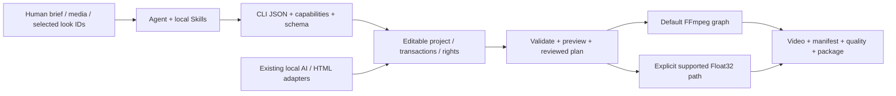

# agent editor kit

C74精確內容去重已完成真實媒體閉環：兩個ID匯入同一藍圖，預設選擇琥珀圖與藍圖；明確僅ID策略允許兩個藍圖別名。120幀完整RGBA工程重放一致。檢索回應為明確合成資料，不計AI語義品質通過。 [C74 video / evidence](docs/validation/CLI58内容去重实测_2026-10-29.md)


原始碼58實際DF3 CUDA複核已通過：4次神經前向，完整1124160位元組PCM工程重放一致；受控MSE改善12.25dB，無自然品質／人工聽審結論。 [CUDA evidence](docs/validation/CLI58真实CUDA复核_2026-10-29.md)

目前開發原始碼為 **CLI0.1.58**：新增精確內容SHA256選材去重，修正Windows自有程序同步回收及補幀前處理逾時映射。57／19／31／104項原始碼分組與3項逾時專項分別通過；完整400項仍執行中。正式載入仍CLI56／local54／r55；57候選安裝398項出現1失敗／1錯誤，未提升版本，失敗紀錄保留。[58實作與核驗](docs/validation/CLI58开发核验_2026-10-29.md)。

獨立安裝57第三類實際模型MuseTalk已通過CUDA及完整成片重放：67次UNet，原生133幀／25fps，成片160幀／30fps。自然口型品質及其餘12類實際模型仍另驗。[C73影片／來源／證據](docs/product/CASES.md#c73-installed57-musetalk)。


目前本機CLI56／local54已安裝並註冊為唯一 `$agent-ffmpeg-local-editor`：1入口／17模組／93檔案。原始碼、獨立安裝與實際C盤入口的CUDA選材及兩畫幅完整音畫專案重播分別通過；四個原配音／翻譯套件已重新核驗。r55工具包獨立解壓／配置／註冊及完整ACES音畫重播已通過。

CLI57／local55獨立離線候選已安裝：1705載荷、281模組及8原生資源一致；原始碼398項、安裝31項回歸及安裝版實際CUDA降噪／完整PCM與原始碼、專案重播一致均已通過。安裝398項仍在執行，正式Skill維持CLI56／r55。 [CLI57 delivery / usage](docs/validation/CLI57独立安装交付_2026-10-29.md)

CLI57原始碼及獨立安裝版實際CUDA降噪均已通過，受控噪聲MSE改善12.25dB；完整PCM逐字節一致。398項原始碼重跑已通過，首輪測試環境失敗紀錄保留。 [C71 actual audio / waveforms](docs/product/CASES.md#c71-source57-native-worker-gpu)

## 目前使用流程與核驗

以下命令使用本機已註冊安裝；新機器請先依交付紀錄準備相符應用套件與原生依賴。選材前登記素材／權利、模型、索引及裝置校準，dry-run後實際選材，再構建分鏡、逐變體預覽／渲染及專案重播。

```powershell
$agentEditor = 'C:/Users/carzy/.codex/skills/agent-ffmpeg-local-editor/scripts/run.ps1'
& $agentEditor version
& $agentEditor doctor
& $agentEditor capabilities
```

[CLI56 delivery / usage](docs/validation/CLI56原生交付_2026-10-29.md) · [Functional modules](#feature-modules) · [Unified Skill](docs/skills/UNIFIED_SKILL.md) · [C70 videos / GIF / receipts](docs/product/CASES.md#c70-registered-semantic-selection)


原始碼CLI57已正式修復15類原生入口的依賴遮蔽，31項引導回歸通過；更廣服務契約及實際模型任務仍在核驗。正式Skill繼續使用CLI56／r55。 [Native worker diagnosis](docs/product/NATIVE_WORKER_BOOTSTRAP.md)

CLI57安裝版第二類實際模型RIFE亦已通過：89次CUDA前向、96／36影格錨點與既有基線一致，完整音畫專案重播相同。 [C72](docs/product/CASES.md#c72-installed57-rife)


<!-- aek-history-summary -->
<details>
<summary>完整開發歷史（保留全部原文，點擊展開）</summary>

**目前本地 CLI56／local54 已安裝並註冊，唯一 `$agent-ffmpeg-local-editor` 維持1入口／17模組／93檔案。** 原始碼與獨立安裝版各1／15／45／104四組通過，兩者實際CUDA選材及兩畫幅完整RGB／非靜音PCM重播均通過；安裝版與原始碼輸出亦逐位元組一致。四個原有配音／翻譯模型套件已重新核驗。實際C盤入口的完整GPU案例仍在執行，新正式工具包另驗。[實際交付與使用流程](docs/validation/CLI56原生交付_2026-10-29.md)。以下較早版本段落保留為歷史紀錄，以頂部目前狀態為準。

**CLI56 原始碼實際CUDA選材與兩畫幅完整音畫重播已通過。** 重新建立11來源索引／校準，3條固定查詢與預期標籤一致；橫直版各90幀，匯出／匯入後完整RGB與非靜音PCM分別相同。[C69影片、GIF與截圖](docs/product/CASES.md#c69-source56-semantic-selection)。安裝版實際GPU任務正在執行，正式Skill仍53／r54。


**CLI56 獨立安裝版1／15／45／104四組均已通過。** 新統一Skill候選維持1入口／17模組／93檔案，實際PowerShell入口已核驗；這些中繼資料檢查沒有模型推理，候選仍未註冊，正式入口維持53／r54。[完整交付紀錄與使用流程](docs/validation/CLI56原生交付_2026-10-29.md)。

**CLI56 完整候選已原生離線安裝。** 1705載荷精確，281模組／8原生資源一致；安裝版1項引導回歸、15項程序控制、45項選材／分鏡已通過，安裝版104項語義相容及完整11素材GPU流程繼續執行。正式Skill仍53／r54。[本地套件、摘要與實際入口](docs/validation/CLI56原生交付_2026-10-29.md)。

**原始碼 CLI56 已修復語義工作程序依賴遮蔽。** 僅在固定自身應用套件時暫時置頂應用路徑，隨後恢復模型環境的依賴搜尋順序，保留版本／路徑指紋檢查。1項實際原生引導回歸、15項程序控制、45項選材／分鏡、104項語義相容分別通過；完整新套件與11素材GPU流程正在執行，安裝版及正式Skill尚未驗收。正式入口仍53／r54。[根因、修復與證據](docs/product/SEMANTIC_WORKER_ISOLATION.md)。

**CLI55 安裝版實際GPU驗收發現依賴遮蔽問題，尚未通過。** 模型環境原本的NumPy／Pillow被應用安裝site中的不同版本覆蓋，指紋檢查回傳SEMANTIC_RUNTIME_CHANGED；沒有安裝版成片。已保留原始失敗並以獨立原生程序重現根因，正在修復；正式Skill維持53／r54。[問題、證據與修復路徑](docs/product/SEMANTIC_WORKER_ISOLATION.md)。

**CLI55 原始碼的實際 CUDA 選材與完整音畫重播已通過。** 11項素材建立索引／校準，3條固定查詢選中預期素材；橫直版各90幀，專案匯出後重播的完整RGB與非靜音PCM分別一致。[C68案例、影片、GIF及邊界](docs/product/CASES.md#c68-source-semantic-ad-selection)。獨立安裝版同範圍任務正在執行，正式Skill仍53／r54；[統一Skill切換流程](docs/validation/CLI55统一Skill切换_2026-10-29.md)已實作缺少案例時拒絕改動。


**目前 CLI55 完整候選已原生離線安裝，原始碼與安裝版各自通過15／45／104分組核驗。** 281模組／8原生資源一致；新統一Skill候選維持1入口／17模組／93檔案，實際PowerShell入口已核驗，但尚未啟用。完整11素材的GPU註冊／索引／校準、實際選材與音畫重放繼續獨立驗收。正式入口仍CLI53／r54。[候選包、摘要與實際使用入口](docs/validation/CLI55原生交付_2026-10-29.md)。

**原始碼 CLI55：修復原生子程序繼承命令預算。** 等待期間檢查外層期限與取消檔案，關閉自有程序作業並回收讀取執行緒；15項控制、45項選材／分鏡、104項語義相容分組分別通過。CLI54實際選材逾時且未產生成片，失敗保留；CLI55新包與完整GPU流程另驗。正式Skill仍CLI53／r54。[行為、原生前後對照與邊界](docs/product/PROCESS_OPERATION_BUDGET.md)。

**CLI54 完整候選包已原生離線安裝，尚未切換 Skill。** 已修復安裝驅動逾時參數，保留首次失敗；1705個Wheel載荷檔案、281個執行期模組及8個原生資源核驗一致。安裝版45項選材／分鏡專項通過；實際CUDA校準、選材與成片重放另驗。[安裝恢復與實際入口](docs/validation/CLI54安装恢复_2026-10-29.md)。

**原始碼 CLI0.1.54：校準語義選材已接入廣告分鏡。** 新增 `ad select`，依所有變體的來源長度、明確原音及已核驗權利過濾候選，再聯合分配素材，產生可編輯計畫及逐鏡頭依據；45項原始碼測試通過，實際CUDA整條流程另驗。目前安裝與唯一Skill仍CLI53／r54。[方案與使用](docs/product/AD_SEMANTIC_SELECTION.md)。

**目前本機 CLI0.1.53 / local.51 已安裝並註冊。** 原始碼與安裝版各自通過 18 項 ACES、46 項測量／Schema、373 項相容性回歸。唯一 `$agent-ffmpeg-local-editor` 維持 1 個入口／17 個模組／92 個檔案；[C67 實際註冊入口案例](docs/product/CASES.md#c67-registered-aces-timeline)已核驗完整視訊、音訊、預覽與專案包往返。[正式 r54 包](docs/skills/agent-editor-kit-community-unified-skill-r54.zip)已通過獨立解包、設定、註冊及完整音畫重放驗收。[使用與安裝流程](docs/releases/CLI_0.1.53_LOCAL.md)。

候選階段歷史核驗：新版統一 Skill 候選入口已實際通過 7 次 CLI53 呼叫（含原生設定、PNG16 預覽和逐幀測量），維持 1 個入口／17 個模組／92 個檔案；原註冊入口與設定未改變。兩組相容性現已通過，正式入口已升級。

<!-- aces-timeline-source53 -->

**原始碼 CLI0.1.53：ACES 時間軸與預覽已接通。** 正式交付、逐幀測量、單次顯示轉換後的線性縮圖，以及 HDR 母版的獨立 SDR 視圖；18 項專項與 46 項測量／Schema 回歸分別通過。[使用流程](docs/product/ACES_TIMELINE.md) · [C65：影片、GIF、PNG16、專案包](docs/product/CASES.md#c65-source-aces-timeline)。此段保留早期原始碼階段記錄；目前入口已升級 CLI53，ACES 仍在 CPU 執行，完整目標繼續開放。


CLI53 目前入口快速核實（使用 ACES 前先列舉實際設定／顯示／視圖；完整專案流程見上方使用文件）：

```powershell
$aekSkill = 'C:/Users/carzy/.codex/skills/agent-ffmpeg-local-editor/scripts/run.ps1'
& $aekSkill version
& $aekSkill capabilities
& $aekSkill surface ocio-configs --config aces-2.1
```

安裝版另獨立通過 **18 項 ACES + 46 項測量／Schema**；[C66：實際影片、GIF、PNG16 與專案包](docs/product/CASES.md#c66-installed-aces-timeline)已核驗完整視訊／音訊往返一致。兩組 373 項廣泛相容性和正式註冊切換現已完成。

<!-- aces-native-kernel-source -->

**核心首輪紀錄（歷史階段）：原生 ACES 核心與配置探索。** 固定 OCIO 2.6.0，支援 ACES 1.3/2.0/2.1 顯示視圖及場景曝光；目前仍為原始碼階段，尚未接入時間軸、預覽與已安裝 Skill。[使用流程、證據與待辦](docs/product/ACES_NATIVE.md)。

**面向 Agent 的開源、本地影片編輯 CLI。** 從結構化編輯計劃到可編輯工程、預覽、成片、品質報告和可恢復交付；保留每一步的真實輸出與來源。

[簡體中文](README.md) · [繁體中文](README.zh-TW.md) · [English](README.en.md) · [Repository](https://github.com/copypasteltd/agent-editor-kit) · [Docs](docs/README.md)


開發輪次彙報：每輪結束均提供編號完成項與待辦表，列明驗證依據及未完成邊界，見[彙報規範](docs/DEVELOPMENT_REPORTING.md)。

**公開發行版本：v0.1.0-alpha.3 預發布版 · CLI 0.1.2 · 500 套風格 · 17 個歷史拆分 Skill。** 提供完整運行 ZIP、Agent kit、可選圖冊及校驗摘要。運行內核保持原已驗包位元組；新增可移植安裝和可執行示例。完整剪映等價仍是開發目標，尚未驗收。

本頁包含完整功能模塊、服務與依賴、安裝與使用邏輯、Skill 輸入輸出、真實案例和核驗表。長篇原始驗收日志繼續留檔，功能說明與案例入口恢復到首頁。


<!-- gpu-gamut-installed-current -->

**CLI0.1.52 / local.50 / r53 kit · 1 Skill / 17 modules / 91 files.**

[Verified small kit](docs/skills/agent-editor-kit-community-unified-skill-r53.zip) · [SHA256 / inventory](docs/skills/community-unified-skill-package-0.1.52-r53.json)

本地統一Skill已升級CLI52：GPU執行亮度肩部與OKLab縮色度，訊號轉換與ICC仍由CPU處理。源碼與安裝版各70項專項、各352項相容分別通過；C64由實際註冊入口完成GPU成片／預覽與完整音畫專案重播。

[Workflow](docs/product/GPU_GAMUT.md) · [Install / usage](docs/releases/CLI_0.1.52_LOCAL.md) · [C64](docs/product/CASES.md#c64-installed-gpu-gamut)


<!-- /gpu-gamut-installed-current -->

<!-- gpu-gamut-source-history -->

Historical source/candidate stage; superseded by installed CLI52 above.

**Development source CLI0.1.52 · installed Skill CLI0.1.51 / local.49 / r52 unchanged.**

源碼CLI52新增實際GPU亮度肩部與OKLab縮色度，訊號轉換與ICC仍由CPU處理。70項專項、12項控制管道測試、4K單表面獨立參考及C63完整音畫／專案重播通過；本地註冊Skill仍CLI51/local49/r52。352項相容回歸與新版安裝交付另行驗收。

[Workflow](docs/product/GPU_GAMUT.md) · [Source release](docs/releases/CLI_0.1.52_SOURCE.md) · [C63](docs/product/CASES.md#c63-source-gpu-gamut) · [Evidence](docs/validation/GPU色域映射源码实测_2026-10-29.md)


候選安裝版70項專項已通過；源碼與安裝版352項相容回歸仍在執行，統一Skill尚未切換。

<!-- /gpu-gamut-source-history -->

<!-- oklab-installed-history -->

Historical installed CLI51; superseded by CLI52 above.

**CLI0.1.51 / local.49 / r52 kit · 1 Skill / 17 modules / 90 files.**

本地安裝CLI51已接通明確OKLab縮色度、正式SDR交付映射繼承與映射後線性預覽縮小。顯式preview_mapping仍優先。實際統一Skill執行C62，完整像素／PCM專案重播通過；CPU色彩核心，不等於完整剪映／ACES／實體監看。

[Workflow](docs/product/OKLAB_GAMUT.md) · [Install](docs/releases/CLI_0.1.51_LOCAL.md) · [C62](docs/product/CASES.md#c62-installed-oklab)


<!-- /oklab-installed-history -->

<!-- oklab-gamut-source-history -->

Historical source/candidate stage; superseded by the installed workflow above.


本輪已修復正式SDR映射的預覽繼承，CLI51候選r2完成原始碼/安裝版專項與實際工程包往返；統一Skill仍50，完整相容與新kit待完成。 [Fix / evidence / C61 errata](docs/validation/SDR预览映射修复_2026-10-29.md).

**原始碼 CLI0.1.51 新增明確選用的 OKLab 保感知明度/色相縮色度，用於 HDR→BT.709 SDR交付及預覽。目前安裝Skill仍CLI0.1.50/local.48/r51，新安裝套件與獨立驗收待完成。**

[Workflow](docs/product/OKLAB_GAMUT.md) · [Source release](docs/releases/CLI_0.1.51_SOURCE.md) · [C61](docs/product/CASES.md#c61-oklab-gamut) · [Evidence](docs/validation/OKLab色域映射源码实测_2026-10-29.md)


專項62/62；相容初跑351/352，文件Schema副本同步後專項17/17通過；C61真實成片、全幀獨立參考與工程包完整音畫重放留證。數值圖卡不代替自然畫面及物理HDR監看驗收。

<!-- /oklab-gamut-source-history -->

<!-- native-hdr-media-history -->

Historical CLI50 delivery; current CLI51 is described above.

**CLI0.1.50 / alpha.4-local.48 / r51 kit · 1 Skill / 17 modules / 89 files.**

新增**解碼後原生成片光量複核**：實際原生PTS／曝光、明確RGB與YCbCr解釋、MaxRGB／CIE Y、越界與裁切計數、完整解碼像素／時鐘摘要。保留編碼前 `surface measure`，新增 `surface measure-media`，兩種測量邊界分別報告。

[Workflow](docs/product/HDR_MEDIA_MEASUREMENT.md) · [C60](docs/product/CASES.md#c60-post-codec-hdr420) · [Install](docs/releases/CLI_0.1.50_LOCAL.md) · [Evidence](docs/validation/编码后成片安装与跨编码实测_2026-10-29.md)


安裝版29項專項、42項邊界回歸與352項相容回歸分別通過。C60由真實本地統一Skill執行PQ／HLG H.265 Main10 4:2:0算繪；兩條48影格成片逐像素獨立核驗，HLG可編輯專案重播像素與完整PCM一致。GIF為作者時間線的明確SDR檢視副本，非解碼後或實體HDR監看驗收。

C59／R331計數更正：384000個PCM總標量中383999非零；原歷史行保留，[目前更正與證據](docs/validation/编码后成片安装与跨编码实测_2026-10-29.md)。

<!-- /native-hdr-media-history -->

<!-- native-hdr-measure-history -->

**CLI0.1.49 / alpha.4-local.47 / r50 kit · 1 Skill / 17 modules.**

新增**全影格 HDR 光量測量與色彩裁切彙總**：實際作者時間線、明確nit、MaxRGB與CIE Y分別報告、峰值位置／最大影格平均／精確時長加權、可選有效畫面範圍。測量與正式算繪共用實際RGB16輸入路徑；中間包補齊所有影格轉換收據。

[Workflow](docs/product/HDR_MEASUREMENT.md) · [C59](docs/product/CASES.md#c59-native-hdr-measurement) · [Install](docs/releases/CLI_0.1.49_LOCAL.md) · [Evidence](docs/validation/全帧HDR光量与裁切汇总实测_2026-10-29.md)


19項原始碼專項、19項安裝專項與352項安裝相容分別通過。C59以獨立公式核對全部48影格／11059200像素及RGB16輸入摘要，真實PQ成片完整音畫與測量專案重播一致；另驗48次實際GPU Bloom及原生ICC軟打樣的測量／算繪輸入相同。非編碼後峰值、實體顯示器或藝術品質驗收。

<!-- /native-hdr-measure-history -->

<!-- native-icc-output-history -->

**CLI0.1.48 / alpha.4-local.46 / r49 kit · 1 Skill / 17 modules.**

新增**原生 RGB ICC 輸出、16位內嵌設定 PNG 序列與軟打樣**：實際B2A查找表、四意圖／BPC、明確亮度縮放、作者時間線逐影格交付及同步PCM；一般算繪／預覽原生模擬，設定依賴可移植。

[Workflow / usage](docs/product/ICC_OUTPUT.md) · [C58](docs/product/CASES.md#c58-native-icc-output) · [Install](docs/releases/CLI_0.1.48_LOCAL.md) · [Evidence](docs/validation/原生ICC输出与软打样实测_2026-10-29.md)


17項原始碼專項、17項安裝專項及335項安裝相容分別通過。C58逐影格內嵌ICC，獨立核對384組B2A色塊及384組軟打樣Y/Cb/Cr；全48影格PNG像素／檔案、66355200位元組軟打樣成片及384000非零PCM標量專案重播一致，每次序列48次實際GPU Bloom。ICC用CPU，支援的剪輯算子用GPU；合成診斷設定非印表機／顯示器校準或藝術品質驗收。

<!-- /native-icc-output-history -->

<!-- native-hlg-black-history -->

**CLI0.1.47 / alpha.4-local.45 / r48 kit · 1 Skill / 17 modules.**

新增**HLG 非零顯示黑位與完整訊號 JSON CLI**：明確黑位、峰值、伽馬及參考白亮度，貫通來源／輸出、浮點中間包、預覽與專案包；低於目標黑位嚴格拒絕或明確裁切計數。

[Workflow / usage](docs/product/HLG_BLACK_LEVEL.md) · [C57](docs/product/CASES.md#c57-hlg-display-black) · [Install](docs/releases/CLI_0.1.47_LOCAL.md) · [Evidence](docs/validation/HLG显示黑位实测_2026-10-28.md)


21項原始碼專項、21項安裝專項及314項安裝相容分別通過。C57核對230400個工作域像素、384組編碼色塊及完整48影格／384000個非零PCM標量專案重播；每次48次實際GPU Bloom。色彩數學使用CPU，支援的合成使用GPU。0.5nit黑位為診斷宣告，非螢幕校準；動態HDR、完整ACES與自然監看尚未驗收。

<!-- /native-hlg-black-history -->

<!-- native-icc-history -->

**CLI0.1.46 / alpha.4-local.44 / r47 kit · 1 Skill / 17 modules.**

新增**原生 ICC 色彩管理**：明確本機 RGB ICC v2/v4、SHA、四種算圖意圖與黑點補償，由 LittleCMS 2.19.1 直接轉換至線性工作 RGB；貫通素材、浮點匯出、預覽快取及可編輯專案封裝。

[Workflow / usage](docs/product/ICC_PROFILES.md) · [C56](docs/product/CASES.md#c56-native-icc-profiles) · [Install](docs/releases/CLI_0.1.46_LOCAL.md) · [Evidence](docs/validation/原生ICC色彩管理实测_2026-10-28.md)


26項原始碼專項、26項安裝專項與287項安裝相容檢查分別通過。C56獨立核對首影格230400像素、全48影格色塊及完整非靜音音畫專案封裝重播；每次48次實際GPU Bloom。ICC CMM使用CPU，支援的合成／光暈使用原生GPU。範圍為RGB來源設定：任意ICC輸出、軟打樣、CMYK、內嵌設定自動識別、完整ACES與自然HDR監看仍待補齊，保留38項原目標關閉條件。

<!-- /native-icc-history -->

<!-- native-chromatic-history -->

**CLI0.1.45 / alpha.4-local.43 / r46 kit · 1 Skill / 17 modules.**

新增**Bradford 白點適應、ProPhoto RGB D50 和線性 ACES AP1 D60**：貫通來源、工作域、效果訊號、浮點中間封裝、實際預覽與可編輯專案；光暈依聲明白點計算亮度，保留既有 D65 行為。

[Workflow / usage](docs/product/CHROMATIC_ADAPTATION.md) · [C55](docs/product/CASES.md#c55-native-chromatic-adaptation) · [Install](docs/releases/CLI_0.1.45_LOCAL.md) · [Evidence](docs/validation/明确白点色适应实测_2026-10-28.md)


[Actual MP4](docs/assets/native-chromatic-20261028-r3/actual-preview.mp4) · [Signals](docs/assets/native-chromatic-20261028-r3/signals.json) · [Comparison](docs/assets/native-chromatic-20261028-r3/comparison.png) · [Editable package](docs/assets/native-chromatic-20261028-r3/editable-chromatic.aevpkg.zip)

20項原始碼專項、20項安裝專項和267項安裝相容檢查分別通過。C55獨立對照首影格230400像素及全48影格色塊，實際GPU Bloom與完整音畫封裝重播通過。顏色數學CPU，合成／光暈可用GPU；最終BT.709／BT.2100交付D65。參考白點轉換並非ICC解析、自動物理白平衡或完整ACES輸出變換；感知色域映射、自然HDR監看及38項完整目標持續開發。

<!-- /native-chromatic-history -->

<!-- native-hdr-metadata-history -->

**CLI0.1.44 / alpha.4-local.42 / r45 kit · 1 Skill / 17 modules.**

新增**HDR10母版顯示與MaxCLL/MaxFALL靜態中繼資料**：明確xy/nit單位，實際寫入HEVC SEI，發布前核驗解碼影格；支援可編輯專案封裝，沿用GPU合成和獨立SDR預覽。

[Workflow / usage](docs/product/HDR_METADATA.md) · [C54](docs/product/CASES.md#c54-native-hdr10-metadata) · [Install](docs/releases/CLI_0.1.44_LOCAL.md) · [Evidence](docs/validation/HDR10静态元数据实测_2026-10-28.md)


[HDR10 master](docs/assets/native-hdr-metadata-20261028-r2/hdr10-master.mkv) · [SDR preview](docs/assets/native-hdr-metadata-20261028-r2/sdr-preview.mp4) · [Declared values](docs/assets/native-hdr-metadata-20261028-r2/declaration.json) · [Editable package](docs/assets/native-hdr-metadata-20261028-r2/editable-hdr10.aevpkg.zip)

21項原始碼、21項安裝版專項與105項安裝版相容檢查分別通過。C54獨立核對全部48影格SEI；專案封裝重播全部視訊影格和384000個PCM純量相同。產品預設核驗前32個視訊封包解出的影格；數值為作者聲明，並非自動峰值量測。x265編碼CPU、合成GPU。動態HDR、ICC/監看、自然品質及原38項完整目標持續建置。

<!-- /native-hdr-metadata-history -->

<!-- native-speech-enhancement-history -->

**CLI0.1.43 / alpha.4-local.41 / r44 kit · 1 Skill / 17 modules.**

新增**真正本機 CUDA DeepFilterNet3 對白降噪**：原生取樣時鐘、單/雙聲道、獨立增強資產與可編輯音軌、強度/衰減上限、分段重疊、配方重跑、工程包及取消回滾。

[Workflow / usage](docs/product/SPEECH_ENHANCEMENT.md) · [C53](docs/product/CASES.md#c53-native-speech-enhancement) · [Install](docs/releases/CLI_0.1.43_LOCAL.md) · [Evidence](docs/validation/本地对白增强实测_2026-10-27.md)


[Listen: clean → noisy → actual enhanced](docs/assets/native-speech-enhancement-20261027-r2/audible-comparison.mp4) · [Original16k human source](docs/assets/native-speech-enhancement-20261027-r2/original-human-16k.flac) · [Enhanced WAV](docs/assets/native-speech-enhancement-20261027-r2/english-enhanced.wav) · [Scientific spectra](docs/assets/native-speech-enhancement-20261027-r2/spectra-and-waveforms.png)

33項原始碼、33項安裝版專項及156項安裝版相容回歸分別通過。C53英語真人錄音由0 dB輸入提升至SNR 12.25 dB，中文合成人聲提升至9.69 dB；完整原生樣本數與工程包PCM相同。保留乾淨對白損傷、混響控制及首輪暫存檔競態失敗。未做人類聽審；分段狀態重置、前端CPU/神經圖CUDA；完整去混響/音樂保真及38原目標關閉條件持續開發。

<!-- /native-speech-enhancement-history -->

<!-- native-interpolation-history -->

**CLI0.1.42 / alpha.4-local.40 / r43 kit · 1 Skill / 17 modules.**

新增**真正本機 CUDA RIFE4.25 神經補幀與可編輯慢動作**：保留CFR/VFR原生PTS、每影格持續時間、全部來源RGBA影格及原音軌；2..8倍補幀、明確切鏡保持、預乘alpha、可重跑配方及關聯雙軌。

[Workflow / usage](docs/product/NEURAL_INTERPOLATION.md) · [C52](docs/product/CASES.md#c52-native-neural-interpolation) · [Install](docs/releases/CLI_0.1.42_LOCAL.md) · [Evidence](docs/validation/本地神经补帧实测_2026-10-27.md)


37項安裝版補幀檢查及143項安裝版相容回歸通過；37項原始碼檢查分列。C52動畫24→96影格，另12→36影格透明VFR與105840個原始PCM標量完整保留，工程包完整音畫重播相同。23張獨立保留參考影格平均MSE：模型12.28／重複24.36／線性混合14.87；**末段模型重影失敗保留**，明確保持以停頓換取去重影。未做人工連續播放／聽審；自然品質、HDR模型及完整目標繼續建置。

[Actual retained failure and explicit hold](docs/assets/native-interpolation-20261027-r1/failure-and-hold.png) · [Held-out per-frame measurements](docs/validation/evidence/native-interpolation-20261027-r1/case-r1/verification.json)

<!-- /native-interpolation-history -->

<!-- native-lip-sync-history -->

**CLI0.1.41 / alpha.4-local.39 / r42 kit · 1 Skill / 17 modules.**

新增**真正本機 CUDA 神經口型同步**：使用 MuseTalk 1.5、Whisper-tiny、VAE 及 BiSeNet，讓指定圖片／影片隨獨立語音生成口型。支援25FPS人臉框關鍵影格、完整PCM保留、可重跑配方，以及分別可編輯的影片／音訊關聯片段。

[Workflow / usage](docs/product/LIP_SYNC.md) · [C51](docs/product/CASES.md#c51-native-lip-sync) · [Install](docs/releases/CLI_0.1.41_LOCAL.md) · [Evidence](docs/validation/本地神经口型实测_2026-10-27.md)


本批 **28項安裝版檢查通過，零失敗／錯誤／跳過**；另177項既有服務原始碼相容回歸通過，原始碼與安裝版248檔案一致。C51實際生成133影格，原始126795個PCM標量、全部alpha及區域外RGB保留，完整音畫在工程包遷移後相同。既有993項HDR整輪紀錄保留為歷史結果。臉部模型256×256；完整身體／表演、自動跟蹤、自然口型／聽審、HDR推理及完整目標仍須建設。

另有30影格移動影片/人臉框實測；真正模型輸出後取消工作，三個子程序回收、工程回滾及診斷均通過。 [Evidence](docs/validation/evidence/native-lipsync-20261027-r1/video-and-cancel-r1/verification.json).

<!-- /native-lip-sync-history -->

<!-- hdr-display-history -->

**CLI0.1.40 / alpha.4-local.38 / r41 kit · 1 Skill / 17 modules.**

新增**原生 PQ／HLG HDR 訊號、明確 nit 單位、10-bit BT.2020 交付及獨立 SDR 預覽**。HLG 包含 RGB 聯動 OOTF；不同參考白的 SDR 圖形與 HDR 高光可在線性光域合成。明確選擇輸入／輸出截斷、SDR 映射及其色域策略，保留作者時鐘、效果及可編輯工程。

[Workflow / usage](docs/product/HDR_DISPLAY.md) · [C50](docs/product/CASES.md#c50-native-hdr) · [Install](docs/releases/CLI_0.1.40_LOCAL.md) · [Evidence](docs/validation/HDR显示光实测_2026-10-27.md)


安裝版單輪 **993 項回歸通過，零失敗／錯誤／跳過**：保留上輪734項，加入20項HDR數值／實際工程核驗及239項相關色彩相容檢查。C50 為實際註冊 Skill 輸出，48影格／12FPS／4秒，非靜音雙聲道384000個Float32 PCM標量及全部10bit影格在工程包遷移後相同。色彩傳遞數學目前CPU，已接通合成／光效持續實際GPU；HDR監看、自然品質、ICC、非零黑位HLG、母版／動態中繼資料及完整目標持續建設。

<!-- /hdr-display-history -->

<!-- highlight-glow-history -->

**CLI0.1.39 / alpha.4-local.37 / r40 kit · 1 Skill / 17 modules.**

新增 **Bloom 高光擴散與 Halation 膠片光暈**：從畫面實際高光提取亮源，在明確線性 RGB 域執行軟膝閾值、分離高斯鄰域擴散、核心抑制及著色疊加。支援作者時鐘關鍵影格、片段及根調整層，CPU 參考與實際 GPU 四階段實作同步交付。

[Workflow / usage](docs/product/HIGHLIGHT_GLOW.md) · [C49](docs/product/CASES.md#c49-highlight-glow) · [Install](docs/releases/CLI_0.1.39_LOCAL.md) · [Evidence](docs/validation/高光扩散实测_2026-10-27.md)


安裝版單輪 734 項回歸通過、零失敗/錯誤/跳過；新增21數值、3實際GPU、6工程整合，共30項。C49四格保留六條數值軌道，工程包往返全48個10bit影格及384000個Float32 PCM相同；每次內容渲染192個glow操作、768個裝置kernel（啟動探測另計）。自然素材品質、物理膠片、HDR、即時/4K長片、完整效果庫與原38項關閉條件持續開發。既有265條核驗逐行保留。

<!-- /highlight-glow-history -->

<!-- optical-effects-history -->

**CLI0.1.38 / alpha.4-local.36 / r39 kit · 1 Skill / 17 modules.**

新增可編輯 **鏡頭眩光、漏光及色差**：線性光浮點運算、參數關鍵影格、原作者時鐘、片段及選定序列調整層；CPU參考與實際OpenCL GPU路徑已接通。透過 `effects list --query optical` / `effects inspect` 查詢約束，用 `timeline compose` 保留參數及動畫。四格案例包含原圖、移除效果的對照及實際GPU輸出。

[Workflow / usage](docs/product/OPTICAL_EFFECTS.md) · [C48](docs/product/CASES.md#c48-optical-effects) · [Install](docs/releases/CLI_0.1.38_LOCAL.md) · [Evidence](docs/validation/光学效果实测_2026-10-27.md)


安裝版最終704項不同用例通過：全量702項通過，另2項舊目錄斷言更新後定向重測通過，產品檔案未變、無跳過。C48保留9條動畫軌，全部48個10bit解碼影格及384000個Float32 PCM取樣在工程包往返後相同，GIF為實際解碼影格、4000ms。藝術光效已接通；實體鏡頭求解、自動亮源偵測、bloom/halation/深度及完整剪映效果庫持續開發。全部259項既有核驗與38項原關閉條件保留。

<!-- /optical-effects-history -->

<!-- emitter-animation-history -->

**CLI0.1.37 / alpha.4-local.35 / r38 kit · 1 Skill / 17 modules.**

新增 **21 項發射器屬性關鍵影格**：積分發射率、出生時的運動/壽命、源時間上的顏色/大小/形狀等外觀，支援六種插值與暫停發射。`vfx animation-properties` 查詢約束，`vfx animate` 新增、明確替換或移除單條屬性；原始源時鐘貫穿裁切、倒放、巢狀、預覽、佇列及工程包。四格案例由已註冊安裝版 Skill 實際 GPU 渲染。

[Workflow / usage](docs/product/EMITTER_ANIMATION.md) · [C47](docs/product/CASES.md#c47-emitter-animation) · [Install](docs/releases/CLI_0.1.37_LOCAL.md) · [Evidence](docs/validation/发射器关键帧实测_2026-10-27.md)


安裝版 679 項回歸通過、零跳過；C47 的 14 條屬性軌道和全部 48 個 10bit 解碼影格、384000 個 Float32 PCM 取樣在工程包回讀後相同。GIF 為實際渲染影格，4 秒。二維發射器動畫已接通；3D、碰撞、深度、流體及完整剪映特效庫仍待補齊。保留全部 253 項歷史核驗與 38 項原關閉條件。

<!-- /emitter-animation-history -->

<!-- gpu-dispatch-history -->

**CLI0.1.36 / alpha.4-local.34 / r37 kit · 1 Skill / 17 modules.**

原生Float32 GPU控制改為任務自有本機管道，消除每個算子的控制檔案寫入與輪詢。相同48幀工程透過實際註冊安裝版對照：**133.95s → 35.19s (3.81×)**；全部10bit解碼幀和384000個Float32音訊取樣相同，數值核心位元組保持。

[Workflow / usage](docs/product/GPU_DISPATCH.md) · [C46](docs/product/CASES.md#c46-gpu-dispatch) · [Install](docs/releases/CLI_0.1.36_LOCAL.md) · [Evidence](docs/validation/GPU管道调度实测_2026-10-27.md)


單一960×360診斷工程、同機一次配對，包含啟動、編碼及核驗；不是即時、4K長片或跨裝置保證。完整剪映等價仍未完成；38項原關閉條件與247項歷史核驗保留。

<!-- /gpu-dispatch-history -->

<!-- procedural-particles-history -->

**CLI0.1.35 / alpha.4-local.33 / r36 kit · 1 Skill / 17 modules.**

新增可編輯程序化粒子：雪、彩紙、餘燼、光斑、斜雨、星芒。來源參數、seed和獨立幀率直接儲存在工程；原生Float32合成、實際OpenCL光柵化、一般關鍵幀/裁切/倒放、預覽、佇列及工程包/OTIO回讀已接通。六宮格由已註冊安裝版Skill實際渲染，未使用模型或第三方影像。

```powershell
$aekSkills = if ($env:CODEX_HOME) { Join-Path $env:CODEX_HOME 'skills' } else { Join-Path $env:USERPROFILE '.codex/skills' }
$avk = Join-Path $aekSkills 'agent-ffmpeg-local-editor/scripts/run.ps1'
$avkProject = 'E:/dev/sandbox/particle-demo'
& $avk project init $avkProject
& $avk vfx list
& $avk vfx inspect --name snow
& $avk vfx apply --project $avkProject --preset snow --seed 73 --clip-id snow --duration-tick 360000 --enable-native --dry-run
& $avk vfx apply --project $avkProject --preset snow --seed 73 --clip-id snow --duration-tick 360000 --enable-native
& $avk vfx show --project $avkProject --clip-id snow
```

[Workflow / parameters](docs/product/PROCEDURAL_PARTICLES.md) · [C45](docs/product/CASES.md#c45-procedural-particles) · [Install](docs/releases/CLI_0.1.35_LOCAL.md) · [Evidence](docs/validation/可编辑粒子实测_2026-10-27.md)


CLI0.1.35當時為二維診斷效果，未含發射器參數關鍵影格；CLI0.1.37已補齊。三維碰撞、深度遮擋及流體仍未實作。舊FFmpeg圖明確拒絕此來源；完整剪映等價與全部38項原關閉條件持續保留。

<!-- /procedural-particles-history -->

<!-- model-session-history -->

**CLI0.1.34 / alpha.4-local.32 / r35 kit · 1 Skill / 17 modules.**

新增原生 GPU 模型會話：明確啟動、查詢、停止，連續生成重用權重與同一提示詞嵌入；每個任務重設 scheduler、前窗上下文及統計。實際同機首條生成 654.27 秒，後兩條 35.46/28.48 秒；會話全模型校驗另計 480.42 秒。相同 seed 的 17 幀逐像素一致，實際去噪取消可回滾並退出所屬行程。

```powershell
$sessionStart = & $avk media model-session start --project $avkProject --adapter-id $vaceAdapterId | ConvertFrom-Json
if (-not $sessionStart.ok) { throw 'Model session failed to start' }
try {
  & $avk media generate --project $avkProject --adapter-id $vaceAdapterId `
    --model-session $sessionStart.data.session_id --asset-id variant-01 `
    --prompt $reviewedPrompt --width 256 --height 144 --frames 17 --fps 12
  if ($LASTEXITCODE -ne 0) { throw 'Generation failed' }
} finally {
  & $avk media model-session stop --project $avkProject --session-id $sessionStart.data.session_id
}
```

[Workflow / try-finally](docs/product/MODEL_SESSIONS.md) · [C44](docs/product/CASES.md#c44-model-sessions) · [Install](docs/releases/CLI_0.1.34_LOCAL.md) · [Evidence](docs/validation/原生GPU模型常驻实测_2026-10-27.md)

這是單機單次冷熱觀測，首次登記/完整校驗/載入成本全部保留；更換正負提示詞或 token 預算須新建會話，僅允許串行任務。自然品質、模型與輸出權利、總行程 RAM/VRAM 配額、多 GPU 及完整剪映等價仍未驗收；靜態檢查已發現生成中間幀彩邊、背景塊狀偽影與異常碎片；實際模型影片/GIF與工程包保留本機。下圖僅展示實際耗時資料。


<!-- /model-session-history -->

<!-- video-generation-current -->

**Historical / 历史 / 歷史：CLI0.1.33 / alpha.4-local.31 / r34 kit · 1 Skill / 17 modules.**

新增本地 GPU 文生、圖生、尾幀與首尾幀影片生成：明確條件、原文提示詞、seed/取樣與視窗參數，產出無聲影片資產，並可直接作為普通可編輯片段入軌。重用既有 VACE 原生核心、GPU 記憶體准入、權利依賴與交易恢復。

```powershell
& $avk media generate --project $avkProject --adapter-id $vaceAdapterId `
  --asset-id generated-shot-01 --mode first-last-to-video `
  --first-asset-id $firstAssetId --last-asset-id $lastAssetId `
  --width 256 --height 144 --frames 17 --fps 12 --image-fit contain `
  --prompt $reviewedPrompt --inference-steps 18 --window-frames 17 `
  --window-overlap 4 --apply --track-id track_video_1
```

[Workflow](docs/product/VIDEO_GENERATION.md) · [C43](docs/product/CASES.md#c43-video-generation) · [Install](docs/releases/CLI_0.1.33_LOCAL.md) · [Evidence](docs/validation/本地GPU视频生成实测_2026-10-26.md)

四種模式皆有真實 CUDA 輸出、全部17幀解碼與工程包往返記錄；每個端點另做解碼雜湊核驗。端點保留不能證明模型運動/身分品質；模型與生成內容權利、自然品質、完整播放及完整剪映等價仍未驗收。模型成片/GIF/工程包保留本機；下圖僅為自行繪製的 CC0 條件圖，並非生成輸出。


<!-- /video-generation-current -->

<!-- tracking-bake-current -->

**Historical / 历史 / 歷史：CLI0.1.32 / alpha.4-local.30 / r33 kit · 1 Skill / 17 modules.**

原生 PTS 跟蹤現可烘焙為普通 hold 關鍵幀：保留真實幀時鐘、遮罩與轉場可見度，逐幀比較烘焙前後全部 Float32 顯示幀，再匯出工程。原始綁定另存旁車；普通工程包繼續保留動態綁定。

```powershell
& $avk convert export --project $avkProject --target-format package `
  --bake-tracking --output $bakedPackagePath
& $avk convert import --input $bakedPackagePath --output $newProjectDirectory
```

[Workflow](docs/product/TRACKING_BAKE.md) · [C42](docs/product/CASES.md#c42-tracking-bake) · [Install](docs/releases/CLI_0.1.32_LOCAL.md) · [Evidence](docs/validation/跟踪原生烘焙导出实测_2026-10-26.md)


C42 實際註冊 Skill：36幀 Float32 核驗，工程包重匯入後36個解碼幀與完整144000雙聲道採樣一致；5種格式匯出/回讀，嚴格草稿與來源覆寫拒絕通過。GPU 兩輪幀運算與資源關閉留證。外部播放器、自然品質、連續播放與人工聽審未驗收；保留38項原關閉條件。

GIF 為 24 幀、實際 3.01 秒（10ms 延遲單位）；MP4 保留原始 3 秒時鐘。

<!-- /tracking-bake-current -->

<!-- tracking-visibility-current -->

**Historical / 历史 / 歷史：CLI0.1.31 / alpha.4-local.29 / r32 kit · 1 Skill / 17 modules.**

實際來源像素/效果alpha和5類遮罩已接入跟蹤；59種進出場/雙來源轉場傳遞錨點及ROI足跡，連續轉場保留完整密度，生成黑白幕不偽造來源；獨立空間進出場可共享變速。

[Workflow](docs/product/TRACKING_VISIBILITY.md) · [C41](docs/product/CASES.md#c41-tracking-visibility) · [Install](docs/releases/CLI_0.1.31_LOCAL.md) · [Evidence](docs/validation/跟踪实际可见度实测_2026-10-26.md)


C41：45次跟蹤求值對照獨立整數滑動參考，全部36幀Float32及解碼畫面對照無綁定參考工程，完整144000雙聲道採樣、包往返、佇列分別核驗。實際GPU投影/合成及清理留證。僅受控素材/靜態抽幀，未驗收自然遮擋、身分、連續播放或人工聽感；38項原關閉條件保留。

<!-- /tracking-visibility-current -->

<!-- tracking-retime-current -->

**Historical / 历史 / 歷史：CLI0.1.30 / alpha.4-local.28 / r31 kit · 1 Skill / 17 modules.**

追蹤來源、標籤與關聯音軌支援完整輸出變速。依賴閉包保存在共享作者子序列，各父層只選擇自己的輸出；保留原始觀察、原生PTS、ROI基準、裁切/運鏡、透明度及外部疊放順序。

[Workflow](docs/product/TRACKING_RETIME.md) · [C40](docs/product/CASES.md#c40-tracking-retime) · [Install](docs/releases/CLI_0.1.30_LOCAL.md) · [Evidence](docs/validation/跟踪共享变速实测_2026-10-26.md)


實際2倍速案例：全部18影格Float32及解碼畫面對應原片偶數影格；完整72000雙聲道取樣與獨立FFmpeg tempo輸出逐樣本相等。工程包重匯入及佇列另外核驗。合成診斷素材，未作自然品質、連續播放或人工聽審驗收。

<!-- /tracking-retime-current -->

<!-- tracking-magnetic-current -->

**Historical / 历史 / 歷史：CLI0.1.29 / alpha.4-local.27 / r30 kit · 1 Skill / 17 modules.**

磁性重排支援追蹤來源、標籤與關聯音軌跨主軌剪口同步拆分；從剪切前的完整作者工程重建來源引用，保留原始觀察、ROI基準、各分片偏移及完整處理時鐘。

[Workflow](docs/product/TRACKING_MAGNETIC.md) · [C39](docs/product/CASES.md#c39-tracking-magnetic) · [Install](docs/releases/CLI_0.1.29_LOCAL.md) · [Evidence](docs/validation/跟踪磁性重排实测_2026-10-26.md)


36影格Float32像素、原生PTS及動態追蹤幾何均按獨立指定的原影格順序保留；完整144000雙聲道取樣誤差0。合成診斷素材，未作自然品質、連續播放或人工聽審驗收。

<!-- /tracking-magnetic-current -->

<!-- tracking-source-edits-current -->

**Historical / 历史 / 歷史：CLI0.1.28 / alpha.4-local.26 / r29 kit · 1 Skill / 17 modules.**

追蹤來源可滑移、真實頭尾外擴及使用真實句柄roll/slide；保留原始觀察，各分片獨立保留作者偏移，關聯音軌同步來源編輯，鎖定引用衝突整體拒絕。修正分段恆速曲線在影格邊界的浮點誤選。

[Workflow](docs/product/TRACKING_SOURCE_EDITS.md) · [C38](docs/product/CASES.md#c38-tracking-source-edits) · [Local install](docs/releases/CLI_0.1.28_LOCAL.md) · [Evidence](docs/validation/跟踪源编辑实测_2026-10-26.md)


36影格Float32像素與獨立無綁定工程一致，逐項核驗原生索引及完整144000雙聲道取樣。本例使用合成診斷素材；未作自然畫質、連續播放或人工聽審驗收。

<!-- /tracking-source-edits-current -->

<!-- tracking-edits-current -->

**Historical / 历史 / 歷史：CLI0.1.27 / alpha.4-local.25 / r28 kit · 1 Skill / 17 modules.**

帶跟蹤綁定的原生剪輯已接通：來源與標籤可分割、裁切、波紋插入／刪除及範圍編輯；自動重規劃保留來源分片，固定ROI縮放／旋轉基準，來源刪除後跟隨層隱藏，鎖定引用衝突整體拒絕。統一Skill實跑C37：36影格剪為30影格，全部保留Float32像素／PTS／綁定座標相同，完整120000雙聲道取樣誤差0，可編輯套件重新匯入相同。

[Workflow](docs/product/TRACKING_EDITS.md) · [C37](docs/product/CASES.md#c37-tracking-edits) · [Local install](docs/releases/CLI_0.1.27_LOCAL.md) · [Evidence](docs/validation/跟踪剪辑实测_2026-10-26.md)


核驗編碼明確採用8bit H.264 CRF0；本機10bit同參數並非逐像素無損，反例保留。來源slip／實際外擴、容器變速、磁性裁切及中介格式原生烘焙繼續有邊界；完整目標持續開發。

<!-- /tracking-edits-current -->

<!-- float-tracking-history -->

**Historical / 历史 / 歷史：CLI0.1.26 / alpha.4-local.24 / r27 kit · 1 Skill / 17 modules.**

原生 PTS 跟蹤綁定已接入安裝版：貼圖／標籤共用實際影片影格時鐘及 crop/fit/TRS 座標，支援倒放、變速、定格、巢狀及作者視窗；疊加序列保留聲音。統一 Skill 實跑36影格／3秒案例，動畫裁切及旋轉下逐影格核對錨點和標記像素，取消恢復／佇列完整畫面時鐘與PCM相同，可編輯套件保留原始觀測。

[Workflow](docs/product/FLOAT_TRACKING.md) · [C36](docs/product/CASES.md#c36-float-tracking) · [Local install](docs/releases/CLI_0.1.26_LOCAL.md) · [Evidence](docs/validation/原生PTS跟踪实测_2026-10-26.md)


模板匹配的取樣／置信度分別記錄；座標CPU，符合條件的投影／合成／文字用GPU。遮擋、mask／轉場可見性、自然身份品質及原生綁定的MLT/OTIO烘焙仍有邊界，完整目標持續開發。

<!-- /float-tracking-history -->

<!-- float-adjustments-history -->

**Historical / 历史 / 歷史：CLI0.1.25 / alpha.4-local.23 / r26 kit · 1 Skill / 17 modules.**

全域及區間 Float32 調整層已進入安裝版：LUT 與曝光、效果鏈順序、六類關鍵影格插值、選中序列僅套用一次。統一 Skill 實跑6秒／72影格專案，組合GPU字幕／投影、倒放子序列、轉場與關聯聲音；取消恢復及佇列全部影格時鐘／完整PCM相同。專案包含LUT原位元組，重新匯入的影格及範圍預覽相同。

[Workflow](docs/product/FLOAT_ADJUSTMENTS.md) · [C35](docs/product/CASES.md#c35-float-adjustments) · [Local install](docs/releases/CLI_0.1.25_LOCAL.md) · [Evidence](docs/validation/Float32调整层实测_2026-10-26.md)


調整層為CPU Float32計算，可與已支援的GPU合成組合；本輪未新增模型推理或效能承諾。自然素材視聽、HDR／ICC及完整目標持續驗收。

<!-- /float-adjustments-history -->

<!-- float-gpu-history -->

**Historical / 历史 / 歷史：CLI0.1.24 / alpha.4-local.22 / r25 kit · 1 Skill / 17 modules.**

原生 Windows 浮點 GPU 執行層已接入正式算繪、預覽、佇列及恢復：仿射投影、一般疊加、文字顏色與逐詞選擇。已安裝 CLI 完成6秒／72影格混剪；註冊的統一 Skill 完成4K／8影格動畫及混剪包重新匯入預覽。同一4K專案單次成對實測 CPU 296.712秒 → GPU 139.938秒（2.120×）；全部影格時鐘／完整PCM相同，解碼碼差≤1。

[Workflow](docs/product/FLOAT_GPU.md) · [C33/C34](docs/product/CASES.md#c33-float-gpu) · [Local install](docs/releases/CLI_0.1.24_LOCAL.md) · [Evidence](docs/validation/浮点GPU执行层实测_2026-10-26.md)


完整解碼最大8bit碼差為 0（門檻≤1）。 本機RTX3060；單對實測、非獨占主機，非中位數或一般速度承諾。字形柵格、轉場／效果／crop／其他混合等仍在CPU；覆蓋率8bit／顏色Float32。准入配額非峰值RSS或可用顯存預留，完整目標持續開放。

<!-- /float-gpu-history -->

<!-- float-text-coverage-history -->

**Historical / 历史 / 歷史：CLI0.1.23 / alpha.4-local.21 / r24 kit · 1 Skill / 17 modules.**

字形栅格已改為原生位元組覆蓋率，顏色採分塊浮點合成；相同前綴與段落幾何重用快取，保留原作者時鐘。實際統一Skill完成4K／8影格標題動畫及含轉場／關聯音軌的6秒／72影格案例。CPU文字，覆蓋率8bit、顏色Float32。 該4K案例的CPU算繪呼叫耗時692.895秒，速度仍須改善。

[Workflow](docs/product/FLOAT_TEXT_COVERAGE.md) · [C31/C32](docs/product/CASES.md#c31-float-text-coverage) · [Local install](docs/releases/CLI_0.1.23_LOCAL.md) · [Evidence](docs/validation/文字覆盖率分块与复用实测_2026-10-26.md)


文字使用CPU合成，字形覆蓋率為8bit；工作區准入估算、即時速度、長片及完整目標分別驗收。

<!-- /float-text-coverage-history -->

<!-- float-text-history -->

**Historical / 历史 / 歷史：CLI0.1.22 / alpha.4-local.20 / r23 kit · 1 Skill / 17 modules.**

線性浮點管線已接入獨立文字、片段內字幕、打字機／逐詞高亮聯動及純文字SRT；保留原作者時鐘、裁切偏移與父級倒放邊界。四元件顏色與alpha獨立核對，實際統一Skill完成含轉場與關聯音軌的6秒／72影格案例。文字合成為CPU，字形覆蓋率8位元、顏色與合成Float32。

[Workflow / 使用流程](docs/product/FLOAT_TEXT.md) · [C30](docs/product/CASES.md#c30-float-text) · [Local install](docs/releases/CLI_0.1.22_LOCAL.md) · [Evidence](docs/validation/Float32文字字幕实测_2026-10-26.md)


Historical CLI0.1.22:plain SRT/explicit font;CPU text;4K text was rejected by its workspace admission. Full original target conditions remain open.

<!-- /float-text-history -->

<!-- float-transition-history -->

**Historical / 历史 / 歷史：CLI0.1.21 / alpha.4-local.19 / r22 kit · 1 Skill / 17 modules.**

明確線性 Float32 管線新增 57 種 xfade 圖案及黑/白 dip，真實來源句柄、關聯音軌與群組空間進出場已接入。實際統一 Skill 完成 6秒/72影格案例，倒放、預覽、取消恢復、佇列與逐樣本音訊核對通過。CPU 執行；預設管線與 GPU 投影沿用各自契約。

[Workflow / 使用流程](docs/product/FLOAT_TRANSITIONS.md) · [C29](docs/product/CASES.md#c29-float-transitions) · [Local install](docs/releases/CLI_0.1.21_LOCAL.md) · [Evidence](docs/validation/Float32转场实测_2026-10-26.md)


CPU Float32; source-handle types and overlap/edge patterns are distinct. Natural audiovisual, HDR, long-form and all original target conditions remain open.

<!-- /float-transition-history -->

<!-- opencl-projection-history -->

**Historical / 历史 / 歷史：CLI0.1.20 / alpha.4-local.18 / r21 kit** · 1 Skill / 17 modules. 原生 GPU 動態裁切、仿射運鏡及子畫布雙線性/面積投影已交付。相同編碼及專案三輪中位數 77.85→12.51秒（6.22×），六次全部120影格、時鐘及PCM相同；預設CPU，以明確策略選擇使用/回退。

[Install / 固定安装](docs/releases/CLI_0.1.20_LOCAL.md) · [GPU workflow / 使用流程](docs/product/OPENCL_PROJECTION.md) · [C28](docs/product/CASES.md#c28-opencl-projection) · [Evidence](docs/validation/OpenCL原生投影实测_2026-10-26.md)

```powershell
& $avk validate --project $project
& $avk render --project $project --output $output --projection-acceleration prefer --projection-device 0.0 --projection-memory-mib 1024 --sequence-sampling area --sequence-memory-mib 1024 --hardware-encode off
```


僅本機RTX3060裝置實測；其餘特效/字幕仍CPU。1080p/4K單幀像素對照已過，通用4K即時、長片及自然視聽繼續驗收。

<!-- /opencl-projection-history -->

<!-- projection-scanline-history -->

**Historical / 历史 / 歷史：CLI 0.1.19 / alpha.4-local.17 / r20 kit** · 1 Skill / 17 modules. 動態裁切及巢狀crop/fit/TRS支援掃描行復用，雙線性/面積採樣保持精度；同組合專案三輪中位數327.62→88.41秒（3.71×），六次120影格及PCM相同。

[Install / 固定0.1.19](docs/releases/CLI_0.1.19_LOCAL.md) · [Workflow / 使用流程](docs/product/PROJECTION_RENDERING.md) · [C27](docs/product/CASES.md#c27-projection-scanline) · [Evidence](docs/validation/裁切与序列投影实测_2026-10-26.md)

```powershell
& $avk validate --project $project
& $avk render --project $project --sequence-sampling area --sequence-memory-mib 1024 --output $output --hardware-encode off
```


CPU合成；GPU編碼另外選擇。本次為384×216/4秒組合實測，完整4K/長片及自然品質繼續驗收。

<!-- /projection-scanline-history -->

<!-- affine-scanline-history -->

**Historical / 历史 / 歷史：CLI 0.1.17 / alpha.4-local.15 / r17 kit** · 208 product Python files · 1 Skill / 17 modules. 固定畫幅旋轉/縮放自動復用掃描行參數；同專案三輪中位數 95.03 → 30.27 秒（3.14×），六次全部120影格及PCM相同。CPU合成，GPU編碼仍明確選擇。

[Workflow / 使用流程](docs/product/AFFINE_RENDERING.md) · [C26](docs/product/CASES.md#c26-affine-scanline) · [Evidence](docs/validation/仿射扫描行复用实测_2026-10-25.md)


相同640×360/30fps/4秒素材及編碼設定，子程序統一使用4個邏輯CPU；動態crop/fit投影、完整4K/長片及自然素材品質繼續驗收。

<!-- /affine-scanline-history -->

<!-- motion-pack-history -->

**Historical / 历史 / 歷史：CLI 0.1.16 / alpha.4-local.14 / r16 kit** · 208 product Python files · 1 Skill / 17 modules. 新增可復用運鏡包：六套參數路徑、既有動畫擷取、跨時長/畫幅復用、明確衝突及作者時鐘；結果保留為可編輯關鍵影格。

[Workflow / 使用流程](docs/product/MOTION_PACKS.md) · [C25 / Original + six previews](docs/product/CASES.md#c25-motion-packs) · [Evidence](docs/validation/可复用运镜包实测_2026-10-25.md)

```powershell
& $avk motion pack list
& $avk motion pack inspect --name arc_push
& $avk motion pack apply --project $project --sequence-id $sequence --clip-id $clip --name arc_push --param travel=0.18 --param zoom=0.12 --dry-run
# Review the returned property conflicts, then apply without --dry-run.
```


每條 4 秒/120 影格；六套 MP4/GIF 均完整解碼。原生裁切/巢狀倒放、擷取復用、專案包及實際 Skill 的逐影格對照通過。空間路徑為 65 點折線；含旋轉樣例耗時約 65 秒，CPU 合成效能/自然素材及主體跟隨仍待補齊。

<!-- /motion-pack-history -->

<!-- semantic-upgrade-history -->

**Historical / 历史 / 歷史：CLI 0.1.15 / alpha.4-local.13 / r14 kit** · 206 product Python files · 1 Skill / 17 modules. 新增 `project upgrade-semantic`：安裝路徑改變時，逐檔案校驗相同實作/依賴，衍生新適配器、索引及校準，無須重複模型推論。舊記錄、素材、閾值及原錯誤保留。

[Workflow / 使用流程](docs/product/SEMANTIC_RUNTIME_UPGRADE.md) · [C24](docs/product/CASES.md#c24-semantic-upgrade) · [Evidence / 实测](docs/validation/语义运行时升级实测_2026-10-25.md)

```powershell
# Use actual source IDs and unused destination IDs; inspect returned mappings.
& $avk project upgrade-semantic --project $project --adapter-id siglip2 --new-adapter-id siglip2_current --id-prefix current --dry-run
& $avk project upgrade-semantic --project $project --adapter-id siglip2 --new-adapter-id siglip2_current --id-prefix current --idempotency-key runtime-upgrade-1
```

CPU/CUDA: 80 decisions each preserved before/after; three known errors retained. Zero new model forwards in the upgrade itself.

<!-- /semantic-upgrade-history -->

<!-- ad-storyboard-history -->

**Historical / 历史 / 歷史：CLI 0.1.14 / alpha.4-local.12 / r13 kit** · 205 product Python files · 1 Skill / 17 modules. 已實作廣告 brief→多畫幅/時長→獨立可編輯軌道→指定鏡頭返工→專案包遷移。新增 `ad storyboard/build/revise`；同語種 GPU 批次配音保留原文，3 句只初始化一次模型。實際生成直式 12 秒、橫式/方形各 9 秒。橫式僅改最後 3 秒，前 180 影格與聲音 PCM 不變；實際註冊 Skill 再次返工通過。

[Workflow / 使用流程](docs/product/AD_STORYBOARD.md) · [C23 / 原输入与实际输出](docs/product/CASES.md#c23-ad-storyboard) · [Evidence / 实测与边界](docs/validation/可编辑广告分镜与返工实测_2026-10-25.md)

```powershell
# Ingest actual assets and prepare the reviewed brief first; use the pinned Skill launcher below.
& $avk ad storyboard --project $project --input "$project/brief.json" --output "$project/validation/ad-plan.json" --dry-run
& $avk ad storyboard --project $project --input "$project/brief.json" --output "$project/validation/ad-plan.json"
& $avk ad build --project $project --input "$project/validation/ad-plan.json"
& $avk render --project $project --sequence-id ad_product_wide_sequence --output "$project/renders/wide.mp4"
& $avk ad revise --project $project --input "$project/revision.json" --output "$project/validation/revision-1.json"
& $avk ad build --project $project --input "$project/validation/revision-1.json"
```


呼叫者明確提供文案與素材選擇；本例是自製產品圖卡廣告，不是自然素材廣告品質或 Agent 自主成功率驗收。完整目標繼續進行。

舊安裝路徑直接復用的拒絕保留；CLI 0.1.15 現在提供[明確升級](docs/product/SEMANTIC_RUNTIME_UPGRADE.md)。全部實作/依賴位元組相同時可復用向量，改變內容仍須重新建立索引和校準，不改舊 pin。

<!-- /ad-storyboard-history -->

<!-- semantic-control-history -->

**Historical / 历史 / 歷史：CLI 0.1.13 / alpha.4-local.11 / r12 kit** · 203 product Python files · 1 Skill / 17 modules. 完整性讀取現在回應逾時/取消，部分摘要丟棄，原生讀鎖與恢復保護保留。1 秒逾時三例完整 CLI 實測 2.500 / 2.354 / 2.426 秒；取消後退出 0.188 / 0.054 秒。模型仍逐命令載入，三條原查詢錯誤與完整目標保持開放。

[实际耗时/原始诊断](docs/validation/完整性校验超时取消实测_2026-10-25.md)

<!-- /semantic-control-history -->

<!-- unified-skill-registration -->

**只註冊一個入口：`$agent-ffmpeg-local-editor`。** 當前本機 GPU 擴充套件使用 [r50 Skill kit](docs/skills/agent-editor-kit-community-unified-skill-r50.zip) 與匹配的[本地執行包/模型安裝流程](docs/product/COMMUNITY_LOCAL_DELIVERY.md)，17 項內部模組按需載入。歷史 r1 kit 繼續匹配下方保持原版的公開 alpha.3 執行包。

<!-- /unified-skill-registration -->

<!-- community-materials-gpu -->

**本機新增已安裝擴充套件：CLI 0.1.21，GPU 配音/翻譯與 359 項內建開源資源。** 公開 alpha.3 附件保持原版。外層只指定 `$agent-ffmpeg-local-editor`；本機登記 GPU 包後預設優先 GPU，明確返回實際裝置/回退原因，保留 CPU 相容。

[完整流程與邊界](docs/product/COMMUNITY_MATERIALS.zh-TW.md) · [逐項素材目錄](docs/product/COMMUNITY_MATERIAL_CATALOG.md) · [103 音色與實際試聽範圍](docs/product/COMMUNITY_VOICES.md) · [CPU 實測](docs/validation/evidence/community-materials-20261025-r1/cpu/verification.json) · [GPU 實測](docs/validation/evidence/community-materials-20261025-r1/gpu/verification.json)。

| 擴充套件編號 | 已實現 | 邊界 |
|---|---|---|
| M01 / F44 | 44 首 BGM、85 個短樂、228 個獨立音效、2 個 OFL Noto 字型 | 分別保留來源/許可，不是商業素材訂閱庫 |
| M02 / F45 | 中英配音、103 具名音色、文字檔案/語速/WAV | 至少 7 個音色有真實生成，未完成人類聽審，不克隆、不宣稱全音色聽審 |
| M03 / F46 | 本地雙向翻譯、雙語 SRT、顯式術語表 | cue 順序/毫秒保留，語義/發音仍需校對 |
| G01 / F47 | CUDA 配音/翻譯、auto/cpu/cuda、視訊記憶體預檢 | RTX 3060 實測，嚴格 CUDA/CPU 回退分明，NVIDIA 依賴許可另列 |
| M04–M05 / F48 | 真實 BGM 擷取/迴圈/淡入淡出、配音混合和閃避 | 保留原分軌，不代表作曲或自動接縫修復 |
| C01 / F49 | 原生視窗/螢幕/區域/攝影機/麥克風擷取 CLI，CPU/NVENC 編碼和取消 | 實測自身測試視窗；攝影機/麥克風、聯合音畫同步及長錄製待驗 |
| V01 / F50 | 條件檢索、裝置繫結經驗校準、實際預覽與可遷移專案 | 同機 CPU/CUDA/Skill 各 80 條遷移結果一致；仍有兩條誤接受、一條誤拒；外部執行環境另備，G26/G31 開放 |
| D01 / F51 | 中英字幕翻譯、批次完整配音、實際 WAV 時窗、明確音色/混音及原子入軌 | 僅普通 SRT / 中英；cue 級時間，語義/聽感/口型未驗收 |

CPU 46 條、GPU 15 條屬於素材/GPU 擴充歷史批次的獨立實測，本次語義恢復未重跑它們。該批 12 秒真實成片已完整解碼、工程往返。未確認釋出權利的生成配音不隨公共頁面再分發，本地原始分軌/完整成片見交付記錄。人工聽審與完整剪映等價仍未完成。

<!-- /community-materials-gpu -->


<!-- semantic-recovery-r1 -->

## CLI 0.1.12 歷史功能：語義任務恢復與診斷

登記、索引、校準與檢索納入受管任務；發布前寫入身分/SHA，已提交引用保護整棵目錄。7 類真實故障/清理案例通過結構恢復檢查，但 1 秒逾時回應延後至約 81.739 秒；完整效能與恢復目標未完成。

[Workflow](docs/product/SEMANTIC_JOB_RECOVERY.md) · [Real evidence and limitations](docs/validation/语义任务中断恢复实测_2026-10-25.md) · [C21](docs/product/CASES.md#c21-semantic-recovery) · [r11 Skill kit](docs/skills/agent-editor-kit-community-unified-skill-r11.zip)

```powershell
& $avk project recover --project $project --cleanup-jobs --dry-run
& $avk project recover --project $project --cleanup-jobs
& $avk validate --project $project
```

Inspect the dry-run and retain required diagnostics first. Cleanup preserves committed references, active jobs, changed/unknown files and legacy caches. It does not resume inference.

CLI 0.1.13 subsequently fixed integrity-read timeout/cancellation; actual timing and preserved boundaries are recorded in [R97/R98](docs/validation/完整性校验超时取消实测_2026-10-25.md).

<!-- /semantic-recovery-r1 -->

<!-- semantic-package-r1 -->

## 歷史 CLI 0.1.11：可遷移的檢索與校準工程

新匯出保留語義目錄，必要時只改寫路徑衍生繫結；匯入先核驗內部索引、素材、向量、預覽、校準與權利，再發布目標專案。向量、原觀察、門檻、裝置與模型 pin 保留。

同一主機的真實 CPU/GPU/Skill 各 80 條遷移後結果與原專案一致；保留兩條誤接受與一條時鐘誤拒。舊 0.1.10 損壞包拒絕匯入，從完好原專案重新匯出。完整 G01–G38 仍有未閉條件。

[Workflow](docs/product/SEMANTIC_PROJECT_PACKAGE.md) · [Actual checks and limits](docs/validation/语义工程包迁移实测_2026-10-25.md) · [All 80 results](docs/assets/semantic-package-20261025-r1/installed-r1/index.html) · [C20](docs/product/CASES.md#c20-semantic-package) · [r10 kit](docs/skills/agent-editor-kit-community-unified-skill-r10.zip)

```powershell
& $avk convert export --project $sourceProject --target-format package --output $projectZip
& $avk convert import --input $projectZip --output $restoredProject
& $avk semantic search --project $restoredProject --index-id images-v1 --query "a cat" --kind image --calibration-id accept-cuda --device cuda
```

Use actual paths/index/profile IDs and the pinned Skill launcher shown below. Native model/runtime dependencies remain separate; inspect conversion warnings and run the real query.


<!-- /semantic-package-r1 -->

<!-- semantic-decision-r1 -->

## 歷史 CLI 0.1.10：明確條件、校準選擇與完整失敗預覽

中文「一只猫，不是一杯咖啡」和明確 `include`/`exclude` 在同一取樣影格比較；可用索引/裝置綁定的經驗校準回傳匹配或無匹配。先明確重新登記模型、重建索引，再準備 32–128 條（至少 16 正向、16 庫外）人工核對的校準 JSON。查詢標註不傳模型。

```powershell
# Existing project/index, explicit native adapter and reviewed calibration JSON required.
& $avk semantic calibrate --project $project --index-id images-v1 --calibration-id accept-cuda --kind image --input $calibrationJson --device cuda
& $avk semantic search --project $project --index-id images-v1 --query '一只猫，不是一杯咖啡' --kind image --calibration-id accept-cuda --device cuda --limit 3
& $avk semantic calibration-list --project $project
```

安裝版 CPU/GPU 與實際 Skill 的另組 60 條均為正向 20/20、否定 20/20、庫外拒絕 18/20；原 20 條新模式正向 15/16、否定 2/2、庫外拒絕 2/2。原 raw 否定 1/2、庫外拒絕 0/2 仍可重現。閾值僅為本索引經驗值；全部結果需複核，複雜否定/自然動作/身分/音訊/大庫仍未完成。

C19 六張卡片各 2 秒，實際 12 秒/360 影格 MP4 和 60 影格 GIF，保留全部三條查詢錯誤；卡片工程往返像素相同。另一個新索引/校準工程在匯入後檢索報 `SEMANTIC_INDEX_INVALID`，該遷移失敗保留，不宣稱可搬遷或已關閉 G31。

[Workflow](docs/product/SEMANTIC_RETRIEVAL.md) · [Actual checks and failures](docs/validation/语义条件与校准拒识实测_2026-10-25.md) · [All 80 results](docs/assets/semantic-decision-20261025-r1/installed-r1/index.html) · [C19](docs/product/CASES.md#c19-semantic-decisions)


<!-- /semantic-decision-r1 -->

<!-- subtitle-dubbing-r1 -->

## 本機 CLI 0.1.9：字幕翻譯、完整配音與可編輯交付

`dub subtitles` 串接 OPUS 中英翻譯、Kokoro 批次配音、實際 WAV 時窗檢查及原子工程提交。一次 voice batch 只初始化一次模型；逐段保留原文、譯文、完整聲音、所有語速嘗試及原 cue 時間。預設超窗拒絕；明確加速會完整重新生成，最多三次，不截台詞。

先按[完整流程](docs/product/SUBTITLE_DUBBING.md)準備來源 SRT、字體及明確的 audio/subtitle 目標軌道，再執行：

```powershell
& $avk dub subtitles --project $project --input $sourceSrt --from en --to zh-Hans --device auto --fit reject --apply --audio-track-id track_audio_1 --subtitle-track-id captions --font-asset-id caption_font --dry-run
& $avk dub subtitles --project $project --input $sourceSrt --from en --to zh-Hans --device auto --fit reject --apply --audio-track-id track_audio_1 --subtitle-track-id captions --font-asset-id caption_font
& $avk validate --project $project
```

安裝版 GPU 22 次 CLI、CPU 另 9 次、真實統一 Skill 另 9 次，分別留存；27 項安裝專項、122 項 CLI 回歸通過，另驗執行中取消/逾時及三個強制中斷邊界。19 秒/570 影格成片的工程往返 PCM/解碼 RGB 相同。第三段原始譯文「以秒数创建另一个版本 。」仍不自然，原結果保留；沒有據技術通過宣告語義、聽感、逐字或口型達標。

[實際結果與失敗](docs/validation/字幕翻译配音联合流程实测_2026-10-25.md) · [C18 / 原始輸入、實際輸出、工程與 GIF](docs/product/CASES.md#c18-subtitle-dubbing)。下圖是實際成片的無聲診斷；配音權利未核驗，完整音畫與可編輯包保留本機。


<!-- /subtitle-dubbing-r1 -->

<!-- ctc-activity-r1 -->

## 本機 CLI 0.1.8：保留原時碼的詞活動邊界

顯式 `--boundary-mode activity --granularity whitespace` 使用實際 PCM 改善有靜音分隔的詞起止，並保留原 CTC 字元/詞時間。須先明確登記已有原生 CTC Python/權重；Kokoro/OPUS 包不提供此模型。預設 `ctc` 不變，CPU/CUDA 分別選擇。

開發與固定安裝版分別執行 6 組實際 GPU 推理：最大誤差 4.3125–4.9375ms，原 66.6667ms 門檻不變；v1/v2 失敗保留。受控合成詞塊不證明自然連續語音、中文、歌詞或重疊聲音精度，G15 仍開放。

```powershell
# Existing project/source and explicitly registered native CTC adapter required.
& $avk subtitle align --project $project --asset-id speech --adapter-id ctc --transcript $text --output assets/alignment/words.json --granularity whitespace --boundary-mode activity --dry-run
& $avk subtitle align --project $project --asset-id speech --adapter-id ctc --transcript $text --output assets/alignment/words.json --granularity whitespace --boundary-mode activity
```

[Workflow / 使用流程](docs/product/CTC_ACTIVITY_ALIGNMENT.md) · [Actual checks / 实测](docs/validation/CTC声学边界实测_2026-10-25.md) · [C17 / source, output and package](docs/product/CASES.md#c17-ctc-activity).


<!-- /ctc-activity-r1 -->

<!-- job-recovery-r1 -->

## 本機 CLI 0.1.7：原生中斷復原與保留規則

新四軌工作記錄持久化暫存目錄與輸出意圖；共享 helper 管理原生子程序樹。復原先還原待提交中繼資料，再確認歸屬：僅清除身分/摘要相符且未引用的輸出，保留已提交四軌、執行中/變更/未知項與舊非管理快取。

```powershell
& $avk project recover --project $project --cleanup-jobs --dry-run
& $avk project recover --project $project --cleanup-jobs
& $avk validate --project $project
```

真實安裝版已在 worker 啟動、首個輸出、提交前與提交後四個位置強制結束 owner 並復原；三個位置僅注入觀察暫停，未替換模型或復原實作。舊快取、其他模型、斷電/磁碟不足/長時間並行仍未完整驗收，G33 保持開放。

[Workflow / 完整使用流程](docs/product/JOB_RECOVERY.md) · [Actual validation / 实测](docs/validation/任务中断恢复实测_2026-10-25.md) · [C16 / actual output](docs/product/CASES.md#c16-job-recovery)

<!-- /job-recovery-r1 -->

<!-- independent-four-stems-r1 -->

## 本機 CLI 0.1.6：獨立四軌分離與可編輯混音

`audio separate-stems` 保留鼓、貝斯、其他樂器、人聲四個獨立 HDemucs 預測；`--apply` 新建四個資產與四條音軌。auto 預設優先可用 NVIDIA GPU，明確 CPU/CUDA 路徑各自記錄實際裝置。先按完整流程登記既有原生 Torch/TorchAudio 與權重；基礎 ZIP 和小型 kit 不包含它們。

[Workflow / 完整流程](docs/product/FOUR_STEM_SEPARATION.md) · [Validation / 全部实测与失败](docs/validation/独立四轨音源分离实测_2026-10-25.md) · [Matching installation / 安装包](docs/product/COMMUNITY_LOCAL_DELIVERY.md)

```powershell
# Existing project/source asset and explicitly registered four-source adapter required.
& $avk audio separate-stems --project $project --asset-id music --adapter-id music_four --prefix edit --apply --dry-run
& $avk audio separate-stems --project $project --asset-id music --adapter-id music_four --prefix edit --apply --device auto --timeout-seconds 600
& $avk validate --project $project
```

開發原始碼 18 次、安裝版另 18 次、真實統一 Skill 另 11 次 CLI 已執行；受控 CPU/GPU 改善門檻及四軌混音/工程往返通過。other 絕對 SI-SDR 僅約 1.71dB；自然音樂、去混響與人工聽審未驗收。實驗權重權利 unverified，音訊/工程包僅留本機；下圖是原創數值圖的真實渲染無聲診斷，不能當試聽。


<!-- /independent-four-stems-r1 -->

<!-- semantic-retrieval-r1 -->

## 本機 CLI 0.1.5：按描述或參考圖檢索素材

使用既有離線 SigLIP2 模型，對選定圖片與影片採樣畫面建立向量索引；按中文、英文或本機參考圖返回候選預覽、來源時間與可編輯引用。仍使用一個 `$agent-ffmpeg-local-editor`。

基礎 ZIP 不含 Torch 或約 1.5GB 權重。先按本機交付設定既有原生環境，讀取 runtime.json 的 semantic_config，明確登記至工程後再建立索引；不隱式下載。

[Workflow / 登记与命令](docs/product/SEMANTIC_RETRIEVAL.md) · [Validation / 实测](docs/validation/离线语义检索实测_2026-10-25.md) · [All 20 queries / 全部结果](docs/assets/semantic-20261025-r1/all-query-results.png)

```powershell
# Existing project, registered local adapter and ingested source IDs required.
& $avk semantic index --project $project --index-id campaign-v1 --adapter-id siglip2 --all-visual-assets --sample-interval-seconds 2 --device auto
& $avk semantic search --project $project --index-id campaign-v1 --query '木桌上的一杯咖啡' --limit 5 --device auto
& $avk semantic search --project $project --index-id campaign-v1 --image $referenceImage --kind image --device cpu
```

在預先凍結的小樣本中，開發版 CPU/GPU 的 16 條常規查詢首選及 mean asset recall@3 均為 1.0；安裝版真實 Skill 另驗相同 20 條文字與 CPU 參考圖。中文否定誤選咖啡，兩條庫外鯊魚查詢仍返回草地；尚無可靠拒識、動作理解或自動導演。


<!-- /semantic-retrieval-r1 -->

<!-- native-capture-r1 -->

## 本機 CLI 0.1.4：新增擷取與音訊修復

新套件與原有 GPU 配音/翻譯、359 項素材相容。已提供[完整擷取流程與邊界](docs/product/NATIVE_CAPTURE.md)、[實際 CPU MP4](docs/assets/native-capture-20261025-r1/cpu-window.mp4)、[GPU MP4/GIF](docs/assets/native-capture-20261025-r1/preview.gif) 和[首批補齊證據](docs/validation/补齐实施首批实测_2026-10-25.md)。先依[本機安裝流程](docs/product/COMMUNITY_LOCAL_DELIVERY.md)設定對應執行套件，再由同一 Skill 呼叫。R3 精確相同/反相/靜音聲道關係已修復；一般立體聲相位、4ms 極短窗音高與自然聽審仍待完成。

```powershell
& $avk project init './workspace/capture-demo'
& $avk capture devices
& $avk capture record --project './workspace/capture-demo' --kind window --window-title 'Your application title' --duration-seconds 5 --encoder auto --asset-id take-01 --dry-run
& $avk capture record --project './workspace/capture-demo' --kind window --window-title 'Your application title' --duration-seconds 5 --encoder auto --asset-id take-01
& $avk validate --project './workspace/capture-demo'
```


<!-- /native-capture-r1 -->


</details>

## 公開 alpha.3：下載並跑通第一條影片

**環境：Windows x64、已有 CPython 3.13 x64、FFmpeg/ffprobe 在 PATH。** 基礎流程不需要模型、Node 或瀏覽器；安裝不使用 Docker、WSL、虛擬環境或全局 pip。Python 路徑按實際安裝位置修改。

| 下載附件 | 用途 |
|---|---|
| [agent-editor-kit-v0.1.0-alpha.3-cp313-win_amd64.zip](https://github.com/copypasteltd/agent-editor-kit/releases/download/v0.1.0-alpha.3/agent-editor-kit-v0.1.0-alpha.3-cp313-win_amd64.zip) | 必需：應用和 8 個固定 wheel，約 196 MB。 |
| [agent-editor-kit-unified-skill-r1.zip](https://github.com/copypasteltd/agent-editor-kit/raw/refs/heads/main/docs/skills/agent-editor-kit-unified-skill-r1.zip) | 必需：離線安裝入口、1 個統一 Skill、17 項內部模塊、註冊腳本與可運行示例。 |
| [agent-editor-kit-v0.1.0-alpha.3-gallery.zip](https://github.com/copypasteltd/agent-editor-kit/releases/download/v0.1.0-alpha.3/agent-editor-kit-v0.1.0-alpha.3-gallery.zip) | 可選：原圖、500 套真實樣例、離線選型頁和客戶對照板資源。 |
| [SHA256SUMS.txt](https://github.com/copypasteltd/agent-editor-kit/releases/download/v0.1.0-alpha.3/SHA256SUMS.txt) | 核對下載文件；安裝入口還會強制驗證運行 ZIP 雜湊。 |

**1. 安裝。** 將兩個必需 ZIP 下載到 `E:/Downloads/`，選擇新的工具目錄；保留運行 ZIP 原樣，由安裝入口校驗並解包。

```powershell
$avkPython = 'C:/Python313/python.exe'
$avkHome = 'E:/tools/agent-editor-kit-unified'
$avkArchive = 'E:/Downloads/agent-editor-kit-v0.1.0-alpha.3-cp313-win_amd64.zip'
Expand-Archive -LiteralPath 'E:/Downloads/agent-editor-kit-unified-skill-r1.zip' -DestinationPath $avkHome
Set-Location $avkHome
& $avkPython -I -B -X utf8 ./install.py --archive $avkArchive
```

**2. 加載 Skill 並檢查環境。** 安裝響應 `ok: true` 後註冊；腳本保留同名沖突目錄。已有本倉庫本機安裝的用戶可繼續使用原入口。客戶端尚未發現 Skill 時，重新打開會話。

```powershell
powershell.exe -NoProfile -ExecutionPolicy Bypass -File ./register-agent-ffmpeg-local-skills.ps1
$avk = Join-Path $avkHome 'skills/agent-ffmpeg-local-editor/scripts/run.ps1'
& $avk version
& $avk doctor
& $avk capabilities
& $avk schema show
```

**3. 跑通示例。** 無需額外素材；隨包 CC0 圖片與合成音頻經過實際剪輯、運鏡、濾鏡、預覽、渲染、質檢及工程包導入導出。輸出目錄必須尚不存在。

```powershell
& $avkPython -I -B -X utf8 ./run-example.py --output 'E:/video-work/aek-first-demo'
```

主要產物：`project/project.json` 可編輯工程、`project/renders/demo.mp4`（6 秒、360×640、30 fps、180 影格及音軌）、`demo.aevpkg.zip`、`restored/`、逐次響應和 `verification.json`。此示例核驗安裝與功能鏈路；自然畫質和聽審仍需獨立驗收。

**4. 用 Agent 編輯自己的素材。** 明確素材路徑、目標、時長、畫幅及音軌；Agent 先檢查真實能力和來源，再形成時間線、預覽和交付。

```text
$agent-ffmpeg-local-editor 用 E:/media/product.mp4 制作 15 秒竖屏广告。
先检查能力和素材，明确保留原声音轨，展示滤镜候选；生成预览、成片、质检报告和可编辑工程包。
```

**5. 按需安裝圖冊。** 將可選 `gallery.zip` 解壓到同一個 `$avkHome`，打開 `docs/assets/looks-n002-20261024-r1/index.html`；也可用下方 Skill helper 輸出候選對照板。使用完關閉不用的瀏覽器標籤。

[Release](https://github.com/copypasteltd/agent-editor-kit/releases/tag/v0.1.0-alpha.3) · [完整安裝與使用流程](docs/skills/UNIFIED_SKILL.zh-TW.md) · [範圍與限制](docs/releases/v0.1.0-alpha.3/RELEASE.md)

統一 kit 是本輪新增的 Skill 組織包，使用同一個 alpha.3 內核。新 kit 的摘要見 [包清單](docs/skills/unified-skill-package.json)；原 Release 的 17 Skill kit 不覆蓋。

## 先看實際效果：同一母圖的 500 套濾鏡

以下每一格都來自用戶提供的 N002 母圖，經已安裝 CLI 實際處理。原圖 + 11 套示例只是入口；全部 500 套均有獨立樣例和詳情。


[**打開全部 500 套交互選型頁**](docs/assets/looks-n002-20261024-r1/index.html) · [全部編號樣例](docs/local/FILTER_GALLERY.zh-TW.md) · [逐項實際效果](docs/local/LOOK_PRESETS.zh-TW.md) · [原始 PNG](docs/assets/looks-n002-20261024-r1/source.png) · [來源與許可](docs/assets/looks-n002-20261024-r1/SOURCE_AND_LICENSES.md)

選型頁支持簡體/繁體/英文、編號/名稱/ID/描述搜索、類別與許可篩選、原圖滑桿、候選勾選和 JSON 導出。每頁僅加載 40 張小圖，選中時再加載原尺寸大圖。GitHub 文件頁不執行 HTML，請下載倉庫後直接雙擊該 HTML；無需服務或聯網。

**樣例口徑：** 原圖 1672×940，統一強度 1.0、四面體插值；500 張原尺寸無損 WebP 與實際 CLI PNG 的解碼 RGB 逐像素一致，500 張小圖為縮放的 WebP。母圖沒有嵌入色彩配置，按編碼 SDR RGB 試片，不推斷為相機/HDR 校準。母圖使用依據為用戶本次提供與展示指令，未將其標為 MIT/CC0。

## 產品方案與完整執行邏輯



當前實現是 **Python CLI + Agent Project schema + FFmpeg**，並有顯式的 Float32 處理子集。Concat 是早期路線研究對象，發行包不是“刪除 Concat GUI 的二進制”。已采用的 OpenFilm 字幕分段、影格時鐘、HTML 動效/模板等復用保留來源與許可；當前運行不依賴 OpenFilm 在線服務。

1. 讀取 version/doctor/capabilities/schema，確定本機真實可用的能力與依賴。
2. 把 brief 寫成計劃：素材、畫幅、時長、鏡頭、音軌、字幕、運鏡、風格、交付與證據。
3. 創建獨立工程，導入本地素材，用真實 asset ID 與整數 ticks 編寫編輯 JSON；音軌明確添加。
4. 通過事務 compose/edit/apply 寫入時間線，保留快照；先校驗，再預覽關鍵影格和區間。
5. 若需要選型，展示原圖與少量候選，記錄最終 ID/強度/作用域；在目標素材上復試。
6. 渲染至工程內新路徑，檢查實際編碼文件、manifest、warning、音畫與權利，再導出專案包。

<a id="feature-modules"></a>

## 功能模組與實際支援邊界

編號用於定位文件；各模塊有依賴與交叉，不是“43 個獨立內核”或完成率。下表直接寫明行為、入口與限制；[完整機器能力清單及每項契約](docs/product/CAPABILITIES.zh-TW.md)保留全部字段。

| 編號 | 功能模塊 | 具體行為與輸入 → 輸出 | 入口 | 依賴/邊界 |
|---|---|---|---|---|
| F01 | Agent 調用協議 | 任務參數 → JSON 響應、退出碼、錯誤、warning、產物與 provenance；能力與 schema 可查詢。 | `version; doctor; capabilities; schema show` | Skill 組織任務，CLI 執行；沒有後臺云端 Agent 服務。 |
| F02 | 可編輯專案 | 創建/檢查 Agent Project，保存資產、序列、軌道、ticks 時鐘、輸出配置和權利引用。 | `project init/inspect` | 源媒體與專案元資料分離，移動工程後需重鏈並復核證據路徑。 |
| F03 | 事務、恢復與快照 | 中繼資料事務/快照；原生子程序樹歸屬；明確復原四軌及字幕配音持久化暫存與未提交輸出。  新增語義登記/索引/校準/檢索的受管任務。| `project snapshot/restore/migrate/recover; operation inspect` | 整棵已引用語義目錄保護；活躍/變化/未知/舊快取保留。僅已接入任務，不是模型續算；目前完整性讀取已回應逾時/取消；其他 worker/OS 阻塞 I/O 仍有邊界。 |
| F04 | 素材導入與重鏈 | 本地圖片/影片/音頻/字體 → 探測結果、穩定資產 ID、雜湊和來源記錄。 | `media ingest/relink` | 不抓取在線素材；導入不自動證明商業授權。 |
| F05 | 代理、縮略圖與波形 | 素材 → 輕量代理、圖片縮略圖、音頻波形、可核查聯系表。 | `media prepare/contact-sheet` | 聯系表是抽樣證據；不代表逐影格視覺理解。 |
| F06 | 鏡頭、靜音與高光分析 | 本地影片/音頻 → 切鏡、靜音、節拍或啟發式高光候選與時間證據。 | `media understand/highlights` | 高光是啟發式候選，語義判斷需要 Agent/已註冊適配器復核。 |
| F07 | 智能粗剪與廣告計劃 | 經檢查的靜音/文本片段或廣告 brief → 編輯計劃 → 可編輯粗剪。 | `media smart-cut; ad plan/apply` | 計劃與實際 apply 分開；不承諾自動導演效果或投放表現。 |
| F08 | 節拍剪輯與多機同步 | 節拍錨點/本地多機音軌 → 剪切或 offset/顯式 affine 時鐘及切機計劃。 | `media beat-cut/multicam` | 低置信度、覆蓋不足、非線性漂移需拒絕/顯式處理；不自動添加音軌。 |
| F09 | 多軌基礎剪輯 | 編輯 JSON → 加軌、插入、更新、拆分、刪除、時長/位置修改與畫幅設置。 | `timeline compose/edit` | 遵守軌道鎖、整數 ticks、資產時長與實際能力契約。 |
| F10 | 範圍與輸出窗口編輯 | 明確區間 → 裁切/刪除/波紋等範圍編輯，保留作者時間與源映射。 | `timeline edit` | 復雜變速與嵌套的組合需按具體契約檢查，不推斷所有組合均可用。 |
| F11 | 源句柄、滑移與滑動 | 源入出點與鄰接片段 → 可逆源編輯、源句柄轉場和剪口調整。 | `timeline edit/transition` | 源句柄不足會報錯；不以靜默復制影格替代。 |
| F12 | 磁吸、主軌與關聯音畫 | 主軌重排、原生追蹤跨剪口同步拆分、區域關聯ID及音畫附著。 | `timeline edit` | 明確同步及拆分策略；鎖、轉場端點及資源門禁；非原生追蹤跨剪口仍受限。 |
| F13 | 復合與嵌套序列 | 子序列 → 獨立畫布合成、父變換/透明度、嵌套時鐘與定格。 | `timeline compose/edit` | 獨立空間不代表獨立色彩/影格率；部分組級空間轉場未接受。 |
| F14 | 變速、倒放與定格 | 共享完整作者時鐘、逐層輸出和單次聲音；原生獨立空間進出場可保留。 | `timeline edit; render` | 跨片段轉場仍需完整上級；ripple/retime、鎖、預算和音訊後端邊界保留。 |
| F15 | 關鍵影格與緩動 | 位置、錨點、縮放、旋轉、透明度、裁切、蒙版、音量/聲像 → 逐影格動畫。 | `timeline compose; schema show` | hold/linear/ease_in/ease_out/ease_in_out/bezier；枚舉/布爾值不推斷為連續動畫。 |
| F16 | 12 套運鏡預設 | 推拉、上下左右平移、Ken Burns、旋入/旋出、淡入/淡出、shake → 可編輯關鍵影格。 | `motion list/inspect/apply` | 參數有界；是明確關鍵影格預設，不是 AI 三維相機或全部商業運鏡庫。 |
| F17 | 轉場與剪口效果 | 相鄰片段與源句柄 → 淡化、擦除、滑動、黑/白場、圓形等已聲明轉場。 | `timeline transition; capabilities` | 依算繪路徑和層級選擇；明確 Float32 已提供 F55 的轉場子集，CPU 執行，支援範圍見獨立契約。 |
| F18 | 幾何蒙版與逐影格修正 | 矩形/圓/橢圓/路徑/多邊形 → 反選、羽化、動畫、編碼蒙版與修正。 | `timeline compose; media mask-edit; quality mask` | 路徑點數和取樣受限；幾何通過不等於語義分割/身份正確。 |
| F19 | 圖層合成與混合 | 多軌視覺層 → normal/multiply/screen/overlay/difference/addition/softlight/hardlight。 | `timeline compose; capabilities` | 預設路徑主要為編碼 8-bit RGB；不宣稱線性光/HDR 合成等價。 |
| F20 | 51 個效果處理算子 | 模糊/銳化、降噪、色調、曲線、HSL、色鍵、暗角、顆粒等 → 可配置效果鏈。 | `effects list/inspect` | 可動畫參數與實際後端逐項查詢；51 算子與 500 成品 LUT 是不同統計。 |
| F21 | 500 套離線風格 | 名稱/ID/類別/許可檢索 → 詳情、圖片預覽、片段或全局應用與來源副本。 | `look list/inspect/preview/apply` | 500 個不同數值變換含同系列曲線；SDR 創意映射，不是 500 個獨立家族。 |
| F22 | 自定義 LUT 與色彩自動化 | 本地 .cube/.3dl/.csp/.dat → 登記、檢查；支持的 3D LUT 強度與色彩參數按契約動畫。 | `lut register/list/inspect; effects inspect` | 格式登記不等於所有路徑都完整解析；完整 CUBE 才有對應強度/浮點支持。 |
| F23 | 顯式 Float32 像素路徑 | 聲明輸入/工作/輸出信號、順序與預算 → 原生浮點色彩、LUT/shaper、選定空間處理和 surface。 | `render; preview; surface export/inspect` | 必須顯式選擇 float32-native-v1；能力子集，拒絕不支持項，非完整 HDR/ICC 管線。 |
| F24 | 字幕、文字與分段 | SRT/VTT/ASS/SSA/TTML 或文字 → 規范化、分段、雙語、文字層、逐字高亮和文字動畫。 | `subtitle validate/normalize/segment; timeline compose` | 字體需本地可用；復雜排版、雙向 shaping 與部分動畫/時鐘有明確近似或拒絕。 |
| F25 | 離線轉寫與字詞對齊 | 音頻 + 已有 Whisper/CTC 模型/校正文 → 轉寫、字幕、字詞時碼與 CER 評估。 | `asr adapter; subtitle transcribe/align/evaluate` | 基礎包不帶權重；activity 保留原 CTC 並通過 6 組受控詞塊門檻；自然連續語音、中文和歌詞精度仍未驗收。[流程](docs/product/CTC_ACTIVITY_ALIGNMENT.md) |
| F26 | 多軌音頻與總線 | 顯式音軌 → 混音、總線、音量/聲像、靜音/solo、淡化、EQ、壓縮、降噪、響度與閃避。 | `audio extract; timeline compose; quality check` | 影片資產有聲音不代表時間線自動出聲；自動 PCM/LUFS 檢查不代替聽審。 |
| F27 | 本地語音合成 | 已有本地 flite 或登記 SoulX 權重/授權參考聲 → WAV 資產與可選音軌。 | `tts adapter/voice; tts synthesize` | flite 取決於 FFmpeg 構建且限 ASCII 英文；SoulX 需 CUDA/原生依賴，非基礎包自帶配音庫。 |
| F28 | 獨立四軌與雙軌分離 | 音訊 → drums/bass/other/vocals 四個模型預測、float WAV 與可編輯音軌；保留原雙軌和 mid/side。 | `audio separate-stems; audio separate; audio adapter` | 另供原生環境/權重；受控 CPU/GPU 實測，自然品質/聽審/模型權利仍待驗。 |
| F29 | 跟蹤、綁定與重構圖 | 模板/模型/已編碼蒙版軌跡 → 文字/貼紙錨定、裁切與主體重構圖關鍵影格。 | `media track/track-bind/reframe` | 多目標須明確對象；置信度/蒙版不等於身份保證，支持的變換與時鐘需檢查。 |
| F30 | OCR 錨點與人臉修飾 | 已有 PP-OCR/OpenSeeFace 模型 → OCR 框/文字、錨點運鏡、人臉點位與受限修飾。 | `ocr adapter/scan/anchors; face adapter/scan/retouch` | 已有 ONNX CPU 環境與權重；不是完整 UI 行為識別、美妝、瘦身或臉部生成。 |
| F31 | 人像摳像與對象分割 | 已有 RVM/SAM2 + 提示點/框 → 透明影片、對象 mask 和可編輯派生資產。 | `media adapter; media matting` | RVM 人像與 SAM2 對象分割不同；概率 mask 不是物理發絲 matte，需檢查運動/遮擋。 |
| F32 | 修復、生成編輯與擴畫 | 已有 LaMa/VACE + 蒙版/提示 → 修復或擴大畫布，保留來源與可重放 recipe。 | `media inpaint/outpaint; media adapter` | LaMa 逐影格不保證時序；VACE 需 CUDA 且僅窗口聯合；自然紋理/時序品質未普遍驗收。 |
| F33 | HTML/CSS/SVG/Canvas 動效 | 受信任本地源碼/素材/字體 → 可編輯模板控件、透明標題、逐筆描線、布局診斷與時間線合成。 | `motion html-*; motion stroke-source` | 另需已有 Node/Playwright/Chromium；非任意網頁沙箱，不自動下載瀏覽器。 |
| F34 | 參數模板與批量變體 | 本地 JSON 模板 + 類型變量 → 可編輯專案變體、批量輸入與模板快照。 | `template apply/batch` | 支持 asset/color/enum 等類型；復雜條件圖和表達式執行未實現。 |
| F35 | 素材索引與片段組復用 | 素材目錄/已編輯片段 → 檢索、重復/相似檢查、跨專案片段組與依賴閉包。 | `library index/search/duplicates/similar; fragment` | 用戶自建資源庫，未內置商業素材訂閱/正版音樂庫存。 |
| F36 | 影格、區間與緩存預覽 | 工程 + 明確影格/區間 → PNG/短影片/緩存與可驗證取樣證據。 | `preview frame/range; cache; preview cache-*` | 預覽不是完整成片核驗；色彩路徑與緩存簽名需一致。 |
| F37 | 輸出、編碼與GPU投影 | 專案 → MP4/WebM/MKV、明確OpenCL裁切/仿射/子畫布投影、編解碼探測及manifest。 | `render --projection-acceleration; render` | 原生GPU需雙精度/紋理預檢；CPU預設，其餘特效仍CPU，無即時/通用4K保證。 |
| F38 | 持久佇列、重試與取消 | 凍結專案快照 → 本地排隊、有限worker、明確重試/取消及序列化提交。 | `queue enqueue/list/inspect/run/cancel` | GPU投影策略逐作業傳遞，拒絕其 --reuse-identical 繞過探測；不是雲渲染。 |
| F39 | 成片、Scope 與 golden 核驗 | 實際編碼文件 → 音畫/影格率/畫幅/時長、響度/黑場、色彩 Scope、蒙版和 golden 差異報告。 | `quality check/scopes/mask/golden` | 自動檢查、靜態目檢、連續播放、人工聽審分別記錄；不等於商業成片品質認證。 |
| F40 | 權利臺賬與本地策略 | 素材/字體/LUT/模型/模板證據 → 依賴臺賬、變更歷史、影響/撤回與發布門禁。 | `rights; policy audit; render --publish` | --publish 只檢查本地權利，不上傳；臺賬不自動裁定版權。 |
| F41 | 專案與時間線交換 | Agent JSON/package、OTIO、Kdenlive MLT、已有合法明文草稿 → 導入/導出與損失報告。 | `convert import/export` | Exact/Approximate/Unsupported/Failed 逐項報告；明文草稿不調用剪映，不解密或下載專有資源。 |
| F42 | 管道診斷與錯誤交付 | 失敗操作 → 有界日志、diagnostic manifest、顯式導出和可復查錯誤資訊。 | `diagnostics list/show/export; operation inspect` | 失敗/拒絕不是成功渲染；包含本地路徑的診斷需按交付範圍處理。 |
| F43 | 創意、內容與投放分析 | 用戶提供的產品、受眾、參考片或投放表 → 腳本、結構、變體建議與分析。 | `ad plan/apply; advisory Skills` | 策略 Skill 不提供廣告平臺連接、自動投放、實時資料或效果保證。 |
| F44 | 內建開源素材庫 | 359 項逐項具名 BGM/短樂/音效/簡繁字型 → 查詢、檢查、權利登記與專案資產。 | `materials list/inspect/verify/ingest` | 44 BGM、85 短樂、228 音效、2 字型；逐項保留來源/許可，影片/貼紙和產業覆蓋不足。 |
| F45 | Kokoro 中英配音庫 | 文字、103 具名音色和語速 → 完整 WAV、實際時長與可編輯聲音資產。 | `voice list/synthesize; model-pack` | 可選 CPU/CUDA 包；累計至少 7 個音色實際生成，完整試聽、情緒/方言與人類聽審未驗收。 |
| F46 | 中英翻譯與雙語字幕 | 文字或普通 SRT → 中英雙向譯文、簡繁轉換、雙語 SRT 與明確術語譯後替換。 | `translate text/subtitles` | OPUS 需本地模型；保留 cue 順序/毫秒，錯譯仍保留，不能代替人工語義接受。 |
| F47 | GPU 配音與翻譯選擇 | 明確 CPU/CUDA/auto 和視訊記憶體預檢 → 實際 provider、裝置與明確回退/失敗。 | `gpu inspect; voice; translate; --device` | RTX 3060 實測；配音 CUDA 13 / 翻譯 CUDA 12、配音目前僅裝置 0，其餘濾鏡不因此 GPU 化。 |
| F48 | 配樂準備與聲音混合 | 實際音樂/人聲資產 → 擷取、迴圈、淡入淡出、明確增益與人聲閃避混音。 | `music prepare/mix` | 保留原分軌，不靜默裁人聲；不作曲、不自動修復迴圈接縫或保證畫面語義匹配。 |
| F49 | 原生擷取 | 明確視窗/螢幕/區域/攝影機/麥克風 → 有限錄製、CPU/NVENC、取消與專案資產登記。 | `capture devices/record` | 真實視窗 CPU/GPU 已驗；攝影機/麥克風、聯合音畫同步、裝置故障與長錄製未驗。 |
| F50 | 離線圖文語義檢索與條件選擇 | 本地索引、中英/參考圖、同影格正負條件、經驗校準檔案、實際預覽/來源時間及可編輯引用。 | `semantic adapter-register/index/calibrate/calibration-list/search/verify` | 專案包按需衍生路徑繫結；同機 80 條遷移決策保留，仍有 3 條已知錯誤；執行環境另備，G26/G31 開放 |
| F51 | 字幕翻譯配音聯合流程 | 普通中英 SRT、明確音色/軌道 → 譯文或保留同語種原文、完整批次 WAV、實際時窗、可編輯聲音/字幕及原子提交。 | `dub subtitles` | 同語種只初始化配音模型；保留原聲/重試/錯譯；cue 時窗不證明字詞精度、自然韻律或口型同步。 |
| F52 | 可編輯廣告分鏡與返工 | 已確認 brief/實際素材 → 多畫幅與時長的畫面/字幕/配音/源音/配樂獨立軌道；按鏡頭及變體局部改稿。 | `ad storyboard/build/revise` | 整影格分配、原素材位元組鎖、實際字型排版和完整配音時窗；不自動創造賣點或決定素材語義。 |
| F53 | 語義執行時升級 | 舊適配器/索引/校準 → 新安裝路徑的新 ID，複製向量/預覽/資料集並保留擬合及原觀察。 | `project upgrade-semantic` | 全部 19 個實作與外部依賴須位元組相同；零新模型前向，原記錄不改；內容變更拒絕並要求重建。 |
| F54 | 可復用參數運鏡 | 本地版本化 JSON / 既有作者曲線 → 一般關鍵影格、參數/摘要/快照、跨專案復用。六套實際預覽供選型。 | `motion pack list/inspect/create/capture/apply` | 65 點採樣、transform 屬性；預設拒絕衝突，明確取代整條屬性軌；跟蹤綁定拒絕，CPU 合成/自然品質未結案。 |
| F55 | 線性浮點轉場與群組進出場 | 明確 Float32 專案 → 57 xfade圖案+2 dip、預乘alpha混合、真實句柄/原作者時鐘、關聯音軌、群組擦除/推移及實際預覽成片。 | `timeline transition; preview; render; queue` | CPU；12種真實句柄宣告，其他圖案用明確重疊/邊緣；normal雙源混合；風噪有平台差異，HDR/自然品質未閉。 |
| F56 | 線性浮點文字與字幕 | 獨立／內嵌／SRT、聯合逐詞／打字機 → 原生位元組覆蓋率、可重用字形、分塊線性合成、原作者時鐘、4K標題及實際交付。 | `timeline compose; preview; render; queue` | 明確本機字型；CPU／明確GPU；覆蓋率8bit／顏色Float32；工作區准入非峰值RSS；富ASS／Bidi／自然品質未閉。 |
| F57 | 原生Float32 GPU執行 | 仿射、一般合成、文字組件/逐詞、粒子光柵及光學/高光擴散效果；任務自有管道/共享像素，貫通渲染/預覽/佇列/恢復。 | `projection_acceleration; render; preview; queue` | off/prefer/require；binary64精度/次正規探測，粒子保留Float32；有界控制及所屬程序/執行緒/串流清理，其他算子CPU。 |
| F58 | Float32全域/區間調整層 | 全軌含字幕合成後依序調色/光效；既有浮點效果及光學/高光擴散效果、六種插值，選定根僅套用一次。 | `settings.adjustments; preview; render; queue` | 明確線性工作域/效果訊號；光學/高光擴散可GPU，其餘CPU；LUT持鎖/包遷移，原作者區間時鐘，非完整HDR。 |
| F59 | 原生PTS跟蹤及疊加軌 | 保存來源觀測→依實際原生影格求跟隨位置；共用crop/TRS、ROI縮放／相對旋轉、透明度、視窗及巢狀聲音。 | `media track-bind; preview; render; queue; package` | 明確Float32，原生PTS不烘焙顯示鍵；預算／循環門禁；模板漂移及遮擋另審，中間格式烘焙未接通。 |
| F60 | 原生跟蹤與烘焙交付 | 實際alpha/5類遮罩/59轉場足跡；剪輯與共享變速保留觀察；原生烘焙逐幀核驗並保留來源旁車。 | `media track-bind; timeline compose/edit; convert export --bake-tracking` | 目前凍結圖/FPS；20,000幀/256,000求值；無法表達的整數步進拒絕；外部播放器與自然身分/遮擋待驗收。 |
| F61 | 本地GPU影片生成 | 文生、圖生、尾幀/首尾幀；原文提示/取樣、真實模型視窗、可編輯入軌、端點核驗、可移植配方與受管恢復。 | `media adapter; media generate` | 既有原生VACE/CUDA依賴；無聲8bit SDR；條件端點合成保留；自然品質/生成權利/完整剪映AI待驗收。 |
| F62 | 原生GPU模型會話 | 同工程/適配器/提示詞重用權重與嵌入；每任務重設，活連線傳遞持鎖雜湊；取消、期限、閒置及任務數退出。 | `media model-session; media generate --model-session` | 原生Windows VACE；首條仍載入；新提示詞須新會話，串行執行；非全域顯存預留/多GPU。 |
| F63 | 可編輯程序化粒子與發射器動畫 | 六種原創配方、五形狀、seed/獨立CFR；21屬性源時鐘關鍵影格、六種緩動、暫停發射；實際GPU光柵化。剪輯/預覽/佇列/包/本地OTIO貫通。 | `vfx list/inspect/apply/update/show/animation-properties/animate` | CPU積分與出生取樣，GPU繪製；64點/屬性、16發射器、4096預留活粒子；無3D/碰撞/深度。 |
| F64 | 可編輯光學效果與GPU運算 | 眩光核心/條紋/光暈/鬼影、旋轉橢圓漏光、徑向紅藍色差；全部數值通道關鍵影格、原作者時鐘、片段/區間調整層，CPU/OpenCL。 | `effects list/inspect` → `timeline compose` → preview/render | 明確線性RGB；原alpha位元保留，透明隱藏色不滲出；ghosts/edge靜態，非實體鏡頭/自動亮源/bloom。 |
| F65 | 實際高光 Bloom / 膠片 Halation | 軟膝閾值提取實際高光→分離高斯擴散→核心抑制/線性著色；可編輯數值軌道及原作者時鐘，片段或根區間調整層。 | `effects list/inspect; timeline compose; preview; render; queue` | sigma0…32輸入像素；透明/複製邊界、原alpha位元保持；實際四kernel GPU/CPU參考，有界空間/訪問預算；非物理膠片/HDR驗收。 |
| F66 | 原生 PQ／HLG HDR 與 SDR 顯示 | 明確參考白及HLG峰值/gamma，解碼至顯示線性光；不同nit素材、一般效果/合成、10-bit BT.2020 NCL交付，獨立選擇SDR trim及PNG/MP4預覽。  原始碼51另增OKLab保感知明度/色相縮色度；安裝50尚未包含。| `timeline compose; validate; preview; render; convert` | 傳遞CPU，既有合成/光效可GPU；拒絕8-bit/標籤不符/缺單位；alpha位元保留。非ICC/動態中繼資料或HDR監看驗收。 |
| F67 | 本機神經口型同步 | 圖片／影片＋獨立聲音→真正CUDA MuseTalk口型；25FPS人臉框關鍵影格、語義下半臉混合、完整PCM及alpha保留，可復用配方並影片/音訊關聯入軌。 | `lipsync adapter register/list/inspect; lipsync generate` | 本機safetensors及既有原生Torch依賴；臉部256×256、明確8bit SDR與來源運鏡、無CPU回退；自然口型、完整數位人仍未驗收。 |
| F68 | CUDA神經補幀與慢動作 | 原生CFR/VFR、每來源影格RGBA、預乘alpha、完整PCM；2..8倍、切鏡保持、關聯慢放雙軌、配方重跑及工程包。 | `interpolate adapter; interpolate generate` | 明確RIFE4.25 safetensors＋原生CUDA Python；無CPU回退；困難運動/遮擋/自然品質/HDR未廣泛驗收。 |
| F69 | CUDA對白降噪與增強 | 原生取樣時鐘/單雙聲道、真正模型、乾濕強度/衰減、可編輯獨立音軌、配方重跑/工程包、取消回滾。 | `audio enhancement-adapter; audio enhance` | DeepFilterNet3固定safetensors＋既有原生CUDA依賴；分段狀態重置、CPU前端；完整去混響/音樂保真待完成。 |
| F70 | HDR10靜態中繼資料交付 | 母版RGB/白點xy、最小/最大nit、MaxCLL/MaxFALL → 實際HEVC SEI與解碼核驗清單。 | `settings.output.hdr10; validate; render; convert` | 明確原生PQ/BT2020 NCL有限範圍、libx265/10bit420/MP4或MKV；作者聲明、前32封包核驗。 |
| F71 | 白點適應與寬色域工作設定 | ProPhoto D50／AP1 D60／明確xy → 線性XYZ Bradford、nit縮放、實際D65預覽與專案封裝。 | `native_chromatic_adaptation; render; preview; surface export; convert` | CPU色彩數學，GPU光暈依聲明白點；不含ICC解析／完整ACES／自動白平衡。 |
| F72 | 原生ICC來源色彩管理 | RGB ICC v2/v4矩陣/CLUT、明確SHA/意圖/BPC → 線性RGB工作域，Float32/alpha、實際預覽與專案依賴閉合。 | `native_icc_source_profiles; surface inspect-profile; surface export; render; preview; convert` | 固定MIT LittleCMS原生CPU；不含任意輸出ICC/軟打樣/CMYK/自動內嵌推斷。 |
| F73 | HLG顯示黑位與完整訊號CLI | BT.2100黑位提升／逆變換、明確nit與黑位、零黑位原數值路徑、完整RGB/HDR/ICC JSON與明確域策略。 | `native_hlg_black_level; surface export; render; preview; convert` | 不推測螢幕；nominal0..1；超限拒絕或明確裁切；無動態HDR／完整ACES。 |
| F74 | 原生ICC輸出與軟打樣 | RGB v2/v4矩陣／B2A CLUT、四意圖／BPC、明確nits、逐影格內嵌ICC的RGBA16 PNG與作者PCM、真實SOFTPROOFING及完整交付檢查。 | `native_icc_output_profiles; surface render; surface inspect-output; render; preview; convert` | CPU CMM；GPU剪輯獨立；8GiB產物預算；無CMYK／ICC5／物理設備校準。 |
| F75 | 編碼前後HDR光量與轉換收據 | 明確nit；實際作者RGB16輸入與解碼後原生RGB／YCbCr分別測量，MaxRGB／CIE Y、位置／時長、完整像素與時鐘摘要、全影格裁切帳本。 | `native_hdr_light_measurement; surface measure; surface measure-media; surface export; render` | CPU測量；不推斷顯示器、不自動寫SEI；原生曝光缺口／重疊不填補。 |
| F76 | 原生 ACES 時間軸與顯示視圖 | 固定ACES1.3/2.0/2.1；AP1/D60場景輸入、曝光、正式SDR/PQ/HLG輸出、獨立觀看視圖、顯示線性縮圖與測量。 | `native_aces_display; surface ocio-configs; render; preview; surface measure` | 原始碼CLI53、CPU；不是自動相機IDT/AMF/LMT/GPU或實體監看；安裝Skill已53。 |
| F77 | 校準語義廣告聯合選材 | 單批真實語義介面、所有變體來源範圍／原音／權利篩選、全域去重分配、可攜逐鏡頭依據與普通分鏡計畫。 | `ad select; ad build; ad revise` | 原始碼CLI54；45項測試通過，實際CUDA／安裝／Skill另驗；不證明整段語義或自然廣告品質。 |
| F78 | 原生子程序繼承預算 | 在預算上下文內，啟動／等待／返回時檢查外層期限和取消標記，中斷時關閉自有Job並回收讀取執行緒。 | `run_process / operation_budget` | 原始碼CLI55；15項控制回歸通過；不承諾OS阻塞呼叫硬即時搶占。 |
| F79 | 語義模型原生依賴隔離 | 工作程序固定自己的應用套件後恢復模型Python的依賴搜尋順序，保留版本／模組路徑／摘要檢查，避免安裝site覆蓋模型NumPy／Pillow。 | `semantic / ad select / project upgrade-semantic` | CLI56原始碼／安裝原生回歸與實際CUDA案例通過；新實作須重新登記綁定，非任意環境相容保證。 |
| F80 | 15類原生工作程序依賴隔離 | 暫時固定所屬應用套件後恢復模型Python依賴搜尋順序，拒絕預載外部同名套件，保留原版本／路徑／摘要校驗。 | 原生ASR／CTC／分割／摳像／跟蹤／修復／生成／口型／補幀／降噪／分離等入口 | CLI57原始碼31項子程序回歸通過；安裝與實際模型另驗，正式Skill仍CLI56。 |
| F81 | 精確內容選材去重 | 規範SHA256內容分組、全域聯合分配，支援明確ID去重或重用。 | ad select；不同ID相同檔案；非感知去重 | 原始碼58選材／分鏡57項通過；[規則與證據](docs/product/AD_CONTENT_UNIQUENESS.md)，58安裝另驗。 |
| F82 | 自有原生程序同步回收 | 持有自有成員控制代碼並等待退出，獨立Job互不影響，保留外層預算例外。 | Windows模型／工具子程序與補幀前處理逾時 | 原始碼58控制19項、逾時3項分別通過；[行為與證據](docs/product/OWNED_PROCESS_CLEANUP.md)。 |

## 支持的服務模塊與依賴

這裡的“服務”指本地處理模塊與適配器。基礎包提供 CLI/專案/渲染能力；模型、瀏覽器、字體與用戶素材按下面條件提供。

| 編號 | 服務模塊 | 運行形式 | 需要什么/提供什么 | 入口 | 範圍 |
|---|---|---|---|---|---|
| S01 | 本地 Agent 工具服務 | 原生進程/JSON | Python 3.13 + 已安裝包；Agent 可通過命令行或 Skill 調用。 | `version / capabilities / schema show` | 不內置 SaaS、HTTP API 或 MCP server；可由調用方自行封裝。 |
| S02 | 專案與操作存儲 | 本地文件/事務 | Agent Project、快照、鎖、操作與恢復記錄。 | `project / operation` | 不是多人云協作資料庫。 |
| S03 | 媒體處理與預設渲染 | 隨功能調用 | 已有 FFmpeg/ffprobe，素材均來自本地。 | `media / timeline / render` | 實際編碼器/濾鏡可用性取決於當前 FFmpeg。 |
| S04 | 顯式浮點像素內核 | 選擇性啟用 | NumPy 與聲明的 signal/預算；與預設管線分開檢查。 | `surface / render / preview` | 子集實現，非通用 FFmpeg 或剪映內核的完整替代。 |
| S05 | 字幕與語音 | 基礎解析 + 可選模型 | 字幕文件解析可直接用；Whisper/CTC/SoulX 需已有註冊環境。 | `subtitle / asr / tts` | 無預設云轉寫/配音供應商。 |
| S06 | 視覺 AI 與修復 | 可選本地適配器 | RVM/SAM2/LaMa/VACE/跟蹤/OCR/人臉的各自原生依賴與權重。 | `media adapter / ocr / face` | 基礎包無模型權重，未配置不能聲明已執行。 |
| S07 | HTML 動效生成 | 可選本地運行時 | 明確登記已有 Node、Playwright、Chromium、模板、圖片和字體。 | `motion html-*` | 不依賴 OpenFilm 在線服務；不自動安裝瀏覽器。 |
| S08 | 資源、模板與風格目錄 | 隨包目錄 + 用戶庫 | 500 LUT 隨包；素材、字體、音樂、模板由用戶登記或自建。 | `look / lut / template / library / fragment` | 不存在完整商業素材/模板訂閱庫。 |
| S09 | 本地渲染隊列與緩存 | 持久作業文件 | 單進程預設串行，明確條件下有限本地 worker 與緩存。 | `queue / preview / cache` | 無跨機器調度、云渲染或遠端計費服務。 |
| S10 | 品質檢查與診斷 | 本地產物服務 | FFmpeg 解碼/Scope、PNG/JSON 報告、golden、失敗診斷。 | `quality / diagnostics` | 客觀檢查與主觀品質驗收分開。 |
| S11 | 權利與交換服務 | 本地證據與文件交換 | 臺賬/策略/包雜湊/損失報告，不調用專有編輯器。 | `rights / policy / convert` | 不自動授予第三方素材/模型商業權利。 |
| S12 | 創意與運營支持 | Agent 任務指導 | 依賴調用方提供業務資訊與資料，產出腳本/建議/分析。 | `$agent-ffmpeg-local-editor` / K01–K17 | 不包含廣告平臺賬號接入、投放或自動采集資料。 |
| S13 | 內建社群素材服務 | 離線目錄 | 359 項有來源/許可的 BGM、短樂、音效、字型 | `materials list/inspect/verify/ingest` | 逐項權利，不是商業素材訂閱庫 |
| S14 | 本地配音/翻譯 | 原生模型 worker | 4 個可選 CPU/CUDA 包，103 音色對映和 OPUS 文字/字幕 | `voice / translate / model-pack` | 累計至少 7 個不同音色有真實輸出；103 音色完整試聽及人工驗收未完成 |
| S15 | 配樂準備與混音 | 原生 FFmpeg 音訊 | 顯式擷取/迴圈/淡化、獨立人聲/配樂、閃避 | `music prepare/mix` | 不作曲、不靜默裁人聲、不承諾接縫修復 |
| S16 | GPU相容服務 | 既有原生OpenCL ICD / NVIDIA模型庫 | 圖投影及獨立Float32仿射/一般疊加/字色/逐詞/粒子/光學/高光擴散；off/prefer/require，模型auto/cpu/cuda；實際探測/預算/清理 | `render --projection-acceleration; gpu inspect; --device` | RTX3060實測；字形/其他效果/轉場等CPU，系統庫授權另列。 |
| S17 | 原生 Windows 擷取 | FFmpeg gdigrab / DirectShow | 明確來源、裝置 ID、有限時長、完整解碼與素材登記 | `capture devices/record` | 真實視窗 CPU/GPU 已驗；攝影機/麥克風/同步未驗 |
| S18 | 圖文語義與經驗校準 | 明確登記的原生 SigLIP2 worker | 既有 Torch/Transformers/權重；檔案綁定索引/實作/類型/實際裝置 | `semantic adapter-register/index/calibrate/calibration-list/search/verify` | 分數非機率；冷啟動/大庫與校準工程遷移仍有限制 |
| S19 | 獨立四軌分離 | 原生 Torch/TorchAudio HDemucs worker | 明確登記原生 Python、權重/證據/實作雜湊；auto/cpu/cuda，4 float WAV/軌道 | `audio adapter; audio separate-stems` | 基礎 ZIP 不含 Torch/權重；自然聽感與權重許可未閉 |
| S20 | 字幕翻譯配音聯合服務 | 既有 OPUS / Kokoro 原生 worker + 受管工程事務 | 普通 SRT、明確語言/音色/軌道，CPU/CUDA/auto，批內復用 | `dub subtitles` | [完整流程](docs/product/SUBTITLE_DUBBING.md)；保留全句與重試，字詞/口型/自然品質未閉 |
| S21 | 本地GPU常駐推理會話 | 原生行程、認證Windows命名管道、JSON/原始幀、重疊拒寫鎖與生命週期監控。 | 既有本地VACE適配器；同一提示詞多方案。 | `media model-session start/status/stop` | 不開放網路埠；同工程串行，首條載入與其他模型重用仍有限。 |
| S22 | MuseTalk CUDA 神經口型服務 | 本機Whisper-tiny音訊特徵、MuseTalk1.5 UNet、SD VAE及BiSeNet；固定safetensors與拒寫鎖、原生工作回收。 | 明確既有Torch/Diffusers/Transformers/OpenCV原生依賴及模型證據；無自動安裝。 | `lipsync adapter; lipsync generate` | 模型256×256，25FPS；授權、自然度、完整數位人及HDR另行驗收。 |
| S23 | RIFE CUDA補幀服務 | 固定五階段IFNet/158個FP32推理張量、嚴格本機雜湊、真正CUDA；不執行模型目錄程式/Pickle。 | 已有原生Torch＋safetensors依賴及MIT模型證據；無自動安裝。 | `interpolate adapter; interpolate generate` | 原生時間細分、全影格/PCM往返；閾值不是語意切鏡；自然品質仍須複核。 |
| S24 | DeepFilterNet3對白服務 | 固定133張量/48kHz全頻模型；神經推論CUDA、NumPy前端CPU、FFmpeg重取樣。 | 明確本機權重/原生Torch/safetensors及MIT OR Apache-2.0證據。 | `audio enhancement-adapter; audio enhance` | 8..96kHz、1/2聲道、完整來源≤1800秒/選區≤600秒；無自動下載/依賴安裝/CPU回退。 |
| S25 | x265 HDR10靜態SEI服務 | 固定語法參數寫入＋原生ffprobe解碼逐有理數核對，發布前失敗關閉。 | 既有原生FFmpeg/libx265/ffprobe；無新模型。 | `render` | 編碼CPU；觀察解碼前綴，非全片認證/峰值量測。 |
| S26 | 明確白點RGB轉換服務 | 原生分塊Float64計算／Float32表面、ProPhoto分段傳遞、Bradford矩陣與白點幾何核驗。 | 既有NumPy；無新增模型／服務。 | `render; preview; surface` | 編碼交付D65，alpha保位；不推斷素材ICC或場景光源。 |
| S27 | 原生ICC CMM服務 | 固定LittleCMS2.19.1 Windows x64 DLL、私有上下文、分塊Float32、持鎖/取消/關閉、實際設定檔位元組核驗。 | 包內原生DLL與MIT授權；無需新模型/全域安裝。 | `surface; render; preview; convert` | 16MiB/4096標籤與表面預算；CPU轉換，GPU合成獨立選擇。 |
| S28 | 明確HLG黑位服務 | 分塊Float32/alpha、beta校驗、來源／目標黑位、輸出域計數及原生時鐘中間包。 | 包內原生Windows CPU數學；既有GPU合成獨立設定。 | `surface; render; preview; convert` | 無新增模型／全域安裝；不替代螢幕測量或HDR監看驗收。 |
| S29 | ICC交付與模擬服務 | 逐影格ICC設備輸出、標準影片軟打樣、原生CMM控制代碼／位元組持鎖、PNG CRC及完整像素／PCM核驗。 | 固定MIT LittleCMS原生Windows；無需新模型。 | `surface render; surface inspect-output; render; preview; convert` | 設定本身映射與程式裁切分開；PNG序列與PCM，不將任意ICC RGB冒充標準YUV。 |
| S30 | 編碼前後光量診斷與全影格色彩審計 | 唯讀原生時間線與成片、可取消分塊測量、RGB16／解碼RGBA及原生時鐘摘要、全部轉換收據與程序執行緒回收。 | 既有FFmpeg／NumPy與選用OpenCL；不下載模型。 | `surface measure; surface measure-media; surface export; render` | 明確色彩／逐行YCbCr及正原生時長；部分有效區域不代表完整畫布；768MiB算子估算非總RSS。 |
| S31 | 本機原生 ACES 色彩服務 | 固定Windows CPython3.13 x64執行庫、配置／處理器摘要、透明度保留、取消與關閉、原生／數值依賴核驗。 | 隨包OCIO2.6.0 BSD-3-Clause與第三方授權；無GUI／全域安裝／聯網LUT。 | `surface ocio-configs; aces_display; aces_preview` | 原始碼CLI53；HLG限定1000nit/gamma1.2/零黑位；ICC複合與安裝交付另驗。 |

**本機查詢與交付狀態：** 本輪 doctor 檢測到原生 Python 3.13.1、FFmpeg/ffprobe 8.1 和 Node；這不證明每個模型或瀏覽器適配器均已註冊。doctor 只查到系統存在 Docker/WSL 可執行路徑，沒有運行它們。本專案始終使用原生工具，不調度 Docker/WSL/虛擬環境。

### 可選 AI 模塊具體支持什么

| 體系 | 功能與前提 | 命令 |
|---|---|---|
| Whisper / CTC | 轉寫、字幕、校正文強制對齊、CER；需已有 safetensors/原生環境。 | asr adapter; subtitle transcribe/align/evaluate |
| flite / SoulX | 英文基礎語音或授權參考音色合成；SoulX 需已有 CUDA BF16 環境。 | tts adapter/voice/synthesize |
| HDemucs | 人聲/伴奏分離，區別於無需模型的 mid/side 聲道近似。 | audio adapter; audio separate |
| Tracking / YOLOv10 ONNX | 模板/原生 ONNX/命令 JSON 軌跡，驅動綁定與重構圖，須選明確對象。 | media adapter/track/track-bind/reframe |
| PP-OCRv4 / OpenSeeFace | OCR 文字框與相機錨點、66 點人臉與受限修飾；需現有 ONNX CPU 依賴。 | ocr; face |
| RVM / SAM2 | 人像軟透明摳像 / 提示式對象分割；模型、提示、場景切換與 mask 都需檢查。 | media adapter; media matting |
| LaMa / VACE | 逐影格修復 / CUDA 窗口聯合生成編輯與擴畫；保留時序/紋理未驗收邊界。 | media inpaint/outpaint |

以上接口不代表這些權重隨基礎包分發。歷史某模型實測也不等於當前工程已配置；應讀取實際 registry 和命令結果。外部模型、音色和素材的許可分別核驗，軟體 MIT 不覆蓋它們。

## 51 個效果算子與 12 個運鏡預設

| 效果類別 | 可查詢的實際算子 |
|---|---|
| blur | `avgblur`, `blur`, `box_blur`, `smartblur` |
| color | `brightness`, `color_balance`, `color`, `color_contrast`, `color_levels`, `color_temperature`, `color_wheel`, `contrast`, `curves`, `exposure`, `gamma`, `hsl`, `histeq`, `hue`, `lut3d`, `rgb_curves`, `selective_hsl`, `saturation` |
| keying | `chroma_key` |
| repair | `deband`, `deflicker`, `deshake`, `dctdnoiz`, `gradfun`, `hqdn3d` |
| overlay | `draw_box` |
| stylize | `edgedetect`, `grayscale`, `invert`, `noise`, `posterize`, `sepia`, `solarize`, `threshold`, `vignette` |
| motion | `frame_interpolation` |
| transform | `hflip`, `vflip` |
| distortion | `lens_correction` |
| detail | `sharpen` |
| temporal | `tblend`, `tmix` |

12 套運鏡：`zoom_in`, `zoom_out`, `pan_left`, `pan_right`, `pan_up`, `pan_down`, `ken_burns`, `rotate_in`, `rotate_out`, `fade_in`, `fade_out`, `shake`.

數值參數、預設值、範圍、是否可關鍵影格和後端逐項見 [全部效果參數](docs/product/EFFECTS.zh-TW.md)。LUT 負責顏色映射；顆粒、暗角、模糊、幾何、蒙版和 AI 修復是各自獨立處理，不因選擇風格而自動加入。

## 500 套濾鏡：命名、詳情與客戶選型

001–100 保留 `sp-`/`t3-`，101–500 使用 `nt-`/`fl-` 來源前綴。名稱保留上游膠片/風格與曲線變體；穩定 ID 才是調用標識。目錄含 500 個不同數值變換，包含相關上游曲線，不按運行強度或文件格式重復計數，也不代表 500 個互不相關的風格家族。

| Category | Count |
|---|---|
| cinema | 39 |
| creative | 135 |
| film-bw | 37 |
| film-negative | 112 |
| film-slide | 41 |
| infrared | 2 |
| instant-consumer | 54 |
| instant-pro | 65 |
| landscape | 10 |
| lomography | 5 |

每套詳情包含：原名/簡繁名稱/ID/類別、實際灰階與膚色/RGB 數值、建議場景、試用強度、注意事項、作者、來源 commit、轉換誤差、LUT 雜湊、獨立許可、本次 N002 樣例以及歷史合成卡 PNG/影片。

| 編號 | 詳情與母圖樣例 |
|---|---|
| 001–100 | [Profiles](docs/local/look-profiles/001-100.zh-TW.md) · [N002 samples](docs/local/filter-gallery/001-100.zh-TW.md) |
| 101–200 | [Profiles](docs/local/look-profiles/101-200.zh-TW.md) · [N002 samples](docs/local/filter-gallery/101-200.zh-TW.md) |
| 201–300 | [Profiles](docs/local/look-profiles/201-300.zh-TW.md) · [N002 samples](docs/local/filter-gallery/201-300.zh-TW.md) |
| 301–400 | [Profiles](docs/local/look-profiles/301-400.zh-TW.md) · [N002 samples](docs/local/filter-gallery/301-400.zh-TW.md) |
| 401–500 | [Profiles](docs/local/look-profiles/401-500.zh-TW.md) · [N002 samples](docs/local/filter-gallery/401-500.zh-TW.md) |

來源與許可：Striped Purple 49 + t3mujinpack 51（MIT），Natron 267（CC BY-SA 4.0），FreshLUTs 133（CC0）。Natron Hald 轉 CUBE 的數值近似逐項披露；社區膠片/產品名不代表官方徠卡、剪映或廠商算法。`fl-0000228-science-fiction-for-flog` 的 Rec.709 標籤與 FLog 標題存在歧義，僅做實驗創意比較，不能作為已驗證的相機 Log 轉換。

**面向客戶的流程：** Agent 先展示原圖 + 3–6 套符合需求的實際樣例，並寫清編號、名稱、穩定 ID、強度、色彩變化與許可；客戶可在選型頁篩選並導出候選，或直接報編號。Agent 再對真實目標素材生成選定強度預覽，記錄最終 ID、強度與片段/全局作用域，再 dry-run/apply。對照滑桿只改變原圖顯示區域，不模擬濾鏡強度。

```powershell
$avkHome = 'E:/tools/agent-editor-kit-unified'
$avk = Join-Path $avkHome 'skills/agent-ffmpeg-local-editor/scripts/run.ps1'
$aekGallery = Join-Path $avkHome 'skills/agent-ffmpeg-local-editor/scripts/look_gallery.py'
& 'C:/Python313/python.exe' -I -S -B -X utf8 $aekGallery --query '黑白' --limit 6
& 'C:/Python313/python.exe' -I -S -B -X utf8 $aekGallery --ids t3-fuji-superia-800 nt-bw-agfa-apx-100 fl-0000634-darkblue --output 'E:/video-work/client-look-options'
& $avk look inspect --id t3-fuji-superia-800
& $avk look preview --id t3-fuji-superia-800 --input 'E:/media/client-frame.png' --output 'E:/video-work/client-strength-065.png' --strength 0.65
& $avk look apply --project 'E:/video-work/my-ad' --id t3-fuji-superia-800 --clip-id clip_1 --strength 0.65 --dry-run
& $avk look apply --project 'E:/video-work/my-ad' --id t3-fuji-superia-800 --clip-id clip_1 --strength 0.65
```

上例輸出目錄必須是新目錄；`clip_1` 應替換為真實片段 ID。helper 只輸出 `board.jpg` 與 `selection.json`，不改工程；樣例均為 100% 強度。`look apply` 預設替換該作用域的內置風格並保留手工效果，`--append` 才疊加；`--global` 作用於全部序列。靜態強度混合的是編碼 RGB。僅創意 SDR，Float32/Log/HDR 應先按獨立色彩契約準備。

## 分卷備用安裝、包內容與倉庫本機入口

基礎環境：原生 Windows x64、已有 CPython 3.13、FFmpeg/ffprobe。發行包含 8 個固定 wheel（應用、NumPy、Pillow 及 schema 依賴），采用目標目錄離線安裝，不創建虛擬環境、不改全局 site-packages。Python、FFmpeg、Node/Chromium、模型權重、商業字體/音樂不包含在基礎包。

[下載所有分卷與元資料](docs/releases/v0.1.0-alpha.3/artifacts/) · [安裝手冊](docs/releases/v0.1.0-alpha.3/USAGE.md) · [摘要](docs/releases/v0.1.0-alpha.3/artifacts/SHA256SUMS.txt)。分卷不是獨立 ZIP；先合成後解壓。雜湊驗證內容一致性，不是發布者簽名。

```powershell
$avkPython = 'C:/Python313/python.exe'
# Run from the directory containing every .partNN and the supplied metadata.
& $avkPython -I -B -X utf8 ./assemble.py --output E:/tools/agent-editor-kit-unified.zip
Expand-Archive E:/tools/agent-editor-kit-unified.zip E:/tools/agent-editor-kit-unified
Set-Location E:/tools/agent-editor-kit-unified
$avkManifest = (Get-Content ./version.json -Raw | ConvertFrom-Json).manifest_sha256
& $avkPython -I -B -X utf8 ./bundle/install.py --target E:/tools/aek-alpha3-installed --manifest-sha256 $avkManifest
& $avkPython -I -S -B -X utf8 E:/tools/aek-alpha3-installed/run.py doctor
```

本機目前安裝到 `E:/dev/sandbox/AI广告剪辑/local/agent-ffmpeg/v0.1.0-alpha.4-local.47/final-r1/installed/`，CLI 0.1.49；上方的公開 alpha.3 下載包保留 CLI 0.1.2 及對應舊手冊。唯一入口正文/腳本及 17 項模組位於 `skills/agent-ffmpeg-local-editor/`，Codex 僅註冊該目錄的聯接。移動倉庫後重新登記；註冊腳本保護同名無關目錄。

```powershell
Set-Location 'E:/dev/sandbox/AI广告剪辑'
./register-agent-ffmpeg-local-skills.ps1
$avk = 'E:/dev/sandbox/AI广告剪辑/skills/agent-ffmpeg-local-editor/scripts/run.ps1'
& $avk version
& $avk doctor
& $avk capabilities
& $avk schema show
& $avk COMMAND --help
```

Skill 啟動器驗證本地安裝回執與 launcher 雜湊，再以 `-I -S` 調用固定發行版；安裝缺失時明確報錯，不靜默回退源碼。500 套 N002 展示圖片和選型頁單獨提供在可選圖冊 ZIP；解壓到 Agent kit 的工具目錄即可供 Skill helper 使用。運行 ZIP 本身保持不變。

## 從零到交付的命令與工程結構

```powershell
$avkHome = 'E:/tools/agent-editor-kit-unified'
$avk = Join-Path $avkHome 'skills/agent-ffmpeg-local-editor/scripts/run.ps1'
$aekProject = 'E:/video-work/first-ad'
& $avk project init $aekProject --name 'First ad'
& $avk media ingest --project $aekProject --input 'E:/media/product.mp4'
# Read returned data.asset.id; author changes.json using actual IDs and source ranges.
& $avk timeline compose --project $aekProject --input 'E:/video-work/changes.json'
& $avk validate --project $aekProject
& $avk rights check --project $aekProject
& $avk policy audit --project $aekProject
& $avk preview frame --project $aekProject --frame 0
& $avk render --project $aekProject --output 'E:/video-work/first-ad/renders/ad.mp4'
& $avk quality check --project $aekProject --input 'E:/video-work/first-ad/renders/ad.mp4'
& $avk convert export --help
```

素材與 changes.json 是示例路徑，需要用真實文件與 ID。預設時基 90,000 ticks/秒、顯示影格率 30/1；源時間、作者時間、影格號與原生 PTS 不可混用。影片軌不會自動導入音軌，需明確寫入 audio track。[可復現廣告的真實編輯 JSON](docs/validation/evidence/release-v0.1.0-alpha.1-r2/changes.json)。

```text
project/
  project.json         # editable settings, assets, sequences and tracks
  rights-ledger.json   # source, license and dependency evidence
  assets/              # imported/derived assets, LUTs and notices
  history/             # snapshots
  operations/          # operations, diagnostics and render queue
  renders/             # delivered files and manifests
  cache/               # disposable derived previews/analysis
```

響應包含 `ok/command/request_id/operation_id/status/data/artifacts/warnings/errors/provenance`。同時檢查進程退出碼與響應，不能只看文件存在；`--dry-run` 是計劃，不能當作實際渲染，冪等語義只用於聲明支持的寫操作。

預設導入權利為未核驗；商業交付前補全真實來源、許可和證據，再使用 `rights check`/`render --publish`。`--publish` 是本地門禁，不上傳到任何平臺。轉換輸出攜帶 Exact/Approximate/Unsupported/Failed 損失報告，明文草稿交換不保證全部效果無損。

## 一個 Skill、17 項內部模組：職責、輸入輸出與使用邊界

| 編號 | 內部模組 | 職責 | 輸入 → 輸出 | 相關命令 | 依賴/邊界 |
|---|---|---|---|---|---|
| K01 | [`$agent-ffmpeg-local-editor`](skills/agent-ffmpeg-local-editor/SKILL.md) | 專案總入口與交付 | brief + 本地素材 → 計劃、可編輯工程、成片、manifest | `project init; timeline compose; look; render` | 按能力路由，包含濾鏡客戶選型；需要基礎 CLI。 |
| K02 | [`timeline`](skills/agent-ffmpeg-local-editor/references/modules/timeline/module.md) | 時間線、關鍵影格與運鏡 | 編輯 JSON → 多軌/運鏡/轉場/嵌套 | `timeline compose/edit; motion apply; motion pack list/inspect/create/capture/apply` | 明確目標軌道/片段與作者時鐘。 |
| K03 | [`quality`](skills/agent-ffmpeg-local-editor/references/modules/quality/module.md) | 成片與像素核驗 | 成片 + manifest + 參考 → 報告/Scope/差異 | `quality check/scopes/mask/golden` | 區分目檢/播放/聽審；支持濾鏡樣例選型復核。 |
| K04 | [`project-ops`](skills/agent-ffmpeg-local-editor/references/modules/project-ops/module.md) | 工程運維、恢復與隊列 | 工程 + 作業 → 快照/恢復/重鏈/運行結果 | `project snapshot/recover; media relink; queue` | 保留舊源與失敗；不是云任務調度器。 |
| K05 | [`local-policy`](skills/agent-ffmpeg-local-editor/references/modules/local-policy/module.md) | 本地執行約束 | 工程引用 → 審計/結構化拒絕 | `policy audit` | 運行時禁止遠程引用；不推斷為 OS 沙箱。 |
| K06 | [`rights-ledger`](skills/agent-ffmpeg-local-editor/references/modules/rights-ledger/module.md) | 素材與模型權利證據 | 來源/許可/本地證據 → 臺賬/影響/門禁 | `rights list/check/update/impact` | 分別處理母圖與 LUT 許可；不自動認定版權。 |
| K07 | [`local-models`](skills/agent-ffmpeg-local-editor/references/modules/local-models/module.md) | 已有離線模型登記 | 原生環境 + 權重/雜湊/許可 → 適配器與推理產物 | `audio adapter; audio separate-stems; media adapter; asr adapter; ocr; face; tts` | 無權重下載；先核對能力/環境，再調用。 |
| K08 | [`video-understand`](skills/agent-ffmpeg-local-editor/references/modules/video-understand/module.md) | 鏡頭/靜音、圖文語義檢索與影片證據 | 本機影片/圖片/描述/參考圖 → 分析、預覽、來源時間與候選 | `media understand/contact-sheet; subtitle transcribe; semantic index/calibrate/calibration-list/search; project upgrade-semantic` | [檢索說明](skills/agent-ffmpeg-local-editor/references/semantic-retrieval.md)；採樣點不定義片段長度，候選需複核。 |
| K09 | [`template-library`](skills/agent-ffmpeg-local-editor/references/modules/template-library/module.md) | 模板與片段組復用 | 模板/變量/素材庫 → 可編輯變體與索引 | `template apply/batch; library; fragment` | 用戶自有素材，按資源許可復用。 |
| K10 | [`long-to-short`](skills/agent-ffmpeg-local-editor/references/modules/long-to-short/module.md) | 長影片轉短片 | 本地課程/口播 + 核對文本 → 粗剪與短片工程 | `media highlights/smart-cut; timeline compose` | 候選段需復核，不聲稱全自動語義導演。 |
| K11 | [`screen-demo`](skills/agent-ffmpeg-local-editor/references/modules/screen-demo/module.md) | 錄屏與錨點運鏡 | 錄屏 + 操作錨點 → 放大/回全景/字幕演示 | `timeline compose; ocr anchors; preview range` | OCR 需要已有模型，文本框不等於可點擊控件。 |
| K12 | [`reference-remake`](skills/agent-ffmpeg-local-editor/references/modules/reference-remake/module.md) | 參考片節奏與布局重建 | 本地參考 + 原創替換素材 → 可編輯重制 | `media understand; timeline compose` | 重建結構，不自動獲取或授權參考素材。 |
| K13 | [`ffmpeg`](skills/agent-ffmpeg-local-editor/references/modules/ffmpeg/module.md) | 原生音影片工具 | 本地文件 + 參數 → 轉碼/縮放/提取/壓縮 | `native ffmpeg / ffprobe` | 直接原生工具；先檢查編解碼器。 |
| K14 | [`video-edit`](skills/agent-ffmpeg-local-editor/references/modules/video-edit/module.md) | 通用影片剪切流程 | 本地文件 + 剪輯要求 → 修剪/拼接/疊加結果 | `native ffmpeg; installed CLI` | 復雜可編輯專案交給 timeline/editor。 |
| K15 | [`ad-creative`](skills/agent-ffmpeg-local-editor/references/modules/ad-creative/module.md) | 廣告創意、可編輯分鏡與變體 | 產品/受眾/審核文案/實際資產 → 計劃、獨立序列與局部返工 | `advisory; ad plan; ad storyboard/build/revise` | 明確提供創意選擇與賣點證據；不自帶生成影片模型。 |
| K16 | [`video-content-strategist`](skills/agent-ffmpeg-local-editor/references/modules/video-content-strategist/module.md) | 影片內容策略 | 目標/受眾/提供的參考 → 內容定位/系列/腳本 | `advisory Skill` | 不自帶實時趨勢、平臺賬號或抓取器。 |
| K17 | [`campaign-analytics`](skills/agent-ffmpeg-local-editor/references/modules/campaign-analytics/module.md) | 提供資料的投放分析 | 本地投放表 → ROAS/CPA/漏斗/建議 | `advisory Skill` | 無廣告平臺連接；指標依賴原始資料與歸因假設。 |

以下 K01–K17 均為統一入口內部模塊，不需要另行註冊。你只需描述目標，入口會讀取相關模塊，再按需組合創意、分析、時間線、模板、質檢和交付。

```text
$agent-ffmpeg-local-editor 用本地素材做 6 秒竖屏广告，保留工程、音轨、权利证据和成片核验。
$agent-ffmpeg-local-editor 用 N002 图册向客户展示暖色胶片、黑白、冷色电影各两套；给编号/ID/强度/许可和对照板，等客户选型后再试目标素材。
$agent-ffmpeg-local-editor 给 clip_1 添加可编辑推近和关键帧，预览首中末帧。
$agent-ffmpeg-local-editor 用提供的本地产品图和变量生成一个可编辑模板变体。
$agent-ffmpeg-local-editor 对实际输出、manifest 和 Scope 复核，分别说明自动检查、目检、播放和听审。
```

[當前完整 Skill 手冊](docs/product/SKILLS.zh-TW.md) · [客戶選型工作流](skills/agent-ffmpeg-local-editor/references/client-look-selection.md) · [註冊與本地安裝](docs/local/INSTALLATION.md)。Skill 是任務指導，不自帶額外模型/素材訂閱，也不自動連接廣告平臺。

## 完整案例、原輸入、實際輸出與 GIF

### C15：四條獨立音軌 → 精確混音 → 可編輯工程往返

實際安裝版生成 6 秒/180 幀及 48kHz PCM；四軌混音誤差 0，工程往返音畫相同。[完整案例/無聲診斷 GIF](docs/product/CASES.md#c15-four-stems)及[原始回應](docs/validation/evidence/four-stems-20261025-r1/demo-r2/verification.json)保留。音訊/工程包僅在本機，未做人類聽審。

### C14：實際檢索候選 → 可編輯片段 → 安裝版成片

從凍結查詢的真實返回中，明確選擇貓、咖啡、太空人三個影片候選，保留原排名及來源時間；每段以明確規則指定 1 秒。安裝版 11 次 CLI 完成工程、字幕、渲染、質檢、工程包匯出/匯入及重渲染：3 秒、640×360、30fps/90 幀，往返解碼畫面相同。輸入為自然靜態圖片組成的序列，不能推論自然運動或廣告品質；音軌與人工視聽範圍另列。


[Input MP4](docs/assets/semantic-20261025-r1/asset_v1.mp4) · [Output MP4](docs/assets/semantic-20261025-r1/demo-installed-r1-workflow/semantic-cut.mp4) · [Candidate/output board](docs/assets/semantic-20261025-r1/demo-installed-r1-workflow/candidate-to-output.png) · [Editable package](docs/assets/semantic-20261025-r1/demo-installed-r1-workflow/editable-project.aevpkg.zip) · [Full case](docs/product/CASES.md#c14-semantic-retrieval)

<!-- community-cases -->

**C10–C12：本輪真實案例。** C10 在本機保留 3 個音色 WAV、雙語字幕、BGM/閃避分軌、可編輯工程和修正後的 12 秒成片；C11 從真正註冊入口執行預設 GPU 配音/翻譯並驗證顯式 CPU；C12 為下方可公開音樂/音效/字型演示。GIF 無聲，MP4 含有明確來源的音樂/音效；生成配音保留在本地審閱記錄中。


[MP4](docs/assets/community-materials-20261025-r2/community-resources.mp4) · [原始圖片](docs/assets/release-v0.1.0-alpha.3-r1/input/card-1.png) · [來源/許可](docs/assets/community-materials-20261025-r2/SOURCE_AND_LICENSES.md) · [完整步驟與邊界](docs/product/COMMUNITY_MATERIALS.zh-TW.md) · [驗收與總產品剩餘差距](docs/product/COMMUNITY_ACCEPTANCE.md)。

<!-- /community-cases -->

| 編號 | 場景與實測範圍 | 原始文件、輸出與證據 |
|---|---|---|
| C01 | 6 秒 FIELD 豎屏廣告：原創產品卡 + 合成音 → 360×640/30 fps/180 影格。 | [Input](docs/assets/release-v0.1.0-alpha.1-r2/input.mp4) · [MP4](docs/assets/release-v0.1.0-alpha.1-r2/field.mp4) · [GIF](docs/assets/release-v0.1.0-alpha.1-r2/field.gif) · [JSON](docs/validation/evidence/release-v0.1.0-alpha.1-r2/changes.json) |
| C02 | 3 秒模板換款：真實 asset ID/時長變量 → 可編輯靜音變體。 | [Template](docs/validation/evidence/release-v0.1.0-alpha.1-r2/template.json) · [Variables](docs/validation/evidence/release-v0.1.0-alpha.1-r2/variables.json) · [MP4](docs/assets/release-v0.1.0-alpha.1-r2/variant.mp4) · [GIF](docs/assets/release-v0.1.0-alpha.1-r2/variant.gif) |
| C03 | Float32 1D/shaper + 3D LUT：有序色彩鏈、源時鐘和獨立預覽的歷史實測。 | [Input](docs/assets/float-shaper-20261023-installed-r1/original.mp4) · [Output](docs/assets/float-shaper-20261023-installed-r1/edited.mp4) · [GIF](docs/assets/float-shaper-20261023-installed-r1/formal-comparison.gif) |
| C04 | 專案包導出/恢復 + 真實遠程引用拒絕；保留完整 CLI 響應。 | [Export](docs/validation/evidence/release-v0.1.0-alpha.1-r2/export-package.stdout.json) · [Restored validation](docs/validation/evidence/release-v0.1.0-alpha.1-r2/restored-validate.stdout.json) · [Refusal](docs/validation/evidence/release-v0.1.0-alpha.1-r2/remote-refused.stdout.json) |
| C05 | 本輪 N002 × 500：500 次安裝版預覽，500 張全尺寸無損圖逐像素一致。 | [Source](docs/assets/looks-n002-20261024-r1/source.png) · [Gallery](docs/assets/looks-n002-20261024-r1/index.html) · [All samples](docs/local/FILTER_GALLERY.zh-TW.md) · [GIF](docs/assets/looks-n002-20261024-r1/look-selection.gif) |
| C06 | 客戶候選板：原圖 + 指定穩定 ID、名稱、許可與可回傳 selection.json。 | [Board](docs/assets/looks-n002-20261024-r1/client-shortlist-example/board.jpg) · [JSON](docs/assets/looks-n002-20261024-r1/client-shortlist-example/selection.json) |
| C07 | 真實選型頁：桌面/手機截圖、實際操作錄屏和交互斷言。 | [Desktop](docs/assets/looks-n002-20261024-r1/gallery-desktop.png) · [Mobile](docs/assets/looks-n002-20261024-r1/gallery-mobile.png) · [WebM](docs/assets/looks-n002-20261024-r1/gallery-walkthrough.webm) |
| H01 / V35 | 源句柄轉場：作者輸入、雙剪口實際輸出、獨立像素參考。 | [Input](docs/assets/source-transitions-20261017/authored-input.mp4) · [Output](docs/assets/source-transitions-20261017/C01-actual.mp4) · [GIF](docs/assets/source-transitions-20261017/comparison.gif) |
| H02 / V41 | HTML 原生動效：保留源碼、透明標題與時間線合成；已有瀏覽器環境。 | [Source](docs/assets/html-motion-20261018/source.mp4) · [HTML](docs/assets/html-motion-20261018/template/index.html) · [Output](docs/assets/html-motion-20261018/S03-timeline.mp4) · [GIF](docs/assets/html-motion-20261018/native-comparison.gif) |
| H03 / V43 | 逐影格蒙版修正：缺選/誤選修正，幾何通過但自然 LaMa 修復仍有涂抹。 | [Source](docs/assets/mask-edits-20261018/source.mp4) · [Before](docs/assets/mask-edits-20261018/mask-input.mov) · [After](docs/assets/mask-edits-20261018/mask-edited.mov) · [GIF](docs/assets/mask-edits-20261018/comparison.gif) |
| H04 / V37 | 片段組跨專案復用：轉場、字幕、LUT、子序列與關聯依賴。 | [Input](docs/assets/fragments-20261018/source-a.mp4) · [Output](docs/assets/fragments-20261018/C01-actual.mp4) · [GIF](docs/assets/fragments-20261018/comparison.gif) |
| H05 / V34 | 字幕分段與雙語：人工標記源文本、實際輸出和參考；不是模型轉寫演示。 | [Input](docs/assets/subtitle-segments-20261017/source.mp4) · [Output](docs/assets/subtitle-segments-20261017/S01-segmented.mp4) · [GIF](docs/assets/subtitle-segments-20261017/comparison.gif) |
| H06 / V49 | 真實離線 CTC：模型時間驅動字幕，邊界偏差 258.1875 ms，未通過 66.6667 ms 門檻。 | [Input audio](docs/assets/ctc-alignment-20261018/input.wav) · [Output](docs/assets/ctc-alignment-20261018/result.mp4) · [GIF](docs/assets/ctc-alignment-20261018/comparison.gif) |
| H07 / V53 | 磁吸主軌重排：A/B/C/D → C/A/B/D，保持關聯音畫與作者約束。 | [Input](docs/assets/magnetic-reorder-v53-r5-20261018/source-preview.mp4) · [Output](docs/assets/magnetic-reorder-v53-r5-20261018/MR01.mp4) · [GIF](docs/assets/magnetic-reorder-v53-r5-20261018/reorder-before-after.gif) |

<!-- unified-skill-demo -->

### C09：統一 Skill 的新目錄實際交付

本輪從統一 kit 在 E 盤中文/空格路徑離線安裝，只註冊一個入口，實際執行 20 次 CLI，完成 6 秒/360×640/30 fps/180 影格含音軌影片、質檢及工程包往返。4 項預期拒絕、17→1 遷移和重復註冊另有原始回執；0 新模型推理。下面 GIF 為本輪實際 MP4 的縮小無聲預覽，48 影格/6.01 秒，非剪輯 GUI 錄像；檢查過靜態影格，未做連續播放和人工聽審。

[MP4](docs/assets/unified-skill-20261024-r1/demo.mp4) · [GIF](docs/assets/unified-skill-20261024-r1/demo.gif) · [Inputs](docs/assets/release-v0.1.0-alpha.1-r2/input/) · [Commands](docs/validation/evidence/unified-skill-20261024-r1/native-r2/demo-commands.json) · [Verification](docs/validation/evidence/unified-skill-20261024-r1/verification.json) · [Media hashes](docs/assets/unified-skill-20261024-r1/manifest.json)


<!-- /unified-skill-demo -->

### C08：從下載包首次安裝到實際交付

本次在新的 E 盤中文/空格路徑安裝 Agent kit，註冊 17 個 Skill，再執行隨包示例的 20 次實際 CLI：兩張 CC0 圖片 + 合成音 → 運鏡與 0.65 強度風格 → 實際影片/質檢 → 工程包導出、導入和恢復驗證。

[MP4](docs/assets/release-v0.1.0-alpha.3-r1/demo.mp4) · [GIF](docs/assets/release-v0.1.0-alpha.3-r1/demo.gif) · [Changes](docs/validation/evidence/release-v0.1.0-alpha.3-r1/demo/changes.json) · [Commands](docs/validation/evidence/release-v0.1.0-alpha.3-r1/demo/commands.json) · [Verification](docs/validation/evidence/release-v0.1.0-alpha.3-r1/verification.json)


本輪實際選型頁桌面截圖，支持原圖對照與候選導出：


下面是實際 CLI 渲染的 FIELD 廣告；所有源卡片、音頻、編輯 JSON、響應與流資訊見案例手冊。GIF 無聲，原 MP4 可檢查音軌。


已保留的 HTML 動效源碼與時間線合成實測：


關鍵影格、運鏡、動態蒙版、標題、轉場和音頻組合的既有實際演示：


[**完整案例冊：恢復全部既有功能演示、輸入/輸出、指標與失敗**](docs/product/CASES.md) · [首版完整復現步驟](docs/releases/v0.1.0-alpha.1/CASES.md)。N002 圖冊與本次新目錄安裝示例分別保留核驗記錄；其他案例保留日期，不累計為本次新模型或新回歸。研究性的時序修復仍單列為未集成/未驗收。

## 故障、恢復與交付注意點

| 現象 | 處理方式 |
|---|---|
| 缺少 FFmpeg / 模型 / 瀏覽器 | 先 doctor/inspect，提供已有原生依賴；不自動聯網下載或改用不聲明的後端。 |
| 輸出已存在 / 路徑在工程外 | 選擇新的工程內絕對路徑；保留原結果與失敗證據。 |
| 專案鎖或中斷 | 查看 operation/queue，按支持入口取消或恢復；不盲刪鎖。 |
| 發布門禁阻止 | 補全每個素材、字體、LUT、模型的真實許可和本地證據，重新 rights check。 |
| 效果/浮點組合不支持 | 讀取能力契約，調整明確計劃與所選渲染路徑；不悄悄降級。 |
| 只有圖冊，沒有運行能力 | 圖冊可以純本地瀏覽；生成新強度和編輯工程需要另行安裝並加載固定 CLI。 |

## 功能核驗與發布證據

<!-- community-supplementary-checks -->

附加檢查單獨記錄：[22 項既有字幕迴歸](docs/validation/evidence/community-materials-20261025-r1/subtitle-regression.json)在安裝版透過；[小型 Skill kit 解包後的 5 次實際呼叫](docs/validation/evidence/community-materials-20261025-r1/kit/verification.json)驗證了獨立配置、隔離發現目錄註冊與預設 CUDA 翻譯。不計作新增音色或歷史全量重跑。

<!-- /community-supplementary-checks -->

R01–R24 保留對應版本/日期核驗；R25–R28 記錄 N002 圖冊與完整文件恢復；R29、R38、R43 分別保留對應時點的目標評估與安裝版唯讀核對。各行按原證據日期理解，歷史核驗未因文件更新重跑；計數不相加，也不據此宣稱完整剪映等價。

R30 記錄本次可移植安裝與完整示例；圖冊獨立解包及 10 個附件從 Git 文件重建一致性另有原始回執。 [Gallery check](docs/validation/evidence/release-v0.1.0-alpha.3-r1/gallery-portable/verification.json) · [Reproduction](docs/validation/evidence/release-v0.1.0-alpha.3-r1/git-reproduction.json).

R31 記錄已經公開的 GitHub 預發布和 10 個附件的實際下載雜湊核對。

| # | 核驗 | 實際結果 | 證據與邊界 |
|---|---|---|---|
| R01 | 基線完整回歸 | **2,930 通過，0 跳過** | [原始記錄](docs/validation/evidence/float-shaper-20261023-lab/full-r1.json)；2026-10-23，6991.508 秒；僅代表 alpha.1 的 331 項凍結輸入，不代表本輪新增程式碼的全量回歸 |
| R02 | 已有 V112 新離線安裝專項 | **118 通過，197 個產品資源** | [隔離安裝記錄](docs/validation/evidence/float-shaper-20261023-lab/installed-r1/verification.json)；該專項與全量有重疊，不相加 |
| R03 | 本輪發佈包重新構建與安裝 | 8 個固定 wheel，`-I -S` 啟動 | [本輪清單](docs/validation/evidence/release-v0.1.0-alpha.1-r2/release-verification.json)；原生 Windows/CPython 3.13 x64 |
| R04 | 本輪直式廣告與模板 | 實際輸入、輸出、GIF、JSON、包匯出/匯入 | [案例核驗](docs/validation/evidence/release-v0.1.0-alpha.1-r2/verification.json)；合成素材，0 新模型推理 |
| R05 | 本機策略拒絕 | 遠端來源返回非零退出與結構化錯誤 | [真實失敗回應](docs/validation/evidence/release-v0.1.0-alpha.1-r2/remote-refused.stdout.json)；不是上傳功能 |
| R06 | 文件頁與回應示範 | 桌面／行動版截圖、交互檢查、回應回放錄製 | [頁面核驗](docs/validation/evidence/release-v0.1.0-alpha.1-r2/browser-verification.json)；本機文件頁，不是剪輯 GUI；錄製為真實日誌回放 |
| R07 | Skill 與連結 | 17 個入口格式核驗、發佈文件本機連結核驗 | [檢核結果](docs/validation/evidence/release-v0.1.0-alpha.1-r2/release-verification.json)；格式驗證不等於 Agent 決策品質 |
| R08 | 留存失敗 | 首輪案例輸出路徑錯誤 | [失敗記錄](docs/validation/evidence/release-v0.1.0-alpha.1-r1/failure.json)；腳本已改絕對專案內路徑後重跑 |
| R09 | 遠端發佈與下載回驗 | **GitHub 預發佈成功，6 個附件逐個下載 SHA-256 一致** | [發佈與下載記錄](docs/validation/evidence/release-v0.1.0-alpha.1-r2/publication.json) · [實際安裝回執](docs/validation/evidence/release-v0.1.0-alpha.1-r2/installation-receipt.json)；2026-10-24 本機時間 |
| R10 | 本機 E 盤正式安裝 | **固定 ZIP 校驗通過，8 個 wheels 原生離線安裝** | [安裝回執](docs/validation/evidence/local-install-20261024-r1/installation/installation.json)；2026-10-24，1,430 檔案 / 81,845,972 位元組；未建立虛擬環境 |
| R11 | 新命名空間與真實 Skill 呼叫 | **17 個 Skill 註冊/格式通過；8 次入口指令，7 成功 + 1 預期拒絕** | [Skill 核驗](docs/validation/evidence/local-install-20261024-r1/skills/verification.json)；從 Codex 接合點呼叫實際安裝版，中文空格路徑渲染，輸出與直接執行 SHA-256 一致；未驗收全部 Agent 決策品質 |
| R12 | 正式安裝版新案例 | **28 次指令，27 成功 + 1 預期拒絕；廣告/模板兩個成片與專案包往返** | [案例記錄](docs/validation/evidence/local-install-20261024-r1/cases/verification.json) · [GIF](docs/assets/local-install-20261024-r1/field.gif) · [擷取影格目檢](docs/validation/evidence/local-install-20261024-r1/review.json)；0 新模型推理，未連續播放/人工聽審；不累計舊回歸數 |
| R13 | 已安裝版濾鏡與 LUT 能力核對 | **目錄 46 項，LUT 登記說明包含 4 種副檔名** | [本輪查詢記錄](docs/validation/evidence/filter-capabilities-20261024-r1/verification.json) · [載入邏輯與邊界](docs/local/FILTERS.md)；2026-10-24，僅目錄/說明/程式碼核對，0 新渲染；1D shaper 為顯式 Float32 能力，既有 GIF 單列為歷史證據 |
| R14 | 歷史 alpha.1 風格庫存 | **無徠卡/富士/柯達命名預設；已安裝應用內 LUT 檔案 0 個** | [庫存核對](docs/validation/evidence/filter-library-20261024-r1/inventory.json)；2026-10-24，排除使用者工程和測試夾具，9 個 stylize 算子不等於成品風格庫；0 新渲染 |
| R15 | 開源 LUT/風格資源研究 | **10 個專案，Star/commit/檔案樹/授權留檔** | [排序與判斷](docs/research/OPEN_LOOK_LIBRARY_20261024.md) · [快照](docs/validation/evidence/lut-research-20261024-r1/upstreams.json)；2026-10-24，檔案數未去重，不等於可分發/已驗收風格數 |
| R16 | 社區 MIT CUBE 安裝版接入小樣 | **最終流程 13 次 CLI 成功；3 秒/36 影格真實輸出** | [核驗與警告](docs/validation/evidence/lut-research-20261024-r1/probe/verification.json) · [GIF](docs/assets/lut-research-20261024-r1/comparison.gif)；2026-10-24，0.65 強度，解碼/品質/靜音取樣通過，保留強度近似警告與先前檢查失敗；合成輸入/第一影格目檢，未連續播放或驗收自然畫面，當時未集成整庫/Hald 轉換 |
| R17 | alpha.2 預設庫與針對性回歸 | **100 個獨立色彩變換；83 項測試通過** | [原始日誌](docs/validation/evidence/look-presets-20261024-r1/unit-tests.txt)；目錄/授權/雜湊、Hald 原生位深與色軸、應用語意、事務、專案包、LUT 與離線安裝器回歸；未重跑 2,930 項全量 |
| R18 | 新本機包與 Skill 同步 | **8 wheels 離線安裝；17 個 Skill 格式通過；14 次入口呼叫：13 成功 + 1 預期拒絕** | [安裝](docs/validation/evidence/look-presets-20261024-r1/install/installation.json) · [Skill 核驗](docs/validation/evidence/look-presets-20261024-r1/skills/verification.json)；E 盤原生安裝，真實預覽/應用/渲染，保留 alpha.1 |
| R19 | 安裝版逐一實測 100 個預設 | **100 個預覽 + 100 個成片；425 次隔離 CLI 呼叫，含 2 次預期拒絕** | [核驗](docs/validation/evidence/look-presets-20261024-r1/installed/verification.json) · [動態 GIF](docs/assets/look-presets-20261024-r1/motion-comparison.gif)；逐片解碼 12 影格/1 秒/480×300，預覽與第一影格各 100 個不同雜湊，上游對照與包往返第一影格像素通過；合成輸入，未做自然素材/聽審驗收 |
| R20 | 新儲存庫、產品名與三語 README | **簡體中文 / 繁體中文 / English 完整入口；推送目標與文件檢查通過** | [維護說明](docs/maintenance/REPOSITORY_AND_READMES.md) · [檢查回執](docs/validation/evidence/readme-rebrand-20261024-r1/verification.json)；2026-10-24，僅文件連結、程式碼區塊、編號一致性與推送設定檢查，0 新渲染；歷史包名和雜湊見維護說明 |
| R21 | 100 預設逐項效果文件與數值分析 | **100 份詳細解釋；100 安裝版 LUT 與 100 張既有原生 PNG 對照；2 張色塊圖** | [完整詳情](docs/local/LOOK_PRESET_DETAILS.zh-TW.md) · [測量與檢查](docs/validation/evidence/look-profiles-20261024-r1/verification.json)；2026-10-24，43,200,000 個通道值對照，最大誤差 1 碼值；場景/強度為建議，0 新成片、0 自然素材驗收、0 產品回歸 |
| R22 | 500 風格目錄與定向回歸 | **500 個獨立簽名/預覽；90 項通過** | [回歸](docs/validation/evidence/look500-20261024-r1/regression-policy.json) · [構建](docs/validation/evidence/look500-sources-20261024-r1/compilation.json)；修復首輪專案包標記錯誤，保留失敗記錄；未重跑歷史全量 |
| R23 | 安裝版 500 項實際輸出 | **1,000 次安裝版進程內 CLI 調用；500 PNG + 500 原生濾鏡成片；25 項完整專案渲染** | [明確範圍](docs/validation/evidence/look500-20261024-r1/installed/verification.json) · [GIF](docs/assets/look500-20261024-r1/motion-comparison.gif)；每片解碼 12 影格，500 項上游對照；合成輸入，未做自然素材/聽審驗收 |
| R24 | 新包、Skill 與三語完整手冊 | **17 個 Skill 格式通過；24 次入口調用；每種語言 500 份詳情** | [安裝](docs/validation/evidence/look500-20261024-r1/install/installation.json) · [Skill](docs/validation/evidence/look500-20261024-r1/skills/verification.json) · [文件](docs/validation/evidence/look500-20261024-r1/docs-verification.json)；E 盤原生安裝，新增許可預設真實應用/渲染，1 次預期拒絕；保留舊包 |
| R25 | N002 全部濾鏡的真實產出 | 500 次安裝版 CLI；500 全尺寸無損圖 + 500 小圖，500 個獨立像素雜湊。 | [Render receipt](docs/validation/evidence/looks-n002-20261024-r1/render-verification.json) · 原圖雜湊不變；無新影片/模型推理，不是全自然影片品質驗收。 |
| R26 | 選型頁、截圖與實際錄像 | 原生瀏覽器交互、三語、搜索/篩選/候選下載/手機布局檢查通過。 | [Browser receipt](docs/validation/evidence/looks-n002-20261024-r1/browser-verification.json) · 0 遠程請求；測試標籤全部關閉。 |
| R27 | Skill 客戶選型與本地加載 | 17 個 Skill 格式/聯接核驗；真實候選對照板、搜索與失敗保護。 | [Skill workflow receipt](docs/validation/evidence/looks-n002-20261024-r1/skill-verification.json) · 不修改時間線；示例強度 1.0。 |
| R28 | 三語完整文件與樣例連結 | 功能/服務/Skill/案例/500 項圖冊、能力字段與本地連結核對。 | [Documentation receipt](docs/validation/evidence/looks-n002-20261024-r1/docs-verification.json) · 未重跑歷史 2,930 項內核全量。 |
| R29 | 完整目標差距與安裝版核對 | 4 次安裝版只讀 CLI 成功；68 項能力聲明與手冊一致；38 組差距分別列出收口條件。 | [Assessment](docs/product/GOAL_GAPS_20261024.md) · [Inventory](docs/validation/evidence/goal-gaps-20261024-r1/inventory.json) · 本輪 0 渲染/0 推理；既有精度失敗與未驗收項保留。 |
| R30 | 可移植 Agent kit 安裝與完整示例 | 原生 E 盤中文/空格路徑安裝；17 個 Skill 註冊；20 次真實 CLI 完成剪輯、渲染、質檢與工程包往返。 | [Release gate](docs/validation/evidence/release-v0.1.0-alpha.3-r1/verification.json) · [Demo video](docs/assets/release-v0.1.0-alpha.3-r1/demo.mp4) · 6 秒/180 影格完整解碼；未重跑內核全量或模型推理，未做聽審。 |
| R31 | GitHub 預發布與全部附件下載核對 | alpha.3 預發布已公開；原生 Windows 發布任務成功；10 個附件逐項實際下載並比對 SHA-256。 | [Release](https://github.com/copypasteltd/agent-editor-kit/releases/tag/v0.1.0-alpha.3) · [Publication receipt](docs/validation/evidence/release-v0.1.0-alpha.3-r1/publication.json) · 原運行 ZIP 不變；不代表完整剪映或自然視聽門禁關閉。 |
| R32 | 統一 Skill 與真實註冊遷移 | **1 個入口 / 17 項模塊；原生新目錄安裝、17→1 遷移、重復註冊和 4 項預期拒絕通過；實際示例 20 次 CLI、180 影格完整解碼。** | [Verification](docs/validation/evidence/unified-skill-20261024-r1/verification.json) · [Guide](docs/skills/UNIFIED_SKILL.zh-TW.md) · 2026-10-24；0 新模型推理；非獨立 Agent 行為評測，未做人工聽審；歷史 17 Skill 收據保留。 |
| R33 | 新安裝社群素材/CPU 擴充套件 | 46 條實際命令；359 素材、3 音色、12 秒 / 360 幀完整解碼、字幕時間及工程往返 | [證據](docs/validation/evidence/community-materials-20261025-r1/cpu/verification.json)；人工聽審/語義接受未完成 |
| R34 | 新安裝 CUDA 擴充套件 | 15 條實際命令；GPU 配音與翻譯、嚴格失敗、CPU/worker 回退 | [證據](docs/validation/evidence/community-materials-20261025-r1/gpu/verification.json)；僅 RTX 3060，冷啟動/持續推理分列 |
| R35 | 可移動模型安裝 | 4 個模型 ZIP；中文/空格路徑下 8 條安裝/拒絕命令 | [證據](docs/validation/evidence/community-materials-20261025-r1/portable/verification.json)；原檔案不變、失敗 staging 清理 |
| R36 | 真正註冊入口與 GPU 預設值 | 11 條實際 CLI；1 個發現入口，預設配音/翻譯 CUDA，顯式 CPU | [證據](docs/validation/evidence/community-materials-20261025-r1/skill/verification.json)；只呼叫已安裝版 |
| R37 | 排版修正與公開樣例 | 8 條修正命令、0 新推理；另 14 條公開案例命令；均完整解碼 360 幀 | [排版](docs/validation/evidence/community-materials-20261025-r1/cpu/presentation-correction/verification.json) · [MP4/GIF](docs/assets/community-materials-20261025-r2/verification.json)；保留首次文字溢位，未做人工聽審 |
| R38 | 目前完整目標重新評估 | 6 次安裝版唯讀 CLI 成功；71 項聲明，原 68 項未變＋3 項社群擴充；38 組差距按目前版本更新 | [差距表](docs/product/GOAL_GAPS_20261025.md) · [原始回應](docs/validation/evidence/goal-gaps-20261025-r1/inventory.json)；2026-10-25，0 新渲染/0 新推論；既有失敗、人工聽審與進階 AI 未完成邊界保留 |
| R39 | 精確聲道關係修復與音訊回歸 | 23 項專項、168 項較廣回歸分別通過；安裝版另跑 23 項通過。專項與較廣回歸有重疊，不相加 | [首批實測](docs/validation/补齐实施首批实测_2026-10-25.md)；2026-10-25，真實 R3 反相保持 L+R=0，4ms 音高/一般相位/聽審未關閉 |
| R40 | 原生擷取 CLI | 10 項契約測試；開發版 10 次 CLI，安裝版另 10 次 CLI；CPU/NVENC 各真實擷取 2 秒/30 幀，取消/重複輸出/視窗不存在通過 | [流程與 MP4/GIF](docs/product/NATIVE_CAPTURE.md)；2026-10-25，僅自身測試視窗，未錄攝影機/麥克風、未驗音畫同步 |
| R41 | Qwen 原生格式邊界候選 | CUDA BF16 實際 2 次前向，原/獨立樣例最大誤差 220ms / 161ms，均未過 66.6667ms | [獨立評分](docs/validation/evidence/implementation-20261025-r1/native-aligner-research/quality.json)；2026-10-25，保留失敗、未接入正式對齊引擎 |
| R42 | CLI 0.1.4 原生離線安裝與統一 Skill | 新本機套件、8 wheel、4 個既有模型包校驗，實際註冊入口核對；舊套件/公開附件保留 | [交付與摘要](docs/product/COMMUNITY_LOCAL_DELIVERY.md) · [入口記錄](docs/validation/evidence/implementation-20261025-r1/skill/verification.json)；2026-10-25，仍為同一主機，完整目標未完成 |
| R43 | 目前目標差距再次複核 | 真實註冊入口 6 次唯讀調用通過；CLI 0.1.4，72 項能力聲明：20 已實現、44 有限制、7 需本地適配器、1 降級；38 組均有待關閉條件 | [最新差距表](docs/product/GOAL_GAPS_20261025.md) · [本次回應](docs/validation/evidence/goal-gaps-20261025-r2/inventory.json) · [證據複核](docs/validation/evidence/goal-gaps-20261025-r2/review.json)；2026-10-25，0 新渲染/推論/聽審；G26 向量檢索尚未交付，公開套件仍為 alpha.3 |
| R44 | 最新目標差距與開發候選分層複核 | 真實註冊入口另 6 次唯讀調用通過，安裝版仍為 CLI 0.1.4 / 72 項聲明；開發候選 25 項契約測試、13 次準備命令另列，GPU 索引 2 次實際前向不冒充檢索品質 | [38 組差距](docs/product/GOAL_GAPS_20261025.md) · [新核對](docs/validation/evidence/goal-gaps-20261025-r3/inventory.json) · [證據邊界](docs/validation/evidence/goal-gaps-20261025-r3/review.json) · [開發索引](docs/validation/evidence/goal-gaps-20261025-r3/candidate-progress.json)；2026-10-25，無新增安裝版渲染/推論或人工聽審；公開套件仍為 alpha.3，G01–G38 均有未關閉條件 |
| R45 | 真實圖文語義相關性 | 開發索引 2 次 CUDA 圖像前向；5 次查詢 CLI 共 11 次前向；CPU/GPU 常規 16 條 top-1/mean recall@3 均 1.0，6 時間點、參考圖、同圖改名與唯讀門禁通過 | [全部 20 條評分](docs/validation/evidence/semantic-20261025-r1/development-r1/queries/quality.json) · [失敗亦展示](docs/assets/semantic-20261025-r1/all-query-results.png)；2026-10-25，中文否定錯選、2 條庫外未拒識；非自然動作/未見訓練集驗收 |
| R46 | 檢索契約、異常與回歸 | 開發 25 項與安裝版另 25 項契約測試；CLI 122 項、離線策略 34 項分別通過；8 次實際異常 CLI、存活 worker 取消約 0.21 秒並退出 | [本輪實測](docs/validation/离线语义检索实测_2026-10-25.md)；2026-10-25，範圍重疊不相加；取消僅驗啟動/完整性階段 |
| R47 | CLI 0.1.5 固定安裝與單一 Skill | 新 8-wheel 包及全部產品 Python 原始碼位元核對；4 既有模型包重驗；真實註冊入口 9 次 CLI，包含實際 GPU 批量文字與 CPU 參考圖；r4 kit 獨立入口另驗 | [安裝摘要](docs/product/COMMUNITY_LOCAL_DELIVERY.md) · [入口實測](docs/validation/evidence/semantic-20261025-r1/skill-r1/verification.json)；2026-10-25，單台實體主機，不冒充公開新 Release |
| R48 | 檢索候選的可編輯案例 | 開發版 11 次 CLI、安裝版另 11 次 CLI；3 秒/90 幀實際渲染、完整解碼、工程往返像素相同 | [實際 MP4/GIF/工程包](docs/product/CASES.md#c14-semantic-retrieval) · [安裝證據](docs/validation/evidence/semantic-20261025-r1/installed-r1/demo/verification.json)；2026-10-25，靜態圖片序列、明確選 1 秒，非自動事件邊界/自然動作或人工聽審 |
| R49 | 獨立四軌真實模型分離 | 開發 18 次 CLI/6 次前向、安裝版另 18/6、真實 Skill 11/2；受控 CPU/GPU 各源改善≥3dB、數值差門檻通過，另有自然音樂執行 | [完整實測](docs/validation/独立四轨音源分离实测_2026-10-25.md)；2026-10-25，other 絕對 SI-SDR 約 1.71dB，自然品質/聽審/去混響/模型權利未驗收 |
| R50 | 四軌契約、舊功能與異常 | 開發 15、安裝另 15、舊雙軌 22、CLI 122、離線 34 項分別通過；實際取消約 0.419 秒且 worker 退出/新目錄清理 | [範圍與保留失敗](docs/validation/独立四轨音源分离实测_2026-10-25.md#失败保留与恢复差距)；2026-10-25，不相加，啟動階段取消；強制結束留下快取，G33 未閉 |
| R51 | CLI 0.1.6 固定安裝與單一 Skill | 新 8-wheel 套件、192 個產品 Python 檔案逐位元組相同；1 Skill/17 模組，真實入口 11 次 CLI，r5 kit 獨立註冊/唯讀核對 | [安裝審計](docs/validation/evidence/four-stems-20261025-r1/installation/verification.json) · [r5 kit](docs/validation/evidence/four-stems-20261025-r1/kit-r1/verification.json)；2026-10-25，仍同一實體主機，無新公開 Release |
| R52 | 四音軌可編輯混音案例 | 安裝版實際渲染 6 秒/180 幀、48kHz/288,000 PCM 幀；與各軌求和最大差 0，工程包往返 PCM/解碼畫面相同 | [C15/實際無聲 GIF](docs/product/CASES.md#c15-four-stems) · [回應](docs/validation/evidence/four-stems-20261025-r1/demo-r2/verification.json)；2026-10-25，公開原創數值圖診斷，聲音和包留本機；無人工聽審 |
| R53 | 最新完整目標差距評估 | 真實註冊入口另 6 次唯讀核對；74 項聲明：20 已實作/46 有限制/7 適配器/1 降級；38 組均有未關閉條件 | [編號差距](docs/product/GOAL_GAPS_20261025.md) · [原始回應/API](docs/validation/evidence/goal-gaps-20261025-r5/inventory.json)；2026-10-25，盤點 0 新推論/渲染；公開仍 alpha.3 / CLI 0.1.2 |
| R54 | 原生生命週期與復原回歸 | 開發/安裝版各 17 項通過；四軌各 15、舊雙軌 22、CLI 122、離線 34 分別通過 | [範圍與失敗保留](docs/validation/任务中断恢复实测_2026-10-25.md)；2026-10-25，0 skip、凍結摘要一致，各套件不相加 |
| R55 | 真實安裝版強制中斷 | 4 個模型工作僅結束 owner；另 17 次正常 CLI/6 次 GPU 前向；回收未提交輸出，保留已提交四軌 | [四階段紀錄](docs/validation/evidence/job-recovery-20261025-r1/faults-r1/verification.json)；2026-10-25，三階段有觀察暫停；舊快取/斷電/磁碟/長並行未閉 |
| R56 | CLI 0.1.7 真實推理與成片 | 開發 11 次 CLI/2 前向、安裝另 16/4、真實入口另 11/2；成片另 9 次 CLI，6 秒/180 幀，混音最大差 0，工程往返 PCM/畫面相同 | [C16/GIF](docs/product/CASES.md#c16-job-recovery) · [成片紀錄](docs/validation/evidence/job-recovery-20261025-r1/demo-r1/verification.json)；2026-10-25，受控音訊留本機，無自然品質或人工聽審驗收 |
| R57 | 固定安裝與單一 Skill r6 | 新 8-wheel 包、194 個產品 Python 檔案位元組相同；r6 79 檔案，隔離登記/只讀/復原 dry-run 8 次程序呼叫 | [安裝](docs/validation/evidence/job-recovery-20261025-r1/installation/verification.json) · [r6 kit](docs/validation/evidence/job-recovery-20261025-r1/kit-r1/verification.json)；2026-10-25，同一實體主機，無新公開 Release |
| R58 | 目前完整目標複核 | 真實統一入口另 6 次只讀；74 項聲明、38 組未滿足條件保留 | [完整差距](docs/product/GOAL_GAPS_20261025.md) · [原始回應/API](docs/validation/evidence/goal-gaps-20261025-r6/inventory.json)；2026-10-25，0 新推理/渲染，公開仍 alpha.3 / CLI 0.1.2 |
| R59 | 最新差距與安裝一致性複核 | 真實 Skill 新增 6 次只讀呼叫；194 個已提交 Python 檔案與安裝版位元組一致；38 組原關閉條件保留 | [完整差距](docs/product/GOAL_GAPS_20261025.md) · [本次回應/API](docs/validation/evidence/goal-gaps-20261025-r7/inventory.json) · [獨立複核](docs/validation/evidence/goal-gaps-20261025-r7/review.json)；2026-10-25，對齊活動邊界僅未整合草稿，0 新模型/渲染/人工聽審，沒有新增已驗收能力 |
| R60 | 受控字詞對齊修復 | 開發/安裝版分別 36 次 CLI、6 次真實 GPU 前向；6 組全詞起止均過原門檻 | [Development](docs/validation/evidence/ctc-activity-20261025-r1/development-v3-r1/state.json) · [Installed](docs/validation/evidence/ctc-activity-20261025-r1/installed-r1/state.json); 2026-10-25; authored blocks, not phonetic truth; v1/v2 failures retained |
| R61 | 安裝版專項與回歸 | 活動邊界 17、CTC 25、ASR 22 分別通過；CLI 首輪 121/122，1 項開發路徑假設失敗，修正測試後原始碼/安裝各 1 項定向通過 | [Tests / retained failure](docs/validation/CTC声学边界实测_2026-10-25.md) · [Targeted installed recheck](docs/validation/evidence/ctc-activity-20261025-r1/installed-runtime-recheck-r1/verification.json); 2026-10-25; neither the full 122 nor historical 2,930 rerun after test correction |
| R62 | CPU、分窗與取消 | CPU 另 12 次 CLI/2 前向；相容異常另 7/5，預設原值、47 秒分窗、SRT 絕對時鐘及取消/逾時保留中繼資料 | [CPU](docs/validation/evidence/ctc-activity-20261025-r1/cpu-v3-r1/state.json) · [Compatibility](docs/validation/evidence/ctc-activity-20261025-r1/extended-r1/verification.json); 2026-10-25; long-window structure is not precision acceptance |
| R63 | 實際字幕成片與工程包 | 10 次 CLI/1 前向，236 影格；工程往返 PCM/逐格 RGB 相同 | [C17 / GIF](docs/product/CASES.md#c17-ctc-activity) · [Actual render](docs/validation/evidence/ctc-activity-20261025-r1/demo-r1/verification.json); 2026-10-25; silent diagnostic, no human listening/continuous playback |
| R64 | 統一 Skill r7 | 81 檔案/63 Skill 檔案，1 註冊入口/17 內部模組；隔離核驗 8 次行程呼叫 | [Actual Skill](docs/validation/evidence/ctc-activity-20261025-r1/skill-r1/state.json) · [r7 kit](docs/validation/evidence/ctc-activity-20261025-r1/kit-r1/verification.json); 2026-10-25; same physical host, weights separate |
| R65 | 最新完整目標評估 | 真實註冊入口另 6 次唯讀；74 項宣告/38 組差距保留，全部原關閉條件不變 | [38 numbered gaps](docs/product/GOAL_GAPS_20261025.md) · [Read-only inventory/API](docs/validation/evidence/goal-gaps-20261025-r8/inventory.json); 2026-10-25; public alpha.3 / CLI 0.1.2; no full CapCut acceptance |
| R66 | 目前目標差距再次核對 | 實際統一 Skill 6 次唯讀呼叫成功；CLI 0.1.8，195 個原始碼/安裝版 Python 檔案一致；38 組仍有未滿足條件 | [完整編號差距與關閉條件](docs/product/GOAL_GAPS_20261025.md) · [實際回應與官方發行 API](docs/validation/evidence/goal-gaps-20261025-r9/inventory.json) · [文件稽核](docs/validation/evidence/goal-gaps-20261025-r9/documentation-audit.json)；2026-10-25，0 新算繪/推論/人工聽審，未重跑歷史回歸；公開仍為 alpha.3 / CLI 0.1.2 |
| R67 | 最終安裝版專項與回歸 | 新配音專項 27/27、CLI 122/122，無 skip；197 個產品 Python 檔案等於原始碼 | [Evidence](docs/validation/evidence/subtitle-dubbing-20261025-r1/tests/installed-r2/verification.json) · [Separate scope](docs/validation/evidence/subtitle-dubbing-20261025-r1/tests/installed-cli-r2/verification.json); 2026-10-25; 契約測試與真實模型分開；未重跑歷史 2930 |
| R68 | 真實字幕翻譯配音 | GPU 22 次 CLI / 6 流程 / 11 次完整聲音生成；CPU 另 9 / 2 / 4，含原始譯文與超窗拒絕 | [Evidence](docs/validation/evidence/subtitle-dubbing-20261025-r1/installed-gpu-r2/verification.json) · [Separate scope](docs/validation/evidence/subtitle-dubbing-20261025-r1/installed-cpu-r2/verification.json); 2026-10-25; 保留錯譯，無人工聽審/語義接受/口型結論 |
| R69 | 配音執行控制與崩潰復原 | 實際 worker 取消/總逾時、三個 owner 強制結束；提交前回滾，提交後聲音/字幕/模型許可保留 | [Evidence](docs/validation/evidence/subtitle-dubbing-20261025-r1/control-r1/verification.json) · [Separate scope](docs/validation/evidence/subtitle-dubbing-20261025-r1/crashes-r1/verification.json); 2026-10-25; 僅受管路徑；其他快取、斷電/磁碟/長並行仍開放 |
| R70 | 實際雙語成片與工程包 | 8 次 CLI，19 秒/570 影格；原聲音擺放 PCM 最大差 0，工程往返 PCM/RGB 相同 | [Evidence](docs/validation/evidence/subtitle-dubbing-20261025-r1/demo-r1/verification.json) · [Separate scope](docs/validation/evidence/subtitle-dubbing-20261025-r1/demo-r1/executed-generator.py); 2026-10-25; C18 無聲診斷，原錯譯保留；不是自然視聽驗收 |
| R71 | 統一 Skill r8 與本機載入 | 一個註冊入口/17 內部模組；真實 Skill 另 9 次 CLI、兩個 CUDA 任務；小型 kit 獨立清單/註冊核驗 | [Evidence](docs/validation/evidence/subtitle-dubbing-20261025-r1/skill-r1/verification.json) · [Separate scope](docs/validation/evidence/subtitle-dubbing-20261025-r1/kit-r1/verification.json); 2026-10-25; 同一實體主機；舊 kit/公開 alpha.3 未覆蓋 |
| R72 | G01–G38 目前目標差距 | CLI 0.1.9，75 項宣告；38 組原關閉條件全部保留 | [完整編號評估](docs/product/GOAL_GAPS_20261025.md) · [真實入口/API](docs/validation/evidence/goal-gaps-20261025-r10/inventory.json) · [歷史列/連結稽核](docs/validation/evidence/goal-gaps-20261025-r10/documentation-audit.json)；2026-10-25，唯讀盤點與模型/算繪分開，無總體完成百分比 |
| R73 | 目前目標與交付狀態複核 | 統一 Skill 另 6 次唯讀呼叫成功；197 個原始碼/安裝檔案一致；75 項宣告、38 組未關閉條件不變；修正目前安裝路徑、頁尾版本及累計音色說明 | [目前差距/關閉條件](docs/product/GOAL_GAPS_20261025.md) · [實際回應/API](docs/validation/evidence/goal-gaps-20261025-r11/inventory.json) · [歷史保留/連結稽核](docs/validation/evidence/goal-gaps-20261025-r11/documentation-audit.json)；2026-10-25，0 新算繪/推論/人工聽審，歷史 R01–R72 保留，公開仍 alpha.3 |
| R74 | 本次完整目標/交付評估 | 另 6 次實際唯讀 Skill 呼叫；197 安裝檔案符合已提交基線；工作區 193 相同、4 修改、2 新增；三語手冊補齊 51 功能/20 服務及 75 項安裝欄位 | [38 組差距](docs/product/GOAL_GAPS_20261025.md) · [入口/API/差異](docs/validation/evidence/goal-gaps-20261025-r12/inventory.json) · [文件稽核](docs/validation/evidence/goal-gaps-20261025-r12/final-documentation-r3/documentation-audit.json)；2026-10-25，本次 0 新推論/算繪/人工聽審，公開仍 alpha.3，歷史 R01–R73 保留 |
| R75 | 檢索候選進度，未入安裝版 | 既有開發實測快照：48 契約測試；GPU 40 校準/60 另組措辭/20 原查詢及獨立 raw；另組庫外誤接受 2 條、原正向誤拒 1 條均保留 | [逐項結果與失敗](docs/validation/evidence/goal-gaps-20261025-r12/candidate-progress.json) · [凍結協定](docs/validation/evidence/goal-gaps-20261025-r12/candidate-snapshot/protocol.json)；2026-10-25，熟悉靜態素材；未計作安裝/CPU/Skill 驗收，G26 未關閉 |
| R76 | 条件与校准契约 / Clause and calibration contracts | Source 48/48, zero skips; bounded grammar, empirical cutoff, rollback/device/hash guards; model substitutes are contracts only | [2026-10-25 evidence](docs/validation/evidence/semantic-decision-20261025-r1/tests/development-r3/verification.json) · [Full scope](docs/validation/语义条件与校准拒识实测_2026-10-25.md) |
| R77 | 固定安装回归 / Installed regressions | Separate installed 48/48 + CLI 122/122, zero skips; not all historical tests | [2026-10-25 evidence](docs/validation/evidence/semantic-decision-20261025-r1/tests/installed-r1/verification.json) · [Full scope](docs/validation/语义条件与校准拒识实测_2026-10-25.md) |
| R78 | 实际 CPU/CUDA 模型 / Actual CPU/CUDA | Separate device profiles, 40 calibration each; held-out 20/20 positive, 20/20 negation, 18/20 rejection; original positive 15/16; errors retained | [2026-10-25 evidence](docs/validation/evidence/semantic-decision-20261025-r1/installed-r1/heldout-cuda/verification.json) · [Full scope](docs/validation/语义条件与校准拒识实测_2026-10-25.md) |
| R79 | 实际统一入口与拒绝 / Registered Skill and refusals | Actual Skill 60-query batch retains errors; 9 installed controls preserve metadata/rights/profiles; no universal semantics acceptance | [2026-10-25 evidence](docs/validation/evidence/semantic-decision-20261025-r1/controls-r1/verification.json) · [Full scope](docs/validation/语义条件与校准拒识实测_2026-10-25.md) |
| R80 | C19 实际视频与迁移失败 / Media and migration failure | 80 result cards; six editable clips, two renders, 360 decoded frames equal; retrieval package search fails after import; failure retained | [2026-10-25 evidence](docs/validation/evidence/semantic-decision-20261025-r1/demo-finalization-r1/verification.json) · [Full scope](docs/validation/语义条件与校准拒识实测_2026-10-25.md) |
| R81 | 当前离线安装与 r9 / Current installation and r9 | 199 product files equal installed CLI 0.1.10; one Skill / 17 modules / 64 Skill files; isolated r9 activation, not clean-host acceptance | [2026-10-25 evidence](docs/validation/evidence/semantic-decision-20261025-r1/kit-r1/verification.json) · [Full scope](docs/validation/语义条件与校准拒识实测_2026-10-25.md) |
| R82 | 源码契约与 CLI / Source checks | 65/65 semantic + 122/122 CLI, zero skips; initial fixture and embedded-runtime failures retained | [2026-10-25 evidence](docs/validation/evidence/semantic-package-20261025-r1/tests/development-r3/verification.json) · [Full scope](docs/validation/语义工程包迁移实测_2026-10-25.md) |
| R83 | 固定安装版 / Installed checks | 200 source-identical product files; separate 65/65 semantic + 122/122 CLI; same native host | [2026-10-25 evidence](docs/validation/evidence/semantic-package-20261025-r1/tests/installed-r1/verification.json) · [Full scope](docs/validation/语义工程包迁移实测_2026-10-25.md) |
| R84 | 真实迁移 / Actual model roundtrip | CPU/CUDA/Skill each 80 decisions and ordered hits identical after source paths unavailable; 3 known errors retained | [2026-10-25 evidence](docs/validation/evidence/semantic-package-20261025-r1/installed-r1/after-cuda/verification.json) · [Full scope](docs/validation/语义工程包迁移实测_2026-10-25.md) |
| R85 | 旧损坏包 / Legacy invalid package | Actual 0.1.10 flattened package rejected before destination publication; old bytes retained; no automatic repair | [2026-10-25 evidence](docs/validation/evidence/semantic-package-20261025-r1/installed-r1/legacy-cuda/verification.json) · [Full scope](docs/validation/语义工程包迁移实测_2026-10-25.md) |
| R86 | C20 可视案例 / Visual example | 12s/360 frames MP4; 60-frame GIF; editable card package decoded frames identical; no human continuous review | [2026-10-25 evidence](docs/validation/evidence/semantic-package-20261025-r1/demo-installed-r1/verification.json) · [Full scope](docs/validation/语义工程包迁移实测_2026-10-25.md) |
| R87 | 单入口交付 / Single-entry delivery | CLI 0.1.11 / local.9 / r10; one Skill, 17 modules, 65 pinned files; all 38 original gap conditions remain | [2026-10-25 evidence](docs/validation/evidence/semantic-package-20261025-r1/kit-r1/verification.json) · [Full scope](docs/validation/语义工程包迁移实测_2026-10-25.md) |
| R88 | 源码范围 / Source checks | 150 related contracts; separate 122 CLI; zero skips; 22 tree cases included, not added | [2026-10-25 evidence](docs/validation/evidence/semantic-recovery-20261025-r1/tests/development-r1/verification.json) · [Scope](docs/validation/语义任务中断恢复实测_2026-10-25.md) |
| R89 | 固定安装 / Installed checks | 202 source-identical Python files; separate 150 related contracts / 122 CLI; zero skips | [2026-10-25 evidence](docs/validation/evidence/semantic-recovery-20261025-r1/tests/installed-r1/verification.json) · [Scope](docs/validation/语义任务中断恢复实测_2026-10-25.md) |
| R90 | 实际恢复 / Real recovery | 7 actual native model fault/cleanup cases; owned worker exit and pre/post-commit invariants; no power-loss claim | [2026-10-25 evidence](docs/validation/evidence/semantic-recovery-20261025-r1/faults-r1/calibration-commit/verification.json) · [Scope](docs/validation/语义任务中断恢复实测_2026-10-25.md) |
| R91 | 语义回归 / Query regression | CPU/CUDA/registered Skill each preserve all 80 decisions after migration; known 3 errors retained | [2026-10-25 evidence](docs/validation/evidence/semantic-recovery-20261025-r1/installed-r1/skill-cuda/verification.json) · [Scope](docs/validation/语义任务中断恢复实测_2026-10-25.md) |
| R92 | 性能失败保留 / Timing limitation | 1-second timeout actually 81.739s; imports/hash/load/inference observable; no persistent service or deadline pass | [2026-10-25 evidence](docs/validation/evidence/semantic-recovery-20261025-r1/faults-r1/search-timeout/verification.json) · [Scope](docs/validation/语义任务中断恢复实测_2026-10-25.md) |
| R93 | 单入口交付 / Single-entry delivery | CLI 0.1.12 / local.10 / r11; 1 Skill / 17 modules; same-host isolated kit, no clean-machine claim | [2026-10-25 evidence](docs/validation/evidence/semantic-recovery-20261025-r1/kit-r2/verification.json) · [Scope](docs/validation/语义任务中断恢复实测_2026-10-25.md) |
| R94 | 完整目标复核 / Full goal review | All G01–G38 original closure conditions and R01–R87 retained; public release/API checked separately; no overall percentage | [2026-10-25 evidence](docs/validation/evidence/semantic-recovery-20261025-r1/final-delivery-r2/verification.json) · [Scope](docs/validation/语义任务中断恢复实测_2026-10-25.md) |
| R95 | 目前完整目標差距評估 | 實際統一 Skill 另 6 次唯讀呼叫；CLI 0.1.12、202 個原始碼/安裝檔案一致、75 項能力與 38 組原結案條件保留；官方 API 仍為 alpha.3 / CLI 0.1.2 | [編號差距與驗收條件](docs/product/GOAL_GAPS_20261025.md) · [本次原始回應/API](docs/validation/evidence/goal-gaps-20261025-r13/inventory.json) · [歷史保留/連結核對](docs/validation/evidence/goal-gaps-20261025-r13/documentation-audit.json)；2026-10-25，本次 0 新推論/算繪/聽審，不提供整體完成百分比；R01–R94 保留 |
| R96 | 完整性讀取控制 | 原始碼/安裝版相關契約各 168/168；有界記憶體摘要各 5/5，原始碼 CLI 122/122；範圍分別記錄，不相加 | [2026-10-25 evidence](docs/validation/evidence/semantic-control-20261025-r1/tests/installed-r1/verification.json) · [Scope](docs/validation/完整性校验超时取消实测_2026-10-25.md) |
| R97 | 實際逾時修復 | 搜尋/適配器檢查/索引核驗各請求 1 秒；完整 CLI 實測 2.500 / 2.354 / 2.426 秒，均返回 PROCESS_TIMEOUT | [2026-10-25 evidence](docs/validation/evidence/semantic-control-20261025-r1/faults-r1/verification.json) · [Scope](docs/validation/完整性校验超时取消实测_2026-10-25.md) |
| R98 | 實際讀取中取消 | 觀察實際讀取超過 64MiB 後取消；搜尋/檢查在 0.188 / 0.054 秒內退出，保留 CANCELLED 與部分摘要診斷 | [2026-10-25 evidence](docs/validation/evidence/semantic-control-20261025-r1/faults-r1/verification.json) · [Scope](docs/validation/完整性校验超时取消实测_2026-10-25.md) |
| R99 | CPU/GPU 與統一 Skill 回歸 | CPU/CUDA/實際 Skill 各 80 決策在遷移後與原工程一致、分數差 0；原三條檢索錯誤保留 | [2026-10-25 evidence](docs/validation/evidence/semantic-control-20261025-r1/installed-r1/skill-cuda/verification.json) · [Scope](docs/validation/完整性校验超时取消实测_2026-10-25.md) |
| R100 | 新版安裝與本地載入 | CLI 0.1.13 / local.11 / r12；203 產品檔案一致，1 Skill/17 模組，4 原模型包重驗；同機獨立工具包驗證 | [2026-10-25 evidence](docs/validation/evidence/semantic-control-20261025-r1/kit-r1/verification.json) · [Scope](docs/validation/完整性校验超时取消实测_2026-10-25.md) |
| R101 | 目前交付核對 | 保留全部原 38 組結案條件與 R01–R95；本批無新自然品質/人工聽審結論，公開仍 alpha.3 | [2026-10-25 evidence](docs/validation/evidence/semantic-control-20261025-r1/final-delivery-r2/verification.json) · [Scope](docs/validation/完整性校验超时取消实测_2026-10-25.md) |
| R102 | 安裝包一致性 | CLI 0.1.14 / local.12；205 產品 Python 檔案與固定安裝包一致，舊包保留 | [2026-10-25 evidence](docs/validation/evidence/ad-storyboard-20261025-r1/installation-r2/verification.json) · [Scope](docs/validation/可编辑广告分镜与返工实测_2026-10-25.md) |
| R103 | 程式與安裝回歸 | 最終原始碼相關契約 226/226；最終安裝專項 55/55；安裝 CLI 122/122；分別記錄，不相加 | [2026-10-25 evidence](docs/validation/evidence/ad-storyboard-20261025-r1/tests/installed-r2/verification.json) · [Scope](docs/validation/可编辑广告分镜与返工实测_2026-10-25.md) |
| R104 | 實際同語種 GPU 配音 | 3 句原文保留，CUDA 配音一次初始化/3 次生成，無翻譯 worker；完整聲音保留本機 | [2026-10-25 evidence](docs/validation/evidence/ad-storyboard-20261025-r1/setup-finalize-r1/verification.json) · [Scope](docs/validation/可编辑广告分镜与返工实测_2026-10-25.md) |
| R105 | 實際多畫幅編碼 | 直式 12 秒/360 影格、橫式/方形各 9 秒/270 影格；另驗 NVENC 270 影格；不宣稱全部效果 GPU 化 | [2026-10-25 evidence](docs/validation/evidence/ad-storyboard-20261025-r1/render-continue-r1/verification.json) · [Scope](docs/validation/可编辑广告分镜与返工实测_2026-10-25.md) |
| R106 | 指定鏡頭返工 | 安裝版及實際註冊 Skill 分別改橫式末鏡；前 180 影格/解碼 PCM/未選序列/原素材保留 | [2026-10-25 evidence](docs/validation/evidence/ad-storyboard-20261025-r1/skill-r1/verification.json) · [Scope](docs/validation/可编辑广告分镜与返工实测_2026-10-25.md) |
| R107 | 可編輯包遷移 | 原專案路徑不可用後匯入，3 序列可編輯，重渲染 RGB/PCM 與修改後原片一致 | [2026-10-25 evidence](docs/validation/evidence/ad-storyboard-20261025-r1/roundtrip-r1/verification.json) · [Scope](docs/validation/可编辑广告分镜与返工实测_2026-10-25.md) |
| R108 | 單一 Skill 與工具包 | 1 Skill/17 模組、66 Skill 檔案；r13 獨立中文/空格目錄驗證，同物理主機 | [2026-10-25 evidence](docs/validation/evidence/ad-storyboard-20261025-r1/kit-r2/verification.json) · [Scope](docs/validation/可编辑广告分镜与返工实测_2026-10-25.md) |
| R109 | 交付及失敗保留 | R01–R101 及全部 38 原結案條件保留；同語種舊拒絕/記錄器錯誤/NVENC 缺碼率失敗均留檔，無自然品質/聽審結論 | [2026-10-25 evidence](docs/validation/evidence/ad-storyboard-20261025-r1/final-delivery-r1/verification.json) · [Scope](docs/validation/可编辑广告分镜与返工实测_2026-10-25.md) |
| R110 | 固定安裝 | CLI 0.1.15 / local.13；206 產品檔案與發行 ZIP 安裝版一致 | [2026-10-25 evidence](docs/validation/evidence/semantic-upgrade-20261025-r1/installation-r3/verification.json) · [Scope](docs/validation/语义运行时升级实测_2026-10-25.md) |
| R111 | 程式與安裝迴歸 | 原始碼契約 122/122、安裝契約 122/122、安裝 CLI 122/122，0 skip；分範圍記錄，不相加 | [2026-10-25 evidence](docs/validation/evidence/semantic-upgrade-20261025-r1/tests/installed-contracts-r3/verification.json) · [Scope](docs/validation/语义运行时升级实测_2026-10-25.md) |
| R112 | 明確零推論升級 | 案例獨有舊安裝移走後直接查詢拒絕；明確遷移 1 索引/2 裝置校準，19 實作 SHA 相同、0 新模型前向；原資料保留 | [2026-10-25 evidence](docs/validation/evidence/semantic-upgrade-20261025-r1/upgrade-r2/verification.json) · [Scope](docs/validation/语义运行时升级实测_2026-10-25.md) |
| R113 | 實際 CPU 與 CUDA 對照 | 升級前後各 80 查詢的決策/排序相同，分數誤差 ≤1e-6；三條原語義錯誤保留，不計品質改善 | [2026-10-25 evidence](docs/validation/evidence/semantic-upgrade-20261025-r1/after-cuda-r2/verification.json) · [Scope](docs/validation/语义运行时升级实测_2026-10-25.md) |
| R114 | 升級後專案包 | 匯出/匯入保留全部資產位元組/語義中繼資料；移走原專案後驗證及實際註冊 Skill 查詢通過 | [2026-10-25 evidence](docs/validation/evidence/semantic-upgrade-20261025-r1/roundtrip-r2/verification.json) · [Scope](docs/validation/语义运行时升级实测_2026-10-25.md) |
| R115 | 實際逾時與取消 | 原生 1 秒/5 秒預算、64MiB 早期/512MiB 讀取中取消；讀取中斷丟棄部分摘要，中繼資料/資產保持 | [2026-10-25 evidence](docs/validation/evidence/semantic-upgrade-20261025-r1/faults-r3/verification.json) · [Scope](docs/validation/语义运行时升级实测_2026-10-25.md) |
| R116 | 單一 Skill 與獨立工具包 | 1 Skill/17 模組、66 Skill 檔案、r14 kit；獨立中文/空格目錄設定/註冊/升級 dry-run 等 8 呼叫 | [2026-10-25 evidence](docs/validation/evidence/semantic-upgrade-20261025-r1/kit-r1/verification.json) · [Scope](docs/validation/语义运行时升级实测_2026-10-25.md) |
| R117 | 交付與歷史保持 | R01–R109 原文及全部 38 原結案條件保持；本機載入/三語文件更新，公開舊版不覆寫 | [2026-10-25 evidence](docs/validation/evidence/semantic-upgrade-20261025-r1/final-delivery-r1/verification.json) · [Scope](docs/validation/语义运行时升级实测_2026-10-25.md) |
| R118 | 2026-10-25 固定安裝 | CLI 0.1.16 / local.14，208 產品檔案與固定 ZIP 安裝版逐位元組一致 | [Evidence](docs/validation/evidence/motion-pack-20261025-r1/installation-r2/verification.json) |
| R119 | 2026-10-25 新增契約及原生像素 | 原始碼/安裝契約各 22/22、原生像素各 5/5，0 skip；範圍分開，非完成率 | [Evidence](docs/validation/evidence/motion-pack-20261025-r1/tests/installed-native-r2/verification.json) |
| R120 | 2026-10-25 實際運鏡預覽 | 7 條原生渲染含原圖對照，另產品 NVENC 120 影格；六套 4 秒 MP4/GIF、實際來源/參數/雜湊；旋轉樣例約 65 秒 | [Evidence](docs/validation/evidence/motion-pack-20261025-r1/render-r1/verification.json) |
| R121 | 2026-10-25 擷取復用及專案包 | 外部包及原專案不可用後，擷取復用/匯入專案各 120 影格與原結果相同，JSON/素材保持 | [Evidence](docs/validation/evidence/motion-pack-20261025-r1/reuse-r1/verification.json) |
| R122 | 2026-10-25 實際註冊 Skill | 唯一入口 dry-run、正式 apply、render、validate 通過；120 影格與基準相同，17 模組保持 | [Evidence](docs/validation/evidence/motion-pack-20261025-r1/skill-r2/verification.json) |
| R123 | 2026-10-25 保留失敗及迴歸 | 122/122 安裝 CLI 迴歸；首輪夾具漏來源時間碼、示範腳本傳入不支援的 canvas.background 兩條失敗保留 | [Evidence](docs/validation/evidence/motion-pack-20261025-r1/tests/installed-cli-r2/verification.json) |
| R124 | 2026-10-25 本機載入及三語文件 | r16 kit/參數/預覽/功能手冊同步；R01–R117 與 38 原結案條件保留，公開舊附件不覆寫 | [Evidence](docs/validation/evidence/motion-pack-20261025-r1/final-delivery-r2/verification.json) |
| R125 | 2026-10-25 固定安裝 | CLI0.1.17/local.15，208產品檔案與發行ZIP安裝版一致 | [Evidence](docs/validation/evidence/affine-scanline-20261025-r1/installation-r1/verification.json) |
| R126 | 2026-10-25 像素與透明採樣 | 原始碼/安裝各8項新像素、5項運鏡及17項透明採樣通過；各範圍獨立 | [Evidence](docs/validation/evidence/affine-scanline-20261025-r1/tests/affine-installed-r1/verification.json) |
| R127 | 2026-10-25 交錯效能實測 | 同專案三輪中位數95.034→30.274秒（3.139×），六次120影格與完整PCM相同；4邏輯CPU親和性，非GPU比值 | [Evidence](docs/validation/evidence/affine-scanline-20261025-r1/verify-r2/verification.json) |
| R128 | 2026-10-25 實際註冊Skill | 實際渲染/validate；120影格及PCM與舊安裝相同，單入口17模組 | [Evidence](docs/validation/evidence/affine-scanline-20261025-r1/skill-r2/verification.json) |
| R129 | 2026-10-25 時鐘與CLI迴歸 | 安裝版巢狀時鐘及122項CLI通過，0skip；未重跑全部歷史套件 | [Evidence](docs/validation/evidence/affine-scanline-20261025-r1/tests/cli-installed-r1/verification.json) |
| R130 | 2026-10-25 保留失敗及範圍 | 測量腳本編碼名稱失敗保留；CPU最佳化，僅固定畫幅仿射，完整4K/長片/自然品質未驗收 | [Evidence](docs/validation/evidence/affine-scanline-20261025-r1/benchmark-r1/verification.json) |
| R131 | 2026-10-25 kit及完整文件 | r17 kit獨立登記/調用通過；三語README、C26及實測同步，124歷史列及38原結案條件保持 | [Evidence](docs/validation/evidence/affine-scanline-20261025-r1/final-delivery-r2/verification.json) |
| R132 | 2026-10-26 固定安裝 | CLI0.1.19/local.17，208產品檔案與固定ZIP安裝版相同 | [Evidence](docs/validation/evidence/projection-scanline-20261026-r1/installation-final-r1/verification.json) |
| R133 | 2026-10-26 裁切及暫存器壓力 | 13項安裝版專項通過；新增全部裁切/變換通道同時動畫，舊12項紀錄保留 | [Evidence](docs/validation/evidence/projection-scanline-20261026-r1/tests/projection-final-r1/verification.json) |
| R134 | 2026-10-26 序列/透明/時鐘迴歸 | 63項序列、45項時鐘、17項透明、8項仿射及122項CLI分別通過，0skip | [Evidence](docs/validation/evidence/projection-scanline-20261026-r1/tests/sequence-final-r1/verification.json) |
| R135 | 2026-10-26 組合專案交錯計時 | 動態crop/反向子序列/arc_push/area，舊新各3次中位數327.615→88.412秒；六次全120影格與PCM相同 | [Evidence](docs/validation/evidence/projection-scanline-20261026-r1/benchmark-r3/verification.json) |
| R136 | 2026-10-26 實際註冊Skill | 實際入口渲染及validate通過；120影格/PCM與舊安裝相同，68檔案/17模組 | [Evidence](docs/validation/evidence/projection-scanline-20261026-r1/skill-r3/verification.json) |
| R137 | 2026-10-26 實際案例及媒體 | 自製原圖、可編輯專案包、MP4/GIF完整解碼及抽幀目檢；首輪編排欄位拒絕保留；未做連續播放/聽審 | [Evidence](docs/validation/evidence/projection-scanline-20261026-r1/preview-r4/verification.json) |
| R138 | 2026-10-26 kit及完整文件 | r20 kit獨立登記/調用；三語README、C27、使用流程及證據同步，保留131歷史列/38原結案條件 | [Evidence](docs/validation/evidence/projection-scanline-20261026-r1/final-delivery-r1/verification.json) |
| R139 | 2026-10-26 固定離線安裝 | CLI0.1.20/local.18-final-r2；209產品檔案與ZIP安裝版逐位元組一致，舊包保留 | [Evidence](docs/validation/evidence/opencl-projection-20261026-r1/installation-final-r2/verification.json) |
| R140 | 2026-10-26 原生GPU與4K像素 | 18項實際GPU專項0skip；1080p/4K仿射整幀、4K源面積縮小、透明/時鐘/全部通道/獨立幾何與積分通過 | [Evidence](docs/validation/evidence/opencl-projection-20261026-r1/tests/native-final-r1/verification.json) |
| R141 | 2026-10-26 渲染/佇列/Schema迴歸 | 119項渲染策略/採樣/透明/時鐘/硬體、63項序列、47項佇列/Schema、122項CLI分別通過，0skip | [Evidence](docs/validation/evidence/opencl-projection-20261026-r1/tests/regression-final-r1/verification.json) |
| R142 | 2026-10-26 相同編碼交錯計時 | CPU/GPU各3次；中位數77.846→12.513秒，6.221×；六次120影格/時鐘/完整PCM相同，非4K即時保證 | [Evidence](docs/validation/evidence/opencl-projection-20261026-r1/benchmark-r2/verification.json) |
| R143 | 2026-10-26 失敗、取消、恢復與佇列 | 錯誤裝置require明確失敗；啟動前取消後原設定恢復、實際GPU佇列及quality通過；兩次120影格/PCM相同 | [Evidence](docs/validation/evidence/opencl-projection-20261026-r1/controls-r1/verification.json) |
| R144 | 2026-10-26 實際統一Skill | 唯一註冊入口調用最終安裝版GPU投影；120影格/PCM相同，69檔案/17內部模組，無原始碼回落 | [Evidence](docs/validation/evidence/opencl-projection-20261026-r1/skill-r2/verification.json) |
| R145 | 2026-10-26 案例媒體與使用流程 | 自製原圖、實際GPU MP4/GIF、可編輯包、SHA及完整解碼；未做連續播放/聽審，自然品質仍開放 | [Evidence](docs/validation/evidence/opencl-projection-20261026-r1/preview-r2/verification.json) |
| R146 | 2026-10-26 三語文件與獨立kit | 三語README、完整功能/服務、Skill說明、C28及r21獨立kit同步；保留138歷史核驗列及38原結案條件 | [Evidence](docs/validation/evidence/opencl-projection-20261026-r1/final-delivery-r1/verification.json) |
| R147 | 2026-10-26 Float32 transitions | CLI0.1.21/local.19-final-r1，211個產品檔案與ZIP安裝版逐位元組相同；70個Skill檔案，1入口／17模組 | [Evidence](docs/validation/evidence/float-transition-20261026-r1/installation-final-r1/verification.json) |
| R148 | 2026-10-26 Float32 transitions | 25項專項測試、零略過；預乘alpha、全部59種圖案／不同分塊、真實來源句柄、奇數剪口、VFR、倒放／裁切／定格／非線性父時鐘及取消均通過 | [Evidence](docs/validation/evidence/float-transition-20261026-r1/kernel-installed-final-r1/verification.json) |
| R149 | 2026-10-26 Float32 transitions | 全部57種圖案與獨立原生FFmpeg實際對照；53種非風噪圖案最多相差1個16位元碼值；4種風噪記錄平台雜湊差異，未聲稱逐位元相同 | [Evidence](docs/validation/evidence/float-transition-20261026-r1/xfade-r1/verification.json) |
| R150 | 2026-10-26 Float32 transitions | 安裝版3840×2160淡化／逐行模糊／擦除完整影格核對；512MiB分配估算，最大誤差5.96e-8；未作即時／峰值RSS驗收 | [Evidence](docs/validation/evidence/float-transition-20261026-r1/4k-r1/verification.json) |
| R151 | 2026-10-26 Float32 transitions | 分別通過98項浮點、64項音訊／來源句柄／巢狀、44項安裝版預覽／算繪及191項CLI／預設預覽／佇列／Schema測試；全部零略過，未合併計數 | [Evidence](docs/validation/evidence/float-transition-20261026-r1/render-installed-r1/verification.json) |
| R152 | 2026-10-26 Float32 transitions | 實際註冊Skill完成6秒／72影格、5組真實來源句柄及配對音軌、子序列倒放、群組空間邊緣；288000個雙聲道取樣誤差3.72529029846e-09 | [Evidence](docs/validation/evidence/float-transition-20261026-r1/case-r3/verification.json) |
| R153 | 2026-10-26 Float32 transitions | 編碼器啟動後取消，再依原操作恢復；佇列明確指定MKV／PCM，全部影格／時鐘／PCM相同；quality通過，作者資料與權利臺帳未改 | [Evidence](docs/validation/evidence/float-transition-20261026-r1/case-r3/verification.json) |
| R154 | 2026-10-26 Float32 transitions | 三語55功能／20服務／17模組與75能力欄位同步；C29 MP4／GIF／可編輯套件、r22獨立工具包；保留146列歷史紀錄及38項原關閉條件 | [Evidence](docs/validation/evidence/float-transition-20261026-r1/final-delivery-r2/verification.json) |
| R155 | 2026-10-26 Float32 text | CLI0.1.22/local.20-final-r2；213個產品檔案與新離線安裝相同；單一Skill／17模組／71檔案 | [Evidence](docs/validation/evidence/float-text-20261026-r1/installation-final-r2/verification.json) |
| R156 | 2026-10-26 Float32 text | 19項文字專項、零略過：獨立顏色／alpha、四元件、逐詞／打字機、SRT、倒放、視窗／定格、快取、變更與原生取消清理 | [Evidence](docs/validation/evidence/float-text-20261026-r1/text-installed-final-r1/verification.json) |
| R157 | 2026-10-26 Float32 text | 全部256個覆蓋率碼值重建誤差0；sRGB EOTF／alpha誤差≤3e-7；未覆蓋原媒體逐位元保持且保留>256級灰階 | [Evidence](docs/validation/evidence/float-text-20261026-r1/text-installed-final-r1/text_receipts.json) |
| R158 | 2026-10-26 Float32 text | 分別98項浮點／64項音訊句柄巢狀／44項標準預覽算繪，全部零略過，未合併計數 | [Evidence](docs/validation/evidence/float-text-20261026-r1/float-installed-final-r1/verification.json) |
| R159 | 2026-10-26 Float32 text | 分別72項預設文字／191項CLI預覽佇列Schema，全部零略過；保留未知產生器拒絕錯誤碼 | [Evidence](docs/validation/evidence/float-text-20261026-r1/text-legacy-installed-final-r1/verification.json) |
| R160 | 2026-10-26 Float32 text | 實際註冊Skill6秒／72影格：中文SRT、打字機+逐詞、旋轉／內嵌字、父倒放／真實句柄；288000雙聲道取樣誤差3.72529029846e-09 | [Evidence](docs/validation/evidence/float-text-20261026-r1/case-r3/verification.json) |
| R161 | 2026-10-26 Float32 text | 編碼器啟動後取消／同操作恢復／明確MKV佇列，全部影格／時鐘／PCM相同；quality及作者／權利保持；可編輯包保留字型授權 | [Evidence](docs/validation/evidence/float-text-20261026-r1/case-r3/verification.json) |
| R162 | 2026-10-26 Float32 text | 三語56功能／20服務／17模組／75能力、C30原素材／MP4／GIF／工程包、r23獨立kit；保留154歷史列及38原關閉條件 | [Evidence](docs/validation/evidence/float-text-20261026-r1/final-delivery-r4/verification.json) |
| R163 | 2026-10-26 Native coverage/4K | CLI0.1.23/local.21-final-r2，214產品檔案與離線安裝相同；71 Skill檔案、1入口／17模組 | [Evidence](docs/validation/evidence/float-text-coverage-20261026-r1/installation-final-r2/verification.json) |
| R164 | 2026-10-26 Native coverage/4K | 26項文字專項零略過：4K四元件獨立覆蓋率／Float64公式誤差≤3e-7，256原生碼值正確，小預算前置拒絕 | [Evidence](docs/validation/evidence/float-text-coverage-20261026-r1/text-installed-final-r1/verification.json) |
| R165 | 2026-10-26 Native coverage/4K | 相同字素前綴／一般活動段落共用不可寫字形；原時鐘不取整；32MiB工作區縮小快取後小畫幅可用；數值AST／取消核驗 | [Evidence](docs/validation/evidence/float-text-coverage-20261026-r1/text-installed-final-r1/text_receipts.json) |
| R166 | 2026-10-26 Native coverage/4K | 分別98浮點／64音訊句柄巢狀／44預覽算繪／191CLI佇列Schema／72預設文字，全部零略過，未合併計數 | [Evidence](docs/validation/evidence/float-text-coverage-20261026-r1/render-installed-final-r1/verification.json) |
| R167 | 2026-10-26 Native coverage/4K | 實際註冊Skill6秒／72影格：字幕／逐詞／打字機／旋轉／父倒放／真實句柄，288000雙聲道取樣誤差3.72529029846e-09；恢復／佇列全影格與PCM相同 | [Evidence](docs/validation/evidence/float-text-coverage-20261026-r1/case-r1/verification.json) |
| R168 | 2026-10-26 Native coverage/4K | 實際註冊Skill3840×2160／4fps／2秒／8影格、三字層、四元件、淡入和逐詞打字機；完整解碼／質檢／可編輯包／MP4／GIF；CPU算繪呼叫耗時692.895秒，非即時 | [Evidence](docs/validation/evidence/float-text-coverage-20261026-r1/4k-r2/verification.json) |
| R169 | 2026-10-26 Native coverage/4K | 同專案320×180、6次交錯成片，4邏輯CPU親和，中位數138.511→120.379秒（1.151×）；全部72影格時鐘／PCM相同，解碼10bit碼差≤1；非獨占主機 | [Evidence](docs/validation/evidence/float-text-coverage-20261026-r1/benchmark-r1/verification.json) |
| R170 | 2026-10-26 Native coverage/4K | 三語56功能／20服務／17模組／75能力，C31／C32、r24獨立kit；保留162歷史列及38原關閉條件 | [Evidence](docs/validation/evidence/float-text-coverage-20261026-r1/final-delivery-r2/verification.json) |
| R171 | 2026-10-26 Float32 GPU | 離線ZIP安裝，217產品檔案逐位元組相同，CLI0.1.24/local.22-final-r4；統一Skill／17模組／71檔案 | [Evidence](docs/validation/evidence/float-gpu-20261026-r1/installation-final-r4/verification.json) |
| R172 | 2026-10-26 Float32 GPU | 23項實際GPU／控制／編碼／取消恢復檢查，零略過；65,536級灰階、次正規alpha位元、120次控制替換、異常／預算及既有目錄保護 | [Evidence](docs/validation/evidence/float-gpu-20261026-r1/gpu-installed-final-r1/verification.json) |
| R173 | 2026-10-26 Float32 GPU | 分別26文字／98浮點／64音訊句柄巢狀／44預覽算繪／191CLI佇列Schema／72預設文字；各組零略過，未合併歷史計數 | [Evidence](docs/validation/evidence/float-gpu-20261026-r1/render-installed-final-r1/verification.json) |
| R174 | 2026-10-26 Float32 GPU | 實際安裝CLI6秒／72影格：GPU字色／投影／逐詞、轉場／倒放／SRT與關聯音軌；288000雙聲道取樣誤差3.72529029846e-09；取消恢復／佇列全影格及PCM相同 | [Evidence](docs/validation/evidence/float-gpu-20261026-r1/case-r1/verification.json) |
| R175 | 2026-10-26 Float32 GPU | 實際統一Skill3840×2160／4fps／2秒／8影格、三字層／四元件／逐詞打字機；GPU實際算子及清理、完整解碼／質檢／MP4／GIF／可編輯包 | [Evidence](docs/validation/evidence/float-gpu-20261026-r1/4k-r1/verification.json) |
| R176 | 2026-10-26 Float32 GPU | 同4K專案完整成片單對 CPU 296.712→GPU 139.938秒（2.120×）；4邏輯CPU親和、空專案快取、全影格時鐘／PCM相同，最大8bit碼差≤1，非獨占／非中位數 | [Evidence](docs/validation/evidence/float-gpu-20261026-r1/benchmark-r1/verification.json) |
| R177 | 2026-10-26 Float32 GPU | 可編輯包實際匯入，三影格RGBA64解碼相同；字型授權保留；r25獨立kit註冊／計畫／驗證 · [r25 kit](docs/validation/evidence/float-gpu-20261026-r1/kit-r1/verification.json) | [Evidence](docs/validation/evidence/float-gpu-20261026-r1/package-r1/verification.json) |
| R178 | 2026-10-26 Float32 GPU | 三語57功能／20服務／17模組／75能力；170歷史核驗列及38原關閉條件保持；最終安裝／Skill／文件位元組核驗 | [Evidence](docs/validation/evidence/float-gpu-20261026-r1/final-delivery-r3/verification.json) |
| R179 | 2026-10-26 Float32 adjustments | 離線ZIP安裝、218產品檔案逐位元組相同；CLI0.1.25/local.23-final-r1；統一Skill／17模組／72檔案 | [Evidence](docs/validation/evidence/float-adjustments-20261026-r1/installation-final-r1/verification.json) |
| R180 | 2026-10-26 Float32 adjustments | 14項調整層檢查，含獨立像素／時鐘公式、實際10bit編碼、完整原PCM、RGBA16影格預覽、Windows LUT讀鎖及釋放 | [Evidence](docs/validation/evidence/float-adjustments-20261026-r1/adjustments-installed-r1/verification.json) |
| R181 | 2026-10-26 Float32 adjustments | 安裝版各組分別通過且零略過：adjustments=14, effects=219, float=98, audio=64, render=44, legacy=191, text=98, gpu=23；未合併歷史計數 | [Evidence](docs/validation/evidence/float-adjustments-20261026-r1/effects-installed-r1/verification.json) |
| R182 | 2026-10-26 Float32 adjustments | 統一Skill6秒／72影格；全域LUT+曝光及區間動畫共108次層套用；完整288000雙聲道取樣誤差3.72529029846e-09；恢復／佇列全影格及PCM相同 | [Evidence](docs/validation/evidence/float-adjustments-20261026-r1/case-r1/verification.json) |
| R183 | 2026-10-26 Float32 adjustments | 可編輯包實際匯入，LUT原位元組／字型授權保留，3影格RGBA64與12影格Float32範圍／48000雙聲道PCM完全相同 | [Evidence](docs/validation/evidence/float-adjustments-20261026-r1/package-r1/verification.json) |
| R184 | 2026-10-26 Float32 adjustments | r26獨立kit解包／登記／計畫／校驗，真實發現目錄保持；唯一Skill17模組72檔案 | [Evidence](docs/validation/evidence/float-adjustments-20261026-r1/kit-r2/verification.json) |
| R185 | 2026-10-26 Float32 adjustments | 三語58功能／20服務／17模組／75宣告；178歷史核驗列、38原關閉條件保持；最終交付位元組及連結核驗 | [Evidence](docs/validation/evidence/float-adjustments-20261026-r1/final-delivery-r1/verification.json) |
| R186 | 2026-10-26 Native PTS tracking | 離線ZIP安裝219產品檔案／隨包schema相同；CLI0.1.26/local.24-final-r2；統一Skill17模組73檔案 | [Evidence](docs/validation/evidence/float-tracking-20261026-r1/installation-final-r2/verification.json) |
| R187 | 2026-10-26 Native PTS tracking | 18項原生跟蹤檢查：實際像素、VFR／非零起點／大PTS、裁切TRS、變速／倒放／定格／視窗／巢狀、alpha、綁定鏈／循環 | [Evidence](docs/validation/evidence/float-tracking-20261026-r1/tracking-installed-r2/verification.json) |
| R188 | 2026-10-26 Native PTS tracking | 安裝版各組分別通過且零略過：tracking=18, bindings=71, float=98, effects=219, adjustments=14, audio=65, render=46, legacy=192, text=98, gpu=23；未合併歷史次數 | [Evidence](docs/validation/evidence/float-tracking-20261026-r1/effects-installed-r2/verification.json) |
| R189 | 2026-10-26 Native PTS tracking | 統一Skill36影格／3秒：實際模板分析36觀測、父級倒放疊加軌；獨立錨點誤差≤0.018046262px，標記質心≤0.42361414px；完整144000雙聲道PCM誤差0，恢復／佇列相同 | [Evidence](docs/validation/evidence/float-tracking-20261026-r1/case-r5/verification.json) |
| R190 | 2026-10-26 Native PTS tracking | 實際專案包重新匯入，觀測／引用摘要與字型授權保留；3影格RGBA64及12影格Float32範圍／48000完整雙聲道取樣相同 | [Evidence](docs/validation/evidence/float-tracking-20261026-r1/package-r1/verification.json) |
| R191 | 2026-10-26 Native PTS tracking | r27獨立kit實際解包／登記／計畫／校驗；唯一Skill17模組73檔案，實際發現目錄保持 | [Evidence](docs/validation/evidence/float-tracking-20261026-r1/kit-r2/verification.json) |
| R192 | 2026-10-26 Native PTS tracking | 三語59功能／20服務／17模組／75實際宣告；185歷史核驗列及38原關閉條件保留；最終交付位元組／連結核驗 | [Evidence](docs/validation/evidence/float-tracking-20261026-r1/final-delivery-r2/verification.json) |
| R193 | 2026-10-26 Native PTS tracking | 開發失敗保留：首輪overlay schema漏接已修復；另兩輪案例插值／圖片起點宣告錯誤及原生PTS參照公式已修正；早期71項零斷言失敗但程式變動破壞凍結，不計最終驗收 | [Evidence](docs/validation/evidence/float-tracking-20261026-r1/development-attempts-r1/verification.json) |
| R194 | 2026-10-26 Native tracking edits | 離線ZIP安裝220產品檔案／隨包Schema相同；CLI0.1.27/local.25-final-r4，唯一Skill17模組73檔案; final-r4 fixes wheel metadata only, 220 executable files and all resource bytes equal tested final-r3; [distribution proof](docs/validation/evidence/tracking-edits-20261026-r1/distribution-r1/verification.json) | [Evidence](docs/validation/evidence/tracking-edits-20261026-r1/installation-final-r4/verification.json) |
| R195 | 2026-10-26 Native tracking edits | 安裝版分別33跟蹤／195編輯／71綁定／192預設CLI預覽佇列Schema／46原生渲染／65音訊／98浮點檢查通過，全部零略過；未合併歷史計數 | [Evidence](docs/validation/evidence/tracking-edits-20261026-r1/tracking-installed-r3/verification.json) |
| R196 | 2026-10-26 Native tracking edits | C37實際統一Skill：30保留影格全部Float32像素／PTS／綁定座標相同；8bit核驗編碼解碼相同，完整120000雙聲道PCM誤差0；套件重新匯入／佇列相同 | [Evidence](docs/validation/evidence/tracking-edits-20261026-r1/case-r3/verification.json) |
| R197 | 2026-10-26 Native tracking edits | r28獨立kit解包、單入口登記、實際CLI規劃／校驗；73Skill檔案／17模組，包內文件與來源相同 | [Evidence](docs/validation/evidence/tracking-edits-20261026-r1/kit-r2/verification.json) |
| R198 | 2026-10-26 Native tracking edits | 三語60功能／20服務／17模組／75實際宣告；193歷史核驗列及全部38關閉條件保留；原始碼／安裝／kit／連結交付核驗 | [Evidence](docs/validation/evidence/tracking-edits-20261026-r1/final-delivery-r3/verification.json) |
| R199 | 2026-10-26 Native tracking edits | 失敗保留：首安裝2個舊最小綁定讀取異常已修復重建；首影片誤把本機10bit CRF0當作無損，保留SPS／實際像素反例，最終8bit及全部Float32核驗通過 ；鏈式綁定的目前姿態與ROI基準已分開求值，新增實際像素反例後修復通過。| [Evidence](docs/validation/evidence/tracking-edits-20261026-r1/development-attempts-r1/verification.json) |
| R200 | 2026-10-26 原生追蹤來源編輯 | 離線 ZIP 已安裝；220個產品Python檔案及schema與原始碼逐位元組一致；CLI0.1.28/local.26-final-r1；1個Skill、17個模組、73個檔案。 | [Evidence](docs/validation/evidence/tracking-source-edits-20261026-r1/installation-final-r1/verification.json) |
| R201 | 2026-10-26 原生追蹤來源編輯 | 安裝版分組驗證：追蹤/來源編輯46項、編輯195項、綁定71項、Float32合成98項、算繪46項、音訊65項、舊CLI192項；均無略過，各組獨立計數。 | [Evidence](docs/validation/evidence/tracking-source-edits-20261026-r1/tracking-installed-r1/verification.json) |
| R202 | 2026-10-26 原生追蹤來源編輯 | C38真實統一Skill執行視訊與關聯音軌滑移及頭尾外擴：36影格Float32像素與獨立無綁定工程一致；逐項核對原PTS索引；完整144000雙聲道取樣誤差0；可編輯工程包往返。 | [Evidence](docs/validation/evidence/tracking-source-edits-20261026-r1/case-r3/verification.json) |
| R203 | 2026-10-26 原生追蹤來源編輯 | r29工具包獨立註冊：唯一入口、17模組、73個Skill檔案；實際來源滑移dry-run與驗證，原作者工程及素材不變，實際Codex探索入口不變。 | [Evidence](docs/validation/evidence/tracking-source-edits-20261026-r1/kit-r1/verification.json) |
| R204 | 2026-10-26 原生追蹤來源編輯 | 安裝版、Skill、媒體、文件及暫存位元組核驗；保留199條歷史R紀錄和38項原關閉條件；60項功能、20類服務、75組實際能力宣告。 | [Evidence](docs/validation/evidence/tracking-source-edits-20261026-r1/final-delivery-r1/verification.json) |
| R205 | 2026-10-26 原生追蹤來源編輯 | 保留失敗反例：不足真實來源句柄的測試輸入、恆速曲線兩影格誤選、案例腳本錯誤入口及誤用標稱fps的獨立參照；分別修正，未增加epsilon或降低像素精度。 | [Evidence](docs/validation/evidence/tracking-source-edits-20261026-r1/development-attempts-r1/verification.json) |
| R206 | 2026-10-26 原生追蹤磁性重排 | 離線安裝CLI0.1.29/local.27-final-r1，220個產品Python檔案及schema與原始碼一致；唯一Skill、17模組、73檔案。 | [Evidence](docs/validation/evidence/tracking-magnetic-20261026-r1/installation-final-r1/verification.json) |
| R207 | 2026-10-26 原生追蹤磁性重排 | 安裝版分組核驗：追蹤61、磁性編輯66、編輯195、綁定71、Float32合成98、算繪46、音訊65、舊CLI192；各組獨立，無略過。 | [Evidence](docs/validation/evidence/tracking-magnetic-20261026-r1/tracking-installed-r1/verification.json) |
| R208 | 2026-10-26 原生追蹤磁性重排 | C39統一Skill實際跨剪口重排視訊/標籤/音軌：36影格Float32像素、原生PTS及動態幾何按原影格重排；完整144000雙聲道取樣誤差0；工程包及佇列重現。 | [Evidence](docs/validation/evidence/tracking-magnetic-20261026-r1/case-r1/verification.json) |
| R209 | 2026-10-26 原生追蹤磁性重排 | r30獨立工具包：唯一註冊、17模組、73個Skill檔案；真實磁性重排dry-run、綁定改寫及工程驗證；作者工程及素材不變，實際探索入口不變。 | [Evidence](docs/validation/evidence/tracking-magnetic-20261026-r1/kit-r1/verification.json) |
| R210 | 2026-10-26 原生追蹤磁性重排 | 安裝版/Skill/媒體/三語文件/暫存位元組核驗；保留205條歷史R紀錄及38項原關閉條件；60功能、20服務、75組實際能力宣告。 | [Evidence](docs/validation/evidence/tracking-magnetic-20261026-r1/final-delivery-r2/verification.json) |
| R211 | 2026-10-26 原生追蹤磁性重排 | 保留開發失敗：新測試要求的片段ID a與資產ID a衝突，正確拒絕；改用shot_a/shot_b/shot_c，未降低像素門檻或移除產品門禁。 | [Evidence](docs/validation/evidence/tracking-magnetic-20261026-r1/development-attempts-r1/verification.json) |
| R212 | 2026-10-26 原生追蹤共享變速 | 離線安裝CLI0.1.30/local.28-final-r1，222個產品Python檔案/schema與原始碼一致；唯一Skill、17模組、73檔案。 | [Evidence](docs/validation/evidence/tracking-retime-20261026-r1/installation-final-r1/verification.json) |
| R213 | 2026-10-26 原生追蹤共享變速 | 安裝版分組核驗：追蹤79、磁性66、編輯195、綁定71、Float32合成98、渲染46、音訊65、舊CLI192；各組獨立，無跳過。 | [Evidence](docs/validation/evidence/tracking-retime-20261026-r1/tracking-installed-r1/verification.json) |
| R214 | 2026-10-26 原生追蹤共享變速 | C40統一Skill實際2倍速：共享作者依賴圖、逐層輸出；全部18影格Float32/PTS/幾何與原偶數影格一致；完整72000雙聲道取樣與獨立tempo誤差0；包及佇列重現。 | [Evidence](docs/validation/evidence/tracking-retime-20261026-r1/case-r1/verification.json) |
| R215 | 2026-10-26 原生追蹤共享變速 | r31獨立工具包：唯一註冊、17模組、73個Skill檔案；真實共享變速dry-run、原觀察保留及工程驗證，作者工程及素材不變。 | [Evidence](docs/validation/evidence/tracking-retime-20261026-r1/kit-r1/verification.json) |
| R216 | 2026-10-26 原生追蹤共享變速 | 安裝版/Skill/媒體/三語完整文件及暫存位元組核驗；保留211條歷史R記錄及38項原關閉條件；60功能、20服務、75組實際能力聲明。 | [Evidence](docs/validation/evidence/tracking-retime-20261026-r1/final-delivery-r1/verification.json) |
| R217 | 2026-10-26 原生追蹤共享變速 | 保留開發失敗：重複巢狀變速的額外alpha取整及缺少明確sync_content:retime的測試情境；修復共享輸出/明確請求後通過，未放寬逐像素門檻。 | [Evidence](docs/validation/evidence/tracking-retime-20261026-r1/development-attempts-r1/verification.json) |
| R218 | 2026-10-26 native tracking visibility | 已安裝原生CLI0.1.31/local.29，224個產品檔案/schema與原始碼一致；唯一Skill/17模組/73檔案/4個既有模型包。分組實測：tracking=125, magnetic=66, editing=195, bindings=71, float=98, render=46, audio=65, legacy=192, effects=219, text=98。 | [Evidence](docs/validation/evidence/tracking-visibility-20261026-r1/tracking-installed-r1/verification.json) |
| R219 | 2026-10-26 native tracking visibility | C41實際註冊Skill：45次綁定求值/36幀Float32及解碼畫面對照獨立滑動和無綁定參考；完整144000雙聲道採樣不變；工程包往返通過。 | [Evidence](docs/validation/evidence/tracking-visibility-20261026-r1/case-r2/verification.json) |
| R220 | 2026-10-26 native tracking visibility | 獨立佇列重現36完整解碼幀和144000雙聲道採樣；作者圖/資產/設定/權利保留；實際GPU worker/shared handles已關閉。 | [Evidence](docs/validation/evidence/tracking-visibility-20261026-r1/queue-r1/verification.json) |
| R221 | 2026-10-26 native tracking visibility | 新r32獨立kit111檔案，唯一註冊/17模組/73 Skill檔案；獨立CLI、C40反向變速dry-run和新可見度協定已核驗，無原始碼回退/推理。 | [Evidence](docs/validation/evidence/tracking-visibility-20261026-r1/kit-r1/verification.json) |
| R222 | 2026-10-26 native tracking visibility | 完整三語README/手冊/能力JSON/Skill/媒體及暫存位元組審核；保留217歷史R列與38原關閉條件；60功能/20服務/75實際宣告。 | [Evidence](docs/validation/evidence/tracking-visibility-20261026-r1/final-delivery-r2/verification.json) |
| R223 | 2026-10-26 native tracking visibility | 開發失敗獨立保留：舊標量alpha斷言、Fraction進度、滑動方向/參考精度、缺少probe/獨立邊緣門禁及第一份無效C41請求。最終門檻與目標邊界明確保留。 | [Evidence](docs/validation/evidence/tracking-visibility-20261026-r1/development-attempts-r1/verification.json) |
| R224 | 2026-10-26 native tracking bake | CLI0.1.32/local.30：225產品檔案/schema與原始碼一致；唯一Skill/17模組/73檔案/4既有模型包。獨立安裝組：跟蹤149、轉換83、舊流程192，失敗/錯誤/跳過皆0。 | [Evidence](docs/validation/evidence/tracking-bake-20261026-r1/installation-final-r3/verification.json) |
| R225 | 2026-10-26 native tracking bake | C42實際安裝Skill：45次原生綁定取樣、36幀Float32精確一致；烘焙工程包重匯入後全部36解碼幀及144000完整雙聲道採樣保留。 | [Evidence](docs/validation/evidence/tracking-bake-20261026-r1/case-r5/verification.json) |
| R226 | 2026-10-26 native tracking bake | 5條格式匯出/回讀：package、agent-json、OTIO、MLT、draft；旁車保留原始觀察；嚴格草稿與來源覆寫拒絕；未宣稱外部渲染器等價。 | [Evidence](docs/validation/evidence/tracking-bake-20261026-r1/case-r5/format-exports.json) |
| R227 | 2026-10-26 native tracking bake | 每輪純幀運算實際GPU affine90/over81；來源、worker與共享資源已關閉。prepared傳輸狀態與編碼成片品質分開記錄。 | [Evidence](docs/validation/evidence/tracking-bake-20261026-r1/case-r5/native-bake-proof.json) |
| R228 | 2026-10-26 native tracking bake | 新r33 kit112檔案、唯一Skill/17模組/73 Skill檔案；獨立註冊及CLI/help/烘焙dry-run核驗，無渲染或原始碼回退。 | [Evidence](docs/validation/evidence/tracking-bake-20261026-r1/kit-r1/verification.json) |
| R229 | 2026-10-26 native tracking bake | 完整三語README、60功能/20服務/75宣告、流程、案例/GIF、Skill與位元組審核同步；223歷史R列及38原關閉條件保留，開發失敗獨立留證。 | [Evidence](docs/validation/evidence/tracking-bake-20261026-r1/development-attempts-r4/verification.json) |
| R230 | 2026-10-26 local GPU generation | CLI0.1.33/local.31：227產品檔案/schema與原始碼一致；安裝版生成14、轉換83、舊流程192通過；另有原始碼VACE/修復/摳像/恢復160通過，分組分別記錄。 | [Evidence](docs/validation/evidence/video-generation-20261026-r1/installation-final-r1/verification.json) |
| R231 | 2026-10-26 local GPU generation | C43四模式各實際CUDA推理1個17幀視窗，全部68個RGBA幀獨立解碼；輸入形狀、provider、GPU准入、取樣與冷啟動耗時留證；合成協議worker不計真實生成。 | [Evidence](docs/validation/evidence/video-generation-20261026-r1/case-r1/verification.json) |
| R232 | 2026-10-26 local GPU generation | 首/尾/雙端點共4個條件幀獨立解碼雜湊一致；可編輯入軌、權利/配方工程包往返；已註冊Skill實際渲染原/遷移工程，30FPS的170幀解碼雜湊逐幀相同；片段組重用重綁圖像ID/配方雜湊。 | [Evidence](docs/validation/evidence/video-generation-20261026-r1/render-roundtrip-r1/verification.json) |
| R233 | 2026-10-26 local GPU generation | 模型與輸出權利維持unverified/internal，rights.check預期拒絕；實際MP4/GIF與可編輯工程包保留本機，公開目錄僅含自行繪製CC0條件圖，不以輸入圖冒充生成結果。 | [Evidence](docs/validation/evidence/video-generation-20261026-r1/case-r1/rights-expected-reject.stdout.json) |
| R234 | 2026-10-26 local GPU generation | 統一Skill新增按需生成流程，維持1入口/17模組；74 Skill檔案與r34 kit114檔案；獨立註冊/安裝版核驗；模型包校驗期限可設定，強制逾時保留先前兩份設定，無原始碼回退。 | [Evidence](docs/validation/evidence/video-generation-20261026-r1/kit-r2/verification.json) |
| R235 | 2026-10-26 local GPU generation | 三語README及61功能/20服務/75宣告、流程、案例/模型限制與安裝包同步；229歷史R列及38原關閉條件保留，開發失敗獨立留證。 | [Evidence](docs/validation/evidence/video-generation-20261026-r1/development-attempts-r1/verification.json) |
| R236 | 2026-10-27 native GPU sessions | CLI0.1.34/local.32：230產品檔案/schema與固定安裝包一致；安裝版會話/讀鎖19、生成14、VACE/修復/恢復161、舊流程192通過，各組分開保留。 | [Evidence](docs/validation/evidence/model-session-20261027-r1/installation-final-r3/verification.json) |
| R237 | 2026-10-27 native GPU sessions | C44實際CUDA連續3任務，51個RGBA幀獨立解碼；同seed重放17幀像素一致，權重/文字編碼器各載入一次。首次生成654.27s、重用35.46/28.48s，全量校驗480.42s另計，非多輪基準。 | [Evidence](docs/validation/evidence/model-session-20261027-r1/case-r1/verification.json) |
| R238 | 2026-10-27 native GPU sessions | 真實去噪啟動後取消，工程/權利檔案逐位元組回滾、無未完成資產、所屬會話退出；原生worker RAM與整卡顯存取樣分開記，非全行程硬配額。 | [Evidence](docs/validation/evidence/model-session-20261027-r1/resources-r1/verification.json) |
| R239 | 2026-10-27 native GPU sessions | 已註冊統一Skill渲染原/遷移工程，全部128個30FPS幀解碼一致；51個12FPS來源幀、作者4.25秒與編碼128/30秒分開記錄；實際GIF/包保留本機。 | [Evidence](docs/validation/evidence/model-session-20261027-r1/render-roundtrip-r2/verification.json) |
| R240 | 2026-10-27 native GPU sessions | 一個入口/17內部模組/75 Skill檔案；r35 kit116檔案，獨立目錄解包/登記/目前宣告/說明/舊圖渲染計畫與包校驗逾時保護，未改變實際發現目錄。 | [Evidence](docs/validation/evidence/model-session-20261027-r1/kit-r3/verification.json) |
| R241 | 2026-10-27 native GPU sessions | 三語62功能/21服務/75宣告、完整流程、C44/實測/版本雜湊與Skill同步；235歷史R列及38原關閉條件保留；開發失敗與未接納候選分開留證。 | [Evidence](docs/validation/evidence/model-session-20261027-r1/development-attempts-r2/verification.json) |
| R242 | 2026-10-27 editable particles | CLI0.1.35/local.33：233產品檔案/Schema與新離線包一致；最終安裝版粒子19、GPU1、集成5及舊流程192分開通過。原生回歸427於首候選通過；最終檔案讀取/冪等修復及231檔案位元組對應另驗。 | [Evidence](docs/validation/evidence/procedural-particles-20261027-r1/installation-final-r2/verification.json) |
| R243 | 2026-10-27 editable particles | 實際RTX/OpenCL：六配方18幀加五形狀5幀共23次光柵化，預乘顏色/alpha與CPU獨立後端對照；seed、隨機存取、邊角、透明度與資源准入有獨立數值測試。 | [Evidence](docs/validation/evidence/procedural-particles-20261027-r1/installed-particle-gpu-r3/verification.json) |
| R244 | 2026-10-27 editable particles | C45由實際註冊Skill生成48幀/12FPS六宮格，288次粒子GPU調度；可編輯工程包遷移後所有解碼幀相同。GIF額外加了編號/英文標籤；原片、純色背景和配方保留。 | [Evidence](docs/validation/evidence/procedural-particles-20261027-r1/case-r3/verification.json) |
| R245 | 2026-10-27 editable particles | 安裝版實際編碼/完整PCM、預覽命中與seed失效、佇列、分割及巢狀倒放、工程包/OTIO往返通過；OTIO背景色遺漏已修復。原生時鐘與核驗範圍分開記。 | [Evidence](docs/validation/evidence/procedural-particles-20261027-r1/installed-integration-r2/verification.json) |
| R246 | 2026-10-27 editable particles | 一個入口/17內部模組/76 Skill檔案；r36 kit於獨立目錄解包/註冊，vfx查詢/說明與既有原生渲染計畫實測；未切換實際發現目錄，不含應用和模型大包。 | [Evidence](docs/validation/evidence/procedural-particles-20261027-r1/kit-r1/verification.json) |
| R247 | 2026-10-27 editable particles | 三語63功能/21服務/76能力、完整流程、C45媒體、安裝雜湊與Skill同步；241歷史R列和38原關閉條件保留。參數檔案讀取失敗和未接納候選原樣留證。 | [Evidence](docs/validation/evidence/procedural-particles-20261027-r1/development-attempts-r1/verification.json) |
| R248 | 2026-10-27 GPU dispatch | CLI0.1.36/local.34離線包：234產品檔案與原始碼一致；最終安裝版656項回歸通過、零跳過，含12協議、23原生GPU及粒子/實際編碼/PCM/預覽/佇列/編輯/舊流程。 | [Evidence](docs/validation/evidence/gpu-dispatch-20261027-r1/installed-regression-r1/verification.json) |
| R249 | 2026-10-27 GPU dispatch | 實際註冊Skill、相同素材包/作者圖/FFmpeg、48幀12FPS：133.95s → 35.19s (3.81×)。48個10bit解碼幀雜湊及全部384000 PCM浮點取樣相同；單次受控配對，不推論4K/即時。 | [Evidence](docs/validation/evidence/gpu-dispatch-20261027-r1/render-installed-r1/verification.json) |
| R250 | 2026-10-27 GPU dispatch | 分開記錄32次小算子、3幀作者圖及CPU/GPU誤差；原GPU數值模組和worker execute/probe保持，227個舊產品檔案位元組相同。高頻呼叫、整片與歷史C45分開計時。 | [Evidence](docs/validation/evidence/gpu-dispatch-20261027-r1/kernel-identity-r1/verification.json) |
| R251 | 2026-10-27 GPU dispatch | 128KiB包/單槽讀寫佇列，拒絕截斷/非有限/重複鍵；實際滿管道、斷管道、120訊息、取消/逾時/恢復均測試。工程原子寫入不變；實際程序/執行緒/串流/共享段回收留證。 | [Evidence](docs/validation/evidence/gpu-dispatch-20261027-r1/installed-regression-r1/receipts.json) |
| R252 | 2026-10-27 GPU dispatch | r37獨立工具包：一入口/17模組/76 Skill檔案、119包檔案；獨立目錄解包、完整模型校驗、註冊及23次呼叫，實際發現聯接保持。 | [Evidence](docs/validation/evidence/gpu-dispatch-20261027-r1/kit-r1/verification.json) |
| R253 | 2026-10-27 GPU dispatch | 三語63功能/21服務及76能力快照、C46實際輸出/耗時圖、完整使用/安裝/Skill手冊更新；247歷史核驗和38原關閉條件保持。開發期兩次測試輔助程序失敗原樣留證。 | [Evidence](docs/validation/evidence/gpu-dispatch-20261027-r1/final-delivery-r2/verification.json) |
| R254 | 2026-10-27 emitter animation | CLI0.1.37/local.35離線安裝包：235產品檔案與原始碼一致；679項安裝版回歸通過、零失敗/錯誤/跳過，包含18項新數值/CLI、1項新實際GPU及4項新工程整合，不重複加總。 | [Evidence](docs/validation/evidence/emitter-animation-20261027-r1/installed-regression-r1/verification.json) |
| R255 | 2026-10-27 emitter animation | 21屬性與原始源時鐘：獨立積分公式、六緩動、暫停/預熱、精確同時出生與hold邊界、跳幀/快取一致、保守資源預算及取消已測；舊靜態源恆值關鍵影格逐像素相同。 | [Evidence](docs/validation/evidence/emitter-animation-20261027-r1/source-emitters-r2/verification.json) |
| R256 | 2026-10-27 emitter animation | 實際註冊Skill C47：14軌、4格、48幀/12FPS/640×360/4秒；匯出回讀所有軌道、48幀10bit與完整384000 Float32 PCM相同，實際GPU程序/執行緒/串流/共享段關閉。 | [Evidence](docs/validation/evidence/emitter-animation-20261027-r1/case-r1/verification.json) |
| R257 | 2026-10-27 emitter animation | 單屬性增改刪、明確replace、軌道鎖、快照、dry-run、檔案內容冪等與失敗原子性；實際編碼CPU/GPU、工程包/本地OTIO、拆分/巢狀倒放、預覽失效及持久佇列已驗。 | [Evidence](docs/validation/evidence/emitter-animation-20261027-r1/installed-regression-r1/receipts.json) |
| R258 | 2026-10-27 emitter animation | r38獨立工具包：1入口/17模組/76 Skill檔案/120包檔案；新目錄完整校驗、隔離註冊及25次呼叫，原Codex發現聯接保持；無新推論或渲染。 | [Evidence](docs/validation/evidence/emitter-animation-20261027-r1/kit-r1/verification.json) |
| R259 | 2026-10-27 emitter animation | 三語README完整63功能/21服務、76能力快照、Skill、安裝及C47案例/GIF/可編輯包已更新；253歷史核驗與38原關閉條件保留，總目標仍未完成。 | [Evidence](docs/validation/evidence/emitter-animation-20261027-r1/final-delivery-r1/verification.json) |
| R260 | 2026-10-27 optical effects | CLI0.1.38/local.36離線包：237產品檔案與原始碼一致；最終704不同用例通過（全量702+目錄契約定向重測2），無未解決失敗/錯誤/跳過；新增16數值、3實際GPU、6工程整合共25項各計一次。 | [Evidence](docs/validation/evidence/optical-effects-20261027-r1/installed-regression-final-r2/verification.json) |
| R261 | 2026-10-27 optical effects | 三類光學效果獨立高斯閉式、徑向整數取樣、預乘透明邊緣、65536級alpha/次正規/符號零、六緩動、預算/取消/原子失敗已驗；同輸入CPU/GPU光學實測完全相同。 | [Evidence](docs/validation/evidence/optical-effects-20261027-r1/source-optics-r2/verification.json) |
| R262 | 2026-10-27 optical effects | 註冊安裝版Skill C48：4格、9軌、48幀/12FPS/960×540/4秒；可編輯效果與全48幀10bit、384000 Float32 PCM往返相同；143次實際光學GPU派發及所屬資源關閉。 | [Evidence](docs/validation/evidence/optical-effects-20261027-r1/case-r3/verification.json) |
| R263 | 2026-10-27 optical effects | 相同解碼輸入CPU/GPU編碼誤差≤1個10bit碼值；粒子疊加獨立維持≤3e-6浮點預算；拆分/倒放左極限、根調整區間、包/本地OTIO、預覽失效與佇列分別核驗。 | [Evidence](docs/validation/evidence/optical-effects-20261027-r1/installed-regression-final-r2/receipts.json) |
| R264 | 2026-10-27 optical effects | r39獨立工具包：1入口/17模組/77 Skill檔案/122包檔案；完整校驗、隔離註冊及29次呼叫；實際Codex發現聯接保持，無新推論或渲染。 | [Evidence](docs/validation/evidence/optical-effects-20261027-r1/kit-r1/verification.json) |
| R265 | 2026-10-27 optical effects | 三語README完整64功能/21服務、77能力快照、Skill、安裝及C48實際GIF/原圖/對照/可編輯包同步；259既有核驗及38原關閉條件保留，總目標持續開發。 | [Evidence](docs/validation/evidence/optical-effects-20261027-r1/final-delivery-r2/verification.json) |
| R266 | 2026-10-27 highlight glow | CLI0.1.39/local.37離線包239產品檔案與原始碼逐位元組相同；734安裝版用例單輪全過，零失敗/錯誤/跳過，包含30新增項，舊704項保留。 | [Evidence](docs/validation/evidence/highlight-glow-20261027-r1/installed-regression-r2/verification.json) |
| R267 | 2026-10-27 highlight glow | 獨立二維高斯衝激/軟膝能量/基色亮度/閾值單調/膠片去核心、透明亮源及65536級alpha位元、六緩動/分塊/取消/配額/溢出21項通過。 | [Evidence](docs/validation/evidence/highlight-glow-20261027-r1/source-glow-r2/verification.json) |
| R268 | 2026-10-27 highlight glow | 3項實際GPU核驗包含72組效果×邊界×半徑×基色；每操作4kernel、原alpha位元一致，CPU參考誤差≤3e-6，無操作/非法請求原子拒絕及取消資源關閉通過。 | [Evidence](docs/validation/evidence/highlight-glow-20261027-r1/source-glow-gpu-r2/verification.json) |
| R269 | 2026-10-27 highlight glow | 6項整合驗證同源編碼≤1個10bit碼、完整PCM、粒子組合≤3e-6、拆分/倒放左極限、包/本地OTIO、預覽鍵失效/佇列、根區間僅套用一次。 | [Evidence](docs/validation/evidence/highlight-glow-20261027-r1/installed-regression-r2/receipts.json) |
| R270 | 2026-10-27 highlight glow | 註冊安裝版Skill C49：原圖/Bloom/Halation/組合四格，6數值軌、48影格/12FPS/4秒；全影格10bit及384000 PCM工程包往返相同，192glow內容操作及所屬資源關閉。 | [Evidence](docs/validation/evidence/highlight-glow-20261027-r1/case-r1/verification.json) |
| R271 | 2026-10-27 highlight glow | r40獨立工具包1入口/17模組/78 Skill檔案/124包檔案，完整校驗/隔離註冊32次呼叫；三語README65功能/21服務及所有265既有核驗和38原關閉條件保留。 | [Evidence](docs/validation/evidence/highlight-glow-20261027-r1/kit-r1/verification.json) |
| R272 | 2026-10-27 native HDR | CLI0.1.40/local.38，240產品檔案原始碼/安裝一致；993安裝版用例單輪全過，零失敗/錯誤/跳過，保留原734項並加入20項HDR及239項色彩相容核驗。 | [Evidence](docs/validation/evidence/native-hdr-20261027-r1/installed-regression-r2/verification.json) |
| R273 | 2026-10-27 native HDR | 12數值項：獨立50位Decimal PQ oracle、HLG彩色聯動OOTF/逆變換、多峰值gamma、絕對nit換算、明確域/色域截斷計數、alpha位元、分塊一致、取消及預算。 | [Evidence](docs/validation/evidence/native-hdr-20261027-r1/source-numeric-r4/verification.json) |
| R274 | 2026-10-27 native HDR | 8實際整合項：PQ/HLG原生10bit與VUI、PQ→HLG、獨立標量SDR trim、真正10bit YCbCr輸入、PNG/MP4預覽、缺映射/8bit/缺單位拒絕、schema及完整音畫工程包。 | [Evidence](docs/validation/evidence/native-hdr-20261027-r1/installed-regression-r2/receipts.json) |
| R275 | 2026-10-27 native HDR | 239既有色彩/曲線/LUT/浮點包/色階/三路平衡/色調專項回歸通過，原二欄位相對訊號、精度、資源及遷移約束保留。 | [Evidence](docs/validation/evidence/native-hdr-20261027-r1/source-compat-r1/verification.json) |
| R276 | 2026-10-27 native HDR | 註冊安裝版Skill C50實際混合100nit SDR圖形及203nit參考白HDR；48影格、非靜音雙聲道384000 PCM及10bit畫面工程包往返相同，輸出PQ/HLG母版、獨立SDR trim及4000ms GIF。 | [Evidence](docs/validation/evidence/native-hdr-20261027-r1/case-r3/verification.json) |
| R277 | 2026-10-27 native HDR | r41工具包1入口/17模組/79 Skill檔案/126包檔案，完整校驗與獨立註冊32次呼叫；三語F66/S21，271既有R記錄及38原關閉條件保留。 | [Evidence](docs/validation/evidence/native-hdr-20261027-r1/kit-r1/verification.json) |
| R278 | 2026-10-27 native lip sync | CLI0.1.41/local.39離線建置及安裝：248檔案逐位元組相同，80項能力；28項安裝版檢查全過，零失敗/錯誤/跳過。 | [Evidence](docs/validation/evidence/native-lipsync-20261027-r1/installed-lipsync-r1/verification.json) |
| R279 | 2026-10-27 native lip sync | 28項原始碼檢查：部分管道讀取、蒙版/區域外/alpha0隱藏RGB、44.1k精確樣本、配方摘要/遷移、真正FFmpeg、取消/逾時、錯誤診斷及交易回滾。 | [Evidence](docs/validation/evidence/native-lipsync-20261027-r1/source-lipsync-r3/verification.json) |
| R280 | 2026-10-27 native lip sync | 177項既有去背/分割/修復/生成/片段庫/schema原始碼相容檢查全過；不與此前993項歷史安裝回歸合併為本輪總數。 | [Evidence](docs/validation/evidence/native-lipsync-20261027-r1/source-service-compat-r1/verification.json) |
| R281 | 2026-10-27 native lip sync | 實際CUDA模型探針通過；首輪舊VAE參數名稱失敗保留，修正使用嚴格明確映射。權重固定來源/雜湊，weights_only轉safetensors並逐張量回讀。 | [Evidence](docs/validation/evidence/native-lipsync-20261027-r1/model-probe-r2/verification.json) |
| R282 | 2026-10-27 native lip sync | C51真正註冊安裝版Skill：133影格、全部126795個原始PCM標量/alpha/區域外RGB保留；關聯可編輯入軌，工程包完整畫面/聲音重播相同，附合成人物/聲音的MP4/GIF及來源。 | [Evidence](docs/validation/evidence/native-lipsync-20261027-r1/case-r1/verification.json) |
| R283 | 2026-10-27 native lip sync | r42單入口工具包：1 Skill/17模組/80 Skill檔案/128ZIP項；完整雜湊、獨立註冊及安裝入口核驗；三語F67/S22及全部277既有R紀錄和38原關閉條件保留。 | [Evidence](docs/validation/evidence/native-lipsync-20261027-r1/kit-r1/verification.json) |
| R284 | 2026-10-27 native interpolation | CLI0.1.42/local.40離線建置、安裝及257程式檔逐位元組相同，81能力；不修改公開alpha.3。 | [Evidence](docs/validation/evidence/native-interpolation-20261027-r1/installation-final-r1/verification.json) |
| R285 | 2026-10-27 native interpolation | 37項原始碼補幀檢查：任意整數倍率/有理數VFR、部分管道、原始影格/隱藏RGB、切鏡/靜態/末幀保持、PCM、配方遷移、真正FFmpeg、取消/逾時及交易回滾。 | [Evidence](docs/validation/evidence/native-interpolation-20261027-r1/source-interpolation-r3/verification.json) |
| R286 | 2026-10-27 native interpolation | 37項安裝版補幀檢查通過；另143項安裝版口型/原生時鐘/去背/片段庫/schema相容回歸通過，分別記錄，不與舊993/177合併。基礎解譯器缺依賴的失敗輪保留。 | [Evidence](docs/validation/evidence/native-interpolation-20261027-r1/installed-compat-r2/verification.json) |
| R287 | 2026-10-27 native interpolation | 固定MIT上游程式、歸檔LFS雜湊；官方Drive逾時保留；158推理張量與獨立鏡像逐張量相同，再轉safetensors回讀，真正CUDA探針通過。 | [Evidence](docs/validation/evidence/native-interpolation-20261027-r1/weight-conversion.json) |
| R288 | 2026-10-27 native interpolation | C52安裝版真正RIFE動畫24→96影格、透明VFR12→36影格、全105840個PCM標量/原始影格/nativePTS保留；完整工程包音畫一致，附原片/結果/GIF/配方。 | [Evidence](docs/validation/evidence/native-interpolation-20261027-r1/case-r1/verification.json) |
| R289 | 2026-10-27 native interpolation | 保留真正末段重影失敗，23張參考影格誤差逐幀披露；明確保持減少該處重影但有停頓。真正CUDA輸出後取消，三個子程序回收、無半成品、工程回滾及診斷通過。 | [Evidence](docs/validation/evidence/native-interpolation-20261027-r1/quality-and-cancel-r1/verification.json) |
| R290 | 2026-10-27 native interpolation | r43統一入口工具包，1 Skill/17模組/81 Skill檔案/130 ZIP項；三語F68/S23及全部283既有R列和38原關閉條件保留。 | [Evidence](docs/validation/evidence/native-interpolation-20261027-r1/kit-r2/verification.json) |
| R291 | 2026-10-27 speech enhancement | CLI0.1.43/local.41修正版離線建置安裝，266程式檔逐位元組相同、82能力；原公開alpha.3保留。 | [Evidence](docs/validation/evidence/native-speech-enhancement-20261027-r1/installation-final-r3/verification.json) |
| R292 | 2026-10-27 speech enhancement | 33項原始碼專項：FFT原生尾部/獨立聲道/OLA/配方/Float32精確旁路/真正worker/取消逾時、持久診斷及暫存回應檔原子替換競態。 | [Evidence](docs/validation/evidence/native-speech-enhancement-20261027-r1/source-enhancement-r6/verification.json) |
| R293 | 2026-10-27 speech enhancement | 33項安裝版專項及156項安裝版四軌/時鐘/片段/schema/補幀回歸分開記錄，均零失敗/錯誤/跳過；首輪安裝及失敗案例保留。 | [Evidence](docs/validation/evidence/native-speech-enhancement-20261027-r1/installed-compat-r3/verification.json) |
| R294 | 2026-10-27 speech enhancement | 固定官方DeepFilterNet3 commit/雙授權/133張量；weights_only開發轉換、safetensors逐張量相同；真正CUDA及獨立官方Windows CPU參考差異保留。 | [Evidence](docs/validation/evidence/native-speech-enhancement-20261027-r1/conversion.json) |
| R295 | 2026-10-27 speech enhancement | C53真人英語/中文合成人聲加噪輸入、真正增強、乾淨/混響控制、全部原生樣本、配方重跑及完整工程包PCM相同；附聲音對照/頻譜/GIF。 | [Evidence](docs/validation/evidence/native-speech-enhancement-20261027-r1/case-complete-r1/verification.json) |
| R296 | 2026-10-27 speech enhancement | 首輪真正雙聲道觸發暫存檔競態已修復；真正神經段完成後取消，owned程序回收、原中繼資料回滾、無半成品；真正片段匯入重綁通過。 | [Evidence](docs/validation/evidence/native-speech-enhancement-20261027-r1/quality-and-cancel-r4/verification.json) |
| R297 | 2026-10-27 speech enhancement | r44統一入口工具包：1 Skill/17模組/82 Skill檔案/132 ZIP項；三語F69/S24，全部290既有R列及38原關閉條件保留。 | [Evidence](docs/validation/evidence/native-speech-enhancement-20261027-r1/kit-r2/verification.json) |
| R298 | 2026-10-28 HDR10 SEI | CLI0.1.44/local.42原生建置安裝：267程式檔一致、83能力，舊公開版本保留。 | [Evidence](docs/validation/evidence/native-hdr-metadata-20261028-r1/installation-final-r1/verification.json) |
| R299 | 2026-10-28 HDR10 SEI | 21原始碼專項：單位/幾何/未知亮度、實際MP4/MKV SEI、無SEI拒絕覆蓋、預覽與封裝遷移；首輪白點映射/測試時間戳錯誤修正並保留失敗。 | [Evidence](docs/validation/evidence/native-hdr-metadata-20261028-r1/source-r3/verification.json) |
| R300 | 2026-10-28 HDR10 SEI | 最終安裝版21專項通過，105既有HDR/渲染/預覽/schema/佇列相容回歸另列，零失敗/錯誤/略過。 | [Evidence](docs/validation/evidence/native-hdr-metadata-20261028-r1/installed-compat-r1/verification.json) |
| R301 | 2026-10-28 HDR10 SEI | C54真實Skill/GPU合成/CPU HEVC，預設前32封包核驗通過；獨立檢查全部48影格SEI與VUI。 | [Evidence](docs/validation/evidence/native-hdr-metadata-20261028-r1/case-r2/verification.json) |
| R302 | 2026-10-28 HDR10 SEI | C54專案封裝重播全部48影格與384000 PCM純量相同；獨立SDR預覽無HDR SEI，GIF24影格/4秒。 | [Evidence](docs/validation/evidence/native-hdr-metadata-20261028-r1/case-r2/verification.json) |
| R303 | 2026-10-28 HDR10 SEI | r45獨立解壓縮/設定/註冊：1入口/17內部模組/83Skill檔/134ZIP項，既有297條R和38原關閉條件全部保留。 | [Evidence](docs/validation/evidence/native-hdr-metadata-20261028-r1/kit-r1/verification.json) |
| R304 | 2026-10-28 chromatic | CLI0.1.45/local.43原生離線建置安裝：268程式檔一致、84能力；既有公開包保留。 | [Evidence](docs/validation/evidence/native-chromatic-20261028-r1/installation-final-r1/verification.json) |
| R305 | 2026-10-28 chromatic | 20原始碼專項：獨立公開矩陣／純量傳遞、D50/D60/自定白、nit與alpha、實際GPU、surface CLI、成片／預覽／專案；首輪兩項斷言錯誤保留並修正。 | [Evidence](docs/validation/evidence/native-chromatic-20261028-r1/source-r3/verification.json) |
| R306 | 2026-10-28 chromatic | 安裝版20專項通過，267項既有色彩／HDR10／光暈／LUT／曲線／渲染／預覽／封裝／schema／佇列相容另列，零失敗／錯誤／略過。 | [Evidence](docs/validation/evidence/native-chromatic-20261028-r1/installed-compat-r1/verification.json) |
| R307 | 2026-10-28 chromatic | C55真實註冊Skill：230400像素獨立AP1對照、48影格8色塊實際編碼核對；每次48次GPU Bloom。首輪超出SDR整數範圍正確拒絕，明確clip後交付。 | [Evidence](docs/validation/evidence/native-chromatic-20261028-r1/case-r3/verification.json) |
| R308 | 2026-10-28 chromatic | C55完整48影格與384000個非零PCM純量專案封裝重播相同；預覽不改作者內容，實際GIF24影格／4秒；數學控制圖明確標示。 | [Evidence](docs/validation/evidence/native-chromatic-20261028-r1/case-r3/verification.json) |
| R309 | 2026-10-28 chromatic | r46獨立解壓縮／設定／註冊：1入口／17模組／84Skill檔／136ZIP項；全部303條舊R與38原關閉條件保留。 | [Evidence](docs/validation/evidence/native-chromatic-20261028-r1/kit-r1/verification.json) |
| R310 | 2026-10-28 ICC | CLI0.1.46/local.44離線包：269個Python檔案及ICC DLL/授權逐位元組一致，85能力；保留舊公開包。 | [Evidence](docs/validation/evidence/native-icc-20261028-r1/installation-final-r1/verification.json) |
| R311 | 2026-10-28 ICC | 26原始碼專項通過：真實v2/v4矩陣/非線性CLUT、四意圖/BPC、獨立矩陣與Pillow2.17 CMM對照、nits/alpha/負值、取消/持鎖、surface CLI/快取/專案包。保留初輪Gamma量化/版本查詢與缺意圖表失敗。 | [Evidence](docs/validation/evidence/native-icc-20261028-r1/source-r3/verification.json) |
| R312 | 2026-10-28 ICC | 安裝版26專項通過；另列287項既有白點/HDR10/光暈/色彩/曲線/LUT/浮點算圖/預覽/專案包/schema/佇列相容，零失敗/錯誤/略過。 | [Evidence](docs/validation/evidence/native-icc-20261028-r1/installed-compat-r1/verification.json) |
| R313 | 2026-10-28 ICC | C56真實註冊Skill：原創CC0 RGB ICC v4設定、230400像素獨立工作域對照、48影格×8色塊編碼核對；每次48次實際GPU Bloom及CMM關閉收據。 | [Evidence](docs/validation/evidence/native-icc-20261028-r1/case-r1/verification.json) |
| R314 | 2026-10-28 ICC | C56專案包保留ICC原位元組/訊號；完整48影格66355200解碼位元組與384000個非零PCM標量重播一致，實際PNG/MP4/GIF及作者唯讀預覽。 | [Evidence](docs/validation/evidence/native-icc-20261028-r1/case-r1/verification.json) |
| R315 | 2026-10-28 ICC | r47統一Skill：1入口/17內部模組/85檔案、安裝版固定摘要與獨立解包註冊/ICC專案計畫；首次啟用因清單更新先後被攔截，完成清單後重新成功。 | [Evidence](docs/validation/evidence/native-icc-20261028-r1/kit-r1/verification.json) |
| R316 | 2026-10-28 HLG | CLI0.1.47/local.45：270個Python檔案與原生ICC依賴位元組一致，86能力；保留舊包。 | [Evidence](docs/validation/evidence/native-hlg-black-20261028-r1/installation-final-r1/verification.json) |
| R317 | 2026-10-28 HLG | 21原始碼專項通過；保留首輪共用測試資料污染與嚴格白點端點拒絕，未加入隱藏epsilon裁切。 | [Evidence](docs/validation/evidence/native-hlg-black-20261028-r1/source-r3/verification.json) |
| R318 | 2026-10-28 HLG | 21安裝專項及另列314安裝相容通過，含27項ICC與既有HDR／白點／算圖／預覽／schema／佇列；零失敗／錯誤／略過。 | [Evidence](docs/validation/evidence/native-hlg-black-20261028-r1/installed-compat-r1/verification.json) |
| R319 | 2026-10-28 HLG | C57：230400工作域像素獨立對照、384編碼色塊，每次48次GPU Bloom；明確HLG黑位，不推測螢幕。 | [Evidence](docs/validation/evidence/native-hlg-black-20261028-r1/case-r1/verification.json) |
| R320 | 2026-10-28 HLG | C57：專案包48影格66355200影片位元組及384000非零PCM標量逐位元組重播，真實PNG／MP4／GIF、唯讀預覽。 | [Evidence](docs/validation/evidence/native-hlg-black-20261028-r1/case-r1/verification.json) |
| R321 | 2026-10-28 HLG | r48統一Skill：1入口／17模組／86檔案，固定安裝包；獨立解包設定／註冊／HLG計畫與作者唯讀核驗。 | [Evidence](docs/validation/evidence/native-hlg-black-20261028-r1/kit-r1/verification.json) |
| R322 | 2026-10-29 ICC | CLI0.1.48/local.46：273個Python檔案及原生CMM與受測原始碼逐位元組一致；87能力。 | [Evidence](docs/validation/evidence/native-icc-output-20261028-r1/installation-final-r1/verification.json) |
| R323 | 2026-10-29 ICC | 17項原始碼專項通過：獨立矩陣／曲線／B2A、意圖／BPC、alpha全部65536碼、PNG完整性、時間線／CLI／PCM。 | [Evidence](docs/validation/evidence/native-icc-output-20261028-r1/source-r2/verification.json) |
| R324 | 2026-10-29 ICC | 17安裝專項與335相容分別通過；原HLG／ICC／HDR／色適應／光暈／算繪／預覽／Schema／佇列持續驗收。 | [Evidence](docs/validation/evidence/native-icc-output-20261028-r1/installed-compat-r1/verification.json) |
| R325 | 2026-10-29 ICC | C58：384組獨立B2A色塊、全48影格內嵌ICC輸出／逐影格像素／CRC檢查、每序列48次GPU Bloom。 | [Evidence](docs/validation/evidence/native-icc-output-20261028-r1/case-r3/verification.json) |
| R326 | 2026-10-29 ICC | C58：可移植軟打樣設定，專案重播全部PNG檔案／像素、66355200影片位元組及384000非零PCM標量一致；實際PNG／MP4／GIF。 | [Evidence](docs/validation/evidence/native-icc-output-20261028-r1/case-r3/verification.json) |
| R327 | 2026-10-29 ICC | r49單Skill：1入口／17模組／87檔案；固定本機安裝，獨立解包核驗及安裝版交付計畫。 | [Evidence](docs/validation/evidence/native-icc-output-20261028-r1/kit-r1/verification.json) |
| R328 | 2026-10-29 HDR meter | CLI0.1.49/local.47：275個產品Python檔案與受測安裝版相同；88能力、1公開Skill／17模組／88檔案。 | [Evidence](docs/validation/evidence/native-hdr-measure-20261028-r1/installation-final-r1/verification.json) |
| R329 | 2026-10-29 HDR meter | 19項原始碼專項：獨立PQ／HLG／MaxRGB／CIE Y、時長／範圍／alpha、真實CLI唯讀／取消、首影格裁切末影格正常。 | [Evidence](docs/validation/evidence/native-hdr-measure-20261028-r1/source-r4/verification.json) |
| R330 | 2026-10-29 HDR meter | 19項安裝專項與352項安裝相容分別通過；顯示映射／原生軟打樣測量及正式算繪RGB16摘要相同。 | [Evidence](docs/validation/evidence/native-hdr-measure-20261028-r1/installed-compat-r1/verification.json) |
| R331 | 2026-10-29 HDR meter | C59：獨立全部48影格／11059200像素公式與RGB16輸入摘要；真實PQ成片66355200影片位元組及384000非零PCM標量。 | [Evidence](docs/validation/evidence/native-hdr-measure-20261028-r1/case-r2/verification.json) |
| R332 | 2026-10-29 HDR meter | C59：專案全音畫／全部測量重播一致；另有48影格真實GPU Bloom／原生軟打樣輸入同正式算繪；實際MP4／GIF。 | [Evidence](docs/validation/evidence/native-hdr-measure-20261028-r1/case-r2/verification.json) |
| R333 | 2026-10-29 原始碼專項 | 解碼後測量＋既有編碼前回歸29/29，0失敗／錯誤／略過；首輪27項有1錯誤已留存並修復。原始碼CLI0.1.50，尚非安裝版驗收。 | [Evidence](docs/validation/evidence/native-hdr-media-measure-20261029-r1/source-r3/verification.json) |
| R334 | 2026-10-29 成片原始碼實測 | C59實際48影格／11,059,200像素獨立RGBA摘要一致，光量最大誤差1.14e-13 nit；原專案／成片未改。非安裝Skill呼叫、非實體HDR監看。 | [Evidence](docs/validation/evidence/native-hdr-media-measure-20261029-r1/case-r2/verification.json) |
| R335 | 2026-10-29 原始碼邊界回歸 | 原生YCbCr、原生影片讀取、schema契約42/42，0失敗／錯誤／略過；與29項專項分列，尚未執行新安裝版回歸。 | [Evidence](docs/validation/evidence/native-hdr-media-measure-20261029-r1/boundary-r2/verification.json) |
| R336 | 2026-10-29 CLI0.1.50 installed | 安裝專項29/29，原始碼／安裝276份Python檔案相同。 | [Evidence](docs/validation/evidence/native-hdr-media-measure-20261029-r1/installed-r1/verification.json) |
| R337 | 2026-10-29 CLI0.1.50 installed | 安裝邊界回歸42/42，原生YCbCr／影片讀取／schema。 | [Evidence](docs/validation/evidence/native-hdr-media-measure-20261029-r1/installed-boundary-r1/verification.json) |
| R338 | 2026-10-29 CLI0.1.50 installed | 安裝相容回歸352/352；與29／42專項分列，不累加歷史次數。 | [Evidence](docs/validation/evidence/native-hdr-media-measure-20261029-r1/installed-compat-r1/verification.json) |
| R339 | 2026-10-29 CLI0.1.50 installed | C60真實註冊Skill：PQ／HLG H.265 4:2:0兩條48影格獨立像素／光量核驗，HLG專案重播全像素與PCM一致。 | [Evidence](docs/validation/evidence/native-hdr-media-measure-20261029-r1/installed-case-r1/verification.json) |
| R340 | 2026-10-29 CLI0.1.50 installed | r51獨立工具包核驗，1入口／17模組／89 Skill檔案；無原始碼回落。 | [Evidence](docs/validation/evidence/native-hdr-media-measure-20261029-r1/kit-r1/verification.json) |
| R341 | Source CLI0.1.51 OKLab/native HDR measurement | 62/62; 0fail/error/skip; source only | 2026-10-29 | [raw](docs/validation/evidence/oklab-gamut-20261029-r1/source-r3/verification.json) | CPU BT709/D65; not installed |
| R342 | Source CLI0.1.51 compatibility | 351/352 initially; documented-Schema mismatch fixed; Schema17/17 rerun passes | 2026-10-29 | [raw](docs/validation/evidence/oklab-gamut-20261029-r1/compat-r1/verification.json) | natural quality/long-form pending |
| R343 | C61 actual clip/OKLab encoded comparison + package replay | 10frames/384x216; full YUV/native reference; complete PCM | 2026-10-29 | [raw](docs/validation/evidence/oklab-gamut-20261029-r1/case-r3/verification.json) | source execution; SDR diagnostic; failed r1/r2 preserved |
| R344 | Source OKLab 4K operator | 8294400 pixels vs independent oracle; max linear RGB error 1.53837053e-07; 17.354s | 2026-10-29 | [raw](docs/validation/evidence/oklab-gamut-20261029-r1/4k-r1/verification.json) | one CPU surface; nonexclusive timing; not encoded/real-time/long-form |
| R345 | Valid-fixture SDR preview defect + historical C61 correction | Installed r1 fails frame/range after validate; C61 duplicate audio clip ID documented | 2026-10-29 | [errata](docs/validation/SDR预览映射修复_2026-10-29.md) | original raw evidence retained; invalid-fixture r1 is not defect proof |
| R346 | SDR delivery inheritance before display-linear preview resize | Source gamut15/15, HDR/measure64/64, preview18/18; independent PQ/PNG/Float32 oracle | 2026-10-29 | [source](docs/validation/evidence/oklab-gamut-20261029-r1/source-r5/verification.json) | 15 is a subset of64; not full compatibility352 |
| R347 | Native CLI51 candidate r2 offline build/install | 277 Python files byte-exact;88 capabilities; native ICC unchanged | 2026-10-29 | [build](docs/validation/evidence/oklab-gamut-20261029-r1/installation-final-r2/verification.json) | candidate only; registered Skill remains50 |
| R348 | Actual candidate-installed HDR/measure and preview regression | 64/64 and18/18, separate groups, zero skips | 2026-10-29 | [measure](docs/validation/evidence/oklab-gamut-20261029-r1/installed-measure-r1/verification.json), [preview](docs/validation/evidence/oklab-gamut-20261029-r1/installed-preview-r1/verification.json) | final full compatibility and unified kit pending |
| R349 | Actual installed valid C61 frame/range and corrected editable package | frame9 +10frame range; export/import/validate/preview; author JSON unchanged | 2026-10-29 | [CLI](docs/validation/evidence/oklab-gamut-20261029-r1/preview-probe-r3/verification.json), [outputs](docs/validation/SDR预览映射修复_2026-10-29.md) | isolated candidate -I -S; no registered-Skill or human-monitor claim |
| R350 | Final CLI51 installed compatibility | 352/352 with zero failures/errors/skips; frozen277 files | 2026-10-29 | [compat](docs/validation/evidence/oklab-gamut-20261029-r1/installed-compat-r2/verification.json) | separate from64/18 focused gates; not full product parity |
| R351 | Unified Skill51 pin, native activation and registration | 1 public Skill/17 modules/90 files; actual junction and4 existing packs verified | 2026-10-29 | [activation](docs/validation/evidence/oklab-gamut-20261029-r1/activation-final-r1/activation-and-registration.json) | no new model forwards; public alpha.3 unchanged |
| R352 | C62 actual registered-Skill OKLab render/preview/package | Full10frame YUV replay,384000byte complete PCM,frame9 independent RGB16 oracle | 2026-10-29 | [case](docs/validation/evidence/oklab-gamut-20261029-r1/registered-case-r2/verification.json) | diagnostic synthetic SDR; CPU; no natural/physical acceptance |
| R353 | Independent r52 kit extraction and real isolated registration | 148 entries/147 inventory/90 Skill files; actual OKLab frame/range and48-frame post-codec meter | 2026-10-29 | [kit](docs/validation/evidence/oklab-gamut-20261029-r1/kit-r1/verification.json), [digest](docs/skills/community-unified-skill-package-0.1.51-r52.json) | real discovery junction unchanged;1 Skill/17 modules; no clean-host claim |
| R354 | CLI52 source GPU + HDR/measurement | 70/70; frozen 278 source files | [raw](docs/validation/evidence/gpu-gamut-20261029-r1/source-r2/verification.json) | source, not installed-Skill acceptance |
| R355 | CLI52 native GPU control lifecycle | 12/12; no skipped tests | [raw](docs/validation/evidence/gpu-gamut-20261029-r1/gpu-control-r1/verification.json) | owned worker/pipes/shared handles; not GPU instruction preemption |
| R356 | Actual 3840×2160 GPU colour operator | all 8,294,400 pixels vs independent reference | [raw](docs/validation/evidence/gpu-gamut-20261029-r1/4k-r1/verification.json) | one surface; not encoded 4K, real-time or long-form |
| R357 | C63 source GPU full encoded media/package replay | 10 frames; 4,976,640 YUV bytes; 384,000 PCM bytes equal; PNG16 error 0 | [raw](docs/validation/evidence/gpu-gamut-20261029-r1/case-r2/verification.json) | source CLI52, synthetic SDR chart; installed Skill remains CLI51 |
| R358 | CLI52 native candidate installed HDR/GPU/measurement | 70/70; no failures/errors/skips; all 278 source files frozen | [raw](docs/validation/evidence/gpu-gamut-20261029-r1/installed-measure-r1/verification.json) | independent candidate installation; registered Skill remains CLI51; installed compatibility pending |
| R359 | CLI52 frozen source compatibility | 352/352; no failures/errors/skips | [raw](docs/validation/evidence/gpu-gamut-20261029-r1/compat-r1/verification.json) | separate source gate; contains 18 preview tests |
| R360 | CLI52 byte-matched installed compatibility | 352/352; 278 source modules equal | [raw](docs/validation/evidence/gpu-gamut-20261029-r1/installed-compat-r1/verification.json) | source and installed groups reported separately |
| R361 | C64 actual registered CLI52 GPU Skill | 2 renders; 10-frame YUV and complete PCM replay equal; frame9 PNG16 error 0 | [raw](docs/validation/evidence/gpu-gamut-20261029-r1/registered-case-r1/verification.json) | 1 Skill / 17 modules / 91 files; synthetic SDR; no full parity claim |
| R362 | Independent r53 kit extraction and real isolated registration | 150 entries/149 inventory/91 Skill files; actual GPU OKLab frame/range and48-frame post-codec meter | 2026-10-29 | [kit](docs/validation/evidence/gpu-gamut-20261029-r1/kit-r1/verification.json), [digest](docs/skills/community-unified-skill-package-0.1.52-r53.json) | real discovery junction unchanged;1 Skill/17 modules; no clean-host claim |
| R363 | Native OCIO ACES source kernel / configuration CLI | 9 native tests; 3 original-wheel process comparisons, exact pixels | [evidence](docs/validation/evidence/aces-kernel-20261029-r1/verification.json) | Source only; timeline/preview/installed Skill pending; G08/G32 remain open |
| R364 | Source CLI53 native ACES timeline/preview | 18 specialized tests, frozen final source, no failures/skips | [raw](docs/validation/evidence/aces-pipeline-20261029-r1/special-r4.json) | CPU; installed Skill52 unchanged; G08 remains open |
| R365 | Final-source metering and Schema regression | 46 tests, frozen final source, no failures/skips; relative-scene ACES metering fixed | [raw](docs/validation/evidence/aces-pipeline-20261029-r1/meter-r4.json) | Separate group; preliminary long compatibility run not final-source proof |
| R366 | C65 real source ACES media | 8-frame/800ms GIF; actual MP4/PNG16/editable project; PNG16 native reference error0 | [raw](docs/validation/evidence/aces-pipeline-20261029-r1/case-r1.json) | Numeric scene; pre-meter-fix render snapshot; no installed/GPU/natural/monitor acceptance |
| R367 | Exact-payload offline wheel reuse | 9 acceptance tests passed; rejects mismatched pins, payloads, metadata and unsafe destinations | [raw](docs/validation/evidence/aces-delivery-20261029-r1/wheel-reuse-tests-r1/verification.json) | Build infrastructure; no new rendering or model-inference claim |
| R368 | Preliminary ACES compatibility audit | 373 tests, no failures/errors/skips; final source differs in hdr_measure.py | [audit](docs/validation/evidence/aces-delivery-20261029-r1/compat-preliminary-audit-r1/verification.json) | Not final-source acceptance; final-source and installed 373-test runs remain pending |
| R369 | Complete CLI53 offline installation | ZIP305677502 bytes; 280 code modules and native resources byte-exact; CLI53 / 90 capabilities | [raw](docs/validation/evidence/aces-delivery-20261029-r1/installation-final-r2/verification.json) | Installed regressions and registered Skill activation remain pending |
| R370 | Actual installed OCIO DLL execution | Isolated/no-site process; actual loaded DLL path and hashes; Float32 transform equals direct native reference | [raw](docs/validation/evidence/aces-delivery-20261029-r1/installed-native-r1/verification.json) | Two-pixel native smoke; not complete-video, GPU or monitor acceptance |
| R371 | Frozen installed native OCIO / ACES timeline acceptance | 18 tests passed; zero failures/errors/skips; actual installed package and no source fallback | [raw](docs/validation/evidence/aces-delivery-20261029-r1/installed-special-r1/verification.json) | Separate from source tests; broad 373-test compatibility remains running |
| R372 | Frozen installed metering / post-codec / Schema acceptance | 46 tests passed; zero failures/errors/skips; isolated/no-site runtime and exact frozen files | [raw](docs/validation/evidence/aces-delivery-20261029-r1/installed-meter-r1/verification.json) | Separate group; not natural HDR, physical-monitor or full-product acceptance |
| R373 | C66 actual isolated installed ACES media and project replay | Full589824-byte YUV /307200-byte PCM equal across source case, installed output and replay; PNG16 decode equal | [raw](docs/validation/evidence/aces-delivery-20261029-r1/installed-case-r1/verification.json) | Installed CLI53; registered Skill unchanged; no new model forwards |
| R374 | C66 actual viewing-media verification | GIF288x384 / MP4 48x64; both8 frames/800ms; static PNG viewed | [raw](docs/validation/evidence/aces-delivery-20261029-r1/installed-case-media-r1/verification.json) | Numeric chart; no continuous human viewing/listening, natural quality or physical monitor acceptance |
| R375 | Actual unregistered CLI53 unified Skill candidate | 7 real pinned-launcher calls; PNG file byte-equal to C66; readonly all-frame measurement; 92 Skill files | [raw](docs/validation/evidence/aces-delivery-20261029-r1/candidate-skill-r1/verification.json) | One entry /17 modules; actual registered Skill and runtime unchanged; broad compatibility pending |
| R376 | Independently extracted/registered CLI53 Skill candidate kit | 153 entries /92 Skill files; actual E-drive registration; two ACES renders and complete YUV/PCM/PNG replay equal | [raw](docs/validation/evidence/aces-delivery-20261029-r1/candidate-kit-r1/verification.json) | Candidate only; original C-drive discovery/runtime unchanged; no new model inference |
| R377 | Staged Skill packaging source boundaries | Four actual CLI refusals; outside-root/parent escapes/backslash aliases create no output | [raw](docs/validation/evidence/aces-delivery-20261029-r1/packager-source-refusals-r1/verification.json) | Valid candidate packaging and independent runtime acceptance separately proven |
| R378 | Frozen final-source CLI53 broad compatibility | 373 tests passed; zero failures/errors/skips; unchanged final-source bytes and no source delta | [raw](docs/validation/evidence/aces-pipeline-20261029-r1/compat-r5.json) | Separate from preliminary r3 and installed compatibility, which remains running |
| R379 | Frozen installed CLI53 broad compatibility | 373 tests passed; zero failures/errors/skips; exact source/installed resources and tests frozen before/after | [raw](docs/validation/evidence/aces-delivery-20261029-r1/installed-compat-r1/verification.json) | Separate run from final-source373 and specialized18/metering46 groups |
| R380 | C67 actual C-drive registered CLI53 Skill | 1 entry/17 modules/92 files; two ACES renders; full589824-byte YUV/307200-byte PCM and PNG16 replay equal | [raw](docs/validation/evidence/aces-delivery-20261029-r1/registered-case-r1/verification.json) | Native CPU ACES; four existing model packs reverified; no new model inference or full-parity claim |
| R381 | Final r54 unified Skill independent installation | 153 entries; 1 entry/17 modules/92 Skill files; independent extraction, configuration, registration and two complete renders; YUV/PCM/PNG replay equal | [raw](docs/validation/evidence/aces-delivery-20261029-r1/final-kit-r1/verification.json) | CPU ACES; no source fallback; live registration unchanged; public alpha.3 remains historical |
| R382 | Source CLI54 semantic ad selection/controller | 45 selection/storyboard tests;100 random assignment graphs matched exhaustive oracle; actual CLI plans/builds and refusal paths tested | [raw](docs/validation/evidence/ad-selection-20261029-r1/tests-r1/verification.json) · [count](docs/validation/evidence/ad-selection-20261029-r1/tests-r1/test-count.json) | Includes service-mocked CLI unit tests; actual CUDA case separate; installed Skill remains53 |
| R383 | Source CLI54 semantic compatibility | 104 tests passed across retrieval, decisions, jobs, packages and runtime upgrades; frozen source bytes unchanged | [raw](docs/validation/evidence/ad-selection-20261029-r1/compat-r1/verification.json) | Separate from45 new-selection/storyboard tests and actual GPU workflow; no full-product coverage claim |
| R384 | CLI54 native offline installation recovery | First install rejected900s; corrected600s and independently extracted/installed the same hash-checked complete bundle;1705 wheel payload files exact,281 modules and8 native resources byte-equal | [failure](docs/validation/evidence/ad-selection-20261029-r1/installation-candidate-r1/install.stdout), [recovery](docs/validation/evidence/ad-selection-20261029-r1/installation-candidate-r2/verification.json) | Candidate CLI54 only; registered Skill remains53/r54; no model forward or render claimed |
| R385 | Installed CLI54 selection/storyboard gate | 45 passed; zero failures/errors/skips; isolated -I -S -B process;281 installed/source modules frozen equal | [raw](docs/validation/evidence/ad-selection-20261029-r1/installed-selection-r1/verification.json) | Separate from45 source tests; semantic-service mocks in CLI plumbing tests are not actual GPU inference |
| R386 | Source CLI54 actual CUDA image index | Native RTX3060 successfully indexed11 source records;10 content-deduplicated embeddings;768 dimensions;2 actual model forwards;network disabled | [raw and receipt](docs/validation/evidence/ad-selection-20261029-r1/gpu-index-completed-r1/verification.json) | Index only; familiar static images; not calibration/selection/render acceptance |
| R387 | Installed CLI54 semantic compatibility | 104 passed;zero failures/errors/skips;isolated installed package only;281 modules frozen equal before/after | [raw](docs/validation/evidence/ad-selection-20261029-r1/installed-semantic-r1/verification.json) | Retrieval/decisions/jobs/packages/runtime relocation; separate from45 installed selection tests and actual GPU workflow |
| R388 | Source CLI54 actual CUDA calibration | Full11-source static corpus restored;20/20 correct positive acceptances,1/20 false accepted negatives;5% empirical false-accept fit;source frozen equal | [raw](docs/validation/evidence/ad-selection-20261029-r1/complete-r2/verification.json), [fit](docs/validation/evidence/ad-selection-20261029-r1/complete-r2/calibrate-full.stdout) | Familiar static images/10 classes;not independent natural-action or no-error acceptance;first failed setup preserved |
| R389 | Unified CLI54 Skill candidate | E-drive unregistered candidate:1 entry,17 modules,93 files;Skill-format check and actual pinned installed version/capabilities calls passed | [raw](docs/validation/evidence/ad-selection-20261029-r1/skill-candidate-r1/verification.json) | Live registration remains CLI53/r54;zero new GPU forwards in these candidate checks;activation waits for installed actual case |
| R390 | Actual source CLI54 ad selection failure | Native attempt ended PROCESS_TIMEOUT during dependency loading;no selected plan and no rendered output | [failure](docs/validation/evidence/ad-selection-20261029-r1/case-r2/terminal.json) | Failed case preserved;prior index/calibration and45/104 tests do not prove actual selection |
| R391 | Inherited native-process budget defect and fix | Old0.2s outer budget allowed2.217s successful child completion;CLI55 same probe raised PROCESS_TIMEOUT at0.373s | [before](docs/validation/evidence/ad-selection-20261029-r1/nested-deadline-reproduction-r1/verification.json), [after](docs/validation/evidence/process-budget-20261029-r1/native-probe-r1/verification.json) | Cooperative checks;not hard real-time OS-call preemption |
| R392 | Source CLI55 native process-control gate | 15 passed:4 new actual subprocess tests and11 existing integrity/control tests;owned PID/reader cleanup verified | [raw](docs/validation/evidence/process-budget-20261029-r1/deadline-r1/verification.json) | Source only;candidate installation/Skill acceptance separate |
| R393 | Source CLI55 selection/storyboard compatibility | 45 passed;zero failures/errors/skips;281 source modules frozen equal | [raw](docs/validation/evidence/process-budget-20261029-r1/selection-r1/verification.json) | Separate fromCLI54 historical gates and actual GPU selection |
| R394 | Source CLI55 semantic compatibility | 104 passed across retrieval/decisions/jobs/packages/upgrades;frozen source unchanged | [raw](docs/validation/evidence/process-budget-20261029-r1/semantic-r1/verification.json) | Re-registration/index/calibration required after implementation change;no manual hash rebinding |
| R395 | CLI55 complete native offline candidate | Fresh1705-file wheel payload exact;complete ZIP independently extracted/installed;281 modules and8 native resources byte-equal;90 capability groups | [receipt](docs/validation/evidence/process-budget-20261029-r1/installation-candidate-r1/verification.json), [entry](docs/validation/CLI55原生交付_2026-10-29.md) | Candidate local53,not registered;no new GPU forward/render claimed by installation |
| R396 | Installed CLI55 process controls | 15 passed;zero failures/errors/skips;-I -S -B installed-only process;281 modules frozen equal | [raw](docs/validation/evidence/process-budget-20261029-r1/installed-deadline-r1/verification.json) |4 real native-process regressions plus11 existing controls;separate from source15 |
| R397 | Installed CLI55 selection/storyboard compatibility | 45 passed;zero failures/errors/skips;installed-only;source/installed bytes frozen equal | [raw](docs/validation/evidence/process-budget-20261029-r1/installed-selection-r1/verification.json) | Includes mocked semantic-service CLI plumbing;not actual GPU selection acceptance |
| R398 | Installed CLI55 semantic compatibility | 104 passed;zero failures/errors/skips;independent isolated installed package;281 modules frozen equal | [raw](docs/validation/evidence/process-budget-20261029-r1/installed-semantic-r1/verification.json) | Retrieval/decisions/jobs/packages/upgrades;actual new-runtime GPU flow remains separate |
| R399 | Unified CLI55 candidate actual PowerShell entry | Skill format valid;actual run.ps1→pinned installed version/capabilities passed;1 entry/17 modules/93 files;live namespace/runtime unchanged | [raw](docs/validation/evidence/process-budget-20261029-r1/skill-candidate-r1/verification.json) | Candidate unregistered;zero model forwards in these2 checks;live Skill remains53/r54 |
| R400 | Source CLI55 full11-source CUDA setup | Registration/index/calibration passed;281 source modules frozen | [raw](docs/validation/evidence/process-budget-20261029-r1/setup-r3/verification.json) | Empirical calibration;not universal rejection or natural quality |
| R401 | Source CLI55 actual semantic ad selection and replay | All3 fixed queries matched expected assets;4 renders;wide/vertical90frames each;complete RGB and finite non-silent PCM replay equal | [raw](docs/validation/evidence/process-budget-20261029-r1/case-r3/verification.json) | Familiar static scope;installed/registered cases separate;no independent Agent benchmark |
| R402 | Actual source55 demo media | Two unchanged source movies,two GIFs,two frame images and source/rights metadata | [media](docs/assets/ad-selection-source55-20261029-r1/SOURCE.json) | Technical small-resolution demo;no continuous human viewing/listening acceptance |
| R403 | Unified55 Skill pin preflight | Missing source/installed-case gates returned pending,exit2;namespace/runtime/all92 live files unchanged | [raw](docs/validation/evidence/process-budget-20261029-r1/skill-pin-preflight-r1/verification.json) | Refusal branch only;positive pin/activation/registration not yet accepted |
| R404 | Actual installed55 semantic case failure retained | Import and explicit migration passed;actual search rejected SEMANTIC_RUNTIME_CHANGED due to bundled NumPy/Pillow shadowing;zero renders | [raw](docs/validation/evidence/process-budget-20261029-r1/installed-case-r1/verification.json) | Failed;not installed GPU acceptance;registered Skill stays53 |
| R405 | Native worker dependency-shadow regression | Actual installed response and isolated bootstrap fixture reproduce model dependency displacement | [raw](docs/validation/evidence/process-budget-20261029-r1/installed-import-shadow-r1/verification.json) | Defect reproduced,not fixed;bootstrap fixture is not neural-quality evidence |
| R406 | Second existing native environment full11 CUDA setup | E-drive Torch2.14/Transformers5.17 registration/index/calibration passed;identical frozen corpus/queries/calibration source | [raw](docs/validation/evidence/process-budget-20261029-r1/setup-r4/verification.json) | Same host;actual case separate;no new dependency install or virtualization |
| R407 | Actual --apply refuses failed installed case | Rejected installed_case;no pin directory;namespace/runtime/all92 live files unchanged | [raw](docs/validation/evidence/process-budget-20261029-r1/skill-pin-preflight-r2/verification.json) | Refusal path only;successful pin/activation/registration remain unaccepted |
| R408 | Source CLI56 native worker isolation fix | Actual isolated subprocess resolves own application and native model dependency despite both name collisions;1 regression passed | [raw](docs/validation/evidence/semantic-worker-isolation-20261029-r1/bootstrap-r1/verification.json) | Bootstrap contract only;actual installed GPU workflow not yet accepted |
| R409 | Source CLI56 inherited process controls | 15 passed;zero failures/errors/skips;281 modules frozen | [raw](docs/validation/evidence/semantic-worker-isolation-20261029-r1/deadline-r1/verification.json) | Cooperative budgets,not hard real-time preemption |
| R410 | Source CLI56 selection/storyboard compatibility | 45 passed;zero failures/errors/skips;281 modules frozen | [raw](docs/validation/evidence/semantic-worker-isolation-20261029-r1/selection-r1/verification.json) | Mocked retrieval contract is separate from actual new-version inference |
| R411 | Source CLI56 semantic compatibility | 104 passed;zero failures/errors/skips;281 modules frozen | [raw](docs/validation/evidence/semantic-worker-isolation-20261029-r1/semantic-r1/verification.json) | Index/calibration/native installation and formal Skill separately accepted |
| R412 | Source CLI55 second native-runtime actual case | E environment passed same3 frozen labels;4renders;both90frames;fullRGB/non-silentPCM replay equal | [raw](docs/validation/evidence/process-budget-20261029-r1/case-r4/verification.json) | Same host and familiar static corpus;not installed55 acceptance or independent Agent benchmark |
| R413 | Native CLI56 full bundle and independent installation | 1705 exact payload files;281 modules/8 native artifacts match;version/capabilities passed;90 groups | [raw](docs/validation/evidence/semantic-worker-isolation-20261029-r1/installation-candidate-r1/verification.json) | Candidate installation;not registered Skill or actual GPU case acceptance |
| R414 | Installed CLI56 native bootstrap regression | 1 passed;isolated installed worker copied into collision fixture;own application/native model dependency both retained | [raw](docs/validation/evidence/semantic-worker-isolation-20261029-r1/installed-bootstrap-r1/verification.json) | Bootstrap mechanism only;real installed inference separate |
| R415 | Installed CLI56 process control | 15 passed;zero failures/errors/skips;281 modules frozen;no source fallback | [raw](docs/validation/evidence/semantic-worker-isolation-20261029-r1/installed-deadline-r1/verification.json) | Cooperative deadline/cancel control,not hard real-time |
| R416 | Installed CLI56 selection/storyboard compatibility | 45 passed;zero failures/errors/skips;isolated installed-only package;281 modules frozen | [raw](docs/validation/evidence/semantic-worker-isolation-20261029-r1/installed-selection-r1/verification.json) | Unit compatibility does not replace actual GPU selection and replay |
| R417 | Installed CLI56 semantic compatibility | 104 passed;zero failures/errors/skips;isolated installed-only package;281 modules frozen | [raw](docs/validation/evidence/semantic-worker-isolation-20261029-r1/installed-semantic-r1/verification.json) | Actual source/installed/registered GPU cases remain separate |
| R418 | Unified CLI56 candidate actual PowerShell entry | version/capabilities passed;1entry/17modules/93files;pinned installed56;live namespace/runtime/92files unchanged | [raw](docs/validation/evidence/semantic-worker-isolation-20261029-r1/skill-candidate-r1/verification.json) | Two metadata calls,zero model forwards;candidate unregistered |
| R419 | Unified CLI56 explicit apply refuses missing actual cases | pending/source_case+installed_case;exit2;no pin directory;namespace/runtime/all92 live files unchanged | [raw](docs/validation/evidence/semantic-worker-isolation-20261029-r1/skill-pin-preflight-r1/verification.json) | Refusal path only;positive pin/activation/registration remain open |
| R420 | Source CLI56 fresh full11-source CUDA setup | Registration/index/calibration passed;original corpus/queries/calibration source retained;281 modules frozen | [raw](docs/validation/evidence/semantic-worker-isolation-20261029-r1/setup-r5/verification.json) | New implementation binding;no hand-edited hashes;empirical calibration only |
| R421 | Source CLI56 actual GPU selection and complete replay | All3 labels matched;4renders;wide/vertical90frames;fullRGB and finite non-silentPCM equal after project replay | [raw](docs/validation/evidence/semantic-worker-isolation-20261029-r1/case-r5/verification.json) | Familiar static scope;not actual installed/registered acceptance or independent Agent benchmark |
| R422 | CLI56 actual demo media | Two unchanged source movies,twoGIFs,twoPNG frames,source/rights metadata;vertical PNG inspected | [media](docs/assets/ad-selection-source56-20261029-r1/SOURCE.json) | Technical contain layout,not natural ad aesthetic or continuous listening acceptance |
| R423 | Installed56 validation workspace collision preserved and driver repaired | Historical CLI55 work basename collision stopped before CLI/model execution;new workspaces include explicit CLI version;actual attempt r2 uses a new folder | [raw](docs/validation/evidence/semantic-worker-isolation-20261029-r1/installed-case-r1/preparation-failure.json) | Preparation failure retained;actual r2 result separately required |
| R424 | Actual isolated installed CLI56 GPU selection/replay | All3 frozen labels matched;4renders;both90frames;fullRGB and finite non-silentPCM replay equal;no source fallback | [raw](docs/validation/evidence/semantic-worker-isolation-20261029-r1/installed-case-r2/verification.json) | Familiar static corpus;registered entry and natural-quality acceptance remain separate |
| R425 | Actual installed native dependency and source/render parity | NumPy2.4.6/Pillow12.3.0 loaded from registered native model runtime;versions/paths match;complete RGB/PCM byte equal to source for both variants | [raw](docs/validation/evidence/semantic-worker-isolation-20261029-r1/installed-native-parity-r1/verification.json) | Exact observed runtime;not arbitrary host/dependency compatibility |
| R426 | Unified56 positive pin | All source/installed1/15/45/104 gates plus actual GPU cases verified;1entry/17modules/93files pinned to native56/local54 | [raw](docs/validation/evidence/semantic-worker-isolation-20261029-r1/skill-pin-r1/verification.json) | Pin receipt alone is not activation or registered-case acceptance |
| R427 | CLI56 activation and actual C discovery registration | Four existing CPU/GPU voice/translation packs integrity-verified;native runtime configured;single C junction/preflight verified;93Skill files | [raw](docs/validation/evidence/semantic-worker-isolation-20261029-r1/activation-r1/activation-and-registration.json) | Registration passed;full registered GPU case still running;no new voice/translation forwards in activation |
| R428 | Actual C-discovered CLI56 GPU selection/replay | All3 frozen labels;4renders;both90frames;complete RGB/finite non-silentPCM equal after package replay;281modules and live namespace frozen | [raw](docs/validation/evidence/semantic-worker-isolation-20261029-r1/installed-case-registered-r1/verification.json) | Familiar static corpus;not natural-motion quality or independent-Agent success |
| R429 | C70 actual registered media | Two actual MP4s,twoGIFs,twoPNGs with original image/music/font rights and hashes;verticalPNG inspected | [C70](docs/product/CASES.md#c70-registered-semantic-selection) | No continuous human viewing/listening or publication clearance inferred |
| R430 | Other15 native worker bootstrap failures reproduced | Source and installed15each:all30 actual entry probes load the controller dependency marker;original runtime281files unchanged | [raw](docs/validation/evidence/native-worker-bootstrap-20261029-r1/full-r1/verification.json) | Import-order fixture only;not neural quality or proof all registered models fail |
| R431 | Copied worker repair and foreign-package regression prototype | Proposed copies pass30 source/installed bootstrap probes;separate30-test prototype verifies native dependencies and preloaded foreign-package rejection | [candidate](docs/validation/evidence/native-worker-bootstrap-20261029-r1/full-proposed-r1/verification.json) · [prototype](docs/validation/evidence/native-worker-bootstrap-20261029-r1/prototype-tests-r1/verification.json) | Proposed copies only;not yet shipped source/installed repair;zero model forwards |
| R432 | Final r55 kit independently accepted | 157ZIP entries/156inventory/93Skill files;four packs configured;isolated E registration;2newACESrenders;complete589824YUV/307200PCM and PNG equal;live discovery unchanged | [proof](docs/validation/evidence/semantic-worker-isolation-20261029-r1/formal-kit-r1/verification.json) · [kit](docs/skills/agent-editor-kit-community-unified-skill-r55.zip) | Same-host native Windows;no new model forwards in kit test;public alpha.3 preserved |
| R433 | Source CLI57 native-worker dependency isolation | All15 remaining native entry bootstraps temporarily pin owned application and restore model dependency search order;reject already-loaded foreign packages;281module count unchanged | [change record](docs/validation/evidence/native-worker-bootstrap-20261029-r1/source57-apply-r1/verification.json) | Source repair;installed Skill remains accepted56/local54/r55;new model/installation gates separate |
| R434 | Source57 actual subprocess bootstrap regressions | 15native-dependency tests+15preloaded foreign-package rejection tests+original semantic regression;31tests,zero failures/errors/skips;source/test hashes frozen | [raw](docs/validation/evidence/native-worker-bootstrap-20261029-r1/source57-bootstrap-r1/verification.json) | Import ownership and dependency priority;not neural quality,all-model GPU or installed57 acceptance |
| R435 | Source57 actual native CUDA enhancement and C71 | FreshDF3 binding;RTX3060/4forwards;nativeNumPy2.4.6;fixed-noiseMSE improvement12.25446dB;complete1124160PCM package replay equal;281modules/liveSkill frozen | [raw](docs/validation/evidence/native-worker-bootstrap-20261029-r1/source57-gpu-r1/verification.json) · [C71 audio/waveforms](docs/product/CASES.md#c71-source57-native-worker-gpu) | Controlled English noise;no human listening,other14-model or installed57 acceptance |
| R436 | Broader57 first398-test run failed and retained | Four failures/12errors/zero skips;frozen code/tests;missingcv2 in controller pixel tests and missingNumPy in isolated synthetic transport child independently reproduced | [failed run](docs/validation/evidence/native-worker-bootstrap-20261029-r1/source57-contracts-r1/verification.json) · [diagnostic](docs/validation/evidence/native-worker-bootstrap-20261029-r1/source57-lipsync-diagnostic-r1/verification.json) | Preserved failure;not counted as passed;synthetic transport is not neural inference |
| R437 | Native contract-runner prerequisite guard | Checks dependencies inside the exact isolated child interpreter before loading broad contracts;newr2 uses the existing native model Python;no installs or weaker product checks | [runner](docs/validation/run_native_worker_regressions.py) | Complete398-test r2 result pending;driver preparation is not a passed functional test |
| R438 | Native CLI57 independent offline candidate | Fresh wheel/ZIP and native install;1705 payload files,281 app modules,8 native resources byte-equal;90 capabilities;live56 Skill/runtime frozen | [installation](docs/validation/evidence/native-worker-bootstrap-20261029-r1/installation-candidate-r1/verification.json) · [usage](docs/validation/CLI57独立安装交付_2026-10-29.md) | Candidate byte acceptance;not whole-model/Skill/release acceptance |
| R439 | Installed57 actual bootstrap regressions |31 tests passed;zero failures/errors/skips;isolated no-site interpreter loads installed package only;source/installed code and tests frozen | [raw](docs/validation/evidence/native-worker-bootstrap-20261029-r1/installed57-bootstrap-r1/verification.json) | Includes dependency priority/foreign-package rejection;not natural neural quality |
| R440 | Installed57 actual CUDA denoising and complete source parity | Fresh DF3 binding;RTX3060/4forwards/nativeNumPy2.4.6;1124160 Float32 PCM bytes identical to source57 and package replay;controlled MSE improvement12.25446dB | [raw](docs/validation/evidence/native-worker-bootstrap-20261029-r1/installed57-gpu-r1/verification.json) · [C71 audio](docs/product/CASES.md#c71-source57-native-worker-gpu) | One actual model;other14 models,full installed contracts,liveSkill switch and natural listening separate |
| R441 | Source57 complete native service-contract rerun |16 groups/398 tests;zero failures/errors/skips;source/tests frozen;existing native Python dependencies;original failed run preserved | [passed r2](docs/validation/evidence/native-worker-bootstrap-20261029-r1/source57-contracts-r2/verification.json) · [retained failed r1](docs/validation/evidence/native-worker-bootstrap-20261029-r1/source57-contracts-r1/verification.json) | Contract coverage,not all real-model or broad natural-quality acceptance;installed398 still running |
| R442 | Installed57 actual RIFE CUDA / C72 |Fresh bindings and ingest IDs;69+20 actual CUDA forwards;nativeNumPy2.4.6;96 animation/36 VFR-alpha frames retain every original anchor and match accepted baseline;full movie RGBA/PCM package replay equal | [raw](docs/validation/evidence/native-worker-bootstrap-20261029-r1/installed57-interpolation-r2/verification.json) · [C72 MP4/GIF](docs/product/CASES.md#c72-installed57-rife) · [retained harness failure](docs/validation/evidence/native-worker-bootstrap-20261029-r1/installed57-interpolation-r1/verification.json) | Revalidation of installed dependency repair;not newly invented interpolation capability or natural-motion/all-model/Skill acceptance |
| R443 | C73：獨立安裝57 MuseTalk實際CUDA | UNet67次、133幀原生master；成片160幀／30fps完整RGBA與PCM工程重放一致；無自然品質驗收 |
| R444 | CLI57安裝398項失敗保留 | 1失敗／1錯誤，未提升正式Skill；原始碼58修正原生清理與逾時映射 |
| R445 | CLI58精確內容去重 | 57項原始碼選材／分鏡通過，含12項新增及隨機圖獨立最優解比較；非感知去重 |
| R446 | CLI58自有程序同步清理 | 修正後19項控制及3項逾時專項分別通過；首次失敗與舊實作20輪重現保留 |
| R447 | CLI58入口與語義相容 | 31項及104項分別通過，完整400項仍執行中；58未安裝、正式Skill仍56 |
| R448 | 原始碼58實際DF3 CUDA | 4次前向、完整1124160位元組PCM工程重放一致；受控MSE改善12.25dB；自然品質未驗收 |
| R449 | C74精確內容去重實測 | 真實別名素材／預設及僅ID選材對照；120幀、27648000位元組RGBA工程重放相同；明確合成檢索、無神經推理 |

## 當前邊界與開發方向

當前可交付的是有明確契約、離線可運行、可編輯、可復查的 Agent CLI 閉環。完整開源素材/模板生態、約定的 AI 特效/美顏/排版、完整色彩管線、指定草稿版本的真實轉換品質、廣泛自然視聽和長片資源性能仍需開發與驗收。消費級 GUI、賬號、云協作及任意私有版本無損轉換不屬於當前內核收口門檻。

[目前完整目標差距表](docs/product/GOAL_GAPS_20261025.md)按 CLI 0.1.23 更新全部 G01–G38。單一 Skill、500 風格/預覽、359 資源、GPU 配音/翻譯、字幕配音聯合流程、四軌/恢復及受控詞活動邊界已交付；自然視聽、複雜組合、進階 AI、內容範本、Agent 自主任務、長片可靠性和新版公開包仍開放。R67–R72 分別記錄真實執行及限制，不給出總體完成率。[2026-10-24 評估](docs/product/GOAL_GAPS_20261024.md)是歷史快照。


下一步以真實客戶素材與最小可復現工程收集缺口，逐項補齊、實測、發布新版本；不覆蓋既有發布包/摘要/標籤。只按實際成功產物更新核驗。

**Historical delivery / 历史交付 / 歷史交付（R110–R117，2026-10-25）：** CLI 0.1.15 / local.13 / r14; explicit byte-identical semantic runtime relocation, zero upgrade inference and preserved CPU/GPU/Skill results. Full goal remains active.

## 文件體系、來源與維護

- [Current capability manual](docs/product/CAPABILITIES.zh-TW.md) · [Effect parameters](docs/product/EFFECTS.zh-TW.md) · [Skills](docs/product/SKILLS.zh-TW.md) · [Complete demonstrations](docs/product/CASES.md).
- [Filter workflow](docs/local/FILTERS.zh-TW.md) · [500 profiles](docs/local/LOOK_PRESETS.zh-TW.md) · [N002 gallery guide](docs/local/FILTER_GALLERY.zh-TW.md) · [Installed setup](docs/local/INSTALLATION.md).
- [Alpha.3 usage](docs/releases/v0.1.0-alpha.3/USAGE.md) · [Base workflow](docs/releases/v0.1.0-alpha.1/USAGE.md) · [Release scope](docs/releases/v0.1.0-alpha.1/RELEASE.md).
- [Requirements/roadmap](docs/产品需求与开发路线基线_2026-10-12.md) · [Architecture](docs/architecture/系统边界与模块契约_v0.1_2026-10-13.md) · [JSON schema](docs/specs/agent-project.schema.json).
- [Historical numbered acceptance](docs/releases/v0.1.0-alpha.1/history/README.zh.pre-release.md) · [Historical document catalog](docs/releases/v0.1.0-alpha.1/history/docs-index.pre-release.md) · [README restoration record](docs/maintenance/README_RESTORATION_20261024.md).
- [Software MIT](LICENSE) · [Base third-party notices](docs/releases/v0.1.0-alpha.1/THIRD_PARTY.md) · [500 LUT notices](docs/releases/v0.1.0-alpha.3/THIRD_PARTY.md) · [Supplied-image rights](docs/assets/looks-n002-20261024-r1/SOURCE_AND_LICENSES.md).

自有代碼按 MIT 分發；第三方 Skill、模型、字體、LUT 與媒體分別保留各自許可，用戶母圖不因進入倉庫而獲得 MIT/CC0 授權。提交問題時提供版本、最小工程、實際命令、錯誤與 manifest。後續功能更新同步簡體/繁體/英文 README，維護 `main`，通過檢查後普通推送到本倉庫。

Float32 transition derivative: [LGPL-2.1-or-later notice](product/src/ai_ad_editor/float_transitions_NOTICE.txt) · [complete license](product/src/ai_ad_editor/COPYING.LGPLv2.1.txt). Other files retain their stated licenses.
