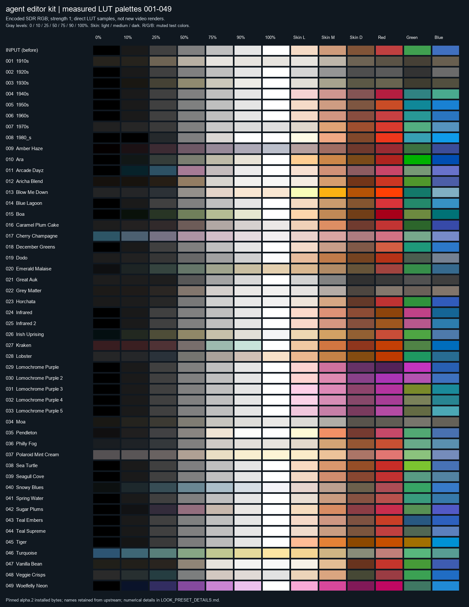
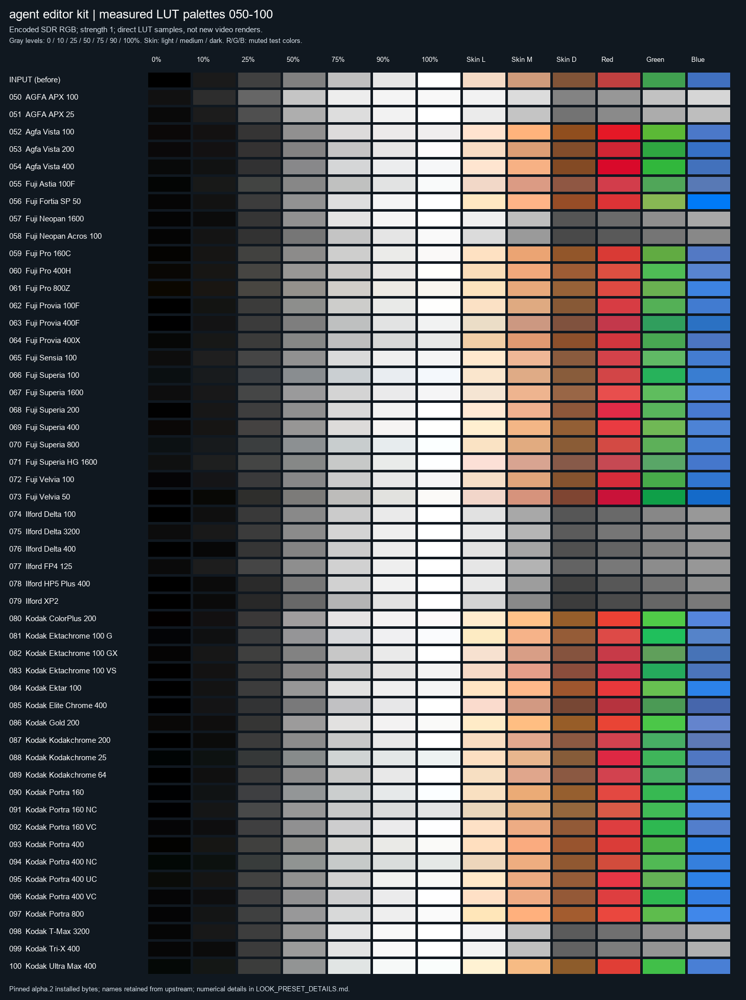

# 100 個風格預設：實際效果與逐項數值

[简体中文](LOOK_PRESET_DETAILS.md) · [繁體中文](LOOK_PRESET_DETAILS.zh-TW.md) · [編號與全部原始預覽](LOOK_PRESETS.md) · [核驗回執](../validation/evidence/look-profiles-20261024-r1/verification.json)

這裡說明本機 `v0.1.0-alpha.2` 實際安裝的 100 個 LUT，保留既有 001–100 編號。每項都包含真實顏色作用、灰階曲線、三個膚色測試塊、紅綠藍映射、場景建議、注意點、試用強度和既有 PNG/MP4。說明基於安裝版位元組與取樣結果，不按膠片名字推測顆粒、寬容度或鏡頭效果。

## 怎樣理解這些資料

- **測量條件**：強度 1.0、四面體插值、編碼 SDR RGB。十六進位是量化到 8 位後的顏色；內部保留浮點數。
- **灰階百分比**：指輸入 RGB 碼值的百分比，50% 為三通道 127.5；不表示場景反射率、18% 灰或線性曝光。
- **Y′ 碼值**：`0.2126 R′ + 0.7152 G′ + 0.0722 B′`，範圍 0–255，用於對照灰階明暗；不是線性亮度、EV 或顯示器實測。
- **中段跨度比**：`(Y′75% − Y′25%) / 127.5`；1 表示與輸入的這段跨度相同，大於 1 表示這段拉開，小於 1 表示這段收窄。它不能代表整條曲線或感知對比評分。
- **膚色塊與三色塊**：只描述固定合成色塊的變化，不代表人臉檢測、膚色保護或所有真實膚色。三色色塊刻意使用非滿飽和輸入，便於看色相與飽和度變化。
- **建議與實測分開**：場景和強度是人工選型起點，尚未進行自然素材畫質驗收。目錄中的預設推薦強度仍為 1；這裡的範圍不修改產品預設值。純黑白效果用 1，低於 1 會混回原始顏色。
- **共同邊界**：均為逐像素色彩 LUT。它們本身不生成顆粒、劃痕、暗角、柔焦、發光、空間霧、邊框、美顏或 AI 特效，也不自動執行曝光/白平衡校正。

上游標籤不是官方膠片、徠卡或剪映濾鏡認證，也不保證精確復現真實膠片。`sp-` 來自 Striped Purple，保留 16³/32³/64³ 原網格；`t3-` 來自 t3mujinpack，144³ 原生 RGB8 Hald 被轉換成 33³ CUBE，存在已披露的近似誤差。本輪讀取安裝版並與 100 張既有 FFmpeg PNG 逐像素對照，單通道差值不超過 1 個 8 位碼值；這不是對自然畫面品質的評分。

[機器可讀測量](../validation/evidence/look-profiles-20261024-r1/analysis.json) · [可編輯逐項說明](LOOK_PRESET_NOTES.json) · [數值分析腳本](../../scripts/analyze_look_profiles.py) · [文件生成腳本](../../scripts/build_look_profile_docs.py)

## 可視色塊對照

每張圖第一行是原色，之後每行是一個 LUT 的直接數值取樣。圖表是計算結果，沒有重新生成影片；原生 FFmpeg 畫面與成片見各項連結。





## 快速目錄

編號沿用原目錄；名稱保持上游原文。灰階曲線相似不代表所有顏色相同，某些膠片預設屬於細微區別。

| # | 名稱 / 穩定 ID | 實際作用 | 建議試用場景 |
|---|---|---|---|
| 001 | [1910s](#preset-sp-1910s)<br>`sp-1910s` | 暖棕單色。純黑被抬成深棕，灰階中段大幅變亮，亮端較早進入平臺；紅綠藍原色都收斂成棕灰，畫面呈褪色舊照片效果。 | 舊報刊、歷史回憶、檔案段落 |
| 002 | [1920s](#preset-sp-1920s)<br>`sp-1920s` | 中性黑白。中性灰輸入基本保持原碼值，但彩色轉灰使用明顯不同的顏色權重：藍色色塊比紅色亮，綠色最暗；不是簡單把所有顏色按普通亮度去飽和。 | 黑白敘事、字幕底片、檔案風格 |
| 003 | [1930s](#preset-sp-1930s)<br>`sp-1930s` | 黃橄欖單色。黑白端保留，中灰略提亮並偏黃綠，紅綠藍被映射為不同深淺的橄欖灰，較 1910s 更少褪黑、更保留端點。 | 復古紀實、歷史標題、懷舊照片動畫 |
| 004 | [1940s](#preset-sp-1940s)<br>`sp-1940s` | 灰階基本不動，主要重新分配色相：紅色變成玫紅，綠色轉深青，藍色色塊轉淺青綠；中膚色色塊明顯偏粉，色彩帶有選擇性著色感。 | 復古彩色敘事、海報感短片 |
| 005 | [1950s](#preset-sp-1950s)<br>`sp-1950s` | 保留灰階骨架，紅色色塊轉更暖的橘紅，綠色明顯轉青藍，藍色更鮮明；膚色保留暖調，但藍分量略增，呈復古彩色印刷感。 | 復古商品故事、街景、旅行片頭 |
| 006 | [1960s](#preset-sp-1960s)<br>`sp-1960s` | 灰階近中性，紅色更濃，綠色變青綠，藍色稍壓暗並保持藍調；膚色增加紅粉感，彩色區域比灰白區域更有存在感。 | 復古生活方式、音樂片段、街拍 |
| 007 | [1970s](#preset-sp-1970s)<br>`sp-1970s` | 抬高純黑並壓低純白，同時加強中段明暗分離。膚色更亮、更橙，綠色偏黃綠，藍色轉柔和青藍；形成有褪色端點的暖復古彩色。 | 旅行回憶、生活記錄、舊相冊感廣告 |
| 008 | [1980_s](#preset-sp-1980-s)<br>`sp-1980-s` | 強對比彩色：10% 灰已壓到接近黑，90% 灰接近白，中段兩側明顯拉開；紅橙更強，綠色轉青，藍色更亮、更鮮。 | 音樂節奏片、街頭、強視覺產品片 |
| 009 | [Amber Haze](#preset-sp-amber-haze)<br>`sp-amber-haze` | 整體壓暗，50% 灰降到約 94；中灰偏紫褐，白色變冷藍灰，膚色轉較暗的紅棕。名字含 Amber，但實際不是單純的暖黃濾鏡。 | 暗調情緒、夜間氛圍、復古靜物 |
| 010 | [Ara](#preset-sp-ara)<br>`sp-ara` | 中灰略暗並偏黃綠；紅色更深，綠色更純更強，藍色色塊更深藍，膚色明顯收藍而偏金橙。灰白區域比彩色區域變化小。 | 鮮明戶外、圖形畫面、暖色主體 |
| 011 | [Arcade Dayz](#preset-sp-arcade-dayz)<br>`sp-arcade-dayz` | 灰階中段染成紫粉，暗灰略提亮；紅色轉玫紅，綠色稍灰，藍色偏紫藍，膚色仍偏暖。形成粉紫環境與暖主體的分離。 | 游戲、潮流、青春生活方式 |
| 012 | [Aricha Blend](#preset-sp-aricha-blend)<br>`sp-aricha-blend` | 黑位抬成暖深棕，但 25% 灰進一步壓暗，75% 灰明顯提亮；中段強對比並帶棕黃傾向，綠偏黃、藍偏紫，膚色更金暖。 | 咖啡、木質靜物、秋日生活方式 |
| 013 | [Blow Me Down](#preset-sp-blow-me-down)<br>`sp-blow-me-down` | 抬黑、暖白，中灰和亮灰提亮；紅橙推得很強，膚色色塊轉鮮黃橙，綠色收成暗青綠，藍色變淺青藍，色相分離非常明顯。 | 海邊創意、強色彩插片、暖色物件 |
| 014 | [Blue Lagoon](#preset-sp-blue-lagoon)<br>`sp-blue-lagoon` | 中性灰階基本保持，主要把藍色推向更明亮的青藍、綠色轉冷青綠；膚色減藍偏金橙，紅色色塊更濃。 | 水景、旅行、暖主體與冷背景對照 |
| 015 | [Boa](#preset-sp-boa)<br>`sp-boa` | 壓暗中灰並染黃綠，綠色去鮮變橄欖，藍色明顯轉深青，紅色更深；膚色偏棕金，整體是暗綠棕與青色關系。 | 森林、戶外裝備、冷峻靜物 |
| 016 | [Caramel Plum Cake](#preset-sp-caramel-plum-cake)<br>`sp-caramel-plum-cake` | 黑位抬至深灰，但大部分中間調明顯變暗；中灰偏暖褐，膚色更紅橙，綠色更深、藍色偏紫，形成厚重暖褐氛圍。 | 甜品、木質桌面、暖調生活片 |
| 017 | [Cherry Champagne](#preset-sp-cherry-champagne)<br>`sp-cherry-champagne` | 顯著抬高黑位和暗灰，黑色染成藍青，中灰偏粉紫；紅綠藍均變柔、膚色偏粉，整體呈高霧面、粉彩效果。 | 柔和人物、婚禮情緒、粉彩設計 |
| 018 | [December Greens](#preset-sp-december-greens)<br>`sp-december-greens` | 灰階幾乎不動，紅色偏淺暖，綠色轉青綠、藍色維持偏冷；膚色稍降紅並加藍，暖度收斂。 | 冬季綠景、冷暖均衡生活片 |
| 019 | [Dodo](#preset-sp-dodo)<br>`sp-dodo` | 保留色彩的暗調處理。純黑抬灰，中灰降到約 104，綠與藍明顯去鮮並偏灰，膚色轉深棕橙；紅色相對更突出。 | 低調靜物、城市紀實、懷舊故事 |
| 020 | [Emerald Malaise](#preset-sp-emerald-malaise)<br>`sp-emerald-malaise` | 抬黑並壓低亮部上限，中灰偏綠，白色染奶油黃；綠色色塊更鮮，紅藍去鮮，膚色降亮並偏棕，形成綠陰影與暖高光。 | 復古綠景、森林情緒、冷暖敘事 |
| 021 | [Great Auk](#preset-sp-great-auk)<br>`sp-great-auk` | 中性黑白暗調，黑位約 29，但 25% 灰也僅約 30，低灰區被壓縮；中灰明顯變深。這裡綠色色塊比紅、藍亮，主體分離方式不同於 1920s。 | 沉靜黑白、暗調敘事、圖形輪廓 |
| 022 | [Grey Matter](#preset-sp-grey-matter)<br>`sp-grey-matter` | 偏棕灰的近單色，純黑略暖抬起，暗中間調壓深、亮中間調提亮；原始彩色收斂為棕灰。灰階曲線與 Horchata 接近，色彩保留程度大不相同。 | 暖灰人物、舊紙質感、克制敘事 |
| 023 | [Horchata](#preset-sp-horchata)<br>`sp-horchata` | 保留彩色的復古曲線：抬黑、壓暗 25% 灰、提亮 75% 灰，灰階本身接近中性；膚色變亮變金暖，紅綠藍仍較鮮。 | 生活方式、咖啡、暖色商品故事 |
| 024 | [Infrared](#preset-sp-infrared)<br>`sp-infrared` | 假色置換，灰階基本不動；綠色直接變洋紅，紅色轉深棕橙，藍色轉青藍，膚色偏紅。適合制造與原場景明顯不同的配色。 | 音樂視覺、超現實植被、創意片段 |
| 025 | [Infrared 2](#preset-sp-infrared-2)<br>`sp-infrared-2` | 與 Infrared 同類但置換較柔：綠色變灰粉紫，紅色成棕橙，藍色變較明亮青藍；中膚色更接近原色，保留更多原色分量。 | 較柔和假色旅行、夢境、MV |
| 026 | [Irish Uprising](#preset-sp-irish-uprising)<br>`sp-irish-uprising` | 抬暗灰、中灰略亮，中性中灰偏黃橄欖；綠色偏黃綠且略提亮、藍色去鮮，膚色偏金暖，黑色帶輕微青色。 | 綠景、戶外生活、暖人物冷背景 |
| 027 | [Kraken](#preset-sp-kraken)<br>`sp-kraken` | 抬黑為暗酒紅，暗中間調和中灰壓深；膚色變濃橙棕，紅色偏橙、綠色偏黃綠，藍色色塊趨向更鮮青藍。 | 暗調動作、復古街頭、強色彩故事 |
| 028 | [Lobster](#preset-sp-lobster)<br>`sp-lobster` | 黑位抬成冷灰，高光染奶油暖色，灰階中亮部壓暗；膚色變棕橙，綠轉青綠、藍轉灰青，整體冷暗部與暖亮部並置。 | 暖靜物、海岸情緒、復古生活 |
| 029 | [Lomochrome Purple](#preset-sp-lomochrome-purple)<br>`sp-lomochrome-purple` | 強烈紫色置換：綠色變鮮洋紅，紅色反而變很暗的紫，藍色更深；膚色明顯偏紫紅，中性灰仍基本保持。五個版本中對紅色的壓暗很突出。 | 超現實植被、音樂、紫色創意世界 |
| 030 | [Lomochrome Purple 2](#preset-sp-lomochrome-purple-2)<br>`sp-lomochrome-purple-2` | 綠色與紅色都變較亮的紫洋紅，藍色仍保留藍調；比第一版少了紅色變深紫的強壓暗，整體假色更均勻。膚色偏粉紫。 | 粉紫植物、時尚創意、夢境畫面 |
| 031 | [Lomochrome Purple 3](#preset-sp-lomochrome-purple-3)<br>`sp-lomochrome-purple-3` | 紅色變紫紅，但綠色變黃橄欖而不是洋紅，藍色轉深青；膚色偏粉紫，形成紫主體、黃綠背景和青色區域的三向置換。 | 紫黃對照、音樂片、非寫實設計 |
| 032 | [Lomochrome Purple 4](#preset-sp-lomochrome-purple-4)<br>`sp-lomochrome-purple-4` | 延續紅轉紫、綠轉橄欖、藍轉青的關系，但綠色更灰、更克制，膚色也比第三版稍柔；適合較低刺激度的紫青配色。 | 低飽和假色、時尚情緒、非寫實旅行 |
| 033 | [Lomochrome Purple 5](#preset-sp-lomochrome-purple-5)<br>`sp-lomochrome-purple-5` | 紅色變較淺紫紅，綠色壓成較暗灰橄欖，藍色提成明青；膚色比第三、四版更深，紫色主體與淺青區域的反差更明確。 | 暗紫植被、青紫對照、創意短片 |
| 034 | [Moa](#preset-sp-moa)<br>`sp-moa` | 暖灰近單色，純黑抬起且偏暖，純白收成淺暖灰；中灰接近原亮度，彩色大幅收斂為不同深淺的米棕灰，比 Great Auk 更明亮柔和。 | 暖灰紀實、人物回憶、紙感畫面 |
| 035 | [Pendleton](#preset-sp-pendleton)<br>`sp-pendleton` | 暗部輕抬，中灰變化不大，但 75% 灰提得很亮、亮端接近白；膚色偏亮紅橙，紅色帶粉，綠色偏青綠，呈明亮鮮活的暖主體。 | 日光生活方式、旅行、青春人物 |
| 036 | [Philly Fog](#preset-sp-philly-fog)<br>`sp-philly-fog` | 黑位抬為冷灰，白位壓為暖灰，中段明暗稍拉開；綠色與藍色變柔，膚色偏暖。兩端褪色而中段仍有分離，屬於克制復古色。 | 城市漫步、海邊生活、溫和紀實 |
| 037 | [Polaroid Mint Cream](#preset-sp-polaroid-mint-cream)<br>`sp-polaroid-mint-cream` | 強抬黑並提亮中間調，白色變奶油黃；綠偏黃、紅色粉化、藍偏淡紫，膚色明顯變淺變暖，形成奶油粉彩的拍立得式配色。 | 回憶、柔和生活方式、粉彩物件 |
| 038 | [Sea Turtle](#preset-sp-sea-turtle)<br>`sp-sea-turtle` | 中性灰階基本保持，綠色明顯提亮並轉黃綠，藍色略柔、紅色更濃；膚色更暖。以綠色的明亮鮮活感為主要差異。 | 熱帶綠景、戶外、明亮旅行 |
| 039 | [Seagull Cove](#preset-sp-seagull-cove)<br>`sp-seagull-cove` | 灰階基本保持，綠色轉柔青綠，藍色去鮮成為灰青藍；膚色偏紅橙且略暗，色彩對照比 Sea Turtle 更克制。 | 海岸、安靜旅行、人物生活片 |
| 040 | [Snowy Blues](#preset-sp-snowy-blues)<br>`sp-snowy-blues` | 暗部抬起、亮端稍收，中灰染藍青；紅色變柔粉，藍色更鮮，膚色去暖變灰粉，整體偏冷但保留柔和明暗。 | 冬景、冷調生活、安靜人物 |
| 041 | [Spring Water](#preset-sp-spring-water)<br>`sp-spring-water` | 灰階接近原樣，紅色去鮮、綠色偏青綠，藍色轉柔青藍；中膚色較原樣更柔、更少紅，屬於溫和冷暖整理。 | 日常人物、清淡旅行、自然生活方式 |
| 042 | [Sugar Plums](#preset-sp-sugar-plums)<br>`sp-sugar-plums` | 灰階中段壓暗且染紫紅，紅色色塊偏玫紅，藍色偏紫藍，綠色稍灰；膚色同時更紅、更金暖，適合紫環境與暖主體關系。 | 甜酷、時尚、音樂與夜間情緒 |
| 043 | [Teal Embers](#preset-sp-teal-embers)<br>`sp-teal-embers` | 灰階基本不動，但綠色被映射為較深的鋼青藍，藍色保留更深藍調；膚色偏紅暖，紅色色塊更橙，冷背景與暖主體分離顯著。 | 青橙敘事、城市夜景、人物短片 |
| 044 | [Teal Supreme](#preset-sp-teal-supreme)<br>`sp-teal-supreme` | 灰階基本保持，綠色明顯壓暗、去鮮成灰綠，藍色更柔；膚色較克制偏暖。比 Teal Embers 少了綠色直接轉藍的強置換。 | 克制冷調、城市生活、靜物氛圍 |
| 045 | [Tiger](#preset-sp-tiger)<br>`sp-tiger` | 中灰略暗且大體中性，膚色明顯偏橙，紅色轉橘紅，綠色轉深金棕，藍色則偏亮青藍；形成強橙藍互補關系。 | 運動、街頭、橙藍視覺廣告 |
| 046 | [Turquoise](#preset-sp-turquoise)<br>`sp-turquoise` | 黑色抬成藍灰，中灰染綠，純白變淡黃；暗部明顯提亮、亮部收窄，紅色粉化、藍色轉青綠，膚色變淺金色。 | 夢幻海邊、粉彩創意、柔和旅行 |
| 047 | [Vanilla Bean](#preset-sp-vanilla-bean)<br>`sp-vanilla-bean` | 抬黑但壓深暗中間調，同時大幅提亮亮中間調；中灰帶米棕，膚色更亮更奶油暖，綠色偏黃綠、藍色偏紫藍。 | 奶油暖調、甜品、明亮室內生活 |
| 048 | [Veggie Crisps](#preset-sp-veggie-crisps)<br>`sp-veggie-crisps` | 黑白端明顯收窄，黑色抬到約 42、白色壓到約 226；中灰大致保持，紅色更深、綠色更濃、藍色更鮮，膚色偏暖。 | 褪色但有鮮色的生活片、戶外物件 |
| 049 | [Woelfelly Neon](#preset-sp-woelfelly-neon)<br>`sp-woelfelly-neon` | 中灰明顯壓暗並染紫，膚色強烈轉洋紅，紅色變深玫紅，藍色轉亮青藍；暗調紫紅與青藍的對照非常明顯。 | 賽博情緒、音樂、霓虹配色設計 |
| 050 | [AGFA APX 100](#preset-t3-agfa-apx-100)<br>`t3-agfa-apx-100` | 中性黑白並大幅提亮中段，50% 灰升到約 197；黑位輕抬、亮部較早收平。綜合色轉灰時藍色色塊較亮，綠色次之，紅色最暗。 | 明亮黑白、柔和回憶、清晰人物 |
| 051 | [AGFA APX 25](#preset-t3-agfa-apx-25)<br>`t3-agfa-apx-25` | 中性黑白，中灰升到約 174，黑位與高光平臺比 APX 100 更克制，保留更深的暗部；紅綠藍灰值都比 APX 100 深。 | 較有深度的明亮黑白、人物紀實 |
| 052 | [Agfa Vista 100](#preset-t3-agfa-vista-100)<br>`t3-agfa-vista-100` | 暗部較深、中亮部明顯提亮，亮端收在淺灰；膚色推成明亮金橙，紅綠更鮮，藍色更亮但飽和度略降，綜合色彩存在感強。 | 日光旅行、暖色商品故事、復古生活 |
| 053 | [Agfa Vista 200](#preset-t3-agfa-vista-200)<br>`t3-agfa-vista-200` | 中灰接近原值但暗部壓深，亮部較完整；紅色更濃，綠藍增強，膚色偏暖棕。比 Vista 100 更暗、更少提亮。 | 日常彩色、城市旅行、溫和復古 |
| 054 | [Agfa Vista 400](#preset-t3-agfa-vista-400)<br>`t3-agfa-vista-400` | 壓暗陰影、提亮中亮部，白端微冷收窄；紅色色塊尤其鮮，綠色增亮，膚色更亮金暖，力度介於清淡校色與強創意之間。 | 鮮明街景、旅行、活潑生活片 |
| 055 | [Fuji Astia 100F](#preset-t3-fuji-astia-100f)<br>`t3-fuji-astia-100f` | 灰階中段略提亮、白端輕收，紅色稍增鮮，綠色和藍色更亮但飽和度降低；膚色色塊偏紅粉，比暖金類負片少一些黃色傾向。 | 日光人物、柔和旅行、服裝生活片 |
| 056 | [Fuji Fortia SP 50](#preset-t3-fuji-fortia-sp-50)<br>`t3-fuji-fortia-sp-50` | 強中段對比，陰影壓深、中亮部明顯提亮；藍色樣本變成非常鮮的亮藍，綠偏黃且更亮，膚色推成明亮金橙。 | 高彩風景、藍天、強色彩片段 |
| 057 | [Fuji Neopan 1600](#preset-t3-fuji-neopan-1600)<br>`t3-fuji-neopan-1600` | 中性黑白，陰影壓深，50% 灰略亮、75% 灰明顯提亮，明暗跨度大；膚色轉相對較亮灰，藍色樣本比紅色亮。 | 反差黑白、街頭、人物敘事 |
| 058 | [Fuji Neopan Acros 100](#preset-t3-fuji-neopan-acros-100)<br>`t3-fuji-neopan-acros-100` | 中性黑白，暗部和中灰整體偏深，白端輕收；相較 Neopan 1600 更沉靜，膚色灰值也更深，藍色轉灰仍較紅色亮。 | 安靜黑白、建筑、低調人物 |
| 059 | [Fuji Pro 160C](#preset-t3-fuji-pro-160c)<br>`t3-fuji-pro-160c` | 中灰略亮、陰影略深，黑白端帶細微暖色；紅色更濃、綠偏黃綠、藍色更亮且更柔，膚色明顯偏暖橙。 | 暖調人物、生活方式、日光街拍 |
| 060 | [Fuji Pro 400H](#preset-t3-fuji-pro-400h)<br>`t3-fuji-pro-400h` | 中灰提亮較明顯，亮部輕收；綠色和藍色更亮但飽和度略降，紅色略增鮮，膚色變亮偏暖。實際是選擇性提亮與配色，不能簡單概括成全局加飽和或全局粉彩。 | 明亮人物、旅行、彩色生活片 |
| 061 | [Fuji Pro 800Z](#preset-t3-fuji-pro-800z)<br>`t3-fuji-pro-800z` | 抬高帶暖色的黑位，中灰提亮、白端偏米暖；藍色增強明顯，綠色偏黃綠，膚色變亮金暖，形成暖中性與較鮮冷色的配比。 | 暖室內故事、旅行、人物生活片 |
| 062 | [Fuji Provia 100F](#preset-t3-fuji-provia-100f)<br>`t3-fuji-provia-100f` | 陰影略壓、中灰提亮、亮部較完整；紅藍更鮮，綠色更亮，膚色偏金暖，是較均衡但明顯增強的反轉片配色。 | 旅行、城市風景、日光生活 |
| 063 | [Fuji Provia 400F](#preset-t3-fuji-provia-400f)<br>`t3-fuji-provia-400f` | 中灰接近原值，暗部壓深、白位輕收；綠色趨青、藍色偏深藍，紅色略濃，膚色變化較克制。比 100F 更沉穩。 | 克制風景、人物環境、城市紀實 |
| 064 | [Fuji Provia 400X](#preset-t3-fuji-provia-400x)<br>`t3-fuji-provia-400x` | 中灰稍亮，但亮部上限明顯收至約 232；紅色更濃，綠色和藍色變亮但飽和度略降，綠偏黃綠，膚色偏橙。顏色改動與柔白端同時存在。 | 復古風景、彩色生活、低白端氛圍 |
| 065 | [Fuji Sensia 100](#preset-t3-fuji-sensia-100)<br>`t3-fuji-sensia-100` | 黑位抬灰，中灰和亮中間調提亮，白端輕收；膚色更亮更暖，綠色更亮更柔、藍色略提亮，整體比深黑類反轉片更輕快。 | 旅行回憶、日常人物、暖日光 |
| 066 | [Fuji Superia 100](#preset-t3-fuji-superia-100)<br>`t3-fuji-superia-100` | 黑白端和中灰略帶冷藍，中灰提亮；綠色更鮮偏青綠，紅藍也加強，膚色仍變暖，形成冷中性與暖膚色的分離。 | 城市日常、旅行、冷暖人物環境 |
| 067 | [Fuji Superia 1600](#preset-t3-fuji-superia-1600)<br>`t3-fuji-superia-1600` | 黑位輕抬，中灰明顯提亮，白端略收；紅綠藍均提亮，綠藍飽和度略降，膚色更亮暖，綜合色彩輕快而不是所有顏色一律增鮮。 | 明亮街頭、生活記錄、暖人物 |
| 068 | [Fuji Superia 200](#preset-t3-fuji-superia-200)<br>`t3-fuji-superia-200` | 端點接近完整，中灰與亮中間調提亮、陰影略深；紅色更鮮，綠色更亮，膚色偏亮紅暖，顏色比灰階變化更顯眼。 | 彩色街景、旅行、生活方式 |
| 069 | [Fuji Superia 400](#preset-t3-fuji-superia-400)<br>`t3-fuji-superia-400` | 微暖黑位、中灰明顯提亮，75% 灰更亮；綠色提亮且偏黃綠，紅色更濃，藍色更亮但飽和度略降，膚色變亮金暖。 | 日光生活、旅行、暖色人物 |
| 070 | [Fuji Superia 800](#preset-t3-fuji-superia-800)<br>`t3-fuji-superia-800` | 黑位和中性灰帶冷青，灰階中段提亮；綠藍主要提亮，綠色飽和度下降，膚色轉暖金，冷暗部與暖主體更明確。 | 城市傍晚配色、冷暖環境人物 |
| 071 | [Fuji Superia HG 1600](#preset-t3-fuji-superia-hg-1600)<br>`t3-fuji-superia-hg-1600` | 輕抬黑、中灰稍亮，綠藍略提亮，綠色飽和度下降；膚色色塊保留更多藍分量，比 Superia 1600 少一些金黃，也少一些中段提亮。 | 較克制生活片、人物與環境共存 |
| 072 | [Fuji Velvia 100](#preset-t3-fuji-velvia-100)<br>`t3-fuji-velvia-100` | 陰影壓深，中灰略提亮，白端輕收；紅藍更濃，綠色更亮且飽和度接近原樣，膚色偏金暖，是偏濃彩的風景候選。 | 高彩風景、綠植、城市色塊 |
| 073 | [Fuji Velvia 50](#preset-t3-fuji-velvia-50)<br>`t3-fuji-velvia-50` | 陰影明顯壓深，50% 灰也略暗；紅綠藍飽和與深度增強，綠色尤其鮮，膚色轉較深紅暖。比 Velvia 100 更低調、更有深黑感。 | 深色風景、綠植、強色彩構圖 |
| 074 | [Ilford Delta 100](#preset-t3-ilford-delta-100)<br>`t3-ilford-delta-100` | 中性黑白，陰影壓深、中灰略提亮，白端完整；膚色轉較清晰的中亮灰。紅色比綠色深，藍色樣本轉灰最亮。 | 黑白人物、建筑、均衡紀實 |
| 075 | [Ilford Delta 3200](#preset-t3-ilford-delta-3200)<br>`t3-ilford-delta-3200` | 中性黑白，黑位明顯抬起，中灰和亮部提亮；相較 Delta 100 膚色灰值更高，紅色色塊也更亮，暗部較柔。 | 抬黑黑白、人物回憶、柔和街頭 |
| 076 | [Ilford Delta 400](#preset-t3-ilford-delta-400)<br>`t3-ilford-delta-400` | 中性黑白，低灰區比 Delta 100 更深，中灰也更低；高灰仍提亮，形成更有深黑感的反差。膚色略深。 | 深黑紀實、建筑輪廓、黑白故事 |
| 077 | [Ilford FP4 125](#preset-t3-ilford-fp4-125)<br>`t3-ilford-fp4-125` | 中性黑白，黑位輕抬、中灰提亮，紅綠藍灰值差距相對較小；紅色色塊與膚色比 Delta 100 更亮，觀感較平緩。 | 溫和黑白人物、日常紀實、回憶 |
| 078 | [Ilford HP5 Plus 400](#preset-t3-ilford-hp5-plus-400)<br>`t3-ilford-hp5-plus-400` | 中性黑白，25% 灰壓到約 42，中灰略暗、75% 灰提亮，中段跨度較大；膚色和紅色比 FP4 更深。 | 街頭、戲劇人物、強明暗敘事 |
| 079 | [Ilford XP2](#preset-t3-ilford-xp2)<br>`t3-ilford-xp2` | 中性黑白整體偏暗，中灰約 104、75% 灰約 180；膚色和紅綠藍樣本均比 HP5 更深，形成沉穩低調的黑白。 | 暗調人像、安靜紀實、輪廓敘事 |
| 080 | [Kodak ColorPlus 200](#preset-t3-kodak-colorplus-200)<br>`t3-kodak-colorplus-200` | 陰影壓深但中灰明顯提亮，亮部也亮；紅綠更鮮，藍色更亮且稍柔，膚色轉很亮金橙，綜合色彩飽滿而偏暖。 | 陽光生活、旅行、暖色復古廣告 |
| 081 | [Kodak Ektachrome 100 G](#preset-t3-kodak-ektachrome-100-g)<br>`t3-kodak-ektachrome-100-g` | 中性灰略冷、陰影較深、中灰明顯提亮；綠色更鮮偏青，藍色更亮且稍柔，膚色偏明亮暖橙，冷中性與暖膚色分離清楚。 | 旅行、風景、冷暖人物場景 |
| 082 | [Kodak Ektachrome 100 GX](#preset-t3-kodak-ektachrome-100-gx)<br>`t3-kodak-ektachrome-100-gx` | 灰階較接近原樣，中段稍拉開；紅色略濃、綠偏黃綠、藍色稍柔，膚色偏暖粉。比 100 G 提亮和綠色增強都少。 | 較柔和人物環境、溫暖日常 |
| 083 | [Kodak Ektachrome 100 VS](#preset-t3-kodak-ektachrome-100-vs)<br>`t3-kodak-ektachrome-100-vs` | 陰影壓深、中灰略亮、白端輕收；紅綠更濃，藍色略柔，膚色更紅粉。綜合色彩比 GX 更有壓深和濃度。 | 彩色街景、復古人物、濃彩設計 |
| 084 | [Kodak Ektar 100](#preset-t3-kodak-ektar-100)<br>`t3-kodak-ektar-100` | 陰影較深、中灰和亮中間調明顯提亮，白位收在淺灰；紅色更濃、綠色更亮、藍色很鮮，膚色變亮金橙。 | 高彩商品故事、旅行、色塊風景 |
| 085 | [Kodak Elite Chrome 400](#preset-t3-kodak-elite-chrome-400)<br>`t3-kodak-elite-chrome-400` | 中灰略壓暗、陰影更深，高光端完整；紅色略濃、綠藍去鮮，三色色塊亮度均降低，膚色較原樣稍紅暖，畫面更沉穩。 | 深色街景、克制復古、靜物敘事 |
| 086 | [Kodak Gold 200](#preset-t3-kodak-gold-200)<br>`t3-kodak-gold-200` | 黑位輕抬但暗中間調壓深，中灰與亮中間調明顯提亮；膚色變亮金橙，綠色更鮮、紅色更暖、藍色趨紫藍。 | 日光回憶、暖人物、生活方式廣告 |
| 087 | [Kodak Kodakchrome 200](#preset-t3-kodak-kodakchrome-200)<br>`t3-kodak-kodakchrome-200` | 陰影壓深、中灰稍亮，高光端完整；紅色稍濃、綠色更亮、藍色更亮卻更柔，膚色偏暖紅。與 64 的總體關系接近，主要有細微膚色、藍色和低灰差別。 | 克制復古彩色、旅行、人物環境 |
| 088 | [Kodak Kodakchrome 25](#preset-t3-kodak-kodakchrome-25)<br>`t3-kodak-kodakchrome-25` | 黑白端及中灰略帶青色，中灰與亮中間調提亮、白端收窄；紅色較鮮，綠更亮，膚色偏淺金暖。比 64/200 有更明顯冷中性和亮部變化。 | 青影暖膚、復古旅行、輕冷紀實 |
| 089 | [Kodak Kodakchrome 64](#preset-t3-kodak-kodakchrome-64)<br>`t3-kodak-kodakchrome-64` | 中性灰與端點基本中性，陰影略壓、中灰稍亮；膚色偏暖紅，藍色較柔。與 200 的曲線高度接近，屬於細微配色區別。 | 輕復古彩色、人物與環境、旅行 |
| 090 | [Kodak Portra 160](#preset-t3-kodak-portra-160)<br>`t3-kodak-portra-160` | 中性灰微冷，中灰明顯提亮；綠藍增強，膚色轉較亮金橙。與 160 NC 相比亮端更完整，色彩變化更強。 | 日光人物、生活方式、旅行 |
| 091 | [Kodak Portra 160 NC](#preset-t3-kodak-portra-160-nc)<br>`t3-kodak-portra-160-nc` | 暗中間調和中灰提亮，但高光收至灰白，整體中段跨度較小；膚色更柔、更少紅橙，紅色也較克制。比標準 160 有更明顯柔白端。 | 柔和人物、明亮回憶、低反差日光 |
| 092 | [Kodak Portra 160 VC](#preset-t3-kodak-portra-160-vc)<br>`t3-kodak-portra-160-vc` | 陰影較深、中灰提亮，灰階與 400 VC 基本一致；紅綠更鮮，膚色偏暖紅，藍色色塊偏較柔的紫藍。 | 彩色人物環境、暖調旅行 |
| 093 | [Kodak Portra 400](#preset-t3-kodak-portra-400)<br>`t3-kodak-portra-400` | 陰影略深、中灰提亮、亮部輕收，中性灰微暖；綠色更亮且偏黃綠，藍色更鮮，膚色轉明亮紅橙。 | 暖人物、日常廣告、旅行故事 |
| 094 | [Kodak Portra 400 NC](#preset-t3-kodak-portra-400-nc)<br>`t3-kodak-portra-400-nc` | 陰影壓深，中灰提亮，白端收成略帶綠的灰白；膚色偏柔暖、紅色較標準 400 克制，綠色提亮但稍去鮮，藍色仍增鮮。比標準 400 有更柔的亮部。 | 柔白端人物、復古紀實、生活片 |
| 095 | [Kodak Portra 400 UC](#preset-t3-kodak-portra-400-uc)<br>`t3-kodak-portra-400-uc` | 輕抬黑、中灰提亮、亮端相對完整；紅色更鮮，藍色明顯增強，膚色偏亮暖，綠偏黃綠。綜合色彩比 NC 更有活力。 | 高彩日常、街拍、暖人物廣告 |
| 096 | [Kodak Portra 400 VC](#preset-t3-kodak-portra-400-vc)<br>`t3-kodak-portra-400-vc` | 與 160 VC 的灰階和多數紅綠變換幾乎一致，但藍色更鮮、更偏正藍，膚色略有紅藍差異；屬於同曲線下的細部配色差異。 | 有人物也有藍天藍衣的彩色場景 |
| 097 | [Kodak Portra 800](#preset-t3-kodak-portra-800)<br>`t3-kodak-portra-800` | 中灰和亮中間調提亮較明顯，白端輕收；紅藍更鮮，綠色更亮且飽和度近原樣，藍色尤其亮，膚色變亮金橙。 | 明亮人物、彩色生活方式、旅行 |
| 098 | [Kodak T-Max 3200](#preset-t3-kodak-t-max-3200)<br>`t3-kodak-t-max-3200` | 中性黑白，黑位輕抬、中灰和亮中間調明顯提亮，白端完整；藍色轉灰比綠色亮，紅色最暗，膚色較亮。 | 明亮反差黑白、街頭、人物敘事 |
| 099 | [Kodak Tri-X 400](#preset-t3-kodak-tri-x-400)<br>`t3-kodak-tri-x-400` | 中性黑白，低灰區明顯壓深，中灰提到約 155，亮部接近白；相比 T-Max 3200 紅色色塊更亮、低灰更深，膚色略深。 | 戲劇黑白、人物紀實、街拍 |
| 100 | [Kodak Ultra Max 400](#preset-t3-kodak-ultra-max-400)<br>`t3-kodak-ultra-max-400` | 中性灰略青，中灰和亮中間調明顯提亮，白端微冷；紅綠更鮮、藍色更亮且飽和度近原樣，膚色偏亮金暖，色彩活躍。 | 日光旅行、生活方式、活潑彩色廣告 |

## 容易混淆的區別

| 對照組 | 這批實際 LUT 的區別 |
|---|---|
| 1910s / 1920s / 1930s | 1910s 暖棕、抬黑、亮端平臺；1920s 中性黑白且灰階基本不動；1930s 黃橄欖單色、端點較完整。 |
| Grey Matter / Horchata | 灰階明暗關系接近，前者彩色大幅收斂成暖灰，後者保留彩色。 |
| Infrared / Infrared 2 | 同樣將綠色置換成紫紅，但第一版更強，第二版更保留原色分量。不是兩種紅外傳感器模擬。 |
| Lomochrome Purple 1–5 | 第 1、2 版綠轉洋紅，第 3–5 版綠轉黃綠/橄欖；第 1 版紅變深紫，第 5 版綠更暗、藍更亮青。 |
| Velvia 100 / 50 | 50 的低灰更深，中灰略暗；100 中灰略亮。兩者都有明顯彩色增強。 |
| Portra 160 VC / 400 VC | 灰階幾乎相同，400 VC 的藍色色塊更鮮、更偏正藍；不是兩種顯著不同的對比曲線。 |
| Kodakchrome 200 / 64 | 關系很接近；200 與 64 主要是細微低灰、膚色和藍色差異。上游拼寫原樣保留。 |
| NC / VC / UC | 是上游方案名稱。某個 NC 也可能增強藍色，不能據名稱認為所有顏色都更淡。 |

## 逐項詳情

<a id="preset-sp-1910s"></a>

### 001 · 1910s

**穩定 ID**：`sp-1910s` · **類別**：`cinema` · **網格**：64³ · **許可**：MIT。

**實際作用**：暖棕單色。純黑被抬成深棕，灰階中段大幅變亮，亮端較早進入平臺；紅綠藍原色都收斂成棕灰，畫面呈褪色舊照片效果。

**建議試用**：舊報刊、歷史回憶、檔案段落。**建議起始強度**：0.6–1.0。**注意**：沒有劃痕、顆粒、閃爍或默片變速；亮部層次需單獨檢查。

**黑白與灰階**：保留色彩或帶有單色染色；灰階樣本中性不代表彩色色相不變。 純黑 → `#26231D`，純白 → `#E7E4DF`；50% 中灰 → `#B8B0A3`。

| 輸入中性灰 | 0% | 10% | 25% | 50% | 75% | 90% | 100% |
|---|---:|---:|---:|---:|---:|---:|---:|
| 輸出 Y′ 碼值 | 35.2 | 35.2 | 101.0 | 177.1 | 228.1 | 228.1 | 228.1 |
| 輸出 RGB | `#26231D` | `#26231D` | `#6E6454` | `#B8B0A3` | `#E7E4DF` | `#E7E4DF` | `#E7E4DF` |

中段跨度比 **0.997×**；4097 點中性灰取樣的最大通道差 **32.8** 碼值。前者看明暗跨度，後者看灰階染色，二者不能互相替代。4097 點取樣的 Y′ 非遞減。

| 固定測試色塊 | 輸入 RGB | 輸出 RGB | Y′ 變化 | HSV 飽和度：輸入 → 輸出 |
|---|---|---|---:|---|
| 淺膚色測試塊 | `#F5DBC6` | `#E7E4DF` | +5.1 | 19.2% → 3.2% |
| 中膚色測試塊 | `#CF9B7B` | `#BEB6AA` | +19.3 | 40.6% → 10.3% |
| 深膚色測試塊 | `#815438` | `#6D6354` | +8.6 | 56.6% → 23.0% |
| 偏柔紅色色塊 | `#C04040` | `#5B5346` | -7.3 | 66.7% → 23.0% |
| 偏柔綠色色塊 | `#40A050` | `#464036` | -69.5 | 60.0% → 23.0% |
| 偏柔藍色色塊 | `#4070C0` | `#685F50` | -11.5 | 66.7% → 23.0% |

[實際 FFmpeg PNG](../assets/look-presets-20261024-r1/previews/sp-1910s.png) · [既有 1 秒成片](../assets/look-presets-20261024-r1/videos/sp-1910s.mp4) · [固定版本上游文件](https://github.com/stripedpurple/color-grading-luts/blob/9757e8b5147693cab49c3fd674bf23dbe28d6c8e/Cinema%20Through%20The%20Ages/Striped%20Purple%20-%201910s.cube)

保留上游 64³ CUBE 網格；未把它重取樣成統一網格。

<a id="preset-sp-1920s"></a>

### 002 · 1920s

**穩定 ID**：`sp-1920s` · **類別**：`cinema` · **網格**：64³ · **許可**：MIT。

**實際作用**：中性黑白。中性灰輸入基本保持原碼值，但彩色轉灰使用明顯不同的顏色權重：藍色色塊比紅色亮，綠色最暗；不是簡單把所有顏色按普通亮度去飽和。

**建議試用**：黑白敘事、字幕底片、檔案風格。**建議起始強度**：1.0。**注意**：綠色服裝或背景可能變暗；要純黑白須用強度 1。

**黑白與灰階**：所有 CUBE 頂點三通道差不超過 1 碼值，屬於數值上的近中性黑白。 純黑 → `#000000`，純白 → `#FFFFFF`；50% 中灰 → `#808080`。

| 輸入中性灰 | 0% | 10% | 25% | 50% | 75% | 90% | 100% |
|---|---:|---:|---:|---:|---:|---:|---:|
| 輸出 Y′ 碼值 | 0.0 | 25.5 | 63.7 | 127.5 | 191.3 | 229.5 | 255.0 |
| 輸出 RGB | `#000000` | `#1A1A1A` | `#404040` | `#808080` | `#BFBFBF` | `#E5E5E5` | `#FFFFFF` |

中段跨度比 **1.000×**；4097 點中性灰取樣的最大通道差 **0.0** 碼值。前者看明暗跨度，後者看灰階染色，二者不能互相替代。4097 點取樣的 Y′ 非遞減。

| 固定測試色塊 | 輸入 RGB | 輸出 RGB | Y′ 變化 | HSV 飽和度：輸入 → 輸出 |
|---|---|---|---:|---|
| 淺膚色測試塊 | `#F5DBC6` | `#D5D5D5` | -9.7 | 19.2% → 0.0% |
| 中膚色測試塊 | `#CF9B7B` | `#959595` | -15.0 | 40.6% → 0.0% |
| 深膚色測試塊 | `#815438` | `#4E4E4E` | -13.1 | 56.6% → 0.0% |
| 偏柔紅色色塊 | `#C04040` | `#5A5A5A` | -1.6 | 66.7% → 0.0% |
| 偏柔綠色色塊 | `#40A050` | `#333333` | -82.6 | 60.0% → 0.0% |
| 偏柔藍色色塊 | `#4070C0` | `#6B6B6B` | -0.4 | 66.7% → 0.0% |

[實際 FFmpeg PNG](../assets/look-presets-20261024-r1/previews/sp-1920s.png) · [既有 1 秒成片](../assets/look-presets-20261024-r1/videos/sp-1920s.mp4) · [固定版本上游文件](https://github.com/stripedpurple/color-grading-luts/blob/9757e8b5147693cab49c3fd674bf23dbe28d6c8e/Cinema%20Through%20The%20Ages/Striped%20Purple%20-%201920s.cube)

保留上游 64³ CUBE 網格；未把它重取樣成統一網格。

<a id="preset-sp-1930s"></a>

### 003 · 1930s

**穩定 ID**：`sp-1930s` · **類別**：`cinema` · **網格**：64³ · **許可**：MIT。

**實際作用**：黃橄欖單色。黑白端保留，中灰略提亮並偏黃綠，紅綠藍被映射為不同深淺的橄欖灰，較 1910s 更少褪黑、更保留端點。

**建議試用**：復古紀實、歷史標題、懷舊照片動畫。**建議起始強度**：0.6–1.0。**注意**：單色不是中性灰；不適合要求白平衡準確的產品展示。

**黑白與灰階**：保留色彩或帶有單色染色；灰階樣本中性不代表彩色色相不變。 純黑 → `#000000`，純白 → `#FFFFFF`；50% 中灰 → `#8F8A70`。

| 輸入中性灰 | 0% | 10% | 25% | 50% | 75% | 90% | 100% |
|---|---:|---:|---:|---:|---:|---:|---:|
| 輸出 Y′ 碼值 | 0.0 | 23.3 | 66.1 | 137.2 | 198.8 | 235.6 | 255.0 |
| 輸出 RGB | `#000000` | `#191712` | `#454235` | `#8F8A70` | `#CAC7BA` | `#EDECE6` | `#FFFFFF` |

中段跨度比 **1.041×**；4097 點中性灰取樣的最大通道差 **31.3** 碼值。前者看明暗跨度，後者看灰階染色，二者不能互相替代。4097 點取樣的 Y′ 非遞減。

| 固定測試色塊 | 輸入 RGB | 輸出 RGB | Y′ 變化 | HSV 飽和度：輸入 → 輸出 |
|---|---|---|---:|---|
| 淺膚色測試塊 | `#F5DBC6` | `#E1DFD7` | -0.3 | 19.2% → 4.3% |
| 中膚色測試塊 | `#CF9B7B` | `#A7A38E` | -1.3 | 40.6% → 15.2% |
| 深膚色測試塊 | `#815438` | `#5B5846` | -4.4 | 56.6% → 22.6% |
| 偏柔紅色色塊 | `#C04040` | `#686450` | +8.0 | 66.7% → 22.5% |
| 偏柔綠色色塊 | `#40A050` | `#3F3C30` | -73.9 | 60.0% → 23.2% |
| 偏柔藍色色塊 | `#4070C0` | `#524F3F` | -29.2 | 66.7% → 22.8% |

[實際 FFmpeg PNG](../assets/look-presets-20261024-r1/previews/sp-1930s.png) · [既有 1 秒成片](../assets/look-presets-20261024-r1/videos/sp-1930s.mp4) · [固定版本上游文件](https://github.com/stripedpurple/color-grading-luts/blob/9757e8b5147693cab49c3fd674bf23dbe28d6c8e/Cinema%20Through%20The%20Ages/Striped%20Purple%20-%201930s.cube)

保留上游 64³ CUBE 網格；未把它重取樣成統一網格。

<a id="preset-sp-1940s"></a>

### 004 · 1940s

**穩定 ID**：`sp-1940s` · **類別**：`cinema` · **網格**：64³ · **許可**：MIT。

**實際作用**：灰階基本不動，主要重新分配色相：紅色變成玫紅，綠色轉深青，藍色色塊轉淺青綠；中膚色色塊明顯偏粉，色彩帶有選擇性著色感。

**建議試用**：復古彩色敘事、海報感短片。**建議起始強度**：0.3–0.7。**注意**：藍色和綠色的區分會被削弱，品牌色需對照原圖。

**黑白與灰階**：保留色彩或帶有單色染色；灰階樣本中性不代表彩色色相不變。 純黑 → `#000000`，純白 → `#FFFFFF`；50% 中灰 → `#808080`。

| 輸入中性灰 | 0% | 10% | 25% | 50% | 75% | 90% | 100% |
|---|---:|---:|---:|---:|---:|---:|---:|
| 輸出 Y′ 碼值 | 0.0 | 25.5 | 63.7 | 127.5 | 191.3 | 229.5 | 255.0 |
| 輸出 RGB | `#000000` | `#1A1A1A` | `#404040` | `#808080` | `#BFBFBF` | `#E5E5E5` | `#FFFFFF` |

中段跨度比 **1.000×**；4097 點中性灰取樣的最大通道差 **0.0** 碼值。前者看明暗跨度，後者看灰階染色，二者不能互相替代。4097 點取樣的 Y′ 非遞減。

| 固定測試色塊 | 輸入 RGB | 輸出 RGB | Y′ 變化 | HSV 飽和度：輸入 → 輸出 |
|---|---|---|---:|---|
| 淺膚色測試塊 | `#F5DBC6` | `#F5D2D3` | -5.2 | 19.2% → 14.3% |
| 中膚色測試塊 | `#CF9B7B` | `#CE9690` | -2.5 | 40.6% → 30.2% |
| 深膚色測試塊 | `#815438` | `#845454` | +2.7 | 56.6% → 36.1% |
| 偏柔紅色色塊 | `#C04040` | `#B41E40` | -26.8 | 66.7% → 83.2% |
| 偏柔綠色色塊 | `#40A050` | `#308282` | -21.0 | 60.0% → 62.9% |
| 偏柔藍色色塊 | `#4070C0` | `#49AA8E` | +39.6 | 66.7% → 57.0% |

[實際 FFmpeg PNG](../assets/look-presets-20261024-r1/previews/sp-1940s.png) · [既有 1 秒成片](../assets/look-presets-20261024-r1/videos/sp-1940s.mp4) · [固定版本上游文件](https://github.com/stripedpurple/color-grading-luts/blob/9757e8b5147693cab49c3fd674bf23dbe28d6c8e/Cinema%20Through%20The%20Ages/Striped%20Purple%20-%201940s.cube)

保留上游 64³ CUBE 網格；未把它重取樣成統一網格。

<a id="preset-sp-1950s"></a>

### 005 · 1950s

**穩定 ID**：`sp-1950s` · **類別**：`cinema` · **網格**：64³ · **許可**：MIT。

**實際作用**：保留灰階骨架，紅色色塊轉更暖的橘紅，綠色明顯轉青藍，藍色更鮮明；膚色保留暖調，但藍分量略增，呈復古彩色印刷感。

**建議試用**：復古商品故事、街景、旅行片頭。**建議起始強度**：0.35–0.75。**注意**：不是統一加黃；青綠色和藍色改動比中性區域大。

**黑白與灰階**：保留色彩或帶有單色染色；灰階樣本中性不代表彩色色相不變。 純黑 → `#000000`，純白 → `#FFFFFF`；50% 中灰 → `#7F8080`。

| 輸入中性灰 | 0% | 10% | 25% | 50% | 75% | 90% | 100% |
|---|---:|---:|---:|---:|---:|---:|---:|
| 輸出 Y′ 碼值 | 0.0 | 25.5 | 63.7 | 127.5 | 191.3 | 229.5 | 255.0 |
| 輸出 RGB | `#000000` | `#1A1A1A` | `#404040` | `#7F8080` | `#BFBFBF` | `#E5E5E5` | `#FFFFFF` |

中段跨度比 **1.000×**；4097 點中性灰取樣的最大通道差 **0.0** 碼值。前者看明暗跨度，後者看灰階染色，二者不能互相替代。4097 點取樣的 Y′ 非遞減。

| 固定測試色塊 | 輸入 RGB | 輸出 RGB | Y′ 變化 | HSV 飽和度：輸入 → 輸出 |
|---|---|---|---:|---|
| 淺膚色測試塊 | `#F5DBC6` | `#F5DBC8` | +0.2 | 19.2% → 18.1% |
| 中膚色測試塊 | `#CF9B7B` | `#CE9C82` | +1.1 | 40.6% → 36.8% |
| 深膚色測試塊 | `#815438` | `#7E5641` | +1.3 | 56.6% → 48.1% |
| 偏柔紅色色塊 | `#C04040` | `#C94C26` | +8.4 | 66.7% → 81.0% |
| 偏柔綠色色塊 | `#40A050` | `#108898` | -22.1 | 60.0% → 89.2% |
| 偏柔藍色色塊 | `#4070C0` | `#1981D3` | +5.0 | 66.7% → 88.3% |

[實際 FFmpeg PNG](../assets/look-presets-20261024-r1/previews/sp-1950s.png) · [既有 1 秒成片](../assets/look-presets-20261024-r1/videos/sp-1950s.mp4) · [固定版本上游文件](https://github.com/stripedpurple/color-grading-luts/blob/9757e8b5147693cab49c3fd674bf23dbe28d6c8e/Cinema%20Through%20The%20Ages/Striped%20Purple%20-%201950s.cube)

保留上游 64³ CUBE 網格；未把它重取樣成統一網格。

<a id="preset-sp-1960s"></a>

### 006 · 1960s

**穩定 ID**：`sp-1960s` · **類別**：`cinema` · **網格**：64³ · **許可**：MIT。

**實際作用**：灰階近中性，紅色更濃，綠色變青綠，藍色稍壓暗並保持藍調；膚色增加紅粉感，彩色區域比灰白區域更有存在感。

**建議試用**：復古生活方式、音樂片段、街拍。**建議起始強度**：0.35–0.75。**注意**：紅色衣物與膚色可能顯得偏紅，先檢查人臉。

**黑白與灰階**：保留色彩或帶有單色染色；灰階樣本中性不代表彩色色相不變。 純黑 → `#000000`，純白 → `#FFFFFF`；50% 中灰 → `#7F8080`。

| 輸入中性灰 | 0% | 10% | 25% | 50% | 75% | 90% | 100% |
|---|---:|---:|---:|---:|---:|---:|---:|
| 輸出 Y′ 碼值 | 0.0 | 25.5 | 63.7 | 127.5 | 191.3 | 229.5 | 255.0 |
| 輸出 RGB | `#000000` | `#1A1A1A` | `#404040` | `#7F8080` | `#BFBFBF` | `#E5E5E5` | `#FFFFFF` |

中段跨度比 **1.000×**；4097 點中性灰取樣的最大通道差 **0.0** 碼值。前者看明暗跨度，後者看灰階染色，二者不能互相替代。4097 點取樣的 Y′ 非遞減。

| 固定測試色塊 | 輸入 RGB | 輸出 RGB | Y′ 變化 | HSV 飽和度：輸入 → 輸出 |
|---|---|---|---:|---|
| 淺膚色測試塊 | `#F5DBC6` | `#F5DAC8` | -0.6 | 19.2% → 18.7% |
| 中膚色測試塊 | `#CF9B7B` | `#D29681` | -2.3 | 40.6% → 38.7% |
| 深膚色測試塊 | `#815438` | `#884D3F` | -3.0 | 56.6% → 53.2% |
| 偏柔紅色色塊 | `#C04040` | `#C74042` | +1.6 | 66.7% → 67.8% |
| 偏柔綠色色塊 | `#40A050` | `#289796` | -6.2 | 60.0% → 73.5% |
| 偏柔藍色色塊 | `#4070C0` | `#2A75C0` | -1.2 | 66.7% → 78.0% |

[實際 FFmpeg PNG](../assets/look-presets-20261024-r1/previews/sp-1960s.png) · [既有 1 秒成片](../assets/look-presets-20261024-r1/videos/sp-1960s.mp4) · [固定版本上游文件](https://github.com/stripedpurple/color-grading-luts/blob/9757e8b5147693cab49c3fd674bf23dbe28d6c8e/Cinema%20Through%20The%20Ages/Striped%20Purple%20-%201960s.cube)

保留上游 64³ CUBE 網格；未把它重取樣成統一網格。

<a id="preset-sp-1970s"></a>

### 007 · 1970s

**穩定 ID**：`sp-1970s` · **類別**：`cinema` · **網格**：64³ · **許可**：MIT。

**實際作用**：抬高純黑並壓低純白，同時加強中段明暗分離。膚色更亮、更橙，綠色偏黃綠，藍色轉柔和青藍；形成有褪色端點的暖復古彩色。

**建議試用**：旅行回憶、生活記錄、舊相冊感廣告。**建議起始強度**：0.4–0.8。**注意**：端點壓縮與中段對比增強同時存在，不能簡單稱為整體低對比。

**黑白與灰階**：保留色彩或帶有單色染色；灰階樣本中性不代表彩色色相不變。 純黑 → `#212121`，純白 → `#DFDFDF`；50% 中灰 → `#808080`。

| 輸入中性灰 | 0% | 10% | 25% | 50% | 75% | 90% | 100% |
|---|---:|---:|---:|---:|---:|---:|---:|
| 輸出 Y′ 碼值 | 33.0 | 37.5 | 57.8 | 128.3 | 199.1 | 219.3 | 223.0 |
| 輸出 RGB | `#212121` | `#262626` | `#3A3A3A` | `#808080` | `#C7C7C7` | `#DBDBDB` | `#DFDFDF` |

中段跨度比 **1.108×**；4097 點中性灰取樣的最大通道差 **0.0** 碼值。前者看明暗跨度，後者看灰階染色，二者不能互相替代。4097 點取樣的 Y′ 非遞減。

| 固定測試色塊 | 輸入 RGB | 輸出 RGB | Y′ 變化 | HSV 飽和度：輸入 → 輸出 |
|---|---|---|---:|---|
| 淺膚色測試塊 | `#F5DBC6` | `#E0D8CC` | -5.8 | 19.2% → 9.2% |
| 中膚色測試塊 | `#CF9B7B` | `#DFA375` | +8.7 | 40.6% → 47.7% |
| 深膚色測試塊 | `#815438` | `#9F4F2F` | +2.0 | 56.6% → 70.5% |
| 偏柔紅色色塊 | `#C04040` | `#D93A2E` | -0.2 | 66.7% → 78.9% |
| 偏柔綠色色塊 | `#40A050` | `#53AD81` | +17.2 | 60.0% → 51.8% |
| 偏柔藍色色塊 | `#4070C0` | `#5693BE` | +29.7 | 66.7% → 54.6% |

[實際 FFmpeg PNG](../assets/look-presets-20261024-r1/previews/sp-1970s.png) · [既有 1 秒成片](../assets/look-presets-20261024-r1/videos/sp-1970s.mp4) · [固定版本上游文件](https://github.com/stripedpurple/color-grading-luts/blob/9757e8b5147693cab49c3fd674bf23dbe28d6c8e/Cinema%20Through%20The%20Ages/Striped%20Purple%20-%201970s.cube)

保留上游 64³ CUBE 網格；未把它重取樣成統一網格。

<a id="preset-sp-1980-s"></a>

### 008 · 1980_s

**穩定 ID**：`sp-1980-s` · **類別**：`cinema` · **網格**：64³ · **許可**：MIT。

**實際作用**：強對比彩色：10% 灰已壓到接近黑，90% 灰接近白，中段兩側明顯拉開；紅橙更強，綠色轉青，藍色更亮、更鮮。

**建議試用**：音樂節奏片、街頭、強視覺產品片。**建議起始強度**：0.2–0.55。**注意**：兩端容易丟失細節；原素材已高對比時降低強度。

**黑白與灰階**：保留色彩或帶有單色染色；灰階樣本中性不代表彩色色相不變。 純黑 → `#000000`，純白 → `#FFFFFF`；50% 中灰 → `#7F7F80`。

| 輸入中性灰 | 0% | 10% | 25% | 50% | 75% | 90% | 100% |
|---|---:|---:|---:|---:|---:|---:|---:|
| 輸出 Y′ 碼值 | 0.0 | 0.0 | 40.2 | 127.5 | 214.8 | 255.0 | 255.0 |
| 輸出 RGB | `#000000` | `#000000` | `#25292C` | `#7F7F80` | `#DAD6D3` | `#FFFFFF` | `#FFFFFF` |

中段跨度比 **1.370×**；4097 點中性灰取樣的最大通道差 **9.7** 碼值。前者看明暗跨度，後者看灰階染色，二者不能互相替代。4097 點取樣的 Y′ 非遞減。

| 固定測試色塊 | 輸入 RGB | 輸出 RGB | Y′ 變化 | HSV 飽和度：輸入 → 輸出 |
|---|---|---|---:|---|
| 淺膚色測試塊 | `#F5DBC6` | `#FFFCE7` | +28.1 | 19.2% → 9.4% |
| 中膚色測試塊 | `#CF9B7B` | `#F0A984` | +17.9 | 40.6% → 45.1% |
| 深膚色測試塊 | `#815438` | `#81482B` | -9.5 | 56.6% → 66.5% |
| 偏柔紅色色塊 | `#C04040` | `#ED371C` | +0.6 | 66.7% → 88.3% |
| 偏柔綠色色塊 | `#40A050` | `#37A0B3` | +5.5 | 60.0% → 69.1% |
| 偏柔藍色色塊 | `#4070C0` | `#0F9BE9` | +23.3 | 66.7% → 93.7% |

[實際 FFmpeg PNG](../assets/look-presets-20261024-r1/previews/sp-1980-s.png) · [既有 1 秒成片](../assets/look-presets-20261024-r1/videos/sp-1980-s.mp4) · [固定版本上游文件](https://github.com/stripedpurple/color-grading-luts/blob/9757e8b5147693cab49c3fd674bf23dbe28d6c8e/Cinema%20Through%20The%20Ages/Striped%20Purple%20-%201980_s.cube)

保留上游 64³ CUBE 網格；未把它重取樣成統一網格。

<a id="preset-sp-amber-haze"></a>

### 009 · Amber Haze

**穩定 ID**：`sp-amber-haze` · **類別**：`creative` · **網格**：32³ · **許可**：MIT。

**實際作用**：整體壓暗，50% 灰降到約 94；中灰偏紫褐，白色變冷藍灰，膚色轉較暗的紅棕。名字含 Amber，但實際不是單純的暖黃濾鏡。

**建議試用**：暗調情緒、夜間氛圍、復古靜物。**建議起始強度**：0.25–0.6。**注意**：明顯降低中亮部亮度，暗素材可能過暗。

**黑白與灰階**：保留色彩或帶有單色染色；灰階樣本中性不代表彩色色相不變。 純黑 → `#040000`，純白 → `#BBBFCB`；50% 中灰 → `#6E5866`。

| 輸入中性灰 | 0% | 10% | 25% | 50% | 75% | 90% | 100% |
|---|---:|---:|---:|---:|---:|---:|---:|
| 輸出 Y′ 碼值 | 0.8 | 19.3 | 47.0 | 93.5 | 141.4 | 171.0 | 190.9 |
| 輸出 RGB | `#040000` | `#1B1114` | `#3C2B33` | `#6E5866` | `#978998` | `#ADA9B7` | `#BBBFCB` |

中段跨度比 **0.740×**；4097 點中性灰取樣的最大通道差 **21.8** 碼值。前者看明暗跨度，後者看灰階染色，二者不能互相替代。4097 點取樣的 Y′ 非遞減。

| 固定測試色塊 | 輸入 RGB | 輸出 RGB | Y′ 變化 | HSV 飽和度：輸入 → 輸出 |
|---|---|---|---:|---|
| 淺膚色測試塊 | `#F5DBC6` | `#B6A09E` | -58.3 | 19.2% → 13.1% |
| 中膚色測試塊 | `#CF9B7B` | `#A06D62` | -44.9 | 40.6% → 38.9% |
| 深膚色測試塊 | `#815438` | `#6F392D` | -24.2 | 56.6% → 59.7% |
| 偏柔紅色色塊 | `#C04040` | `#982B33` | -24.6 | 66.7% → 71.6% |
| 偏柔綠色色塊 | `#40A050` | `#3C7140` | -36.0 | 60.0% → 46.8% |
| 偏柔藍色色塊 | `#4070C0` | `#3C4D99` | -29.0 | 66.7% → 60.9% |

[實際 FFmpeg PNG](../assets/look-presets-20261024-r1/previews/sp-amber-haze.png) · [既有 1 秒成片](../assets/look-presets-20261024-r1/videos/sp-amber-haze.mp4) · [固定版本上游文件](https://github.com/stripedpurple/color-grading-luts/blob/9757e8b5147693cab49c3fd674bf23dbe28d6c8e/Avant%20Garde/Striped%20Purple%20-%20Amber%20Haze.cube)

保留上游 32³ CUBE 網格；未把它重取樣成統一網格。

<a id="preset-sp-ara"></a>

### 010 · Ara

**穩定 ID**：`sp-ara` · **類別**：`creative` · **網格**：64³ · **許可**：MIT。

**實際作用**：中灰略暗並偏黃綠；紅色更深，綠色更純更強，藍色色塊更深藍，膚色明顯收藍而偏金橙。灰白區域比彩色區域變化小。

**建議試用**：鮮明戶外、圖形畫面、暖色主體。**建議起始強度**：0.25–0.65。**注意**：膚色與綠植易顯濃烈，商品色準確性需檢查。

**黑白與灰階**：保留色彩或帶有單色染色；灰階樣本中性不代表彩色色相不變。 純黑 → `#000000`，純白 → `#FFFFFE`；50% 中灰 → `#7B7E71`。

| 輸入中性灰 | 0% | 10% | 25% | 50% | 75% | 90% | 100% |
|---|---:|---:|---:|---:|---:|---:|---:|
| 輸出 Y′ 碼值 | 0.0 | 21.9 | 59.3 | 123.9 | 185.9 | 227.0 | 254.9 |
| 輸出 RGB | `#000000` | `#111716` | `#353D3A` | `#7B7E71` | `#BEBAA8` | `#E8E3D7` | `#FFFFFE` |

中段跨度比 **0.993×**；4097 點中性灰取樣的最大通道差 **23.0** 碼值。前者看明暗跨度，後者看灰階染色，二者不能互相替代。4097 點取樣的 Y′ 非遞減。

| 固定測試色塊 | 輸入 RGB | 輸出 RGB | Y′ 變化 | HSV 飽和度：輸入 → 輸出 |
|---|---|---|---:|---|
| 淺膚色測試塊 | `#F5DBC6` | `#FFCE92` | -11.3 | 19.2% → 42.8% |
| 中膚色測試塊 | `#CF9B7B` | `#CC8749` | -18.9 | 40.6% → 64.2% |
| 深膚色測試塊 | `#815438` | `#7A4A19` | -10.9 | 56.6% → 79.9% |
| 偏柔紅色色塊 | `#C04040` | `#AE241F` | -25.9 | 66.7% → 82.4% |
| 偏柔綠色色塊 | `#40A050` | `#00B200` | -6.4 | 60.0% → 100.0% |
| 偏柔藍色色塊 | `#4070C0` | `#004EB2` | -38.7 | 66.7% → 100.0% |

[實際 FFmpeg PNG](../assets/look-presets-20261024-r1/previews/sp-ara.png) · [既有 1 秒成片](../assets/look-presets-20261024-r1/videos/sp-ara.mp4) · [固定版本上游文件](https://github.com/stripedpurple/color-grading-luts/blob/9757e8b5147693cab49c3fd674bf23dbe28d6c8e/Zoology/Striped%20Purple%20-%20Ara.cube)

保留上游 64³ CUBE 網格；未把它重取樣成統一網格。

<a id="preset-sp-arcade-dayz"></a>

### 011 · Arcade Dayz

**穩定 ID**：`sp-arcade-dayz` · **類別**：`creative` · **網格**：32³ · **許可**：MIT。

**實際作用**：灰階中段染成紫粉，暗灰略提亮；紅色轉玫紅，綠色稍灰，藍色偏紫藍，膚色仍偏暖。形成粉紫環境與暖主體的分離。

**建議試用**：游戲、潮流、青春生活方式。**建議起始強度**：0.3–0.7。**注意**：白平衡並非全程中性，灰色衣物也會染色。

**黑白與灰階**：保留色彩或帶有單色染色；灰階樣本中性不代表彩色色相不變。 純黑 → `#000000`，純白 → `#FFFFFF`；50% 中灰 → `#A67B95`。

| 輸入中性灰 | 0% | 10% | 25% | 50% | 75% | 90% | 100% |
|---|---:|---:|---:|---:|---:|---:|---:|
| 輸出 Y′ 碼值 | 0.0 | 28.6 | 74.4 | 133.9 | 190.1 | 235.1 | 255.0 |
| 輸出 RGB | `#000000` | `#07222A` | `#2D5164` | `#A67B95` | `#C4BCBD` | `#ECEBEC` | `#FFFFFF` |

中段跨度比 **0.907×**；4097 點中性灰取樣的最大通道差 **61.3** 碼值。前者看明暗跨度，後者看灰階染色，二者不能互相替代。4097 點取樣的 Y′ 非遞減。

| 固定測試色塊 | 輸入 RGB | 輸出 RGB | Y′ 變化 | HSV 飽和度：輸入 → 輸出 |
|---|---|---|---:|---|
| 淺膚色測試塊 | `#F5DBC6` | `#F7E1D2` | +5.6 | 19.2% → 14.9% |
| 中膚色測試塊 | `#CF9B7B` | `#D09177` | -7.0 | 40.6% → 42.7% |
| 深膚色測試塊 | `#815438` | `#8D5C61` | +11.1 | 56.6% → 35.2% |
| 偏柔紅色色塊 | `#C04040` | `#C84669` | +9.1 | 66.7% → 65.0% |
| 偏柔綠色色塊 | `#40A050` | `#779876` | +8.3 | 60.0% → 22.0% |
| 偏柔藍色色塊 | `#4070C0` | `#6872CB` | +10.6 | 66.7% → 48.6% |

[實際 FFmpeg PNG](../assets/look-presets-20261024-r1/previews/sp-arcade-dayz.png) · [既有 1 秒成片](../assets/look-presets-20261024-r1/videos/sp-arcade-dayz.mp4) · [固定版本上游文件](https://github.com/stripedpurple/color-grading-luts/blob/9757e8b5147693cab49c3fd674bf23dbe28d6c8e/Avant%20Garde/Striped%20Purple%20-%20Arcade%20Dayz.cube)

保留上游 32³ CUBE 網格；未把它重取樣成統一網格。

<a id="preset-sp-aricha-blend"></a>

### 012 · Aricha Blend

**穩定 ID**：`sp-aricha-blend` · **類別**：`creative` · **網格**：32³ · **許可**：MIT。

**實際作用**：黑位抬成暖深棕，但 25% 灰進一步壓暗，75% 灰明顯提亮；中段強對比並帶棕黃傾向，綠偏黃、藍偏紫，膚色更金暖。

**建議試用**：咖啡、木質靜物、秋日生活方式。**建議起始強度**：0.3–0.65。**注意**：抬黑不代表暗部一定變亮，暗中間調反而更深。

**黑白與灰階**：保留色彩或帶有單色染色；灰階樣本中性不代表彩色色相不變。 純黑 → `#15110D`，純白 → `#F7F7F6`；50% 中灰 → `#937D63`。

| 輸入中性灰 | 0% | 10% | 25% | 50% | 75% | 90% | 100% |
|---|---:|---:|---:|---:|---:|---:|---:|
| 輸出 Y′ 碼值 | 17.5 | 19.2 | 30.7 | 128.0 | 212.1 | 239.8 | 246.7 |
| 輸出 RGB | `#15110D` | `#17130E` | `#261E15` | `#937D63` | `#D7D4CF` | `#F1F0EE` | `#F7F7F6` |

中段跨度比 **1.422×**；4097 點中性灰取樣的最大通道差 **51.1** 碼值。前者看明暗跨度，後者看灰階染色，二者不能互相替代。4097 點取樣的 Y′ 非遞減。

| 固定測試色塊 | 輸入 RGB | 輸出 RGB | Y′ 變化 | HSV 飽和度：輸入 → 輸出 |
|---|---|---|---:|---|
| 淺膚色測試塊 | `#F5DBC6` | `#F4ECE2` | +13.6 | 19.2% → 7.3% |
| 中膚色測試塊 | `#CF9B7B` | `#D59D6F` | +1.5 | 40.6% → 47.6% |
| 深膚色測試塊 | `#815438` | `#733519` | -27.3 | 56.6% → 78.4% |
| 偏柔紅色色塊 | `#C04040` | `#CB3623` | -6.9 | 66.7% → 82.8% |
| 偏柔綠色色塊 | `#40A050` | `#50972C` | -5.4 | 60.0% → 71.1% |
| 偏柔藍色色塊 | `#4070C0` | `#4C5EA7` | -12.6 | 66.7% → 54.8% |

[實際 FFmpeg PNG](../assets/look-presets-20261024-r1/previews/sp-aricha-blend.png) · [既有 1 秒成片](../assets/look-presets-20261024-r1/videos/sp-aricha-blend.mp4) · [固定版本上游文件](https://github.com/stripedpurple/color-grading-luts/blob/9757e8b5147693cab49c3fd674bf23dbe28d6c8e/Drink%20it%20in%21/Striped%20Purple%20-%20Aricha%20Blend.cube)

保留上游 32³ CUBE 網格；未把它重取樣成統一網格。

<a id="preset-sp-blow-me-down"></a>

### 013 · Blow Me Down

**穩定 ID**：`sp-blow-me-down` · **類別**：`creative` · **網格**：32³ · **許可**：MIT。

**實際作用**：抬黑、暖白，中灰和亮灰提亮；紅橙推得很強，膚色色塊轉鮮黃橙，綠色收成暗青綠，藍色變淺青藍，色相分離非常明顯。

**建議試用**：海邊創意、強色彩插片、暖色物件。**建議起始強度**：0.15–0.45。**注意**：膚色色塊已接近通道上限，不宜直接套在膚色敏感的人像上。

**黑白與灰階**：保留色彩或帶有單色染色；灰階樣本中性不代表彩色色相不變。 純黑 → `#232425`，純白 → `#F9E7D3`；50% 中灰 → `#94908B`。

| 輸入中性灰 | 0% | 10% | 25% | 50% | 75% | 90% | 100% |
|---|---:|---:|---:|---:|---:|---:|---:|
| 輸出 Y′ 碼值 | 35.7 | 36.8 | 48.5 | 144.6 | 214.8 | 233.5 | 233.5 |
| 輸出 RGB | `#232425` | `#242527` | `#2C3136` | `#94908B` | `#E4D4C9` | `#F9E7D3` | `#F9E7D3` |

中段跨度比 **1.304×**；4097 點中性灰取樣的最大通道差 **37.7** 碼值。前者看明暗跨度，後者看灰階染色，二者不能互相替代。4097 點取樣的 Y′ 非遞減。

| 固定測試色塊 | 輸入 RGB | 輸出 RGB | Y′ 變化 | HSV 飽和度：輸入 → 輸出 |
|---|---|---|---:|---|
| 淺膚色測試塊 | `#F5DBC6` | `#F8FEB9` | +24.7 | 19.2% → 27.3% |
| 中膚色測試塊 | `#CF9B7B` | `#FBB213` | +18.1 | 40.6% → 92.5% |
| 深膚色測試塊 | `#815438` | `#B55306` | +6.9 | 56.6% → 96.8% |
| 偏柔紅色色塊 | `#C04040` | `#FF4004` | +9.0 | 66.7% → 98.6% |
| 偏柔綠色色塊 | `#40A050` | `#13796A` | -35.4 | 60.0% → 84.0% |
| 偏柔藍色色塊 | `#4070C0` | `#80AFC3` | +59.0 | 66.7% → 34.5% |

[實際 FFmpeg PNG](../assets/look-presets-20261024-r1/previews/sp-blow-me-down.png) · [既有 1 秒成片](../assets/look-presets-20261024-r1/videos/sp-blow-me-down.mp4) · [固定版本上游文件](https://github.com/stripedpurple/color-grading-luts/blob/9757e8b5147693cab49c3fd674bf23dbe28d6c8e/Avant%20Garde/Striped%20Purple%20-%20Blow%20Me%20Down.cube)

保留上游 32³ CUBE 網格；未把它重取樣成統一網格。

<a id="preset-sp-blue-lagoon"></a>

### 014 · Blue Lagoon

**穩定 ID**：`sp-blue-lagoon` · **類別**：`creative` · **網格**：64³ · **許可**：MIT。

**實際作用**：中性灰階基本保持，主要把藍色推向更明亮的青藍、綠色轉冷青綠；膚色減藍偏金橙，紅色色塊更濃。

**建議試用**：水景、旅行、暖主體與冷背景對照。**建議起始強度**：0.35–0.8。**注意**：名字不代表整幅加藍，中性區域通常仍接近中性。

**黑白與灰階**：保留色彩或帶有單色染色；灰階樣本中性不代表彩色色相不變。 純黑 → `#000000`，純白 → `#FFFFFF`；50% 中灰 → `#808080`。

| 輸入中性灰 | 0% | 10% | 25% | 50% | 75% | 90% | 100% |
|---|---:|---:|---:|---:|---:|---:|---:|
| 輸出 Y′ 碼值 | 0.0 | 25.5 | 63.7 | 127.5 | 191.3 | 229.5 | 255.0 |
| 輸出 RGB | `#000000` | `#1A1A1A` | `#404040` | `#808080` | `#BFBFBF` | `#E5E5E5` | `#FFFFFF` |

中段跨度比 **1.000×**；4097 點中性灰取樣的最大通道差 **0.0** 碼值。前者看明暗跨度，後者看灰階染色，二者不能互相替代。4097 點取樣的 Y′ 非遞減。

| 固定測試色塊 | 輸入 RGB | 輸出 RGB | Y′ 變化 | HSV 飽和度：輸入 → 輸出 |
|---|---|---|---:|---|
| 淺膚色測試塊 | `#F5DBC6` | `#F4DBC2` | -0.2 | 19.2% → 20.4% |
| 中膚色測試塊 | `#CF9B7B` | `#CA9C6E` | -1.5 | 40.6% → 45.6% |
| 深膚色測試塊 | `#815438` | `#845530` | +0.9 | 56.6% → 63.8% |
| 偏柔紅色色塊 | `#C04040` | `#D8343A` | -4.0 | 66.7% → 76.1% |
| 偏柔綠色色塊 | `#40A050` | `#24896B` | -20.5 | 60.0% → 73.7% |
| 偏柔藍色色塊 | `#4070C0` | `#3792C4` | +22.7 | 66.7% → 72.0% |

[實際 FFmpeg PNG](../assets/look-presets-20261024-r1/previews/sp-blue-lagoon.png) · [既有 1 秒成片](../assets/look-presets-20261024-r1/videos/sp-blue-lagoon.mp4) · [固定版本上游文件](https://github.com/stripedpurple/color-grading-luts/blob/9757e8b5147693cab49c3fd674bf23dbe28d6c8e/Drink%20it%20in%21/Striped%20Purple%20-%20Blue%20Lagoon.cube)

保留上游 64³ CUBE 網格；未把它重取樣成統一網格。

<a id="preset-sp-boa"></a>

### 015 · Boa

**穩定 ID**：`sp-boa` · **類別**：`creative` · **網格**：64³ · **許可**：MIT。

**實際作用**：壓暗中灰並染黃綠，綠色去鮮變橄欖，藍色明顯轉深青，紅色更深；膚色偏棕金，整體是暗綠棕與青色關系。

**建議試用**：森林、戶外裝備、冷峻靜物。**建議起始強度**：0.2–0.6。**注意**：膚色和灰墻都會偏色，暗部可能需要預先校正。

**黑白與灰階**：保留色彩或帶有單色染色；灰階樣本中性不代表彩色色相不變。 純黑 → `#000000`，純白 → `#FFFFFF`；50% 中灰 → `#707F5B`。

| 輸入中性灰 | 0% | 10% | 25% | 50% | 75% | 90% | 100% |
|---|---:|---:|---:|---:|---:|---:|---:|
| 輸出 Y′ 碼值 | 0.0 | 14.6 | 48.9 | 121.1 | 183.7 | 229.4 | 255.0 |
| 輸出 RGB | `#000000` | `#09110A` | `#283525` | `#707F5B` | `#B4BC94` | `#E5E7D0` | `#FFFFFF` |

中段跨度比 **1.057×**；4097 點中性灰取樣的最大通道差 **42.0** 碼值。前者看明暗跨度，後者看灰階染色，二者不能互相替代。4097 點取樣的 Y′ 非遞減。

| 固定測試色塊 | 輸入 RGB | 輸出 RGB | Y′ 變化 | HSV 飽和度：輸入 → 輸出 |
|---|---|---|---:|---|
| 淺膚色測試塊 | `#F5DBC6` | `#FCD6AC` | -3.9 | 19.2% → 31.8% |
| 中膚色測試塊 | `#CF9B7B` | `#C08956` | -18.6 | 40.6% → 55.1% |
| 深膚色測試塊 | `#815438` | `#713E17` | -21.5 | 56.6% → 79.4% |
| 偏柔紅色色塊 | `#C04040` | `#A60019` | -54.2 | 66.7% → 100.0% |
| 偏柔綠色色塊 | `#40A050` | `#6D8A40` | -7.0 | 60.0% → 53.8% |
| 偏柔藍色色塊 | `#4070C0` | `#007276` | -17.7 | 66.7% → 100.0% |

[實際 FFmpeg PNG](../assets/look-presets-20261024-r1/previews/sp-boa.png) · [既有 1 秒成片](../assets/look-presets-20261024-r1/videos/sp-boa.mp4) · [固定版本上游文件](https://github.com/stripedpurple/color-grading-luts/blob/9757e8b5147693cab49c3fd674bf23dbe28d6c8e/Zoology/Striped%20Purple%20-%20Boa.cube)

保留上游 64³ CUBE 網格；未把它重取樣成統一網格。

<a id="preset-sp-caramel-plum-cake"></a>

### 016 · Caramel Plum Cake

**穩定 ID**：`sp-caramel-plum-cake` · **類別**：`creative` · **網格**：32³ · **許可**：MIT。

**實際作用**：黑位抬至深灰，但大部分中間調明顯變暗；中灰偏暖褐，膚色更紅橙，綠色更深、藍色偏紫，形成厚重暖褐氛圍。

**建議試用**：甜品、木質桌面、暖調生活片。**建議起始強度**：0.25–0.65。**注意**：抬黑與壓中灰並存；暗皮膚和深色商品須重點檢查。

**黑白與灰階**：保留色彩或帶有單色染色；灰階樣本中性不代表彩色色相不變。 純黑 → `#1D1D1D`，純白 → `#EBE8E7`；50% 中灰 → `#6D5C58`。

| 輸入中性灰 | 0% | 10% | 25% | 50% | 75% | 90% | 100% |
|---|---:|---:|---:|---:|---:|---:|---:|
| 輸出 Y′ 碼值 | 29.0 | 33.1 | 43.5 | 95.4 | 168.9 | 209.6 | 232.9 |
| 輸出 RGB | `#1D1D1D` | `#232121` | `#312A2B` | `#6D5C58` | `#B1A7A4` | `#D6D1CF` | `#EBE8E7` |

中段跨度比 **0.984×**；4097 點中性灰取樣的最大通道差 **21.4** 碼值。前者看明暗跨度，後者看灰階染色，二者不能互相替代。4097 點取樣的 Y′ 非遞減。

| 固定測試色塊 | 輸入 RGB | 輸出 RGB | Y′ 變化 | HSV 飽和度：輸入 → 輸出 |
|---|---|---|---:|---|
| 淺膚色測試塊 | `#F5DBC6` | `#F0D1B8` | -9.1 | 19.2% → 23.4% |
| 中膚色測試塊 | `#CF9B7B` | `#DD8E63` | -8.4 | 40.6% → 55.2% |
| 深膚色測試塊 | `#815438` | `#703B2F` | -22.4 | 56.6% → 58.0% |
| 偏柔紅色色塊 | `#C04040` | `#C23433` | -9.3 | 66.7% → 73.8% |
| 偏柔綠色色塊 | `#40A050` | `#2C652B` | -48.9 | 60.0% → 58.0% |
| 偏柔藍色色塊 | `#4070C0` | `#374AA8` | -30.9 | 66.7% → 67.1% |

[實際 FFmpeg PNG](../assets/look-presets-20261024-r1/previews/sp-caramel-plum-cake.png) · [既有 1 秒成片](../assets/look-presets-20261024-r1/videos/sp-caramel-plum-cake.mp4) · [固定版本上游文件](https://github.com/stripedpurple/color-grading-luts/blob/9757e8b5147693cab49c3fd674bf23dbe28d6c8e/Avant%20Garde/Striped%20Purple%20-%20Caramel%20Plum%20Cake.cube)

保留上游 32³ CUBE 網格；未把它重取樣成統一網格。

<a id="preset-sp-cherry-champagne"></a>

### 017 · Cherry Champagne

**穩定 ID**：`sp-cherry-champagne` · **類別**：`creative` · **網格**：32³ · **許可**：MIT。

**實際作用**：顯著抬高黑位和暗灰，黑色染成藍青，中灰偏粉紫；紅綠藍均變柔、膚色偏粉，整體呈高霧面、粉彩效果。

**建議試用**：柔和人物、婚禮情緒、粉彩設計。**建議起始強度**：0.3–0.7。**注意**：黑色會失去深度，沒有真正的霧化或柔焦空間效果。

**黑白與灰階**：保留色彩或帶有單色染色；灰階樣本中性不代表彩色色相不變。 純黑 → `#2D5566`，純白 → `#F1EEF0`；50% 中灰 → `#AD94A4`。

| 輸入中性灰 | 0% | 10% | 25% | 50% | 75% | 90% | 100% |
|---|---:|---:|---:|---:|---:|---:|---:|
| 輸出 Y′ 碼值 | 78.0 | 93.3 | 116.1 | 154.3 | 195.2 | 221.3 | 239.0 |
| 輸出 RGB | `#2D5566` | `#4C6071` | `#767284` | `#AD94A4` | `#D3BEC9` | `#E5DBE0` | `#F1EEF0` |

中段跨度比 **0.620×**；4097 點中性灰取樣的最大通道差 **56.4** 碼值。前者看明暗跨度，後者看灰階染色，二者不能互相替代。4097 點取樣的 Y′ 非遞減。

| 固定測試色塊 | 輸入 RGB | 輸出 RGB | Y′ 變化 | HSV 飽和度：輸入 → 輸出 |
|---|---|---|---:|---|
| 淺膚色測試塊 | `#F5DBC6` | `#ECD3CD` | -7.3 | 19.2% → 13.3% |
| 中膚色測試塊 | `#CF9B7B` | `#DAA5A2` | +12.3 | 40.6% → 25.8% |
| 深膚色測試塊 | `#815438` | `#AE7C80` | +43.2 | 56.6% → 28.9% |
| 偏柔紅色色塊 | `#C04040` | `#D37284` | +44.7 | 66.7% → 46.0% |
| 偏柔綠色色塊 | `#40A050` | `#77A88C` | +21.8 | 60.0% → 29.5% |
| 偏柔藍色色塊 | `#4070C0` | `#778BC9` | +31.4 | 66.7% → 41.1% |

[實際 FFmpeg PNG](../assets/look-presets-20261024-r1/previews/sp-cherry-champagne.png) · [既有 1 秒成片](../assets/look-presets-20261024-r1/videos/sp-cherry-champagne.mp4) · [固定版本上游文件](https://github.com/stripedpurple/color-grading-luts/blob/9757e8b5147693cab49c3fd674bf23dbe28d6c8e/Avant%20Garde/Striped%20Purple%20-%20Cherry%20Champagne.cube)

保留上游 32³ CUBE 網格；未把它重取樣成統一網格。

<a id="preset-sp-december-greens"></a>

### 018 · December Greens

**穩定 ID**：`sp-december-greens` · **類別**：`landscape` · **網格**：64³ · **許可**：MIT。

**實際作用**：灰階幾乎不動，紅色偏淺暖，綠色轉青綠、藍色維持偏冷；膚色稍降紅並加藍，暖度收斂。

**建議試用**：冬季綠景、冷暖均衡生活片。**建議起始強度**：0.4–0.85。**注意**：不是去除所有綠色；綠色主要改色相，仍可能鮮明。

**黑白與灰階**：保留色彩或帶有單色染色；灰階樣本中性不代表彩色色相不變。 純黑 → `#000000`，純白 → `#FFFFFF`；50% 中灰 → `#80807F`。

| 輸入中性灰 | 0% | 10% | 25% | 50% | 75% | 90% | 100% |
|---|---:|---:|---:|---:|---:|---:|---:|
| 輸出 Y′ 碼值 | 0.0 | 25.5 | 63.7 | 127.5 | 191.3 | 229.5 | 255.0 |
| 輸出 RGB | `#000000` | `#1A1A1A` | `#404040` | `#80807F` | `#BFBFBF` | `#E5E5E5` | `#FFFFFF` |

中段跨度比 **1.000×**；4097 點中性灰取樣的最大通道差 **0.0** 碼值。前者看明暗跨度，後者看灰階染色，二者不能互相替代。4097 點取樣的 Y′ 非遞減。

| 固定測試色塊 | 輸入 RGB | 輸出 RGB | Y′ 變化 | HSV 飽和度：輸入 → 輸出 |
|---|---|---|---:|---|
| 淺膚色測試塊 | `#F5DBC6` | `#F4DBCA` | +0.3 | 19.2% → 17.1% |
| 中膚色測試塊 | `#CF9B7B` | `#C89E89` | +1.9 | 40.6% → 31.9% |
| 深膚色測試塊 | `#815438` | `#805948` | +4.5 | 56.6% → 43.4% |
| 偏柔紅色色塊 | `#C04040` | `#D35E43` | +26.0 | 66.7% → 68.2% |
| 偏柔綠色色塊 | `#40A050` | `#1E997A` | -9.5 | 60.0% → 80.7% |
| 偏柔藍色色塊 | `#4070C0` | `#2C78C9` | +2.4 | 66.7% → 78.0% |

[實際 FFmpeg PNG](../assets/look-presets-20261024-r1/previews/sp-december-greens.png) · [既有 1 秒成片](../assets/look-presets-20261024-r1/videos/sp-december-greens.mp4) · [固定版本上游文件](https://github.com/stripedpurple/color-grading-luts/blob/9757e8b5147693cab49c3fd674bf23dbe28d6c8e/Scenic%20Moods/Striped%20Purple%20-%20December%20Greens.cube)

保留上游 64³ CUBE 網格；未把它重取樣成統一網格。

<a id="preset-sp-dodo"></a>

### 019 · Dodo

**穩定 ID**：`sp-dodo` · **類別**：`creative` · **網格**：64³ · **許可**：MIT。

**實際作用**：保留色彩的暗調處理。純黑抬灰，中灰降到約 104，綠與藍明顯去鮮並偏灰，膚色轉深棕橙；紅色相對更突出。

**建議試用**：低調靜物、城市紀實、懷舊故事。**建議起始強度**：0.3–0.7。**注意**：不是黑白預設；暗膚色和深色衣物可能顯悶。

**黑白與灰階**：保留色彩或帶有單色染色；灰階樣本中性不代表彩色色相不變。 純黑 → `#1D1D1D`，純白 → `#FCFCFC`；50% 中灰 → `#686868`。

| 輸入中性灰 | 0% | 10% | 25% | 50% | 75% | 90% | 100% |
|---|---:|---:|---:|---:|---:|---:|---:|
| 輸出 Y′ 碼值 | 29.0 | 33.3 | 54.2 | 103.5 | 161.0 | 208.2 | 252.0 |
| 輸出 RGB | `#1D1D1D` | `#212121` | `#363636` | `#686868` | `#A1A1A1` | `#D0D0D0` | `#FCFCFC` |

中段跨度比 **0.837×**；4097 點中性灰取樣的最大通道差 **0.0** 碼值。前者看明暗跨度，後者看灰階染色，二者不能互相替代。4097 點取樣的 Y′ 非遞減。

| 固定測試色塊 | 輸入 RGB | 輸出 RGB | Y′ 變化 | HSV 飽和度：輸入 → 輸出 |
|---|---|---|---:|---|
| 淺膚色測試塊 | `#F5DBC6` | `#E8BD9D` | -27.5 | 19.2% → 32.2% |
| 中膚色測試塊 | `#CF9B7B` | `#C07B4A` | -29.9 | 40.6% → 61.7% |
| 深膚色測試塊 | `#815438` | `#754321` | -16.1 | 56.6% → 72.2% |
| 偏柔紅色色塊 | `#C04040` | `#B53217` | -15.6 | 66.7% → 87.5% |
| 偏柔綠色色塊 | `#40A050` | `#4B5D4F` | -45.5 | 60.0% → 19.1% |
| 偏柔藍色色塊 | `#4070C0` | `#758192` | +19.8 | 66.7% → 19.6% |

[實際 FFmpeg PNG](../assets/look-presets-20261024-r1/previews/sp-dodo.png) · [既有 1 秒成片](../assets/look-presets-20261024-r1/videos/sp-dodo.mp4) · [固定版本上游文件](https://github.com/stripedpurple/color-grading-luts/blob/9757e8b5147693cab49c3fd674bf23dbe28d6c8e/Zoology/Striped%20Purple%20-%20Dodo.cube)

保留上游 64³ CUBE 網格；未把它重取樣成統一網格。

<a id="preset-sp-emerald-malaise"></a>

### 020 · Emerald Malaise

**穩定 ID**：`sp-emerald-malaise` · **類別**：`landscape` · **網格**：16³ · **許可**：MIT。

**實際作用**：抬黑並壓低亮部上限，中灰偏綠，白色染奶油黃；綠色色塊更鮮，紅藍去鮮，膚色降亮並偏棕，形成綠陰影與暖高光。

**建議試用**：復古綠景、森林情緒、冷暖敘事。**建議起始強度**：0.25–0.65。**注意**：白色商品不再中性，不能直接用於顏色還原展示。

**黑白與灰階**：保留色彩或帶有單色染色；灰階樣本中性不代表彩色色相不變。 純黑 → `#0E0F11`，純白 → `#E4D0AF`；50% 中灰 → `#657669`。

| 輸入中性灰 | 0% | 10% | 25% | 50% | 75% | 90% | 100% |
|---|---:|---:|---:|---:|---:|---:|---:|
| 輸出 Y′ 碼值 | 14.9 | 34.8 | 64.5 | 113.6 | 162.0 | 190.7 | 209.9 |
| 輸出 RGB | `#0E0F11` | `#1D2424` | `#35443F` | `#657669` | `#A0A48E` | `#C9BFA2` | `#E4D0AF` |

中段跨度比 **0.764×**；4097 點中性灰取樣的最大通道差 **53.0** 碼值。前者看明暗跨度，後者看灰階染色，二者不能互相替代。4097 點取樣的 Y′ 非遞減。

| 固定測試色塊 | 輸入 RGB | 輸出 RGB | Y′ 變化 | HSV 飽和度：輸入 → 輸出 |
|---|---|---|---:|---|
| 淺膚色測試塊 | `#F5DBC6` | `#D9B891` | -35.0 | 19.2% → 33.0% |
| 中膚色測試塊 | `#CF9B7B` | `#B18B66` | -19.6 | 40.6% → 42.0% |
| 深膚色測試塊 | `#815438` | `#665439` | -5.4 | 56.6% → 43.6% |
| 偏柔紅色色塊 | `#C04040` | `#A1443F` | -3.6 | 66.7% → 60.9% |
| 偏柔綠色色塊 | `#40A050` | `#368E4A` | -15.3 | 60.0% → 62.4% |
| 偏柔藍色色塊 | `#4070C0` | `#366A8E` | -9.8 | 66.7% → 62.4% |

[實際 FFmpeg PNG](../assets/look-presets-20261024-r1/previews/sp-emerald-malaise.png) · [既有 1 秒成片](../assets/look-presets-20261024-r1/videos/sp-emerald-malaise.mp4) · [固定版本上游文件](https://github.com/stripedpurple/color-grading-luts/blob/9757e8b5147693cab49c3fd674bf23dbe28d6c8e/Scenic%20Moods/Striped%20Purple%20-%20Emerald%20Malaise.cube)

保留上游 16³ CUBE 網格；未把它重取樣成統一網格。

<a id="preset-sp-great-auk"></a>

### 021 · Great Auk

**穩定 ID**：`sp-great-auk` · **類別**：`creative` · **網格**：64³ · **許可**：MIT。

**實際作用**：中性黑白暗調，黑位約 29，但 25% 灰也僅約 30，低灰區被壓縮；中灰明顯變深。這裡綠色色塊比紅、藍亮，主體分離方式不同於 1920s。

**建議試用**：沉靜黑白、暗調敘事、圖形輪廓。**建議起始強度**：1.0。**注意**：暗灰容易聚在一起；沒有暗角或顆粒。

**黑白與灰階**：所有 CUBE 頂點三通道差不超過 1 碼值，屬於數值上的近中性黑白。 純黑 → `#1D1D1D`，純白 → `#FFFFFF`；50% 中灰 → `#575757`。

| 輸入中性灰 | 0% | 10% | 25% | 50% | 75% | 90% | 100% |
|---|---:|---:|---:|---:|---:|---:|---:|
| 輸出 Y′ 碼值 | 29.0 | 28.9 | 29.7 | 86.5 | 163.0 | 216.4 | 255.0 |
| 輸出 RGB | `#1D1D1D` | `#1D1D1D` | `#1E1E1E` | `#575757` | `#A3A3A3` | `#D8D8D8` | `#FFFFFF` |

中段跨度比 **1.046×**；4097 點中性灰取樣的最大通道差 **0.0** 碼值。前者看明暗跨度，後者看灰階染色，二者不能互相替代。4097 點取樣存在局部 Y′ 倒退，不是嚴格單調曲線。

| 固定測試色塊 | 輸入 RGB | 輸出 RGB | Y′ 變化 | HSV 飽和度：輸入 → 輸出 |
|---|---|---|---:|---|
| 淺膚色測試塊 | `#F5DBC6` | `#D2D2D2` | -13.5 | 19.2% → 0.0% |
| 中膚色測試塊 | `#CF9B7B` | `#828282` | -33.5 | 40.6% → 0.0% |
| 深膚色測試塊 | `#815438` | `#313131` | -42.7 | 56.6% → 0.0% |
| 偏柔紅色色塊 | `#C04040` | `#3A3A3A` | -33.3 | 66.7% → 0.0% |
| 偏柔綠色色塊 | `#40A050` | `#515151` | -52.8 | 60.0% → 0.0% |
| 偏柔藍色色塊 | `#4070C0` | `#3F3F3F` | -44.8 | 66.7% → 0.0% |

[實際 FFmpeg PNG](../assets/look-presets-20261024-r1/previews/sp-great-auk.png) · [既有 1 秒成片](../assets/look-presets-20261024-r1/videos/sp-great-auk.mp4) · [固定版本上游文件](https://github.com/stripedpurple/color-grading-luts/blob/9757e8b5147693cab49c3fd674bf23dbe28d6c8e/Zoology/Striped%20Purple%20-%20Great%20Auk.cube)

保留上游 64³ CUBE 網格；未把它重取樣成統一網格。

<a id="preset-sp-grey-matter"></a>

### 022 · Grey Matter

**穩定 ID**：`sp-grey-matter` · **類別**：`creative` · **網格**：32³ · **許可**：MIT。

**實際作用**：偏棕灰的近單色，純黑略暖抬起，暗中間調壓深、亮中間調提亮；原始彩色收斂為棕灰。灰階曲線與 Horchata 接近，色彩保留程度大不相同。

**建議試用**：暖灰人物、舊紙質感、克制敘事。**建議起始強度**：0.6–1.0。**注意**：不能按名字理解為中性黑白，灰色會帶棕暖色。

**黑白與灰階**：保留色彩或帶有單色染色；灰階樣本中性不代表彩色色相不變。 純黑 → `#1C1A18`，純白 → `#F2F1F0`；50% 中灰 → `#82766D`。

| 輸入中性灰 | 0% | 10% | 25% | 50% | 75% | 90% | 100% |
|---|---:|---:|---:|---:|---:|---:|---:|
| 輸出 Y′ 碼值 | 26.1 | 27.9 | 39.1 | 120.1 | 208.0 | 232.4 | 241.1 |
| 輸出 RGB | `#1C1A18` | `#1E1B19` | `#2A2623` | `#82766D` | `#D4CFCC` | `#EAE8E6` | `#F2F1F0` |

中段跨度比 **1.325×**；4097 點中性灰取樣的最大通道差 **22.8** 碼值。前者看明暗跨度，後者看灰階染色，二者不能互相替代。4097 點取樣的 Y′ 非遞減。

| 固定測試色塊 | 輸入 RGB | 輸出 RGB | Y′ 變化 | HSV 飽和度：輸入 → 輸出 |
|---|---|---|---:|---|
| 淺膚色測試塊 | `#F5DBC6` | `#E6E3E1` | +4.7 | 19.2% → 2.1% |
| 中膚色測試塊 | `#CF9B7B` | `#B5ACA6` | +9.9 | 40.6% → 8.1% |
| 深膚色測試塊 | `#815438` | `#4D4640` | -20.8 | 56.6% → 16.5% |
| 偏柔紅色色塊 | `#C04040` | `#83776D` | +29.4 | 66.7% → 16.5% |
| 偏柔綠色色塊 | `#40A050` | `#6A6059` | -36.0 | 60.0% → 16.5% |
| 偏柔藍色色塊 | `#4070C0` | `#81756B` | +10.9 | 66.7% → 16.5% |

[實際 FFmpeg PNG](../assets/look-presets-20261024-r1/previews/sp-grey-matter.png) · [既有 1 秒成片](../assets/look-presets-20261024-r1/videos/sp-grey-matter.mp4) · [固定版本上游文件](https://github.com/stripedpurple/color-grading-luts/blob/9757e8b5147693cab49c3fd674bf23dbe28d6c8e/MISC/Striped%20Purple%20-%20Grey%20Matter.cube)

保留上游 32³ CUBE 網格；未把它重取樣成統一網格。

<a id="preset-sp-horchata"></a>

### 023 · Horchata

**穩定 ID**：`sp-horchata` · **類別**：`creative` · **網格**：32³ · **許可**：MIT。

**實際作用**：保留彩色的復古曲線：抬黑、壓暗 25% 灰、提亮 75% 灰，灰階本身接近中性；膚色變亮變金暖，紅綠藍仍較鮮。

**建議試用**：生活方式、咖啡、暖色商品故事。**建議起始強度**：0.35–0.8。**注意**：與 Grey Matter 的關鍵區別是保留彩色，不是強度檔位差異。

**黑白與灰階**：保留色彩或帶有單色染色；灰階樣本中性不代表彩色色相不變。 純黑 → `#1A1A1A`，純白 → `#F1F1F1`；50% 中灰 → `#787878`。

| 輸入中性灰 | 0% | 10% | 25% | 50% | 75% | 90% | 100% |
|---|---:|---:|---:|---:|---:|---:|---:|
| 輸出 Y′ 碼值 | 26.0 | 27.8 | 38.9 | 119.6 | 207.8 | 232.3 | 241.0 |
| 輸出 RGB | `#1A1A1A` | `#1C1C1C` | `#272727` | `#787878` | `#D0D0D0` | `#E8E8E8` | `#F1F1F1` |

中段跨度比 **1.324×**；4097 點中性灰取樣的最大通道差 **0.0** 碼值。前者看明暗跨度，後者看灰階染色，二者不能互相替代。4097 點取樣的 Y′ 非遞減。

| 固定測試色塊 | 輸入 RGB | 輸出 RGB | Y′ 變化 | HSV 飽和度：輸入 → 輸出 |
|---|---|---|---:|---|
| 淺膚色測試塊 | `#F5DBC6` | `#EEE4DA` | +6.0 | 19.2% → 8.4% |
| 中膚色測試塊 | `#CF9B7B` | `#D6A784` | +10.9 | 40.6% → 38.1% |
| 深膚色測試塊 | `#815438` | `#643929` | -26.4 | 56.6% → 59.4% |
| 偏柔紅色色塊 | `#C04040` | `#BE3333` | -11.0 | 66.7% → 73.2% |
| 偏柔綠色色塊 | `#40A050` | `#30933C` | -14.5 | 60.0% → 67.1% |
| 偏柔藍色色塊 | `#4070C0` | `#315BBB` | -18.3 | 66.7% → 73.8% |

[實際 FFmpeg PNG](../assets/look-presets-20261024-r1/previews/sp-horchata.png) · [既有 1 秒成片](../assets/look-presets-20261024-r1/videos/sp-horchata.mp4) · [固定版本上游文件](https://github.com/stripedpurple/color-grading-luts/blob/9757e8b5147693cab49c3fd674bf23dbe28d6c8e/Drink%20it%20in%21/Striped%20Purple%20-%20Horchata.cube)

保留上游 32³ CUBE 網格；未把它重取樣成統一網格。

<a id="preset-sp-infrared"></a>

### 024 · Infrared

**穩定 ID**：`sp-infrared` · **類別**：`infrared` · **網格**：32³ · **許可**：MIT。

**實際作用**：假色置換，灰階基本不動；綠色直接變洋紅，紅色轉深棕橙，藍色轉青藍，膚色偏紅。適合制造與原場景明顯不同的配色。

**建議試用**：音樂視覺、超現實植被、創意片段。**建議起始強度**：0.4–1.0。**注意**：不能模擬傳感器真實紅外采集；綠色品牌色會完全改變。

**黑白與灰階**：保留色彩或帶有單色染色；灰階樣本中性不代表彩色色相不變。 純黑 → `#000000`，純白 → `#FFFFFF`；50% 中灰 → `#808080`。

| 輸入中性灰 | 0% | 10% | 25% | 50% | 75% | 90% | 100% |
|---|---:|---:|---:|---:|---:|---:|---:|
| 輸出 Y′ 碼值 | 0.0 | 25.5 | 63.7 | 127.5 | 191.3 | 229.5 | 255.0 |
| 輸出 RGB | `#000000` | `#191919` | `#404040` | `#808080` | `#BFBFBF` | `#E6E6E6` | `#FFFFFF` |

中段跨度比 **1.000×**；4097 點中性灰取樣的最大通道差 **0.0** 碼值。前者看明暗跨度，後者看灰階染色，二者不能互相替代。4097 點取樣的 Y′ 非遞減。

| 固定測試色塊 | 輸入 RGB | 輸出 RGB | Y′ 變化 | HSV 飽和度：輸入 → 輸出 |
|---|---|---|---:|---|
| 淺膚色測試塊 | `#F5DBC6` | `#FCDACB` | +1.1 | 19.2% → 19.4% |
| 中膚色測試塊 | `#CF9B7B` | `#DD9277` | -4.0 | 40.6% → 46.0% |
| 深膚色測試塊 | `#815438` | `#8D4C35` | -3.3 | 56.6% → 62.7% |
| 偏柔紅色色塊 | `#C04040` | `#8D440C` | -11.5 | 66.7% → 91.3% |
| 偏柔綠色色塊 | `#40A050` | `#C04287` | -36.0 | 60.0% → 65.5% |
| 偏柔藍色色塊 | `#4070C0` | `#156595` | -20.3 | 66.7% → 86.0% |

[實際 FFmpeg PNG](../assets/look-presets-20261024-r1/previews/sp-infrared.png) · [既有 1 秒成片](../assets/look-presets-20261024-r1/videos/sp-infrared.mp4) · [固定版本上游文件](https://github.com/stripedpurple/color-grading-luts/blob/9757e8b5147693cab49c3fd674bf23dbe28d6c8e/Film%20Simulations/Infrared/Striped%20Purple%20-%20Infrared.cube)

保留上游 32³ CUBE 網格；未把它重取樣成統一網格。

<a id="preset-sp-infrared-2"></a>

### 025 · Infrared 2

**穩定 ID**：`sp-infrared-2` · **類別**：`infrared` · **網格**：64³ · **許可**：MIT。

**實際作用**：與 Infrared 同類但置換較柔：綠色變灰粉紫，紅色成棕橙，藍色變較明亮青藍；中膚色更接近原色，保留更多原色分量。

**建議試用**：較柔和假色旅行、夢境、MV。**建議起始強度**：0.4–1.0。**注意**：仍是明顯假色，不適合把植被與膚色都要求真實的畫面。

**黑白與灰階**：保留色彩或帶有單色染色；灰階樣本中性不代表彩色色相不變。 純黑 → `#000000`，純白 → `#FFFFFF`；50% 中灰 → `#808080`。

| 輸入中性灰 | 0% | 10% | 25% | 50% | 75% | 90% | 100% |
|---|---:|---:|---:|---:|---:|---:|---:|
| 輸出 Y′ 碼值 | 0.0 | 25.5 | 63.7 | 127.5 | 191.3 | 229.5 | 255.0 |
| 輸出 RGB | `#000000` | `#1A1A1A` | `#404040` | `#808080` | `#BFBFBF` | `#E5E5E5` | `#FFFFFF` |

中段跨度比 **1.000×**；4097 點中性灰取樣的最大通道差 **0.0** 碼值。前者看明暗跨度，後者看灰階染色，二者不能互相替代。4097 點取樣的 Y′ 非遞減。

| 固定測試色塊 | 輸入 RGB | 輸出 RGB | Y′ 變化 | HSV 飽和度：輸入 → 輸出 |
|---|---|---|---:|---|
| 淺膚色測試塊 | `#F5DBC6` | `#F9D8CA` | -0.9 | 19.2% → 18.9% |
| 中膚色測試塊 | `#CF9B7B` | `#D59781` | -1.2 | 40.6% → 39.5% |
| 深膚色測試塊 | `#815438` | `#86503D` | -1.1 | 56.6% → 54.4% |
| 偏柔紅色色塊 | `#C04040` | `#9F571F` | +6.9 | 66.7% → 80.4% |
| 偏柔綠色色塊 | `#40A050` | `#B8588D` | -21.8 | 60.0% → 52.2% |
| 偏柔藍色色塊 | `#4070C0` | `#2D7DAD` | +4.0 | 66.7% → 73.9% |

[實際 FFmpeg PNG](../assets/look-presets-20261024-r1/previews/sp-infrared-2.png) · [既有 1 秒成片](../assets/look-presets-20261024-r1/videos/sp-infrared-2.mp4) · [固定版本上游文件](https://github.com/stripedpurple/color-grading-luts/blob/9757e8b5147693cab49c3fd674bf23dbe28d6c8e/Film%20Simulations/Infrared/Infrared%202.cube)

保留上游 64³ CUBE 網格；未把它重取樣成統一網格。

<a id="preset-sp-irish-uprising"></a>

### 026 · Irish Uprising

**穩定 ID**：`sp-irish-uprising` · **類別**：`landscape` · **網格**：32³ · **許可**：MIT。

**實際作用**：抬暗灰、中灰略亮，中性中灰偏黃橄欖；綠色偏黃綠且略提亮、藍色去鮮，膚色偏金暖，黑色帶輕微青色。

**建議試用**：綠景、戶外生活、暖人物冷背景。**建議起始強度**：0.3–0.7。**注意**：既染中性灰又改綠色，不等於單獨增加綠色飽和度。

**黑白與灰階**：保留色彩或帶有單色染色；灰階樣本中性不代表彩色色相不變。 純黑 → `#040F11`，純白 → `#F4F4F6`；50% 中灰 → `#908868`。

| 輸入中性灰 | 0% | 10% | 25% | 50% | 75% | 90% | 100% |
|---|---:|---:|---:|---:|---:|---:|---:|
| 輸出 Y′ 碼值 | 12.8 | 38.1 | 75.7 | 135.8 | 191.4 | 223.2 | 244.1 |
| 輸出 RGB | `#040F11` | `#222820` | `#4E4D38` | `#908868` | `#C6C0AA` | `#E2DFD7` | `#F4F4F6` |

中段跨度比 **0.907×**；4097 點中性灰取樣的最大通道差 **40.1** 碼值。前者看明暗跨度，後者看灰階染色，二者不能互相替代。4097 點取樣的 Y′ 非遞減。

| 固定測試色塊 | 輸入 RGB | 輸出 RGB | Y′ 變化 | HSV 飽和度：輸入 → 輸出 |
|---|---|---|---:|---|
| 淺膚色測試塊 | `#F5DBC6` | `#EDD7B2` | -6.4 | 19.2% → 24.9% |
| 中膚色測試塊 | `#CF9B7B` | `#D2A164` | +3.0 | 40.6% → 52.1% |
| 深膚色測試塊 | `#815438` | `#926033` | +12.0 | 56.6% → 65.3% |
| 偏柔紅色色塊 | `#C04040` | `#C74D38` | +10.3 | 66.7% → 71.9% |
| 偏柔綠色色塊 | `#40A050` | `#4EA543` | +5.7 | 60.0% → 59.6% |
| 偏柔藍色色塊 | `#4070C0` | `#4E7AAB` | +9.0 | 66.7% → 54.2% |

[實際 FFmpeg PNG](../assets/look-presets-20261024-r1/previews/sp-irish-uprising.png) · [既有 1 秒成片](../assets/look-presets-20261024-r1/videos/sp-irish-uprising.mp4) · [固定版本上游文件](https://github.com/stripedpurple/color-grading-luts/blob/9757e8b5147693cab49c3fd674bf23dbe28d6c8e/Scenic%20Moods/Striped%20Purple%20-%20Irish%20Uprising.cube)

保留上游 32³ CUBE 網格；未把它重取樣成統一網格。

<a id="preset-sp-kraken"></a>

### 027 · Kraken

**穩定 ID**：`sp-kraken` · **類別**：`creative` · **網格**：64³ · **許可**：MIT。

**實際作用**：抬黑為暗酒紅，暗中間調和中灰壓深；膚色變濃橙棕，紅色偏橙、綠色偏黃綠，藍色色塊趨向更鮮青藍。

**建議試用**：暗調動作、復古街頭、強色彩故事。**建議起始強度**：0.25–0.6。**注意**：會染黑色區域；陰影細節與人臉橙色需檢查。

**黑白與灰階**：保留色彩或帶有單色染色；灰階樣本中性不代表彩色色相不變。 純黑 → `#381D20`，純白 → `#FEFFFF`；50% 中灰 → `#786E6C`。

| 輸入中性灰 | 0% | 10% | 25% | 50% | 75% | 90% | 100% |
|---|---:|---:|---:|---:|---:|---:|---:|
| 輸出 Y′ 碼值 | 35.0 | 37.0 | 56.4 | 112.3 | 179.0 | 220.5 | 254.8 |
| 輸出 RGB | `#381D20` | `#3A1F21` | `#4F3235` | `#786E6C` | `#9DBAAF` | `#C8E3DA` | `#FEFFFF` |

中段跨度比 **0.961×**；4097 點中性灰取樣的最大通道差 **31.0** 碼值。前者看明暗跨度，後者看灰階染色，二者不能互相替代。4097 點取樣的 Y′ 非遞減。

| 固定測試色塊 | 輸入 RGB | 輸出 RGB | Y′ 變化 | HSV 飽和度：輸入 → 輸出 |
|---|---|---|---:|---|
| 淺膚色測試塊 | `#F5DBC6` | `#F0C9A3` | -16.3 | 19.2% → 32.3% |
| 中膚色測試塊 | `#CF9B7B` | `#D27641` | -29.9 | 40.6% → 69.3% |
| 深膚色測試塊 | `#815438` | `#8F361D` | -20.7 | 56.6% → 79.9% |
| 偏柔紅色色塊 | `#C04040` | `#C33F05` | -4.5 | 66.7% → 97.3% |
| 偏柔綠色色塊 | `#40A050` | `#508346` | -18.1 | 60.0% → 46.6% |
| 偏柔藍色色塊 | `#4070C0` | `#006DBC` | -16.3 | 66.7% → 100.0% |

[實際 FFmpeg PNG](../assets/look-presets-20261024-r1/previews/sp-kraken.png) · [既有 1 秒成片](../assets/look-presets-20261024-r1/videos/sp-kraken.mp4) · [固定版本上游文件](https://github.com/stripedpurple/color-grading-luts/blob/9757e8b5147693cab49c3fd674bf23dbe28d6c8e/Zoology/Striped%20Purple%20-%20Kraken.cube)

保留上游 64³ CUBE 網格；未把它重取樣成統一網格。

<a id="preset-sp-lobster"></a>

### 028 · Lobster

**穩定 ID**：`sp-lobster` · **類別**：`creative` · **網格**：16³ · **許可**：MIT。

**實際作用**：黑位抬成冷灰，高光染奶油暖色，灰階中亮部壓暗；膚色變棕橙，綠轉青綠、藍轉灰青，整體冷暗部與暖亮部並置。

**建議試用**：暖靜物、海岸情緒、復古生活。**建議起始強度**：0.25–0.6。**注意**：高光不是純白，白色包裝會偏黃；沒有柔光效果。

**黑白與灰階**：保留色彩或帶有單色染色；灰階樣本中性不代表彩色色相不變。 純黑 → `#252627`，純白 → `#F7E1C8`；50% 中灰 → `#757570`。

| 輸入中性灰 | 0% | 10% | 25% | 50% | 75% | 90% | 100% |
|---|---:|---:|---:|---:|---:|---:|---:|
| 輸出 Y′ 碼值 | 37.9 | 38.6 | 49.2 | 116.5 | 163.2 | 194.6 | 228.1 |
| 輸出 RGB | `#252627` | `#252729` | `#2A323A` | `#757570` | `#AAA29A` | `#D0C0B5` | `#F7E1C8` |

中段跨度比 **0.894×**；4097 點中性灰取樣的最大通道差 **47.2** 碼值。前者看明暗跨度，後者看灰階染色，二者不能互相替代。4097 點取樣的 Y′ 非遞減。

| 固定測試色塊 | 輸入 RGB | 輸出 RGB | Y′ 變化 | HSV 飽和度：輸入 → 輸出 |
|---|---|---|---:|---|
| 淺膚色測試塊 | `#F5DBC6` | `#EBB890` | -31.4 | 19.2% → 38.8% |
| 中膚色測試塊 | `#CF9B7B` | `#C48247` | -24.2 | 40.6% → 63.6% |
| 深膚色測試塊 | `#815438` | `#844C11` | -8.1 | 56.6% → 87.3% |
| 偏柔紅色色塊 | `#C04040` | `#BE3A00` | -8.9 | 66.7% → 100.0% |
| 偏柔綠色色塊 | `#40A050` | `#1E9861` | -12.0 | 60.0% → 80.1% |
| 偏柔藍色色塊 | `#4070C0` | `#286C92` | -11.0 | 66.7% → 72.7% |

[實際 FFmpeg PNG](../assets/look-presets-20261024-r1/previews/sp-lobster.png) · [既有 1 秒成片](../assets/look-presets-20261024-r1/videos/sp-lobster.mp4) · [固定版本上游文件](https://github.com/stripedpurple/color-grading-luts/blob/9757e8b5147693cab49c3fd674bf23dbe28d6c8e/Zoology/Striped%20Purple%20-%20Lobster.cube)

保留上游 16³ CUBE 網格；未把它重取樣成統一網格。

<a id="preset-sp-lomochrome-purple"></a>

### 029 · Lomochrome Purple

**穩定 ID**：`sp-lomochrome-purple` · **類別**：`lomography` · **網格**：64³ · **許可**：MIT。

**實際作用**：強烈紫色置換：綠色變鮮洋紅，紅色反而變很暗的紫，藍色更深；膚色明顯偏紫紅，中性灰仍基本保持。五個版本中對紅色的壓暗很突出。

**建議試用**：超現實植被、音樂、紫色創意世界。**建議起始強度**：0.4–1.0。**注意**：紅色標志可能變成深紫，膚色需要單獨保護。

**黑白與灰階**：保留色彩或帶有單色染色；灰階樣本中性不代表彩色色相不變。 純黑 → `#000000`，純白 → `#FFFFFF`；50% 中灰 → `#80807F`。

| 輸入中性灰 | 0% | 10% | 25% | 50% | 75% | 90% | 100% |
|---|---:|---:|---:|---:|---:|---:|---:|
| 輸出 Y′ 碼值 | 0.0 | 25.5 | 63.7 | 127.5 | 191.3 | 229.5 | 255.0 |
| 輸出 RGB | `#000000` | `#1A1A1A` | `#404040` | `#80807F` | `#BFBFBF` | `#E5E5E5` | `#FFFFFF` |

中段跨度比 **1.000×**；4097 點中性灰取樣的最大通道差 **0.0** 碼值。前者看明暗跨度，後者看灰階染色，二者不能互相替代。4097 點取樣的 Y′ 非遞減。

| 固定測試色塊 | 輸入 RGB | 輸出 RGB | Y′ 變化 | HSV 飽和度：輸入 → 輸出 |
|---|---|---|---:|---|
| 淺膚色測試塊 | `#F5DBC6` | `#FCD4D2` | -2.3 | 19.2% → 16.7% |
| 中膚色測試塊 | `#CF9B7B` | `#CF729E` | -27.0 | 40.6% → 45.1% |
| 深膚色測試塊 | `#815438` | `#663267` | -26.9 | 56.6% → 51.6% |
| 偏柔紅色色塊 | `#C04040` | `#542259` | -42.8 | 66.7% → 61.9% |
| 偏柔綠色色塊 | `#40A050` | `#C334BE` | -41.8 | 60.0% → 73.6% |
| 偏柔藍色色塊 | `#4070C0` | `#285FB2` | -18.2 | 66.7% → 77.8% |

[實際 FFmpeg PNG](../assets/look-presets-20261024-r1/previews/sp-lomochrome-purple.png) · [既有 1 秒成片](../assets/look-presets-20261024-r1/videos/sp-lomochrome-purple.mp4) · [固定版本上游文件](https://github.com/stripedpurple/color-grading-luts/blob/9757e8b5147693cab49c3fd674bf23dbe28d6c8e/Film%20Simulations/Lomography/Lomochrome%20Purple.cube)

保留上游 64³ CUBE 網格；未把它重取樣成統一網格。

<a id="preset-sp-lomochrome-purple-2"></a>

### 030 · Lomochrome Purple 2

**穩定 ID**：`sp-lomochrome-purple-2` · **類別**：`lomography` · **網格**：64³ · **許可**：MIT。

**實際作用**：綠色與紅色都變較亮的紫洋紅，藍色仍保留藍調；比第一版少了紅色變深紫的強壓暗，整體假色更均勻。膚色偏粉紫。

**建議試用**：粉紫植物、時尚創意、夢境畫面。**建議起始強度**：0.4–1.0。**注意**：紅綠顏色區分會收斂，不能用於交通信號等語義保真畫面。

**黑白與灰階**：保留色彩或帶有單色染色；灰階樣本中性不代表彩色色相不變。 純黑 → `#000000`，純白 → `#FFFFFF`；50% 中灰 → `#808080`。

| 輸入中性灰 | 0% | 10% | 25% | 50% | 75% | 90% | 100% |
|---|---:|---:|---:|---:|---:|---:|---:|
| 輸出 Y′ 碼值 | 0.0 | 25.5 | 63.7 | 127.5 | 191.3 | 229.5 | 255.0 |
| 輸出 RGB | `#000000` | `#1A1A1A` | `#404040` | `#808080` | `#BFBFBF` | `#E5E5E5` | `#FFFFFF` |

中段跨度比 **1.000×**；4097 點中性灰取樣的最大通道差 **0.0** 碼值。前者看明暗跨度，後者看灰階染色，二者不能互相替代。4097 點取樣的 Y′ 非遞減。

| 固定測試色塊 | 輸入 RGB | 輸出 RGB | Y′ 變化 | HSV 飽和度：輸入 → 輸出 |
|---|---|---|---:|---|
| 淺膚色測試塊 | `#F5DBC6` | `#FED4D2` | -2.1 | 19.2% → 17.5% |
| 中膚色測試塊 | `#CF9B7B` | `#DE8AB1` | -5.5 | 40.6% → 37.9% |
| 深膚色測試塊 | `#815438` | `#89418A` | -6.2 | 56.6% → 53.0% |
| 偏柔紅色色塊 | `#C04040` | `#AB35B5` | -4.0 | 66.7% → 70.7% |
| 偏柔綠色色塊 | `#40A050` | `#B353B0` | -23.3 | 60.0% → 53.5% |
| 偏柔藍色色塊 | `#4070C0` | `#3E71BE` | +0.4 | 66.7% → 67.4% |

[實際 FFmpeg PNG](../assets/look-presets-20261024-r1/previews/sp-lomochrome-purple-2.png) · [既有 1 秒成片](../assets/look-presets-20261024-r1/videos/sp-lomochrome-purple-2.mp4) · [固定版本上游文件](https://github.com/stripedpurple/color-grading-luts/blob/9757e8b5147693cab49c3fd674bf23dbe28d6c8e/Film%20Simulations/Lomography/Lomochrome%20Purple%202.cube)

保留上游 64³ CUBE 網格；未把它重取樣成統一網格。

<a id="preset-sp-lomochrome-purple-3"></a>

### 031 · Lomochrome Purple 3

**穩定 ID**：`sp-lomochrome-purple-3` · **類別**：`lomography` · **網格**：64³ · **許可**：MIT。

**實際作用**：紅色變紫紅，但綠色變黃橄欖而不是洋紅，藍色轉深青；膚色偏粉紫，形成紫主體、黃綠背景和青色區域的三向置換。

**建議試用**：紫黃對照、音樂片、非寫實設計。**建議起始強度**：0.4–1.0。**注意**：與 Purple 1/2 不是同一種紫色濃淡，綠色去向不同。

**黑白與灰階**：保留色彩或帶有單色染色；灰階樣本中性不代表彩色色相不變。 純黑 → `#000000`，純白 → `#FFFFFF`；50% 中灰 → `#808080`。

| 輸入中性灰 | 0% | 10% | 25% | 50% | 75% | 90% | 100% |
|---|---:|---:|---:|---:|---:|---:|---:|
| 輸出 Y′ 碼值 | 0.0 | 25.5 | 63.7 | 127.5 | 191.3 | 229.5 | 255.0 |
| 輸出 RGB | `#000000` | `#1A1A1A` | `#404040` | `#808080` | `#BFBFBF` | `#E5E5E5` | `#FFFFFF` |

中段跨度比 **1.000×**；4097 點中性灰取樣的最大通道差 **0.0** 碼值。前者看明暗跨度，後者看灰階染色，二者不能互相替代。4097 點取樣的 Y′ 非遞減。

| 固定測試色塊 | 輸入 RGB | 輸出 RGB | Y′ 變化 | HSV 飽和度：輸入 → 輸出 |
|---|---|---|---:|---|
| 淺膚色測試塊 | `#F5DBC6` | `#FED0E9` | -3.5 | 19.2% → 18.0% |
| 中膚色測試塊 | `#CF9B7B` | `#DD89B7` | -5.8 | 40.6% → 38.0% |
| 深膚色測試塊 | `#815438` | `#8D446C` | -5.0 | 56.6% → 51.7% |
| 偏柔紅色色塊 | `#C04040` | `#B4349F` | -4.0 | 66.7% → 71.0% |
| 偏柔綠色色塊 | `#40A050` | `#798A2A` | -6.2 | 60.0% → 69.4% |
| 偏柔藍色色塊 | `#4070C0` | `#1A8A9A` | +8.0 | 66.7% → 83.0% |

[實際 FFmpeg PNG](../assets/look-presets-20261024-r1/previews/sp-lomochrome-purple-3.png) · [既有 1 秒成片](../assets/look-presets-20261024-r1/videos/sp-lomochrome-purple-3.mp4) · [固定版本上游文件](https://github.com/stripedpurple/color-grading-luts/blob/9757e8b5147693cab49c3fd674bf23dbe28d6c8e/Film%20Simulations/Lomography/Lomochrome%20Purple%203.cube)

保留上游 64³ CUBE 網格；未把它重取樣成統一網格。

<a id="preset-sp-lomochrome-purple-4"></a>

### 032 · Lomochrome Purple 4

**穩定 ID**：`sp-lomochrome-purple-4` · **類別**：`lomography` · **網格**：64³ · **許可**：MIT。

**實際作用**：延續紅轉紫、綠轉橄欖、藍轉青的關系，但綠色更灰、更克制，膚色也比第三版稍柔；適合較低刺激度的紫青配色。

**建議試用**：低飽和假色、時尚情緒、非寫實旅行。**建議起始強度**：0.4–1.0。**注意**：仍會明顯改變膚色，不是自然人像濾鏡。

**黑白與灰階**：保留色彩或帶有單色染色；灰階樣本中性不代表彩色色相不變。 純黑 → `#000000`，純白 → `#FFFFFF`；50% 中灰 → `#808080`。

| 輸入中性灰 | 0% | 10% | 25% | 50% | 75% | 90% | 100% |
|---|---:|---:|---:|---:|---:|---:|---:|
| 輸出 Y′ 碼值 | 0.0 | 25.5 | 63.7 | 127.5 | 191.3 | 229.5 | 255.0 |
| 輸出 RGB | `#000000` | `#1A1A1A` | `#404040` | `#808080` | `#BFBFBF` | `#E5E5E5` | `#FFFFFF` |

中段跨度比 **1.000×**；4097 點中性灰取樣的最大通道差 **0.0** 碼值。前者看明暗跨度，後者看灰階染色，二者不能互相替代。4097 點取樣的 Y′ 非遞減。

| 固定測試色塊 | 輸入 RGB | 輸出 RGB | Y′ 變化 | HSV 飽和度：輸入 → 輸出 |
|---|---|---|---:|---|
| 淺膚色測試塊 | `#F5DBC6` | `#FBD2E8` | -3.0 | 19.2% → 16.4% |
| 中膚色測試塊 | `#CF9B7B` | `#D68DB5` | -4.5 | 40.6% → 34.0% |
| 深膚色測試塊 | `#815438` | `#87486A` | -4.0 | 56.6% → 46.8% |
| 偏柔紅色色塊 | `#C04040` | `#A73D95` | -1.5 | 66.7% → 63.7% |
| 偏柔綠色色塊 | `#40A050` | `#7A815A` | -9.3 | 60.0% → 30.1% |
| 偏柔藍色色塊 | `#4070C0` | `#288592` | +6.5 | 66.7% → 72.9% |

[實際 FFmpeg PNG](../assets/look-presets-20261024-r1/previews/sp-lomochrome-purple-4.png) · [既有 1 秒成片](../assets/look-presets-20261024-r1/videos/sp-lomochrome-purple-4.mp4) · [固定版本上游文件](https://github.com/stripedpurple/color-grading-luts/blob/9757e8b5147693cab49c3fd674bf23dbe28d6c8e/Film%20Simulations/Lomography/Lomochrome%20Purple%204.cube)

保留上游 64³ CUBE 網格；未把它重取樣成統一網格。

<a id="preset-sp-lomochrome-purple-5"></a>

### 033 · Lomochrome Purple 5

**穩定 ID**：`sp-lomochrome-purple-5` · **類別**：`lomography` · **網格**：64³ · **許可**：MIT。

**實際作用**：紅色變較淺紫紅，綠色壓成較暗灰橄欖，藍色提成明青；膚色比第三、四版更深，紫色主體與淺青區域的反差更明確。

**建議試用**：暗紫植被、青紫對照、創意短片。**建議起始強度**：0.4–1.0。**注意**：綠色比前三個版本更暗，低照度植被可能失去層次。

**黑白與灰階**：保留色彩或帶有單色染色；灰階樣本中性不代表彩色色相不變。 純黑 → `#000000`，純白 → `#FFFFFF`；50% 中灰 → `#808080`。

| 輸入中性灰 | 0% | 10% | 25% | 50% | 75% | 90% | 100% |
|---|---:|---:|---:|---:|---:|---:|---:|
| 輸出 Y′ 碼值 | 0.0 | 25.5 | 63.7 | 127.5 | 191.3 | 229.5 | 255.0 |
| 輸出 RGB | `#000000` | `#1A1A1A` | `#404040` | `#808080` | `#BFBFBF` | `#E5E5E5` | `#FFFFFF` |

中段跨度比 **1.000×**；4097 點中性灰取樣的最大通道差 **0.0** 碼值。前者看明暗跨度，後者看灰階染色，二者不能互相替代。4097 點取樣的 Y′ 非遞減。

| 固定測試色塊 | 輸入 RGB | 輸出 RGB | Y′ 變化 | HSV 飽和度：輸入 → 輸出 |
|---|---|---|---:|---|
| 淺膚色測試塊 | `#F5DBC6` | `#F0C7DD` | -13.5 | 19.2% → 17.1% |
| 中膚色測試塊 | `#CF9B7B` | `#C77FA7` | -18.8 | 40.6% → 36.5% |
| 深膚色測試塊 | `#815438` | `#7A3B5E` | -16.5 | 56.6% → 51.6% |
| 偏柔紅色色塊 | `#C04040` | `#B54BA3` | +12.6 | 66.7% → 58.8% |
| 偏柔綠色色塊 | `#40A050` | `#646B44` | -31.2 | 60.0% → 36.3% |
| 偏柔藍色色塊 | `#4070C0` | `#4BA8B5` | +41.6 | 66.7% → 58.8% |

[實際 FFmpeg PNG](../assets/look-presets-20261024-r1/previews/sp-lomochrome-purple-5.png) · [既有 1 秒成片](../assets/look-presets-20261024-r1/videos/sp-lomochrome-purple-5.mp4) · [固定版本上游文件](https://github.com/stripedpurple/color-grading-luts/blob/9757e8b5147693cab49c3fd674bf23dbe28d6c8e/Film%20Simulations/Lomography/Lomochrome%20Purple%205.cube)

保留上游 64³ CUBE 網格；未把它重取樣成統一網格。

<a id="preset-sp-moa"></a>

### 034 · Moa

**穩定 ID**：`sp-moa` · **類別**：`creative` · **網格**：64³ · **許可**：MIT。

**實際作用**：暖灰近單色，純黑抬起且偏暖，純白收成淺暖灰；中灰接近原亮度，彩色大幅收斂為不同深淺的米棕灰，比 Great Auk 更明亮柔和。

**建議試用**：暖灰紀實、人物回憶、紙感畫面。**建議起始強度**：0.6–1.0。**注意**：不是純中性黑白，不能據此聲稱有膠片顆粒或紙張紋理。

**黑白與灰階**：保留色彩或帶有單色染色；灰階樣本中性不代表彩色色相不變。 純黑 → `#191814`，純白 → `#E9E8E6`；50% 中灰 → `#7F7C73`。

| 輸入中性灰 | 0% | 10% | 25% | 50% | 75% | 90% | 100% |
|---|---:|---:|---:|---:|---:|---:|---:|
| 輸出 Y′ 碼值 | 23.7 | 34.7 | 57.8 | 123.6 | 196.8 | 220.9 | 232.4 |
| 輸出 RGB | `#191814` | `#24231E` | `#3C3A33` | `#7F7C73` | `#C7C5BF` | `#DEDDDA` | `#E9E8E6` |

中段跨度比 **1.090×**；4097 點中性灰取樣的最大通道差 **12.5** 碼值。前者看明暗跨度，後者看灰階染色，二者不能互相替代。4097 點取樣的 Y′ 非遞減。

| 固定測試色塊 | 輸入 RGB | 輸出 RGB | Y′ 變化 | HSV 飽和度：輸入 → 輸出 |
|---|---|---|---:|---|
| 淺膚色測試塊 | `#F5DBC6` | `#DCDBD7` | -4.3 | 19.2% → 2.1% |
| 中膚色測試塊 | `#CF9B7B` | `#B0AEA7` | +10.0 | 40.6% → 5.4% |
| 深膚色測試塊 | `#815438` | `#58544C` | -7.1 | 56.6% → 13.3% |
| 偏柔紅色色塊 | `#C04040` | `#605D54` | +1.5 | 66.7% → 12.6% |
| 偏柔綠色色塊 | `#40A050` | `#78756C` | -17.1 | 60.0% → 10.4% |
| 偏柔藍色色塊 | `#4070C0` | `#656158` | -10.5 | 66.7% → 12.2% |

[實際 FFmpeg PNG](../assets/look-presets-20261024-r1/previews/sp-moa.png) · [既有 1 秒成片](../assets/look-presets-20261024-r1/videos/sp-moa.mp4) · [固定版本上游文件](https://github.com/stripedpurple/color-grading-luts/blob/9757e8b5147693cab49c3fd674bf23dbe28d6c8e/Zoology/Striped%20Purple%20-%20Moa.cube)

保留上游 64³ CUBE 網格；未把它重取樣成統一網格。

<a id="preset-sp-pendleton"></a>

### 035 · Pendleton

**穩定 ID**：`sp-pendleton` · **類別**：`creative` · **網格**：32³ · **許可**：MIT。

**實際作用**：暗部輕抬，中灰變化不大，但 75% 灰提得很亮、亮端接近白；膚色偏亮紅橙，紅色帶粉，綠色偏青綠，呈明亮鮮活的暖主體。

**建議試用**：日光生活方式、旅行、青春人物。**建議起始強度**：0.3–0.7。**注意**：亮中間調很容易變淺，臉部高光與白衣需檢查。

**黑白與灰階**：保留色彩或帶有單色染色；灰階樣本中性不代表彩色色相不變。 純黑 → `#100F10`，純白 → `#FEFEFE`；50% 中灰 → `#898581`。

| 輸入中性灰 | 0% | 10% | 25% | 50% | 75% | 90% | 100% |
|---|---:|---:|---:|---:|---:|---:|---:|
| 輸出 Y′ 碼值 | 15.4 | 31.0 | 65.1 | 133.3 | 229.2 | 252.6 | 254.1 |
| 輸出 RGB | `#100F10` | `#201F1F` | `#414143` | `#898581` | `#EFE4D5` | `#FDFDFB` | `#FEFEFE` |

中段跨度比 **1.287×**；4097 點中性灰取樣的最大通道差 **28.8** 碼值。前者看明暗跨度，後者看灰階染色，二者不能互相替代。4097 點取樣存在局部 Y′ 倒退，不是嚴格單調曲線。

| 固定測試色塊 | 輸入 RGB | 輸出 RGB | Y′ 變化 | HSV 飽和度：輸入 → 輸出 |
|---|---|---|---:|---|
| 淺膚色測試塊 | `#F5DBC6` | `#FEFAD6` | +25.0 | 19.2% → 15.6% |
| 中膚色測試塊 | `#CF9B7B` | `#F19066` | -2.1 | 40.6% → 57.5% |
| 深膚色測試塊 | `#815438` | `#753B31` | -21.0 | 56.6% → 58.0% |
| 偏柔紅色色塊 | `#C04040` | `#C64969` | +10.7 | 66.7% → 63.2% |
| 偏柔綠色色塊 | `#40A050` | `#52A873` | +11.7 | 60.0% → 51.2% |
| 偏柔藍色色塊 | `#4070C0` | `#4971B0` | +1.7 | 66.7% → 58.7% |

[實際 FFmpeg PNG](../assets/look-presets-20261024-r1/previews/sp-pendleton.png) · [既有 1 秒成片](../assets/look-presets-20261024-r1/videos/sp-pendleton.mp4) · [固定版本上游文件](https://github.com/stripedpurple/color-grading-luts/blob/9757e8b5147693cab49c3fd674bf23dbe28d6c8e/Avant%20Garde/Striped%20Purple%20-%20Pendleton.cube)

保留上游 32³ CUBE 網格；未把它重取樣成統一網格。

<a id="preset-sp-philly-fog"></a>

### 036 · Philly Fog

**穩定 ID**：`sp-philly-fog` · **類別**：`landscape` · **網格**：16³ · **許可**：MIT。

**實際作用**：黑位抬為冷灰，白位壓為暖灰，中段明暗稍拉開；綠色與藍色變柔，膚色偏暖。兩端褪色而中段仍有分離，屬於克制復古色。

**建議試用**：城市漫步、海邊生活、溫和紀實。**建議起始強度**：0.4–0.8。**注意**：名字里的霧是顏色與曲線效果，不會生成空間霧氣。

**黑白與灰階**：保留色彩或帶有單色染色；灰階樣本中性不代表彩色色相不變。 純黑 → `#191D21`，純白 → `#E7E3DF`；50% 中灰 → `#81807F`。

| 輸入中性灰 | 0% | 10% | 25% | 50% | 75% | 90% | 100% |
|---|---:|---:|---:|---:|---:|---:|---:|
| 輸出 Y′ 碼值 | 28.5 | 33.7 | 55.3 | 128.3 | 201.9 | 223.2 | 227.5 |
| 輸出 RGB | `#191D21` | `#1E2226` | `#34383B` | `#81807F` | `#CEC9C5` | `#E3DEDA` | `#E7E3DF` |

中段跨度比 **1.150×**；4097 點中性灰取樣的最大通道差 **9.7** 碼值。前者看明暗跨度，後者看灰階染色，二者不能互相替代。4097 點取樣的 Y′ 非遞減。

| 固定測試色塊 | 輸入 RGB | 輸出 RGB | Y′ 變化 | HSV 飽和度：輸入 → 輸出 |
|---|---|---|---:|---|
| 淺膚色測試塊 | `#F5DBC6` | `#E3D9CC` | -4.5 | 19.2% → 10.3% |
| 中膚色測試塊 | `#CF9B7B` | `#D3A475` | +7.0 | 40.6% → 44.7% |
| 深膚色測試塊 | `#815438` | `#955633` | +5.5 | 56.6% → 65.9% |
| 偏柔紅色色塊 | `#C04040` | `#C85033` | +12.2 | 66.7% → 74.5% |
| 偏柔綠色色塊 | `#40A050` | `#68AA89` | +20.1 | 60.0% → 38.9% |
| 偏柔藍色色塊 | `#4070C0` | `#5A90AF` | +27.1 | 66.7% → 48.7% |

[實際 FFmpeg PNG](../assets/look-presets-20261024-r1/previews/sp-philly-fog.png) · [既有 1 秒成片](../assets/look-presets-20261024-r1/videos/sp-philly-fog.mp4) · [固定版本上游文件](https://github.com/stripedpurple/color-grading-luts/blob/9757e8b5147693cab49c3fd674bf23dbe28d6c8e/Scenic%20Moods/Striped%20Purple%20-%20Philly%20Fog.cube)

保留上游 16³ CUBE 網格；未把它重取樣成統一網格。

<a id="preset-sp-polaroid-mint-cream"></a>

### 037 · Polaroid Mint Cream

**穩定 ID**：`sp-polaroid-mint-cream` · **類別**：`creative` · **網格**：32³ · **許可**：MIT。

**實際作用**：強抬黑並提亮中間調，白色變奶油黃；綠偏黃、紅色粉化、藍偏淡紫，膚色明顯變淺變暖，形成奶油粉彩的拍立得式配色。

**建議試用**：回憶、柔和生活方式、粉彩物件。**建議起始強度**：0.25–0.6。**注意**：黑色失去深度，白包裝會染黃；不含相紙邊框。

**黑白與灰階**：保留色彩或帶有單色染色；灰階樣本中性不代表彩色色相不變。 純黑 → `#555153`，純白 → `#FDF4D5`；50% 中灰 → `#AFA094`。

| 輸入中性灰 | 0% | 10% | 25% | 50% | 75% | 90% | 100% |
|---|---:|---:|---:|---:|---:|---:|---:|
| 輸出 Y′ 碼值 | 82.4 | 85.6 | 99.1 | 161.9 | 222.4 | 237.7 | 243.7 |
| 輸出 RGB | `#555153` | `#595556` | `#696261` | `#AFA094` | `#E9DEC4` | `#F8EED0` | `#FDF4D5` |

中段跨度比 **0.968×**；4097 點中性灰取樣的最大通道差 **40.0** 碼值。前者看明暗跨度，後者看灰階染色，二者不能互相替代。4097 點取樣的 Y′ 非遞減。

| 固定測試色塊 | 輸入 RGB | 輸出 RGB | Y′ 變化 | HSV 飽和度：輸入 → 輸出 |
|---|---|---|---:|---|
| 淺膚色測試塊 | `#F5DBC6` | `#FAEBC9` | +12.7 | 19.2% → 19.8% |
| 中膚色測試塊 | `#CF9B7B` | `#ECC299` | +36.5 | 40.6% → 35.2% |
| 深膚色測試塊 | `#815438` | `#AB7567` | +35.9 | 56.6% → 39.7% |
| 偏柔紅色色塊 | `#C04040` | `#E17672` | +49.2 | 66.7% → 49.3% |
| 偏柔綠色色塊 | `#40A050` | `#8BC27D` | +43.2 | 60.0% → 35.5% |
| 偏柔藍色色塊 | `#4070C0` | `#758CBB` | +30.6 | 66.7% → 37.2% |

[實際 FFmpeg PNG](../assets/look-presets-20261024-r1/previews/sp-polaroid-mint-cream.png) · [既有 1 秒成片](../assets/look-presets-20261024-r1/videos/sp-polaroid-mint-cream.mp4) · [固定版本上游文件](https://github.com/stripedpurple/color-grading-luts/blob/9757e8b5147693cab49c3fd674bf23dbe28d6c8e/Avant%20Garde/Striped%20Purple%20-%20Polaroid%20Mint%20Cream.cube)

保留上游 32³ CUBE 網格；未把它重取樣成統一網格。

<a id="preset-sp-sea-turtle"></a>

### 038 · Sea Turtle

**穩定 ID**：`sp-sea-turtle` · **類別**：`landscape` · **網格**：64³ · **許可**：MIT。

**實際作用**：中性灰階基本保持，綠色明顯提亮並轉黃綠，藍色略柔、紅色更濃；膚色更暖。以綠色的明亮鮮活感為主要差異。

**建議試用**：熱帶綠景、戶外、明亮旅行。**建議起始強度**：0.3–0.7。**注意**：鮮綠與黃綠區域容易搶過人物；不等於保真風景校色。

**黑白與灰階**：保留色彩或帶有單色染色；灰階樣本中性不代表彩色色相不變。 純黑 → `#000000`，純白 → `#FFFFFF`；50% 中灰 → `#7F7F80`。

| 輸入中性灰 | 0% | 10% | 25% | 50% | 75% | 90% | 100% |
|---|---:|---:|---:|---:|---:|---:|---:|
| 輸出 Y′ 碼值 | 0.0 | 25.5 | 63.7 | 127.5 | 191.3 | 229.5 | 255.0 |
| 輸出 RGB | `#000000` | `#1A1A1A` | `#404040` | `#7F7F80` | `#BFBFBF` | `#E5E5E5` | `#FFFFFF` |

中段跨度比 **1.000×**；4097 點中性灰取樣的最大通道差 **0.0** 碼值。前者看明暗跨度，後者看灰階染色，二者不能互相替代。4097 點取樣的 Y′ 非遞減。

| 固定測試色塊 | 輸入 RGB | 輸出 RGB | Y′ 變化 | HSV 飽和度：輸入 → 輸出 |
|---|---|---|---:|---|
| 淺膚色測試塊 | `#F5DBC6` | `#F8DAC2` | -0.3 | 19.2% → 21.9% |
| 中膚色測試塊 | `#CF9B7B` | `#D9976D` | -1.6 | 40.6% → 49.8% |
| 深膚色測試塊 | `#815438` | `#954E27` | -1.1 | 56.6% → 73.7% |
| 偏柔紅色色塊 | `#C04040` | `#C82D27` | -13.4 | 66.7% → 80.3% |
| 偏柔綠色色塊 | `#40A050` | `#7BC430` | +35.8 | 60.0% → 75.6% |
| 偏柔藍色色塊 | `#4070C0` | `#4772B5` | +2.0 | 66.7% → 60.8% |

[實際 FFmpeg PNG](../assets/look-presets-20261024-r1/previews/sp-sea-turtle.png) · [既有 1 秒成片](../assets/look-presets-20261024-r1/videos/sp-sea-turtle.mp4) · [固定版本上游文件](https://github.com/stripedpurple/color-grading-luts/blob/9757e8b5147693cab49c3fd674bf23dbe28d6c8e/Scenic%20Moods/Striped%20Purple%20-%20Sea%20Turtle.cube)

保留上游 64³ CUBE 網格；未把它重取樣成統一網格。

<a id="preset-sp-seagull-cove"></a>

### 039 · Seagull Cove

**穩定 ID**：`sp-seagull-cove` · **類別**：`landscape` · **網格**：64³ · **許可**：MIT。

**實際作用**：灰階基本保持，綠色轉柔青綠，藍色去鮮成為灰青藍；膚色偏紅橙且略暗，色彩對照比 Sea Turtle 更克制。

**建議試用**：海岸、安靜旅行、人物生活片。**建議起始強度**：0.4–0.85。**注意**：藍色衣物與天空可能顯灰，需與 Spring Water 對照選型。

**黑白與灰階**：保留色彩或帶有單色染色；灰階樣本中性不代表彩色色相不變。 純黑 → `#000000`，純白 → `#FFFFFF`；50% 中灰 → `#808080`。

| 輸入中性灰 | 0% | 10% | 25% | 50% | 75% | 90% | 100% |
|---|---:|---:|---:|---:|---:|---:|---:|
| 輸出 Y′ 碼值 | 0.0 | 25.5 | 63.7 | 127.5 | 191.3 | 229.5 | 255.0 |
| 輸出 RGB | `#000000` | `#1A1A1A` | `#404040` | `#808080` | `#BFBFBF` | `#E5E5E5` | `#FFFFFF` |

中段跨度比 **1.000×**；4097 點中性灰取樣的最大通道差 **0.0** 碼值。前者看明暗跨度，後者看灰階染色，二者不能互相替代。4097 點取樣的 Y′ 非遞減。

| 固定測試色塊 | 輸入 RGB | 輸出 RGB | Y′ 變化 | HSV 飽和度：輸入 → 輸出 |
|---|---|---|---:|---|
| 淺膚色測試塊 | `#F5DBC6` | `#F4D9C4` | -2.0 | 19.2% → 19.4% |
| 中膚色測試塊 | `#CF9B7B` | `#D08D6E` | -10.9 | 40.6% → 46.9% |
| 深膚色測試塊 | `#815438` | `#884731` | -8.5 | 56.6% → 64.1% |
| 偏柔紅色色塊 | `#C04040` | `#C23131` | -11.4 | 66.7% → 74.8% |
| 偏柔綠色色塊 | `#40A050` | `#589B83` | +5.5 | 60.0% → 43.2% |
| 偏柔藍色色塊 | `#4070C0` | `#5383A2` | +15.3 | 66.7% → 48.8% |

[實際 FFmpeg PNG](../assets/look-presets-20261024-r1/previews/sp-seagull-cove.png) · [既有 1 秒成片](../assets/look-presets-20261024-r1/videos/sp-seagull-cove.mp4) · [固定版本上游文件](https://github.com/stripedpurple/color-grading-luts/blob/9757e8b5147693cab49c3fd674bf23dbe28d6c8e/Scenic%20Moods/Striped%20Purple%20-%20Seagull%20Cove.cube)

保留上游 64³ CUBE 網格；未把它重取樣成統一網格。

<a id="preset-sp-snowy-blues"></a>

### 040 · Snowy Blues

**穩定 ID**：`sp-snowy-blues` · **類別**：`landscape` · **網格**：32³ · **許可**：MIT。

**實際作用**：暗部抬起、亮端稍收，中灰染藍青；紅色變柔粉，藍色更鮮，膚色去暖變灰粉，整體偏冷但保留柔和明暗。

**建議試用**：冬景、冷調生活、安靜人物。**建議起始強度**：0.3–0.7。**注意**：白灰區域會染冷色，偏冷膚色需檢查。

**黑白與灰階**：保留色彩或帶有單色染色；灰階樣本中性不代表彩色色相不變。 純黑 → `#0C1010`，純白 → `#F3F3F8`；50% 中灰 → `#6A8793`。

| 輸入中性灰 | 0% | 10% | 25% | 50% | 75% | 90% | 100% |
|---|---:|---:|---:|---:|---:|---:|---:|
| 輸出 Y′ 碼值 | 15.1 | 38.2 | 72.8 | 130.1 | 186.9 | 220.8 | 243.4 |
| 輸出 RGB | `#0C1010` | `#1D282C` | `#374D55` | `#6A8793` | `#ABBEC9` | `#D6DEE5` | `#F3F3F8` |

中段跨度比 **0.895×**；4097 點中性灰取樣的最大通道差 **41.0** 碼值。前者看明暗跨度，後者看灰階染色，二者不能互相替代。4097 點取樣的 Y′ 非遞減。

| 固定測試色塊 | 輸入 RGB | 輸出 RGB | Y′ 變化 | HSV 飽和度：輸入 → 輸出 |
|---|---|---|---:|---|
| 淺膚色測試塊 | `#F5DBC6` | `#E7D5CE` | -6.3 | 19.2% → 11.1% |
| 中膚色測試塊 | `#CF9B7B` | `#BCA08F` | +0.7 | 40.6% → 23.8% |
| 深膚色測試塊 | `#815438` | `#6C604C` | +5.4 | 56.6% → 29.1% |
| 偏柔紅色色塊 | `#C04040` | `#AC4D55` | +6.5 | 66.7% → 55.1% |
| 偏柔綠色色塊 | `#40A050` | `#37A465` | +2.5 | 60.0% → 66.2% |
| 偏柔藍色色塊 | `#4070C0` | `#377AC9` | +5.6 | 66.7% → 72.4% |

[實際 FFmpeg PNG](../assets/look-presets-20261024-r1/previews/sp-snowy-blues.png) · [既有 1 秒成片](../assets/look-presets-20261024-r1/videos/sp-snowy-blues.mp4) · [固定版本上游文件](https://github.com/stripedpurple/color-grading-luts/blob/9757e8b5147693cab49c3fd674bf23dbe28d6c8e/Scenic%20Moods/Striped%20Purple%20-%20Snowy%20Blues.cube)

保留上游 32³ CUBE 網格；未把它重取樣成統一網格。

<a id="preset-sp-spring-water"></a>

### 041 · Spring Water

**穩定 ID**：`sp-spring-water` · **類別**：`landscape` · **網格**：16³ · **許可**：MIT。

**實際作用**：灰階接近原樣，紅色去鮮、綠色偏青綠，藍色轉柔青藍；中膚色較原樣更柔、更少紅，屬於溫和冷暖整理。

**建議試用**：日常人物、清淡旅行、自然生活方式。**建議起始強度**：0.45–0.9。**注意**：只是相對溫和，仍會改色；品牌色應以色塊對照。

**黑白與灰階**：保留色彩或帶有單色染色；灰階樣本中性不代表彩色色相不變。 純黑 → `#000000`，純白 → `#FFFFFF`；50% 中灰 → `#808080`。

| 輸入中性灰 | 0% | 10% | 25% | 50% | 75% | 90% | 100% |
|---|---:|---:|---:|---:|---:|---:|---:|
| 輸出 Y′ 碼值 | 0.0 | 25.5 | 63.8 | 127.5 | 191.2 | 229.5 | 255.0 |
| 輸出 RGB | `#000000` | `#1A1A1A` | `#404040` | `#808080` | `#BFBFBF` | `#E5E5E5` | `#FFFFFF` |

中段跨度比 **1.000×**；4097 點中性灰取樣的最大通道差 **0.0** 碼值。前者看明暗跨度，後者看灰階染色，二者不能互相替代。4097 點取樣的 Y′ 非遞減。

| 固定測試色塊 | 輸入 RGB | 輸出 RGB | Y′ 變化 | HSV 飽和度：輸入 → 輸出 |
|---|---|---|---:|---|
| 淺膚色測試塊 | `#F5DBC6` | `#E9DED3` | +0.7 | 19.2% → 9.6% |
| 中膚色測試塊 | `#CF9B7B` | `#CA9C80` | -0.1 | 40.6% → 36.7% |
| 深膚色測試塊 | `#815438` | `#875242` | +0.9 | 56.6% → 51.1% |
| 偏柔紅色色塊 | `#C04040` | `#B8514D` | +11.6 | 66.7% → 58.4% |
| 偏柔綠色色塊 | `#40A050` | `#399B7D` | -1.7 | 60.0% → 63.5% |
| 偏柔藍色色塊 | `#4070C0` | `#3779AA` | +2.7 | 66.7% → 67.4% |

[實際 FFmpeg PNG](../assets/look-presets-20261024-r1/previews/sp-spring-water.png) · [既有 1 秒成片](../assets/look-presets-20261024-r1/videos/sp-spring-water.mp4) · [固定版本上游文件](https://github.com/stripedpurple/color-grading-luts/blob/9757e8b5147693cab49c3fd674bf23dbe28d6c8e/Scenic%20Moods/Striped%20Purple%20-%20Spring%20Water.cube)

保留上游 16³ CUBE 網格；未把它重取樣成統一網格。

<a id="preset-sp-sugar-plums"></a>

### 042 · Sugar Plums

**穩定 ID**：`sp-sugar-plums` · **類別**：`creative` · **網格**：32³ · **許可**：MIT。

**實際作用**：灰階中段壓暗且染紫紅，紅色色塊偏玫紅，藍色偏紫藍，綠色稍灰；膚色同時更紅、更金暖，適合紫環境與暖主體關系。

**建議試用**：甜酷、時尚、音樂與夜間情緒。**建議起始強度**：0.25–0.65。**注意**：中性衣物也可能染紫，暗部可能需要補償。

**黑白與灰階**：保留色彩或帶有單色染色；灰階樣本中性不代表彩色色相不變。 純黑 → `#000000`，純白 → `#FFFFFF`；50% 中灰 → `#936E7E`。

| 輸入中性灰 | 0% | 10% | 25% | 50% | 75% | 90% | 100% |
|---|---:|---:|---:|---:|---:|---:|---:|
| 輸出 Y′ 碼值 | 0.0 | 18.0 | 46.7 | 119.0 | 186.6 | 231.5 | 255.0 |
| 輸出 RGB | `#000000` | `#111214` | `#332C3B` | `#936E7E` | `#C7B8AD` | `#EAE7E4` | `#FFFFFF` |

中段跨度比 **1.097×**；4097 點中性灰取樣的最大通道差 **40.5** 碼值。前者看明暗跨度，後者看灰階染色，二者不能互相替代。4097 點取樣的 Y′ 非遞減。

| 固定測試色塊 | 輸入 RGB | 輸出 RGB | Y′ 變化 | HSV 飽和度：輸入 → 輸出 |
|---|---|---|---:|---|
| 淺膚色測試塊 | `#F5DBC6` | `#F6DCBF` | +0.7 | 19.2% → 22.6% |
| 中膚色測試塊 | `#CF9B7B` | `#D88C63` | -10.7 | 40.6% → 54.2% |
| 深膚色測試塊 | `#815438` | `#8C3D45` | -13.4 | 56.6% → 56.4% |
| 偏柔紅色色塊 | `#C04040` | `#C82D4D` | -10.9 | 66.7% → 77.4% |
| 偏柔綠色色塊 | `#40A050` | `#579054` | -6.1 | 60.0% → 41.9% |
| 偏柔藍色色塊 | `#4070C0` | `#5259C6` | -12.2 | 66.7% → 58.5% |

[實際 FFmpeg PNG](../assets/look-presets-20261024-r1/previews/sp-sugar-plums.png) · [既有 1 秒成片](../assets/look-presets-20261024-r1/videos/sp-sugar-plums.mp4) · [固定版本上游文件](https://github.com/stripedpurple/color-grading-luts/blob/9757e8b5147693cab49c3fd674bf23dbe28d6c8e/Avant%20Garde/Striped%20Purple%20-%20Sugar%20Plums.cube)

保留上游 32³ CUBE 網格；未把它重取樣成統一網格。

<a id="preset-sp-teal-embers"></a>

### 043 · Teal Embers

**穩定 ID**：`sp-teal-embers` · **類別**：`landscape` · **網格**：64³ · **許可**：MIT。

**實際作用**：灰階基本不動，但綠色被映射為較深的鋼青藍，藍色保留更深藍調；膚色偏紅暖，紅色色塊更橙，冷背景與暖主體分離顯著。

**建議試用**：青橙敘事、城市夜景、人物短片。**建議起始強度**：0.25–0.65。**注意**：青色主要來自色相置換，不是自動識別人像後的背景調色。

**黑白與灰階**：保留色彩或帶有單色染色；灰階樣本中性不代表彩色色相不變。 純黑 → `#000000`，純白 → `#FFFFFF`；50% 中灰 → `#7F8080`。

| 輸入中性灰 | 0% | 10% | 25% | 50% | 75% | 90% | 100% |
|---|---:|---:|---:|---:|---:|---:|---:|
| 輸出 Y′ 碼值 | 0.0 | 25.5 | 63.7 | 127.5 | 191.3 | 229.5 | 255.0 |
| 輸出 RGB | `#000000` | `#1A1A1A` | `#404040` | `#7F8080` | `#BFBFBF` | `#E5E5E5` | `#FFFFFF` |

中段跨度比 **1.000×**；4097 點中性灰取樣的最大通道差 **0.0** 碼值。前者看明暗跨度，後者看灰階染色，二者不能互相替代。4097 點取樣的 Y′ 非遞減。

| 固定測試色塊 | 輸入 RGB | 輸出 RGB | Y′ 變化 | HSV 飽和度：輸入 → 輸出 |
|---|---|---|---:|---|
| 淺膚色測試塊 | `#F5DBC6` | `#F5D9C8` | -1.5 | 19.2% → 18.1% |
| 中膚色測試塊 | `#CF9B7B` | `#CE9782` | -2.5 | 40.6% → 36.8% |
| 深膚色測試塊 | `#815438` | `#7E5241` | -1.6 | 56.6% → 48.1% |
| 偏柔紅色色塊 | `#C04040` | `#C93E26` | -1.3 | 66.7% → 81.0% |
| 偏柔綠色色塊 | `#40A050` | `#285881` | -52.7 | 60.0% → 68.9% |
| 偏柔藍色色塊 | `#4070C0` | `#2D60BE` | -15.9 | 66.7% → 76.1% |

[實際 FFmpeg PNG](../assets/look-presets-20261024-r1/previews/sp-teal-embers.png) · [既有 1 秒成片](../assets/look-presets-20261024-r1/videos/sp-teal-embers.mp4) · [固定版本上游文件](https://github.com/stripedpurple/color-grading-luts/blob/9757e8b5147693cab49c3fd674bf23dbe28d6c8e/Scenic%20Moods/Striped%20Purple%20-%20Teal%20Embers.cube)

保留上游 64³ CUBE 網格；未把它重取樣成統一網格。

<a id="preset-sp-teal-supreme"></a>

### 044 · Teal Supreme

**穩定 ID**：`sp-teal-supreme` · **類別**：`landscape` · **網格**：32³ · **許可**：MIT。

**實際作用**：灰階基本保持，綠色明顯壓暗、去鮮成灰綠，藍色更柔；膚色較克制偏暖。比 Teal Embers 少了綠色直接轉藍的強置換。

**建議試用**：克制冷調、城市生活、靜物氛圍。**建議起始強度**：0.35–0.8。**注意**：可能讓植被變灰暗，不適合追求鮮綠的風景。

**黑白與灰階**：保留色彩或帶有單色染色；灰階樣本中性不代表彩色色相不變。 純黑 → `#000000`，純白 → `#FFFFFF`；50% 中灰 → `#808080`。

| 輸入中性灰 | 0% | 10% | 25% | 50% | 75% | 90% | 100% |
|---|---:|---:|---:|---:|---:|---:|---:|
| 輸出 Y′ 碼值 | 0.0 | 25.5 | 63.7 | 127.5 | 191.3 | 229.5 | 255.0 |
| 輸出 RGB | `#000000` | `#191919` | `#404040` | `#808080` | `#BFBFBF` | `#E6E6E6` | `#FFFFFF` |

中段跨度比 **1.000×**；4097 點中性灰取樣的最大通道差 **0.0** 碼值。前者看明暗跨度，後者看灰階染色，二者不能互相替代。4097 點取樣的 Y′ 非遞減。

| 固定測試色塊 | 輸入 RGB | 輸出 RGB | Y′ 變化 | HSV 飽和度：輸入 → 輸出 |
|---|---|---|---:|---|
| 淺膚色測試塊 | `#F5DBC6` | `#EFDBCC` | -0.6 | 19.2% → 14.5% |
| 中膚色測試塊 | `#CF9B7B` | `#C89D82` | +0.1 | 40.6% → 34.8% |
| 深膚色測試塊 | `#815438` | `#7B553E` | -0.0 | 56.6% → 49.1% |
| 偏柔紅色色塊 | `#C04040` | `#C04040` | -0.0 | 66.7% → 66.7% |
| 偏柔綠色色塊 | `#40A050` | `#506754` | -36.8 | 60.0% → 22.1% |
| 偏柔藍色色塊 | `#4070C0` | `#5C80BD` | +17.1 | 66.7% → 51.4% |

[實際 FFmpeg PNG](../assets/look-presets-20261024-r1/previews/sp-teal-supreme.png) · [既有 1 秒成片](../assets/look-presets-20261024-r1/videos/sp-teal-supreme.mp4) · [固定版本上游文件](https://github.com/stripedpurple/color-grading-luts/blob/9757e8b5147693cab49c3fd674bf23dbe28d6c8e/Scenic%20Moods/Striped%20Purple%20-%20Teal%20Supreme.cube)

保留上游 32³ CUBE 網格；未把它重取樣成統一網格。

<a id="preset-sp-tiger"></a>

### 045 · Tiger

**穩定 ID**：`sp-tiger` · **類別**：`creative` · **網格**：64³ · **許可**：MIT。

**實際作用**：中灰略暗且大體中性，膚色明顯偏橙，紅色轉橘紅，綠色轉深金棕，藍色則偏亮青藍；形成強橙藍互補關系。

**建議試用**：運動、街頭、橙藍視覺廣告。**建議起始強度**：0.2–0.55。**注意**：綠色會大幅失真，膚色橙化明顯；先低強度試用。

**黑白與灰階**：保留色彩或帶有單色染色；灰階樣本中性不代表彩色色相不變。 純黑 → `#000000`，純白 → `#FEFEFE`；50% 中灰 → `#7C7C7C`。

| 輸入中性灰 | 0% | 10% | 25% | 50% | 75% | 90% | 100% |
|---|---:|---:|---:|---:|---:|---:|---:|
| 輸出 Y′ 碼值 | 0.0 | 21.2 | 58.3 | 124.0 | 187.0 | 228.5 | 254.0 |
| 輸出 RGB | `#000000` | `#151515` | `#3A3A3A` | `#7C7C7C` | `#BBBBBB` | `#E5E5E5` | `#FEFEFE` |

中段跨度比 **1.010×**；4097 點中性灰取樣的最大通道差 **0.0** 碼值。前者看明暗跨度，後者看灰階染色，二者不能互相替代。4097 點取樣的 Y′ 非遞減。

| 固定測試色塊 | 輸入 RGB | 輸出 RGB | Y′ 變化 | HSV 飽和度：輸入 → 輸出 |
|---|---|---|---:|---|
| 淺膚色測試塊 | `#F5DBC6` | `#FFBC96` | -23.5 | 19.2% → 41.3% |
| 中膚色測試塊 | `#CF9B7B` | `#E48237` | -18.6 | 40.6% → 76.1% |
| 深膚色測試塊 | `#815438` | `#8C4800` | -10.6 | 56.6% → 100.0% |
| 偏柔紅色色塊 | `#C04040` | `#C64F00` | +7.5 | 66.7% → 100.0% |
| 偏柔綠色色塊 | `#40A050` | `#A16F01` | -20.4 | 60.0% → 99.1% |
| 偏柔藍色色塊 | `#4070C0` | `#0092D4` | +12.0 | 66.7% → 100.0% |

[實際 FFmpeg PNG](../assets/look-presets-20261024-r1/previews/sp-tiger.png) · [既有 1 秒成片](../assets/look-presets-20261024-r1/videos/sp-tiger.mp4) · [固定版本上游文件](https://github.com/stripedpurple/color-grading-luts/blob/9757e8b5147693cab49c3fd674bf23dbe28d6c8e/Zoology/Striped%20Purple%20-%20Tiger.cube)

保留上游 64³ CUBE 網格；未把它重取樣成統一網格。

<a id="preset-sp-turquoise"></a>

### 046 · Turquoise

**穩定 ID**：`sp-turquoise` · **類別**：`creative` · **網格**：32³ · **許可**：MIT。

**實際作用**：黑色抬成藍灰，中灰染綠，純白變淡黃；暗部明顯提亮、亮部收窄，紅色粉化、藍色轉青綠，膚色變淺金色。

**建議試用**：夢幻海邊、粉彩創意、柔和旅行。**建議起始強度**：0.25–0.6。**注意**：青綠是整體配色置換，不含水面或光線特效。

**黑白與灰階**：保留色彩或帶有單色染色；灰階樣本中性不代表彩色色相不變。 純黑 → `#2D5472`，純白 → `#FDE6A3`；50% 中灰 → `#87A685`。

| 輸入中性灰 | 0% | 10% | 25% | 50% | 75% | 90% | 100% |
|---|---:|---:|---:|---:|---:|---:|---:|
| 輸出 Y′ 碼值 | 78.1 | 94.4 | 118.4 | 156.8 | 193.6 | 215.4 | 229.8 |
| 輸出 RGB | `#2D5472` | `#3E6675` | `#587F7A` | `#87A685` | `#BFC792` | `#E4DA9C` | `#FDE6A3` |

中段跨度比 **0.590×**；4097 點中性灰取樣的最大通道差 **90.5** 碼值。前者看明暗跨度，後者看灰階染色，二者不能互相替代。4097 點取樣的 Y′ 非遞減。

| 固定測試色塊 | 輸入 RGB | 輸出 RGB | Y′ 變化 | HSV 飽和度：輸入 → 輸出 |
|---|---|---|---:|---|
| 淺膚色測試塊 | `#F5DBC6` | `#F3D594` | -8.5 | 19.2% → 39.1% |
| 中膚色測試塊 | `#CF9B7B` | `#CEB584` | +18.8 | 40.6% → 36.0% |
| 深膚色測試塊 | `#815438` | `#888C79` | +46.3 | 56.6% → 13.4% |
| 偏柔紅色色塊 | `#C04040` | `#C07F7A` | +49.5 | 66.7% → 36.2% |
| 偏柔綠色色塊 | `#40A050` | `#58B77D` | +24.9 | 60.0% → 52.2% |
| 偏柔藍色色塊 | `#4070C0` | `#589D93` | +33.9 | 66.7% → 44.1% |

[實際 FFmpeg PNG](../assets/look-presets-20261024-r1/previews/sp-turquoise.png) · [既有 1 秒成片](../assets/look-presets-20261024-r1/videos/sp-turquoise.mp4) · [固定版本上游文件](https://github.com/stripedpurple/color-grading-luts/blob/9757e8b5147693cab49c3fd674bf23dbe28d6c8e/Avant%20Garde/Striped%20Purple%20-%20Turquoise.cube)

保留上游 32³ CUBE 網格；未把它重取樣成統一網格。

<a id="preset-sp-vanilla-bean"></a>

### 047 · Vanilla Bean

**穩定 ID**：`sp-vanilla-bean` · **類別**：`creative` · **網格**：32³ · **許可**：MIT。

**實際作用**：抬黑但壓深暗中間調，同時大幅提亮亮中間調；中灰帶米棕，膚色更亮更奶油暖，綠色偏黃綠、藍色偏紫藍。

**建議試用**：奶油暖調、甜品、明亮室內生活。**建議起始強度**：0.3–0.65。**注意**：暖白與強中段曲線會影響白衣和淺色商品。

**黑白與灰階**：保留色彩或帶有單色染色；灰階樣本中性不代表彩色色相不變。 純黑 → `#201F19`，純白 → `#F8F8F7`；50% 中灰 → `#8F8577`。

| 輸入中性灰 | 0% | 10% | 25% | 50% | 75% | 90% | 100% |
|---|---:|---:|---:|---:|---:|---:|---:|
| 輸出 Y′ 碼值 | 30.7 | 31.3 | 36.3 | 134.1 | 227.1 | 243.1 | 247.8 |
| 輸出 RGB | `#201F19` | `#211F1A` | `#29241F` | `#8F8577` | `#E5E3DC` | `#F3F3F1` | `#F8F8F7` |

中段跨度比 **1.496×**；4097 點中性灰取樣的最大通道差 **25.0** 碼值。前者看明暗跨度，後者看灰階染色，二者不能互相替代。4097 點取樣的 Y′ 非遞減。

| 固定測試色塊 | 輸入 RGB | 輸出 RGB | Y′ 變化 | HSV 飽和度：輸入 → 輸出 |
|---|---|---|---:|---|
| 淺膚色測試塊 | `#F5DBC6` | `#F6F1E8` | +18.1 | 19.2% → 5.9% |
| 中膚色測試塊 | `#CF9B7B` | `#E3BD94` | +30.6 | 40.6% → 34.7% |
| 深膚色測試塊 | `#815438` | `#68331E` | -31.0 | 56.6% → 71.4% |
| 偏柔紅色色塊 | `#C04040` | `#C5352C` | -8.2 | 66.7% → 77.8% |
| 偏柔綠色色塊 | `#40A050` | `#469A38` | -4.5 | 60.0% → 63.4% |
| 偏柔藍色色塊 | `#4070C0` | `#3E5CB1` | -15.7 | 66.7% → 64.8% |

[實際 FFmpeg PNG](../assets/look-presets-20261024-r1/previews/sp-vanilla-bean.png) · [既有 1 秒成片](../assets/look-presets-20261024-r1/videos/sp-vanilla-bean.mp4) · [固定版本上游文件](https://github.com/stripedpurple/color-grading-luts/blob/9757e8b5147693cab49c3fd674bf23dbe28d6c8e/Drink%20it%20in%21/Striped%20Purple%20-%20Vanilla%20Bean.cube)

保留上游 32³ CUBE 網格；未把它重取樣成統一網格。

<a id="preset-sp-veggie-crisps"></a>

### 048 · Veggie Crisps

**穩定 ID**：`sp-veggie-crisps` · **類別**：`creative` · **網格**：32³ · **許可**：MIT。

**實際作用**：黑白端明顯收窄，黑色抬到約 42、白色壓到約 226；中灰大致保持，紅色更深、綠色更濃、藍色更鮮，膚色偏暖。

**建議試用**：褪色但有鮮色的生活片、戶外物件。**建議起始強度**：0.35–0.8。**注意**：不是整體去飽和；中段彩色仍可很鮮。

**黑白與灰階**：保留色彩或帶有單色染色；灰階樣本中性不代表彩色色相不變。 純黑 → `#2A2A2A`，純白 → `#E2E2E2`；50% 中灰 → `#7C7E7E`。

| 輸入中性灰 | 0% | 10% | 25% | 50% | 75% | 90% | 100% |
|---|---:|---:|---:|---:|---:|---:|---:|
| 輸出 Y′ 碼值 | 42.0 | 45.0 | 55.9 | 125.8 | 201.2 | 219.3 | 226.0 |
| 輸出 RGB | `#2A2A2A` | `#272F30` | `#253D41` | `#7C7E7E` | `#D2C8C0` | `#E0DAD6` | `#E2E2E2` |

中段跨度比 **1.140×**；4097 點中性灰取樣的最大通道差 **54.5** 碼值。前者看明暗跨度，後者看灰階染色，二者不能互相替代。4097 點取樣的 Y′ 非遞減。

| 固定測試色塊 | 輸入 RGB | 輸出 RGB | Y′ 變化 | HSV 飽和度：輸入 → 輸出 |
|---|---|---|---:|---|
| 淺膚色測試塊 | `#F5DBC6` | `#ECD4B9` | -7.6 | 19.2% → 21.7% |
| 中膚色測試塊 | `#CF9B7B` | `#DAA580` | +9.9 | 40.6% → 41.3% |
| 深膚色測試塊 | `#815438` | `#464835` | -21.1 | 56.6% → 26.9% |
| 偏柔紅色色塊 | `#C04040` | `#9A3C43` | -10.7 | 66.7% → 61.2% |
| 偏柔綠色色塊 | `#40A050` | `#3BA153` | +0.0 | 60.0% → 63.2% |
| 偏柔藍色色塊 | `#4070C0` | `#206DC4` | -8.5 | 66.7% → 83.4% |

[實際 FFmpeg PNG](../assets/look-presets-20261024-r1/previews/sp-veggie-crisps.png) · [既有 1 秒成片](../assets/look-presets-20261024-r1/videos/sp-veggie-crisps.mp4) · [固定版本上游文件](https://github.com/stripedpurple/color-grading-luts/blob/9757e8b5147693cab49c3fd674bf23dbe28d6c8e/Avant%20Garde/Striped%20Purple%20-%20Veggie%20Crisps.cube)

保留上游 32³ CUBE 網格；未把它重取樣成統一網格。

<a id="preset-sp-woelfelly-neon"></a>

### 049 · Woelfelly Neon

**穩定 ID**：`sp-woelfelly-neon` · **類別**：`creative` · **網格**：32³ · **許可**：MIT。

**實際作用**：中灰明顯壓暗並染紫，膚色強烈轉洋紅，紅色變深玫紅，藍色轉亮青藍；暗調紫紅與青藍的對照非常明顯。

**建議試用**：賽博情緒、音樂、霓虹配色設計。**建議起始強度**：0.2–0.6。**注意**：不會生成發光、光暈或燈牌；人像膚色嚴重偏色。

**黑白與灰階**：保留色彩或帶有單色染色；灰階樣本中性不代表彩色色相不變。 純黑 → `#000000`，純白 → `#FFFFFF`；50% 中灰 → `#854A9E`。

| 輸入中性灰 | 0% | 10% | 25% | 50% | 75% | 90% | 100% |
|---|---:|---:|---:|---:|---:|---:|---:|
| 輸出 Y′ 碼值 | 0.0 | 18.8 | 49.5 | 92.3 | 153.5 | 205.4 | 255.0 |
| 輸出 RGB | `#000000` | `#0A132A` | `#322D61` | `#854A9E` | `#C985D3` | `#EBC1EE` | `#FFFFFF` |

中段跨度比 **0.816×**；4097 點中性灰取樣的最大通道差 **86.1** 碼值。前者看明暗跨度，後者看灰階染色，二者不能互相替代。4097 點取樣的 Y′ 非遞減。

| 固定測試色塊 | 輸入 RGB | 輸出 RGB | Y′ 變化 | HSV 飽和度：輸入 → 輸出 |
|---|---|---|---:|---|
| 淺膚色測試塊 | `#F5DBC6` | `#F8A9D7` | -33.9 | 19.2% → 31.6% |
| 中膚色測試塊 | `#CF9B7B` | `#D7489B` | -55.4 | 40.6% → 66.5% |
| 深膚色測試塊 | `#815438` | `#811958` | -39.8 | 56.6% → 80.6% |
| 偏柔紅色色塊 | `#C04040` | `#BF0862` | -37.9 | 66.7% → 95.9% |
| 偏柔綠色色塊 | `#40A050` | `#3F7763` | -28.4 | 60.0% → 46.8% |
| 偏柔藍色色塊 | `#4070C0` | `#208AD5` | +13.4 | 66.7% → 84.8% |

[實際 FFmpeg PNG](../assets/look-presets-20261024-r1/previews/sp-woelfelly-neon.png) · [既有 1 秒成片](../assets/look-presets-20261024-r1/videos/sp-woelfelly-neon.mp4) · [固定版本上游文件](https://github.com/stripedpurple/color-grading-luts/blob/9757e8b5147693cab49c3fd674bf23dbe28d6c8e/Avant%20Garde/Striped%20Purple%20-%20Woelfelly%20Neon.cube)

保留上游 32³ CUBE 網格；未把它重取樣成統一網格。

<a id="preset-t3-agfa-apx-100"></a>

### 050 · AGFA APX 100

**穩定 ID**：`t3-agfa-apx-100` · **類別**：`film-bw` · **網格**：33³ · **許可**：MIT。

**實際作用**：中性黑白並大幅提亮中段，50% 灰升到約 197；黑位輕抬、亮部較早收平。綜合色轉灰時藍色色塊較亮，綠色次之，紅色最暗。

**建議試用**：明亮黑白、柔和回憶、清晰人物。**建議起始強度**：1.0。**注意**：這裡的 APX 100 比 APX 25 明顯更亮，不代表更細顆粒。

**黑白與灰階**：所有 CUBE 頂點三通道差不超過 1 碼值，屬於數值上的近中性黑白。 純黑 → `#111111`，純白 → `#F8F8F8`；50% 中灰 → `#C5C5C5`。

| 輸入中性灰 | 0% | 10% | 25% | 50% | 75% | 90% | 100% |
|---|---:|---:|---:|---:|---:|---:|---:|
| 輸出 Y′ 碼值 | 17.0 | 44.7 | 102.3 | 197.0 | 237.3 | 243.8 | 248.0 |
| 輸出 RGB | `#111111` | `#2D2D2D` | `#666666` | `#C5C5C5` | `#EDEDED` | `#F4F4F4` | `#F8F8F8` |

中段跨度比 **1.059×**；4097 點中性灰取樣的最大通道差 **0.0** 碼值。前者看明暗跨度，後者看灰階染色，二者不能互相替代。4097 點取樣的 Y′ 非遞減。

| 固定測試色塊 | 輸入 RGB | 輸出 RGB | Y′ 變化 | HSV 飽和度：輸入 → 輸出 |
|---|---|---|---:|---|
| 淺膚色測試塊 | `#F5DBC6` | `#F2F2F2` | +19.5 | 19.2% → 0.0% |
| 中膚色測試塊 | `#CF9B7B` | `#DCDCDC` | +56.3 | 40.6% → 0.0% |
| 深膚色測試塊 | `#815438` | `#838383` | +39.6 | 56.6% → 0.0% |
| 偏柔紅色色塊 | `#C04040` | `#979797` | +60.2 | 66.7% → 0.0% |
| 偏柔綠色色塊 | `#40A050` | `#C2C2C2` | +59.8 | 60.0% → 0.0% |
| 偏柔藍色色塊 | `#4070C0` | `#D6D6D6` | +106.4 | 66.7% → 0.0% |

[實際 FFmpeg PNG](../assets/look-presets-20261024-r1/previews/t3-agfa-apx-100.png) · [既有 1 秒成片](../assets/look-presets-20261024-r1/videos/t3-agfa-apx-100.mp4) · [固定版本上游文件](https://github.com/t3mujinpack/t3mujinpack/blob/0b421f3e25209ed78253d1724a29cc6255c5e7fe/haldcluts/t3mujinpack%20-%20Black%20and%20White%20-%20AGFA%20APX%20100.png)

原生 144³ RGB8 Hald → 33³；8192 個既有抽樣點的最大 RGB 誤差 `0.003027`，平均絕對誤差 `0.000707`，單位 0–1；這是轉換誤差抽樣，不是全域上界或品質評分。

<a id="preset-t3-agfa-apx-25"></a>

### 051 · AGFA APX 25

**穩定 ID**：`t3-agfa-apx-25` · **類別**：`film-bw` · **網格**：33³ · **許可**：MIT。

**實際作用**：中性黑白，中灰升到約 174，黑位與高光平臺比 APX 100 更克制，保留更深的暗部；紅綠藍灰值都比 APX 100 深。

**建議試用**：較有深度的明亮黑白、人物紀實。**建議起始強度**：1.0。**注意**：數值 25 是上游名稱，不是軟體感光度或顆粒參數。

**黑白與灰階**：所有 CUBE 頂點三通道差不超過 1 碼值，屬於數值上的近中性黑白。 純黑 → `#090909`，純白 → `#FFFFFF`；50% 中灰 → `#AEAEAE`。

| 輸入中性灰 | 0% | 10% | 25% | 50% | 75% | 90% | 100% |
|---|---:|---:|---:|---:|---:|---:|---:|
| 輸出 Y′ 碼值 | 9.0 | 27.9 | 79.2 | 174.0 | 221.3 | 241.7 | 255.0 |
| 輸出 RGB | `#090909` | `#1C1C1C` | `#4F4F4F` | `#AEAEAE` | `#DDDDDD` | `#F2F2F2` | `#FFFFFF` |

中段跨度比 **1.114×**；4097 點中性灰取樣的最大通道差 **0.0** 碼值。前者看明暗跨度，後者看灰階染色，二者不能互相替代。4097 點取樣的 Y′ 非遞減。

| 固定測試色塊 | 輸入 RGB | 輸出 RGB | Y′ 變化 | HSV 飽和度：輸入 → 輸出 |
|---|---|---|---:|---|
| 淺膚色測試塊 | `#F5DBC6` | `#EBEBEB` | +11.9 | 19.2% → 0.0% |
| 中膚色測試塊 | `#CF9B7B` | `#C4C4C4` | +32.3 | 40.6% → 0.0% |
| 深膚色測試塊 | `#815438` | `#737373` | +23.2 | 56.6% → 0.0% |
| 偏柔紅色色塊 | `#C04040` | `#8A8A8A` | +46.4 | 66.7% → 0.0% |
| 偏柔綠色色塊 | `#40A050` | `#ACACAC` | +37.7 | 60.0% → 0.0% |
| 偏柔藍色色塊 | `#4070C0` | `#BEBEBE` | +82.1 | 66.7% → 0.0% |

[實際 FFmpeg PNG](../assets/look-presets-20261024-r1/previews/t3-agfa-apx-25.png) · [既有 1 秒成片](../assets/look-presets-20261024-r1/videos/t3-agfa-apx-25.mp4) · [固定版本上游文件](https://github.com/t3mujinpack/t3mujinpack/blob/0b421f3e25209ed78253d1724a29cc6255c5e7fe/haldcluts/t3mujinpack%20-%20Black%20and%20White%20-%20AGFA%20APX%2025.png)

原生 144³ RGB8 Hald → 33³；8192 個既有抽樣點的最大 RGB 誤差 `0.002845`，平均絕對誤差 `0.000699`，單位 0–1；這是轉換誤差抽樣，不是全域上界或品質評分。

<a id="preset-t3-agfa-vista-100"></a>

### 052 · Agfa Vista 100

**穩定 ID**：`t3-agfa-vista-100` · **類別**：`film-negative` · **網格**：33³ · **許可**：MIT。

**實際作用**：暗部較深、中亮部明顯提亮，亮端收在淺灰；膚色推成明亮金橙，紅綠更鮮，藍色更亮但飽和度略降，綜合色彩存在感強。

**建議試用**：日光旅行、暖色商品故事、復古生活。**建議起始強度**：0.3–0.7。**注意**：膚色色塊紅通道已到上限，不能當作低飽和人像濾鏡。

**黑白與灰階**：保留色彩或帶有單色染色；灰階樣本中性不代表彩色色相不變。 純黑 → `#0B0808`，純白 → `#F0EEEE`；50% 中灰 → `#919090`。

| 輸入中性灰 | 0% | 10% | 25% | 50% | 75% | 90% | 100% |
|---|---:|---:|---:|---:|---:|---:|---:|
| 輸出 Y′ 碼值 | 8.6 | 17.7 | 51.9 | 143.9 | 219.7 | 234.1 | 238.4 |
| 輸出 RGB | `#0B0808` | `#131111` | `#353434` | `#919090` | `#DDDBDB` | `#ECEAEA` | `#F0EEEE` |

中段跨度比 **1.316×**；4097 點中性灰取樣的最大通道差 **3.0** 碼值。前者看明暗跨度，後者看灰階染色，二者不能互相替代。4097 點取樣的 Y′ 非遞減。

| 固定測試色塊 | 輸入 RGB | 輸出 RGB | Y′ 變化 | HSV 飽和度：輸入 → 輸出 |
|---|---|---|---:|---|
| 淺膚色測試塊 | `#F5DBC6` | `#FFE3CF` | +8.1 | 19.2% → 18.6% |
| 中膚色測試塊 | `#CF9B7B` | `#FFB37C` | +27.6 | 40.6% → 51.4% |
| 深膚色測試塊 | `#815438` | `#904E1E` | -3.0 | 56.6% → 79.1% |
| 偏柔紅色色塊 | `#C04040` | `#E51826` | -22.3 | 66.7% → 89.4% |
| 偏柔綠色色塊 | `#40A050` | `#5BB936` | +21.9 | 60.0% → 71.1% |
| 偏柔藍色色塊 | `#4070C0` | `#4B78C9` | +9.0 | 66.7% → 62.6% |

[實際 FFmpeg PNG](../assets/look-presets-20261024-r1/previews/t3-agfa-vista-100.png) · [既有 1 秒成片](../assets/look-presets-20261024-r1/videos/t3-agfa-vista-100.mp4) · [固定版本上游文件](https://github.com/t3mujinpack/t3mujinpack/blob/0b421f3e25209ed78253d1724a29cc6255c5e7fe/haldcluts/t3mujinpack%20-%20Color%20Negative%20-%20Agfa%20Vista%20100.png)

原生 144³ RGB8 Hald → 33³；8192 個既有抽樣點的最大 RGB 誤差 `0.037626`，平均絕對誤差 `0.001040`，單位 0–1；這是轉換誤差抽樣，不是全域上界或品質評分。

<a id="preset-t3-agfa-vista-200"></a>

### 053 · Agfa Vista 200

**穩定 ID**：`t3-agfa-vista-200` · **類別**：`film-negative` · **網格**：33³ · **許可**：MIT。

**實際作用**：中灰接近原值但暗部壓深，亮部較完整；紅色更濃，綠藍增強，膚色偏暖棕。比 Vista 100 更暗、更少提亮。

**建議試用**：日常彩色、城市旅行、溫和復古。**建議起始強度**：0.4–0.8。**注意**：不是 Vista 100 的另一檔強度，曲線與顏色關系不同。

**黑白與灰階**：保留色彩或帶有單色染色；灰階樣本中性不代表彩色色相不變。 純黑 → `#0A0809`，純白 → `#FDFBFC`；50% 中灰 → `#838282`。

| 輸入中性灰 | 0% | 10% | 25% | 50% | 75% | 90% | 100% |
|---|---:|---:|---:|---:|---:|---:|---:|
| 輸出 Y′ 碼值 | 8.5 | 17.7 | 50.7 | 130.2 | 196.5 | 230.2 | 251.5 |
| 輸出 RGB | `#0A0809` | `#131112` | `#343232` | `#838282` | `#C5C4C4` | `#E7E6E6` | `#FDFBFC` |

中段跨度比 **1.144×**；4097 點中性灰取樣的最大通道差 **2.0** 碼值。前者看明暗跨度，後者看灰階染色，二者不能互相替代。4097 點取樣的 Y′ 非遞減。

| 固定測試色塊 | 輸入 RGB | 輸出 RGB | Y′ 變化 | HSV 飽和度：輸入 → 輸出 |
|---|---|---|---:|---|
| 淺膚色測試塊 | `#F5DBC6` | `#F8DCC4` | +1.5 | 19.2% → 20.8% |
| 中膚色測試塊 | `#CF9B7B` | `#DC9E75` | +4.3 | 40.6% → 46.7% |
| 深膚色測試塊 | `#815438` | `#824D2B` | -5.8 | 56.6% → 67.3% |
| 偏柔紅色色塊 | `#C04040` | `#D12534` | -16.8 | 66.7% → 82.5% |
| 偏柔綠色色塊 | `#40A050` | `#2FA641` | -0.2 | 60.0% → 72.0% |
| 偏柔藍色色塊 | `#4070C0` | `#3671C6` | -1.3 | 66.7% → 73.0% |

[實際 FFmpeg PNG](../assets/look-presets-20261024-r1/previews/t3-agfa-vista-200.png) · [既有 1 秒成片](../assets/look-presets-20261024-r1/videos/t3-agfa-vista-200.mp4) · [固定版本上游文件](https://github.com/t3mujinpack/t3mujinpack/blob/0b421f3e25209ed78253d1724a29cc6255c5e7fe/haldcluts/t3mujinpack%20-%20Color%20Negative%20-%20Agfa%20Vista%20200.png)

原生 144³ RGB8 Hald → 33³；8192 個既有抽樣點的最大 RGB 誤差 `0.033362`，平均絕對誤差 `0.000917`，單位 0–1；這是轉換誤差抽樣，不是全域上界或品質評分。

<a id="preset-t3-agfa-vista-400"></a>

### 054 · Agfa Vista 400

**穩定 ID**：`t3-agfa-vista-400` · **類別**：`film-negative` · **網格**：33³ · **許可**：MIT。

**實際作用**：壓暗陰影、提亮中亮部，白端微冷收窄；紅色色塊尤其鮮，綠色增亮，膚色更亮金暖，力度介於清淡校色與強創意之間。

**建議試用**：鮮明街景、旅行、活潑生活片。**建議起始強度**：0.3–0.7。**注意**：紅色與臉部亮色可能偏強，注意高光膚色。

**黑白與灰階**：保留色彩或帶有單色染色；灰階樣本中性不代表彩色色相不變。 純黑 → `#080909`，純白 → `#F6F7F8`；50% 中灰 → `#88888A`。

| 輸入中性灰 | 0% | 10% | 25% | 50% | 75% | 90% | 100% |
|---|---:|---:|---:|---:|---:|---:|---:|
| 輸出 Y′ 碼值 | 8.8 | 18.1 | 49.6 | 136.6 | 214.2 | 236.8 | 246.9 |
| 輸出 RGB | `#080909` | `#111212` | `#313132` | `#88888A` | `#D5D6D7` | `#ECEDEE` | `#F6F7F8` |

中段跨度比 **1.291×**；4097 點中性灰取樣的最大通道差 **2.0** 碼值。前者看明暗跨度，後者看灰階染色，二者不能互相替代。4097 點取樣的 Y′ 非遞減。

| 固定測試色塊 | 輸入 RGB | 輸出 RGB | Y′ 變化 | HSV 飽和度：輸入 → 輸出 |
|---|---|---|---:|---|
| 淺膚色測試塊 | `#F5DBC6` | `#FEE5D0` | +10.0 | 19.2% → 18.1% |
| 中膚色測試塊 | `#CF9B7B` | `#F7B184` | +24.9 | 40.6% → 46.4% |
| 深膚色測試塊 | `#815438` | `#834A24` | -8.3 | 56.6% → 72.1% |
| 偏柔紅色色塊 | `#C04040` | `#D9092A` | -36.0 | 66.7% → 96.0% |
| 偏柔綠色色塊 | `#40A050` | `#31B73C` | +11.9 | 60.0% → 73.2% |
| 偏柔藍色色塊 | `#4070C0` | `#4271BC` | +0.7 | 66.7% → 65.0% |

[實際 FFmpeg PNG](../assets/look-presets-20261024-r1/previews/t3-agfa-vista-400.png) · [既有 1 秒成片](../assets/look-presets-20261024-r1/videos/t3-agfa-vista-400.mp4) · [固定版本上游文件](https://github.com/t3mujinpack/t3mujinpack/blob/0b421f3e25209ed78253d1724a29cc6255c5e7fe/haldcluts/t3mujinpack%20-%20Color%20Negative%20-%20Agfa%20Vista%20400.png)

原生 144³ RGB8 Hald → 33³；8192 個既有抽樣點的最大 RGB 誤差 `0.051809`，平均絕對誤差 `0.001001`，單位 0–1；這是轉換誤差抽樣，不是全域上界或品質評分。

<a id="preset-t3-fuji-astia-100f"></a>

### 055 · Fuji Astia 100F

**穩定 ID**：`t3-fuji-astia-100f` · **類別**：`film-slide` · **網格**：33³ · **許可**：MIT。

**實際作用**：灰階中段略提亮、白端輕收，紅色稍增鮮，綠色和藍色更亮但飽和度降低；膚色色塊偏紅粉，比暖金類負片少一些黃色傾向。

**建議試用**：日光人物、柔和旅行、服裝生活片。**建議起始強度**：0.45–0.85。**注意**：並非柔焦或美顏，膚色偏紅程度仍需實片判斷。

**黑白與灰階**：保留色彩或帶有單色染色；灰階樣本中性不代表彩色色相不變。 純黑 → `#030504`，純白 → `#F9FAFA`；50% 中灰 → `#878787`。

| 輸入中性灰 | 0% | 10% | 25% | 50% | 75% | 90% | 100% |
|---|---:|---:|---:|---:|---:|---:|---:|
| 輸出 Y′ 碼值 | 4.5 | 24.5 | 67.2 | 135.4 | 192.3 | 226.6 | 249.8 |
| 輸出 RGB | `#030504` | `#181918` | `#424442` | `#878787` | `#C0C1C0` | `#E2E3E3` | `#F9FAFA` |

中段跨度比 **0.981×**；4097 點中性灰取樣的最大通道差 **2.0** 碼值。前者看明暗跨度，後者看灰階染色，二者不能互相替代。4097 點取樣的 Y′ 非遞減。

| 固定測試色塊 | 輸入 RGB | 輸出 RGB | Y′ 變化 | HSV 飽和度：輸入 → 輸出 |
|---|---|---|---:|---|
| 淺膚色測試塊 | `#F5DBC6` | `#F2D8C8` | -2.3 | 19.2% → 17.5% |
| 中膚色測試塊 | `#CF9B7B` | `#DB9B84` | +3.4 | 40.6% → 39.6% |
| 深膚色測試塊 | `#815438` | `#8F5743` | +5.5 | 56.6% → 53.2% |
| 偏柔紅色色塊 | `#C04040` | `#D23D4B` | +2.3 | 66.7% → 71.1% |
| 偏柔綠色色塊 | `#40A050` | `#50A659` | +8.5 | 60.0% → 52.1% |
| 偏柔藍色色塊 | `#4070C0` | `#5879B5` | +10.3 | 66.7% → 51.6% |

[實際 FFmpeg PNG](../assets/look-presets-20261024-r1/previews/t3-fuji-astia-100f.png) · [既有 1 秒成片](../assets/look-presets-20261024-r1/videos/t3-fuji-astia-100f.mp4) · [固定版本上游文件](https://github.com/t3mujinpack/t3mujinpack/blob/0b421f3e25209ed78253d1724a29cc6255c5e7fe/haldcluts/t3mujinpack%20-%20Color%20Slide%20-%20Fuji%20Astia%20100F.png)

原生 144³ RGB8 Hald → 33³；8192 個既有抽樣點的最大 RGB 誤差 `0.020208`，平均絕對誤差 `0.000838`，單位 0–1；這是轉換誤差抽樣，不是全域上界或品質評分。

<a id="preset-t3-fuji-fortia-sp-50"></a>

### 056 · Fuji Fortia SP 50

**穩定 ID**：`t3-fuji-fortia-sp-50` · **類別**：`film-slide` · **網格**：33³ · **許可**：MIT。

**實際作用**：強中段對比，陰影壓深、中亮部明顯提亮；藍色樣本變成非常鮮的亮藍，綠偏黃且更亮，膚色推成明亮金橙。

**建議試用**：高彩風景、藍天、強色彩片段。**建議起始強度**：0.2–0.55。**注意**：藍色與膚色通道可能接近上限，不宜視為自然還原。

**黑白與灰階**：保留色彩或帶有單色染色；灰階樣本中性不代表彩色色相不變。 純黑 → `#050505`，純白 → `#FFFFFF`；50% 中灰 → `#929292`。

| 輸入中性灰 | 0% | 10% | 25% | 50% | 75% | 90% | 100% |
|---|---:|---:|---:|---:|---:|---:|---:|
| 輸出 Y′ 碼值 | 5.0 | 18.2 | 60.5 | 146.5 | 222.2 | 243.9 | 255.0 |
| 輸出 RGB | `#050505` | `#121212` | `#3C3C3C` | `#929292` | `#DEDEDE` | `#F4F4F4` | `#FFFFFF` |

中段跨度比 **1.269×**；4097 點中性灰取樣的最大通道差 **0.0** 碼值。前者看明暗跨度，後者看灰階染色，二者不能互相替代。4097 點取樣的 Y′ 非遞減。

| 固定測試色塊 | 輸入 RGB | 輸出 RGB | Y′ 變化 | HSV 飽和度：輸入 → 輸出 |
|---|---|---|---:|---|
| 淺膚色測試塊 | `#F5DBC6` | `#FFE8C2` | +11.3 | 19.2% → 24.0% |
| 中膚色測試塊 | `#CF9B7B` | `#FFB487` | +28.8 | 40.6% → 47.2% |
| 深膚色測試塊 | `#815438` | `#974D27` | -1.9 | 56.6% → 74.4% |
| 偏柔紅色色塊 | `#C04040` | `#DC3336` | -4.1 | 66.7% → 76.9% |
| 偏柔綠色色塊 | `#40A050` | `#87B754` | +31.8 | 60.0% → 53.9% |
| 偏柔藍色色塊 | `#4070C0` | `#007AF7` | -2.4 | 66.7% → 100.0% |

[實際 FFmpeg PNG](../assets/look-presets-20261024-r1/previews/t3-fuji-fortia-sp-50.png) · [既有 1 秒成片](../assets/look-presets-20261024-r1/videos/t3-fuji-fortia-sp-50.mp4) · [固定版本上游文件](https://github.com/t3mujinpack/t3mujinpack/blob/0b421f3e25209ed78253d1724a29cc6255c5e7fe/haldcluts/t3mujinpack%20-%20Color%20Slide%20-%20Fuji%20Fortia%20SP%2050.png)

原生 144³ RGB8 Hald → 33³；8192 個既有抽樣點的最大 RGB 誤差 `0.064489`，平均絕對誤差 `0.000881`，單位 0–1；這是轉換誤差抽樣，不是全域上界或品質評分。

<a id="preset-t3-fuji-neopan-1600"></a>

### 057 · Fuji Neopan 1600

**穩定 ID**：`t3-fuji-neopan-1600` · **類別**：`film-bw` · **網格**：33³ · **許可**：MIT。

**實際作用**：中性黑白，陰影壓深，50% 灰略亮、75% 灰明顯提亮，明暗跨度大；膚色轉相對較亮灰，藍色樣本比紅色亮。

**建議試用**：反差黑白、街頭、人物敘事。**建議起始強度**：1.0。**注意**：沒有 ISO 1600 顆粒或噪聲生成，只有色彩轉灰與曲線。

**黑白與灰階**：所有 CUBE 頂點三通道差不超過 1 碼值，屬於數值上的近中性黑白。 純黑 → `#040404`，純白 → `#FFFFFF`；50% 中灰 → `#919191`。

| 輸入中性灰 | 0% | 10% | 25% | 50% | 75% | 90% | 100% |
|---|---:|---:|---:|---:|---:|---:|---:|
| 輸出 Y′ 碼值 | 4.0 | 10.6 | 53.5 | 145.0 | 227.5 | 245.1 | 255.0 |
| 輸出 RGB | `#040404` | `#0B0B0B` | `#353535` | `#919191` | `#E4E4E4` | `#F5F5F5` | `#FFFFFF` |

中段跨度比 **1.365×**；4097 點中性灰取樣的最大通道差 **0.0** 碼值。前者看明暗跨度，後者看灰階染色，二者不能互相替代。4097 點取樣的 Y′ 非遞減。

| 固定測試色塊 | 輸入 RGB | 輸出 RGB | Y′ 變化 | HSV 飽和度：輸入 → 輸出 |
|---|---|---|---:|---|
| 淺膚色測試塊 | `#F5DBC6` | `#F0F0F0` | +17.4 | 19.2% → 0.0% |
| 中膚色測試塊 | `#CF9B7B` | `#BEBEBE` | +26.1 | 40.6% → 0.0% |
| 深膚色測試塊 | `#815438` | `#555555` | -6.1 | 56.6% → 0.0% |
| 偏柔紅色色塊 | `#C04040` | `#6B6B6B` | +15.8 | 66.7% → 0.0% |
| 偏柔綠色色塊 | `#40A050` | `#8E8E8E` | +8.5 | 60.0% → 0.0% |
| 偏柔藍色色塊 | `#4070C0` | `#A8A8A8` | +60.4 | 66.7% → 0.0% |

[實際 FFmpeg PNG](../assets/look-presets-20261024-r1/previews/t3-fuji-neopan-1600.png) · [既有 1 秒成片](../assets/look-presets-20261024-r1/videos/t3-fuji-neopan-1600.mp4) · [固定版本上游文件](https://github.com/t3mujinpack/t3mujinpack/blob/0b421f3e25209ed78253d1724a29cc6255c5e7fe/haldcluts/t3mujinpack%20-%20Black%20and%20White%20-%20Fuji%20Neopan%201600.png)

原生 144³ RGB8 Hald → 33³；8192 個既有抽樣點的最大 RGB 誤差 `0.003719`，平均絕對誤差 `0.000689`，單位 0–1；這是轉換誤差抽樣，不是全域上界或品質評分。

<a id="preset-t3-fuji-neopan-acros-100"></a>

### 058 · Fuji Neopan Acros 100

**穩定 ID**：`t3-fuji-neopan-acros-100` · **類別**：`film-bw` · **網格**：33³ · **許可**：MIT。

**實際作用**：中性黑白，暗部和中灰整體偏深，白端輕收；相較 Neopan 1600 更沉靜，膚色灰值也更深，藍色轉灰仍較紅色亮。

**建議試用**：安靜黑白、建筑、低調人物。**建議起始強度**：1.0。**注意**：深色皮膚與黑衣可能偏暗，需先校正曝光。

**黑白與灰階**：所有 CUBE 頂點三通道差不超過 1 碼值，屬於數值上的近中性黑白。 純黑 → `#040404`，純白 → `#F9F9F9`；50% 中灰 → `#767676`。

| 輸入中性灰 | 0% | 10% | 25% | 50% | 75% | 90% | 100% |
|---|---:|---:|---:|---:|---:|---:|---:|
| 輸出 Y′ 碼值 | 4.0 | 19.5 | 49.7 | 118.0 | 195.5 | 229.0 | 249.0 |
| 輸出 RGB | `#040404` | `#141414` | `#323232` | `#767676` | `#C4C4C4` | `#E5E5E5` | `#F9F9F9` |

中段跨度比 **1.143×**；4097 點中性灰取樣的最大通道差 **0.0** 碼值。前者看明暗跨度，後者看灰階染色，二者不能互相替代。4097 點取樣的 Y′ 非遞減。

| 固定測試色塊 | 輸入 RGB | 輸出 RGB | Y′ 變化 | HSV 飽和度：輸入 → 輸出 |
|---|---|---|---:|---|
| 淺膚色測試塊 | `#F5DBC6` | `#DBDBDB` | -4.1 | 19.2% → 0.0% |
| 中膚色測試塊 | `#CF9B7B` | `#9A9A9A` | -10.2 | 40.6% → 0.0% |
| 深膚色測試塊 | `#815438` | `#494949` | -18.7 | 56.6% → 0.0% |
| 偏柔紅色色塊 | `#C04040` | `#595959` | -2.0 | 66.7% → 0.0% |
| 偏柔綠色色塊 | `#40A050` | `#757575` | -17.2 | 60.0% → 0.0% |
| 偏柔藍色色塊 | `#4070C0` | `#888888` | +28.0 | 66.7% → 0.0% |

[實際 FFmpeg PNG](../assets/look-presets-20261024-r1/previews/t3-fuji-neopan-acros-100.png) · [既有 1 秒成片](../assets/look-presets-20261024-r1/videos/t3-fuji-neopan-acros-100.mp4) · [固定版本上游文件](https://github.com/t3mujinpack/t3mujinpack/blob/0b421f3e25209ed78253d1724a29cc6255c5e7fe/haldcluts/t3mujinpack%20-%20Black%20and%20White%20-%20Fuji%20Neopan%20Acros%20100.png)

原生 144³ RGB8 Hald → 33³；8192 個既有抽樣點的最大 RGB 誤差 `0.003123`，平均絕對誤差 `0.000681`，單位 0–1；這是轉換誤差抽樣，不是全域上界或品質評分。

<a id="preset-t3-fuji-pro-160c"></a>

### 059 · Fuji Pro 160C

**穩定 ID**：`t3-fuji-pro-160c` · **類別**：`film-negative` · **網格**：33³ · **許可**：MIT。

**實際作用**：中灰略亮、陰影略深，黑白端帶細微暖色；紅色更濃、綠偏黃綠、藍色更亮且更柔，膚色明顯偏暖橙。

**建議試用**：暖調人物、生活方式、日光街拍。**建議起始強度**：0.4–0.8。**注意**：名字中的 C 不是一個可調對比參數；以實際曲線選型。

**黑白與灰階**：保留色彩或帶有單色染色；灰階樣本中性不代表彩色色相不變。 純黑 → `#040301`，純白 → `#FAF9F8`；50% 中灰 → `#8C8B8A`。

| 輸入中性灰 | 0% | 10% | 25% | 50% | 75% | 90% | 100% |
|---|---:|---:|---:|---:|---:|---:|---:|
| 輸出 Y′ 碼值 | 3.1 | 21.3 | 64.4 | 139.1 | 205.6 | 234.4 | 249.1 |
| 輸出 RGB | `#040301` | `#161514` | `#41413F` | `#8C8B8A` | `#CECECD` | `#EBEBE9` | `#FAF9F8` |

中段跨度比 **1.108×**；4097 點中性灰取樣的最大通道差 **3.0** 碼值。前者看明暗跨度，後者看灰階染色，二者不能互相替代。4097 點取樣的 Y′ 非遞減。

| 固定測試色塊 | 輸入 RGB | 輸出 RGB | Y′ 變化 | HSV 飽和度：輸入 → 輸出 |
|---|---|---|---:|---|
| 淺膚色測試塊 | `#F5DBC6` | `#FEE1C2` | +6.2 | 19.2% → 23.6% |
| 中膚色測試塊 | `#CF9B7B` | `#EBA473` | +11.8 | 40.6% → 51.0% |
| 深膚色測試塊 | `#815438` | `#92562A` | +3.9 | 56.6% → 71.0% |
| 偏柔紅色色塊 | `#C04040` | `#D93A35` | -0.1 | 66.7% → 75.7% |
| 偏柔綠色色塊 | `#40A050` | `#61AB42` | +14.1 | 60.0% → 61.5% |
| 偏柔藍色色塊 | `#4070C0` | `#5379C4` | +10.9 | 66.7% → 57.8% |

[實際 FFmpeg PNG](../assets/look-presets-20261024-r1/previews/t3-fuji-pro-160c.png) · [既有 1 秒成片](../assets/look-presets-20261024-r1/videos/t3-fuji-pro-160c.mp4) · [固定版本上游文件](https://github.com/t3mujinpack/t3mujinpack/blob/0b421f3e25209ed78253d1724a29cc6255c5e7fe/haldcluts/t3mujinpack%20-%20Color%20Negative%20-%20Fuji%20Pro%20160C.png)

原生 144³ RGB8 Hald → 33³；8192 個既有抽樣點的最大 RGB 誤差 `0.023308`，平均絕對誤差 `0.000922`，單位 0–1；這是轉換誤差抽樣，不是全域上界或品質評分。

<a id="preset-t3-fuji-pro-400h"></a>

### 060 · Fuji Pro 400H

**穩定 ID**：`t3-fuji-pro-400h` · **類別**：`film-negative` · **網格**：33³ · **許可**：MIT。

**實際作用**：中灰提亮較明顯，亮部輕收；綠色和藍色更亮但飽和度略降，紅色略增鮮，膚色變亮偏暖。實際是選擇性提亮與配色，不能簡單概括成全局加飽和或全局粉彩。

**建議試用**：明亮人物、旅行、彩色生活片。**建議起始強度**：0.35–0.75。**注意**：不能根據膠片口碑假設低飽和，應以當前樣本為準。

**黑白與灰階**：保留色彩或帶有單色染色；灰階樣本中性不代表彩色色相不變。 純黑 → `#090704`，純白 → `#FFFFFC`；50% 中灰 → `#989795`。

| 輸入中性灰 | 0% | 10% | 25% | 50% | 75% | 90% | 100% |
|---|---:|---:|---:|---:|---:|---:|---:|
| 輸出 Y′ 碼值 | 7.2 | 22.5 | 68.7 | 151.2 | 200.5 | 231.3 | 254.8 |
| 輸出 RGB | `#090704` | `#171614` | `#464542` | `#989795` | `#CAC8C6` | `#E9E7E5` | `#FFFFFC` |

中段跨度比 **1.034×**；4097 點中性灰取樣的最大通道差 **5.0** 碼值。前者看明暗跨度，後者看灰階染色，二者不能互相替代。4097 點取樣的 Y′ 非遞減。

| 固定測試色塊 | 輸入 RGB | 輸出 RGB | Y′ 變化 | HSV 飽和度：輸入 → 輸出 |
|---|---|---|---:|---|
| 淺膚色測試塊 | `#F5DBC6` | `#FADDB9` | +1.8 | 19.2% → 26.0% |
| 中膚色測試塊 | `#CF9B7B` | `#F2A87B` | +16.8 | 40.6% → 49.0% |
| 深膚色測試塊 | `#815438` | `#9D5C35` | +11.7 | 56.6% → 66.2% |
| 偏柔紅色色塊 | `#C04040` | `#DD4F41` | +17.0 | 66.7% → 70.6% |
| 偏柔綠色色塊 | `#40A050` | `#4FBC55` | +23.7 | 60.0% → 58.2% |
| 偏柔藍色色塊 | `#4070C0` | `#5884D0` | +20.4 | 66.7% → 57.8% |

[實際 FFmpeg PNG](../assets/look-presets-20261024-r1/previews/t3-fuji-pro-400h.png) · [既有 1 秒成片](../assets/look-presets-20261024-r1/videos/t3-fuji-pro-400h.mp4) · [固定版本上游文件](https://github.com/t3mujinpack/t3mujinpack/blob/0b421f3e25209ed78253d1724a29cc6255c5e7fe/haldcluts/t3mujinpack%20-%20Color%20Negative%20-%20Fuji%20Pro%20400H.png)

原生 144³ RGB8 Hald → 33³；8192 個既有抽樣點的最大 RGB 誤差 `0.027003`，平均絕對誤差 `0.000960`，單位 0–1；這是轉換誤差抽樣，不是全域上界或品質評分。

<a id="preset-t3-fuji-pro-800z"></a>

### 061 · Fuji Pro 800Z

**穩定 ID**：`t3-fuji-pro-800z` · **類別**：`film-negative` · **網格**：33³ · **許可**：MIT。

**實際作用**：抬高帶暖色的黑位，中灰提亮、白端偏米暖；藍色增強明顯，綠色偏黃綠，膚色變亮金暖，形成暖中性與較鮮冷色的配比。

**建議試用**：暖室內故事、旅行、人物生活片。**建議起始強度**：0.35–0.75。**注意**：名稱不帶來暗光降噪或高感顆粒，暖黑會染深色物件。

**黑白與灰階**：保留色彩或帶有單色染色；灰階樣本中性不代表彩色色相不變。 純黑 → `#0B0700`，純白 → `#F9F6F0`；50% 中灰 → `#94918C`。

| 輸入中性灰 | 0% | 10% | 25% | 50% | 75% | 90% | 100% |
|---|---:|---:|---:|---:|---:|---:|---:|
| 輸出 Y′ 碼值 | 7.3 | 22.6 | 70.4 | 145.3 | 206.8 | 234.1 | 246.2 |
| 輸出 RGB | `#0B0700` | `#191612` | `#484641` | `#94918C` | `#D1CEC9` | `#EDEAE4` | `#F9F6F0` |

中段跨度比 **1.070×**；4097 點中性灰取樣的最大通道差 **11.5** 碼值。前者看明暗跨度，後者看灰階染色，二者不能互相替代。4097 點取樣的 Y′ 非遞減。

| 固定測試色塊 | 輸入 RGB | 輸出 RGB | Y′ 變化 | HSV 飽和度：輸入 → 輸出 |
|---|---|---|---:|---|
| 淺膚色測試塊 | `#F5DBC6` | `#FCE4BE` | +7.2 | 19.2% → 24.6% |
| 中膚色測試塊 | `#CF9B7B` | `#E8A97B` | +15.6 | 40.6% → 46.7% |
| 深膚色測試塊 | `#815438` | `#976238` | +14.4 | 56.6% → 63.1% |
| 偏柔紅色色塊 | `#C04040` | `#DE4A42` | +13.6 | 66.7% → 70.2% |
| 偏柔綠色色塊 | `#40A050` | `#6AB051` | +20.4 | 60.0% → 54.2% |
| 偏柔藍色色塊 | `#4070C0` | `#3D83E1` | +15.2 | 66.7% → 73.0% |

[實際 FFmpeg PNG](../assets/look-presets-20261024-r1/previews/t3-fuji-pro-800z.png) · [既有 1 秒成片](../assets/look-presets-20261024-r1/videos/t3-fuji-pro-800z.mp4) · [固定版本上游文件](https://github.com/t3mujinpack/t3mujinpack/blob/0b421f3e25209ed78253d1724a29cc6255c5e7fe/haldcluts/t3mujinpack%20-%20Color%20Negative%20-%20Fuji%20Pro%20800Z.png)

原生 144³ RGB8 Hald → 33³；8192 個既有抽樣點的最大 RGB 誤差 `0.036044`，平均絕對誤差 `0.000866`，單位 0–1；這是轉換誤差抽樣，不是全域上界或品質評分。

<a id="preset-t3-fuji-provia-100f"></a>

### 062 · Fuji Provia 100F

**穩定 ID**：`t3-fuji-provia-100f` · **類別**：`film-slide` · **網格**：33³ · **許可**：MIT。

**實際作用**：陰影略壓、中灰提亮、亮部較完整；紅藍更鮮，綠色更亮，膚色偏金暖，是較均衡但明顯增強的反轉片配色。

**建議試用**：旅行、城市風景、日光生活。**建議起始強度**：0.4–0.8。**注意**：與 Provia 400F 相比更亮、更鮮，並非僅感光度差別。

**黑白與灰階**：保留色彩或帶有單色染色；灰階樣本中性不代表彩色色相不變。 純黑 → `#000000`，純白 → `#FEFEFD`；50% 中灰 → `#8D8E8C`。

| 輸入中性灰 | 0% | 10% | 25% | 50% | 75% | 90% | 100% |
|---|---:|---:|---:|---:|---:|---:|---:|
| 輸出 Y′ 碼值 | 0.0 | 19.4 | 59.1 | 141.3 | 204.9 | 233.3 | 253.9 |
| 輸出 RGB | `#000000` | `#131412` | `#3B3B3A` | `#8D8E8C` | `#CDCDCB` | `#E9EAE8` | `#FEFEFD` |

中段跨度比 **1.144×**；4097 點中性灰取樣的最大通道差 **2.0** 碼值。前者看明暗跨度，後者看灰階染色，二者不能互相替代。4097 點取樣的 Y′ 非遞減。

| 固定測試色塊 | 輸入 RGB | 輸出 RGB | Y′ 變化 | HSV 飽和度：輸入 → 輸出 |
|---|---|---|---:|---|
| 淺膚色測試塊 | `#F5DBC6` | `#FBE1C5` | +5.3 | 19.2% → 21.5% |
| 中膚色測試塊 | `#CF9B7B` | `#DFAA81` | +14.5 | 40.6% → 42.1% |
| 深膚色測試塊 | `#815438` | `#875936` | +4.8 | 56.6% → 60.3% |
| 偏柔紅色色塊 | `#C04040` | `#D73C43` | +2.3 | 66.7% → 72.2% |
| 偏柔綠色色塊 | `#40A050` | `#54B056` | +16.5 | 60.0% → 52.1% |
| 偏柔藍色色塊 | `#4070C0` | `#417BD0` | +8.9 | 66.7% → 68.9% |

[實際 FFmpeg PNG](../assets/look-presets-20261024-r1/previews/t3-fuji-provia-100f.png) · [既有 1 秒成片](../assets/look-presets-20261024-r1/videos/t3-fuji-provia-100f.mp4) · [固定版本上游文件](https://github.com/t3mujinpack/t3mujinpack/blob/0b421f3e25209ed78253d1724a29cc6255c5e7fe/haldcluts/t3mujinpack%20-%20Color%20Slide%20-%20Fuji%20Provia%20100F.png)

原生 144³ RGB8 Hald → 33³；8192 個既有抽樣點的最大 RGB 誤差 `0.024421`，平均絕對誤差 `0.000888`，單位 0–1；這是轉換誤差抽樣，不是全域上界或品質評分。

<a id="preset-t3-fuji-provia-400f"></a>

### 063 · Fuji Provia 400F

**穩定 ID**：`t3-fuji-provia-400f` · **類別**：`film-slide` · **網格**：33³ · **許可**：MIT。

**實際作用**：中灰接近原值，暗部壓深、白位輕收；綠色趨青、藍色偏深藍，紅色略濃，膚色變化較克制。比 100F 更沉穩。

**建議試用**：克制風景、人物環境、城市紀實。**建議起始強度**：0.45–0.9。**注意**：亮白會略變灰，不適合作為白底商品自動校白。

**黑白與灰階**：保留色彩或帶有單色染色；灰階樣本中性不代表彩色色相不變。 純黑 → `#000001`，純白 → `#F1F2F2`；50% 中灰 → `#7E7E7E`。

| 輸入中性灰 | 0% | 10% | 25% | 50% | 75% | 90% | 100% |
|---|---:|---:|---:|---:|---:|---:|---:|
| 輸出 Y′ 碼值 | 0.1 | 19.2 | 59.1 | 125.9 | 191.3 | 226.3 | 241.8 |
| 輸出 RGB | `#000001` | `#131314` | `#3B3B3B` | `#7E7E7E` | `#BEC0C0` | `#E2E3E3` | `#F1F2F2` |

中段跨度比 **1.037×**；4097 點中性灰取樣的最大通道差 **1.8** 碼值。前者看明暗跨度，後者看灰階染色，二者不能互相替代。4097 點取樣的 Y′ 非遞減。

| 固定測試色塊 | 輸入 RGB | 輸出 RGB | Y′ 變化 | HSV 飽和度：輸入 → 輸出 |
|---|---|---|---:|---|
| 淺膚色測試塊 | `#F5DBC6` | `#EBDDC7` | -0.7 | 19.2% → 15.4% |
| 中膚色測試塊 | `#CF9B7B` | `#CC9881` | -2.5 | 40.6% → 36.8% |
| 深膚色測試塊 | `#815438` | `#80523E` | -1.0 | 56.6% → 51.2% |
| 偏柔紅色色塊 | `#C04040` | `#C3384B` | -4.5 | 66.7% → 71.6% |
| 偏柔綠色色塊 | `#40A050` | `#309E5D` | -3.6 | 60.0% → 69.7% |
| 偏柔藍色色塊 | `#4070C0` | `#2B71C3` | -3.6 | 66.7% → 78.0% |

[實際 FFmpeg PNG](../assets/look-presets-20261024-r1/previews/t3-fuji-provia-400f.png) · [既有 1 秒成片](../assets/look-presets-20261024-r1/videos/t3-fuji-provia-400f.mp4) · [固定版本上游文件](https://github.com/t3mujinpack/t3mujinpack/blob/0b421f3e25209ed78253d1724a29cc6255c5e7fe/haldcluts/t3mujinpack%20-%20Color%20Slide%20-%20Fuji%20Provia%20400F.png)

原生 144³ RGB8 Hald → 33³；8192 個既有抽樣點的最大 RGB 誤差 `0.045028`，平均絕對誤差 `0.000967`，單位 0–1；這是轉換誤差抽樣，不是全域上界或品質評分。

<a id="preset-t3-fuji-provia-400x"></a>

### 064 · Fuji Provia 400X

**穩定 ID**：`t3-fuji-provia-400x` · **類別**：`film-slide` · **網格**：33³ · **許可**：MIT。

**實際作用**：中灰稍亮，但亮部上限明顯收至約 232；紅色更濃，綠色和藍色變亮但飽和度略降，綠偏黃綠，膚色偏橙。顏色改動與柔白端同時存在。

**建議試用**：復古風景、彩色生活、低白端氛圍。**建議起始強度**：0.35–0.75。**注意**：白位收窄明顯，不能只用飽和度標籤概括。

**黑白與灰階**：保留色彩或帶有單色染色；灰階樣本中性不代表彩色色相不變。 純黑 → `#060706`，純白 → `#E7E8E7`；50% 中灰 → `#868786`。

| 輸入中性灰 | 0% | 10% | 25% | 50% | 75% | 90% | 100% |
|---|---:|---:|---:|---:|---:|---:|---:|
| 輸出 Y′ 碼值 | 6.7 | 23.5 | 58.4 | 134.4 | 190.2 | 215.5 | 231.7 |
| 輸出 RGB | `#060706` | `#171817` | `#3B3B3A` | `#868786` | `#BEBEBE` | `#D7D8D7` | `#E7E8E7` |

中段跨度比 **1.033×**；4097 點中性灰取樣的最大通道差 **2.0** 碼值。前者看明暗跨度，後者看灰階染色，二者不能互相替代。4097 點取樣的 Y′ 非遞減。

| 固定測試色塊 | 輸入 RGB | 輸出 RGB | Y′ 變化 | HSV 飽和度：輸入 → 輸出 |
|---|---|---|---:|---|
| 淺膚色測試塊 | `#F5DBC6` | `#F1CEA7` | -12.5 | 19.2% → 30.5% |
| 中膚色測試塊 | `#CF9B7B` | `#E09971` | +1.8 | 40.6% → 49.6% |
| 深膚色測試塊 | `#815438` | `#8D502C` | -1.6 | 56.6% → 69.1% |
| 偏柔紅色色塊 | `#C04040` | `#D1363E` | -3.7 | 66.7% → 74.3% |
| 偏柔綠色色塊 | `#40A050` | `#48A752` | +7.0 | 60.0% → 57.2% |
| 偏柔藍色色塊 | `#4070C0` | `#4C75C1` | +5.9 | 66.7% → 60.7% |

[實際 FFmpeg PNG](../assets/look-presets-20261024-r1/previews/t3-fuji-provia-400x.png) · [既有 1 秒成片](../assets/look-presets-20261024-r1/videos/t3-fuji-provia-400x.mp4) · [固定版本上游文件](https://github.com/t3mujinpack/t3mujinpack/blob/0b421f3e25209ed78253d1724a29cc6255c5e7fe/haldcluts/t3mujinpack%20-%20Color%20Slide%20-%20Fuji%20Provia%20400X.png)

原生 144³ RGB8 Hald → 33³；8192 個既有抽樣點的最大 RGB 誤差 `0.031234`，平均絕對誤差 `0.000921`，單位 0–1；這是轉換誤差抽樣，不是全域上界或品質評分。

<a id="preset-t3-fuji-sensia-100"></a>

### 065 · Fuji Sensia 100

**穩定 ID**：`t3-fuji-sensia-100` · **類別**：`film-slide` · **網格**：33³ · **許可**：MIT。

**實際作用**：黑位抬灰，中灰和亮中間調提亮，白端輕收；膚色更亮更暖，綠色更亮更柔、藍色略提亮，整體比深黑類反轉片更輕快。

**建議試用**：旅行回憶、日常人物、暖日光。**建議起始強度**：0.4–0.8。**注意**：抬黑不意味著完全柔對比，中段仍會拉開。

**黑白與灰階**：保留色彩或帶有單色染色；灰階樣本中性不代表彩色色相不變。 純黑 → `#0D0D0D`，純白 → `#F5F5F5`；50% 中灰 → `#919191`。

| 輸入中性灰 | 0% | 10% | 25% | 50% | 75% | 90% | 100% |
|---|---:|---:|---:|---:|---:|---:|---:|
| 輸出 Y′ 碼值 | 13.0 | 30.9 | 68.5 | 145.0 | 218.3 | 239.1 | 245.0 |
| 輸出 RGB | `#0D0D0D` | `#1F1F1F` | `#454545` | `#919191` | `#DADADA` | `#EFEFEF` | `#F5F5F5` |

中段跨度比 **1.175×**；4097 點中性灰取樣的最大通道差 **0.8** 碼值。前者看明暗跨度，後者看灰階染色，二者不能互相替代。4097 點取樣的 Y′ 非遞減。

| 固定測試色塊 | 輸入 RGB | 輸出 RGB | Y′ 變化 | HSV 飽和度：輸入 → 輸出 |
|---|---|---|---:|---|
| 淺膚色測試塊 | `#F5DBC6` | `#FFE9CE` | +13.0 | 19.2% → 19.1% |
| 中膚色測試塊 | `#CF9B7B` | `#EFB796` | +28.6 | 40.6% → 37.4% |
| 深膚色測試塊 | `#815438` | `#8A5B3E` | +7.3 | 56.6% → 54.8% |
| 偏柔紅色色塊 | `#C04040` | `#D4424A` | +6.4 | 66.7% → 69.0% |
| 偏柔綠色色塊 | `#40A050` | `#60B965` | +25.9 | 60.0% → 47.8% |
| 偏柔藍色色塊 | `#4070C0` | `#447CD0` | +10.4 | 66.7% → 67.4% |

[實際 FFmpeg PNG](../assets/look-presets-20261024-r1/previews/t3-fuji-sensia-100.png) · [既有 1 秒成片](../assets/look-presets-20261024-r1/videos/t3-fuji-sensia-100.mp4) · [固定版本上游文件](https://github.com/t3mujinpack/t3mujinpack/blob/0b421f3e25209ed78253d1724a29cc6255c5e7fe/haldcluts/t3mujinpack%20-%20Color%20Slide%20-%20Fuji%20Sensia%20100.png)

原生 144³ RGB8 Hald → 33³；8192 個既有抽樣點的最大 RGB 誤差 `0.019934`，平均絕對誤差 `0.000794`，單位 0–1；這是轉換誤差抽樣，不是全域上界或品質評分。

<a id="preset-t3-fuji-superia-100"></a>

### 066 · Fuji Superia 100

**穩定 ID**：`t3-fuji-superia-100` · **類別**：`film-negative` · **網格**：33³ · **許可**：MIT。

**實際作用**：黑白端和中灰略帶冷藍，中灰提亮；綠色更鮮偏青綠，紅藍也加強，膚色仍變暖，形成冷中性與暖膚色的分離。

**建議試用**：城市日常、旅行、冷暖人物環境。**建議起始強度**：0.4–0.8。**注意**：冷灰並不代表人物也偏冷，需分區域查看。

**黑白與灰階**：保留色彩或帶有單色染色；灰階樣本中性不代表彩色色相不變。 純黑 → `#0A0F11`，純白 → `#F4F8FC`；50% 中灰 → `#898D90`。

| 輸入中性灰 | 0% | 10% | 25% | 50% | 75% | 90% | 100% |
|---|---:|---:|---:|---:|---:|---:|---:|
| 輸出 Y′ 碼值 | 14.1 | 26.2 | 62.1 | 140.4 | 206.5 | 236.5 | 247.4 |
| 輸出 RGB | `#0A0F11` | `#181B1D` | `#3B3E41` | `#898D90` | `#CACFD2` | `#E9EDF1` | `#F4F8FC` |

中段跨度比 **1.132×**；4097 點中性灰取樣的最大通道差 **8.0** 碼值。前者看明暗跨度，後者看灰階染色，二者不能互相替代。4097 點取樣的 Y′ 非遞減。

| 固定測試色塊 | 輸入 RGB | 輸出 RGB | Y′ 變化 | HSV 飽和度：輸入 → 輸出 |
|---|---|---|---:|---|
| 淺膚色測試塊 | `#F5DBC6` | `#FAE6CD` | +9.5 | 19.2% → 17.8% |
| 中膚色測試塊 | `#CF9B7B` | `#DFAB86` | +15.5 | 40.6% → 39.9% |
| 深膚色測試塊 | `#815438` | `#885C3B` | +7.1 | 56.6% → 56.5% |
| 偏柔紅色色塊 | `#C04040` | `#D24547` | +7.8 | 66.7% → 67.3% |
| 偏柔綠色色塊 | `#40A050` | `#27B25B` | +8.8 | 60.0% → 77.9% |
| 偏柔藍色色塊 | `#4070C0` | `#397DD1` | +8.9 | 66.7% → 72.5% |

[實際 FFmpeg PNG](../assets/look-presets-20261024-r1/previews/t3-fuji-superia-100.png) · [既有 1 秒成片](../assets/look-presets-20261024-r1/videos/t3-fuji-superia-100.mp4) · [固定版本上游文件](https://github.com/t3mujinpack/t3mujinpack/blob/0b421f3e25209ed78253d1724a29cc6255c5e7fe/haldcluts/t3mujinpack%20-%20Color%20Negative%20-%20Fuji%20Superia%20100.png)

原生 144³ RGB8 Hald → 33³；8192 個既有抽樣點的最大 RGB 誤差 `0.041888`，平均絕對誤差 `0.000934`，單位 0–1；這是轉換誤差抽樣，不是全域上界或品質評分。

<a id="preset-t3-fuji-superia-1600"></a>

### 067 · Fuji Superia 1600

**穩定 ID**：`t3-fuji-superia-1600` · **類別**：`film-negative` · **網格**：33³ · **許可**：MIT。

**實際作用**：黑位輕抬，中灰明顯提亮，白端略收；紅綠藍均提亮，綠藍飽和度略降，膚色更亮暖，綜合色彩輕快而不是所有顏色一律增鮮。

**建議試用**：明亮街頭、生活記錄、暖人物。**建議起始強度**：0.35–0.75。**注意**：不包含高 ISO 噪點，不會自動改善暗光素材。

**黑白與灰階**：保留色彩或帶有單色染色；灰階樣本中性不代表彩色色相不變。 純黑 → `#0D0D0E`，純白 → `#F5F5F6`；50% 中灰 → `#9A9A9B`。

| 輸入中性灰 | 0% | 10% | 25% | 50% | 75% | 90% | 100% |
|---|---:|---:|---:|---:|---:|---:|---:|
| 輸出 Y′ 碼值 | 13.1 | 24.3 | 70.1 | 154.1 | 212.1 | 234.0 | 245.1 |
| 輸出 RGB | `#0D0D0E` | `#181819` | `#454646` | `#9A9A9B` | `#D4D4D4` | `#EAEAEB` | `#F5F5F6` |

中段跨度比 **1.114×**；4097 點中性灰取樣的最大通道差 **1.0** 碼值。前者看明暗跨度，後者看灰階染色，二者不能互相替代。4097 點取樣的 Y′ 非遞減。

| 固定測試色塊 | 輸入 RGB | 輸出 RGB | Y′ 變化 | HSV 飽和度：輸入 → 輸出 |
|---|---|---|---:|---|
| 淺膚色測試塊 | `#F5DBC6` | `#F5E5D3` | +7.8 | 19.2% → 14.0% |
| 中膚色測試塊 | `#CF9B7B` | `#EEB48F` | +25.7 | 40.6% → 39.9% |
| 深膚色測試塊 | `#815438` | `#996646` | +18.8 | 56.6% → 54.1% |
| 偏柔紅色色塊 | `#C04040` | `#E84E4D` | +19.4 | 66.7% → 66.7% |
| 偏柔綠色色塊 | `#40A050` | `#5FBD5E` | +28.6 | 60.0% → 50.2% |
| 偏柔藍色色塊 | `#4070C0` | `#5189DF` | +23.6 | 66.7% → 63.4% |

[實際 FFmpeg PNG](../assets/look-presets-20261024-r1/previews/t3-fuji-superia-1600.png) · [既有 1 秒成片](../assets/look-presets-20261024-r1/videos/t3-fuji-superia-1600.mp4) · [固定版本上游文件](https://github.com/t3mujinpack/t3mujinpack/blob/0b421f3e25209ed78253d1724a29cc6255c5e7fe/haldcluts/t3mujinpack%20-%20Color%20Negative%20-%20Fuji%20Superia%201600.png)

原生 144³ RGB8 Hald → 33³；8192 個既有抽樣點的最大 RGB 誤差 `0.049546`，平均絕對誤差 `0.000906`，單位 0–1；這是轉換誤差抽樣，不是全域上界或品質評分。

<a id="preset-t3-fuji-superia-200"></a>

### 068 · Fuji Superia 200

**穩定 ID**：`t3-fuji-superia-200` · **類別**：`film-negative` · **網格**：33³ · **許可**：MIT。

**實際作用**：端點接近完整，中灰與亮中間調提亮、陰影略深；紅色更鮮，綠色更亮，膚色偏亮紅暖，顏色比灰階變化更顯眼。

**建議試用**：彩色街景、旅行、生活方式。**建議起始強度**：0.35–0.75。**注意**：膚色可能偏粉紅，應對照 Superia 400 的金暖效果。

**黑白與灰階**：保留色彩或帶有單色染色；灰階樣本中性不代表彩色色相不變。 純黑 → `#010101`，純白 → `#FFFFFF`；50% 中灰 → `#8F8F8F`。

| 輸入中性灰 | 0% | 10% | 25% | 50% | 75% | 90% | 100% |
|---|---:|---:|---:|---:|---:|---:|---:|
| 輸出 Y′ 碼值 | 1.0 | 22.9 | 61.5 | 143.0 | 216.5 | 241.9 | 255.0 |
| 輸出 RGB | `#010101` | `#171717` | `#3E3E3E` | `#8F8F8F` | `#D8D8D8` | `#F2F2F2` | `#FFFFFF` |

中段跨度比 **1.216×**；4097 點中性灰取樣的最大通道差 **0.0** 碼值。前者看明暗跨度，後者看灰階染色，二者不能互相替代。4097 點取樣的 Y′ 非遞減。

| 固定測試色塊 | 輸入 RGB | 輸出 RGB | Y′ 變化 | HSV 飽和度：輸入 → 輸出 |
|---|---|---|---:|---|
| 淺膚色測試塊 | `#F5DBC6` | `#FFE9D4` | +13.0 | 19.2% → 16.7% |
| 中膚色測試塊 | `#CF9B7B` | `#F0B08F` | +23.8 | 40.6% → 40.5% |
| 深膚色測試塊 | `#815438` | `#8D573A` | +4.5 | 56.6% → 58.7% |
| 偏柔紅色色塊 | `#C04040` | `#E12B47` | -7.2 | 66.7% → 80.8% |
| 偏柔綠色色塊 | `#40A050` | `#58B55C` | +20.6 | 60.0% → 51.3% |
| 偏柔藍色色塊 | `#4070C0` | `#487AD0` | +10.2 | 66.7% → 65.5% |

[實際 FFmpeg PNG](../assets/look-presets-20261024-r1/previews/t3-fuji-superia-200.png) · [既有 1 秒成片](../assets/look-presets-20261024-r1/videos/t3-fuji-superia-200.mp4) · [固定版本上游文件](https://github.com/t3mujinpack/t3mujinpack/blob/0b421f3e25209ed78253d1724a29cc6255c5e7fe/haldcluts/t3mujinpack%20-%20Color%20Negative%20-%20Fuji%20Superia%20200.png)

原生 144³ RGB8 Hald → 33³；8192 個既有抽樣點的最大 RGB 誤差 `0.026360`，平均絕對誤差 `0.000905`，單位 0–1；這是轉換誤差抽樣，不是全域上界或品質評分。

<a id="preset-t3-fuji-superia-400"></a>

### 069 · Fuji Superia 400

**穩定 ID**：`t3-fuji-superia-400` · **類別**：`film-negative` · **網格**：33³ · **許可**：MIT。

**實際作用**：微暖黑位、中灰明顯提亮，75% 灰更亮；綠色提亮且偏黃綠，紅色更濃，藍色更亮但飽和度略降，膚色變亮金暖。

**建議試用**：日光生活、旅行、暖色人物。**建議起始強度**：0.35–0.75。**注意**：亮膚色易偏黃橙；不是自動膚色保護濾鏡。

**黑白與灰階**：保留色彩或帶有單色染色；灰階樣本中性不代表彩色色相不變。 純黑 → `#0A0807`，純白 → `#FFFFFE`；50% 中灰 → `#979695`。

| 輸入中性灰 | 0% | 10% | 25% | 50% | 75% | 90% | 100% |
|---|---:|---:|---:|---:|---:|---:|---:|
| 輸出 Y′ 碼值 | 8.4 | 21.5 | 66.6 | 150.1 | 219.8 | 244.2 | 254.9 |
| 輸出 RGB | `#0A0807` | `#161514` | `#444241` | `#979695` | `#DDDBDA` | `#F6F4F3` | `#FFFFFE` |

中段跨度比 **1.201×**；4097 點中性灰取樣的最大通道差 **3.0** 碼值。前者看明暗跨度，後者看灰階染色，二者不能互相替代。4097 點取樣的 Y′ 非遞減。

| 固定測試色塊 | 輸入 RGB | 輸出 RGB | Y′ 變化 | HSV 飽和度：輸入 → 輸出 |
|---|---|---|---:|---|
| 淺膚色測試塊 | `#F5DBC6` | `#FFEFD0` | +17.1 | 19.2% → 18.3% |
| 中膚色測試塊 | `#CF9B7B` | `#F3B686` | +27.7 | 40.6% → 44.8% |
| 深膚色測試塊 | `#815438` | `#935F35` | +11.7 | 56.6% → 63.7% |
| 偏柔紅色色塊 | `#C04040` | `#E93B41` | +4.9 | 66.7% → 74.8% |
| 偏柔綠色色塊 | `#40A050` | `#70B855` | +27.9 | 60.0% → 54.0% |
| 偏柔藍色色塊 | `#4070C0` | `#4D83D5` | +17.7 | 66.7% → 64.0% |

[實際 FFmpeg PNG](../assets/look-presets-20261024-r1/previews/t3-fuji-superia-400.png) · [既有 1 秒成片](../assets/look-presets-20261024-r1/videos/t3-fuji-superia-400.mp4) · [固定版本上游文件](https://github.com/t3mujinpack/t3mujinpack/blob/0b421f3e25209ed78253d1724a29cc6255c5e7fe/haldcluts/t3mujinpack%20-%20Color%20Negative%20-%20Fuji%20Superia%20400.png)

原生 144³ RGB8 Hald → 33³；8192 個既有抽樣點的最大 RGB 誤差 `0.043213`，平均絕對誤差 `0.000946`，單位 0–1；這是轉換誤差抽樣，不是全域上界或品質評分。

<a id="preset-t3-fuji-superia-800"></a>

### 070 · Fuji Superia 800

**穩定 ID**：`t3-fuji-superia-800` · **類別**：`film-negative` · **網格**：33³ · **許可**：MIT。

**實際作用**：黑位和中性灰帶冷青，灰階中段提亮；綠藍主要提亮，綠色飽和度下降，膚色轉暖金，冷暗部與暖主體更明確。

**建議試用**：城市傍晚配色、冷暖環境人物。**建議起始強度**：0.4–0.8。**注意**：名稱 800 不會改變曝光能力，冷暗部只是色彩映射。

**黑白與灰階**：保留色彩或帶有單色染色；灰階樣本中性不代表彩色色相不變。 純黑 → `#0C1113`，純白 → `#FBFFFF`；50% 中灰 → `#8C9092`。

| 輸入中性灰 | 0% | 10% | 25% | 50% | 75% | 90% | 100% |
|---|---:|---:|---:|---:|---:|---:|---:|
| 輸出 Y′ 碼值 | 16.1 | 25.4 | 61.7 | 143.3 | 203.7 | 235.2 | 254.1 |
| 輸出 RGB | `#0C1113` | `#171A1C` | `#3B3E3F` | `#8C9092` | `#C8CDCE` | `#E7ECEE` | `#FBFFFF` |

中段跨度比 **1.114×**；4097 點中性灰取樣的最大通道差 **7.0** 碼值。前者看明暗跨度，後者看灰階染色，二者不能互相替代。4097 點取樣的 Y′ 非遞減。

| 固定測試色塊 | 輸入 RGB | 輸出 RGB | Y′ 變化 | HSV 飽和度：輸入 → 輸出 |
|---|---|---|---:|---|
| 淺膚色測試塊 | `#F5DBC6` | `#FAE3C4` | +6.6 | 19.2% → 21.7% |
| 中膚色測試塊 | `#CF9B7B` | `#E1AB80` | +15.6 | 40.6% → 43.0% |
| 深膚色測試塊 | `#815438` | `#8A5C36` | +7.5 | 56.6% → 61.0% |
| 偏柔紅色色塊 | `#C04040` | `#D34A44` | +11.8 | 66.7% → 67.7% |
| 偏柔綠色色塊 | `#40A050` | `#5DB059` | +18.5 | 60.0% → 49.5% |
| 偏柔藍色色塊 | `#4070C0` | `#467ED0` | +12.5 | 66.7% → 66.3% |

[實際 FFmpeg PNG](../assets/look-presets-20261024-r1/previews/t3-fuji-superia-800.png) · [既有 1 秒成片](../assets/look-presets-20261024-r1/videos/t3-fuji-superia-800.mp4) · [固定版本上游文件](https://github.com/t3mujinpack/t3mujinpack/blob/0b421f3e25209ed78253d1724a29cc6255c5e7fe/haldcluts/t3mujinpack%20-%20Color%20Negative%20-%20Fuji%20Superia%20800.png)

原生 144³ RGB8 Hald → 33³；8192 個既有抽樣點的最大 RGB 誤差 `0.029381`，平均絕對誤差 `0.000929`，單位 0–1；這是轉換誤差抽樣，不是全域上界或品質評分。

<a id="preset-t3-fuji-superia-hg-1600"></a>

### 071 · Fuji Superia HG 1600

**穩定 ID**：`t3-fuji-superia-hg-1600` · **類別**：`film-negative` · **網格**：33³ · **許可**：MIT。

**實際作用**：輕抬黑、中灰稍亮，綠藍略提亮，綠色飽和度下降；膚色色塊保留更多藍分量，比 Superia 1600 少一些金黃，也少一些中段提亮。

**建議試用**：較克制生活片、人物與環境共存。**建議起始強度**：0.45–0.85。**注意**：與 Superia 1600 是不同曲線和配色，不是重復命名。

**黑白與灰階**：保留色彩或帶有單色染色；灰階樣本中性不代表彩色色相不變。 純黑 → `#0F1010`，純白 → `#FEFFFF`；50% 中灰 → `#868887`。

| 輸入中性灰 | 0% | 10% | 25% | 50% | 75% | 90% | 100% |
|---|---:|---:|---:|---:|---:|---:|---:|
| 輸出 Y′ 碼值 | 15.8 | 31.0 | 68.2 | 135.5 | 200.8 | 234.6 | 254.8 |
| 輸出 RGB | `#0F1010` | `#1E1F1F` | `#444544` | `#868887` | `#C7C9C8` | `#E9EBEA` | `#FEFFFF` |

中段跨度比 **1.040×**；4097 點中性灰取樣的最大通道差 **2.0** 碼值。前者看明暗跨度，後者看灰階染色，二者不能互相替代。4097 點取樣的 Y′ 非遞減。

| 固定測試色塊 | 輸入 RGB | 輸出 RGB | Y′ 變化 | HSV 飽和度：輸入 → 輸出 |
|---|---|---|---:|---|
| 淺膚色測試塊 | `#F5DBC6` | `#FCE0D6` | +6.2 | 19.2% → 14.8% |
| 中膚色測試塊 | `#CF9B7B` | `#D8A491` | +10.3 | 40.6% → 32.8% |
| 深膚色測試塊 | `#815438` | `#875A49` | +6.6 | 56.6% → 45.7% |
| 偏柔紅色色塊 | `#C04040` | `#C64953` | +9.0 | 66.7% → 63.3% |
| 偏柔綠色色塊 | `#40A050` | `#59A667` | +11.6 | 60.0% → 46.7% |
| 偏柔藍色色塊 | `#4070C0` | `#4577CC` | +6.6 | 66.7% → 66.4% |

[實際 FFmpeg PNG](../assets/look-presets-20261024-r1/previews/t3-fuji-superia-hg-1600.png) · [既有 1 秒成片](../assets/look-presets-20261024-r1/videos/t3-fuji-superia-hg-1600.mp4) · [固定版本上游文件](https://github.com/t3mujinpack/t3mujinpack/blob/0b421f3e25209ed78253d1724a29cc6255c5e7fe/haldcluts/t3mujinpack%20-%20Color%20Negative%20-%20Fuji%20Superia%20HG%201600.png)

原生 144³ RGB8 Hald → 33³；8192 個既有抽樣點的最大 RGB 誤差 `0.029385`，平均絕對誤差 `0.000848`，單位 0–1；這是轉換誤差抽樣，不是全域上界或品質評分。

<a id="preset-t3-fuji-velvia-100"></a>

### 072 · Fuji Velvia 100

**穩定 ID**：`t3-fuji-velvia-100` · **類別**：`film-slide` · **網格**：33³ · **許可**：MIT。

**實際作用**：陰影壓深，中灰略提亮，白端輕收；紅藍更濃，綠色更亮且飽和度接近原樣，膚色偏金暖，是偏濃彩的風景候選。

**建議試用**：高彩風景、綠植、城市色塊。**建議起始強度**：0.3–0.7。**注意**：人臉可能偏濃暖；應與 Velvia 50 的更深暗部對照。

**黑白與灰階**：保留色彩或帶有單色染色；灰階樣本中性不代表彩色色相不變。 純黑 → `#050406`，純白 → `#F6F5F7`；50% 中灰 → `#878788`。

| 輸入中性灰 | 0% | 10% | 25% | 50% | 75% | 90% | 100% |
|---|---:|---:|---:|---:|---:|---:|---:|
| 輸出 Y′ 碼值 | 4.4 | 21.2 | 57.6 | 135.1 | 202.4 | 230.6 | 245.4 |
| 輸出 RGB | `#050406` | `#151517` | `#3A3A3B` | `#878788` | `#CACACB` | `#E7E7E8` | `#F6F5F7` |

中段跨度比 **1.136×**；4097 點中性灰取樣的最大通道差 **2.0** 碼值。前者看明暗跨度，後者看灰階染色，二者不能互相替代。4097 點取樣的 Y′ 非遞減。

| 固定測試色塊 | 輸入 RGB | 輸出 RGB | Y′ 變化 | HSV 飽和度：輸入 → 輸出 |
|---|---|---|---:|---|
| 淺膚色測試塊 | `#F5DBC6` | `#F6DFC8` | +3.3 | 19.2% → 18.9% |
| 中膚色測試塊 | `#CF9B7B` | `#E0A57B` | +11.0 | 40.6% → 45.0% |
| 深膚色測試塊 | `#815438` | `#85532F` | -0.5 | 56.6% → 64.9% |
| 偏柔紅色色塊 | `#C04040` | `#D62C3A` | -10.0 | 66.7% → 79.5% |
| 偏柔綠色色塊 | `#40A050` | `#47AB4A` | +9.1 | 60.0% → 58.8% |
| 偏柔藍色色塊 | `#4070C0` | `#3176D0` | +2.0 | 66.7% → 76.6% |

[實際 FFmpeg PNG](../assets/look-presets-20261024-r1/previews/t3-fuji-velvia-100.png) · [既有 1 秒成片](../assets/look-presets-20261024-r1/videos/t3-fuji-velvia-100.mp4) · [固定版本上游文件](https://github.com/t3mujinpack/t3mujinpack/blob/0b421f3e25209ed78253d1724a29cc6255c5e7fe/haldcluts/t3mujinpack%20-%20Color%20Slide%20-%20Fuji%20Velvia%20100.png)

原生 144³ RGB8 Hald → 33³；8192 個既有抽樣點的最大 RGB 誤差 `0.033848`，平均絕對誤差 `0.000926`，單位 0–1；這是轉換誤差抽樣，不是全域上界或品質評分。

<a id="preset-t3-fuji-velvia-50"></a>

### 073 · Fuji Velvia 50

**穩定 ID**：`t3-fuji-velvia-50` · **類別**：`film-slide` · **網格**：33³ · **許可**：MIT。

**實際作用**：陰影明顯壓深，50% 灰也略暗；紅綠藍飽和與深度增強，綠色尤其鮮，膚色轉較深紅暖。比 Velvia 100 更低調、更有深黑感。

**建議試用**：深色風景、綠植、強色彩構圖。**建議起始強度**：0.25–0.65。**注意**：暗皮膚與陰影細節可能偏重，先檢查低灰階。

**黑白與灰階**：保留色彩或帶有單色染色；灰階樣本中性不代表彩色色相不變。 純黑 → `#010000`，純白 → `#FBFAF8`；50% 中灰 → `#7C7B79`。

| 輸入中性灰 | 0% | 10% | 25% | 50% | 75% | 90% | 100% |
|---|---:|---:|---:|---:|---:|---:|---:|
| 輸出 Y′ 碼值 | 0.2 | 7.7 | 45.6 | 123.1 | 188.2 | 225.4 | 250.1 |
| 輸出 RGB | `#010000` | `#080805` | `#2E2E2C` | `#7C7B79` | `#BDBCBA` | `#E2E2DF` | `#FBFAF8` |

中段跨度比 **1.118×**；4097 點中性灰取樣的最大通道差 **3.4** 碼值。前者看明暗跨度，後者看灰階染色，二者不能互相替代。4097 點取樣的 Y′ 非遞減。

| 固定測試色塊 | 輸入 RGB | 輸出 RGB | Y′ 變化 | HSV 飽和度：輸入 → 輸出 |
|---|---|---|---:|---|
| 淺膚色測試塊 | `#F5DBC6` | `#F2D6CA` | -4.0 | 19.2% → 16.5% |
| 中膚色測試塊 | `#CF9B7B` | `#D6937C` | -3.9 | 40.6% → 42.3% |
| 深膚色測試塊 | `#815438` | `#7F4532` | -11.6 | 56.6% → 60.2% |
| 偏柔紅色色塊 | `#C04040` | `#C91239` | -31.5 | 66.7% → 91.1% |
| 偏柔綠色色塊 | `#40A050` | `#0F9F48` | -11.3 | 60.0% → 90.4% |
| 偏柔藍色色塊 | `#4070C0` | `#146AC9` | -13.2 | 66.7% → 90.1% |

[實際 FFmpeg PNG](../assets/look-presets-20261024-r1/previews/t3-fuji-velvia-50.png) · [既有 1 秒成片](../assets/look-presets-20261024-r1/videos/t3-fuji-velvia-50.mp4) · [固定版本上游文件](https://github.com/t3mujinpack/t3mujinpack/blob/0b421f3e25209ed78253d1724a29cc6255c5e7fe/haldcluts/t3mujinpack%20-%20Color%20Slide%20-%20Fuji%20Velvia%2050.png)

原生 144³ RGB8 Hald → 33³；8192 個既有抽樣點的最大 RGB 誤差 `0.038172`，平均絕對誤差 `0.000959`，單位 0–1；這是轉換誤差抽樣，不是全域上界或品質評分。

<a id="preset-t3-ilford-delta-100"></a>

### 074 · Ilford Delta 100

**穩定 ID**：`t3-ilford-delta-100` · **類別**：`film-bw` · **網格**：33³ · **許可**：MIT。

**實際作用**：中性黑白，陰影壓深、中灰略提亮，白端完整；膚色轉較清晰的中亮灰。紅色比綠色深，藍色樣本轉灰最亮。

**建議試用**：黑白人物、建筑、均衡紀實。**建議起始強度**：1.0。**注意**：不同顏色的衣物可能靠近相似灰度，需檢查主體分離。

**黑白與灰階**：所有 CUBE 頂點三通道差不超過 1 碼值，屬於數值上的近中性黑白。 純黑 → `#000000`，純白 → `#FFFFFF`；50% 中灰 → `#898989`。

| 輸入中性灰 | 0% | 10% | 25% | 50% | 75% | 90% | 100% |
|---|---:|---:|---:|---:|---:|---:|---:|
| 輸出 Y′ 碼值 | 0.0 | 14.6 | 57.2 | 137.0 | 203.2 | 234.3 | 255.0 |
| 輸出 RGB | `#000000` | `#0F0F0F` | `#393939` | `#898989` | `#CBCBCB` | `#EAEAEA` | `#FFFFFF` |

中段跨度比 **1.145×**；4097 點中性灰取樣的最大通道差 **0.0** 碼值。前者看明暗跨度，後者看灰階染色，二者不能互相替代。4097 點取樣的 Y′ 非遞減。

| 固定測試色塊 | 輸入 RGB | 輸出 RGB | Y′ 變化 | HSV 飽和度：輸入 → 輸出 |
|---|---|---|---:|---|
| 淺膚色測試塊 | `#F5DBC6` | `#E1E1E1` | +1.6 | 19.2% → 0.0% |
| 中膚色測試塊 | `#CF9B7B` | `#A8A8A8` | +4.3 | 40.6% → 0.0% |
| 深膚色測試塊 | `#815438` | `#565656` | -5.4 | 56.6% → 0.0% |
| 偏柔紅色色塊 | `#C04040` | `#696969` | +14.3 | 66.7% → 0.0% |
| 偏柔綠色色塊 | `#40A050` | `#878787` | +0.8 | 60.0% → 0.0% |
| 偏柔藍色色塊 | `#4070C0` | `#989898` | +44.9 | 66.7% → 0.0% |

[實際 FFmpeg PNG](../assets/look-presets-20261024-r1/previews/t3-ilford-delta-100.png) · [既有 1 秒成片](../assets/look-presets-20261024-r1/videos/t3-ilford-delta-100.mp4) · [固定版本上游文件](https://github.com/t3mujinpack/t3mujinpack/blob/0b421f3e25209ed78253d1724a29cc6255c5e7fe/haldcluts/t3mujinpack%20-%20Black%20and%20White%20-%20Ilford%20Delta%20100.png)

原生 144³ RGB8 Hald → 33³；8192 個既有抽樣點的最大 RGB 誤差 `0.002784`，平均絕對誤差 `0.000653`，單位 0–1；這是轉換誤差抽樣，不是全域上界或品質評分。

<a id="preset-t3-ilford-delta-3200"></a>

### 075 · Ilford Delta 3200

**穩定 ID**：`t3-ilford-delta-3200` · **類別**：`film-bw` · **網格**：33³ · **許可**：MIT。

**實際作用**：中性黑白，黑位明顯抬起，中灰和亮部提亮；相較 Delta 100 膚色灰值更高，紅色色塊也更亮，暗部較柔。

**建議試用**：抬黑黑白、人物回憶、柔和街頭。**建議起始強度**：1.0。**注意**：3200 是風格名稱，不包含顆粒、推片或去噪。

**黑白與灰階**：所有 CUBE 頂點三通道差不超過 1 碼值，屬於數值上的近中性黑白。 純黑 → `#0C0C0C`，純白 → `#FFFFFF`；50% 中灰 → `#8B8B8B`。

| 輸入中性灰 | 0% | 10% | 25% | 50% | 75% | 90% | 100% |
|---|---:|---:|---:|---:|---:|---:|---:|
| 輸出 Y′ 碼值 | 12.0 | 25.3 | 58.5 | 139.5 | 212.2 | 238.7 | 255.0 |
| 輸出 RGB | `#0C0C0C` | `#191919` | `#3B3B3B` | `#8B8B8B` | `#D4D4D4` | `#EFEFEF` | `#FFFFFF` |

中段跨度比 **1.206×**；4097 點中性灰取樣的最大通道差 **0.0** 碼值。前者看明暗跨度，後者看灰階染色，二者不能互相替代。4097 點取樣的 Y′ 非遞減。

| 固定測試色塊 | 輸入 RGB | 輸出 RGB | Y′ 變化 | HSV 飽和度：輸入 → 輸出 |
|---|---|---|---:|---|
| 淺膚色測試塊 | `#F5DBC6` | `#E8E8E8` | +9.4 | 19.2% → 0.0% |
| 中膚色測試塊 | `#CF9B7B` | `#B5B5B5` | +16.8 | 40.6% → 0.0% |
| 深膚色測試塊 | `#815438` | `#5B5B5B` | -0.8 | 56.6% → 0.0% |
| 偏柔紅色色塊 | `#C04040` | `#767676` | +26.3 | 66.7% → 0.0% |
| 偏柔綠色色塊 | `#40A050` | `#868686` | +0.3 | 60.0% → 0.0% |
| 偏柔藍色色塊 | `#4070C0` | `#989898` | +44.9 | 66.7% → 0.0% |

[實際 FFmpeg PNG](../assets/look-presets-20261024-r1/previews/t3-ilford-delta-3200.png) · [既有 1 秒成片](../assets/look-presets-20261024-r1/videos/t3-ilford-delta-3200.mp4) · [固定版本上游文件](https://github.com/t3mujinpack/t3mujinpack/blob/0b421f3e25209ed78253d1724a29cc6255c5e7fe/haldcluts/t3mujinpack%20-%20Black%20and%20White%20-%20Ilford%20Delta%203200.png)

原生 144³ RGB8 Hald → 33³；8192 個既有抽樣點的最大 RGB 誤差 `0.002730`，平均絕對誤差 `0.000678`，單位 0–1；這是轉換誤差抽樣，不是全域上界或品質評分。

<a id="preset-t3-ilford-delta-400"></a>

### 076 · Ilford Delta 400

**穩定 ID**：`t3-ilford-delta-400` · **類別**：`film-bw` · **網格**：33³ · **許可**：MIT。

**實際作用**：中性黑白，低灰區比 Delta 100 更深，中灰也更低；高灰仍提亮，形成更有深黑感的反差。膚色略深。

**建議試用**：深黑紀實、建筑輪廓、黑白故事。**建議起始強度**：1.0。**注意**：陰影層次比 Delta 100 更容易壓縮。

**黑白與灰階**：所有 CUBE 頂點三通道差不超過 1 碼值，屬於數值上的近中性黑白。 純黑 → `#000000`，純白 → `#FFFFFF`；50% 中灰 → `#838383`。

| 輸入中性灰 | 0% | 10% | 25% | 50% | 75% | 90% | 100% |
|---|---:|---:|---:|---:|---:|---:|---:|
| 輸出 Y′ 碼值 | 0.0 | 7.1 | 52.5 | 131.0 | 203.5 | 236.3 | 255.0 |
| 輸出 RGB | `#000000` | `#070707` | `#353535` | `#838383` | `#CBCBCB` | `#ECECEC` | `#FFFFFF` |

中段跨度比 **1.184×**；4097 點中性灰取樣的最大通道差 **0.0** 碼值。前者看明暗跨度，後者看灰階染色，二者不能互相替代。4097 點取樣的 Y′ 非遞減。

| 固定測試色塊 | 輸入 RGB | 輸出 RGB | Y′ 變化 | HSV 飽和度：輸入 → 輸出 |
|---|---|---|---:|---|
| 淺膚色測試塊 | `#F5DBC6` | `#E3E3E3` | +3.6 | 19.2% → 0.0% |
| 中膚色測試塊 | `#CF9B7B` | `#A5A5A5` | +1.6 | 40.6% → 0.0% |
| 深膚色測試塊 | `#815438` | `#505050` | -11.3 | 56.6% → 0.0% |
| 偏柔紅色色塊 | `#C04040` | `#646464` | +8.3 | 66.7% → 0.0% |
| 偏柔綠色色塊 | `#40A050` | `#808080` | -5.4 | 60.0% → 0.0% |
| 偏柔藍色色塊 | `#4070C0` | `#939393` | +39.9 | 66.7% → 0.0% |

[實際 FFmpeg PNG](../assets/look-presets-20261024-r1/previews/t3-ilford-delta-400.png) · [既有 1 秒成片](../assets/look-presets-20261024-r1/videos/t3-ilford-delta-400.mp4) · [固定版本上游文件](https://github.com/t3mujinpack/t3mujinpack/blob/0b421f3e25209ed78253d1724a29cc6255c5e7fe/haldcluts/t3mujinpack%20-%20Black%20and%20White%20-%20Ilford%20Delta%20400.png)

原生 144³ RGB8 Hald → 33³；8192 個既有抽樣點的最大 RGB 誤差 `0.003239`，平均絕對誤差 `0.000676`，單位 0–1；這是轉換誤差抽樣，不是全域上界或品質評分。

<a id="preset-t3-ilford-fp4-125"></a>

### 077 · Ilford FP4 125

**穩定 ID**：`t3-ilford-fp4-125` · **類別**：`film-bw` · **網格**：33³ · **許可**：MIT。

**實際作用**：中性黑白，黑位輕抬、中灰提亮，紅綠藍灰值差距相對較小；紅色色塊與膚色比 Delta 100 更亮，觀感較平緩。

**建議試用**：溫和黑白人物、日常紀實、回憶。**建議起始強度**：1.0。**注意**：顏色灰值分離較弱時，需要靠光線和構圖區分主體。

**黑白與灰階**：所有 CUBE 頂點三通道差不超過 1 碼值，屬於數值上的近中性黑白。 純黑 → `#0A0A0A`，純白 → `#FFFFFF`；50% 中灰 → `#8E8E8E`。

| 輸入中性灰 | 0% | 10% | 25% | 50% | 75% | 90% | 100% |
|---|---:|---:|---:|---:|---:|---:|---:|
| 輸出 Y′ 碼值 | 10.0 | 29.4 | 69.5 | 142.0 | 209.5 | 237.5 | 255.0 |
| 輸出 RGB | `#0A0A0A` | `#1D1D1D` | `#454545` | `#8E8E8E` | `#D1D1D1` | `#EEEEEE` | `#FFFFFF` |

中段跨度比 **1.098×**；4097 點中性灰取樣的最大通道差 **0.0** 碼值。前者看明暗跨度，後者看灰階染色，二者不能互相替代。4097 點取樣的 Y′ 非遞減。

| 固定測試色塊 | 輸入 RGB | 輸出 RGB | Y′ 變化 | HSV 飽和度：輸入 → 輸出 |
|---|---|---|---:|---|
| 淺膚色測試塊 | `#F5DBC6` | `#E6E6E6` | +7.5 | 19.2% → 0.0% |
| 中膚色測試塊 | `#CF9B7B` | `#B3B3B3` | +14.8 | 40.6% → 0.0% |
| 深膚色測試塊 | `#815438` | `#636363` | +7.5 | 56.6% → 0.0% |
| 偏柔紅色色塊 | `#C04040` | `#787878` | +28.5 | 66.7% → 0.0% |
| 偏柔綠色色塊 | `#40A050` | `#8C8C8C` | +5.9 | 60.0% → 0.0% |
| 偏柔藍色色塊 | `#4070C0` | `#979797` | +43.9 | 66.7% → 0.0% |

[實際 FFmpeg PNG](../assets/look-presets-20261024-r1/previews/t3-ilford-fp4-125.png) · [既有 1 秒成片](../assets/look-presets-20261024-r1/videos/t3-ilford-fp4-125.mp4) · [固定版本上游文件](https://github.com/t3mujinpack/t3mujinpack/blob/0b421f3e25209ed78253d1724a29cc6255c5e7fe/haldcluts/t3mujinpack%20-%20Black%20and%20White%20-%20Ilford%20FP4%20125.png)

原生 144³ RGB8 Hald → 33³；8192 個既有抽樣點的最大 RGB 誤差 `0.002687`，平均絕對誤差 `0.000666`，單位 0–1；這是轉換誤差抽樣，不是全域上界或品質評分。

<a id="preset-t3-ilford-hp5-plus-400"></a>

### 078 · Ilford HP5 Plus 400

**穩定 ID**：`t3-ilford-hp5-plus-400` · **類別**：`film-bw` · **網格**：33³ · **許可**：MIT。

**實際作用**：中性黑白，25% 灰壓到約 42，中灰略暗、75% 灰提亮，中段跨度較大；膚色和紅色比 FP4 更深。

**建議試用**：街頭、戲劇人物、強明暗敘事。**建議起始強度**：1.0。**注意**：暗臉與黑衣可能偏重，不自帶顆粒或暗角。

**黑白與灰階**：所有 CUBE 頂點三通道差不超過 1 碼值，屬於數值上的近中性黑白。 純黑 → `#000000`，純白 → `#FFFFFF`；50% 中灰 → `#777777`。

| 輸入中性灰 | 0% | 10% | 25% | 50% | 75% | 90% | 100% |
|---|---:|---:|---:|---:|---:|---:|---:|
| 輸出 Y′ 碼值 | 0.0 | 11.2 | 41.5 | 119.0 | 208.5 | 240.5 | 255.0 |
| 輸出 RGB | `#000000` | `#0B0B0B` | `#2A2A2A` | `#777777` | `#D1D1D1` | `#F1F1F1` | `#FFFFFF` |

中段跨度比 **1.310×**；4097 點中性灰取樣的最大通道差 **0.0** 碼值。前者看明暗跨度，後者看灰階染色，二者不能互相替代。4097 點取樣的 Y′ 非遞減。

| 固定測試色塊 | 輸入 RGB | 輸出 RGB | Y′ 變化 | HSV 飽和度：輸入 → 輸出 |
|---|---|---|---:|---|
| 淺膚色測試塊 | `#F5DBC6` | `#E8E8E8` | +9.3 | 19.2% → 0.0% |
| 中膚色測試塊 | `#CF9B7B` | `#9D9D9D` | -6.3 | 40.6% → 0.0% |
| 深膚色測試塊 | `#815438` | `#424242` | -25.4 | 56.6% → 0.0% |
| 偏柔紅色色塊 | `#C04040` | `#575757` | -4.7 | 66.7% → 0.0% |
| 偏柔綠色色塊 | `#40A050` | `#717171` | -21.1 | 60.0% → 0.0% |
| 偏柔藍色色塊 | `#4070C0` | `#8D8D8D` | +33.0 | 66.7% → 0.0% |

[實際 FFmpeg PNG](../assets/look-presets-20261024-r1/previews/t3-ilford-hp5-plus-400.png) · [既有 1 秒成片](../assets/look-presets-20261024-r1/videos/t3-ilford-hp5-plus-400.mp4) · [固定版本上游文件](https://github.com/t3mujinpack/t3mujinpack/blob/0b421f3e25209ed78253d1724a29cc6255c5e7fe/haldcluts/t3mujinpack%20-%20Black%20and%20White%20-%20Ilford%20HP5%20Plus%20400.png)

原生 144³ RGB8 Hald → 33³；8192 個既有抽樣點的最大 RGB 誤差 `0.002989`，平均絕對誤差 `0.000680`，單位 0–1；這是轉換誤差抽樣，不是全域上界或品質評分。

<a id="preset-t3-ilford-xp2"></a>

### 079 · Ilford XP2

**穩定 ID**：`t3-ilford-xp2` · **類別**：`film-bw` · **網格**：33³ · **許可**：MIT。

**實際作用**：中性黑白整體偏暗，中灰約 104、75% 灰約 180；膚色和紅綠藍樣本均比 HP5 更深，形成沉穩低調的黑白。

**建議試用**：暗調人像、安靜紀實、輪廓敘事。**建議起始強度**：1.0。**注意**：不是單純低對比，亮中間調也被壓低。

**黑白與灰階**：所有 CUBE 頂點三通道差不超過 1 碼值，屬於數值上的近中性黑白。 純黑 → `#000000`，純白 → `#FFFFFF`；50% 中灰 → `#686868`。

| 輸入中性灰 | 0% | 10% | 25% | 50% | 75% | 90% | 100% |
|---|---:|---:|---:|---:|---:|---:|---:|
| 輸出 Y′ 碼值 | 0.0 | 10.3 | 39.5 | 104.0 | 180.5 | 225.9 | 255.0 |
| 輸出 RGB | `#000000` | `#0A0A0A` | `#282828` | `#686868` | `#B4B4B4` | `#E2E2E2` | `#FFFFFF` |

中段跨度比 **1.106×**；4097 點中性灰取樣的最大通道差 **0.0** 碼值。前者看明暗跨度，後者看灰階染色，二者不能互相替代。4097 點取樣的 Y′ 非遞減。

| 固定測試色塊 | 輸入 RGB | 輸出 RGB | Y′ 變化 | HSV 飽和度：輸入 → 輸出 |
|---|---|---|---:|---|
| 淺膚色測試塊 | `#F5DBC6` | `#D3D3D3` | -12.1 | 19.2% → 0.0% |
| 中膚色測試塊 | `#CF9B7B` | `#898989` | -26.4 | 40.6% → 0.0% |
| 深膚色測試塊 | `#815438` | `#3C3C3C` | -31.4 | 56.6% → 0.0% |
| 偏柔紅色色塊 | `#C04040` | `#4B4B4B` | -15.8 | 66.7% → 0.0% |
| 偏柔綠色色塊 | `#40A050` | `#666666` | -31.5 | 60.0% → 0.0% |
| 偏柔藍色色塊 | `#4070C0` | `#797979` | +12.9 | 66.7% → 0.0% |

[實際 FFmpeg PNG](../assets/look-presets-20261024-r1/previews/t3-ilford-xp2.png) · [既有 1 秒成片](../assets/look-presets-20261024-r1/videos/t3-ilford-xp2.mp4) · [固定版本上游文件](https://github.com/t3mujinpack/t3mujinpack/blob/0b421f3e25209ed78253d1724a29cc6255c5e7fe/haldcluts/t3mujinpack%20-%20Black%20and%20White%20-%20Ilford%20XP2.png)

原生 144³ RGB8 Hald → 33³；8192 個既有抽樣點的最大 RGB 誤差 `0.002979`，平均絕對誤差 `0.000691`，單位 0–1；這是轉換誤差抽樣，不是全域上界或品質評分。

<a id="preset-t3-kodak-colorplus-200"></a>

### 080 · Kodak ColorPlus 200

**穩定 ID**：`t3-kodak-colorplus-200` · **類別**：`film-negative` · **網格**：33³ · **許可**：MIT。

**實際作用**：陰影壓深但中灰明顯提亮，亮部也亮；紅綠更鮮，藍色更亮且稍柔，膚色轉很亮金橙，綜合色彩飽滿而偏暖。

**建議試用**：陽光生活、旅行、暖色復古廣告。**建議起始強度**：0.3–0.7。**注意**：中膚色色塊紅通道到頂，應降低強度或預先壓亮。

**黑白與灰階**：保留色彩或帶有單色染色；灰階樣本中性不代表彩色色相不變。 純黑 → `#030000`，純白 → `#FCF9FA`；50% 中灰 → `#A09D9E`。

| 輸入中性灰 | 0% | 10% | 25% | 50% | 75% | 90% | 100% |
|---|---:|---:|---:|---:|---:|---:|---:|
| 輸出 Y′ 碼值 | 0.6 | 16.2 | 56.7 | 157.2 | 228.0 | 242.3 | 249.7 |
| 輸出 RGB | `#030000` | `#121011` | `#3A3838` | `#A09D9E` | `#E6E3E4` | `#F4F2F3` | `#FCF9FA` |

中段跨度比 **1.343×**；4097 點中性灰取樣的最大通道差 **4.0** 碼值。前者看明暗跨度，後者看灰階染色，二者不能互相替代。4097 點取樣的 Y′ 非遞減。

| 固定測試色塊 | 輸入 RGB | 輸出 RGB | Y′ 變化 | HSV 飽和度：輸入 → 輸出 |
|---|---|---|---:|---|
| 淺膚色測試塊 | `#F5DBC6` | `#FFEBCE` | +13.9 | 19.2% → 19.0% |
| 中膚色測試塊 | `#CF9B7B` | `#FFC289` | +39.4 | 40.6% → 46.1% |
| 深膚色測試塊 | `#815438` | `#965E2B` | +10.4 | 56.6% → 71.0% |
| 偏柔紅色色塊 | `#C04040` | `#EC4134` | +9.4 | 66.7% → 78.1% |
| 偏柔綠色色塊 | `#40A050` | `#50CA48` | +32.7 | 60.0% → 64.6% |
| 偏柔藍色色塊 | `#4070C0` | `#5585DD` | +21.4 | 66.7% → 61.7% |

[實際 FFmpeg PNG](../assets/look-presets-20261024-r1/previews/t3-kodak-colorplus-200.png) · [既有 1 秒成片](../assets/look-presets-20261024-r1/videos/t3-kodak-colorplus-200.mp4) · [固定版本上游文件](https://github.com/t3mujinpack/t3mujinpack/blob/0b421f3e25209ed78253d1724a29cc6255c5e7fe/haldcluts/t3mujinpack%20-%20Color%20Negative%20-%20Kodak%20ColorPlus%20200.png)

原生 144³ RGB8 Hald → 33³；8192 個既有抽樣點的最大 RGB 誤差 `0.037241`，平均絕對誤差 `0.000932`，單位 0–1；這是轉換誤差抽樣，不是全域上界或品質評分。

<a id="preset-t3-kodak-ektachrome-100-g"></a>

### 081 · Kodak Ektachrome 100 G

**穩定 ID**：`t3-kodak-ektachrome-100-g` · **類別**：`film-slide` · **網格**：33³ · **許可**：MIT。

**實際作用**：中性灰略冷、陰影較深、中灰明顯提亮；綠色更鮮偏青，藍色更亮且稍柔，膚色偏明亮暖橙，冷中性與暖膚色分離清楚。

**建議試用**：旅行、風景、冷暖人物場景。**建議起始強度**：0.35–0.75。**注意**：不能僅憑 G 字母理解為全局綠色濾鏡。

**黑白與灰階**：保留色彩或帶有單色染色；灰階樣本中性不代表彩色色相不變。 純黑 → `#030406`，純白 → `#FAFBFD`；50% 中灰 → `#959597`。

| 輸入中性灰 | 0% | 10% | 25% | 50% | 75% | 90% | 100% |
|---|---:|---:|---:|---:|---:|---:|---:|
| 輸出 Y′ 碼值 | 3.9 | 15.7 | 58.6 | 149.5 | 217.2 | 240.0 | 250.9 |
| 輸出 RGB | `#030406` | `#0F1011` | `#3A3B3C` | `#959597` | `#D8D9DB` | `#F0F0F2` | `#FAFBFD` |

中段跨度比 **1.244×**；4097 點中性灰取樣的最大通道差 **3.0** 碼值。前者看明暗跨度，後者看灰階染色，二者不能互相替代。4097 點取樣的 Y′ 非遞減。

| 固定測試色塊 | 輸入 RGB | 輸出 RGB | Y′ 變化 | HSV 飽和度：輸入 → 輸出 |
|---|---|---|---:|---|
| 淺膚色測試塊 | `#F5DBC6` | `#FDEBC3` | +13.2 | 19.2% → 23.0% |
| 中膚色測試塊 | `#CF9B7B` | `#F6B389` | +26.4 | 40.6% → 44.3% |
| 深膚色測試塊 | `#815438` | `#955C37` | +10.2 | 56.6% → 63.2% |
| 偏柔紅色色塊 | `#C04040` | `#DD4A47` | +13.8 | 66.7% → 68.0% |
| 偏柔綠色色塊 | `#40A050` | `#20BF5C` | +16.3 | 60.0% → 83.4% |
| 偏柔藍色色塊 | `#4070C0` | `#5583C9` | +18.5 | 66.7% → 57.9% |

[實際 FFmpeg PNG](../assets/look-presets-20261024-r1/previews/t3-kodak-ektachrome-100-g.png) · [既有 1 秒成片](../assets/look-presets-20261024-r1/videos/t3-kodak-ektachrome-100-g.mp4) · [固定版本上游文件](https://github.com/t3mujinpack/t3mujinpack/blob/0b421f3e25209ed78253d1724a29cc6255c5e7fe/haldcluts/t3mujinpack%20-%20Color%20Slide%20-%20Kodak%20Ektachrome%20100%20G.png)

原生 144³ RGB8 Hald → 33³；8192 個既有抽樣點的最大 RGB 誤差 `0.050574`，平均絕對誤差 `0.001005`，單位 0–1；這是轉換誤差抽樣，不是全域上界或品質評分。

<a id="preset-t3-kodak-ektachrome-100-gx"></a>

### 082 · Kodak Ektachrome 100 GX

**穩定 ID**：`t3-kodak-ektachrome-100-gx` · **類別**：`film-slide` · **網格**：33³ · **許可**：MIT。

**實際作用**：灰階較接近原樣，中段稍拉開；紅色略濃、綠偏黃綠、藍色稍柔，膚色偏暖粉。比 100 G 提亮和綠色增強都少。

**建議試用**：較柔和人物環境、溫暖日常。**建議起始強度**：0.45–0.85。**注意**：GX 與 G 是兩套變換，不是自動相機色溫檔。

**黑白與灰階**：保留色彩或帶有單色染色；灰階樣本中性不代表彩色色相不變。 純黑 → `#050404`，純白 → `#FFFFFF`；50% 中灰 → `#828282`。

| 輸入中性灰 | 0% | 10% | 25% | 50% | 75% | 90% | 100% |
|---|---:|---:|---:|---:|---:|---:|---:|
| 輸出 Y′ 碼值 | 4.2 | 23.1 | 62.9 | 130.0 | 198.5 | 233.8 | 255.0 |
| 輸出 RGB | `#050404` | `#171717` | `#3F3F3E` | `#828282` | `#C7C7C7` | `#EAEAEA` | `#FFFFFF` |

中段跨度比 **1.064×**；4097 點中性灰取樣的最大通道差 **1.0** 碼值。前者看明暗跨度，後者看灰階染色，二者不能互相替代。4097 點取樣的 Y′ 非遞減。

| 固定測試色塊 | 輸入 RGB | 輸出 RGB | Y′ 變化 | HSV 飽和度：輸入 → 輸出 |
|---|---|---|---:|---|
| 淺膚色測試塊 | `#F5DBC6` | `#F7E1D0` | +5.5 | 19.2% → 15.9% |
| 中膚色測試塊 | `#CF9B7B` | `#D89E86` | +5.1 | 40.6% → 38.2% |
| 深膚色測試塊 | `#815438` | `#85533E` | +0.3 | 56.6% → 53.7% |
| 偏柔紅色色塊 | `#C04040` | `#C73A48` | -2.3 | 66.7% → 71.0% |
| 偏柔綠色色塊 | `#40A050` | `#609F5B` | +7.1 | 60.0% → 42.6% |
| 偏柔藍色色塊 | `#4070C0` | `#4773B7` | +2.6 | 66.7% → 61.3% |

[實際 FFmpeg PNG](../assets/look-presets-20261024-r1/previews/t3-kodak-ektachrome-100-gx.png) · [既有 1 秒成片](../assets/look-presets-20261024-r1/videos/t3-kodak-ektachrome-100-gx.mp4) · [固定版本上游文件](https://github.com/t3mujinpack/t3mujinpack/blob/0b421f3e25209ed78253d1724a29cc6255c5e7fe/haldcluts/t3mujinpack%20-%20Color%20Slide%20-%20Kodak%20Ektachrome%20100%20GX.png)

原生 144³ RGB8 Hald → 33³；8192 個既有抽樣點的最大 RGB 誤差 `0.020983`，平均絕對誤差 `0.000851`，單位 0–1；這是轉換誤差抽樣，不是全域上界或品質評分。

<a id="preset-t3-kodak-ektachrome-100-vs"></a>

### 083 · Kodak Ektachrome 100 VS

**穩定 ID**：`t3-kodak-ektachrome-100-vs` · **類別**：`film-slide` · **網格**：33³ · **許可**：MIT。

**實際作用**：陰影壓深、中灰略亮、白端輕收；紅綠更濃，藍色略柔，膚色更紅粉。綜合色彩比 GX 更有壓深和濃度。

**建議試用**：彩色街景、復古人物、濃彩設計。**建議起始強度**：0.35–0.75。**注意**：上游 VS 名稱不保證所有色相都提高相同飽和度。

**黑白與灰階**：保留色彩或帶有單色染色；灰階樣本中性不代表彩色色相不變。 純黑 → `#010000`，純白 → `#F4F3F3`；50% 中灰 → `#868585`。

| 輸入中性灰 | 0% | 10% | 25% | 50% | 75% | 90% | 100% |
|---|---:|---:|---:|---:|---:|---:|---:|
| 輸出 Y′ 碼值 | 0.2 | 18.4 | 55.7 | 133.2 | 198.7 | 226.9 | 243.2 |
| 輸出 RGB | `#010000` | `#131212` | `#383838` | `#868585` | `#C7C7C7` | `#E4E3E3` | `#F4F3F3` |

中段跨度比 **1.122×**；4097 點中性灰取樣的最大通道差 **2.0** 碼值。前者看明暗跨度，後者看灰階染色，二者不能互相替代。4097 點取樣的 Y′ 非遞減。

| 固定測試色塊 | 輸入 RGB | 輸出 RGB | Y′ 變化 | HSV 飽和度：輸入 → 輸出 |
|---|---|---|---:|---|
| 淺膚色測試塊 | `#F5DBC6` | `#F7DAC7` | -0.5 | 19.2% → 19.6% |
| 中膚色測試塊 | `#CF9B7B` | `#E59E89` | +7.7 | 40.6% → 39.9% |
| 深膚色測試塊 | `#815438` | `#8A4D3C` | -3.0 | 56.6% → 56.5% |
| 偏柔紅色色塊 | `#C04040` | `#CE3549` | -4.4 | 66.7% → 74.5% |
| 偏柔綠色色塊 | `#40A050` | `#25AA5C` | +2.6 | 60.0% → 78.4% |
| 偏柔藍色色塊 | `#4070C0` | `#4B74BB` | +4.5 | 66.7% → 59.8% |

[實際 FFmpeg PNG](../assets/look-presets-20261024-r1/previews/t3-kodak-ektachrome-100-vs.png) · [既有 1 秒成片](../assets/look-presets-20261024-r1/videos/t3-kodak-ektachrome-100-vs.mp4) · [固定版本上游文件](https://github.com/t3mujinpack/t3mujinpack/blob/0b421f3e25209ed78253d1724a29cc6255c5e7fe/haldcluts/t3mujinpack%20-%20Color%20Slide%20-%20Kodak%20Ektachrome%20100%20VS.png)

原生 144³ RGB8 Hald → 33³；8192 個既有抽樣點的最大 RGB 誤差 `0.062629`，平均絕對誤差 `0.000997`，單位 0–1；這是轉換誤差抽樣，不是全域上界或品質評分。

<a id="preset-t3-kodak-ektar-100"></a>

### 084 · Kodak Ektar 100

**穩定 ID**：`t3-kodak-ektar-100` · **類別**：`film-negative` · **網格**：33³ · **許可**：MIT。

**實際作用**：陰影較深、中灰和亮中間調明顯提亮，白位收在淺灰；紅色更濃、綠色更亮、藍色很鮮，膚色變亮金橙。

**建議試用**：高彩商品故事、旅行、色塊風景。**建議起始強度**：0.25–0.65。**注意**：膚色色塊紅通道達到上限，藍色也很強，不宜盲套人像。

**黑白與灰階**：保留色彩或帶有單色染色；灰階樣本中性不代表彩色色相不變。 純黑 → `#000000`，純白 → `#F5F5F5`；50% 中灰 → `#979797`。

| 輸入中性灰 | 0% | 10% | 25% | 50% | 75% | 90% | 100% |
|---|---:|---:|---:|---:|---:|---:|---:|
| 輸出 Y′ 碼值 | 0.0 | 18.9 | 60.2 | 151.1 | 226.2 | 239.2 | 245.0 |
| 輸出 RGB | `#000000` | `#131313` | `#3C3C3C` | `#979797` | `#E2E2E1` | `#EFEFEF` | `#F5F5F5` |

中段跨度比 **1.301×**；4097 點中性灰取樣的最大通道差 **1.0** 碼值。前者看明暗跨度，後者看灰階染色，二者不能互相替代。4097 點取樣的 Y′ 非遞減。

| 固定測試色塊 | 輸入 RGB | 輸出 RGB | Y′ 變化 | HSV 飽和度：輸入 → 輸出 |
|---|---|---|---:|---|
| 淺膚色測試塊 | `#F5DBC6` | `#FFE5C3` | +9.0 | 19.2% → 23.7% |
| 中膚色測試塊 | `#CF9B7B` | `#FFB98A` | +32.9 | 40.6% → 45.9% |
| 深膚色測試塊 | `#815438` | `#9E562E` | +6.9 | 56.6% → 71.0% |
| 偏柔紅色色塊 | `#C04040` | `#E8383B` | +2.7 | 66.7% → 75.8% |
| 偏柔綠色色塊 | `#40A050` | `#67C051` | +31.0 | 60.0% → 58.0% |
| 偏柔藍色色塊 | `#4070C0` | `#2C82E9` | +11.8 | 66.7% → 81.0% |

[實際 FFmpeg PNG](../assets/look-presets-20261024-r1/previews/t3-kodak-ektar-100.png) · [既有 1 秒成片](../assets/look-presets-20261024-r1/videos/t3-kodak-ektar-100.mp4) · [固定版本上游文件](https://github.com/t3mujinpack/t3mujinpack/blob/0b421f3e25209ed78253d1724a29cc6255c5e7fe/haldcluts/t3mujinpack%20-%20Color%20Negative%20-%20Kodak%20Ektar%20100.png)

原生 144³ RGB8 Hald → 33³；8192 個既有抽樣點的最大 RGB 誤差 `0.063725`，平均絕對誤差 `0.001129`，單位 0–1；這是轉換誤差抽樣，不是全域上界或品質評分。

<a id="preset-t3-kodak-elite-chrome-400"></a>

### 085 · Kodak Elite Chrome 400

**穩定 ID**：`t3-kodak-elite-chrome-400` · **類別**：`film-slide` · **網格**：33³ · **許可**：MIT。

**實際作用**：中灰略壓暗、陰影更深，高光端完整；紅色略濃、綠藍去鮮，三色色塊亮度均降低，膚色較原樣稍紅暖，畫面更沉穩。

**建議試用**：深色街景、克制復古、靜物敘事。**建議起始強度**：0.4–0.85。**注意**：藍色樣本比多數明亮反轉片更暗，不是鮮藍濾鏡。

**黑白與灰階**：保留色彩或帶有單色染色；灰階樣本中性不代表彩色色相不變。 純黑 → `#000001`，純白 → `#FFFFFF`；50% 中灰 → `#79797A`。

| 輸入中性灰 | 0% | 10% | 25% | 50% | 75% | 90% | 100% |
|---|---:|---:|---:|---:|---:|---:|---:|
| 輸出 Y′ 碼值 | 0.1 | 20.0 | 50.8 | 121.1 | 193.6 | 230.8 | 255.0 |
| 輸出 RGB | `#000001` | `#141415` | `#323334` | `#79797A` | `#C1C1C3` | `#E7E7E8` | `#FFFFFF` |

中段跨度比 **1.120×**；4097 點中性灰取樣的最大通道差 **2.0** 碼值。前者看明暗跨度，後者看灰階染色，二者不能互相替代。4097 點取樣的 Y′ 非遞減。

| 固定測試色塊 | 輸入 RGB | 輸出 RGB | Y′ 變化 | HSV 飽和度：輸入 → 輸出 |
|---|---|---|---:|---|
| 淺膚色測試塊 | `#F5DBC6` | `#FADBCD` | +1.6 | 19.2% → 18.1% |
| 中膚色測試塊 | `#CF9B7B` | `#D29982` | +0.1 | 40.6% → 38.0% |
| 深膚色測試塊 | `#815438` | `#774734` | -11.8 | 56.6% → 56.5% |
| 偏柔紅色色塊 | `#C04040` | `#B6333E` | -11.6 | 66.7% → 72.1% |
| 偏柔綠色色塊 | `#40A050` | `#4B9A55` | -1.3 | 60.0% → 51.5% |
| 偏柔藍色色塊 | `#4070C0` | `#4666AC` | -7.6 | 66.7% → 59.6% |

[實際 FFmpeg PNG](../assets/look-presets-20261024-r1/previews/t3-kodak-elite-chrome-400.png) · [既有 1 秒成片](../assets/look-presets-20261024-r1/videos/t3-kodak-elite-chrome-400.mp4) · [固定版本上游文件](https://github.com/t3mujinpack/t3mujinpack/blob/0b421f3e25209ed78253d1724a29cc6255c5e7fe/haldcluts/t3mujinpack%20-%20Color%20Slide%20-%20Kodak%20Elite%20Chrome%20400.png)

原生 144³ RGB8 Hald → 33³；8192 個既有抽樣點的最大 RGB 誤差 `0.017715`，平均絕對誤差 `0.000739`，單位 0–1；這是轉換誤差抽樣，不是全域上界或品質評分。

<a id="preset-t3-kodak-gold-200"></a>

### 086 · Kodak Gold 200

**穩定 ID**：`t3-kodak-gold-200` · **類別**：`film-negative` · **網格**：33³ · **許可**：MIT。

**實際作用**：黑位輕抬但暗中間調壓深，中灰與亮中間調明顯提亮；膚色變亮金橙，綠色更鮮、紅色更暖、藍色趨紫藍。

**建議試用**：日光回憶、暖人物、生活方式廣告。**建議起始強度**：0.3–0.7。**注意**：不是把整幅染黃：中性灰仍接近中性，主要改曲線與彩色。

**黑白與灰階**：保留色彩或帶有單色染色；灰階樣本中性不代表彩色色相不變。 純黑 → `#090807`，純白 → `#FAFAF9`；50% 中灰 → `#9C9B9B`。

| 輸入中性灰 | 0% | 10% | 25% | 50% | 75% | 90% | 100% |
|---|---:|---:|---:|---:|---:|---:|---:|
| 輸出 Y′ 碼值 | 8.1 | 14.2 | 53.2 | 155.5 | 225.4 | 242.5 | 249.9 |
| 輸出 RGB | `#090807` | `#0F0E0E` | `#353534` | `#9C9B9B` | `#E2E1E0` | `#F3F2F2` | `#FAFAF9` |

中段跨度比 **1.351×**；4097 點中性灰取樣的最大通道差 **2.0** 碼值。前者看明暗跨度，後者看灰階染色，二者不能互相替代。4097 點取樣的 Y′ 非遞減。

| 固定測試色塊 | 輸入 RGB | 輸出 RGB | Y′ 變化 | HSV 飽和度：輸入 → 輸出 |
|---|---|---|---:|---|
| 淺膚色測試塊 | `#F5DBC6` | `#FFEBC7` | +13.3 | 19.2% → 22.1% |
| 中膚色測試塊 | `#CF9B7B` | `#FFBE82` | +35.6 | 40.6% → 49.2% |
| 深膚色測試塊 | `#815438` | `#975D28` | +10.1 | 56.6% → 73.6% |
| 偏柔紅色色塊 | `#C04040` | `#E94435` | +10.6 | 66.7% → 77.4% |
| 偏柔綠色色塊 | `#40A050` | `#4BC748` | +29.3 | 60.0% → 63.8% |
| 偏柔藍色色塊 | `#4070C0` | `#6484CD` | +22.5 | 66.7% → 51.3% |

[實際 FFmpeg PNG](../assets/look-presets-20261024-r1/previews/t3-kodak-gold-200.png) · [既有 1 秒成片](../assets/look-presets-20261024-r1/videos/t3-kodak-gold-200.mp4) · [固定版本上游文件](https://github.com/t3mujinpack/t3mujinpack/blob/0b421f3e25209ed78253d1724a29cc6255c5e7fe/haldcluts/t3mujinpack%20-%20Color%20Negative%20-%20Kodak%20Gold%20200.png)

原生 144³ RGB8 Hald → 33³；8192 個既有抽樣點的最大 RGB 誤差 `0.033399`，平均絕對誤差 `0.000907`，單位 0–1；這是轉換誤差抽樣，不是全域上界或品質評分。

<a id="preset-t3-kodak-kodakchrome-200"></a>

### 087 · Kodak Kodakchrome 200

**穩定 ID**：`t3-kodak-kodakchrome-200` · **類別**：`film-slide` · **網格**：33³ · **許可**：MIT。

**實際作用**：陰影壓深、中灰稍亮，高光端完整；紅色稍濃、綠色更亮、藍色更亮卻更柔，膚色偏暖紅。與 64 的總體關系接近，主要有細微膚色、藍色和低灰差別。

**建議試用**：克制復古彩色、旅行、人物環境。**建議起始強度**：0.45–0.85。**注意**：名稱按上游保留 Kodakchrome 拼寫，不宣稱官方 Kodachrome 校準。

**黑白與灰階**：保留色彩或帶有單色染色；灰階樣本中性不代表彩色色相不變。 純黑 → `#000000`，純白 → `#FFFFFF`；50% 中灰 → `#8B8B8B`。

| 輸入中性灰 | 0% | 10% | 25% | 50% | 75% | 90% | 100% |
|---|---:|---:|---:|---:|---:|---:|---:|
| 輸出 Y′ 碼值 | 0.0 | 11.1 | 58.5 | 139.0 | 199.2 | 231.8 | 255.0 |
| 輸出 RGB | `#000000` | `#0B0B0A` | `#3B3B3B` | `#8B8B8B` | `#C7C7C7` | `#E8E8E8` | `#FFFFFF` |

中段跨度比 **1.103×**；4097 點中性灰取樣的最大通道差 **1.0** 碼值。前者看明暗跨度，後者看灰階染色，二者不能互相替代。4097 點取樣的 Y′ 非遞減。

| 固定測試色塊 | 輸入 RGB | 輸出 RGB | Y′ 變化 | HSV 飽和度：輸入 → 輸出 |
|---|---|---|---:|---|
| 淺膚色測試塊 | `#F5DBC6` | `#FADDC2` | +2.5 | 19.2% → 22.3% |
| 中膚色測試塊 | `#CF9B7B` | `#E3A88E` | +14.6 | 40.6% → 37.4% |
| 深膚色測試塊 | `#815438` | `#8C5942` | +6.4 | 56.6% → 52.8% |
| 偏柔紅色色塊 | `#C04040` | `#D2424F` | +6.3 | 66.7% → 68.7% |
| 偏柔綠色色塊 | `#40A050` | `#47AE64` | +13.2 | 60.0% → 59.5% |
| 偏柔藍色色塊 | `#4070C0` | `#5D79B6` | +12.0 | 66.7% → 48.9% |

[實際 FFmpeg PNG](../assets/look-presets-20261024-r1/previews/t3-kodak-kodakchrome-200.png) · [既有 1 秒成片](../assets/look-presets-20261024-r1/videos/t3-kodak-kodakchrome-200.mp4) · [固定版本上游文件](https://github.com/t3mujinpack/t3mujinpack/blob/0b421f3e25209ed78253d1724a29cc6255c5e7fe/haldcluts/t3mujinpack%20-%20Color%20Slide%20-%20Kodak%20Kodakchrome%20200.png)

原生 144³ RGB8 Hald → 33³；8192 個既有抽樣點的最大 RGB 誤差 `0.030098`，平均絕對誤差 `0.000841`，單位 0–1；這是轉換誤差抽樣，不是全域上界或品質評分。

<a id="preset-t3-kodak-kodakchrome-25"></a>

### 088 · Kodak Kodakchrome 25

**穩定 ID**：`t3-kodak-kodakchrome-25` · **類別**：`film-slide` · **網格**：33³ · **許可**：MIT。

**實際作用**：黑白端及中灰略帶青色，中灰與亮中間調提亮、白端收窄；紅色較鮮，綠更亮，膚色偏淺金暖。比 64/200 有更明顯冷中性和亮部變化。

**建議試用**：青影暖膚、復古旅行、輕冷紀實。**建議起始強度**：0.35–0.8。**注意**：白色不再純中性，適合創意配色而非白底還原。

**黑白與灰階**：保留色彩或帶有單色染色；灰階樣本中性不代表彩色色相不變。 純黑 → `#000404`，純白 → `#EDF2F2`；50% 中灰 → `#878B8B`。

| 輸入中性灰 | 0% | 10% | 25% | 50% | 75% | 90% | 100% |
|---|---:|---:|---:|---:|---:|---:|---:|
| 輸出 Y′ 碼值 | 3.1 | 16.7 | 55.8 | 138.1 | 211.2 | 230.5 | 240.9 |
| 輸出 RGB | `#000404` | `#0D1211` | `#353838` | `#878B8B` | `#D0D4D4` | `#E3E7E7` | `#EDF2F2` |

中段跨度比 **1.219×**；4097 點中性灰取樣的最大通道差 **6.0** 碼值。前者看明暗跨度，後者看灰階染色，二者不能互相替代。4097 點取樣的 Y′ 非遞減。

| 固定測試色塊 | 輸入 RGB | 輸出 RGB | Y′ 變化 | HSV 飽和度：輸入 → 輸出 |
|---|---|---|---:|---|
| 淺膚色測試塊 | `#F5DBC6` | `#FCDFC1` | +3.9 | 19.2% → 23.4% |
| 中膚色測試塊 | `#CF9B7B` | `#E8B68E` | +25.8 | 40.6% → 38.8% |
| 深膚色測試塊 | `#815438` | `#865C39` | +7.3 | 56.6% → 57.4% |
| 偏柔紅色色塊 | `#C04040` | `#DE2843` | -10.7 | 66.7% → 81.9% |
| 偏柔綠色色塊 | `#40A050` | `#3FB55A` | +15.7 | 60.0% → 65.0% |
| 偏柔藍色色塊 | `#4070C0` | `#5077C2` | +8.4 | 66.7% → 58.9% |

[實際 FFmpeg PNG](../assets/look-presets-20261024-r1/previews/t3-kodak-kodakchrome-25.png) · [既有 1 秒成片](../assets/look-presets-20261024-r1/videos/t3-kodak-kodakchrome-25.mp4) · [固定版本上游文件](https://github.com/t3mujinpack/t3mujinpack/blob/0b421f3e25209ed78253d1724a29cc6255c5e7fe/haldcluts/t3mujinpack%20-%20Color%20Slide%20-%20Kodak%20Kodakchrome%2025.png)

原生 144³ RGB8 Hald → 33³；8192 個既有抽樣點的最大 RGB 誤差 `0.050310`，平均絕對誤差 `0.001163`，單位 0–1；這是轉換誤差抽樣，不是全域上界或品質評分。

<a id="preset-t3-kodak-kodakchrome-64"></a>

### 089 · Kodak Kodakchrome 64

**穩定 ID**：`t3-kodak-kodakchrome-64` · **類別**：`film-slide` · **網格**：33³ · **許可**：MIT。

**實際作用**：中性灰與端點基本中性，陰影略壓、中灰稍亮；膚色偏暖紅，藍色較柔。與 200 的曲線高度接近，屬於細微配色區別。

**建議試用**：輕復古彩色、人物與環境、旅行。**建議起始強度**：0.45–0.85。**注意**：不要把與 200 的區別夸張為完全不同的大色調。

**黑白與灰階**：保留色彩或帶有單色染色；灰階樣本中性不代表彩色色相不變。 純黑 → `#000000`，純白 → `#FFFFFF`；50% 中灰 → `#8B8B8B`。

| 輸入中性灰 | 0% | 10% | 25% | 50% | 75% | 90% | 100% |
|---|---:|---:|---:|---:|---:|---:|---:|
| 輸出 Y′ 碼值 | 0.0 | 16.2 | 58.5 | 139.0 | 198.6 | 231.8 | 255.0 |
| 輸出 RGB | `#000000` | `#101010` | `#3B3B3B` | `#8B8B8B` | `#C7C7C6` | `#E8E8E8` | `#FFFFFF` |

中段跨度比 **1.099×**；4097 點中性灰取樣的最大通道差 **1.0** 碼值。前者看明暗跨度，後者看灰階染色，二者不能互相替代。4097 點取樣的 Y′ 非遞減。

| 固定測試色塊 | 輸入 RGB | 輸出 RGB | Y′ 變化 | HSV 飽和度：輸入 → 輸出 |
|---|---|---|---:|---|
| 淺膚色測試塊 | `#F5DBC6` | `#F7DFC2` | +2.8 | 19.2% → 21.5% |
| 中膚色測試塊 | `#CF9B7B` | `#E0A68C` | +13.0 | 40.6% → 37.6% |
| 深膚色測試塊 | `#815438` | `#8B5942` | +6.3 | 56.6% → 52.7% |
| 偏柔紅色色塊 | `#C04040` | `#D2424F` | +6.3 | 66.7% → 68.7% |
| 偏柔綠色色塊 | `#40A050` | `#46AE63` | +13.0 | 60.0% → 59.8% |
| 偏柔藍色色塊 | `#4070C0` | `#597AB6` | +11.5 | 66.7% → 51.0% |

[實際 FFmpeg PNG](../assets/look-presets-20261024-r1/previews/t3-kodak-kodakchrome-64.png) · [既有 1 秒成片](../assets/look-presets-20261024-r1/videos/t3-kodak-kodakchrome-64.mp4) · [固定版本上游文件](https://github.com/t3mujinpack/t3mujinpack/blob/0b421f3e25209ed78253d1724a29cc6255c5e7fe/haldcluts/t3mujinpack%20-%20Color%20Slide%20-%20Kodak%20Kodakchrome%2064.png)

原生 144³ RGB8 Hald → 33³；8192 個既有抽樣點的最大 RGB 誤差 `0.031287`，平均絕對誤差 `0.000878`，單位 0–1；這是轉換誤差抽樣，不是全域上界或品質評分。

<a id="preset-t3-kodak-portra-160"></a>

### 090 · Kodak Portra 160

**穩定 ID**：`t3-kodak-portra-160` · **類別**：`film-negative` · **網格**：33³ · **許可**：MIT。

**實際作用**：中性灰微冷，中灰明顯提亮；綠藍增強，膚色轉較亮金橙。與 160 NC 相比亮端更完整，色彩變化更強。

**建議試用**：日光人物、生活方式、旅行。**建議起始強度**：0.35–0.75。**注意**：當前預設不是整體低飽和，膚色與品牌色均需預覽。

**黑白與灰階**：保留色彩或帶有單色染色；灰階樣本中性不代表彩色色相不變。 純黑 → `#000102`，純白 → `#FBFEFF`；50% 中灰 → `#939697`。

| 輸入中性灰 | 0% | 10% | 25% | 50% | 75% | 90% | 100% |
|---|---:|---:|---:|---:|---:|---:|---:|
| 輸出 Y′ 碼值 | 0.9 | 18.6 | 63.1 | 149.4 | 205.1 | 232.4 | 253.4 |
| 輸出 RGB | `#000102` | `#101314` | `#3E3F41` | `#939697` | `#CBCECE` | `#E6E9EA` | `#FBFEFF` |

中段跨度比 **1.113×**；4097 點中性灰取樣的最大通道差 **5.0** 碼值。前者看明暗跨度，後者看灰階染色，二者不能互相替代。4097 點取樣的 Y′ 非遞減。

| 固定測試色塊 | 輸入 RGB | 輸出 RGB | Y′ 變化 | HSV 飽和度：輸入 → 輸出 |
|---|---|---|---:|---|
| 淺膚色測試塊 | `#F5DBC6` | `#F9E0C1` | +3.9 | 19.2% → 22.4% |
| 中膚色測試塊 | `#CF9B7B` | `#EBAB76` | +16.9 | 40.6% → 49.7% |
| 深膚色測試塊 | `#815438` | `#965F2F` | +11.4 | 56.6% → 68.6% |
| 偏柔紅色色塊 | `#C04040` | `#E34841` | +13.5 | 66.7% → 71.4% |
| 偏柔綠色色塊 | `#40A050` | `#37B952` | +16.3 | 60.0% → 70.4% |
| 偏柔藍色色塊 | `#4070C0` | `#4385E0` | +17.8 | 66.7% → 70.1% |

[實際 FFmpeg PNG](../assets/look-presets-20261024-r1/previews/t3-kodak-portra-160.png) · [既有 1 秒成片](../assets/look-presets-20261024-r1/videos/t3-kodak-portra-160.mp4) · [固定版本上游文件](https://github.com/t3mujinpack/t3mujinpack/blob/0b421f3e25209ed78253d1724a29cc6255c5e7fe/haldcluts/t3mujinpack%20-%20Color%20Negative%20-%20Kodak%20Portra%20160.png)

原生 144³ RGB8 Hald → 33³；8192 個既有抽樣點的最大 RGB 誤差 `0.044347`，平均絕對誤差 `0.000939`，單位 0–1；這是轉換誤差抽樣，不是全域上界或品質評分。

<a id="preset-t3-kodak-portra-160-nc"></a>

### 091 · Kodak Portra 160 NC

**穩定 ID**：`t3-kodak-portra-160-nc` · **類別**：`film-negative` · **網格**：33³ · **許可**：MIT。

**實際作用**：暗中間調和中灰提亮，但高光收至灰白，整體中段跨度較小；膚色更柔、更少紅橙，紅色也較克制。比標準 160 有更明顯柔白端。

**建議試用**：柔和人物、明亮回憶、低反差日光。**建議起始強度**：0.45–0.85。**注意**：藍色樣本仍明顯增強，NC 不等於所有顏色都去飽和。

**黑白與灰階**：保留色彩或帶有單色染色；灰階樣本中性不代表彩色色相不變。 純黑 → `#000001`，純白 → `#E3E4E5`；50% 中灰 → `#979797`。

| 輸入中性灰 | 0% | 10% | 25% | 50% | 75% | 90% | 100% |
|---|---:|---:|---:|---:|---:|---:|---:|
| 輸出 Y′ 碼值 | 0.1 | 21.6 | 73.0 | 150.9 | 200.1 | 218.9 | 227.9 |
| 輸出 RGB | `#000001` | `#151616` | `#484949` | `#979797` | `#C7C8C8` | `#DADBDB` | `#E3E4E5` |

中段跨度比 **0.996×**；4097 點中性灰取樣的最大通道差 **2.0** 碼值。前者看明暗跨度，後者看灰階染色，二者不能互相替代。4097 點取樣的 Y′ 非遞減。

| 固定測試色塊 | 輸入 RGB | 輸出 RGB | Y′ 變化 | HSV 飽和度：輸入 → 輸出 |
|---|---|---|---:|---|
| 淺膚色測試塊 | `#F5DBC6` | `#E8D6BB` | -6.9 | 19.2% → 19.2% |
| 中膚色測試塊 | `#CF9B7B` | `#E0AD7E` | +16.5 | 40.6% → 43.6% |
| 深膚色測試塊 | `#815438` | `#94673D` | +18.3 | 56.6% → 58.4% |
| 偏柔紅色色塊 | `#C04040` | `#D95A47` | +24.3 | 66.7% → 67.5% |
| 偏柔綠色色塊 | `#40A050` | `#41BA56` | +19.5 | 60.0% → 65.0% |
| 偏柔藍色色塊 | `#4070C0` | `#4588E0` | +20.3 | 66.7% → 69.2% |

[實際 FFmpeg PNG](../assets/look-presets-20261024-r1/previews/t3-kodak-portra-160-nc.png) · [既有 1 秒成片](../assets/look-presets-20261024-r1/videos/t3-kodak-portra-160-nc.mp4) · [固定版本上游文件](https://github.com/t3mujinpack/t3mujinpack/blob/0b421f3e25209ed78253d1724a29cc6255c5e7fe/haldcluts/t3mujinpack%20-%20Color%20Negative%20-%20Kodak%20Portra%20160%20NC.png)

原生 144³ RGB8 Hald → 33³；8192 個既有抽樣點的最大 RGB 誤差 `0.051277`，平均絕對誤差 `0.000901`，單位 0–1；這是轉換誤差抽樣，不是全域上界或品質評分。

<a id="preset-t3-kodak-portra-160-vc"></a>

### 092 · Kodak Portra 160 VC

**穩定 ID**：`t3-kodak-portra-160-vc` · **類別**：`film-negative` · **網格**：33³ · **許可**：MIT。

**實際作用**：陰影較深、中灰提亮，灰階與 400 VC 基本一致；紅綠更鮮，膚色偏暖紅，藍色色塊偏較柔的紫藍。

**建議試用**：彩色人物環境、暖調旅行。**建議起始強度**：0.35–0.75。**注意**：區別重點看藍色與膚色，不要只比較灰階或名稱數字。

**黑白與灰階**：保留色彩或帶有單色染色；灰階樣本中性不代表彩色色相不變。 純黑 → `#050506`，純白 → `#FEFEFF`；50% 中灰 → `#909091`。

| 輸入中性灰 | 0% | 10% | 25% | 50% | 75% | 90% | 100% |
|---|---:|---:|---:|---:|---:|---:|---:|
| 輸出 Y′ 碼值 | 5.1 | 14.1 | 63.6 | 144.1 | 205.3 | 234.9 | 254.1 |
| 輸出 RGB | `#050506` | `#0E0E0F` | `#3F3F40` | `#909091` | `#CDCDCE` | `#EBEBEC` | `#FEFEFF` |

中段跨度比 **1.112×**；4097 點中性灰取樣的最大通道差 **1.6** 碼值。前者看明暗跨度，後者看灰階染色，二者不能互相替代。4097 點取樣的 Y′ 非遞減。

| 固定測試色塊 | 輸入 RGB | 輸出 RGB | Y′ 變化 | HSV 飽和度：輸入 → 輸出 |
|---|---|---|---:|---|
| 淺膚色測試塊 | `#F5DBC6` | `#FDE1C6` | +6.3 | 19.2% → 21.7% |
| 中膚色測試塊 | `#CF9B7B` | `#EDAC84` | +19.1 | 40.6% → 44.5% |
| 深膚色測試塊 | `#815438` | `#925A37` | +7.9 | 56.6% → 62.2% |
| 偏柔紅色色塊 | `#C04040` | `#DE3E40` | +4.9 | 66.7% → 72.1% |
| 偏柔綠色色塊 | `#40A050` | `#2EB851` | +13.6 | 60.0% → 75.3% |
| 偏柔藍色色塊 | `#4070C0` | `#527ECC` | +14.4 | 66.7% → 59.9% |

[實際 FFmpeg PNG](../assets/look-presets-20261024-r1/previews/t3-kodak-portra-160-vc.png) · [既有 1 秒成片](../assets/look-presets-20261024-r1/videos/t3-kodak-portra-160-vc.mp4) · [固定版本上游文件](https://github.com/t3mujinpack/t3mujinpack/blob/0b421f3e25209ed78253d1724a29cc6255c5e7fe/haldcluts/t3mujinpack%20-%20Color%20Negative%20-%20Kodak%20Portra%20160%20VC.png)

原生 144³ RGB8 Hald → 33³；8192 個既有抽樣點的最大 RGB 誤差 `0.042920`，平均絕對誤差 `0.000900`，單位 0–1；這是轉換誤差抽樣，不是全域上界或品質評分。

<a id="preset-t3-kodak-portra-400"></a>

### 093 · Kodak Portra 400

**穩定 ID**：`t3-kodak-portra-400` · **類別**：`film-negative` · **網格**：33³ · **許可**：MIT。

**實際作用**：陰影略深、中灰提亮、亮部輕收，中性灰微暖；綠色更亮且偏黃綠，藍色更鮮，膚色轉明亮紅橙。

**建議試用**：暖人物、日常廣告、旅行故事。**建議起始強度**：0.35–0.75。**注意**：並非自動人像美化或膚色鎖定，偏橙程度依素材而定。

**黑白與灰階**：保留色彩或帶有單色染色；灰階樣本中性不代表彩色色相不變。 純黑 → `#020200`，純白 → `#FAFAF8`；50% 中灰 → `#8D8D8B`。

| 輸入中性灰 | 0% | 10% | 25% | 50% | 75% | 90% | 100% |
|---|---:|---:|---:|---:|---:|---:|---:|
| 輸出 Y′ 碼值 | 1.9 | 21.5 | 64.1 | 140.9 | 211.1 | 233.3 | 249.9 |
| 輸出 RGB | `#020200` | `#161614` | `#40403E` | `#8D8D8B` | `#D3D3D1` | `#EAEAE7` | `#FAFAF8` |

中段跨度比 **1.153×**；4097 點中性灰取樣的最大通道差 **3.0** 碼值。前者看明暗跨度，後者看灰階染色，二者不能互相替代。4097 點取樣的 Y′ 非遞減。

| 固定測試色塊 | 輸入 RGB | 輸出 RGB | Y′ 變化 | HSV 飽和度：輸入 → 輸出 |
|---|---|---|---:|---|
| 淺膚色測試塊 | `#F5DBC6` | `#FFDFBF` | +4.3 | 19.2% → 24.9% |
| 中膚色測試塊 | `#CF9B7B` | `#FAAB7F` | +21.0 | 40.6% → 49.2% |
| 深膚色測試塊 | `#815438` | `#98542E` | +4.2 | 56.6% → 69.5% |
| 偏柔紅色色塊 | `#C04040` | `#DA3C38` | +2.0 | 66.7% → 74.5% |
| 偏柔綠色色塊 | `#40A050` | `#4BB347` | +15.1 | 60.0% → 60.0% |
| 偏柔藍色色塊 | `#4070C0` | `#2C7CDE` | +6.3 | 66.7% → 80.2% |

[實際 FFmpeg PNG](../assets/look-presets-20261024-r1/previews/t3-kodak-portra-400.png) · [既有 1 秒成片](../assets/look-presets-20261024-r1/videos/t3-kodak-portra-400.mp4) · [固定版本上游文件](https://github.com/t3mujinpack/t3mujinpack/blob/0b421f3e25209ed78253d1724a29cc6255c5e7fe/haldcluts/t3mujinpack%20-%20Color%20Negative%20-%20Kodak%20Portra%20400.png)

原生 144³ RGB8 Hald → 33³；8192 個既有抽樣點的最大 RGB 誤差 `0.048586`，平均絕對誤差 `0.000966`，單位 0–1；這是轉換誤差抽樣，不是全域上界或品質評分。

<a id="preset-t3-kodak-portra-400-nc"></a>

### 094 · Kodak Portra 400 NC

**穩定 ID**：`t3-kodak-portra-400-nc` · **類別**：`film-negative` · **網格**：33³ · **許可**：MIT。

**實際作用**：陰影壓深，中灰提亮，白端收成略帶綠的灰白；膚色偏柔暖、紅色較標準 400 克制，綠色提亮但稍去鮮，藍色仍增鮮。比標準 400 有更柔的亮部。

**建議試用**：柔白端人物、復古紀實、生活片。**建議起始強度**：0.4–0.8。**注意**：不能將 NC 等同為全局低飽和，藍色仍可能鮮。

**黑白與灰階**：保留色彩或帶有單色染色；灰階樣本中性不代表彩色色相不變。 純黑 → `#020805`，純白 → `#E5E9E7`；50% 中灰 → `#909492`。

| 輸入中性灰 | 0% | 10% | 25% | 50% | 75% | 90% | 100% |
|---|---:|---:|---:|---:|---:|---:|---:|
| 輸出 Y′ 碼值 | 6.5 | 15.7 | 59.4 | 146.5 | 201.3 | 220.2 | 232.0 |
| 輸出 RGB | `#020805` | `#0C110F` | `#383C3B` | `#909492` | `#C6CAC9` | `#D9DDDC` | `#E5E9E7` |

中段跨度比 **1.113×**；4097 點中性灰取樣的最大通道差 **6.0** 碼值。前者看明暗跨度，後者看灰階染色，二者不能互相替代。4097 點取樣的 Y′ 非遞減。

| 固定測試色塊 | 輸入 RGB | 輸出 RGB | Y′ 變化 | HSV 飽和度：輸入 → 輸出 |
|---|---|---|---:|---|
| 淺膚色測試塊 | `#F5DBC6` | `#EDD6BB` | -6.2 | 19.2% → 21.1% |
| 中膚色測試塊 | `#CF9B7B` | `#EEAD80` | +20.1 | 40.6% → 46.3% |
| 深膚色測試塊 | `#815438` | `#905831` | +5.7 | 56.6% → 66.2% |
| 偏柔紅色色塊 | `#C04040` | `#D24C3C` | +12.4 | 66.7% → 71.5% |
| 偏柔綠色色塊 | `#40A050` | `#51B954` | +22.1 | 60.0% → 56.4% |
| 偏柔藍色色塊 | `#4070C0` | `#357FDD` | +10.3 | 66.7% → 76.0% |

[實際 FFmpeg PNG](../assets/look-presets-20261024-r1/previews/t3-kodak-portra-400-nc.png) · [既有 1 秒成片](../assets/look-presets-20261024-r1/videos/t3-kodak-portra-400-nc.mp4) · [固定版本上游文件](https://github.com/t3mujinpack/t3mujinpack/blob/0b421f3e25209ed78253d1724a29cc6255c5e7fe/haldcluts/t3mujinpack%20-%20Color%20Negative%20-%20Kodak%20Portra%20400%20NC.png)

原生 144³ RGB8 Hald → 33³；8192 個既有抽樣點的最大 RGB 誤差 `0.031228`，平均絕對誤差 `0.000888`，單位 0–1；這是轉換誤差抽樣，不是全域上界或品質評分。

<a id="preset-t3-kodak-portra-400-uc"></a>

### 095 · Kodak Portra 400 UC

**穩定 ID**：`t3-kodak-portra-400-uc` · **類別**：`film-negative` · **網格**：33³ · **許可**：MIT。

**實際作用**：輕抬黑、中灰提亮、亮端相對完整；紅色更鮮，藍色明顯增強，膚色偏亮暖，綠偏黃綠。綜合色彩比 NC 更有活力。

**建議試用**：高彩日常、街拍、暖人物廣告。**建議起始強度**：0.3–0.7。**注意**：UC 是上游標籤，不意味著所有色相同比放大。

**黑白與灰階**：保留色彩或帶有單色染色；灰階樣本中性不代表彩色色相不變。 純黑 → `#0A0B08`，純白 → `#F9F9F7`；50% 中灰 → `#919190`。

| 輸入中性灰 | 0% | 10% | 25% | 50% | 75% | 90% | 100% |
|---|---:|---:|---:|---:|---:|---:|---:|
| 輸出 Y′ 碼值 | 10.6 | 20.6 | 66.4 | 144.9 | 209.4 | 241.5 | 248.9 |
| 輸出 RGB | `#0A0B08` | `#151514` | `#424241` | `#919190` | `#D1D1D0` | `#F1F2F0` | `#F9F9F7` |

中段跨度比 **1.122×**；4097 點中性灰取樣的最大通道差 **3.0** 碼值。前者看明暗跨度，後者看灰階染色，二者不能互相替代。4097 點取樣的 Y′ 非遞減。

| 固定測試色塊 | 輸入 RGB | 輸出 RGB | Y′ 變化 | HSV 飽和度：輸入 → 輸出 |
|---|---|---|---:|---|
| 淺膚色測試塊 | `#F5DBC6` | `#FFE9C9` | +12.5 | 19.2% → 21.3% |
| 中膚色測試塊 | `#CF9B7B` | `#ECAA81` | +17.4 | 40.6% → 45.4% |
| 深膚色測試塊 | `#815438` | `#955C38` | +10.3 | 56.6% → 62.5% |
| 偏柔紅色色塊 | `#C04040` | `#E73645` | +1.2 | 66.7% → 76.8% |
| 偏柔綠色色塊 | `#40A050` | `#63B256` | +20.8 | 60.0% → 51.4% |
| 偏柔藍色色塊 | `#4070C0` | `#2D81E6` | +10.6 | 66.7% → 80.5% |

[實際 FFmpeg PNG](../assets/look-presets-20261024-r1/previews/t3-kodak-portra-400-uc.png) · [既有 1 秒成片](../assets/look-presets-20261024-r1/videos/t3-kodak-portra-400-uc.mp4) · [固定版本上游文件](https://github.com/t3mujinpack/t3mujinpack/blob/0b421f3e25209ed78253d1724a29cc6255c5e7fe/haldcluts/t3mujinpack%20-%20Color%20Negative%20-%20Kodak%20Portra%20400%20UC.png)

原生 144³ RGB8 Hald → 33³；8192 個既有抽樣點的最大 RGB 誤差 `0.033919`，平均絕對誤差 `0.000930`，單位 0–1；這是轉換誤差抽樣，不是全域上界或品質評分。

<a id="preset-t3-kodak-portra-400-vc"></a>

### 096 · Kodak Portra 400 VC

**穩定 ID**：`t3-kodak-portra-400-vc` · **類別**：`film-negative` · **網格**：33³ · **許可**：MIT。

**實際作用**：與 160 VC 的灰階和多數紅綠變換幾乎一致，但藍色更鮮、更偏正藍，膚色略有紅藍差異；屬於同曲線下的細部配色差異。

**建議試用**：有人物也有藍天藍衣的彩色場景。**建議起始強度**：0.35–0.75。**注意**：灰階測試幾乎看不出與 160 VC 的區別，需看藍色樣本。

**黑白與灰階**：保留色彩或帶有單色染色；灰階樣本中性不代表彩色色相不變。 純黑 → `#050506`，純白 → `#FEFEFF`；50% 中灰 → `#909091`。

| 輸入中性灰 | 0% | 10% | 25% | 50% | 75% | 90% | 100% |
|---|---:|---:|---:|---:|---:|---:|---:|
| 輸出 Y′ 碼值 | 5.1 | 14.1 | 63.6 | 144.1 | 205.3 | 234.9 | 254.1 |
| 輸出 RGB | `#050506` | `#0E0E0F` | `#3F3F40` | `#909091` | `#CDCDCE` | `#EBEBEC` | `#FEFEFF` |

中段跨度比 **1.112×**；4097 點中性灰取樣的最大通道差 **1.6** 碼值。前者看明暗跨度，後者看灰階染色，二者不能互相替代。4097 點取樣的 Y′ 非遞減。

| 固定測試色塊 | 輸入 RGB | 輸出 RGB | Y′ 變化 | HSV 飽和度：輸入 → 輸出 |
|---|---|---|---:|---|
| 淺膚色測試塊 | `#F5DBC6` | `#FEE0C6` | +5.7 | 19.2% → 22.0% |
| 中膚色測試塊 | `#CF9B7B` | `#EFAB84` | +18.7 | 40.6% → 45.0% |
| 深膚色測試塊 | `#815438` | `#945937` | +7.6 | 56.6% → 62.7% |
| 偏柔紅色色塊 | `#C04040` | `#DE3E40` | +4.9 | 66.7% → 72.1% |
| 偏柔綠色色塊 | `#40A050` | `#2EB851` | +13.6 | 60.0% → 75.3% |
| 偏柔藍色色塊 | `#4070C0` | `#347EE1` | +10.0 | 66.7% → 77.0% |

[實際 FFmpeg PNG](../assets/look-presets-20261024-r1/previews/t3-kodak-portra-400-vc.png) · [既有 1 秒成片](../assets/look-presets-20261024-r1/videos/t3-kodak-portra-400-vc.mp4) · [固定版本上游文件](https://github.com/t3mujinpack/t3mujinpack/blob/0b421f3e25209ed78253d1724a29cc6255c5e7fe/haldcluts/t3mujinpack%20-%20Color%20Negative%20-%20Kodak%20Portra%20400%20VC.png)

原生 144³ RGB8 Hald → 33³；8192 個既有抽樣點的最大 RGB 誤差 `0.036079`，平均絕對誤差 `0.000921`，單位 0–1；這是轉換誤差抽樣，不是全域上界或品質評分。

<a id="preset-t3-kodak-portra-800"></a>

### 097 · Kodak Portra 800

**穩定 ID**：`t3-kodak-portra-800` · **類別**：`film-negative` · **網格**：33³ · **許可**：MIT。

**實際作用**：中灰和亮中間調提亮較明顯，白端輕收；紅藍更鮮，綠色更亮且飽和度近原樣，藍色尤其亮，膚色變亮金橙。

**建議試用**：明亮人物、彩色生活方式、旅行。**建議起始強度**：0.3–0.7。**注意**：膚色色塊紅通道到頂，不帶高感顆粒、降噪或暗光補償。

**黑白與灰階**：保留色彩或帶有單色染色；灰階樣本中性不代表彩色色相不變。 純黑 → `#040405`，純白 → `#FAFAFA`；50% 中灰 → `#989899`。

| 輸入中性灰 | 0% | 10% | 25% | 50% | 75% | 90% | 100% |
|---|---:|---:|---:|---:|---:|---:|---:|
| 輸出 Y′ 碼值 | 4.1 | 20.6 | 64.1 | 152.1 | 217.1 | 237.9 | 250.0 |
| 輸出 RGB | `#040405` | `#141515` | `#3F4040` | `#989899` | `#D8D9D9` | `#EEEEEE` | `#FAFAFA` |

中段跨度比 **1.200×**；4097 點中性灰取樣的最大通道差 **1.0** 碼值。前者看明暗跨度，後者看灰階染色，二者不能互相替代。4097 點取樣的 Y′ 非遞減。

| 固定測試色塊 | 輸入 RGB | 輸出 RGB | Y′ 變化 | HSV 飽和度：輸入 → 輸出 |
|---|---|---|---:|---|
| 淺膚色測試塊 | `#F5DBC6` | `#FFE6B9` | +8.8 | 19.2% → 27.6% |
| 中膚色測試塊 | `#CF9B7B` | `#FFB07D` | +25.2 | 40.6% → 50.9% |
| 深膚色測試塊 | `#815438` | `#A35C2F` | +12.6 | 56.6% → 71.1% |
| 偏柔紅色色塊 | `#C04040` | `#EA473E` | +13.8 | 66.7% → 73.6% |
| 偏柔綠色色塊 | `#40A050` | `#5EBC4D` | +26.4 | 60.0% → 59.3% |
| 偏柔藍色色塊 | `#4070C0` | `#4087EA` | +19.8 | 66.7% → 72.7% |

[實際 FFmpeg PNG](../assets/look-presets-20261024-r1/previews/t3-kodak-portra-800.png) · [既有 1 秒成片](../assets/look-presets-20261024-r1/videos/t3-kodak-portra-800.mp4) · [固定版本上游文件](https://github.com/t3mujinpack/t3mujinpack/blob/0b421f3e25209ed78253d1724a29cc6255c5e7fe/haldcluts/t3mujinpack%20-%20Color%20Negative%20-%20Kodak%20Portra%20800.png)

原生 144³ RGB8 Hald → 33³；8192 個既有抽樣點的最大 RGB 誤差 `0.029170`，平均絕對誤差 `0.000902`，單位 0–1；這是轉換誤差抽樣，不是全域上界或品質評分。

<a id="preset-t3-kodak-t-max-3200"></a>

### 098 · Kodak T-Max 3200

**穩定 ID**：`t3-kodak-t-max-3200` · **類別**：`film-bw` · **網格**：33³ · **許可**：MIT。

**實際作用**：中性黑白，黑位輕抬、中灰和亮中間調明顯提亮，白端完整；藍色轉灰比綠色亮，紅色最暗，膚色較亮。

**建議試用**：明亮反差黑白、街頭、人物敘事。**建議起始強度**：1.0。**注意**：3200 名稱不包含顆粒生成，亮部層次需按素材檢查。

**黑白與灰階**：所有 CUBE 頂點三通道差不超過 1 碼值，屬於數值上的近中性黑白。 純黑 → `#050505`，純白 → `#FFFFFF`；50% 中灰 → `#959595`。

| 輸入中性灰 | 0% | 10% | 25% | 50% | 75% | 90% | 100% |
|---|---:|---:|---:|---:|---:|---:|---:|
| 輸出 Y′ 碼值 | 5.0 | 23.7 | 61.3 | 149.5 | 229.2 | 248.1 | 255.0 |
| 輸出 RGB | `#050505` | `#181818` | `#3D3D3D` | `#959595` | `#E5E5E5` | `#F8F8F8` | `#FFFFFF` |

中段跨度比 **1.318×**；4097 點中性灰取樣的最大通道差 **0.0** 碼值。前者看明暗跨度，後者看灰階染色，二者不能互相替代。4097 點取樣的 Y′ 非遞減。

| 固定測試色塊 | 輸入 RGB | 輸出 RGB | Y′ 變化 | HSV 飽和度：輸入 → 輸出 |
|---|---|---|---:|---|
| 淺膚色測試塊 | `#F5DBC6` | `#F4F4F4` | +21.5 | 19.2% → 0.0% |
| 中膚色測試塊 | `#CF9B7B` | `#C1C1C1` | +29.6 | 40.6% → 0.0% |
| 深膚色測試塊 | `#815438` | `#5B5B5B` | -0.9 | 56.6% → 0.0% |
| 偏柔紅色色塊 | `#C04040` | `#707070` | +20.4 | 66.7% → 0.0% |
| 偏柔綠色色塊 | `#40A050` | `#929292` | +12.5 | 60.0% → 0.0% |
| 偏柔藍色色塊 | `#4070C0` | `#ADADAD` | +65.1 | 66.7% → 0.0% |

[實際 FFmpeg PNG](../assets/look-presets-20261024-r1/previews/t3-kodak-t-max-3200.png) · [既有 1 秒成片](../assets/look-presets-20261024-r1/videos/t3-kodak-t-max-3200.mp4) · [固定版本上游文件](https://github.com/t3mujinpack/t3mujinpack/blob/0b421f3e25209ed78253d1724a29cc6255c5e7fe/haldcluts/t3mujinpack%20-%20Black%20and%20White%20-%20Kodak%20T-Max%203200.png)

原生 144³ RGB8 Hald → 33³；8192 個既有抽樣點的最大 RGB 誤差 `0.002873`，平均絕對誤差 `0.000689`，單位 0–1；這是轉換誤差抽樣，不是全域上界或品質評分。

<a id="preset-t3-kodak-tri-x-400"></a>

### 099 · Kodak Tri-X 400

**穩定 ID**：`t3-kodak-tri-x-400` · **類別**：`film-bw` · **網格**：33³ · **許可**：MIT。

**實際作用**：中性黑白，低灰區明顯壓深，中灰提到約 155，亮部接近白；相比 T-Max 3200 紅色色塊更亮、低灰更深，膚色略深。

**建議試用**：戲劇黑白、人物紀實、街拍。**建議起始強度**：1.0。**注意**：深暗部與亮中段對照強，不自帶 Tri-X 膠片顆粒。

**黑白與灰階**：所有 CUBE 頂點三通道差不超過 1 碼值，屬於數值上的近中性黑白。 純黑 → `#060606`，純白 → `#FFFFFF`；50% 中灰 → `#9B9B9B`。

| 輸入中性灰 | 0% | 10% | 25% | 50% | 75% | 90% | 100% |
|---|---:|---:|---:|---:|---:|---:|---:|
| 輸出 Y′ 碼值 | 6.0 | 10.7 | 59.5 | 155.0 | 227.3 | 248.1 | 255.0 |
| 輸出 RGB | `#060606` | `#0B0B0B` | `#3B3B3B` | `#9B9B9B` | `#E3E3E3` | `#F8F8F8` | `#FFFFFF` |

中段跨度比 **1.316×**；4097 點中性灰取樣的最大通道差 **0.0** 碼值。前者看明暗跨度，後者看灰階染色，二者不能互相替代。4097 點取樣的 Y′ 非遞減。

| 固定測試色塊 | 輸入 RGB | 輸出 RGB | Y′ 變化 | HSV 飽和度：輸入 → 輸出 |
|---|---|---|---:|---|
| 淺膚色測試塊 | `#F5DBC6` | `#F3F3F3` | +20.3 | 19.2% → 0.0% |
| 中膚色測試塊 | `#CF9B7B` | `#BFBFBF` | +27.4 | 40.6% → 0.0% |
| 深膚色測試塊 | `#815438` | `#626262` | +6.4 | 56.6% → 0.0% |
| 偏柔紅色色塊 | `#C04040` | `#7D7D7D` | +33.4 | 66.7% → 0.0% |
| 偏柔綠色色塊 | `#40A050` | `#949494` | +13.9 | 60.0% → 0.0% |
| 偏柔藍色色塊 | `#4070C0` | `#B0B0B0` | +68.0 | 66.7% → 0.0% |

[實際 FFmpeg PNG](../assets/look-presets-20261024-r1/previews/t3-kodak-tri-x-400.png) · [既有 1 秒成片](../assets/look-presets-20261024-r1/videos/t3-kodak-tri-x-400.mp4) · [固定版本上游文件](https://github.com/t3mujinpack/t3mujinpack/blob/0b421f3e25209ed78253d1724a29cc6255c5e7fe/haldcluts/t3mujinpack%20-%20Black%20and%20White%20-%20Kodak%20Tri-X%20400.png)

原生 144³ RGB8 Hald → 33³；8192 個既有抽樣點的最大 RGB 誤差 `0.002756`，平均絕對誤差 `0.000681`，單位 0–1；這是轉換誤差抽樣，不是全域上界或品質評分。

<a id="preset-t3-kodak-ultra-max-400"></a>

### 100 · Kodak Ultra Max 400

**穩定 ID**：`t3-kodak-ultra-max-400` · **類別**：`film-negative` · **網格**：33³ · **許可**：MIT。

**實際作用**：中性灰略青，中灰和亮中間調明顯提亮，白端微冷；紅綠更鮮、藍色更亮且飽和度近原樣，膚色偏亮金暖，色彩活躍。

**建議試用**：日光旅行、生活方式、活潑彩色廣告。**建議起始強度**：0.35–0.75。**注意**：綠藍增強與暖膚色同時出現，不等於全局加暖。

**黑白與灰階**：保留色彩或帶有單色染色；灰階樣本中性不代表彩色色相不變。 純黑 → `#040806`，純白 → `#FAFDFC`；50% 中灰 → `#929494`。

| 輸入中性灰 | 0% | 10% | 25% | 50% | 75% | 90% | 100% |
|---|---:|---:|---:|---:|---:|---:|---:|
| 輸出 Y′ 碼值 | 7.0 | 22.0 | 60.0 | 147.9 | 228.3 | 248.0 | 252.3 |
| 輸出 RGB | `#040806` | `#141715` | `#3B3C3B` | `#929494` | `#E1E5E4` | `#F6F9F8` | `#FAFDFC` |

中段跨度比 **1.320×**；4097 點中性灰取樣的最大通道差 **4.0** 碼值。前者看明暗跨度，後者看灰階染色，二者不能互相替代。4097 點取樣的 Y′ 非遞減。

| 固定測試色塊 | 輸入 RGB | 輸出 RGB | Y′ 變化 | HSV 飽和度：輸入 → 輸出 |
|---|---|---|---:|---|
| 淺膚色測試塊 | `#F5DBC6` | `#FFF2D3` | +19.8 | 19.2% → 17.4% |
| 中膚色測試塊 | `#CF9B7B` | `#F6BB84` | +32.1 | 40.6% → 46.2% |
| 深膚色測試塊 | `#815438` | `#8D5C2B` | +7.2 | 56.6% → 69.4% |
| 偏柔紅色色塊 | `#C04040` | `#E03E36` | +4.6 | 66.7% → 75.7% |
| 偏柔綠色色塊 | `#40A050` | `#41BF49` | +21.6 | 60.0% → 65.9% |
| 偏柔藍色色塊 | `#4070C0` | `#497FD5` | +13.9 | 66.7% → 65.7% |

[實際 FFmpeg PNG](../assets/look-presets-20261024-r1/previews/t3-kodak-ultra-max-400.png) · [既有 1 秒成片](../assets/look-presets-20261024-r1/videos/t3-kodak-ultra-max-400.mp4) · [固定版本上游文件](https://github.com/t3mujinpack/t3mujinpack/blob/0b421f3e25209ed78253d1724a29cc6255c5e7fe/haldcluts/t3mujinpack%20-%20Color%20Negative%20-%20Kodak%20Ultra%20Max%20400.png)

原生 144³ RGB8 Hald → 33³；8192 個既有抽樣點的最大 RGB 誤差 `0.053344`，平均絕對誤差 `0.000933`，單位 0–1；這是轉換誤差抽樣，不是全域上界或品質評分。

## 來源與復現

來源以目錄固定提交為準：[Striped Purple 固定版本說明](../validation/evidence/lut-research-20261024-r1/stripedpurple--color-grading-luts/README.md) · [t3mujinpack 固定版本說明](../validation/evidence/lut-research-20261024-r1/t3mujinpack--t3mujinpack/README.md)。前者主要聲明 Photoshop LUT 使用方式，沒有提供這 49 項逐一的效果保證；後者說明是基於色彩曲線和通道混合的社區膠片模擬。本文逐項效果由實際安裝版資料補足。

```powershell
$avk = 'E:/dev/sandbox/AI广告剪辑/skills/agent-ffmpeg-local-editor/scripts/run.ps1'
& $avk look inspect --id sp-lomochrome-purple-3
& $avk look preview --id sp-lomochrome-purple-3 --input 'E:/media/frame-sdr.png' --output 'E:/work/lomo3.png' --strength 0.65
```

預覽輸入需要替換成實際存在的 SDR 圖片，輸出使用新路徑。完整應用流程見 [alpha.2 使用手冊](../releases/v0.1.0-alpha.2/USAGE.md)。

復現本輪分析（需本機既有安裝、NumPy、Pillow 和固定歷史 PNG；Windows 原生，不下載、不調用 Docker/WSL）：

```powershell
& 'C:/Python313/python.exe' -E -B -X utf8 scripts/analyze_look_profiles.py
& 'C:/Python313/python.exe' -E -B -X utf8 scripts/build_look_profile_docs.py
& 'C:/Python313/python.exe' -E -B -X utf8 scripts/verify_look_profile_docs.py
```

本輪新增 100 項逐項數值解釋、兩張計算色塊圖和文件檢查；新增 FFmpeg 成片 0、自然素材驗收 0、產品回歸測試 0。既有 100 成片和 83 項產品測試保留原日期與原核驗範圍。
