# 001–100 actual look profiles

[500-look index](../LOOK_PRESETS.en.md) · [Functional guide](../FILTERS.en.md)

## 001 · 1910s

`sp-1910s` · `cinema` · MIT · 64³

50% gray Y′ 177.1/255 (+49.6 code values); 25–75% gray span ratio 0.997; mid-gray red minus blue +21.1 code values. Light/medium/deep skin swatches: #E7E4DF, #BEB6AA, #6D6354. Red/green/blue swatches: #403A31, #060504, #25211C.

Suggested use: Compare on your own SDR product, portrait and landscape footage before selecting.

Trial strength: 0.35–0.8; default 1.0.

Pixel color mapping only; no grain, glow, vignette, spatial haze or beauty effects. Natural footage quality is unaccepted. Check skin/product colors and clipped output.

| Input swatch | Input RGB | Actual output RGB |
|---|---|---|
| `gray_0` | `#000000` | `#26231D` |
| `gray_10` | `#1A1A1A` | `#26231D` |
| `gray_25` | `#404040` | `#6E6454` |
| `gray_50` | `#808080` | `#B8B0A3` |
| `gray_75` | `#BFBFBF` | `#E7E4DF` |
| `gray_90` | `#E6E6E6` | `#E7E4DF` |
| `gray_100` | `#FFFFFF` | `#E7E4DF` |
| `skin_light` | `#F5DBC6` | `#E7E4DF` |
| `skin_medium` | `#CF9B7B` | `#BEB6AA` |
| `skin_deep` | `#815438` | `#6D6354` |
| `red` | `#CC3333` | `#403A31` |
| `green` | `#33CC33` | `#060504` |
| `blue` | `#3333CC` | `#25211C` |

Creator: **Nixua / Striped Purple** · [Source](https://github.com/stripedpurple/color-grading-luts/blob/9757e8b5147693cab49c3fd674bf23dbe28d6c8e/Cinema%20Through%20The%20Ages/Striped%20Purple%20-%201910s.cube) · commit `9757e8b5147693cab49c3fd674bf23dbe28d6c8e`.

Conversion: `native-CUBE-grid-retained-v1`; 8,192 sampled RGB points; max error 0.0000000; mean 0.0000000. This is numerical approximation, not a perceptual quality score.

License obligations: Retain MIT copyright and license notice.

[License](../../../product/src/ai_ad_editor/look_data/licenses/sp-MIT.txt) · LUT SHA-256 `0101a722dc9cb26030901044ab4aa0b7aea60698925f2a9a7d6bf89d3cd7bdfc`.

[Actual preview PNG](../../assets/look500-20261024-r1/previews/sp-1910s.png) · [Actual video](../../assets/look500-20261024-r1/videos/sp-1910s.mp4)

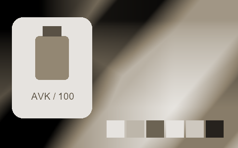

## 002 · 1920s

`sp-1920s` · `cinema` · MIT · 64³

50% gray Y′ 127.5/255 (+0.0 code values); 25–75% gray span ratio 1.000; mid-gray red minus blue +0.0 code values. Light/medium/deep skin swatches: #D5D5D5, #959595, #4E4E4E. Red/green/blue swatches: #525252, #080808, #4F4F4F.

Suggested use: Compare on your own SDR product, portrait and landscape footage before selecting.

Trial strength: 1–1; default 1.0.

Pixel color mapping only; no grain, glow, vignette, spatial haze or beauty effects. Natural footage quality is unaccepted. Check skin/product colors and clipped output.

| Input swatch | Input RGB | Actual output RGB |
|---|---|---|
| `gray_0` | `#000000` | `#000000` |
| `gray_10` | `#1A1A1A` | `#1A1A1A` |
| `gray_25` | `#404040` | `#404040` |
| `gray_50` | `#808080` | `#808080` |
| `gray_75` | `#BFBFBF` | `#BFBFBF` |
| `gray_90` | `#E6E6E6` | `#E5E5E5` |
| `gray_100` | `#FFFFFF` | `#FFFFFF` |
| `skin_light` | `#F5DBC6` | `#D5D5D5` |
| `skin_medium` | `#CF9B7B` | `#959595` |
| `skin_deep` | `#815438` | `#4E4E4E` |
| `red` | `#CC3333` | `#525252` |
| `green` | `#33CC33` | `#080808` |
| `blue` | `#3333CC` | `#4F4F4F` |

Creator: **Nixua / Striped Purple** · [Source](https://github.com/stripedpurple/color-grading-luts/blob/9757e8b5147693cab49c3fd674bf23dbe28d6c8e/Cinema%20Through%20The%20Ages/Striped%20Purple%20-%201920s.cube) · commit `9757e8b5147693cab49c3fd674bf23dbe28d6c8e`.

Conversion: `native-CUBE-grid-retained-v1`; 8,192 sampled RGB points; max error 0.0000000; mean 0.0000000. This is numerical approximation, not a perceptual quality score.

License obligations: Retain MIT copyright and license notice.

[License](../../../product/src/ai_ad_editor/look_data/licenses/sp-MIT.txt) · LUT SHA-256 `1433ad4babb27b3eba3348c55c538762745df81606b13487057eddca0a854a69`.

[Actual preview PNG](../../assets/look500-20261024-r1/previews/sp-1920s.png) · [Actual video](../../assets/look500-20261024-r1/videos/sp-1920s.mp4)

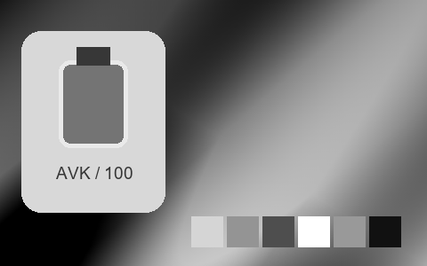

## 003 · 1930s

`sp-1930s` · `cinema` · MIT · 64³

50% gray Y′ 137.2/255 (+9.7 code values); 25–75% gray span ratio 1.041; mid-gray red minus blue +31.3 code values. Light/medium/deep skin swatches: #E1DFD7, #A7A38E, #5B5846. Red/green/blue swatches: #5F5C4A, #11100C, #040402.

Suggested use: Compare on your own SDR product, portrait and landscape footage before selecting.

Trial strength: 0.35–0.8; default 1.0.

Pixel color mapping only; no grain, glow, vignette, spatial haze or beauty effects. Natural footage quality is unaccepted. Check skin/product colors and clipped output.

| Input swatch | Input RGB | Actual output RGB |
|---|---|---|
| `gray_0` | `#000000` | `#000000` |
| `gray_10` | `#1A1A1A` | `#191712` |
| `gray_25` | `#404040` | `#454235` |
| `gray_50` | `#808080` | `#8F8A70` |
| `gray_75` | `#BFBFBF` | `#CAC7BA` |
| `gray_90` | `#E6E6E6` | `#EDECE6` |
| `gray_100` | `#FFFFFF` | `#FFFFFF` |
| `skin_light` | `#F5DBC6` | `#E1DFD7` |
| `skin_medium` | `#CF9B7B` | `#A7A38E` |
| `skin_deep` | `#815438` | `#5B5846` |
| `red` | `#CC3333` | `#5F5C4A` |
| `green` | `#33CC33` | `#11100C` |
| `blue` | `#3333CC` | `#040402` |

Creator: **Nixua / Striped Purple** · [Source](https://github.com/stripedpurple/color-grading-luts/blob/9757e8b5147693cab49c3fd674bf23dbe28d6c8e/Cinema%20Through%20The%20Ages/Striped%20Purple%20-%201930s.cube) · commit `9757e8b5147693cab49c3fd674bf23dbe28d6c8e`.

Conversion: `native-CUBE-grid-retained-v1`; 8,192 sampled RGB points; max error 0.0000000; mean 0.0000000. This is numerical approximation, not a perceptual quality score.

License obligations: Retain MIT copyright and license notice.

[License](../../../product/src/ai_ad_editor/look_data/licenses/sp-MIT.txt) · LUT SHA-256 `b8ecdd5ffd06c0a1e6e9c9a319223568a3a7ebed544c99741520642e84a0384f`.

[Actual preview PNG](../../assets/look500-20261024-r1/previews/sp-1930s.png) · [Actual video](../../assets/look500-20261024-r1/videos/sp-1930s.mp4)

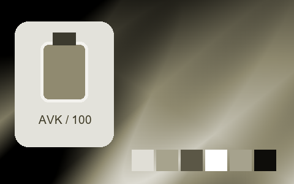

## 004 · 1940s

`sp-1940s` · `cinema` · MIT · 64³

50% gray Y′ 127.5/255 (+0.0 code values); 25–75% gray span ratio 1.000; mid-gray red minus blue +0.0 code values. Light/medium/deep skin swatches: #F5D2D3, #CE9690, #845454. Red/green/blue swatches: #BE133E, #14AEAD, #14B4BC.

Suggested use: Compare on your own SDR product, portrait and landscape footage before selecting.

Trial strength: 0.35–0.8; default 1.0.

Pixel color mapping only; no grain, glow, vignette, spatial haze or beauty effects. Natural footage quality is unaccepted. Check skin/product colors and clipped output.

| Input swatch | Input RGB | Actual output RGB |
|---|---|---|
| `gray_0` | `#000000` | `#000000` |
| `gray_10` | `#1A1A1A` | `#1A1A1A` |
| `gray_25` | `#404040` | `#404040` |
| `gray_50` | `#808080` | `#808080` |
| `gray_75` | `#BFBFBF` | `#BFBFBF` |
| `gray_90` | `#E6E6E6` | `#E5E5E5` |
| `gray_100` | `#FFFFFF` | `#FFFFFF` |
| `skin_light` | `#F5DBC6` | `#F5D2D3` |
| `skin_medium` | `#CF9B7B` | `#CE9690` |
| `skin_deep` | `#815438` | `#845454` |
| `red` | `#CC3333` | `#BE133E` |
| `green` | `#33CC33` | `#14AEAD` |
| `blue` | `#3333CC` | `#14B4BC` |

Creator: **Nixua / Striped Purple** · [Source](https://github.com/stripedpurple/color-grading-luts/blob/9757e8b5147693cab49c3fd674bf23dbe28d6c8e/Cinema%20Through%20The%20Ages/Striped%20Purple%20-%201940s.cube) · commit `9757e8b5147693cab49c3fd674bf23dbe28d6c8e`.

Conversion: `native-CUBE-grid-retained-v1`; 8,192 sampled RGB points; max error 0.0000000; mean 0.0000000. This is numerical approximation, not a perceptual quality score.

License obligations: Retain MIT copyright and license notice.

[License](../../../product/src/ai_ad_editor/look_data/licenses/sp-MIT.txt) · LUT SHA-256 `f3d000747f996f705b915f18b2671aec2b1aeb3d05cb07d227c3f9d455301e9c`.

[Actual preview PNG](../../assets/look500-20261024-r1/previews/sp-1940s.png) · [Actual video](../../assets/look500-20261024-r1/videos/sp-1940s.mp4)

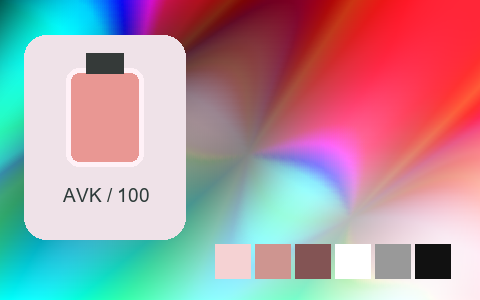

## 005 · 1950s

`sp-1950s` · `cinema` · MIT · 64³

50% gray Y′ 127.5/255 (+0.0 code values); 25–75% gray span ratio 1.000; mid-gray red minus blue -0.0 code values. Light/medium/deep skin swatches: #F5DBC8, #CE9C82, #7E5641. Red/green/blue swatches: #D54214, #00AEBA, #2551CF.

Suggested use: Compare on your own SDR product, portrait and landscape footage before selecting.

Trial strength: 0.35–0.8; default 1.0.

Pixel color mapping only; no grain, glow, vignette, spatial haze or beauty effects. Natural footage quality is unaccepted. Check skin/product colors and clipped output.

| Input swatch | Input RGB | Actual output RGB |
|---|---|---|
| `gray_0` | `#000000` | `#000000` |
| `gray_10` | `#1A1A1A` | `#1A1A1A` |
| `gray_25` | `#404040` | `#404040` |
| `gray_50` | `#808080` | `#7F8080` |
| `gray_75` | `#BFBFBF` | `#BFBFBF` |
| `gray_90` | `#E6E6E6` | `#E5E5E5` |
| `gray_100` | `#FFFFFF` | `#FFFFFF` |
| `skin_light` | `#F5DBC6` | `#F5DBC8` |
| `skin_medium` | `#CF9B7B` | `#CE9C82` |
| `skin_deep` | `#815438` | `#7E5641` |
| `red` | `#CC3333` | `#D54214` |
| `green` | `#33CC33` | `#00AEBA` |
| `blue` | `#3333CC` | `#2551CF` |

Creator: **Nixua / Striped Purple** · [Source](https://github.com/stripedpurple/color-grading-luts/blob/9757e8b5147693cab49c3fd674bf23dbe28d6c8e/Cinema%20Through%20The%20Ages/Striped%20Purple%20-%201950s.cube) · commit `9757e8b5147693cab49c3fd674bf23dbe28d6c8e`.

Conversion: `native-CUBE-grid-retained-v1`; 8,192 sampled RGB points; max error 0.0000000; mean 0.0000000. This is numerical approximation, not a perceptual quality score.

License obligations: Retain MIT copyright and license notice.

[License](../../../product/src/ai_ad_editor/look_data/licenses/sp-MIT.txt) · LUT SHA-256 `82f3efad7170ebeba3c6b2897d5fc2cbd0345b4a4b71824b269f4e94bbddc2dc`.

[Actual preview PNG](../../assets/look500-20261024-r1/previews/sp-1950s.png) · [Actual video](../../assets/look500-20261024-r1/videos/sp-1950s.mp4)

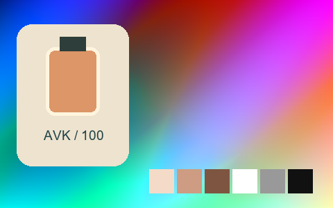

## 006 · 1960s

`sp-1960s` · `cinema` · MIT · 64³

50% gray Y′ 127.5/255 (+0.0 code values); 25–75% gray span ratio 1.000; mid-gray red minus blue -0.0 code values. Light/medium/deep skin swatches: #F5DAC8, #D29681, #884D3F. Red/green/blue swatches: #D33335, #13BFB7, #1435D5.

Suggested use: Compare on your own SDR product, portrait and landscape footage before selecting.

Trial strength: 0.35–0.8; default 1.0.

Pixel color mapping only; no grain, glow, vignette, spatial haze or beauty effects. Natural footage quality is unaccepted. Check skin/product colors and clipped output.

| Input swatch | Input RGB | Actual output RGB |
|---|---|---|
| `gray_0` | `#000000` | `#000000` |
| `gray_10` | `#1A1A1A` | `#1A1A1A` |
| `gray_25` | `#404040` | `#404040` |
| `gray_50` | `#808080` | `#7F8080` |
| `gray_75` | `#BFBFBF` | `#BFBFBF` |
| `gray_90` | `#E6E6E6` | `#E5E5E5` |
| `gray_100` | `#FFFFFF` | `#FFFFFF` |
| `skin_light` | `#F5DBC6` | `#F5DAC8` |
| `skin_medium` | `#CF9B7B` | `#D29681` |
| `skin_deep` | `#815438` | `#884D3F` |
| `red` | `#CC3333` | `#D33335` |
| `green` | `#33CC33` | `#13BFB7` |
| `blue` | `#3333CC` | `#1435D5` |

Creator: **Nixua / Striped Purple** · [Source](https://github.com/stripedpurple/color-grading-luts/blob/9757e8b5147693cab49c3fd674bf23dbe28d6c8e/Cinema%20Through%20The%20Ages/Striped%20Purple%20-%201960s.cube) · commit `9757e8b5147693cab49c3fd674bf23dbe28d6c8e`.

Conversion: `native-CUBE-grid-retained-v1`; 8,192 sampled RGB points; max error 0.0000000; mean 0.0000000. This is numerical approximation, not a perceptual quality score.

License obligations: Retain MIT copyright and license notice.

[License](../../../product/src/ai_ad_editor/look_data/licenses/sp-MIT.txt) · LUT SHA-256 `131e8cec132469e5e99d9ef4b346e39dae9d606705f74811b9894bd0ca99d9a8`.

[Actual preview PNG](../../assets/look500-20261024-r1/previews/sp-1960s.png) · [Actual video](../../assets/look500-20261024-r1/videos/sp-1960s.mp4)

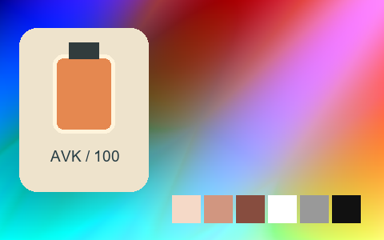

## 007 · 1970s

`sp-1970s` · `cinema` · MIT · 64³

50% gray Y′ 128.3/255 (+0.8 code values); 25–75% gray span ratio 1.108; mid-gray red minus blue +0.0 code values. Light/medium/deep skin swatches: #E0D8CC, #DFA375, #9F4F2F. Red/green/blue swatches: #E03325, #62D687, #4A60CA.

Suggested use: Compare on your own SDR product, portrait and landscape footage before selecting.

Trial strength: 0.35–0.8; default 1.0.

Pixel color mapping only; no grain, glow, vignette, spatial haze or beauty effects. Natural footage quality is unaccepted. Check skin/product colors and clipped output.

| Input swatch | Input RGB | Actual output RGB |
|---|---|---|
| `gray_0` | `#000000` | `#212121` |
| `gray_10` | `#1A1A1A` | `#262626` |
| `gray_25` | `#404040` | `#3A3A3A` |
| `gray_50` | `#808080` | `#808080` |
| `gray_75` | `#BFBFBF` | `#C7C7C7` |
| `gray_90` | `#E6E6E6` | `#DBDBDB` |
| `gray_100` | `#FFFFFF` | `#DFDFDF` |
| `skin_light` | `#F5DBC6` | `#E0D8CC` |
| `skin_medium` | `#CF9B7B` | `#DFA375` |
| `skin_deep` | `#815438` | `#9F4F2F` |
| `red` | `#CC3333` | `#E03325` |
| `green` | `#33CC33` | `#62D687` |
| `blue` | `#3333CC` | `#4A60CA` |

Creator: **Nixua / Striped Purple** · [Source](https://github.com/stripedpurple/color-grading-luts/blob/9757e8b5147693cab49c3fd674bf23dbe28d6c8e/Cinema%20Through%20The%20Ages/Striped%20Purple%20-%201970s.cube) · commit `9757e8b5147693cab49c3fd674bf23dbe28d6c8e`.

Conversion: `native-CUBE-grid-retained-v1`; 8,192 sampled RGB points; max error 0.0000000; mean 0.0000000. This is numerical approximation, not a perceptual quality score.

License obligations: Retain MIT copyright and license notice.

[License](../../../product/src/ai_ad_editor/look_data/licenses/sp-MIT.txt) · LUT SHA-256 `ae3581409ff727f29825fc583aa3f345688086fc9a5b4b8fdcf21b0c91fc8194`.

[Actual preview PNG](../../assets/look500-20261024-r1/previews/sp-1970s.png) · [Actual video](../../assets/look500-20261024-r1/videos/sp-1970s.mp4)

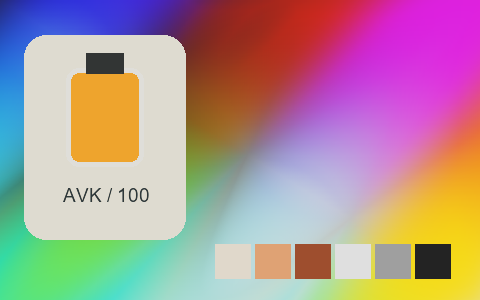

## 008 · 1980_s

`sp-1980-s` · `cinema` · MIT · 64³

50% gray Y′ 127.5/255 (-0.0 code values); 25–75% gray span ratio 1.370; mid-gray red minus blue -0.0 code values. Light/medium/deep skin swatches: #FFFCE7, #F0A984, #81482B. Red/green/blue swatches: #FF2808, #2FF6F1, #004EFF.

Suggested use: Compare on your own SDR product, portrait and landscape footage before selecting.

Trial strength: 0.35–0.8; default 1.0.

Pixel color mapping only; no grain, glow, vignette, spatial haze or beauty effects. Natural footage quality is unaccepted. Check skin/product colors and clipped output.

| Input swatch | Input RGB | Actual output RGB |
|---|---|---|
| `gray_0` | `#000000` | `#000000` |
| `gray_10` | `#1A1A1A` | `#000000` |
| `gray_25` | `#404040` | `#25292C` |
| `gray_50` | `#808080` | `#7F7F80` |
| `gray_75` | `#BFBFBF` | `#DAD6D3` |
| `gray_90` | `#E6E6E6` | `#FFFFFF` |
| `gray_100` | `#FFFFFF` | `#FFFFFF` |
| `skin_light` | `#F5DBC6` | `#FFFCE7` |
| `skin_medium` | `#CF9B7B` | `#F0A984` |
| `skin_deep` | `#815438` | `#81482B` |
| `red` | `#CC3333` | `#FF2808` |
| `green` | `#33CC33` | `#2FF6F1` |
| `blue` | `#3333CC` | `#004EFF` |

Creator: **Nixua / Striped Purple** · [Source](https://github.com/stripedpurple/color-grading-luts/blob/9757e8b5147693cab49c3fd674bf23dbe28d6c8e/Cinema%20Through%20The%20Ages/Striped%20Purple%20-%201980_s.cube) · commit `9757e8b5147693cab49c3fd674bf23dbe28d6c8e`.

Conversion: `native-CUBE-grid-retained-v1`; 8,192 sampled RGB points; max error 0.0000000; mean 0.0000000. This is numerical approximation, not a perceptual quality score.

License obligations: Retain MIT copyright and license notice.

[License](../../../product/src/ai_ad_editor/look_data/licenses/sp-MIT.txt) · LUT SHA-256 `51fbd944abcef4b6217a3e16cbd74432273728737b4894fb751c15c7fe2ffc48`.

[Actual preview PNG](../../assets/look500-20261024-r1/previews/sp-1980-s.png) · [Actual video](../../assets/look500-20261024-r1/videos/sp-1980-s.mp4)

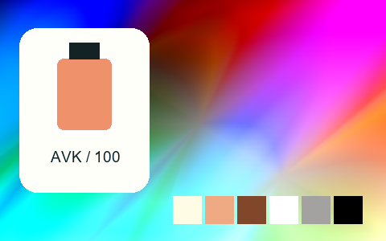

## 009 · Amber Haze

`sp-amber-haze` · `creative` · MIT · 32³

50% gray Y′ 93.5/255 (-34.0 code values); 25–75% gray span ratio 0.740; mid-gray red minus blue +8.0 code values. Light/medium/deep skin swatches: #B6A09E, #A06D62, #6F392D. Red/green/blue swatches: #9F2229, #319429, #3122A3.

Suggested use: Compare on your own SDR product, portrait and landscape footage before selecting.

Trial strength: 0.35–0.8; default 1.0.

Pixel color mapping only; no grain, glow, vignette, spatial haze or beauty effects. Natural footage quality is unaccepted. Check skin/product colors and clipped output.

| Input swatch | Input RGB | Actual output RGB |
|---|---|---|
| `gray_0` | `#000000` | `#040000` |
| `gray_10` | `#1A1A1A` | `#1B1114` |
| `gray_25` | `#404040` | `#3C2B33` |
| `gray_50` | `#808080` | `#6E5866` |
| `gray_75` | `#BFBFBF` | `#978998` |
| `gray_90` | `#E6E6E6` | `#ADA9B7` |
| `gray_100` | `#FFFFFF` | `#BBBFCB` |
| `skin_light` | `#F5DBC6` | `#B6A09E` |
| `skin_medium` | `#CF9B7B` | `#A06D62` |
| `skin_deep` | `#815438` | `#6F392D` |
| `red` | `#CC3333` | `#9F2229` |
| `green` | `#33CC33` | `#319429` |
| `blue` | `#3333CC` | `#3122A3` |

Creator: **Nixua / Striped Purple** · [Source](https://github.com/stripedpurple/color-grading-luts/blob/9757e8b5147693cab49c3fd674bf23dbe28d6c8e/Avant%20Garde/Striped%20Purple%20-%20Amber%20Haze.cube) · commit `9757e8b5147693cab49c3fd674bf23dbe28d6c8e`.

Conversion: `native-CUBE-grid-retained-v1`; 8,192 sampled RGB points; max error 0.0000000; mean 0.0000000. This is numerical approximation, not a perceptual quality score.

License obligations: Retain MIT copyright and license notice.

[License](../../../product/src/ai_ad_editor/look_data/licenses/sp-MIT.txt) · LUT SHA-256 `391f896bcd37959b63c8bf21d1d4667d916bae123f8b6976a1fdad8b832295b7`.

[Actual preview PNG](../../assets/look500-20261024-r1/previews/sp-amber-haze.png) · [Actual video](../../assets/look500-20261024-r1/videos/sp-amber-haze.mp4)

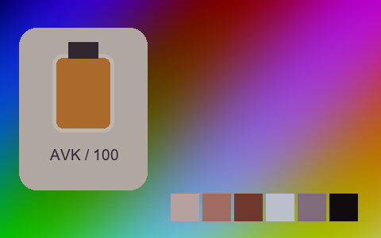

## 010 · Ara

`sp-ara` · `creative` · MIT · 64³

50% gray Y′ 123.9/255 (-3.6 code values); 25–75% gray span ratio 0.993; mid-gray red minus blue +10.0 code values. Light/medium/deep skin swatches: #FFCE92, #CC8749, #7A4A19. Red/green/blue swatches: #B6160C, #00E100, #1E08BB.

Suggested use: Compare on your own SDR product, portrait and landscape footage before selecting.

Trial strength: 0.35–0.8; default 1.0.

Pixel color mapping only; no grain, glow, vignette, spatial haze or beauty effects. Natural footage quality is unaccepted. Check skin/product colors and clipped output.

| Input swatch | Input RGB | Actual output RGB |
|---|---|---|
| `gray_0` | `#000000` | `#000000` |
| `gray_10` | `#1A1A1A` | `#111716` |
| `gray_25` | `#404040` | `#353D3A` |
| `gray_50` | `#808080` | `#7B7E71` |
| `gray_75` | `#BFBFBF` | `#BEBAA8` |
| `gray_90` | `#E6E6E6` | `#E8E3D7` |
| `gray_100` | `#FFFFFF` | `#FFFFFE` |
| `skin_light` | `#F5DBC6` | `#FFCE92` |
| `skin_medium` | `#CF9B7B` | `#CC8749` |
| `skin_deep` | `#815438` | `#7A4A19` |
| `red` | `#CC3333` | `#B6160C` |
| `green` | `#33CC33` | `#00E100` |
| `blue` | `#3333CC` | `#1E08BB` |

Creator: **Nixua / Striped Purple** · [Source](https://github.com/stripedpurple/color-grading-luts/blob/9757e8b5147693cab49c3fd674bf23dbe28d6c8e/Zoology/Striped%20Purple%20-%20Ara.cube) · commit `9757e8b5147693cab49c3fd674bf23dbe28d6c8e`.

Conversion: `native-CUBE-grid-retained-v1`; 8,192 sampled RGB points; max error 0.0000000; mean 0.0000000. This is numerical approximation, not a perceptual quality score.

License obligations: Retain MIT copyright and license notice.

[License](../../../product/src/ai_ad_editor/look_data/licenses/sp-MIT.txt) · LUT SHA-256 `b305a51c72c66460e32a908bb9fb05dad2f6890235a084d3fc5b317ca64903e9`.

[Actual preview PNG](../../assets/look500-20261024-r1/previews/sp-ara.png) · [Actual video](../../assets/look500-20261024-r1/videos/sp-ara.mp4)

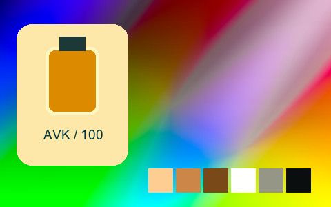

## 011 · Arcade Dayz

`sp-arcade-dayz` · `creative` · MIT · 32³

50% gray Y′ 133.9/255 (+6.4 code values); 25–75% gray span ratio 0.907; mid-gray red minus blue +16.8 code values. Light/medium/deep skin swatches: #F7E1D2, #D09177, #8D5C61. Red/green/blue swatches: #CF3B5D, #5CC241, #2743D3.

Suggested use: Compare on your own SDR product, portrait and landscape footage before selecting.

Trial strength: 0.35–0.8; default 1.0.

Pixel color mapping only; no grain, glow, vignette, spatial haze or beauty effects. Natural footage quality is unaccepted. Check skin/product colors and clipped output.

| Input swatch | Input RGB | Actual output RGB |
|---|---|---|
| `gray_0` | `#000000` | `#000000` |
| `gray_10` | `#1A1A1A` | `#07222A` |
| `gray_25` | `#404040` | `#2D5164` |
| `gray_50` | `#808080` | `#A67B95` |
| `gray_75` | `#BFBFBF` | `#C4BCBD` |
| `gray_90` | `#E6E6E6` | `#ECEBEC` |
| `gray_100` | `#FFFFFF` | `#FFFFFF` |
| `skin_light` | `#F5DBC6` | `#F7E1D2` |
| `skin_medium` | `#CF9B7B` | `#D09177` |
| `skin_deep` | `#815438` | `#8D5C61` |
| `red` | `#CC3333` | `#CF3B5D` |
| `green` | `#33CC33` | `#5CC241` |
| `blue` | `#3333CC` | `#2743D3` |

Creator: **Nixua / Striped Purple** · [Source](https://github.com/stripedpurple/color-grading-luts/blob/9757e8b5147693cab49c3fd674bf23dbe28d6c8e/Avant%20Garde/Striped%20Purple%20-%20Arcade%20Dayz.cube) · commit `9757e8b5147693cab49c3fd674bf23dbe28d6c8e`.

Conversion: `native-CUBE-grid-retained-v1`; 8,192 sampled RGB points; max error 0.0000000; mean 0.0000000. This is numerical approximation, not a perceptual quality score.

License obligations: Retain MIT copyright and license notice.

[License](../../../product/src/ai_ad_editor/look_data/licenses/sp-MIT.txt) · LUT SHA-256 `ec68418dad22ed505e80dae87ecb63d4b1460db2d539768cb497cd6f260a3657`.

[Actual preview PNG](../../assets/look500-20261024-r1/previews/sp-arcade-dayz.png) · [Actual video](../../assets/look500-20261024-r1/videos/sp-arcade-dayz.mp4)

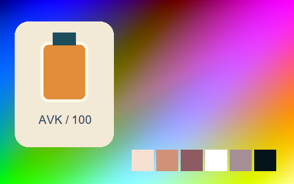

## 012 · Aricha Blend

`sp-aricha-blend` · `creative` · MIT · 32³

50% gray Y′ 128.0/255 (+0.5 code values); 25–75% gray span ratio 1.422; mid-gray red minus blue +47.9 code values. Light/medium/deep skin swatches: #F4ECE2, #D59D6F, #733519. Red/green/blue swatches: #D42D1C, #42CB1F, #2C20A7.

Suggested use: Compare on your own SDR product, portrait and landscape footage before selecting.

Trial strength: 0.35–0.8; default 1.0.

Pixel color mapping only; no grain, glow, vignette, spatial haze or beauty effects. Natural footage quality is unaccepted. Check skin/product colors and clipped output.

| Input swatch | Input RGB | Actual output RGB |
|---|---|---|
| `gray_0` | `#000000` | `#15110D` |
| `gray_10` | `#1A1A1A` | `#17130E` |
| `gray_25` | `#404040` | `#261E15` |
| `gray_50` | `#808080` | `#937D63` |
| `gray_75` | `#BFBFBF` | `#D7D4CF` |
| `gray_90` | `#E6E6E6` | `#F1F0EE` |
| `gray_100` | `#FFFFFF` | `#F7F7F6` |
| `skin_light` | `#F5DBC6` | `#F4ECE2` |
| `skin_medium` | `#CF9B7B` | `#D59D6F` |
| `skin_deep` | `#815438` | `#733519` |
| `red` | `#CC3333` | `#D42D1C` |
| `green` | `#33CC33` | `#42CB1F` |
| `blue` | `#3333CC` | `#2C20A7` |

Creator: **Nixua / Striped Purple** · [Source](https://github.com/stripedpurple/color-grading-luts/blob/9757e8b5147693cab49c3fd674bf23dbe28d6c8e/Drink%20it%20in%21/Striped%20Purple%20-%20Aricha%20Blend.cube) · commit `9757e8b5147693cab49c3fd674bf23dbe28d6c8e`.

Conversion: `native-CUBE-grid-retained-v1`; 8,192 sampled RGB points; max error 0.0000000; mean 0.0000000. This is numerical approximation, not a perceptual quality score.

License obligations: Retain MIT copyright and license notice.

[License](../../../product/src/ai_ad_editor/look_data/licenses/sp-MIT.txt) · LUT SHA-256 `36180adeddaec6f02ecb26d7cb91018911f04a3ade55e8eb427b379e7264239c`.

[Actual preview PNG](../../assets/look500-20261024-r1/previews/sp-aricha-blend.png) · [Actual video](../../assets/look500-20261024-r1/videos/sp-aricha-blend.mp4)

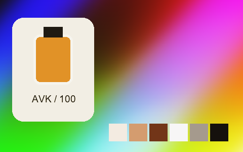

## 013 · Blow Me Down

`sp-blow-me-down` · `creative` · MIT · 32³

50% gray Y′ 144.6/255 (+17.1 code values); 25–75% gray span ratio 1.304; mid-gray red minus blue +9.0 code values. Light/medium/deep skin swatches: #F8FEB9, #FBB213, #B55306. Red/green/blue swatches: #FF3E01, #2B9D77, #87AFCA.

Suggested use: Compare on your own SDR product, portrait and landscape footage before selecting.

Trial strength: 0.35–0.8; default 1.0.

Pixel color mapping only; no grain, glow, vignette, spatial haze or beauty effects. Natural footage quality is unaccepted. Check skin/product colors and clipped output.

| Input swatch | Input RGB | Actual output RGB |
|---|---|---|
| `gray_0` | `#000000` | `#232425` |
| `gray_10` | `#1A1A1A` | `#242527` |
| `gray_25` | `#404040` | `#2C3136` |
| `gray_50` | `#808080` | `#94908B` |
| `gray_75` | `#BFBFBF` | `#E4D4C9` |
| `gray_90` | `#E6E6E6` | `#F9E7D3` |
| `gray_100` | `#FFFFFF` | `#F9E7D3` |
| `skin_light` | `#F5DBC6` | `#F8FEB9` |
| `skin_medium` | `#CF9B7B` | `#FBB213` |
| `skin_deep` | `#815438` | `#B55306` |
| `red` | `#CC3333` | `#FF3E01` |
| `green` | `#33CC33` | `#2B9D77` |
| `blue` | `#3333CC` | `#87AFCA` |

Creator: **Nixua / Striped Purple** · [Source](https://github.com/stripedpurple/color-grading-luts/blob/9757e8b5147693cab49c3fd674bf23dbe28d6c8e/Avant%20Garde/Striped%20Purple%20-%20Blow%20Me%20Down.cube) · commit `9757e8b5147693cab49c3fd674bf23dbe28d6c8e`.

Conversion: `native-CUBE-grid-retained-v1`; 8,192 sampled RGB points; max error 0.0000000; mean 0.0000000. This is numerical approximation, not a perceptual quality score.

License obligations: Retain MIT copyright and license notice.

[License](../../../product/src/ai_ad_editor/look_data/licenses/sp-MIT.txt) · LUT SHA-256 `a2a90af1e3795b37db6330abcc69d6004ec2064136207bc41099097ea9ffb0f7`.

[Actual preview PNG](../../assets/look500-20261024-r1/previews/sp-blow-me-down.png) · [Actual video](../../assets/look500-20261024-r1/videos/sp-blow-me-down.mp4)

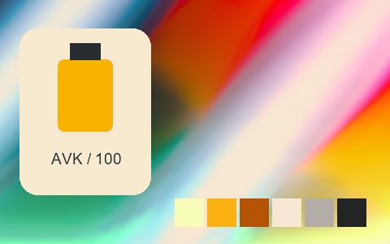

## 014 · Blue Lagoon

`sp-blue-lagoon` · `creative` · MIT · 64³

50% gray Y′ 127.5/255 (+0.0 code values); 25–75% gray span ratio 1.000; mid-gray red minus blue +0.0 code values. Light/medium/deep skin swatches: #F4DBC2, #CA9C6E, #845530. Red/green/blue swatches: #E4232C, #0DA877, #2C69D3.

Suggested use: Compare on your own SDR product, portrait and landscape footage before selecting.

Trial strength: 0.35–0.8; default 1.0.

Pixel color mapping only; no grain, glow, vignette, spatial haze or beauty effects. Natural footage quality is unaccepted. Check skin/product colors and clipped output.

| Input swatch | Input RGB | Actual output RGB |
|---|---|---|
| `gray_0` | `#000000` | `#000000` |
| `gray_10` | `#1A1A1A` | `#1A1A1A` |
| `gray_25` | `#404040` | `#404040` |
| `gray_50` | `#808080` | `#808080` |
| `gray_75` | `#BFBFBF` | `#BFBFBF` |
| `gray_90` | `#E6E6E6` | `#E5E5E5` |
| `gray_100` | `#FFFFFF` | `#FFFFFF` |
| `skin_light` | `#F5DBC6` | `#F4DBC2` |
| `skin_medium` | `#CF9B7B` | `#CA9C6E` |
| `skin_deep` | `#815438` | `#845530` |
| `red` | `#CC3333` | `#E4232C` |
| `green` | `#33CC33` | `#0DA877` |
| `blue` | `#3333CC` | `#2C69D3` |

Creator: **Nixua / Striped Purple** · [Source](https://github.com/stripedpurple/color-grading-luts/blob/9757e8b5147693cab49c3fd674bf23dbe28d6c8e/Drink%20it%20in%21/Striped%20Purple%20-%20Blue%20Lagoon.cube) · commit `9757e8b5147693cab49c3fd674bf23dbe28d6c8e`.

Conversion: `native-CUBE-grid-retained-v1`; 8,192 sampled RGB points; max error 0.0000000; mean 0.0000000. This is numerical approximation, not a perceptual quality score.

License obligations: Retain MIT copyright and license notice.

[License](../../../product/src/ai_ad_editor/look_data/licenses/sp-MIT.txt) · LUT SHA-256 `399efd6a99069015e2e01376ecd7ad3650f079cdfc78e31710e2ba8b8f56f233`.

[Actual preview PNG](../../assets/look500-20261024-r1/previews/sp-blue-lagoon.png) · [Actual video](../../assets/look500-20261024-r1/videos/sp-blue-lagoon.mp4)

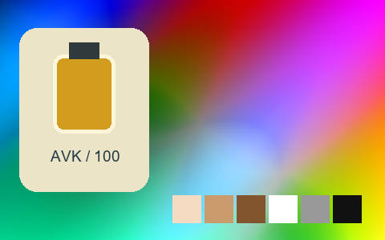

## 015 · Boa

`sp-boa` · `creative` · MIT · 64³

50% gray Y′ 121.1/255 (-6.4 code values); 25–75% gray span ratio 1.057; mid-gray red minus blue +21.0 code values. Light/medium/deep skin swatches: #FCD6AC, #C08956, #713E17. Red/green/blue swatches: #AD0012, #91AB44, #005886.

Suggested use: Compare on your own SDR product, portrait and landscape footage before selecting.

Trial strength: 0.35–0.8; default 1.0.

Pixel color mapping only; no grain, glow, vignette, spatial haze or beauty effects. Natural footage quality is unaccepted. Check skin/product colors and clipped output.

| Input swatch | Input RGB | Actual output RGB |
|---|---|---|
| `gray_0` | `#000000` | `#000000` |
| `gray_10` | `#1A1A1A` | `#09110A` |
| `gray_25` | `#404040` | `#283525` |
| `gray_50` | `#808080` | `#707F5B` |
| `gray_75` | `#BFBFBF` | `#B4BC94` |
| `gray_90` | `#E6E6E6` | `#E5E7D0` |
| `gray_100` | `#FFFFFF` | `#FFFFFF` |
| `skin_light` | `#F5DBC6` | `#FCD6AC` |
| `skin_medium` | `#CF9B7B` | `#C08956` |
| `skin_deep` | `#815438` | `#713E17` |
| `red` | `#CC3333` | `#AD0012` |
| `green` | `#33CC33` | `#91AB44` |
| `blue` | `#3333CC` | `#005886` |

Creator: **Nixua / Striped Purple** · [Source](https://github.com/stripedpurple/color-grading-luts/blob/9757e8b5147693cab49c3fd674bf23dbe28d6c8e/Zoology/Striped%20Purple%20-%20Boa.cube) · commit `9757e8b5147693cab49c3fd674bf23dbe28d6c8e`.

Conversion: `native-CUBE-grid-retained-v1`; 8,192 sampled RGB points; max error 0.0000000; mean 0.0000000. This is numerical approximation, not a perceptual quality score.

License obligations: Retain MIT copyright and license notice.

[License](../../../product/src/ai_ad_editor/look_data/licenses/sp-MIT.txt) · LUT SHA-256 `e32aaa5914cec54f7fa1610f51678c5f86f068f6141f80189d540264d93e79ef`.

[Actual preview PNG](../../assets/look500-20261024-r1/previews/sp-boa.png) · [Actual video](../../assets/look500-20261024-r1/videos/sp-boa.mp4)

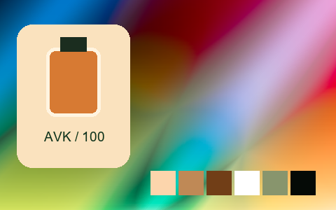

## 016 · Caramel Plum Cake

`sp-caramel-plum-cake` · `creative` · MIT · 32³

50% gray Y′ 95.4/255 (-32.1 code values); 25–75% gray span ratio 0.984; mid-gray red minus blue +21.3 code values. Light/medium/deep skin swatches: #F0D1B8, #DD8E63, #703B2F. Red/green/blue swatches: #D22F2F, #21881E, #342CC2.

Suggested use: Compare on your own SDR product, portrait and landscape footage before selecting.

Trial strength: 0.35–0.8; default 1.0.

Pixel color mapping only; no grain, glow, vignette, spatial haze or beauty effects. Natural footage quality is unaccepted. Check skin/product colors and clipped output.

| Input swatch | Input RGB | Actual output RGB |
|---|---|---|
| `gray_0` | `#000000` | `#1D1D1D` |
| `gray_10` | `#1A1A1A` | `#232121` |
| `gray_25` | `#404040` | `#312A2B` |
| `gray_50` | `#808080` | `#6D5C58` |
| `gray_75` | `#BFBFBF` | `#B1A7A4` |
| `gray_90` | `#E6E6E6` | `#D6D1CF` |
| `gray_100` | `#FFFFFF` | `#EBE8E7` |
| `skin_light` | `#F5DBC6` | `#F0D1B8` |
| `skin_medium` | `#CF9B7B` | `#DD8E63` |
| `skin_deep` | `#815438` | `#703B2F` |
| `red` | `#CC3333` | `#D22F2F` |
| `green` | `#33CC33` | `#21881E` |
| `blue` | `#3333CC` | `#342CC2` |

Creator: **Nixua / Striped Purple** · [Source](https://github.com/stripedpurple/color-grading-luts/blob/9757e8b5147693cab49c3fd674bf23dbe28d6c8e/Avant%20Garde/Striped%20Purple%20-%20Caramel%20Plum%20Cake.cube) · commit `9757e8b5147693cab49c3fd674bf23dbe28d6c8e`.

Conversion: `native-CUBE-grid-retained-v1`; 8,192 sampled RGB points; max error 0.0000000; mean 0.0000000. This is numerical approximation, not a perceptual quality score.

License obligations: Retain MIT copyright and license notice.

[License](../../../product/src/ai_ad_editor/look_data/licenses/sp-MIT.txt) · LUT SHA-256 `33512f89431ef8405e5652da3c95006bacf9898e44ad856a70b90aae00014a7e`.

[Actual preview PNG](../../assets/look500-20261024-r1/previews/sp-caramel-plum-cake.png) · [Actual video](../../assets/look500-20261024-r1/videos/sp-caramel-plum-cake.mp4)

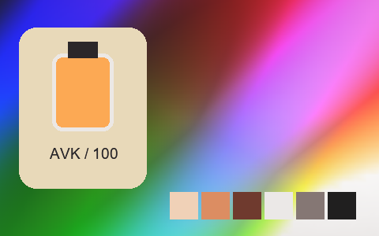

## 017 · Cherry Champagne

`sp-cherry-champagne` · `creative` · MIT · 32³

50% gray Y′ 154.3/255 (+26.8 code values); 25–75% gray span ratio 0.620; mid-gray red minus blue +8.5 code values. Light/medium/deep skin swatches: #ECD3CD, #DAA5A2, #AE7C80. Red/green/blue swatches: #D96C7D, #69C77D, #696CD0.

Suggested use: Compare on your own SDR product, portrait and landscape footage before selecting.

Trial strength: 0.35–0.8; default 1.0.

Pixel color mapping only; no grain, glow, vignette, spatial haze or beauty effects. Natural footage quality is unaccepted. Check skin/product colors and clipped output.

| Input swatch | Input RGB | Actual output RGB |
|---|---|---|
| `gray_0` | `#000000` | `#2D5566` |
| `gray_10` | `#1A1A1A` | `#4C6071` |
| `gray_25` | `#404040` | `#767284` |
| `gray_50` | `#808080` | `#AD94A4` |
| `gray_75` | `#BFBFBF` | `#D3BEC9` |
| `gray_90` | `#E6E6E6` | `#E5DBE0` |
| `gray_100` | `#FFFFFF` | `#F1EEF0` |
| `skin_light` | `#F5DBC6` | `#ECD3CD` |
| `skin_medium` | `#CF9B7B` | `#DAA5A2` |
| `skin_deep` | `#815438` | `#AE7C80` |
| `red` | `#CC3333` | `#D96C7D` |
| `green` | `#33CC33` | `#69C77D` |
| `blue` | `#3333CC` | `#696CD0` |

Creator: **Nixua / Striped Purple** · [Source](https://github.com/stripedpurple/color-grading-luts/blob/9757e8b5147693cab49c3fd674bf23dbe28d6c8e/Avant%20Garde/Striped%20Purple%20-%20Cherry%20Champagne.cube) · commit `9757e8b5147693cab49c3fd674bf23dbe28d6c8e`.

Conversion: `native-CUBE-grid-retained-v1`; 8,192 sampled RGB points; max error 0.0000000; mean 0.0000000. This is numerical approximation, not a perceptual quality score.

License obligations: Retain MIT copyright and license notice.

[License](../../../product/src/ai_ad_editor/look_data/licenses/sp-MIT.txt) · LUT SHA-256 `c426f349af15b15615db3eeb32583946ad5a3db150d0af38c44c731842027630`.

[Actual preview PNG](../../assets/look500-20261024-r1/previews/sp-cherry-champagne.png) · [Actual video](../../assets/look500-20261024-r1/videos/sp-cherry-champagne.mp4)

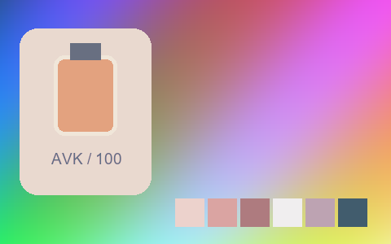

## 018 · December Greens

`sp-december-greens` · `landscape` · MIT · 64³

50% gray Y′ 127.5/255 (+0.0 code values); 25–75% gray span ratio 1.000; mid-gray red minus blue +0.0 code values. Light/medium/deep skin swatches: #F4DBCA, #C89E89, #805948. Red/green/blue swatches: #DE5A39, #14BA77, #253BC7.

Suggested use: Compare on your own SDR product, portrait and landscape footage before selecting.

Trial strength: 0.35–0.8; default 1.0.

Pixel color mapping only; no grain, glow, vignette, spatial haze or beauty effects. Natural footage quality is unaccepted. Check skin/product colors and clipped output.

| Input swatch | Input RGB | Actual output RGB |
|---|---|---|
| `gray_0` | `#000000` | `#000000` |
| `gray_10` | `#1A1A1A` | `#1A1A1A` |
| `gray_25` | `#404040` | `#404040` |
| `gray_50` | `#808080` | `#80807F` |
| `gray_75` | `#BFBFBF` | `#BFBFBF` |
| `gray_90` | `#E6E6E6` | `#E5E5E5` |
| `gray_100` | `#FFFFFF` | `#FFFFFF` |
| `skin_light` | `#F5DBC6` | `#F4DBCA` |
| `skin_medium` | `#CF9B7B` | `#C89E89` |
| `skin_deep` | `#815438` | `#805948` |
| `red` | `#CC3333` | `#DE5A39` |
| `green` | `#33CC33` | `#14BA77` |
| `blue` | `#3333CC` | `#253BC7` |

Creator: **Nixua / Striped Purple** · [Source](https://github.com/stripedpurple/color-grading-luts/blob/9757e8b5147693cab49c3fd674bf23dbe28d6c8e/Scenic%20Moods/Striped%20Purple%20-%20December%20Greens.cube) · commit `9757e8b5147693cab49c3fd674bf23dbe28d6c8e`.

Conversion: `native-CUBE-grid-retained-v1`; 8,192 sampled RGB points; max error 0.0000000; mean 0.0000000. This is numerical approximation, not a perceptual quality score.

License obligations: Retain MIT copyright and license notice.

[License](../../../product/src/ai_ad_editor/look_data/licenses/sp-MIT.txt) · LUT SHA-256 `c05bb89507b1e6c76f072e14a85c61c1e69e737b241fb75f4a3ee1b70047ddaa`.

[Actual preview PNG](../../assets/look500-20261024-r1/previews/sp-december-greens.png) · [Actual video](../../assets/look500-20261024-r1/videos/sp-december-greens.mp4)

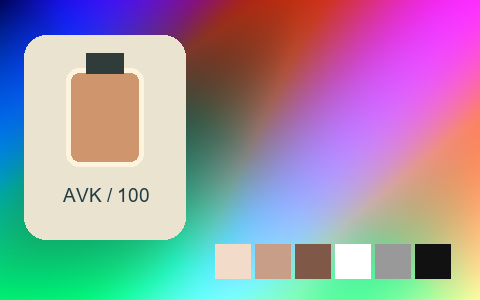

## 019 · Dodo

`sp-dodo` · `creative` · MIT · 64³

50% gray Y′ 103.5/255 (-24.0 code values); 25–75% gray span ratio 0.837; mid-gray red minus blue +0.0 code values. Light/medium/deep skin swatches: #E8BD9D, #C07B4A, #754321. Red/green/blue swatches: #C22F05, #4E6C51, #79809C.

Suggested use: Compare on your own SDR product, portrait and landscape footage before selecting.

Trial strength: 0.35–0.8; default 1.0.

Pixel color mapping only; no grain, glow, vignette, spatial haze or beauty effects. Natural footage quality is unaccepted. Check skin/product colors and clipped output.

| Input swatch | Input RGB | Actual output RGB |
|---|---|---|
| `gray_0` | `#000000` | `#1D1D1D` |
| `gray_10` | `#1A1A1A` | `#212121` |
| `gray_25` | `#404040` | `#363636` |
| `gray_50` | `#808080` | `#686868` |
| `gray_75` | `#BFBFBF` | `#A1A1A1` |
| `gray_90` | `#E6E6E6` | `#D0D0D0` |
| `gray_100` | `#FFFFFF` | `#FCFCFC` |
| `skin_light` | `#F5DBC6` | `#E8BD9D` |
| `skin_medium` | `#CF9B7B` | `#C07B4A` |
| `skin_deep` | `#815438` | `#754321` |
| `red` | `#CC3333` | `#C22F05` |
| `green` | `#33CC33` | `#4E6C51` |
| `blue` | `#3333CC` | `#79809C` |

Creator: **Nixua / Striped Purple** · [Source](https://github.com/stripedpurple/color-grading-luts/blob/9757e8b5147693cab49c3fd674bf23dbe28d6c8e/Zoology/Striped%20Purple%20-%20Dodo.cube) · commit `9757e8b5147693cab49c3fd674bf23dbe28d6c8e`.

Conversion: `native-CUBE-grid-retained-v1`; 8,192 sampled RGB points; max error 0.0000000; mean 0.0000000. This is numerical approximation, not a perceptual quality score.

License obligations: Retain MIT copyright and license notice.

[License](../../../product/src/ai_ad_editor/look_data/licenses/sp-MIT.txt) · LUT SHA-256 `2422d62ad806917badd1aee347343336ea4361b3f5c389dbf1cddbc60a51df25`.

[Actual preview PNG](../../assets/look500-20261024-r1/previews/sp-dodo.png) · [Actual video](../../assets/look500-20261024-r1/videos/sp-dodo.mp4)

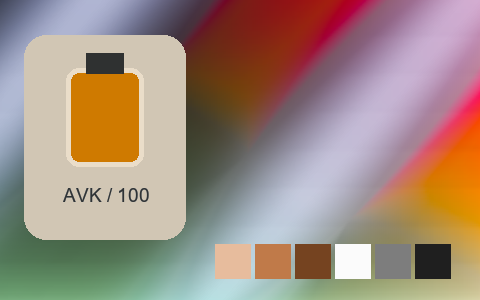

## 020 · Emerald Malaise

`sp-emerald-malaise` · `landscape` · MIT · 16³

50% gray Y′ 113.6/255 (-13.9 code values); 25–75% gray span ratio 0.764; mid-gray red minus blue -4.7 code values. Light/medium/deep skin swatches: #D9B891, #B18B66, #665439. Red/green/blue swatches: #AE3A36, #2DAD36, #2D3A95.

Suggested use: Compare on your own SDR product, portrait and landscape footage before selecting.

Trial strength: 0.35–0.8; default 1.0.

Pixel color mapping only; no grain, glow, vignette, spatial haze or beauty effects. Natural footage quality is unaccepted. Check skin/product colors and clipped output.

| Input swatch | Input RGB | Actual output RGB |
|---|---|---|
| `gray_0` | `#000000` | `#0E0F11` |
| `gray_10` | `#1A1A1A` | `#1D2424` |
| `gray_25` | `#404040` | `#35443F` |
| `gray_50` | `#808080` | `#657669` |
| `gray_75` | `#BFBFBF` | `#A0A48E` |
| `gray_90` | `#E6E6E6` | `#C9BFA2` |
| `gray_100` | `#FFFFFF` | `#E4D0AF` |
| `skin_light` | `#F5DBC6` | `#D9B891` |
| `skin_medium` | `#CF9B7B` | `#B18B66` |
| `skin_deep` | `#815438` | `#665439` |
| `red` | `#CC3333` | `#AE3A36` |
| `green` | `#33CC33` | `#2DAD36` |
| `blue` | `#3333CC` | `#2D3A95` |

Creator: **Nixua / Striped Purple** · [Source](https://github.com/stripedpurple/color-grading-luts/blob/9757e8b5147693cab49c3fd674bf23dbe28d6c8e/Scenic%20Moods/Striped%20Purple%20-%20Emerald%20Malaise.cube) · commit `9757e8b5147693cab49c3fd674bf23dbe28d6c8e`.

Conversion: `native-CUBE-grid-retained-v1`; 8,192 sampled RGB points; max error 0.0000000; mean 0.0000000. This is numerical approximation, not a perceptual quality score.

License obligations: Retain MIT copyright and license notice.

[License](../../../product/src/ai_ad_editor/look_data/licenses/sp-MIT.txt) · LUT SHA-256 `3ca04ba3a3407ad275c314713523e91457d805c4609342c2293cbddb575be72f`.

[Actual preview PNG](../../assets/look500-20261024-r1/previews/sp-emerald-malaise.png) · [Actual video](../../assets/look500-20261024-r1/videos/sp-emerald-malaise.mp4)

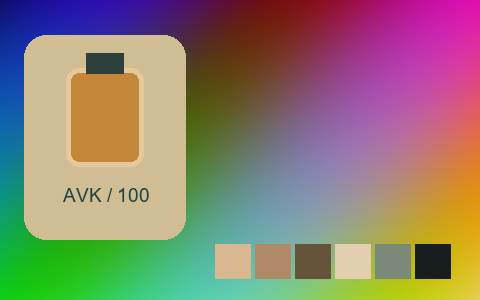

## 021 · Great Auk

`sp-great-auk` · `creative` · MIT · 64³

50% gray Y′ 86.5/255 (-41.0 code values); 25–75% gray span ratio 1.046; mid-gray red minus blue +0.0 code values. Light/medium/deep skin swatches: #D2D2D2, #828282, #313131. Red/green/blue swatches: #343434, #656565, #1F1F1F.

Suggested use: Compare on your own SDR product, portrait and landscape footage before selecting.

Trial strength: 1–1; default 1.0.

Pixel color mapping only; no grain, glow, vignette, spatial haze or beauty effects. Natural footage quality is unaccepted. Check skin/product colors and clipped output.

| Input swatch | Input RGB | Actual output RGB |
|---|---|---|
| `gray_0` | `#000000` | `#1D1D1D` |
| `gray_10` | `#1A1A1A` | `#1D1D1D` |
| `gray_25` | `#404040` | `#1E1E1E` |
| `gray_50` | `#808080` | `#575757` |
| `gray_75` | `#BFBFBF` | `#A3A3A3` |
| `gray_90` | `#E6E6E6` | `#D8D8D8` |
| `gray_100` | `#FFFFFF` | `#FFFFFF` |
| `skin_light` | `#F5DBC6` | `#D2D2D2` |
| `skin_medium` | `#CF9B7B` | `#828282` |
| `skin_deep` | `#815438` | `#313131` |
| `red` | `#CC3333` | `#343434` |
| `green` | `#33CC33` | `#656565` |
| `blue` | `#3333CC` | `#1F1F1F` |

Creator: **Nixua / Striped Purple** · [Source](https://github.com/stripedpurple/color-grading-luts/blob/9757e8b5147693cab49c3fd674bf23dbe28d6c8e/Zoology/Striped%20Purple%20-%20Great%20Auk.cube) · commit `9757e8b5147693cab49c3fd674bf23dbe28d6c8e`.

Conversion: `native-CUBE-grid-retained-v1`; 8,192 sampled RGB points; max error 0.0000000; mean 0.0000000. This is numerical approximation, not a perceptual quality score.

License obligations: Retain MIT copyright and license notice.

[License](../../../product/src/ai_ad_editor/look_data/licenses/sp-MIT.txt) · LUT SHA-256 `3d46d0c5f0fda375e1f09e4853bd0f1517c80d56fa4b25509df589ecbf2b5c05`.

[Actual preview PNG](../../assets/look500-20261024-r1/previews/sp-great-auk.png) · [Actual video](../../assets/look500-20261024-r1/videos/sp-great-auk.mp4)

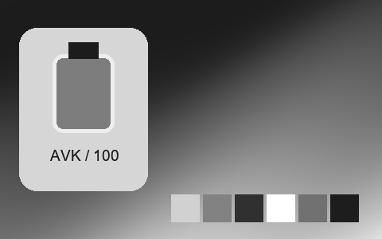

## 022 · Grey Matter

`sp-grey-matter` · `creative` · MIT · 32³

50% gray Y′ 120.1/255 (-7.4 code values); 25–75% gray span ratio 1.325; mid-gray red minus blue +21.5 code values. Light/medium/deep skin swatches: #E6E3E1, #B5ACA6, #4D4640. Red/green/blue swatches: #85786F, #85786F, #7D7168.

Suggested use: Compare on your own SDR product, portrait and landscape footage before selecting.

Trial strength: 0.35–0.8; default 1.0.

Pixel color mapping only; no grain, glow, vignette, spatial haze or beauty effects. Natural footage quality is unaccepted. Check skin/product colors and clipped output.

| Input swatch | Input RGB | Actual output RGB |
|---|---|---|
| `gray_0` | `#000000` | `#1C1A18` |
| `gray_10` | `#1A1A1A` | `#1E1B19` |
| `gray_25` | `#404040` | `#2A2623` |
| `gray_50` | `#808080` | `#82766D` |
| `gray_75` | `#BFBFBF` | `#D4CFCC` |
| `gray_90` | `#E6E6E6` | `#EAE8E6` |
| `gray_100` | `#FFFFFF` | `#F2F1F0` |
| `skin_light` | `#F5DBC6` | `#E6E3E1` |
| `skin_medium` | `#CF9B7B` | `#B5ACA6` |
| `skin_deep` | `#815438` | `#4D4640` |
| `red` | `#CC3333` | `#85786F` |
| `green` | `#33CC33` | `#85786F` |
| `blue` | `#3333CC` | `#7D7168` |

Creator: **Nixua / Striped Purple** · [Source](https://github.com/stripedpurple/color-grading-luts/blob/9757e8b5147693cab49c3fd674bf23dbe28d6c8e/MISC/Striped%20Purple%20-%20Grey%20Matter.cube) · commit `9757e8b5147693cab49c3fd674bf23dbe28d6c8e`.

Conversion: `native-CUBE-grid-retained-v1`; 8,192 sampled RGB points; max error 0.0000000; mean 0.0000000. This is numerical approximation, not a perceptual quality score.

License obligations: Retain MIT copyright and license notice.

[License](../../../product/src/ai_ad_editor/look_data/licenses/sp-MIT.txt) · LUT SHA-256 `6a4d62fab181cb261b2226ef1507b3a42eacd6e1a8d0973debcdd2b752b9589c`.

[Actual preview PNG](../../assets/look500-20261024-r1/previews/sp-grey-matter.png) · [Actual video](../../assets/look500-20261024-r1/videos/sp-grey-matter.mp4)

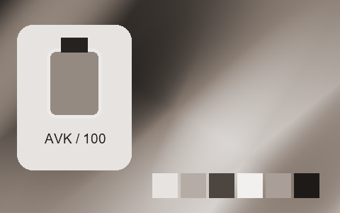

## 023 · Horchata

`sp-horchata` · `creative` · MIT · 32³

50% gray Y′ 119.6/255 (-7.9 code values); 25–75% gray span ratio 1.324; mid-gray red minus blue -0.0 code values. Light/medium/deep skin swatches: #EEE4DA, #D6A784, #643929. Red/green/blue swatches: #C92A2A, #2AC92A, #2525C0.

Suggested use: Compare on your own SDR product, portrait and landscape footage before selecting.

Trial strength: 0.35–0.8; default 1.0.

Pixel color mapping only; no grain, glow, vignette, spatial haze or beauty effects. Natural footage quality is unaccepted. Check skin/product colors and clipped output.

| Input swatch | Input RGB | Actual output RGB |
|---|---|---|
| `gray_0` | `#000000` | `#1A1A1A` |
| `gray_10` | `#1A1A1A` | `#1C1C1C` |
| `gray_25` | `#404040` | `#272727` |
| `gray_50` | `#808080` | `#787878` |
| `gray_75` | `#BFBFBF` | `#D0D0D0` |
| `gray_90` | `#E6E6E6` | `#E8E8E8` |
| `gray_100` | `#FFFFFF` | `#F1F1F1` |
| `skin_light` | `#F5DBC6` | `#EEE4DA` |
| `skin_medium` | `#CF9B7B` | `#D6A784` |
| `skin_deep` | `#815438` | `#643929` |
| `red` | `#CC3333` | `#C92A2A` |
| `green` | `#33CC33` | `#2AC92A` |
| `blue` | `#3333CC` | `#2525C0` |

Creator: **Nixua / Striped Purple** · [Source](https://github.com/stripedpurple/color-grading-luts/blob/9757e8b5147693cab49c3fd674bf23dbe28d6c8e/Drink%20it%20in%21/Striped%20Purple%20-%20Horchata.cube) · commit `9757e8b5147693cab49c3fd674bf23dbe28d6c8e`.

Conversion: `native-CUBE-grid-retained-v1`; 8,192 sampled RGB points; max error 0.0000000; mean 0.0000000. This is numerical approximation, not a perceptual quality score.

License obligations: Retain MIT copyright and license notice.

[License](../../../product/src/ai_ad_editor/look_data/licenses/sp-MIT.txt) · LUT SHA-256 `7d299593177cf3b3026f4ce610b273d927f42452f40b6f50f1c006f4414a73db`.

[Actual preview PNG](../../assets/look500-20261024-r1/previews/sp-horchata.png) · [Actual video](../../assets/look500-20261024-r1/videos/sp-horchata.mp4)

## 024 · Infrared

`sp-infrared` · `infrared` · MIT · 32³

50% gray Y′ 127.5/255 (+0.0 code values); 25–75% gray span ratio 1.000; mid-gray red minus blue +0.0 code values. Light/medium/deep skin swatches: #FCDACB, #DD9277, #8D4C35. Red/green/blue swatches: #8A3C00, #F9317E, #004C4C.

Suggested use: Compare on your own SDR product, portrait and landscape footage before selecting.

Trial strength: 0.35–0.8; default 1.0.

Pixel color mapping only; no grain, glow, vignette, spatial haze or beauty effects. Natural footage quality is unaccepted. Check skin/product colors and clipped output.

| Input swatch | Input RGB | Actual output RGB |
|---|---|---|
| `gray_0` | `#000000` | `#000000` |
| `gray_10` | `#1A1A1A` | `#191919` |
| `gray_25` | `#404040` | `#404040` |
| `gray_50` | `#808080` | `#808080` |
| `gray_75` | `#BFBFBF` | `#BFBFBF` |
| `gray_90` | `#E6E6E6` | `#E6E6E6` |
| `gray_100` | `#FFFFFF` | `#FFFFFF` |
| `skin_light` | `#F5DBC6` | `#FCDACB` |
| `skin_medium` | `#CF9B7B` | `#DD9277` |
| `skin_deep` | `#815438` | `#8D4C35` |
| `red` | `#CC3333` | `#8A3C00` |
| `green` | `#33CC33` | `#F9317E` |
| `blue` | `#3333CC` | `#004C4C` |

Creator: **Nixua / Striped Purple** · [Source](https://github.com/stripedpurple/color-grading-luts/blob/9757e8b5147693cab49c3fd674bf23dbe28d6c8e/Film%20Simulations/Infrared/Striped%20Purple%20-%20Infrared.cube) · commit `9757e8b5147693cab49c3fd674bf23dbe28d6c8e`.

Conversion: `native-CUBE-grid-retained-v1`; 8,192 sampled RGB points; max error 0.0000000; mean 0.0000000. This is numerical approximation, not a perceptual quality score.

License obligations: Retain MIT copyright and license notice.

[License](../../../product/src/ai_ad_editor/look_data/licenses/sp-MIT.txt) · LUT SHA-256 `b9104f927582542b69f0a5219d47ada05b1db68741aa0949c4760887295c89ab`.

[Actual preview PNG](../../assets/look500-20261024-r1/previews/sp-infrared.png) · [Actual video](../../assets/look500-20261024-r1/videos/sp-infrared.mp4)

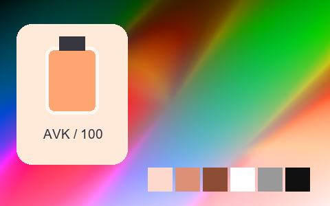

## 025 · Infrared 2

`sp-infrared-2` · `infrared` · MIT · 64³

50% gray Y′ 127.5/255 (+0.0 code values); 25–75% gray span ratio 1.000; mid-gray red minus blue +0.0 code values. Light/medium/deep skin swatches: #F9D8CA, #D59781, #86503D. Red/green/blue swatches: #A54E0C, #F25994, #006161.

Suggested use: Compare on your own SDR product, portrait and landscape footage before selecting.

Trial strength: 0.35–0.8; default 1.0.

Pixel color mapping only; no grain, glow, vignette, spatial haze or beauty effects. Natural footage quality is unaccepted. Check skin/product colors and clipped output.

| Input swatch | Input RGB | Actual output RGB |
|---|---|---|
| `gray_0` | `#000000` | `#000000` |
| `gray_10` | `#1A1A1A` | `#1A1A1A` |
| `gray_25` | `#404040` | `#404040` |
| `gray_50` | `#808080` | `#808080` |
| `gray_75` | `#BFBFBF` | `#BFBFBF` |
| `gray_90` | `#E6E6E6` | `#E5E5E5` |
| `gray_100` | `#FFFFFF` | `#FFFFFF` |
| `skin_light` | `#F5DBC6` | `#F9D8CA` |
| `skin_medium` | `#CF9B7B` | `#D59781` |
| `skin_deep` | `#815438` | `#86503D` |
| `red` | `#CC3333` | `#A54E0C` |
| `green` | `#33CC33` | `#F25994` |
| `blue` | `#3333CC` | `#006161` |

Creator: **Nixua / Striped Purple** · [Source](https://github.com/stripedpurple/color-grading-luts/blob/9757e8b5147693cab49c3fd674bf23dbe28d6c8e/Film%20Simulations/Infrared/Infrared%202.cube) · commit `9757e8b5147693cab49c3fd674bf23dbe28d6c8e`.

Conversion: `native-CUBE-grid-retained-v1`; 8,192 sampled RGB points; max error 0.0000000; mean 0.0000000. This is numerical approximation, not a perceptual quality score.

License obligations: Retain MIT copyright and license notice.

[License](../../../product/src/ai_ad_editor/look_data/licenses/sp-MIT.txt) · LUT SHA-256 `67e9bbe0aee79fd8f315aec90b094742827f321b1ea19ce5183de2e389b30803`.

[Actual preview PNG](../../assets/look500-20261024-r1/previews/sp-infrared-2.png) · [Actual video](../../assets/look500-20261024-r1/videos/sp-infrared-2.mp4)

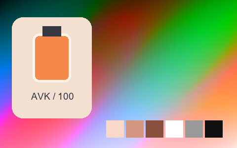

## 026 · Irish Uprising

`sp-irish-uprising` · `landscape` · MIT · 32³

50% gray Y′ 135.8/255 (+8.3 code values); 25–75% gray span ratio 0.907; mid-gray red minus blue +40.0 code values. Light/medium/deep skin swatches: #EDD7B2, #D2A164, #926033. Red/green/blue swatches: #D0412F, #40CA2F, #4041B9.

Suggested use: Compare on your own SDR product, portrait and landscape footage before selecting.

Trial strength: 0.35–0.8; default 1.0.

Pixel color mapping only; no grain, glow, vignette, spatial haze or beauty effects. Natural footage quality is unaccepted. Check skin/product colors and clipped output.

| Input swatch | Input RGB | Actual output RGB |
|---|---|---|
| `gray_0` | `#000000` | `#040F11` |
| `gray_10` | `#1A1A1A` | `#222820` |
| `gray_25` | `#404040` | `#4E4D38` |
| `gray_50` | `#808080` | `#908868` |
| `gray_75` | `#BFBFBF` | `#C6C0AA` |
| `gray_90` | `#E6E6E6` | `#E2DFD7` |
| `gray_100` | `#FFFFFF` | `#F4F4F6` |
| `skin_light` | `#F5DBC6` | `#EDD7B2` |
| `skin_medium` | `#CF9B7B` | `#D2A164` |
| `skin_deep` | `#815438` | `#926033` |
| `red` | `#CC3333` | `#D0412F` |
| `green` | `#33CC33` | `#40CA2F` |
| `blue` | `#3333CC` | `#4041B9` |

Creator: **Nixua / Striped Purple** · [Source](https://github.com/stripedpurple/color-grading-luts/blob/9757e8b5147693cab49c3fd674bf23dbe28d6c8e/Scenic%20Moods/Striped%20Purple%20-%20Irish%20Uprising.cube) · commit `9757e8b5147693cab49c3fd674bf23dbe28d6c8e`.

Conversion: `native-CUBE-grid-retained-v1`; 8,192 sampled RGB points; max error 0.0000000; mean 0.0000000. This is numerical approximation, not a perceptual quality score.

License obligations: Retain MIT copyright and license notice.

[License](../../../product/src/ai_ad_editor/look_data/licenses/sp-MIT.txt) · LUT SHA-256 `8ce17d53e0cb32bd32a4d7c0e4c2c348a7f302de4a3c968edc217137ba99432c`.

[Actual preview PNG](../../assets/look500-20261024-r1/previews/sp-irish-uprising.png) · [Actual video](../../assets/look500-20261024-r1/videos/sp-irish-uprising.mp4)

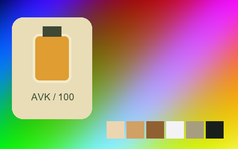

## 027 · Kraken

`sp-kraken` · `creative` · MIT · 64³

50% gray Y′ 112.3/255 (-15.2 code values); 25–75% gray span ratio 0.961; mid-gray red minus blue +11.0 code values. Light/medium/deep skin swatches: #F0C9A3, #D27641, #8F361D. Red/green/blue swatches: #CD4200, #52A946, #0050C9.

Suggested use: Compare on your own SDR product, portrait and landscape footage before selecting.

Trial strength: 0.35–0.8; default 1.0.

Pixel color mapping only; no grain, glow, vignette, spatial haze or beauty effects. Natural footage quality is unaccepted. Check skin/product colors and clipped output.

| Input swatch | Input RGB | Actual output RGB |
|---|---|---|
| `gray_0` | `#000000` | `#381D20` |
| `gray_10` | `#1A1A1A` | `#3A1F21` |
| `gray_25` | `#404040` | `#4F3235` |
| `gray_50` | `#808080` | `#786E6C` |
| `gray_75` | `#BFBFBF` | `#9DBAAF` |
| `gray_90` | `#E6E6E6` | `#C8E3DA` |
| `gray_100` | `#FFFFFF` | `#FEFFFF` |
| `skin_light` | `#F5DBC6` | `#F0C9A3` |
| `skin_medium` | `#CF9B7B` | `#D27641` |
| `skin_deep` | `#815438` | `#8F361D` |
| `red` | `#CC3333` | `#CD4200` |
| `green` | `#33CC33` | `#52A946` |
| `blue` | `#3333CC` | `#0050C9` |

Creator: **Nixua / Striped Purple** · [Source](https://github.com/stripedpurple/color-grading-luts/blob/9757e8b5147693cab49c3fd674bf23dbe28d6c8e/Zoology/Striped%20Purple%20-%20Kraken.cube) · commit `9757e8b5147693cab49c3fd674bf23dbe28d6c8e`.

Conversion: `native-CUBE-grid-retained-v1`; 8,192 sampled RGB points; max error 0.0000000; mean 0.0000000. This is numerical approximation, not a perceptual quality score.

License obligations: Retain MIT copyright and license notice.

[License](../../../product/src/ai_ad_editor/look_data/licenses/sp-MIT.txt) · LUT SHA-256 `be3e304750faa590fe0ea6cc0197a05ee8c14cc68de170b1e01e50e6c5c9873b`.

[Actual preview PNG](../../assets/look500-20261024-r1/previews/sp-kraken.png) · [Actual video](../../assets/look500-20261024-r1/videos/sp-kraken.mp4)

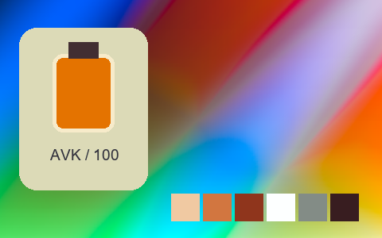

## 028 · Lobster

`sp-lobster` · `creative` · MIT · 16³

50% gray Y′ 116.5/255 (-11.0 code values); 25–75% gray span ratio 0.894; mid-gray red minus blue +4.9 code values. Light/medium/deep skin swatches: #EBB890, #C48247, #844C11. Red/green/blue swatches: #C43200, #26B552, #2B55A0.

Suggested use: Compare on your own SDR product, portrait and landscape footage before selecting.

Trial strength: 0.35–0.8; default 1.0.

Pixel color mapping only; no grain, glow, vignette, spatial haze or beauty effects. Natural footage quality is unaccepted. Check skin/product colors and clipped output.

| Input swatch | Input RGB | Actual output RGB |
|---|---|---|
| `gray_0` | `#000000` | `#252627` |
| `gray_10` | `#1A1A1A` | `#252729` |
| `gray_25` | `#404040` | `#2A323A` |
| `gray_50` | `#808080` | `#757570` |
| `gray_75` | `#BFBFBF` | `#AAA29A` |
| `gray_90` | `#E6E6E6` | `#D0C0B5` |
| `gray_100` | `#FFFFFF` | `#F7E1C8` |
| `skin_light` | `#F5DBC6` | `#EBB890` |
| `skin_medium` | `#CF9B7B` | `#C48247` |
| `skin_deep` | `#815438` | `#844C11` |
| `red` | `#CC3333` | `#C43200` |
| `green` | `#33CC33` | `#26B552` |
| `blue` | `#3333CC` | `#2B55A0` |

Creator: **Nixua / Striped Purple** · [Source](https://github.com/stripedpurple/color-grading-luts/blob/9757e8b5147693cab49c3fd674bf23dbe28d6c8e/Zoology/Striped%20Purple%20-%20Lobster.cube) · commit `9757e8b5147693cab49c3fd674bf23dbe28d6c8e`.

Conversion: `native-CUBE-grid-retained-v1`; 8,192 sampled RGB points; max error 0.0000000; mean 0.0000000. This is numerical approximation, not a perceptual quality score.

License obligations: Retain MIT copyright and license notice.

[License](../../../product/src/ai_ad_editor/look_data/licenses/sp-MIT.txt) · LUT SHA-256 `88650f721cf6127fa76563664d5222bb825573b3eb7dd0393fd1f52f8c72f7b4`.

[Actual preview PNG](../../assets/look500-20261024-r1/previews/sp-lobster.png) · [Actual video](../../assets/look500-20261024-r1/videos/sp-lobster.mp4)

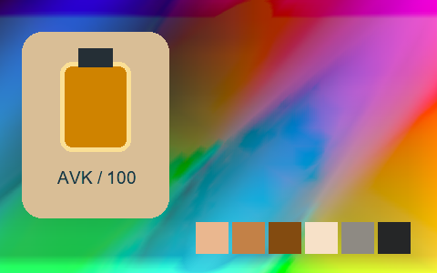

## 029 · Lomochrome Purple

`sp-lomochrome-purple` · `lomography` · MIT · 64³

50% gray Y′ 127.5/255 (+0.0 code values); 25–75% gray span ratio 1.000; mid-gray red minus blue +0.0 code values. Light/medium/deep skin swatches: #FCD4D2, #CF729E, #663267. Red/green/blue swatches: #4C1B56, #F819DA, #033282.

Suggested use: Compare on your own SDR product, portrait and landscape footage before selecting.

Trial strength: 0.35–0.8; default 1.0.

Pixel color mapping only; no grain, glow, vignette, spatial haze or beauty effects. Natural footage quality is unaccepted. Check skin/product colors and clipped output.

| Input swatch | Input RGB | Actual output RGB |
|---|---|---|
| `gray_0` | `#000000` | `#000000` |
| `gray_10` | `#1A1A1A` | `#1A1A1A` |
| `gray_25` | `#404040` | `#404040` |
| `gray_50` | `#808080` | `#80807F` |
| `gray_75` | `#BFBFBF` | `#BFBFBF` |
| `gray_90` | `#E6E6E6` | `#E5E5E5` |
| `gray_100` | `#FFFFFF` | `#FFFFFF` |
| `skin_light` | `#F5DBC6` | `#FCD4D2` |
| `skin_medium` | `#CF9B7B` | `#CF729E` |
| `skin_deep` | `#815438` | `#663267` |
| `red` | `#CC3333` | `#4C1B56` |
| `green` | `#33CC33` | `#F819DA` |
| `blue` | `#3333CC` | `#033282` |

Creator: **Nixua / Striped Purple** · [Source](https://github.com/stripedpurple/color-grading-luts/blob/9757e8b5147693cab49c3fd674bf23dbe28d6c8e/Film%20Simulations/Lomography/Lomochrome%20Purple.cube) · commit `9757e8b5147693cab49c3fd674bf23dbe28d6c8e`.

Conversion: `native-CUBE-grid-retained-v1`; 8,192 sampled RGB points; max error 0.0000000; mean 0.0000000. This is numerical approximation, not a perceptual quality score.

License obligations: Retain MIT copyright and license notice.

[License](../../../product/src/ai_ad_editor/look_data/licenses/sp-MIT.txt) · LUT SHA-256 `ff98d81fd60b96b36a196a2f21214d384ed5c93d69184cfbf0163884d6909ea4`.

[Actual preview PNG](../../assets/look500-20261024-r1/previews/sp-lomochrome-purple.png) · [Actual video](../../assets/look500-20261024-r1/videos/sp-lomochrome-purple.mp4)

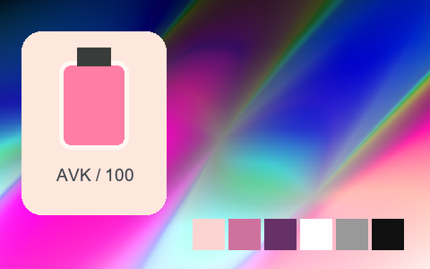

## 030 · Lomochrome Purple 2

`sp-lomochrome-purple-2` · `lomography` · MIT · 64³

50% gray Y′ 127.5/255 (+0.0 code values); 25–75% gray span ratio 1.000; mid-gray red minus blue +0.0 code values. Light/medium/deep skin swatches: #FED4D2, #DE8AB1, #89418A. Red/green/blue swatches: #A82AC3, #EA51D5, #124AAB.

Suggested use: Compare on your own SDR product, portrait and landscape footage before selecting.

Trial strength: 0.35–0.8; default 1.0.

Pixel color mapping only; no grain, glow, vignette, spatial haze or beauty effects. Natural footage quality is unaccepted. Check skin/product colors and clipped output.

| Input swatch | Input RGB | Actual output RGB |
|---|---|---|
| `gray_0` | `#000000` | `#000000` |
| `gray_10` | `#1A1A1A` | `#1A1A1A` |
| `gray_25` | `#404040` | `#404040` |
| `gray_50` | `#808080` | `#808080` |
| `gray_75` | `#BFBFBF` | `#BFBFBF` |
| `gray_90` | `#E6E6E6` | `#E5E5E5` |
| `gray_100` | `#FFFFFF` | `#FFFFFF` |
| `skin_light` | `#F5DBC6` | `#FED4D2` |
| `skin_medium` | `#CF9B7B` | `#DE8AB1` |
| `skin_deep` | `#815438` | `#89418A` |
| `red` | `#CC3333` | `#A82AC3` |
| `green` | `#33CC33` | `#EA51D5` |
| `blue` | `#3333CC` | `#124AAB` |

Creator: **Nixua / Striped Purple** · [Source](https://github.com/stripedpurple/color-grading-luts/blob/9757e8b5147693cab49c3fd674bf23dbe28d6c8e/Film%20Simulations/Lomography/Lomochrome%20Purple%202.cube) · commit `9757e8b5147693cab49c3fd674bf23dbe28d6c8e`.

Conversion: `native-CUBE-grid-retained-v1`; 8,192 sampled RGB points; max error 0.0000000; mean 0.0000000. This is numerical approximation, not a perceptual quality score.

License obligations: Retain MIT copyright and license notice.

[License](../../../product/src/ai_ad_editor/look_data/licenses/sp-MIT.txt) · LUT SHA-256 `776f866fee0415858c31c0a2b228a51bf716f87032b606d00ad33e54ec6907a4`.

[Actual preview PNG](../../assets/look500-20261024-r1/previews/sp-lomochrome-purple-2.png) · [Actual video](../../assets/look500-20261024-r1/videos/sp-lomochrome-purple-2.mp4)

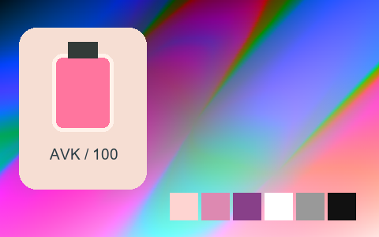

## 031 · Lomochrome Purple 3

`sp-lomochrome-purple-3` · `lomography` · MIT · 64³

50% gray Y′ 127.5/255 (+0.0 code values); 25–75% gray span ratio 1.000; mid-gray red minus blue +0.0 code values. Light/medium/deep skin swatches: #FED0E9, #DD89B7, #8D446C. Red/green/blue swatches: #BE25A4, #9C9F06, #1548AE.

Suggested use: Compare on your own SDR product, portrait and landscape footage before selecting.

Trial strength: 0.35–0.8; default 1.0.

Pixel color mapping only; no grain, glow, vignette, spatial haze or beauty effects. Natural footage quality is unaccepted. Check skin/product colors and clipped output.

| Input swatch | Input RGB | Actual output RGB |
|---|---|---|
| `gray_0` | `#000000` | `#000000` |
| `gray_10` | `#1A1A1A` | `#1A1A1A` |
| `gray_25` | `#404040` | `#404040` |
| `gray_50` | `#808080` | `#808080` |
| `gray_75` | `#BFBFBF` | `#BFBFBF` |
| `gray_90` | `#E6E6E6` | `#E5E5E5` |
| `gray_100` | `#FFFFFF` | `#FFFFFF` |
| `skin_light` | `#F5DBC6` | `#FED0E9` |
| `skin_medium` | `#CF9B7B` | `#DD89B7` |
| `skin_deep` | `#815438` | `#8D446C` |
| `red` | `#CC3333` | `#BE25A4` |
| `green` | `#33CC33` | `#9C9F06` |
| `blue` | `#3333CC` | `#1548AE` |

Creator: **Nixua / Striped Purple** · [Source](https://github.com/stripedpurple/color-grading-luts/blob/9757e8b5147693cab49c3fd674bf23dbe28d6c8e/Film%20Simulations/Lomography/Lomochrome%20Purple%203.cube) · commit `9757e8b5147693cab49c3fd674bf23dbe28d6c8e`.

Conversion: `native-CUBE-grid-retained-v1`; 8,192 sampled RGB points; max error 0.0000000; mean 0.0000000. This is numerical approximation, not a perceptual quality score.

License obligations: Retain MIT copyright and license notice.

[License](../../../product/src/ai_ad_editor/look_data/licenses/sp-MIT.txt) · LUT SHA-256 `12295fbff8446d6840a00dd98b81de677bfd12de7d3ca20a6214ea204a36ec91`.

[Actual preview PNG](../../assets/look500-20261024-r1/previews/sp-lomochrome-purple-3.png) · [Actual video](../../assets/look500-20261024-r1/videos/sp-lomochrome-purple-3.mp4)

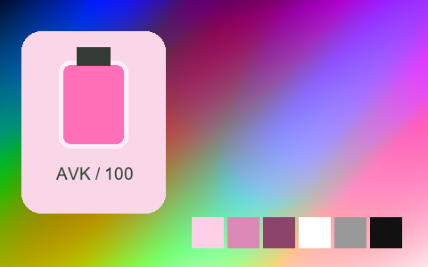

## 032 · Lomochrome Purple 4

`sp-lomochrome-purple-4` · `lomography` · MIT · 64³

50% gray Y′ 127.5/255 (+0.0 code values); 25–75% gray span ratio 1.000; mid-gray red minus blue +0.0 code values. Light/medium/deep skin swatches: #FBD2E8, #D68DB5, #87486A. Red/green/blue swatches: #AE2F99, #939457, #1D479C.

Suggested use: Compare on your own SDR product, portrait and landscape footage before selecting.

Trial strength: 0.35–0.8; default 1.0.

Pixel color mapping only; no grain, glow, vignette, spatial haze or beauty effects. Natural footage quality is unaccepted. Check skin/product colors and clipped output.

| Input swatch | Input RGB | Actual output RGB |
|---|---|---|
| `gray_0` | `#000000` | `#000000` |
| `gray_10` | `#1A1A1A` | `#1A1A1A` |
| `gray_25` | `#404040` | `#404040` |
| `gray_50` | `#808080` | `#808080` |
| `gray_75` | `#BFBFBF` | `#BFBFBF` |
| `gray_90` | `#E6E6E6` | `#E5E5E5` |
| `gray_100` | `#FFFFFF` | `#FFFFFF` |
| `skin_light` | `#F5DBC6` | `#FBD2E8` |
| `skin_medium` | `#CF9B7B` | `#D68DB5` |
| `skin_deep` | `#815438` | `#87486A` |
| `red` | `#CC3333` | `#AE2F99` |
| `green` | `#33CC33` | `#939457` |
| `blue` | `#3333CC` | `#1D479C` |

Creator: **Nixua / Striped Purple** · [Source](https://github.com/stripedpurple/color-grading-luts/blob/9757e8b5147693cab49c3fd674bf23dbe28d6c8e/Film%20Simulations/Lomography/Lomochrome%20Purple%204.cube) · commit `9757e8b5147693cab49c3fd674bf23dbe28d6c8e`.

Conversion: `native-CUBE-grid-retained-v1`; 8,192 sampled RGB points; max error 0.0000000; mean 0.0000000. This is numerical approximation, not a perceptual quality score.

License obligations: Retain MIT copyright and license notice.

[License](../../../product/src/ai_ad_editor/look_data/licenses/sp-MIT.txt) · LUT SHA-256 `29e6773ad0b89a42a995a59f13bcd413247c374c10fa3ade07ea267347542bcf`.

[Actual preview PNG](../../assets/look500-20261024-r1/previews/sp-lomochrome-purple-4.png) · [Actual video](../../assets/look500-20261024-r1/videos/sp-lomochrome-purple-4.mp4)

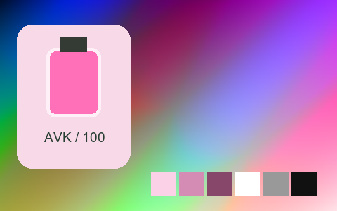

## 033 · Lomochrome Purple 5

`sp-lomochrome-purple-5` · `lomography` · MIT · 64³

50% gray Y′ 127.5/255 (+0.0 code values); 25–75% gray span ratio 1.000; mid-gray red minus blue +0.0 code values. Light/medium/deep skin swatches: #F0C7DD, #C77FA7, #7A3B5E. Red/green/blue swatches: #BF40AA, #76773A, #406ABF.

Suggested use: Compare on your own SDR product, portrait and landscape footage before selecting.

Trial strength: 0.35–0.8; default 1.0.

Pixel color mapping only; no grain, glow, vignette, spatial haze or beauty effects. Natural footage quality is unaccepted. Check skin/product colors and clipped output.

| Input swatch | Input RGB | Actual output RGB |
|---|---|---|
| `gray_0` | `#000000` | `#000000` |
| `gray_10` | `#1A1A1A` | `#1A1A1A` |
| `gray_25` | `#404040` | `#404040` |
| `gray_50` | `#808080` | `#808080` |
| `gray_75` | `#BFBFBF` | `#BFBFBF` |
| `gray_90` | `#E6E6E6` | `#E5E5E5` |
| `gray_100` | `#FFFFFF` | `#FFFFFF` |
| `skin_light` | `#F5DBC6` | `#F0C7DD` |
| `skin_medium` | `#CF9B7B` | `#C77FA7` |
| `skin_deep` | `#815438` | `#7A3B5E` |
| `red` | `#CC3333` | `#BF40AA` |
| `green` | `#33CC33` | `#76773A` |
| `blue` | `#3333CC` | `#406ABF` |

Creator: **Nixua / Striped Purple** · [Source](https://github.com/stripedpurple/color-grading-luts/blob/9757e8b5147693cab49c3fd674bf23dbe28d6c8e/Film%20Simulations/Lomography/Lomochrome%20Purple%205.cube) · commit `9757e8b5147693cab49c3fd674bf23dbe28d6c8e`.

Conversion: `native-CUBE-grid-retained-v1`; 8,192 sampled RGB points; max error 0.0000000; mean 0.0000000. This is numerical approximation, not a perceptual quality score.

License obligations: Retain MIT copyright and license notice.

[License](../../../product/src/ai_ad_editor/look_data/licenses/sp-MIT.txt) · LUT SHA-256 `fca9dc32e878aeb32440869044adc77fd1d6e998e253147fb129be0447872bfc`.

[Actual preview PNG](../../assets/look500-20261024-r1/previews/sp-lomochrome-purple-5.png) · [Actual video](../../assets/look500-20261024-r1/videos/sp-lomochrome-purple-5.mp4)

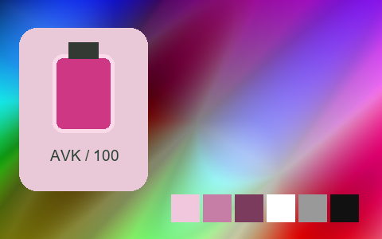

## 034 · Moa

`sp-moa` · `creative` · MIT · 64³

50% gray Y′ 123.6/255 (-3.9 code values); 25–75% gray span ratio 1.090; mid-gray red minus blue +12.4 code values. Light/medium/deep skin swatches: #DCDBD7, #B0AEA7, #58544C. Red/green/blue swatches: #5A574E, #928F86, #403D36.

Suggested use: Compare on your own SDR product, portrait and landscape footage before selecting.

Trial strength: 0.35–0.8; default 1.0.

Pixel color mapping only; no grain, glow, vignette, spatial haze or beauty effects. Natural footage quality is unaccepted. Check skin/product colors and clipped output.

| Input swatch | Input RGB | Actual output RGB |
|---|---|---|
| `gray_0` | `#000000` | `#191814` |
| `gray_10` | `#1A1A1A` | `#24231E` |
| `gray_25` | `#404040` | `#3C3A33` |
| `gray_50` | `#808080` | `#7F7C73` |
| `gray_75` | `#BFBFBF` | `#C7C5BF` |
| `gray_90` | `#E6E6E6` | `#DEDDDA` |
| `gray_100` | `#FFFFFF` | `#E9E8E6` |
| `skin_light` | `#F5DBC6` | `#DCDBD7` |
| `skin_medium` | `#CF9B7B` | `#B0AEA7` |
| `skin_deep` | `#815438` | `#58544C` |
| `red` | `#CC3333` | `#5A574E` |
| `green` | `#33CC33` | `#928F86` |
| `blue` | `#3333CC` | `#403D36` |

Creator: **Nixua / Striped Purple** · [Source](https://github.com/stripedpurple/color-grading-luts/blob/9757e8b5147693cab49c3fd674bf23dbe28d6c8e/Zoology/Striped%20Purple%20-%20Moa.cube) · commit `9757e8b5147693cab49c3fd674bf23dbe28d6c8e`.

Conversion: `native-CUBE-grid-retained-v1`; 8,192 sampled RGB points; max error 0.0000000; mean 0.0000000. This is numerical approximation, not a perceptual quality score.

License obligations: Retain MIT copyright and license notice.

[License](../../../product/src/ai_ad_editor/look_data/licenses/sp-MIT.txt) · LUT SHA-256 `1dda89c88958ff2199325a910a4f8d929f239944874e9c6c5e800a5c600c6dba`.

[Actual preview PNG](../../assets/look500-20261024-r1/previews/sp-moa.png) · [Actual video](../../assets/look500-20261024-r1/videos/sp-moa.mp4)

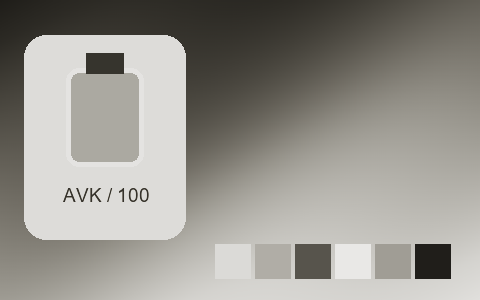

## 035 · Pendleton

`sp-pendleton` · `creative` · MIT · 32³

50% gray Y′ 133.3/255 (+5.8 code values); 25–75% gray span ratio 1.287; mid-gray red minus blue +8.2 code values. Light/medium/deep skin swatches: #FEFAD6, #F19066, #753B31. Red/green/blue swatches: #DD3C60, #5BD970, #334494.

Suggested use: Compare on your own SDR product, portrait and landscape footage before selecting.

Trial strength: 0.35–0.8; default 1.0.

Pixel color mapping only; no grain, glow, vignette, spatial haze or beauty effects. Natural footage quality is unaccepted. Check skin/product colors and clipped output.

| Input swatch | Input RGB | Actual output RGB |
|---|---|---|
| `gray_0` | `#000000` | `#100F10` |
| `gray_10` | `#1A1A1A` | `#201F1F` |
| `gray_25` | `#404040` | `#414143` |
| `gray_50` | `#808080` | `#898581` |
| `gray_75` | `#BFBFBF` | `#EFE4D5` |
| `gray_90` | `#E6E6E6` | `#FDFDFB` |
| `gray_100` | `#FFFFFF` | `#FEFEFE` |
| `skin_light` | `#F5DBC6` | `#FEFAD6` |
| `skin_medium` | `#CF9B7B` | `#F19066` |
| `skin_deep` | `#815438` | `#753B31` |
| `red` | `#CC3333` | `#DD3C60` |
| `green` | `#33CC33` | `#5BD970` |
| `blue` | `#3333CC` | `#334494` |

Creator: **Nixua / Striped Purple** · [Source](https://github.com/stripedpurple/color-grading-luts/blob/9757e8b5147693cab49c3fd674bf23dbe28d6c8e/Avant%20Garde/Striped%20Purple%20-%20Pendleton.cube) · commit `9757e8b5147693cab49c3fd674bf23dbe28d6c8e`.

Conversion: `native-CUBE-grid-retained-v1`; 8,192 sampled RGB points; max error 0.0000000; mean 0.0000000. This is numerical approximation, not a perceptual quality score.

License obligations: Retain MIT copyright and license notice.

[License](../../../product/src/ai_ad_editor/look_data/licenses/sp-MIT.txt) · LUT SHA-256 `823ce14c1c10bd0c5432679afa856f40cd70bceaa0ce815840439994f5b8991c`.

[Actual preview PNG](../../assets/look500-20261024-r1/previews/sp-pendleton.png) · [Actual video](../../assets/look500-20261024-r1/videos/sp-pendleton.mp4)

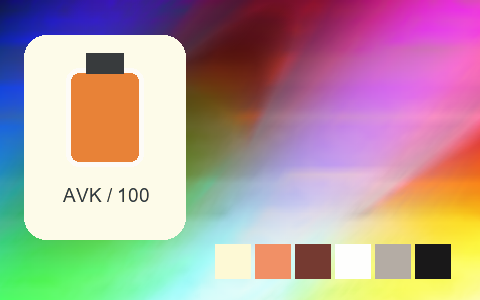

## 036 · Philly Fog

`sp-philly-fog` · `landscape` · MIT · 16³

50% gray Y′ 128.3/255 (+0.8 code values); 25–75% gray span ratio 1.150; mid-gray red minus blue +1.7 code values. Light/medium/deep skin swatches: #E3D9CC, #D3A475, #955633. Red/green/blue swatches: #C94B30, #83D395, #405DB3.

Suggested use: Compare on your own SDR product, portrait and landscape footage before selecting.

Trial strength: 0.35–0.8; default 1.0.

Pixel color mapping only; no grain, glow, vignette, spatial haze or beauty effects. Natural footage quality is unaccepted. Check skin/product colors and clipped output.

| Input swatch | Input RGB | Actual output RGB |
|---|---|---|
| `gray_0` | `#000000` | `#191D21` |
| `gray_10` | `#1A1A1A` | `#1E2226` |
| `gray_25` | `#404040` | `#34383B` |
| `gray_50` | `#808080` | `#81807F` |
| `gray_75` | `#BFBFBF` | `#CEC9C5` |
| `gray_90` | `#E6E6E6` | `#E3DEDA` |
| `gray_100` | `#FFFFFF` | `#E7E3DF` |
| `skin_light` | `#F5DBC6` | `#E3D9CC` |
| `skin_medium` | `#CF9B7B` | `#D3A475` |
| `skin_deep` | `#815438` | `#955633` |
| `red` | `#CC3333` | `#C94B30` |
| `green` | `#33CC33` | `#83D395` |
| `blue` | `#3333CC` | `#405DB3` |

Creator: **Nixua / Striped Purple** · [Source](https://github.com/stripedpurple/color-grading-luts/blob/9757e8b5147693cab49c3fd674bf23dbe28d6c8e/Scenic%20Moods/Striped%20Purple%20-%20Philly%20Fog.cube) · commit `9757e8b5147693cab49c3fd674bf23dbe28d6c8e`.

Conversion: `native-CUBE-grid-retained-v1`; 8,192 sampled RGB points; max error 0.0000000; mean 0.0000000. This is numerical approximation, not a perceptual quality score.

License obligations: Retain MIT copyright and license notice.

[License](../../../product/src/ai_ad_editor/look_data/licenses/sp-MIT.txt) · LUT SHA-256 `63020776deceddd16cf8a753b9d040a61f43fd54a00ddacc2a92035cf5399919`.

[Actual preview PNG](../../assets/look500-20261024-r1/previews/sp-philly-fog.png) · [Actual video](../../assets/look500-20261024-r1/videos/sp-philly-fog.mp4)

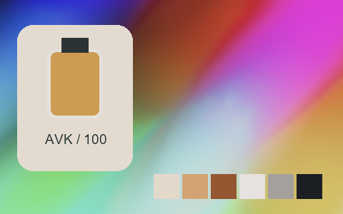

## 037 · Polaroid Mint Cream

`sp-polaroid-mint-cream` · `creative` · MIT · 32³

50% gray Y′ 161.9/255 (+34.4 code values); 25–75% gray span ratio 0.968; mid-gray red minus blue +27.0 code values. Light/medium/deep skin swatches: #FAEBC9, #ECC299, #AB7567. Red/green/blue swatches: #E67571, #97E081, #615CBD.

Suggested use: Compare on your own SDR product, portrait and landscape footage before selecting.

Trial strength: 0.35–0.8; default 1.0.

Pixel color mapping only; no grain, glow, vignette, spatial haze or beauty effects. Natural footage quality is unaccepted. Check skin/product colors and clipped output.

| Input swatch | Input RGB | Actual output RGB |
|---|---|---|
| `gray_0` | `#000000` | `#555153` |
| `gray_10` | `#1A1A1A` | `#595556` |
| `gray_25` | `#404040` | `#696261` |
| `gray_50` | `#808080` | `#AFA094` |
| `gray_75` | `#BFBFBF` | `#E9DEC4` |
| `gray_90` | `#E6E6E6` | `#F8EED0` |
| `gray_100` | `#FFFFFF` | `#FDF4D5` |
| `skin_light` | `#F5DBC6` | `#FAEBC9` |
| `skin_medium` | `#CF9B7B` | `#ECC299` |
| `skin_deep` | `#815438` | `#AB7567` |
| `red` | `#CC3333` | `#E67571` |
| `green` | `#33CC33` | `#97E081` |
| `blue` | `#3333CC` | `#615CBD` |

Creator: **Nixua / Striped Purple** · [Source](https://github.com/stripedpurple/color-grading-luts/blob/9757e8b5147693cab49c3fd674bf23dbe28d6c8e/Avant%20Garde/Striped%20Purple%20-%20Polaroid%20Mint%20Cream.cube) · commit `9757e8b5147693cab49c3fd674bf23dbe28d6c8e`.

Conversion: `native-CUBE-grid-retained-v1`; 8,192 sampled RGB points; max error 0.0000000; mean 0.0000000. This is numerical approximation, not a perceptual quality score.

License obligations: Retain MIT copyright and license notice.

[License](../../../product/src/ai_ad_editor/look_data/licenses/sp-MIT.txt) · LUT SHA-256 `5a1138e6ac8f86eedd2de4f570147f9452c1b4c2ca3c52152b438c93d7d40987`.

[Actual preview PNG](../../assets/look500-20261024-r1/previews/sp-polaroid-mint-cream.png) · [Actual video](../../assets/look500-20261024-r1/videos/sp-polaroid-mint-cream.mp4)

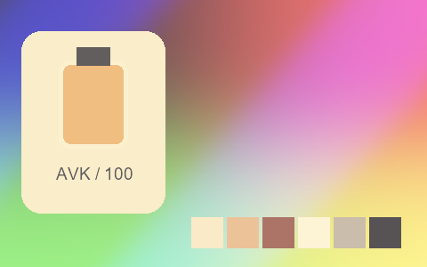

## 038 · Sea Turtle

`sp-sea-turtle` · `landscape` · MIT · 64³

50% gray Y′ 127.5/255 (-0.0 code values); 25–75% gray span ratio 1.000; mid-gray red minus blue -0.0 code values. Light/medium/deep skin swatches: #F8DAC2, #D9976D, #954E27. Red/green/blue swatches: #D41C14, #B2F50A, #3333CC.

Suggested use: Compare on your own SDR product, portrait and landscape footage before selecting.

Trial strength: 0.35–0.8; default 1.0.

Pixel color mapping only; no grain, glow, vignette, spatial haze or beauty effects. Natural footage quality is unaccepted. Check skin/product colors and clipped output.

| Input swatch | Input RGB | Actual output RGB |
|---|---|---|
| `gray_0` | `#000000` | `#000000` |
| `gray_10` | `#1A1A1A` | `#1A1A1A` |
| `gray_25` | `#404040` | `#404040` |
| `gray_50` | `#808080` | `#7F7F80` |
| `gray_75` | `#BFBFBF` | `#BFBFBF` |
| `gray_90` | `#E6E6E6` | `#E5E5E5` |
| `gray_100` | `#FFFFFF` | `#FFFFFF` |
| `skin_light` | `#F5DBC6` | `#F8DAC2` |
| `skin_medium` | `#CF9B7B` | `#D9976D` |
| `skin_deep` | `#815438` | `#954E27` |
| `red` | `#CC3333` | `#D41C14` |
| `green` | `#33CC33` | `#B2F50A` |
| `blue` | `#3333CC` | `#3333CC` |

Creator: **Nixua / Striped Purple** · [Source](https://github.com/stripedpurple/color-grading-luts/blob/9757e8b5147693cab49c3fd674bf23dbe28d6c8e/Scenic%20Moods/Striped%20Purple%20-%20Sea%20Turtle.cube) · commit `9757e8b5147693cab49c3fd674bf23dbe28d6c8e`.

Conversion: `native-CUBE-grid-retained-v1`; 8,192 sampled RGB points; max error 0.0000000; mean 0.0000000. This is numerical approximation, not a perceptual quality score.

License obligations: Retain MIT copyright and license notice.

[License](../../../product/src/ai_ad_editor/look_data/licenses/sp-MIT.txt) · LUT SHA-256 `355963ce5e0dca7d30992e90cc7ff8e216cc397b0aebb718cdbabd407487eff0`.

[Actual preview PNG](../../assets/look500-20261024-r1/previews/sp-sea-turtle.png) · [Actual video](../../assets/look500-20261024-r1/videos/sp-sea-turtle.mp4)

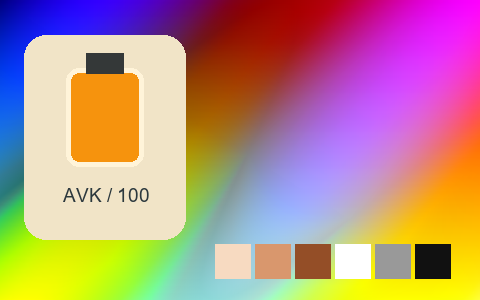

## 039 · Seagull Cove

`sp-seagull-cove` · `landscape` · MIT · 64³

50% gray Y′ 127.5/255 (+0.0 code values); 25–75% gray span ratio 1.000; mid-gray red minus blue +0.0 code values. Light/medium/deep skin swatches: #F4D9C4, #D08D6E, #884731. Red/green/blue swatches: #CD2D2D, #63B9A1, #2550B8.

Suggested use: Compare on your own SDR product, portrait and landscape footage before selecting.

Trial strength: 0.35–0.8; default 1.0.

Pixel color mapping only; no grain, glow, vignette, spatial haze or beauty effects. Natural footage quality is unaccepted. Check skin/product colors and clipped output.

| Input swatch | Input RGB | Actual output RGB |
|---|---|---|
| `gray_0` | `#000000` | `#000000` |
| `gray_10` | `#1A1A1A` | `#1A1A1A` |
| `gray_25` | `#404040` | `#404040` |
| `gray_50` | `#808080` | `#808080` |
| `gray_75` | `#BFBFBF` | `#BFBFBF` |
| `gray_90` | `#E6E6E6` | `#E5E5E5` |
| `gray_100` | `#FFFFFF` | `#FFFFFF` |
| `skin_light` | `#F5DBC6` | `#F4D9C4` |
| `skin_medium` | `#CF9B7B` | `#D08D6E` |
| `skin_deep` | `#815438` | `#884731` |
| `red` | `#CC3333` | `#CD2D2D` |
| `green` | `#33CC33` | `#63B9A1` |
| `blue` | `#3333CC` | `#2550B8` |

Creator: **Nixua / Striped Purple** · [Source](https://github.com/stripedpurple/color-grading-luts/blob/9757e8b5147693cab49c3fd674bf23dbe28d6c8e/Scenic%20Moods/Striped%20Purple%20-%20Seagull%20Cove.cube) · commit `9757e8b5147693cab49c3fd674bf23dbe28d6c8e`.

Conversion: `native-CUBE-grid-retained-v1`; 8,192 sampled RGB points; max error 0.0000000; mean 0.0000000. This is numerical approximation, not a perceptual quality score.

License obligations: Retain MIT copyright and license notice.

[License](../../../product/src/ai_ad_editor/look_data/licenses/sp-MIT.txt) · LUT SHA-256 `724d6bd2d3671c75e2602875e4947924cd96974930a6bb35c1b118cd20dfcf80`.

[Actual preview PNG](../../assets/look500-20261024-r1/previews/sp-seagull-cove.png) · [Actual video](../../assets/look500-20261024-r1/videos/sp-seagull-cove.mp4)

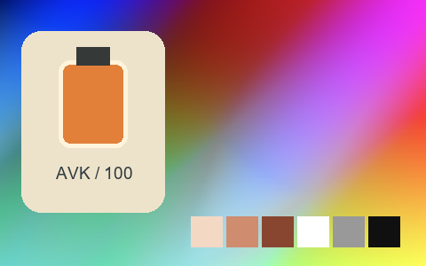

## 040 · Snowy Blues

`sp-snowy-blues` · `landscape` · MIT · 32³

50% gray Y′ 130.1/255 (+2.6 code values); 25–75% gray span ratio 0.895; mid-gray red minus blue -40.9 code values. Light/medium/deep skin swatches: #E7D5CE, #BCA08F, #6C604C. Red/green/blue swatches: #B94147, #2EC947, #2E41D2.

Suggested use: Compare on your own SDR product, portrait and landscape footage before selecting.

Trial strength: 0.35–0.8; default 1.0.

Pixel color mapping only; no grain, glow, vignette, spatial haze or beauty effects. Natural footage quality is unaccepted. Check skin/product colors and clipped output.

| Input swatch | Input RGB | Actual output RGB |
|---|---|---|
| `gray_0` | `#000000` | `#0C1010` |
| `gray_10` | `#1A1A1A` | `#1D282C` |
| `gray_25` | `#404040` | `#374D55` |
| `gray_50` | `#808080` | `#6A8793` |
| `gray_75` | `#BFBFBF` | `#ABBEC9` |
| `gray_90` | `#E6E6E6` | `#D6DEE5` |
| `gray_100` | `#FFFFFF` | `#F3F3F8` |
| `skin_light` | `#F5DBC6` | `#E7D5CE` |
| `skin_medium` | `#CF9B7B` | `#BCA08F` |
| `skin_deep` | `#815438` | `#6C604C` |
| `red` | `#CC3333` | `#B94147` |
| `green` | `#33CC33` | `#2EC947` |
| `blue` | `#3333CC` | `#2E41D2` |

Creator: **Nixua / Striped Purple** · [Source](https://github.com/stripedpurple/color-grading-luts/blob/9757e8b5147693cab49c3fd674bf23dbe28d6c8e/Scenic%20Moods/Striped%20Purple%20-%20Snowy%20Blues.cube) · commit `9757e8b5147693cab49c3fd674bf23dbe28d6c8e`.

Conversion: `native-CUBE-grid-retained-v1`; 8,192 sampled RGB points; max error 0.0000000; mean 0.0000000. This is numerical approximation, not a perceptual quality score.

License obligations: Retain MIT copyright and license notice.

[License](../../../product/src/ai_ad_editor/look_data/licenses/sp-MIT.txt) · LUT SHA-256 `bc8077203fbec5c93437c2b013a8e7b6f2232888bdf117be177761c7dbcf1fc4`.

[Actual preview PNG](../../assets/look500-20261024-r1/previews/sp-snowy-blues.png) · [Actual video](../../assets/look500-20261024-r1/videos/sp-snowy-blues.mp4)

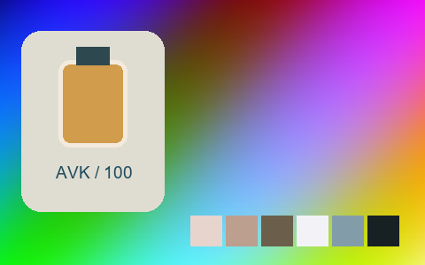

## 041 · Spring Water

`sp-spring-water` · `landscape` · MIT · 16³

50% gray Y′ 127.5/255 (+0.0 code values); 25–75% gray span ratio 1.000; mid-gray red minus blue +0.0 code values. Light/medium/deep skin swatches: #E9DED3, #CA9C80, #875242. Red/green/blue swatches: #BC4944, #33BD85, #243FB6.

Suggested use: Compare on your own SDR product, portrait and landscape footage before selecting.

Trial strength: 0.35–0.8; default 1.0.

Pixel color mapping only; no grain, glow, vignette, spatial haze or beauty effects. Natural footage quality is unaccepted. Check skin/product colors and clipped output.

| Input swatch | Input RGB | Actual output RGB |
|---|---|---|
| `gray_0` | `#000000` | `#000000` |
| `gray_10` | `#1A1A1A` | `#1A1A1A` |
| `gray_25` | `#404040` | `#404040` |
| `gray_50` | `#808080` | `#808080` |
| `gray_75` | `#BFBFBF` | `#BFBFBF` |
| `gray_90` | `#E6E6E6` | `#E5E5E5` |
| `gray_100` | `#FFFFFF` | `#FFFFFF` |
| `skin_light` | `#F5DBC6` | `#E9DED3` |
| `skin_medium` | `#CF9B7B` | `#CA9C80` |
| `skin_deep` | `#815438` | `#875242` |
| `red` | `#CC3333` | `#BC4944` |
| `green` | `#33CC33` | `#33BD85` |
| `blue` | `#3333CC` | `#243FB6` |

Creator: **Nixua / Striped Purple** · [Source](https://github.com/stripedpurple/color-grading-luts/blob/9757e8b5147693cab49c3fd674bf23dbe28d6c8e/Scenic%20Moods/Striped%20Purple%20-%20Spring%20Water.cube) · commit `9757e8b5147693cab49c3fd674bf23dbe28d6c8e`.

Conversion: `native-CUBE-grid-retained-v1`; 8,192 sampled RGB points; max error 0.0000000; mean 0.0000000. This is numerical approximation, not a perceptual quality score.

License obligations: Retain MIT copyright and license notice.

[License](../../../product/src/ai_ad_editor/look_data/licenses/sp-MIT.txt) · LUT SHA-256 `d1ddba608afb1f4ec6c8bf6810634f1d8014705cb3c31704b0ff4ab66cfe29bb`.

[Actual preview PNG](../../assets/look500-20261024-r1/previews/sp-spring-water.png) · [Actual video](../../assets/look500-20261024-r1/videos/sp-spring-water.mp4)

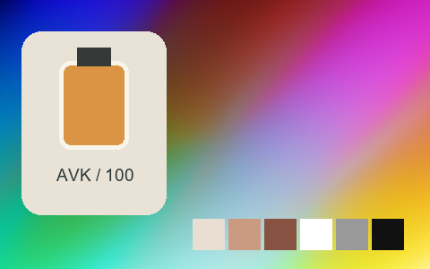

## 042 · Sugar Plums

`sp-sugar-plums` · `creative` · MIT · 32³

50% gray Y′ 119.0/255 (-8.5 code values); 25–75% gray span ratio 1.097; mid-gray red minus blue +20.7 code values. Light/medium/deep skin swatches: #F6DCBF, #D88C63, #8C3D45. Red/green/blue swatches: #D12240, #4CBF29, #2A22C9.

Suggested use: Compare on your own SDR product, portrait and landscape footage before selecting.

Trial strength: 0.35–0.8; default 1.0.

Pixel color mapping only; no grain, glow, vignette, spatial haze or beauty effects. Natural footage quality is unaccepted. Check skin/product colors and clipped output.

| Input swatch | Input RGB | Actual output RGB |
|---|---|---|
| `gray_0` | `#000000` | `#000000` |
| `gray_10` | `#1A1A1A` | `#111214` |
| `gray_25` | `#404040` | `#332C3B` |
| `gray_50` | `#808080` | `#936E7E` |
| `gray_75` | `#BFBFBF` | `#C7B8AD` |
| `gray_90` | `#E6E6E6` | `#EAE7E4` |
| `gray_100` | `#FFFFFF` | `#FFFFFF` |
| `skin_light` | `#F5DBC6` | `#F6DCBF` |
| `skin_medium` | `#CF9B7B` | `#D88C63` |
| `skin_deep` | `#815438` | `#8C3D45` |
| `red` | `#CC3333` | `#D12240` |
| `green` | `#33CC33` | `#4CBF29` |
| `blue` | `#3333CC` | `#2A22C9` |

Creator: **Nixua / Striped Purple** · [Source](https://github.com/stripedpurple/color-grading-luts/blob/9757e8b5147693cab49c3fd674bf23dbe28d6c8e/Avant%20Garde/Striped%20Purple%20-%20Sugar%20Plums.cube) · commit `9757e8b5147693cab49c3fd674bf23dbe28d6c8e`.

Conversion: `native-CUBE-grid-retained-v1`; 8,192 sampled RGB points; max error 0.0000000; mean 0.0000000. This is numerical approximation, not a perceptual quality score.

License obligations: Retain MIT copyright and license notice.

[License](../../../product/src/ai_ad_editor/look_data/licenses/sp-MIT.txt) · LUT SHA-256 `3fc32fed5e20076bfcfeb67208c61dd8fc89542a32472cf2b92d33c2aef7995a`.

[Actual preview PNG](../../assets/look500-20261024-r1/previews/sp-sugar-plums.png) · [Actual video](../../assets/look500-20261024-r1/videos/sp-sugar-plums.mp4)

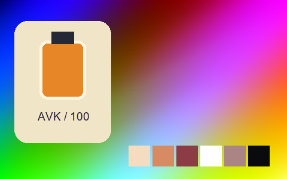

## 043 · Teal Embers

`sp-teal-embers` · `landscape` · MIT · 64³

50% gray Y′ 127.5/255 (+0.0 code values); 25–75% gray span ratio 1.000; mid-gray red minus blue -0.0 code values. Light/medium/deep skin swatches: #F5D9C8, #CE9782, #7E5241. Red/green/blue swatches: #D53214, #20699A, #264FCE.

Suggested use: Compare on your own SDR product, portrait and landscape footage before selecting.

Trial strength: 0.35–0.8; default 1.0.

Pixel color mapping only; no grain, glow, vignette, spatial haze or beauty effects. Natural footage quality is unaccepted. Check skin/product colors and clipped output.

| Input swatch | Input RGB | Actual output RGB |
|---|---|---|
| `gray_0` | `#000000` | `#000000` |
| `gray_10` | `#1A1A1A` | `#1A1A1A` |
| `gray_25` | `#404040` | `#404040` |
| `gray_50` | `#808080` | `#7F8080` |
| `gray_75` | `#BFBFBF` | `#BFBFBF` |
| `gray_90` | `#E6E6E6` | `#E5E5E5` |
| `gray_100` | `#FFFFFF` | `#FFFFFF` |
| `skin_light` | `#F5DBC6` | `#F5D9C8` |
| `skin_medium` | `#CF9B7B` | `#CE9782` |
| `skin_deep` | `#815438` | `#7E5241` |
| `red` | `#CC3333` | `#D53214` |
| `green` | `#33CC33` | `#20699A` |
| `blue` | `#3333CC` | `#264FCE` |

Creator: **Nixua / Striped Purple** · [Source](https://github.com/stripedpurple/color-grading-luts/blob/9757e8b5147693cab49c3fd674bf23dbe28d6c8e/Scenic%20Moods/Striped%20Purple%20-%20Teal%20Embers.cube) · commit `9757e8b5147693cab49c3fd674bf23dbe28d6c8e`.

Conversion: `native-CUBE-grid-retained-v1`; 8,192 sampled RGB points; max error 0.0000000; mean 0.0000000. This is numerical approximation, not a perceptual quality score.

License obligations: Retain MIT copyright and license notice.

[License](../../../product/src/ai_ad_editor/look_data/licenses/sp-MIT.txt) · LUT SHA-256 `1b8525d1594b24782bd19cbf66c73eb4d297451b57651c84b620ed6ed33ec48c`.

[Actual preview PNG](../../assets/look500-20261024-r1/previews/sp-teal-embers.png) · [Actual video](../../assets/look500-20261024-r1/videos/sp-teal-embers.mp4)

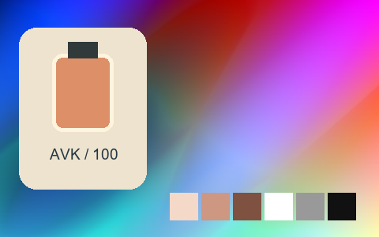

## 044 · Teal Supreme

`sp-teal-supreme` · `landscape` · MIT · 32³

50% gray Y′ 127.5/255 (+0.0 code values); 25–75% gray span ratio 1.000; mid-gray red minus blue +0.0 code values. Light/medium/deep skin swatches: #EFDBCC, #C89D82, #7B553E. Red/green/blue swatches: #CC3333, #4D724D, #3333CC.

Suggested use: Compare on your own SDR product, portrait and landscape footage before selecting.

Trial strength: 0.35–0.8; default 1.0.

Pixel color mapping only; no grain, glow, vignette, spatial haze or beauty effects. Natural footage quality is unaccepted. Check skin/product colors and clipped output.

| Input swatch | Input RGB | Actual output RGB |
|---|---|---|
| `gray_0` | `#000000` | `#000000` |
| `gray_10` | `#1A1A1A` | `#191919` |
| `gray_25` | `#404040` | `#404040` |
| `gray_50` | `#808080` | `#808080` |
| `gray_75` | `#BFBFBF` | `#BFBFBF` |
| `gray_90` | `#E6E6E6` | `#E6E6E6` |
| `gray_100` | `#FFFFFF` | `#FFFFFF` |
| `skin_light` | `#F5DBC6` | `#EFDBCC` |
| `skin_medium` | `#CF9B7B` | `#C89D82` |
| `skin_deep` | `#815438` | `#7B553E` |
| `red` | `#CC3333` | `#CC3333` |
| `green` | `#33CC33` | `#4D724D` |
| `blue` | `#3333CC` | `#3333CC` |

Creator: **Nixua / Striped Purple** · [Source](https://github.com/stripedpurple/color-grading-luts/blob/9757e8b5147693cab49c3fd674bf23dbe28d6c8e/Scenic%20Moods/Striped%20Purple%20-%20Teal%20Supreme.cube) · commit `9757e8b5147693cab49c3fd674bf23dbe28d6c8e`.

Conversion: `native-CUBE-grid-retained-v1`; 8,192 sampled RGB points; max error 0.0000000; mean 0.0000000. This is numerical approximation, not a perceptual quality score.

License obligations: Retain MIT copyright and license notice.

[License](../../../product/src/ai_ad_editor/look_data/licenses/sp-MIT.txt) · LUT SHA-256 `a2d2fbe8eca1771046030274d6da77e1638626475ac4e48c708634cf24580d48`.

[Actual preview PNG](../../assets/look500-20261024-r1/previews/sp-teal-supreme.png) · [Actual video](../../assets/look500-20261024-r1/videos/sp-teal-supreme.mp4)

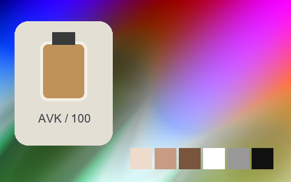

## 045 · Tiger

`sp-tiger` · `creative` · MIT · 64³

50% gray Y′ 124.0/255 (-3.5 code values); 25–75% gray span ratio 1.010; mid-gray red minus blue -0.0 code values. Light/medium/deep skin swatches: #FFBC96, #E48237, #8C4800. Red/green/blue swatches: #D15000, #D38700, #007DE3.

Suggested use: Compare on your own SDR product, portrait and landscape footage before selecting.

Trial strength: 0.35–0.8; default 1.0.

Pixel color mapping only; no grain, glow, vignette, spatial haze or beauty effects. Natural footage quality is unaccepted. Check skin/product colors and clipped output.

| Input swatch | Input RGB | Actual output RGB |
|---|---|---|
| `gray_0` | `#000000` | `#000000` |
| `gray_10` | `#1A1A1A` | `#151515` |
| `gray_25` | `#404040` | `#3A3A3A` |
| `gray_50` | `#808080` | `#7C7C7C` |
| `gray_75` | `#BFBFBF` | `#BBBBBB` |
| `gray_90` | `#E6E6E6` | `#E5E5E5` |
| `gray_100` | `#FFFFFF` | `#FEFEFE` |
| `skin_light` | `#F5DBC6` | `#FFBC96` |
| `skin_medium` | `#CF9B7B` | `#E48237` |
| `skin_deep` | `#815438` | `#8C4800` |
| `red` | `#CC3333` | `#D15000` |
| `green` | `#33CC33` | `#D38700` |
| `blue` | `#3333CC` | `#007DE3` |

Creator: **Nixua / Striped Purple** · [Source](https://github.com/stripedpurple/color-grading-luts/blob/9757e8b5147693cab49c3fd674bf23dbe28d6c8e/Zoology/Striped%20Purple%20-%20Tiger.cube) · commit `9757e8b5147693cab49c3fd674bf23dbe28d6c8e`.

Conversion: `native-CUBE-grid-retained-v1`; 8,192 sampled RGB points; max error 0.0000000; mean 0.0000000. This is numerical approximation, not a perceptual quality score.

License obligations: Retain MIT copyright and license notice.

[License](../../../product/src/ai_ad_editor/look_data/licenses/sp-MIT.txt) · LUT SHA-256 `44cd29552ae66f3d15f28bfb3248355e06d490e91b251dc446988d9cb92e694b`.

[Actual preview PNG](../../assets/look500-20261024-r1/previews/sp-tiger.png) · [Actual video](../../assets/look500-20261024-r1/videos/sp-tiger.mp4)

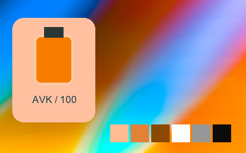

## 046 · Turquoise

`sp-turquoise` · `creative` · MIT · 32³

50% gray Y′ 156.8/255 (+29.3 code values); 25–75% gray span ratio 0.590; mid-gray red minus blue +2.2 code values. Light/medium/deep skin swatches: #F3D594, #CEB584, #888C79. Red/green/blue swatches: #CB7778, #4FCD78, #4F7796.

Suggested use: Compare on your own SDR product, portrait and landscape footage before selecting.

Trial strength: 0.35–0.8; default 1.0.

Pixel color mapping only; no grain, glow, vignette, spatial haze or beauty effects. Natural footage quality is unaccepted. Check skin/product colors and clipped output.

| Input swatch | Input RGB | Actual output RGB |
|---|---|---|
| `gray_0` | `#000000` | `#2D5472` |
| `gray_10` | `#1A1A1A` | `#3E6675` |
| `gray_25` | `#404040` | `#587F7A` |
| `gray_50` | `#808080` | `#87A685` |
| `gray_75` | `#BFBFBF` | `#BFC792` |
| `gray_90` | `#E6E6E6` | `#E4DA9C` |
| `gray_100` | `#FFFFFF` | `#FDE6A3` |
| `skin_light` | `#F5DBC6` | `#F3D594` |
| `skin_medium` | `#CF9B7B` | `#CEB584` |
| `skin_deep` | `#815438` | `#888C79` |
| `red` | `#CC3333` | `#CB7778` |
| `green` | `#33CC33` | `#4FCD78` |
| `blue` | `#3333CC` | `#4F7796` |

Creator: **Nixua / Striped Purple** · [Source](https://github.com/stripedpurple/color-grading-luts/blob/9757e8b5147693cab49c3fd674bf23dbe28d6c8e/Avant%20Garde/Striped%20Purple%20-%20Turquoise.cube) · commit `9757e8b5147693cab49c3fd674bf23dbe28d6c8e`.

Conversion: `native-CUBE-grid-retained-v1`; 8,192 sampled RGB points; max error 0.0000000; mean 0.0000000. This is numerical approximation, not a perceptual quality score.

License obligations: Retain MIT copyright and license notice.

[License](../../../product/src/ai_ad_editor/look_data/licenses/sp-MIT.txt) · LUT SHA-256 `0de60bc5f2ac3ac95c7ef6cb7cb8267d3bd344240f6328e105ec6724b583c046`.

[Actual preview PNG](../../assets/look500-20261024-r1/previews/sp-turquoise.png) · [Actual video](../../assets/look500-20261024-r1/videos/sp-turquoise.mp4)

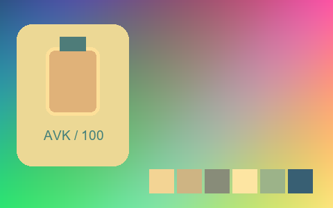

## 047 · Vanilla Bean

`sp-vanilla-bean` · `creative` · MIT · 32³

50% gray Y′ 134.1/255 (+6.6 code values); 25–75% gray span ratio 1.496; mid-gray red minus blue +23.1 code values. Light/medium/deep skin swatches: #F6F1E8, #E3BD94, #68331E. Red/green/blue swatches: #CF2B23, #49D22F, #261FAF.

Suggested use: Compare on your own SDR product, portrait and landscape footage before selecting.

Trial strength: 0.35–0.8; default 1.0.

Pixel color mapping only; no grain, glow, vignette, spatial haze or beauty effects. Natural footage quality is unaccepted. Check skin/product colors and clipped output.

| Input swatch | Input RGB | Actual output RGB |
|---|---|---|
| `gray_0` | `#000000` | `#201F19` |
| `gray_10` | `#1A1A1A` | `#211F1A` |
| `gray_25` | `#404040` | `#29241F` |
| `gray_50` | `#808080` | `#8F8577` |
| `gray_75` | `#BFBFBF` | `#E5E3DC` |
| `gray_90` | `#E6E6E6` | `#F3F3F1` |
| `gray_100` | `#FFFFFF` | `#F8F8F7` |
| `skin_light` | `#F5DBC6` | `#F6F1E8` |
| `skin_medium` | `#CF9B7B` | `#E3BD94` |
| `skin_deep` | `#815438` | `#68331E` |
| `red` | `#CC3333` | `#CF2B23` |
| `green` | `#33CC33` | `#49D22F` |
| `blue` | `#3333CC` | `#261FAF` |

Creator: **Nixua / Striped Purple** · [Source](https://github.com/stripedpurple/color-grading-luts/blob/9757e8b5147693cab49c3fd674bf23dbe28d6c8e/Drink%20it%20in%21/Striped%20Purple%20-%20Vanilla%20Bean.cube) · commit `9757e8b5147693cab49c3fd674bf23dbe28d6c8e`.

Conversion: `native-CUBE-grid-retained-v1`; 8,192 sampled RGB points; max error 0.0000000; mean 0.0000000. This is numerical approximation, not a perceptual quality score.

License obligations: Retain MIT copyright and license notice.

[License](../../../product/src/ai_ad_editor/look_data/licenses/sp-MIT.txt) · LUT SHA-256 `c68b935c25494afca6adede07d178269c4681284ebd20553a123d4cfa26cad9d`.

[Actual preview PNG](../../assets/look500-20261024-r1/previews/sp-vanilla-bean.png) · [Actual video](../../assets/look500-20261024-r1/videos/sp-vanilla-bean.mp4)

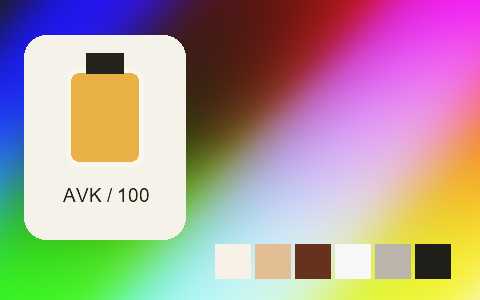

## 048 · Veggie Crisps

`sp-veggie-crisps` · `creative` · MIT · 32³

50% gray Y′ 125.8/255 (-1.7 code values); 25–75% gray span ratio 1.140; mid-gray red minus blue -2.1 code values. Light/medium/deep skin swatches: #ECD4B9, #DAA580, #464835. Red/green/blue swatches: #AF343B, #3FCE35, #2238D4.

Suggested use: Compare on your own SDR product, portrait and landscape footage before selecting.

Trial strength: 0.35–0.8; default 1.0.

Pixel color mapping only; no grain, glow, vignette, spatial haze or beauty effects. Natural footage quality is unaccepted. Check skin/product colors and clipped output.

| Input swatch | Input RGB | Actual output RGB |
|---|---|---|
| `gray_0` | `#000000` | `#2A2A2A` |
| `gray_10` | `#1A1A1A` | `#272F30` |
| `gray_25` | `#404040` | `#253D41` |
| `gray_50` | `#808080` | `#7C7E7E` |
| `gray_75` | `#BFBFBF` | `#D2C8C0` |
| `gray_90` | `#E6E6E6` | `#E0DAD6` |
| `gray_100` | `#FFFFFF` | `#E2E2E2` |
| `skin_light` | `#F5DBC6` | `#ECD4B9` |
| `skin_medium` | `#CF9B7B` | `#DAA580` |
| `skin_deep` | `#815438` | `#464835` |
| `red` | `#CC3333` | `#AF343B` |
| `green` | `#33CC33` | `#3FCE35` |
| `blue` | `#3333CC` | `#2238D4` |

Creator: **Nixua / Striped Purple** · [Source](https://github.com/stripedpurple/color-grading-luts/blob/9757e8b5147693cab49c3fd674bf23dbe28d6c8e/Avant%20Garde/Striped%20Purple%20-%20Veggie%20Crisps.cube) · commit `9757e8b5147693cab49c3fd674bf23dbe28d6c8e`.

Conversion: `native-CUBE-grid-retained-v1`; 8,192 sampled RGB points; max error 0.0000000; mean 0.0000000. This is numerical approximation, not a perceptual quality score.

License obligations: Retain MIT copyright and license notice.

[License](../../../product/src/ai_ad_editor/look_data/licenses/sp-MIT.txt) · LUT SHA-256 `71fa6ff5919804dc57050b11d6723e8c477efd544f00740f4e5addaddba62658`.

[Actual preview PNG](../../assets/look500-20261024-r1/previews/sp-veggie-crisps.png) · [Actual video](../../assets/look500-20261024-r1/videos/sp-veggie-crisps.mp4)

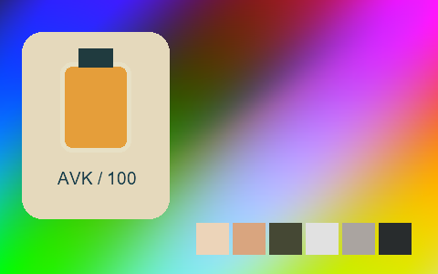

## 049 · Woelfelly Neon

`sp-woelfelly-neon` · `creative` · MIT · 32³

50% gray Y′ 92.3/255 (-35.2 code values); 25–75% gray span ratio 0.816; mid-gray red minus blue -24.9 code values. Light/medium/deep skin swatches: #F8A9D7, #D7489B, #811958. Red/green/blue swatches: #CB044D, #419D54, #158CE0.

Suggested use: Compare on your own SDR product, portrait and landscape footage before selecting.

Trial strength: 0.35–0.8; default 1.0.

Pixel color mapping only; no grain, glow, vignette, spatial haze or beauty effects. Natural footage quality is unaccepted. Check skin/product colors and clipped output.

| Input swatch | Input RGB | Actual output RGB |
|---|---|---|
| `gray_0` | `#000000` | `#000000` |
| `gray_10` | `#1A1A1A` | `#0A132A` |
| `gray_25` | `#404040` | `#322D61` |
| `gray_50` | `#808080` | `#854A9E` |
| `gray_75` | `#BFBFBF` | `#C985D3` |
| `gray_90` | `#E6E6E6` | `#EBC1EE` |
| `gray_100` | `#FFFFFF` | `#FFFFFF` |
| `skin_light` | `#F5DBC6` | `#F8A9D7` |
| `skin_medium` | `#CF9B7B` | `#D7489B` |
| `skin_deep` | `#815438` | `#811958` |
| `red` | `#CC3333` | `#CB044D` |
| `green` | `#33CC33` | `#419D54` |
| `blue` | `#3333CC` | `#158CE0` |

Creator: **Nixua / Striped Purple** · [Source](https://github.com/stripedpurple/color-grading-luts/blob/9757e8b5147693cab49c3fd674bf23dbe28d6c8e/Avant%20Garde/Striped%20Purple%20-%20Woelfelly%20Neon.cube) · commit `9757e8b5147693cab49c3fd674bf23dbe28d6c8e`.

Conversion: `native-CUBE-grid-retained-v1`; 8,192 sampled RGB points; max error 0.0000000; mean 0.0000000. This is numerical approximation, not a perceptual quality score.

License obligations: Retain MIT copyright and license notice.

[License](../../../product/src/ai_ad_editor/look_data/licenses/sp-MIT.txt) · LUT SHA-256 `ce066831054d3e2e9a5d87fd35da0696b1345704069541514b5d62bb8e3e2212`.

[Actual preview PNG](../../assets/look500-20261024-r1/previews/sp-woelfelly-neon.png) · [Actual video](../../assets/look500-20261024-r1/videos/sp-woelfelly-neon.mp4)

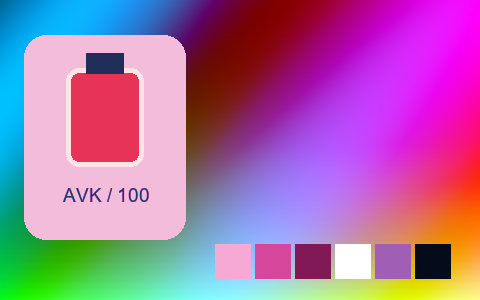

## 050 · AGFA APX 100

`t3-agfa-apx-100` · `film-bw` · MIT · 33³

50% gray Y′ 197.0/255 (+69.5 code values); 25–75% gray span ratio 1.059; mid-gray red minus blue +0.0 code values. Light/medium/deep skin swatches: #F2F2F2, #DCDCDC, #838383. Red/green/blue swatches: #959595, #D9D9D9, #CFCFCF.

Suggested use: Compare on your own SDR product, portrait and landscape footage before selecting.

Trial strength: 1–1; default 1.0.

Pixel color mapping only; no grain, glow, vignette, spatial haze or beauty effects. Natural footage quality is unaccepted. Check skin/product colors and clipped output.

| Input swatch | Input RGB | Actual output RGB |
|---|---|---|
| `gray_0` | `#000000` | `#111111` |
| `gray_10` | `#1A1A1A` | `#2D2D2D` |
| `gray_25` | `#404040` | `#666666` |
| `gray_50` | `#808080` | `#C5C5C5` |
| `gray_75` | `#BFBFBF` | `#EDEDED` |
| `gray_90` | `#E6E6E6` | `#F4F4F4` |
| `gray_100` | `#FFFFFF` | `#F8F8F8` |
| `skin_light` | `#F5DBC6` | `#F2F2F2` |
| `skin_medium` | `#CF9B7B` | `#DCDCDC` |
| `skin_deep` | `#815438` | `#838383` |
| `red` | `#CC3333` | `#959595` |
| `green` | `#33CC33` | `#D9D9D9` |
| `blue` | `#3333CC` | `#CFCFCF` |

Creator: **João Almeida** · [Source](https://github.com/t3mujinpack/t3mujinpack/blob/0b421f3e25209ed78253d1724a29cc6255c5e7fe/haldcluts/t3mujinpack%20-%20Black%20and%20White%20-%20AGFA%20APX%20100.png) · commit `0b421f3e25209ed78253d1724a29cc6255c5e7fe`.

Conversion: `native-depth-Hald-to-33-tetrahedral-v1`; 8,192 sampled RGB points; max error 0.0030273; mean 0.0007068. This is numerical approximation, not a perceptual quality score.

License obligations: Retain MIT copyright and license notice.

[License](../../../product/src/ai_ad_editor/look_data/licenses/t3-MIT.txt) · LUT SHA-256 `4e7d1be74e25d29177216b94a02f5ddf9d50e8fa1ba8b67b10f18f796e772248`.

[Actual preview PNG](../../assets/look500-20261024-r1/previews/t3-agfa-apx-100.png) · [Actual video](../../assets/look500-20261024-r1/videos/t3-agfa-apx-100.mp4)

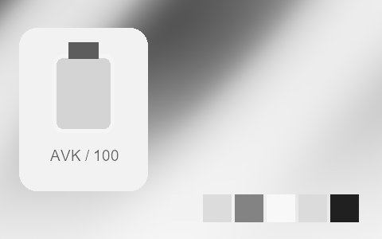

## 051 · AGFA APX 25

`t3-agfa-apx-25` · `film-bw` · MIT · 33³

50% gray Y′ 174.0/255 (+46.5 code values); 25–75% gray span ratio 1.114; mid-gray red minus blue +0.0 code values. Light/medium/deep skin swatches: #EBEBEB, #C4C4C4, #737373. Red/green/blue swatches: #878787, #C1C1C1, #B7B7B7.

Suggested use: Compare on your own SDR product, portrait and landscape footage before selecting.

Trial strength: 1–1; default 1.0.

Pixel color mapping only; no grain, glow, vignette, spatial haze or beauty effects. Natural footage quality is unaccepted. Check skin/product colors and clipped output.

| Input swatch | Input RGB | Actual output RGB |
|---|---|---|
| `gray_0` | `#000000` | `#090909` |
| `gray_10` | `#1A1A1A` | `#1C1C1C` |
| `gray_25` | `#404040` | `#4F4F4F` |
| `gray_50` | `#808080` | `#AEAEAE` |
| `gray_75` | `#BFBFBF` | `#DDDDDD` |
| `gray_90` | `#E6E6E6` | `#F2F2F2` |
| `gray_100` | `#FFFFFF` | `#FFFFFF` |
| `skin_light` | `#F5DBC6` | `#EBEBEB` |
| `skin_medium` | `#CF9B7B` | `#C4C4C4` |
| `skin_deep` | `#815438` | `#737373` |
| `red` | `#CC3333` | `#878787` |
| `green` | `#33CC33` | `#C1C1C1` |
| `blue` | `#3333CC` | `#B7B7B7` |

Creator: **João Almeida** · [Source](https://github.com/t3mujinpack/t3mujinpack/blob/0b421f3e25209ed78253d1724a29cc6255c5e7fe/haldcluts/t3mujinpack%20-%20Black%20and%20White%20-%20AGFA%20APX%2025.png) · commit `0b421f3e25209ed78253d1724a29cc6255c5e7fe`.

Conversion: `native-depth-Hald-to-33-tetrahedral-v1`; 8,192 sampled RGB points; max error 0.0028451; mean 0.0006990. This is numerical approximation, not a perceptual quality score.

License obligations: Retain MIT copyright and license notice.

[License](../../../product/src/ai_ad_editor/look_data/licenses/t3-MIT.txt) · LUT SHA-256 `aed4e50b852990c84db2bce2457e8622942f426548eb6505cca21b31108b8472`.

[Actual preview PNG](../../assets/look500-20261024-r1/previews/t3-agfa-apx-25.png) · [Actual video](../../assets/look500-20261024-r1/videos/t3-agfa-apx-25.mp4)

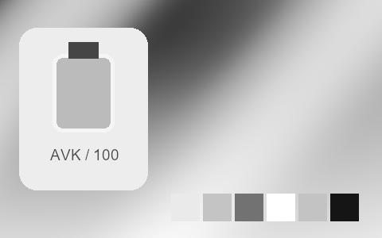

## 052 · Agfa Vista 100

`t3-agfa-vista-100` · `film-negative` · MIT · 33³

50% gray Y′ 143.9/255 (+16.4 code values); 25–75% gray span ratio 1.316; mid-gray red minus blue +2.0 code values. Light/medium/deep skin swatches: #FFE3CF, #FFB37C, #904E1E. Red/green/blue swatches: #F20017, #5DEE2D, #5408C1.

Suggested use: Compare on your own SDR product, portrait and landscape footage before selecting.

Trial strength: 0.35–0.8; default 1.0.

Pixel color mapping only; no grain, glow, vignette, spatial haze or beauty effects. Natural footage quality is unaccepted. Check skin/product colors and clipped output.

| Input swatch | Input RGB | Actual output RGB |
|---|---|---|
| `gray_0` | `#000000` | `#0B0808` |
| `gray_10` | `#1A1A1A` | `#131111` |
| `gray_25` | `#404040` | `#353434` |
| `gray_50` | `#808080` | `#919090` |
| `gray_75` | `#BFBFBF` | `#DDDBDB` |
| `gray_90` | `#E6E6E6` | `#ECEAEA` |
| `gray_100` | `#FFFFFF` | `#F0EEEE` |
| `skin_light` | `#F5DBC6` | `#FFE3CF` |
| `skin_medium` | `#CF9B7B` | `#FFB37C` |
| `skin_deep` | `#815438` | `#904E1E` |
| `red` | `#CC3333` | `#F20017` |
| `green` | `#33CC33` | `#5DEE2D` |
| `blue` | `#3333CC` | `#5408C1` |

Creator: **João Almeida** · [Source](https://github.com/t3mujinpack/t3mujinpack/blob/0b421f3e25209ed78253d1724a29cc6255c5e7fe/haldcluts/t3mujinpack%20-%20Color%20Negative%20-%20Agfa%20Vista%20100.png) · commit `0b421f3e25209ed78253d1724a29cc6255c5e7fe`.

Conversion: `native-depth-Hald-to-33-tetrahedral-v1`; 8,192 sampled RGB points; max error 0.0376260; mean 0.0010397. This is numerical approximation, not a perceptual quality score.

License obligations: Retain MIT copyright and license notice.

[License](../../../product/src/ai_ad_editor/look_data/licenses/t3-MIT.txt) · LUT SHA-256 `47be333a86017727c45b2da31d749acf66884a92df95213ca44d95ff37f51828`.

[Actual preview PNG](../../assets/look500-20261024-r1/previews/t3-agfa-vista-100.png) · [Actual video](../../assets/look500-20261024-r1/videos/t3-agfa-vista-100.mp4)

## 053 · Agfa Vista 200

`t3-agfa-vista-200` · `film-negative` · MIT · 33³

50% gray Y′ 130.2/255 (+2.7 code values); 25–75% gray span ratio 1.144; mid-gray red minus blue +1.0 code values. Light/medium/deep skin swatches: #F8DCC4, #DC9E75, #824D2B. Red/green/blue swatches: #DC0725, #0AD41D, #4211C3.

Suggested use: Compare on your own SDR product, portrait and landscape footage before selecting.

Trial strength: 0.35–0.8; default 1.0.

Pixel color mapping only; no grain, glow, vignette, spatial haze or beauty effects. Natural footage quality is unaccepted. Check skin/product colors and clipped output.

| Input swatch | Input RGB | Actual output RGB |
|---|---|---|
| `gray_0` | `#000000` | `#0A0809` |
| `gray_10` | `#1A1A1A` | `#131112` |
| `gray_25` | `#404040` | `#343232` |
| `gray_50` | `#808080` | `#838282` |
| `gray_75` | `#BFBFBF` | `#C5C4C4` |
| `gray_90` | `#E6E6E6` | `#E7E6E6` |
| `gray_100` | `#FFFFFF` | `#FDFBFC` |
| `skin_light` | `#F5DBC6` | `#F8DCC4` |
| `skin_medium` | `#CF9B7B` | `#DC9E75` |
| `skin_deep` | `#815438` | `#824D2B` |
| `red` | `#CC3333` | `#DC0725` |
| `green` | `#33CC33` | `#0AD41D` |
| `blue` | `#3333CC` | `#4211C3` |

Creator: **João Almeida** · [Source](https://github.com/t3mujinpack/t3mujinpack/blob/0b421f3e25209ed78253d1724a29cc6255c5e7fe/haldcluts/t3mujinpack%20-%20Color%20Negative%20-%20Agfa%20Vista%20200.png) · commit `0b421f3e25209ed78253d1724a29cc6255c5e7fe`.

Conversion: `native-depth-Hald-to-33-tetrahedral-v1`; 8,192 sampled RGB points; max error 0.0333623; mean 0.0009171. This is numerical approximation, not a perceptual quality score.

License obligations: Retain MIT copyright and license notice.

[License](../../../product/src/ai_ad_editor/look_data/licenses/t3-MIT.txt) · LUT SHA-256 `59e557bea68f6e8f1b31155cf9ea8ea116ee3b05d8cffa30acea52ffafacc1c8`.

[Actual preview PNG](../../assets/look500-20261024-r1/previews/t3-agfa-vista-200.png) · [Actual video](../../assets/look500-20261024-r1/videos/t3-agfa-vista-200.mp4)

## 054 · Agfa Vista 400

`t3-agfa-vista-400` · `film-negative` · MIT · 33³

50% gray Y′ 136.6/255 (+9.1 code values); 25–75% gray span ratio 1.291; mid-gray red minus blue -1.0 code values. Light/medium/deep skin swatches: #FEE5D0, #F7B184, #834A24. Red/green/blue swatches: #E90012, #30EB00, #4B08BB.

Suggested use: Compare on your own SDR product, portrait and landscape footage before selecting.

Trial strength: 0.35–0.8; default 1.0.

Pixel color mapping only; no grain, glow, vignette, spatial haze or beauty effects. Natural footage quality is unaccepted. Check skin/product colors and clipped output.

| Input swatch | Input RGB | Actual output RGB |
|---|---|---|
| `gray_0` | `#000000` | `#080909` |
| `gray_10` | `#1A1A1A` | `#111212` |
| `gray_25` | `#404040` | `#313132` |
| `gray_50` | `#808080` | `#88888A` |
| `gray_75` | `#BFBFBF` | `#D5D6D7` |
| `gray_90` | `#E6E6E6` | `#ECEDEE` |
| `gray_100` | `#FFFFFF` | `#F6F7F8` |
| `skin_light` | `#F5DBC6` | `#FEE5D0` |
| `skin_medium` | `#CF9B7B` | `#F7B184` |
| `skin_deep` | `#815438` | `#834A24` |
| `red` | `#CC3333` | `#E90012` |
| `green` | `#33CC33` | `#30EB00` |
| `blue` | `#3333CC` | `#4B08BB` |

Creator: **João Almeida** · [Source](https://github.com/t3mujinpack/t3mujinpack/blob/0b421f3e25209ed78253d1724a29cc6255c5e7fe/haldcluts/t3mujinpack%20-%20Color%20Negative%20-%20Agfa%20Vista%20400.png) · commit `0b421f3e25209ed78253d1724a29cc6255c5e7fe`.

Conversion: `native-depth-Hald-to-33-tetrahedral-v1`; 8,192 sampled RGB points; max error 0.0518095; mean 0.0010006. This is numerical approximation, not a perceptual quality score.

License obligations: Retain MIT copyright and license notice.

[License](../../../product/src/ai_ad_editor/look_data/licenses/t3-MIT.txt) · LUT SHA-256 `1d3cefbe475d1d88513467e04452ac6d93fecbbff406819c0b17d8fa3e787527`.

[Actual preview PNG](../../assets/look500-20261024-r1/previews/t3-agfa-vista-400.png) · [Actual video](../../assets/look500-20261024-r1/videos/t3-agfa-vista-400.mp4)

## 055 · Fuji Astia 100F

`t3-fuji-astia-100f` · `film-slide` · MIT · 33³

50% gray Y′ 135.4/255 (+7.9 code values); 25–75% gray span ratio 0.981; mid-gray red minus blue -0.5 code values. Light/medium/deep skin swatches: #F2D8C8, #DB9B84, #8F5743. Red/green/blue swatches: #E02A38, #47CE16, #592EC5.

Suggested use: Compare on your own SDR product, portrait and landscape footage before selecting.

Trial strength: 0.35–0.8; default 1.0.

Pixel color mapping only; no grain, glow, vignette, spatial haze or beauty effects. Natural footage quality is unaccepted. Check skin/product colors and clipped output.

| Input swatch | Input RGB | Actual output RGB |
|---|---|---|
| `gray_0` | `#000000` | `#030504` |
| `gray_10` | `#1A1A1A` | `#181918` |
| `gray_25` | `#404040` | `#424442` |
| `gray_50` | `#808080` | `#878787` |
| `gray_75` | `#BFBFBF` | `#C0C1C0` |
| `gray_90` | `#E6E6E6` | `#E2E3E3` |
| `gray_100` | `#FFFFFF` | `#F9FAFA` |
| `skin_light` | `#F5DBC6` | `#F2D8C8` |
| `skin_medium` | `#CF9B7B` | `#DB9B84` |
| `skin_deep` | `#815438` | `#8F5743` |
| `red` | `#CC3333` | `#E02A38` |
| `green` | `#33CC33` | `#47CE16` |
| `blue` | `#3333CC` | `#592EC5` |

Creator: **João Almeida** · [Source](https://github.com/t3mujinpack/t3mujinpack/blob/0b421f3e25209ed78253d1724a29cc6255c5e7fe/haldcluts/t3mujinpack%20-%20Color%20Slide%20-%20Fuji%20Astia%20100F.png) · commit `0b421f3e25209ed78253d1724a29cc6255c5e7fe`.

Conversion: `native-depth-Hald-to-33-tetrahedral-v1`; 8,192 sampled RGB points; max error 0.0202080; mean 0.0008376. This is numerical approximation, not a perceptual quality score.

License obligations: Retain MIT copyright and license notice.

[License](../../../product/src/ai_ad_editor/look_data/licenses/t3-MIT.txt) · LUT SHA-256 `dd3fb7067ef3d841795dafd9c4678a63b9518a021795286f9a81bc52136fcc5a`.

[Actual preview PNG](../../assets/look500-20261024-r1/previews/t3-fuji-astia-100f.png) · [Actual video](../../assets/look500-20261024-r1/videos/t3-fuji-astia-100f.mp4)

## 056 · Fuji Fortia SP 50

`t3-fuji-fortia-sp-50` · `film-slide` · MIT · 33³

50% gray Y′ 146.5/255 (+19.0 code values); 25–75% gray span ratio 1.269; mid-gray red minus blue +0.0 code values. Light/medium/deep skin swatches: #FFE8C2, #FFB487, #974D27. Red/green/blue swatches: #E5272A, #93EA46, #2021ED.

Suggested use: Compare on your own SDR product, portrait and landscape footage before selecting.

Trial strength: 0.35–0.8; default 1.0.

Pixel color mapping only; no grain, glow, vignette, spatial haze or beauty effects. Natural footage quality is unaccepted. Check skin/product colors and clipped output.

| Input swatch | Input RGB | Actual output RGB |
|---|---|---|
| `gray_0` | `#000000` | `#050505` |
| `gray_10` | `#1A1A1A` | `#121212` |
| `gray_25` | `#404040` | `#3C3C3C` |
| `gray_50` | `#808080` | `#929292` |
| `gray_75` | `#BFBFBF` | `#DEDEDE` |
| `gray_90` | `#E6E6E6` | `#F4F4F4` |
| `gray_100` | `#FFFFFF` | `#FFFFFF` |
| `skin_light` | `#F5DBC6` | `#FFE8C2` |
| `skin_medium` | `#CF9B7B` | `#FFB487` |
| `skin_deep` | `#815438` | `#974D27` |
| `red` | `#CC3333` | `#E5272A` |
| `green` | `#33CC33` | `#93EA46` |
| `blue` | `#3333CC` | `#2021ED` |

Creator: **João Almeida** · [Source](https://github.com/t3mujinpack/t3mujinpack/blob/0b421f3e25209ed78253d1724a29cc6255c5e7fe/haldcluts/t3mujinpack%20-%20Color%20Slide%20-%20Fuji%20Fortia%20SP%2050.png) · commit `0b421f3e25209ed78253d1724a29cc6255c5e7fe`.

Conversion: `native-depth-Hald-to-33-tetrahedral-v1`; 8,192 sampled RGB points; max error 0.0644893; mean 0.0008812. This is numerical approximation, not a perceptual quality score.

License obligations: Retain MIT copyright and license notice.

[License](../../../product/src/ai_ad_editor/look_data/licenses/t3-MIT.txt) · LUT SHA-256 `78be4d590637c63a6661baf0a04e809d4df20dcd22d666d797500440a4d1642c`.

[Actual preview PNG](../../assets/look500-20261024-r1/previews/t3-fuji-fortia-sp-50.png) · [Actual video](../../assets/look500-20261024-r1/videos/t3-fuji-fortia-sp-50.mp4)

## 057 · Fuji Neopan 1600

`t3-fuji-neopan-1600` · `film-bw` · MIT · 33³

50% gray Y′ 145.0/255 (+17.5 code values); 25–75% gray span ratio 1.365; mid-gray red minus blue +0.0 code values. Light/medium/deep skin swatches: #F0F0F0, #BEBEBE, #555555. Red/green/blue swatches: #6A6A6A, #B7B7B7, #989898.

Suggested use: Compare on your own SDR product, portrait and landscape footage before selecting.

Trial strength: 1–1; default 1.0.

Pixel color mapping only; no grain, glow, vignette, spatial haze or beauty effects. Natural footage quality is unaccepted. Check skin/product colors and clipped output.

| Input swatch | Input RGB | Actual output RGB |
|---|---|---|
| `gray_0` | `#000000` | `#040404` |
| `gray_10` | `#1A1A1A` | `#0B0B0B` |
| `gray_25` | `#404040` | `#353535` |
| `gray_50` | `#808080` | `#919191` |
| `gray_75` | `#BFBFBF` | `#E4E4E4` |
| `gray_90` | `#E6E6E6` | `#F5F5F5` |
| `gray_100` | `#FFFFFF` | `#FFFFFF` |
| `skin_light` | `#F5DBC6` | `#F0F0F0` |
| `skin_medium` | `#CF9B7B` | `#BEBEBE` |
| `skin_deep` | `#815438` | `#555555` |
| `red` | `#CC3333` | `#6A6A6A` |
| `green` | `#33CC33` | `#B7B7B7` |
| `blue` | `#3333CC` | `#989898` |

Creator: **João Almeida** · [Source](https://github.com/t3mujinpack/t3mujinpack/blob/0b421f3e25209ed78253d1724a29cc6255c5e7fe/haldcluts/t3mujinpack%20-%20Black%20and%20White%20-%20Fuji%20Neopan%201600.png) · commit `0b421f3e25209ed78253d1724a29cc6255c5e7fe`.

Conversion: `native-depth-Hald-to-33-tetrahedral-v1`; 8,192 sampled RGB points; max error 0.0037186; mean 0.0006889. This is numerical approximation, not a perceptual quality score.

License obligations: Retain MIT copyright and license notice.

[License](../../../product/src/ai_ad_editor/look_data/licenses/t3-MIT.txt) · LUT SHA-256 `e7fa984275220fe19904e4ab4eb4512cca9090284770900582e2e4e86dd2876d`.

[Actual preview PNG](../../assets/look500-20261024-r1/previews/t3-fuji-neopan-1600.png) · [Actual video](../../assets/look500-20261024-r1/videos/t3-fuji-neopan-1600.mp4)

## 058 · Fuji Neopan Acros 100

`t3-fuji-neopan-acros-100` · `film-bw` · MIT · 33³

50% gray Y′ 118.0/255 (-9.5 code values); 25–75% gray span ratio 1.143; mid-gray red minus blue +0.0 code values. Light/medium/deep skin swatches: #DBDBDB, #9A9A9A, #494949. Red/green/blue swatches: #585858, #949494, #7C7C7C.

Suggested use: Compare on your own SDR product, portrait and landscape footage before selecting.

Trial strength: 1–1; default 1.0.

Pixel color mapping only; no grain, glow, vignette, spatial haze or beauty effects. Natural footage quality is unaccepted. Check skin/product colors and clipped output.

| Input swatch | Input RGB | Actual output RGB |
|---|---|---|
| `gray_0` | `#000000` | `#040404` |
| `gray_10` | `#1A1A1A` | `#141414` |
| `gray_25` | `#404040` | `#323232` |
| `gray_50` | `#808080` | `#767676` |
| `gray_75` | `#BFBFBF` | `#C4C4C4` |
| `gray_90` | `#E6E6E6` | `#E5E5E5` |
| `gray_100` | `#FFFFFF` | `#F9F9F9` |
| `skin_light` | `#F5DBC6` | `#DBDBDB` |
| `skin_medium` | `#CF9B7B` | `#9A9A9A` |
| `skin_deep` | `#815438` | `#494949` |
| `red` | `#CC3333` | `#585858` |
| `green` | `#33CC33` | `#949494` |
| `blue` | `#3333CC` | `#7C7C7C` |

Creator: **João Almeida** · [Source](https://github.com/t3mujinpack/t3mujinpack/blob/0b421f3e25209ed78253d1724a29cc6255c5e7fe/haldcluts/t3mujinpack%20-%20Black%20and%20White%20-%20Fuji%20Neopan%20Acros%20100.png) · commit `0b421f3e25209ed78253d1724a29cc6255c5e7fe`.

Conversion: `native-depth-Hald-to-33-tetrahedral-v1`; 8,192 sampled RGB points; max error 0.0031227; mean 0.0006806. This is numerical approximation, not a perceptual quality score.

License obligations: Retain MIT copyright and license notice.

[License](../../../product/src/ai_ad_editor/look_data/licenses/t3-MIT.txt) · LUT SHA-256 `351a761dd3b66012d8135f225b576f20f49ac04cda465a64a6a2ae0831e53eee`.

[Actual preview PNG](../../assets/look500-20261024-r1/previews/t3-fuji-neopan-acros-100.png) · [Actual video](../../assets/look500-20261024-r1/videos/t3-fuji-neopan-acros-100.mp4)

## 059 · Fuji Pro 160C

`t3-fuji-pro-160c` · `film-negative` · MIT · 33³

50% gray Y′ 139.1/255 (+11.6 code values); 25–75% gray span ratio 1.108; mid-gray red minus blue +2.0 code values. Light/medium/deep skin swatches: #FEE1C2, #EBA473, #92562A. Red/green/blue swatches: #E62426, #64D91C, #522ACC.

Suggested use: Compare on your own SDR product, portrait and landscape footage before selecting.

Trial strength: 0.35–0.8; default 1.0.

Pixel color mapping only; no grain, glow, vignette, spatial haze or beauty effects. Natural footage quality is unaccepted. Check skin/product colors and clipped output.

| Input swatch | Input RGB | Actual output RGB |
|---|---|---|
| `gray_0` | `#000000` | `#040301` |
| `gray_10` | `#1A1A1A` | `#161514` |
| `gray_25` | `#404040` | `#41413F` |
| `gray_50` | `#808080` | `#8C8B8A` |
| `gray_75` | `#BFBFBF` | `#CECECD` |
| `gray_90` | `#E6E6E6` | `#EBEBE9` |
| `gray_100` | `#FFFFFF` | `#FAF9F8` |
| `skin_light` | `#F5DBC6` | `#FEE1C2` |
| `skin_medium` | `#CF9B7B` | `#EBA473` |
| `skin_deep` | `#815438` | `#92562A` |
| `red` | `#CC3333` | `#E62426` |
| `green` | `#33CC33` | `#64D91C` |
| `blue` | `#3333CC` | `#522ACC` |

Creator: **João Almeida** · [Source](https://github.com/t3mujinpack/t3mujinpack/blob/0b421f3e25209ed78253d1724a29cc6255c5e7fe/haldcluts/t3mujinpack%20-%20Color%20Negative%20-%20Fuji%20Pro%20160C.png) · commit `0b421f3e25209ed78253d1724a29cc6255c5e7fe`.

Conversion: `native-depth-Hald-to-33-tetrahedral-v1`; 8,192 sampled RGB points; max error 0.0233078; mean 0.0009218. This is numerical approximation, not a perceptual quality score.

License obligations: Retain MIT copyright and license notice.

[License](../../../product/src/ai_ad_editor/look_data/licenses/t3-MIT.txt) · LUT SHA-256 `73eeb5c95df3888fc6c18296225426eedea7626b9199dac2173e7db3b6db4d8b`.

[Actual preview PNG](../../assets/look500-20261024-r1/previews/t3-fuji-pro-160c.png) · [Actual video](../../assets/look500-20261024-r1/videos/t3-fuji-pro-160c.mp4)

## 060 · Fuji Pro 400H

`t3-fuji-pro-400h` · `film-negative` · MIT · 33³

50% gray Y′ 151.2/255 (+23.7 code values); 25–75% gray span ratio 1.034; mid-gray red minus blue +3.5 code values. Light/medium/deep skin swatches: #FADDB9, #F2A87B, #9D5C35. Red/green/blue swatches: #E94434, #1BDE27, #4736DB.

Suggested use: Compare on your own SDR product, portrait and landscape footage before selecting.

Trial strength: 0.35–0.8; default 1.0.

Pixel color mapping only; no grain, glow, vignette, spatial haze or beauty effects. Natural footage quality is unaccepted. Check skin/product colors and clipped output.

| Input swatch | Input RGB | Actual output RGB |
|---|---|---|
| `gray_0` | `#000000` | `#090704` |
| `gray_10` | `#1A1A1A` | `#171614` |
| `gray_25` | `#404040` | `#464542` |
| `gray_50` | `#808080` | `#989795` |
| `gray_75` | `#BFBFBF` | `#CAC8C6` |
| `gray_90` | `#E6E6E6` | `#E9E7E5` |
| `gray_100` | `#FFFFFF` | `#FFFFFC` |
| `skin_light` | `#F5DBC6` | `#FADDB9` |
| `skin_medium` | `#CF9B7B` | `#F2A87B` |
| `skin_deep` | `#815438` | `#9D5C35` |
| `red` | `#CC3333` | `#E94434` |
| `green` | `#33CC33` | `#1BDE27` |
| `blue` | `#3333CC` | `#4736DB` |

Creator: **João Almeida** · [Source](https://github.com/t3mujinpack/t3mujinpack/blob/0b421f3e25209ed78253d1724a29cc6255c5e7fe/haldcluts/t3mujinpack%20-%20Color%20Negative%20-%20Fuji%20Pro%20400H.png) · commit `0b421f3e25209ed78253d1724a29cc6255c5e7fe`.

Conversion: `native-depth-Hald-to-33-tetrahedral-v1`; 8,192 sampled RGB points; max error 0.0270027; mean 0.0009605. This is numerical approximation, not a perceptual quality score.

License obligations: Retain MIT copyright and license notice.

[License](../../../product/src/ai_ad_editor/look_data/licenses/t3-MIT.txt) · LUT SHA-256 `8346d2dae42ae16571947a0b634d8dc83b5e804e82ae623a4866ad8199d14516`.

[Actual preview PNG](../../assets/look500-20261024-r1/previews/t3-fuji-pro-400h.png) · [Actual video](../../assets/look500-20261024-r1/videos/t3-fuji-pro-400h.mp4)

## 061 · Fuji Pro 800Z

`t3-fuji-pro-800z` · `film-negative` · MIT · 33³

50% gray Y′ 145.3/255 (+17.8 code values); 25–75% gray span ratio 1.070; mid-gray red minus blue +8.0 code values. Light/medium/deep skin swatches: #FCE4BE, #E8A97B, #976238. Red/green/blue swatches: #EC3B35, #6BDA32, #4539E3.

Suggested use: Compare on your own SDR product, portrait and landscape footage before selecting.

Trial strength: 0.35–0.8; default 1.0.

Pixel color mapping only; no grain, glow, vignette, spatial haze or beauty effects. Natural footage quality is unaccepted. Check skin/product colors and clipped output.

| Input swatch | Input RGB | Actual output RGB |
|---|---|---|
| `gray_0` | `#000000` | `#0B0700` |
| `gray_10` | `#1A1A1A` | `#191612` |
| `gray_25` | `#404040` | `#484641` |
| `gray_50` | `#808080` | `#94918C` |
| `gray_75` | `#BFBFBF` | `#D1CEC9` |
| `gray_90` | `#E6E6E6` | `#EDEAE4` |
| `gray_100` | `#FFFFFF` | `#F9F6F0` |
| `skin_light` | `#F5DBC6` | `#FCE4BE` |
| `skin_medium` | `#CF9B7B` | `#E8A97B` |
| `skin_deep` | `#815438` | `#976238` |
| `red` | `#CC3333` | `#EC3B35` |
| `green` | `#33CC33` | `#6BDA32` |
| `blue` | `#3333CC` | `#4539E3` |

Creator: **João Almeida** · [Source](https://github.com/t3mujinpack/t3mujinpack/blob/0b421f3e25209ed78253d1724a29cc6255c5e7fe/haldcluts/t3mujinpack%20-%20Color%20Negative%20-%20Fuji%20Pro%20800Z.png) · commit `0b421f3e25209ed78253d1724a29cc6255c5e7fe`.

Conversion: `native-depth-Hald-to-33-tetrahedral-v1`; 8,192 sampled RGB points; max error 0.0360442; mean 0.0008662. This is numerical approximation, not a perceptual quality score.

License obligations: Retain MIT copyright and license notice.

[License](../../../product/src/ai_ad_editor/look_data/licenses/t3-MIT.txt) · LUT SHA-256 `177dcd112df69fea03d302db7c79825234a9b6bbd32845fee18915b30ce8e54a`.

[Actual preview PNG](../../assets/look500-20261024-r1/previews/t3-fuji-pro-800z.png) · [Actual video](../../assets/look500-20261024-r1/videos/t3-fuji-pro-800z.mp4)

## 062 · Fuji Provia 100F

`t3-fuji-provia-100f` · `film-slide` · MIT · 33³

50% gray Y′ 141.3/255 (+13.8 code values); 25–75% gray span ratio 1.144; mid-gray red minus blue +1.0 code values. Light/medium/deep skin swatches: #FBE1C5, #DFAA81, #875936. Red/green/blue swatches: #E13135, #4ADB33, #4326CF.

Suggested use: Compare on your own SDR product, portrait and landscape footage before selecting.

Trial strength: 0.35–0.8; default 1.0.

Pixel color mapping only; no grain, glow, vignette, spatial haze or beauty effects. Natural footage quality is unaccepted. Check skin/product colors and clipped output.

| Input swatch | Input RGB | Actual output RGB |
|---|---|---|
| `gray_0` | `#000000` | `#000000` |
| `gray_10` | `#1A1A1A` | `#131412` |
| `gray_25` | `#404040` | `#3B3B3A` |
| `gray_50` | `#808080` | `#8D8E8C` |
| `gray_75` | `#BFBFBF` | `#CDCDCB` |
| `gray_90` | `#E6E6E6` | `#E9EAE8` |
| `gray_100` | `#FFFFFF` | `#FEFEFD` |
| `skin_light` | `#F5DBC6` | `#FBE1C5` |
| `skin_medium` | `#CF9B7B` | `#DFAA81` |
| `skin_deep` | `#815438` | `#875936` |
| `red` | `#CC3333` | `#E13135` |
| `green` | `#33CC33` | `#4ADB33` |
| `blue` | `#3333CC` | `#4326CF` |

Creator: **João Almeida** · [Source](https://github.com/t3mujinpack/t3mujinpack/blob/0b421f3e25209ed78253d1724a29cc6255c5e7fe/haldcluts/t3mujinpack%20-%20Color%20Slide%20-%20Fuji%20Provia%20100F.png) · commit `0b421f3e25209ed78253d1724a29cc6255c5e7fe`.

Conversion: `native-depth-Hald-to-33-tetrahedral-v1`; 8,192 sampled RGB points; max error 0.0244207; mean 0.0008875. This is numerical approximation, not a perceptual quality score.

License obligations: Retain MIT copyright and license notice.

[License](../../../product/src/ai_ad_editor/look_data/licenses/t3-MIT.txt) · LUT SHA-256 `4cd3658520057bc5240c04fe91269f00683594946f912884bbf14c7d6621ac44`.

[Actual preview PNG](../../assets/look500-20261024-r1/previews/t3-fuji-provia-100f.png) · [Actual video](../../assets/look500-20261024-r1/videos/t3-fuji-provia-100f.mp4)

## 063 · Fuji Provia 400F

`t3-fuji-provia-400f` · `film-slide` · MIT · 33³

50% gray Y′ 125.9/255 (-1.6 code values); 25–75% gray span ratio 1.037; mid-gray red minus blue -1.0 code values. Light/medium/deep skin swatches: #EBDDC7, #CC9881, #80523E. Red/green/blue swatches: #D41745, #00CE50, #1831CF.

Suggested use: Compare on your own SDR product, portrait and landscape footage before selecting.

Trial strength: 0.35–0.8; default 1.0.

Pixel color mapping only; no grain, glow, vignette, spatial haze or beauty effects. Natural footage quality is unaccepted. Check skin/product colors and clipped output.

| Input swatch | Input RGB | Actual output RGB |
|---|---|---|
| `gray_0` | `#000000` | `#000001` |
| `gray_10` | `#1A1A1A` | `#131314` |
| `gray_25` | `#404040` | `#3B3B3B` |
| `gray_50` | `#808080` | `#7E7E7E` |
| `gray_75` | `#BFBFBF` | `#BEC0C0` |
| `gray_90` | `#E6E6E6` | `#E2E3E3` |
| `gray_100` | `#FFFFFF` | `#F1F2F2` |
| `skin_light` | `#F5DBC6` | `#EBDDC7` |
| `skin_medium` | `#CF9B7B` | `#CC9881` |
| `skin_deep` | `#815438` | `#80523E` |
| `red` | `#CC3333` | `#D41745` |
| `green` | `#33CC33` | `#00CE50` |
| `blue` | `#3333CC` | `#1831CF` |

Creator: **João Almeida** · [Source](https://github.com/t3mujinpack/t3mujinpack/blob/0b421f3e25209ed78253d1724a29cc6255c5e7fe/haldcluts/t3mujinpack%20-%20Color%20Slide%20-%20Fuji%20Provia%20400F.png) · commit `0b421f3e25209ed78253d1724a29cc6255c5e7fe`.

Conversion: `native-depth-Hald-to-33-tetrahedral-v1`; 8,192 sampled RGB points; max error 0.0450277; mean 0.0009666. This is numerical approximation, not a perceptual quality score.

License obligations: Retain MIT copyright and license notice.

[License](../../../product/src/ai_ad_editor/look_data/licenses/t3-MIT.txt) · LUT SHA-256 `2a73a310d697d1382491094eb57ae1b979cedf976fc7939b5819ea4216c92dd4`.

[Actual preview PNG](../../assets/look500-20261024-r1/previews/t3-fuji-provia-400f.png) · [Actual video](../../assets/look500-20261024-r1/videos/t3-fuji-provia-400f.mp4)

## 064 · Fuji Provia 400X

`t3-fuji-provia-400x` · `film-slide` · MIT · 33³

50% gray Y′ 134.4/255 (+6.9 code values); 25–75% gray span ratio 1.033; mid-gray red minus blue +0.0 code values. Light/medium/deep skin swatches: #F1CEA7, #E09971, #8D502C. Red/green/blue swatches: #DC2639, #3DCE00, #4B1FC8.

Suggested use: Compare on your own SDR product, portrait and landscape footage before selecting.

Trial strength: 0.35–0.8; default 1.0.

Pixel color mapping only; no grain, glow, vignette, spatial haze or beauty effects. Natural footage quality is unaccepted. Check skin/product colors and clipped output.

| Input swatch | Input RGB | Actual output RGB |
|---|---|---|
| `gray_0` | `#000000` | `#060706` |
| `gray_10` | `#1A1A1A` | `#171817` |
| `gray_25` | `#404040` | `#3B3B3A` |
| `gray_50` | `#808080` | `#868786` |
| `gray_75` | `#BFBFBF` | `#BEBEBE` |
| `gray_90` | `#E6E6E6` | `#D7D8D7` |
| `gray_100` | `#FFFFFF` | `#E7E8E7` |
| `skin_light` | `#F5DBC6` | `#F1CEA7` |
| `skin_medium` | `#CF9B7B` | `#E09971` |
| `skin_deep` | `#815438` | `#8D502C` |
| `red` | `#CC3333` | `#DC2639` |
| `green` | `#33CC33` | `#3DCE00` |
| `blue` | `#3333CC` | `#4B1FC8` |

Creator: **João Almeida** · [Source](https://github.com/t3mujinpack/t3mujinpack/blob/0b421f3e25209ed78253d1724a29cc6255c5e7fe/haldcluts/t3mujinpack%20-%20Color%20Slide%20-%20Fuji%20Provia%20400X.png) · commit `0b421f3e25209ed78253d1724a29cc6255c5e7fe`.

Conversion: `native-depth-Hald-to-33-tetrahedral-v1`; 8,192 sampled RGB points; max error 0.0312341; mean 0.0009209. This is numerical approximation, not a perceptual quality score.

License obligations: Retain MIT copyright and license notice.

[License](../../../product/src/ai_ad_editor/look_data/licenses/t3-MIT.txt) · LUT SHA-256 `0d4693876a53acff9eea6a91fa3494ffd18c7bf3333ae9f0a6c42100c05d2d5f`.

[Actual preview PNG](../../assets/look500-20261024-r1/previews/t3-fuji-provia-400x.png) · [Actual video](../../assets/look500-20261024-r1/videos/t3-fuji-provia-400x.mp4)

## 065 · Fuji Sensia 100

`t3-fuji-sensia-100` · `film-slide` · MIT · 33³

50% gray Y′ 145.0/255 (+17.5 code values); 25–75% gray span ratio 1.175; mid-gray red minus blue +0.0 code values. Light/medium/deep skin swatches: #FFE9CE, #EFB796, #8A5B3E. Red/green/blue swatches: #E2333A, #62E94A, #4233D9.

Suggested use: Compare on your own SDR product, portrait and landscape footage before selecting.

Trial strength: 0.35–0.8; default 1.0.

Pixel color mapping only; no grain, glow, vignette, spatial haze or beauty effects. Natural footage quality is unaccepted. Check skin/product colors and clipped output.

| Input swatch | Input RGB | Actual output RGB |
|---|---|---|
| `gray_0` | `#000000` | `#0D0D0D` |
| `gray_10` | `#1A1A1A` | `#1F1F1F` |
| `gray_25` | `#404040` | `#454545` |
| `gray_50` | `#808080` | `#919191` |
| `gray_75` | `#BFBFBF` | `#DADADA` |
| `gray_90` | `#E6E6E6` | `#EFEFEF` |
| `gray_100` | `#FFFFFF` | `#F5F5F5` |
| `skin_light` | `#F5DBC6` | `#FFE9CE` |
| `skin_medium` | `#CF9B7B` | `#EFB796` |
| `skin_deep` | `#815438` | `#8A5B3E` |
| `red` | `#CC3333` | `#E2333A` |
| `green` | `#33CC33` | `#62E94A` |
| `blue` | `#3333CC` | `#4233D9` |

Creator: **João Almeida** · [Source](https://github.com/t3mujinpack/t3mujinpack/blob/0b421f3e25209ed78253d1724a29cc6255c5e7fe/haldcluts/t3mujinpack%20-%20Color%20Slide%20-%20Fuji%20Sensia%20100.png) · commit `0b421f3e25209ed78253d1724a29cc6255c5e7fe`.

Conversion: `native-depth-Hald-to-33-tetrahedral-v1`; 8,192 sampled RGB points; max error 0.0199336; mean 0.0007940. This is numerical approximation, not a perceptual quality score.

License obligations: Retain MIT copyright and license notice.

[License](../../../product/src/ai_ad_editor/look_data/licenses/t3-MIT.txt) · LUT SHA-256 `70aae35875f84a0e534e6ad41de1e369eafbb589f1e50cfb70cbd48bdc78e85c`.

[Actual preview PNG](../../assets/look500-20261024-r1/previews/t3-fuji-sensia-100.png) · [Actual video](../../assets/look500-20261024-r1/videos/t3-fuji-sensia-100.mp4)

## 066 · Fuji Superia 100

`t3-fuji-superia-100` · `film-negative` · MIT · 33³

50% gray Y′ 140.4/255 (+12.9 code values); 25–75% gray span ratio 1.132; mid-gray red minus blue -7.0 code values. Light/medium/deep skin swatches: #FAE6CD, #DFAB86, #885C3B. Red/green/blue swatches: #DF3740, #00DF5B, #3A2FD0.

Suggested use: Compare on your own SDR product, portrait and landscape footage before selecting.

Trial strength: 0.35–0.8; default 1.0.

Pixel color mapping only; no grain, glow, vignette, spatial haze or beauty effects. Natural footage quality is unaccepted. Check skin/product colors and clipped output.

| Input swatch | Input RGB | Actual output RGB |
|---|---|---|
| `gray_0` | `#000000` | `#0A0F11` |
| `gray_10` | `#1A1A1A` | `#181B1D` |
| `gray_25` | `#404040` | `#3B3E41` |
| `gray_50` | `#808080` | `#898D90` |
| `gray_75` | `#BFBFBF` | `#CACFD2` |
| `gray_90` | `#E6E6E6` | `#E9EDF1` |
| `gray_100` | `#FFFFFF` | `#F4F8FC` |
| `skin_light` | `#F5DBC6` | `#FAE6CD` |
| `skin_medium` | `#CF9B7B` | `#DFAB86` |
| `skin_deep` | `#815438` | `#885C3B` |
| `red` | `#CC3333` | `#DF3740` |
| `green` | `#33CC33` | `#00DF5B` |
| `blue` | `#3333CC` | `#3A2FD0` |

Creator: **João Almeida** · [Source](https://github.com/t3mujinpack/t3mujinpack/blob/0b421f3e25209ed78253d1724a29cc6255c5e7fe/haldcluts/t3mujinpack%20-%20Color%20Negative%20-%20Fuji%20Superia%20100.png) · commit `0b421f3e25209ed78253d1724a29cc6255c5e7fe`.

Conversion: `native-depth-Hald-to-33-tetrahedral-v1`; 8,192 sampled RGB points; max error 0.0418877; mean 0.0009339. This is numerical approximation, not a perceptual quality score.

License obligations: Retain MIT copyright and license notice.

[License](../../../product/src/ai_ad_editor/look_data/licenses/t3-MIT.txt) · LUT SHA-256 `52db7e1262f6ee1a51b8f831de08560837e70cf8e9798d24ec4d27dcde7ee94e`.

[Actual preview PNG](../../assets/look500-20261024-r1/previews/t3-fuji-superia-100.png) · [Actual video](../../assets/look500-20261024-r1/videos/t3-fuji-superia-100.mp4)

## 067 · Fuji Superia 1600

`t3-fuji-superia-1600` · `film-negative` · MIT · 33³

50% gray Y′ 154.1/255 (+26.6 code values); 25–75% gray span ratio 1.114; mid-gray red minus blue -1.0 code values. Light/medium/deep skin swatches: #F5E5D3, #EEB48F, #996646. Red/green/blue swatches: #F3433E, #54E64D, #5A31DD.

Suggested use: Compare on your own SDR product, portrait and landscape footage before selecting.

Trial strength: 0.35–0.8; default 1.0.

Pixel color mapping only; no grain, glow, vignette, spatial haze or beauty effects. Natural footage quality is unaccepted. Check skin/product colors and clipped output.

| Input swatch | Input RGB | Actual output RGB |
|---|---|---|
| `gray_0` | `#000000` | `#0D0D0E` |
| `gray_10` | `#1A1A1A` | `#181819` |
| `gray_25` | `#404040` | `#454646` |
| `gray_50` | `#808080` | `#9A9A9B` |
| `gray_75` | `#BFBFBF` | `#D4D4D4` |
| `gray_90` | `#E6E6E6` | `#EAEAEB` |
| `gray_100` | `#FFFFFF` | `#F5F5F6` |
| `skin_light` | `#F5DBC6` | `#F5E5D3` |
| `skin_medium` | `#CF9B7B` | `#EEB48F` |
| `skin_deep` | `#815438` | `#996646` |
| `red` | `#CC3333` | `#F3433E` |
| `green` | `#33CC33` | `#54E64D` |
| `blue` | `#3333CC` | `#5A31DD` |

Creator: **João Almeida** · [Source](https://github.com/t3mujinpack/t3mujinpack/blob/0b421f3e25209ed78253d1724a29cc6255c5e7fe/haldcluts/t3mujinpack%20-%20Color%20Negative%20-%20Fuji%20Superia%201600.png) · commit `0b421f3e25209ed78253d1724a29cc6255c5e7fe`.

Conversion: `native-depth-Hald-to-33-tetrahedral-v1`; 8,192 sampled RGB points; max error 0.0495462; mean 0.0009063. This is numerical approximation, not a perceptual quality score.

License obligations: Retain MIT copyright and license notice.

[License](../../../product/src/ai_ad_editor/look_data/licenses/t3-MIT.txt) · LUT SHA-256 `f1b91cdd6e66b0e8dfdf475f110c22f735183a653224f86bb60168d6fe280650`.

[Actual preview PNG](../../assets/look500-20261024-r1/previews/t3-fuji-superia-1600.png) · [Actual video](../../assets/look500-20261024-r1/videos/t3-fuji-superia-1600.mp4)

## 068 · Fuji Superia 200

`t3-fuji-superia-200` · `film-negative` · MIT · 33³

50% gray Y′ 143.0/255 (+15.5 code values); 25–75% gray span ratio 1.216; mid-gray red minus blue +0.0 code values. Light/medium/deep skin swatches: #FFE9D4, #F0B08F, #8D573A. Red/green/blue swatches: #EF0932, #46E906, #4423DA.

Suggested use: Compare on your own SDR product, portrait and landscape footage before selecting.

Trial strength: 0.35–0.8; default 1.0.

Pixel color mapping only; no grain, glow, vignette, spatial haze or beauty effects. Natural footage quality is unaccepted. Check skin/product colors and clipped output.

| Input swatch | Input RGB | Actual output RGB |
|---|---|---|
| `gray_0` | `#000000` | `#010101` |
| `gray_10` | `#1A1A1A` | `#171717` |
| `gray_25` | `#404040` | `#3E3E3E` |
| `gray_50` | `#808080` | `#8F8F8F` |
| `gray_75` | `#BFBFBF` | `#D8D8D8` |
| `gray_90` | `#E6E6E6` | `#F2F2F2` |
| `gray_100` | `#FFFFFF` | `#FFFFFF` |
| `skin_light` | `#F5DBC6` | `#FFE9D4` |
| `skin_medium` | `#CF9B7B` | `#F0B08F` |
| `skin_deep` | `#815438` | `#8D573A` |
| `red` | `#CC3333` | `#EF0932` |
| `green` | `#33CC33` | `#46E906` |
| `blue` | `#3333CC` | `#4423DA` |

Creator: **João Almeida** · [Source](https://github.com/t3mujinpack/t3mujinpack/blob/0b421f3e25209ed78253d1724a29cc6255c5e7fe/haldcluts/t3mujinpack%20-%20Color%20Negative%20-%20Fuji%20Superia%20200.png) · commit `0b421f3e25209ed78253d1724a29cc6255c5e7fe`.

Conversion: `native-depth-Hald-to-33-tetrahedral-v1`; 8,192 sampled RGB points; max error 0.0263597; mean 0.0009054. This is numerical approximation, not a perceptual quality score.

License obligations: Retain MIT copyright and license notice.

[License](../../../product/src/ai_ad_editor/look_data/licenses/t3-MIT.txt) · LUT SHA-256 `91aec3e57ea98708a514263f25c41cc5a902800978715046d31a3f3cbadcfc86`.

[Actual preview PNG](../../assets/look500-20261024-r1/previews/t3-fuji-superia-200.png) · [Actual video](../../assets/look500-20261024-r1/videos/t3-fuji-superia-200.mp4)

## 069 · Fuji Superia 400

`t3-fuji-superia-400` · `film-negative` · MIT · 33³

50% gray Y′ 150.1/255 (+22.6 code values); 25–75% gray span ratio 1.201; mid-gray red minus blue +2.0 code values. Light/medium/deep skin swatches: #FFEFD0, #F3B686, #935F35. Red/green/blue swatches: #F62535, #70E84B, #5929D8.

Suggested use: Compare on your own SDR product, portrait and landscape footage before selecting.

Trial strength: 0.35–0.8; default 1.0.

Pixel color mapping only; no grain, glow, vignette, spatial haze or beauty effects. Natural footage quality is unaccepted. Check skin/product colors and clipped output.

| Input swatch | Input RGB | Actual output RGB |
|---|---|---|
| `gray_0` | `#000000` | `#0A0807` |
| `gray_10` | `#1A1A1A` | `#161514` |
| `gray_25` | `#404040` | `#444241` |
| `gray_50` | `#808080` | `#979695` |
| `gray_75` | `#BFBFBF` | `#DDDBDA` |
| `gray_90` | `#E6E6E6` | `#F6F4F3` |
| `gray_100` | `#FFFFFF` | `#FFFFFE` |
| `skin_light` | `#F5DBC6` | `#FFEFD0` |
| `skin_medium` | `#CF9B7B` | `#F3B686` |
| `skin_deep` | `#815438` | `#935F35` |
| `red` | `#CC3333` | `#F62535` |
| `green` | `#33CC33` | `#70E84B` |
| `blue` | `#3333CC` | `#5929D8` |

Creator: **João Almeida** · [Source](https://github.com/t3mujinpack/t3mujinpack/blob/0b421f3e25209ed78253d1724a29cc6255c5e7fe/haldcluts/t3mujinpack%20-%20Color%20Negative%20-%20Fuji%20Superia%20400.png) · commit `0b421f3e25209ed78253d1724a29cc6255c5e7fe`.

Conversion: `native-depth-Hald-to-33-tetrahedral-v1`; 8,192 sampled RGB points; max error 0.0432132; mean 0.0009460. This is numerical approximation, not a perceptual quality score.

License obligations: Retain MIT copyright and license notice.

[License](../../../product/src/ai_ad_editor/look_data/licenses/t3-MIT.txt) · LUT SHA-256 `6f47d2184b46a9c22b1bb5e3e1da4b2930383fdffd1a9c2913f87436889bc85f`.

[Actual preview PNG](../../assets/look500-20261024-r1/previews/t3-fuji-superia-400.png) · [Actual video](../../assets/look500-20261024-r1/videos/t3-fuji-superia-400.mp4)

## 070 · Fuji Superia 800

`t3-fuji-superia-800` · `film-negative` · MIT · 33³

50% gray Y′ 143.3/255 (+15.8 code values); 25–75% gray span ratio 1.114; mid-gray red minus blue -6.0 code values. Light/medium/deep skin swatches: #FAE3C4, #E1AB80, #8A5C36. Red/green/blue swatches: #E23A3E, #51DA5B, #1E36CF.

Suggested use: Compare on your own SDR product, portrait and landscape footage before selecting.

Trial strength: 0.35–0.8; default 1.0.

Pixel color mapping only; no grain, glow, vignette, spatial haze or beauty effects. Natural footage quality is unaccepted. Check skin/product colors and clipped output.

| Input swatch | Input RGB | Actual output RGB |
|---|---|---|
| `gray_0` | `#000000` | `#0C1113` |
| `gray_10` | `#1A1A1A` | `#171A1C` |
| `gray_25` | `#404040` | `#3B3E3F` |
| `gray_50` | `#808080` | `#8C9092` |
| `gray_75` | `#BFBFBF` | `#C8CDCE` |
| `gray_90` | `#E6E6E6` | `#E7ECEE` |
| `gray_100` | `#FFFFFF` | `#FBFFFF` |
| `skin_light` | `#F5DBC6` | `#FAE3C4` |
| `skin_medium` | `#CF9B7B` | `#E1AB80` |
| `skin_deep` | `#815438` | `#8A5C36` |
| `red` | `#CC3333` | `#E23A3E` |
| `green` | `#33CC33` | `#51DA5B` |
| `blue` | `#3333CC` | `#1E36CF` |

Creator: **João Almeida** · [Source](https://github.com/t3mujinpack/t3mujinpack/blob/0b421f3e25209ed78253d1724a29cc6255c5e7fe/haldcluts/t3mujinpack%20-%20Color%20Negative%20-%20Fuji%20Superia%20800.png) · commit `0b421f3e25209ed78253d1724a29cc6255c5e7fe`.

Conversion: `native-depth-Hald-to-33-tetrahedral-v1`; 8,192 sampled RGB points; max error 0.0293813; mean 0.0009285. This is numerical approximation, not a perceptual quality score.

License obligations: Retain MIT copyright and license notice.

[License](../../../product/src/ai_ad_editor/look_data/licenses/t3-MIT.txt) · LUT SHA-256 `e442a0e70701977f38ccef8d62c75dc4ab42d7fadcec0f653073694ac38d6c3b`.

[Actual preview PNG](../../assets/look500-20261024-r1/previews/t3-fuji-superia-800.png) · [Actual video](../../assets/look500-20261024-r1/videos/t3-fuji-superia-800.mp4)

## 071 · Fuji Superia HG 1600

`t3-fuji-superia-hg-1600` · `film-negative` · MIT · 33³

50% gray Y′ 135.5/255 (+8.0 code values); 25–75% gray span ratio 1.040; mid-gray red minus blue -1.0 code values. Light/medium/deep skin swatches: #FCE0D6, #D8A491, #875A49. Red/green/blue swatches: #D33D46, #53D450, #3638D4.

Suggested use: Compare on your own SDR product, portrait and landscape footage before selecting.

Trial strength: 0.35–0.8; default 1.0.

Pixel color mapping only; no grain, glow, vignette, spatial haze or beauty effects. Natural footage quality is unaccepted. Check skin/product colors and clipped output.

| Input swatch | Input RGB | Actual output RGB |
|---|---|---|
| `gray_0` | `#000000` | `#0F1010` |
| `gray_10` | `#1A1A1A` | `#1E1F1F` |
| `gray_25` | `#404040` | `#444544` |
| `gray_50` | `#808080` | `#868887` |
| `gray_75` | `#BFBFBF` | `#C7C9C8` |
| `gray_90` | `#E6E6E6` | `#E9EBEA` |
| `gray_100` | `#FFFFFF` | `#FEFFFF` |
| `skin_light` | `#F5DBC6` | `#FCE0D6` |
| `skin_medium` | `#CF9B7B` | `#D8A491` |
| `skin_deep` | `#815438` | `#875A49` |
| `red` | `#CC3333` | `#D33D46` |
| `green` | `#33CC33` | `#53D450` |
| `blue` | `#3333CC` | `#3638D4` |

Creator: **João Almeida** · [Source](https://github.com/t3mujinpack/t3mujinpack/blob/0b421f3e25209ed78253d1724a29cc6255c5e7fe/haldcluts/t3mujinpack%20-%20Color%20Negative%20-%20Fuji%20Superia%20HG%201600.png) · commit `0b421f3e25209ed78253d1724a29cc6255c5e7fe`.

Conversion: `native-depth-Hald-to-33-tetrahedral-v1`; 8,192 sampled RGB points; max error 0.0293846; mean 0.0008477. This is numerical approximation, not a perceptual quality score.

License obligations: Retain MIT copyright and license notice.

[License](../../../product/src/ai_ad_editor/look_data/licenses/t3-MIT.txt) · LUT SHA-256 `422183807ef2ec20e4d2c496baa457a83fda33a8ac2d85a3158c37214e791d05`.

[Actual preview PNG](../../assets/look500-20261024-r1/previews/t3-fuji-superia-hg-1600.png) · [Actual video](../../assets/look500-20261024-r1/videos/t3-fuji-superia-hg-1600.mp4)

## 072 · Fuji Velvia 100

`t3-fuji-velvia-100` · `film-slide` · MIT · 33³

50% gray Y′ 135.1/255 (+7.6 code values); 25–75% gray span ratio 1.136; mid-gray red minus blue -1.5 code values. Light/medium/deep skin swatches: #F6DFC8, #E0A57B, #85532F. Red/green/blue swatches: #E30A2B, #29DA22, #2F22D6.

Suggested use: Compare on your own SDR product, portrait and landscape footage before selecting.

Trial strength: 0.35–0.8; default 1.0.

Pixel color mapping only; no grain, glow, vignette, spatial haze or beauty effects. Natural footage quality is unaccepted. Check skin/product colors and clipped output.

| Input swatch | Input RGB | Actual output RGB |
|---|---|---|
| `gray_0` | `#000000` | `#050406` |
| `gray_10` | `#1A1A1A` | `#151517` |
| `gray_25` | `#404040` | `#3A3A3B` |
| `gray_50` | `#808080` | `#878788` |
| `gray_75` | `#BFBFBF` | `#CACACB` |
| `gray_90` | `#E6E6E6` | `#E7E7E8` |
| `gray_100` | `#FFFFFF` | `#F6F5F7` |
| `skin_light` | `#F5DBC6` | `#F6DFC8` |
| `skin_medium` | `#CF9B7B` | `#E0A57B` |
| `skin_deep` | `#815438` | `#85532F` |
| `red` | `#CC3333` | `#E30A2B` |
| `green` | `#33CC33` | `#29DA22` |
| `blue` | `#3333CC` | `#2F22D6` |

Creator: **João Almeida** · [Source](https://github.com/t3mujinpack/t3mujinpack/blob/0b421f3e25209ed78253d1724a29cc6255c5e7fe/haldcluts/t3mujinpack%20-%20Color%20Slide%20-%20Fuji%20Velvia%20100.png) · commit `0b421f3e25209ed78253d1724a29cc6255c5e7fe`.

Conversion: `native-depth-Hald-to-33-tetrahedral-v1`; 8,192 sampled RGB points; max error 0.0338481; mean 0.0009255. This is numerical approximation, not a perceptual quality score.

License obligations: Retain MIT copyright and license notice.

[License](../../../product/src/ai_ad_editor/look_data/licenses/t3-MIT.txt) · LUT SHA-256 `64e5eab0c1d6219457c96edfb27c09451fa2b91d782770ff02b40f32da629a62`.

[Actual preview PNG](../../assets/look500-20261024-r1/previews/t3-fuji-velvia-100.png) · [Actual video](../../assets/look500-20261024-r1/videos/t3-fuji-velvia-100.mp4)

## 073 · Fuji Velvia 50

`t3-fuji-velvia-50` · `film-slide` · MIT · 33³

50% gray Y′ 123.1/255 (-4.4 code values); 25–75% gray span ratio 1.118; mid-gray red minus blue +3.0 code values. Light/medium/deep skin swatches: #F2D6CA, #D6937C, #7F4532. Red/green/blue swatches: #D5002A, #00CD21, #2A0AC8.

Suggested use: Compare on your own SDR product, portrait and landscape footage before selecting.

Trial strength: 0.35–0.8; default 1.0.

Pixel color mapping only; no grain, glow, vignette, spatial haze or beauty effects. Natural footage quality is unaccepted. Check skin/product colors and clipped output.

| Input swatch | Input RGB | Actual output RGB |
|---|---|---|
| `gray_0` | `#000000` | `#010000` |
| `gray_10` | `#1A1A1A` | `#080805` |
| `gray_25` | `#404040` | `#2E2E2C` |
| `gray_50` | `#808080` | `#7C7B79` |
| `gray_75` | `#BFBFBF` | `#BDBCBA` |
| `gray_90` | `#E6E6E6` | `#E2E2DF` |
| `gray_100` | `#FFFFFF` | `#FBFAF8` |
| `skin_light` | `#F5DBC6` | `#F2D6CA` |
| `skin_medium` | `#CF9B7B` | `#D6937C` |
| `skin_deep` | `#815438` | `#7F4532` |
| `red` | `#CC3333` | `#D5002A` |
| `green` | `#33CC33` | `#00CD21` |
| `blue` | `#3333CC` | `#2A0AC8` |

Creator: **João Almeida** · [Source](https://github.com/t3mujinpack/t3mujinpack/blob/0b421f3e25209ed78253d1724a29cc6255c5e7fe/haldcluts/t3mujinpack%20-%20Color%20Slide%20-%20Fuji%20Velvia%2050.png) · commit `0b421f3e25209ed78253d1724a29cc6255c5e7fe`.

Conversion: `native-depth-Hald-to-33-tetrahedral-v1`; 8,192 sampled RGB points; max error 0.0381718; mean 0.0009592. This is numerical approximation, not a perceptual quality score.

License obligations: Retain MIT copyright and license notice.

[License](../../../product/src/ai_ad_editor/look_data/licenses/t3-MIT.txt) · LUT SHA-256 `3e21d8b286eae440ff1b98ef2e7b9acf4b6971c6307a2bf216ad4f92615971d0`.

[Actual preview PNG](../../assets/look500-20261024-r1/previews/t3-fuji-velvia-50.png) · [Actual video](../../assets/look500-20261024-r1/videos/t3-fuji-velvia-50.mp4)

## 074 · Ilford Delta 100

`t3-ilford-delta-100` · `film-bw` · MIT · 33³

50% gray Y′ 137.0/255 (+9.5 code values); 25–75% gray span ratio 1.145; mid-gray red minus blue +0.0 code values. Light/medium/deep skin swatches: #E1E1E1, #A8A8A8, #565656. Red/green/blue swatches: #686868, #A3A3A3, #8E8E8E.

Suggested use: Compare on your own SDR product, portrait and landscape footage before selecting.

Trial strength: 1–1; default 1.0.

Pixel color mapping only; no grain, glow, vignette, spatial haze or beauty effects. Natural footage quality is unaccepted. Check skin/product colors and clipped output.

| Input swatch | Input RGB | Actual output RGB |
|---|---|---|
| `gray_0` | `#000000` | `#000000` |
| `gray_10` | `#1A1A1A` | `#0F0F0F` |
| `gray_25` | `#404040` | `#393939` |
| `gray_50` | `#808080` | `#898989` |
| `gray_75` | `#BFBFBF` | `#CBCBCB` |
| `gray_90` | `#E6E6E6` | `#EAEAEA` |
| `gray_100` | `#FFFFFF` | `#FFFFFF` |
| `skin_light` | `#F5DBC6` | `#E1E1E1` |
| `skin_medium` | `#CF9B7B` | `#A8A8A8` |
| `skin_deep` | `#815438` | `#565656` |
| `red` | `#CC3333` | `#686868` |
| `green` | `#33CC33` | `#A3A3A3` |
| `blue` | `#3333CC` | `#8E8E8E` |

Creator: **João Almeida** · [Source](https://github.com/t3mujinpack/t3mujinpack/blob/0b421f3e25209ed78253d1724a29cc6255c5e7fe/haldcluts/t3mujinpack%20-%20Black%20and%20White%20-%20Ilford%20Delta%20100.png) · commit `0b421f3e25209ed78253d1724a29cc6255c5e7fe`.

Conversion: `native-depth-Hald-to-33-tetrahedral-v1`; 8,192 sampled RGB points; max error 0.0027835; mean 0.0006525. This is numerical approximation, not a perceptual quality score.

License obligations: Retain MIT copyright and license notice.

[License](../../../product/src/ai_ad_editor/look_data/licenses/t3-MIT.txt) · LUT SHA-256 `537bb0d6866978d4122b9a7b64aa23e1f02fa4c49f121d46b796e0249f01c040`.

[Actual preview PNG](../../assets/look500-20261024-r1/previews/t3-ilford-delta-100.png) · [Actual video](../../assets/look500-20261024-r1/videos/t3-ilford-delta-100.mp4)

## 075 · Ilford Delta 3200

`t3-ilford-delta-3200` · `film-bw` · MIT · 33³

50% gray Y′ 139.5/255 (+12.0 code values); 25–75% gray span ratio 1.206; mid-gray red minus blue +0.0 code values. Light/medium/deep skin swatches: #E8E8E8, #B5B5B5, #5B5B5B. Red/green/blue swatches: #777777, #A6A6A6, #8B8B8B.

Suggested use: Compare on your own SDR product, portrait and landscape footage before selecting.

Trial strength: 1–1; default 1.0.

Pixel color mapping only; no grain, glow, vignette, spatial haze or beauty effects. Natural footage quality is unaccepted. Check skin/product colors and clipped output.

| Input swatch | Input RGB | Actual output RGB |
|---|---|---|
| `gray_0` | `#000000` | `#0C0C0C` |
| `gray_10` | `#1A1A1A` | `#191919` |
| `gray_25` | `#404040` | `#3B3B3B` |
| `gray_50` | `#808080` | `#8B8B8B` |
| `gray_75` | `#BFBFBF` | `#D4D4D4` |
| `gray_90` | `#E6E6E6` | `#EFEFEF` |
| `gray_100` | `#FFFFFF` | `#FFFFFF` |
| `skin_light` | `#F5DBC6` | `#E8E8E8` |
| `skin_medium` | `#CF9B7B` | `#B5B5B5` |
| `skin_deep` | `#815438` | `#5B5B5B` |
| `red` | `#CC3333` | `#777777` |
| `green` | `#33CC33` | `#A6A6A6` |
| `blue` | `#3333CC` | `#8B8B8B` |

Creator: **João Almeida** · [Source](https://github.com/t3mujinpack/t3mujinpack/blob/0b421f3e25209ed78253d1724a29cc6255c5e7fe/haldcluts/t3mujinpack%20-%20Black%20and%20White%20-%20Ilford%20Delta%203200.png) · commit `0b421f3e25209ed78253d1724a29cc6255c5e7fe`.

Conversion: `native-depth-Hald-to-33-tetrahedral-v1`; 8,192 sampled RGB points; max error 0.0027305; mean 0.0006780. This is numerical approximation, not a perceptual quality score.

License obligations: Retain MIT copyright and license notice.

[License](../../../product/src/ai_ad_editor/look_data/licenses/t3-MIT.txt) · LUT SHA-256 `2450d27bb15e78f3ebded6d6b802d6a48443ee7e9d7c81fc0f2a987437bfa9b3`.

[Actual preview PNG](../../assets/look500-20261024-r1/previews/t3-ilford-delta-3200.png) · [Actual video](../../assets/look500-20261024-r1/videos/t3-ilford-delta-3200.mp4)

## 076 · Ilford Delta 400

`t3-ilford-delta-400` · `film-bw` · MIT · 33³

50% gray Y′ 131.0/255 (+3.5 code values); 25–75% gray span ratio 1.184; mid-gray red minus blue +0.0 code values. Light/medium/deep skin swatches: #E3E3E3, #A5A5A5, #505050. Red/green/blue swatches: #636363, #9F9F9F, #888888.

Suggested use: Compare on your own SDR product, portrait and landscape footage before selecting.

Trial strength: 1–1; default 1.0.

Pixel color mapping only; no grain, glow, vignette, spatial haze or beauty effects. Natural footage quality is unaccepted. Check skin/product colors and clipped output.

| Input swatch | Input RGB | Actual output RGB |
|---|---|---|
| `gray_0` | `#000000` | `#000000` |
| `gray_10` | `#1A1A1A` | `#070707` |
| `gray_25` | `#404040` | `#353535` |
| `gray_50` | `#808080` | `#838383` |
| `gray_75` | `#BFBFBF` | `#CBCBCB` |
| `gray_90` | `#E6E6E6` | `#ECECEC` |
| `gray_100` | `#FFFFFF` | `#FFFFFF` |
| `skin_light` | `#F5DBC6` | `#E3E3E3` |
| `skin_medium` | `#CF9B7B` | `#A5A5A5` |
| `skin_deep` | `#815438` | `#505050` |
| `red` | `#CC3333` | `#636363` |
| `green` | `#33CC33` | `#9F9F9F` |
| `blue` | `#3333CC` | `#888888` |

Creator: **João Almeida** · [Source](https://github.com/t3mujinpack/t3mujinpack/blob/0b421f3e25209ed78253d1724a29cc6255c5e7fe/haldcluts/t3mujinpack%20-%20Black%20and%20White%20-%20Ilford%20Delta%20400.png) · commit `0b421f3e25209ed78253d1724a29cc6255c5e7fe`.

Conversion: `native-depth-Hald-to-33-tetrahedral-v1`; 8,192 sampled RGB points; max error 0.0032386; mean 0.0006764. This is numerical approximation, not a perceptual quality score.

License obligations: Retain MIT copyright and license notice.

[License](../../../product/src/ai_ad_editor/look_data/licenses/t3-MIT.txt) · LUT SHA-256 `c839e1d5e16ddcf4acc8ca93b7453fa14c61f9e6814db45b1b8ae1e3b66b92b5`.

[Actual preview PNG](../../assets/look500-20261024-r1/previews/t3-ilford-delta-400.png) · [Actual video](../../assets/look500-20261024-r1/videos/t3-ilford-delta-400.mp4)

## 077 · Ilford FP4 125

`t3-ilford-fp4-125` · `film-bw` · MIT · 33³

50% gray Y′ 142.0/255 (+14.5 code values); 25–75% gray span ratio 1.098; mid-gray red minus blue +0.0 code values. Light/medium/deep skin swatches: #E6E6E6, #B3B3B3, #636363. Red/green/blue swatches: #797979, #AAAAAA, #898989.

Suggested use: Compare on your own SDR product, portrait and landscape footage before selecting.

Trial strength: 1–1; default 1.0.

Pixel color mapping only; no grain, glow, vignette, spatial haze or beauty effects. Natural footage quality is unaccepted. Check skin/product colors and clipped output.

| Input swatch | Input RGB | Actual output RGB |
|---|---|---|
| `gray_0` | `#000000` | `#0A0A0A` |
| `gray_10` | `#1A1A1A` | `#1D1D1D` |
| `gray_25` | `#404040` | `#454545` |
| `gray_50` | `#808080` | `#8E8E8E` |
| `gray_75` | `#BFBFBF` | `#D1D1D1` |
| `gray_90` | `#E6E6E6` | `#EEEEEE` |
| `gray_100` | `#FFFFFF` | `#FFFFFF` |
| `skin_light` | `#F5DBC6` | `#E6E6E6` |
| `skin_medium` | `#CF9B7B` | `#B3B3B3` |
| `skin_deep` | `#815438` | `#636363` |
| `red` | `#CC3333` | `#797979` |
| `green` | `#33CC33` | `#AAAAAA` |
| `blue` | `#3333CC` | `#898989` |

Creator: **João Almeida** · [Source](https://github.com/t3mujinpack/t3mujinpack/blob/0b421f3e25209ed78253d1724a29cc6255c5e7fe/haldcluts/t3mujinpack%20-%20Black%20and%20White%20-%20Ilford%20FP4%20125.png) · commit `0b421f3e25209ed78253d1724a29cc6255c5e7fe`.

Conversion: `native-depth-Hald-to-33-tetrahedral-v1`; 8,192 sampled RGB points; max error 0.0026869; mean 0.0006660. This is numerical approximation, not a perceptual quality score.

License obligations: Retain MIT copyright and license notice.

[License](../../../product/src/ai_ad_editor/look_data/licenses/t3-MIT.txt) · LUT SHA-256 `99db338b515b25448b97b56a8769b8bd37f1aa9970d645d9b5b2cf9f2dfef5f6`.

[Actual preview PNG](../../assets/look500-20261024-r1/previews/t3-ilford-fp4-125.png) · [Actual video](../../assets/look500-20261024-r1/videos/t3-ilford-fp4-125.mp4)

## 078 · Ilford HP5 Plus 400

`t3-ilford-hp5-plus-400` · `film-bw` · MIT · 33³

50% gray Y′ 119.0/255 (-8.5 code values); 25–75% gray span ratio 1.310; mid-gray red minus blue +0.0 code values. Light/medium/deep skin swatches: #E8E8E8, #9D9D9D, #424242. Red/green/blue swatches: #565656, #909090, #828282.

Suggested use: Compare on your own SDR product, portrait and landscape footage before selecting.

Trial strength: 1–1; default 1.0.

Pixel color mapping only; no grain, glow, vignette, spatial haze or beauty effects. Natural footage quality is unaccepted. Check skin/product colors and clipped output.

| Input swatch | Input RGB | Actual output RGB |
|---|---|---|
| `gray_0` | `#000000` | `#000000` |
| `gray_10` | `#1A1A1A` | `#0B0B0B` |
| `gray_25` | `#404040` | `#2A2A2A` |
| `gray_50` | `#808080` | `#777777` |
| `gray_75` | `#BFBFBF` | `#D1D1D1` |
| `gray_90` | `#E6E6E6` | `#F1F1F1` |
| `gray_100` | `#FFFFFF` | `#FFFFFF` |
| `skin_light` | `#F5DBC6` | `#E8E8E8` |
| `skin_medium` | `#CF9B7B` | `#9D9D9D` |
| `skin_deep` | `#815438` | `#424242` |
| `red` | `#CC3333` | `#565656` |
| `green` | `#33CC33` | `#909090` |
| `blue` | `#3333CC` | `#828282` |

Creator: **João Almeida** · [Source](https://github.com/t3mujinpack/t3mujinpack/blob/0b421f3e25209ed78253d1724a29cc6255c5e7fe/haldcluts/t3mujinpack%20-%20Black%20and%20White%20-%20Ilford%20HP5%20Plus%20400.png) · commit `0b421f3e25209ed78253d1724a29cc6255c5e7fe`.

Conversion: `native-depth-Hald-to-33-tetrahedral-v1`; 8,192 sampled RGB points; max error 0.0029891; mean 0.0006798. This is numerical approximation, not a perceptual quality score.

License obligations: Retain MIT copyright and license notice.

[License](../../../product/src/ai_ad_editor/look_data/licenses/t3-MIT.txt) · LUT SHA-256 `180bd9641b3bded8260d1666435b407f3c8b7f87deb7ee4c0bb5b125ab2aa914`.

[Actual preview PNG](../../assets/look500-20261024-r1/previews/t3-ilford-hp5-plus-400.png) · [Actual video](../../assets/look500-20261024-r1/videos/t3-ilford-hp5-plus-400.mp4)

## 079 · Ilford XP2

`t3-ilford-xp2` · `film-bw` · MIT · 33³

50% gray Y′ 104.0/255 (-23.5 code values); 25–75% gray span ratio 1.106; mid-gray red minus blue +0.0 code values. Light/medium/deep skin swatches: #D3D3D3, #898989, #3C3C3C. Red/green/blue swatches: #4B4B4B, #848484, #6D6D6D.

Suggested use: Compare on your own SDR product, portrait and landscape footage before selecting.

Trial strength: 1–1; default 1.0.

Pixel color mapping only; no grain, glow, vignette, spatial haze or beauty effects. Natural footage quality is unaccepted. Check skin/product colors and clipped output.

| Input swatch | Input RGB | Actual output RGB |
|---|---|---|
| `gray_0` | `#000000` | `#000000` |
| `gray_10` | `#1A1A1A` | `#0A0A0A` |
| `gray_25` | `#404040` | `#282828` |
| `gray_50` | `#808080` | `#686868` |
| `gray_75` | `#BFBFBF` | `#B4B4B4` |
| `gray_90` | `#E6E6E6` | `#E2E2E2` |
| `gray_100` | `#FFFFFF` | `#FFFFFF` |
| `skin_light` | `#F5DBC6` | `#D3D3D3` |
| `skin_medium` | `#CF9B7B` | `#898989` |
| `skin_deep` | `#815438` | `#3C3C3C` |
| `red` | `#CC3333` | `#4B4B4B` |
| `green` | `#33CC33` | `#848484` |
| `blue` | `#3333CC` | `#6D6D6D` |

Creator: **João Almeida** · [Source](https://github.com/t3mujinpack/t3mujinpack/blob/0b421f3e25209ed78253d1724a29cc6255c5e7fe/haldcluts/t3mujinpack%20-%20Black%20and%20White%20-%20Ilford%20XP2.png) · commit `0b421f3e25209ed78253d1724a29cc6255c5e7fe`.

Conversion: `native-depth-Hald-to-33-tetrahedral-v1`; 8,192 sampled RGB points; max error 0.0029788; mean 0.0006909. This is numerical approximation, not a perceptual quality score.

License obligations: Retain MIT copyright and license notice.

[License](../../../product/src/ai_ad_editor/look_data/licenses/t3-MIT.txt) · LUT SHA-256 `94ac377016d116d6203137c2d6eab05d505282ee47c608cf0d55bd14c1b77c3b`.

[Actual preview PNG](../../assets/look500-20261024-r1/previews/t3-ilford-xp2.png) · [Actual video](../../assets/look500-20261024-r1/videos/t3-ilford-xp2.mp4)

## 080 · Kodak ColorPlus 200

`t3-kodak-colorplus-200` · `film-negative` · MIT · 33³

50% gray Y′ 157.2/255 (+29.7 code values); 25–75% gray span ratio 1.343; mid-gray red minus blue +2.0 code values. Light/medium/deep skin swatches: #FFEBCE, #FFC289, #965E2B. Red/green/blue swatches: #F83223, #43FC44, #511FCF.

Suggested use: Compare on your own SDR product, portrait and landscape footage before selecting.

Trial strength: 0.35–0.8; default 1.0.

Pixel color mapping only; no grain, glow, vignette, spatial haze or beauty effects. Natural footage quality is unaccepted. Check skin/product colors and clipped output.

| Input swatch | Input RGB | Actual output RGB |
|---|---|---|
| `gray_0` | `#000000` | `#030000` |
| `gray_10` | `#1A1A1A` | `#121011` |
| `gray_25` | `#404040` | `#3A3838` |
| `gray_50` | `#808080` | `#A09D9E` |
| `gray_75` | `#BFBFBF` | `#E6E3E4` |
| `gray_90` | `#E6E6E6` | `#F4F2F3` |
| `gray_100` | `#FFFFFF` | `#FCF9FA` |
| `skin_light` | `#F5DBC6` | `#FFEBCE` |
| `skin_medium` | `#CF9B7B` | `#FFC289` |
| `skin_deep` | `#815438` | `#965E2B` |
| `red` | `#CC3333` | `#F83223` |
| `green` | `#33CC33` | `#43FC44` |
| `blue` | `#3333CC` | `#511FCF` |

Creator: **João Almeida** · [Source](https://github.com/t3mujinpack/t3mujinpack/blob/0b421f3e25209ed78253d1724a29cc6255c5e7fe/haldcluts/t3mujinpack%20-%20Color%20Negative%20-%20Kodak%20ColorPlus%20200.png) · commit `0b421f3e25209ed78253d1724a29cc6255c5e7fe`.

Conversion: `native-depth-Hald-to-33-tetrahedral-v1`; 8,192 sampled RGB points; max error 0.0372405; mean 0.0009323. This is numerical approximation, not a perceptual quality score.

License obligations: Retain MIT copyright and license notice.

[License](../../../product/src/ai_ad_editor/look_data/licenses/t3-MIT.txt) · LUT SHA-256 `23852967b783a0b38f19e7f2c558cf48f0e78c43cb46d82dffee2950d0f3fbb9`.

[Actual preview PNG](../../assets/look500-20261024-r1/previews/t3-kodak-colorplus-200.png) · [Actual video](../../assets/look500-20261024-r1/videos/t3-kodak-colorplus-200.mp4)

## 081 · Kodak Ektachrome 100 G

`t3-kodak-ektachrome-100-g` · `film-slide` · MIT · 33³

50% gray Y′ 149.5/255 (+22.0 code values); 25–75% gray span ratio 1.244; mid-gray red minus blue -2.0 code values. Light/medium/deep skin swatches: #FDEBC3, #F6B389, #955C37. Red/green/blue swatches: #E93D3B, #00EF43, #502AC7.

Suggested use: Compare on your own SDR product, portrait and landscape footage before selecting.

Trial strength: 0.35–0.8; default 1.0.

Pixel color mapping only; no grain, glow, vignette, spatial haze or beauty effects. Natural footage quality is unaccepted. Check skin/product colors and clipped output.

| Input swatch | Input RGB | Actual output RGB |
|---|---|---|
| `gray_0` | `#000000` | `#030406` |
| `gray_10` | `#1A1A1A` | `#0F1011` |
| `gray_25` | `#404040` | `#3A3B3C` |
| `gray_50` | `#808080` | `#959597` |
| `gray_75` | `#BFBFBF` | `#D8D9DB` |
| `gray_90` | `#E6E6E6` | `#F0F0F2` |
| `gray_100` | `#FFFFFF` | `#FAFBFD` |
| `skin_light` | `#F5DBC6` | `#FDEBC3` |
| `skin_medium` | `#CF9B7B` | `#F6B389` |
| `skin_deep` | `#815438` | `#955C37` |
| `red` | `#CC3333` | `#E93D3B` |
| `green` | `#33CC33` | `#00EF43` |
| `blue` | `#3333CC` | `#502AC7` |

Creator: **João Almeida** · [Source](https://github.com/t3mujinpack/t3mujinpack/blob/0b421f3e25209ed78253d1724a29cc6255c5e7fe/haldcluts/t3mujinpack%20-%20Color%20Slide%20-%20Kodak%20Ektachrome%20100%20G.png) · commit `0b421f3e25209ed78253d1724a29cc6255c5e7fe`.

Conversion: `native-depth-Hald-to-33-tetrahedral-v1`; 8,192 sampled RGB points; max error 0.0505745; mean 0.0010048. This is numerical approximation, not a perceptual quality score.

License obligations: Retain MIT copyright and license notice.

[License](../../../product/src/ai_ad_editor/look_data/licenses/t3-MIT.txt) · LUT SHA-256 `902da64d77a7490f5989a76a4839676fcdc643feeb7645ed6360e13b3cea6c24`.

[Actual preview PNG](../../assets/look500-20261024-r1/previews/t3-kodak-ektachrome-100-g.png) · [Actual video](../../assets/look500-20261024-r1/videos/t3-kodak-ektachrome-100-g.mp4)

## 082 · Kodak Ektachrome 100 GX

`t3-kodak-ektachrome-100-gx` · `film-slide` · MIT · 33³

50% gray Y′ 130.0/255 (+2.5 code values); 25–75% gray span ratio 1.064; mid-gray red minus blue +0.0 code values. Light/medium/deep skin swatches: #F7E1D0, #D89E86, #85533E. Red/green/blue swatches: #D32A3F, #5FCF4F, #4E2CC0.

Suggested use: Compare on your own SDR product, portrait and landscape footage before selecting.

Trial strength: 0.35–0.8; default 1.0.

Pixel color mapping only; no grain, glow, vignette, spatial haze or beauty effects. Natural footage quality is unaccepted. Check skin/product colors and clipped output.

| Input swatch | Input RGB | Actual output RGB |
|---|---|---|
| `gray_0` | `#000000` | `#050404` |
| `gray_10` | `#1A1A1A` | `#171717` |
| `gray_25` | `#404040` | `#3F3F3E` |
| `gray_50` | `#808080` | `#828282` |
| `gray_75` | `#BFBFBF` | `#C7C7C7` |
| `gray_90` | `#E6E6E6` | `#EAEAEA` |
| `gray_100` | `#FFFFFF` | `#FFFFFF` |
| `skin_light` | `#F5DBC6` | `#F7E1D0` |
| `skin_medium` | `#CF9B7B` | `#D89E86` |
| `skin_deep` | `#815438` | `#85533E` |
| `red` | `#CC3333` | `#D32A3F` |
| `green` | `#33CC33` | `#5FCF4F` |
| `blue` | `#3333CC` | `#4E2CC0` |

Creator: **João Almeida** · [Source](https://github.com/t3mujinpack/t3mujinpack/blob/0b421f3e25209ed78253d1724a29cc6255c5e7fe/haldcluts/t3mujinpack%20-%20Color%20Slide%20-%20Kodak%20Ektachrome%20100%20GX.png) · commit `0b421f3e25209ed78253d1724a29cc6255c5e7fe`.

Conversion: `native-depth-Hald-to-33-tetrahedral-v1`; 8,192 sampled RGB points; max error 0.0209828; mean 0.0008513. This is numerical approximation, not a perceptual quality score.

License obligations: Retain MIT copyright and license notice.

[License](../../../product/src/ai_ad_editor/look_data/licenses/t3-MIT.txt) · LUT SHA-256 `d6395f1323d491bde76fb2627380ad90ac6d93e3d933ec70ada8082fd8e62e24`.

[Actual preview PNG](../../assets/look500-20261024-r1/previews/t3-kodak-ektachrome-100-gx.png) · [Actual video](../../assets/look500-20261024-r1/videos/t3-kodak-ektachrome-100-gx.mp4)

## 083 · Kodak Ektachrome 100 VS

`t3-kodak-ektachrome-100-vs` · `film-slide` · MIT · 33³

50% gray Y′ 133.2/255 (+5.7 code values); 25–75% gray span ratio 1.122; mid-gray red minus blue +1.0 code values. Light/medium/deep skin swatches: #F7DAC7, #E59E89, #8A4D3C. Red/green/blue swatches: #DA2232, #00DB03, #511CB7.

Suggested use: Compare on your own SDR product, portrait and landscape footage before selecting.

Trial strength: 0.35–0.8; default 1.0.

Pixel color mapping only; no grain, glow, vignette, spatial haze or beauty effects. Natural footage quality is unaccepted. Check skin/product colors and clipped output.

| Input swatch | Input RGB | Actual output RGB |
|---|---|---|
| `gray_0` | `#000000` | `#010000` |
| `gray_10` | `#1A1A1A` | `#131212` |
| `gray_25` | `#404040` | `#383838` |
| `gray_50` | `#808080` | `#868585` |
| `gray_75` | `#BFBFBF` | `#C7C7C7` |
| `gray_90` | `#E6E6E6` | `#E4E3E3` |
| `gray_100` | `#FFFFFF` | `#F4F3F3` |
| `skin_light` | `#F5DBC6` | `#F7DAC7` |
| `skin_medium` | `#CF9B7B` | `#E59E89` |
| `skin_deep` | `#815438` | `#8A4D3C` |
| `red` | `#CC3333` | `#DA2232` |
| `green` | `#33CC33` | `#00DB03` |
| `blue` | `#3333CC` | `#511CB7` |

Creator: **João Almeida** · [Source](https://github.com/t3mujinpack/t3mujinpack/blob/0b421f3e25209ed78253d1724a29cc6255c5e7fe/haldcluts/t3mujinpack%20-%20Color%20Slide%20-%20Kodak%20Ektachrome%20100%20VS.png) · commit `0b421f3e25209ed78253d1724a29cc6255c5e7fe`.

Conversion: `native-depth-Hald-to-33-tetrahedral-v1`; 8,192 sampled RGB points; max error 0.0626294; mean 0.0009970. This is numerical approximation, not a perceptual quality score.

License obligations: Retain MIT copyright and license notice.

[License](../../../product/src/ai_ad_editor/look_data/licenses/t3-MIT.txt) · LUT SHA-256 `139ba5fea9e52f9597af5235bc2acc39dbfba219c5a53f47f3d88c926d902692`.

[Actual preview PNG](../../assets/look500-20261024-r1/previews/t3-kodak-ektachrome-100-vs.png) · [Actual video](../../assets/look500-20261024-r1/videos/t3-kodak-ektachrome-100-vs.mp4)

## 084 · Kodak Ektar 100

`t3-kodak-ektar-100` · `film-negative` · MIT · 33³

50% gray Y′ 151.1/255 (+23.6 code values); 25–75% gray span ratio 1.301; mid-gray red minus blue +1.0 code values. Light/medium/deep skin swatches: #FFE5C3, #FFB98A, #9E562E. Red/green/blue swatches: #F12F29, #73F42B, #491FE0.

Suggested use: Compare on your own SDR product, portrait and landscape footage before selecting.

Trial strength: 0.35–0.8; default 1.0.

Pixel color mapping only; no grain, glow, vignette, spatial haze or beauty effects. Natural footage quality is unaccepted. Check skin/product colors and clipped output.

| Input swatch | Input RGB | Actual output RGB |
|---|---|---|
| `gray_0` | `#000000` | `#000000` |
| `gray_10` | `#1A1A1A` | `#131313` |
| `gray_25` | `#404040` | `#3C3C3C` |
| `gray_50` | `#808080` | `#979797` |
| `gray_75` | `#BFBFBF` | `#E2E2E1` |
| `gray_90` | `#E6E6E6` | `#EFEFEF` |
| `gray_100` | `#FFFFFF` | `#F5F5F5` |
| `skin_light` | `#F5DBC6` | `#FFE5C3` |
| `skin_medium` | `#CF9B7B` | `#FFB98A` |
| `skin_deep` | `#815438` | `#9E562E` |
| `red` | `#CC3333` | `#F12F29` |
| `green` | `#33CC33` | `#73F42B` |
| `blue` | `#3333CC` | `#491FE0` |

Creator: **João Almeida** · [Source](https://github.com/t3mujinpack/t3mujinpack/blob/0b421f3e25209ed78253d1724a29cc6255c5e7fe/haldcluts/t3mujinpack%20-%20Color%20Negative%20-%20Kodak%20Ektar%20100.png) · commit `0b421f3e25209ed78253d1724a29cc6255c5e7fe`.

Conversion: `native-depth-Hald-to-33-tetrahedral-v1`; 8,192 sampled RGB points; max error 0.0637246; mean 0.0011288. This is numerical approximation, not a perceptual quality score.

License obligations: Retain MIT copyright and license notice.

[License](../../../product/src/ai_ad_editor/look_data/licenses/t3-MIT.txt) · LUT SHA-256 `fd998d2f7f8a9bdd50e346e029e783b6d2b83333abc03552041380c7011ff2e2`.

[Actual preview PNG](../../assets/look500-20261024-r1/previews/t3-kodak-ektar-100.png) · [Actual video](../../assets/look500-20261024-r1/videos/t3-kodak-ektar-100.mp4)

## 085 · Kodak Elite Chrome 400

`t3-kodak-elite-chrome-400` · `film-slide` · MIT · 33³

50% gray Y′ 121.1/255 (-6.4 code values); 25–75% gray span ratio 1.120; mid-gray red minus blue -1.0 code values. Light/medium/deep skin swatches: #FADBCD, #D29982, #774734. Red/green/blue swatches: #C22332, #4CCC40, #3522B2.

Suggested use: Compare on your own SDR product, portrait and landscape footage before selecting.

Trial strength: 0.35–0.8; default 1.0.

Pixel color mapping only; no grain, glow, vignette, spatial haze or beauty effects. Natural footage quality is unaccepted. Check skin/product colors and clipped output.

| Input swatch | Input RGB | Actual output RGB |
|---|---|---|
| `gray_0` | `#000000` | `#000001` |
| `gray_10` | `#1A1A1A` | `#141415` |
| `gray_25` | `#404040` | `#323334` |
| `gray_50` | `#808080` | `#79797A` |
| `gray_75` | `#BFBFBF` | `#C1C1C3` |
| `gray_90` | `#E6E6E6` | `#E7E7E8` |
| `gray_100` | `#FFFFFF` | `#FFFFFF` |
| `skin_light` | `#F5DBC6` | `#FADBCD` |
| `skin_medium` | `#CF9B7B` | `#D29982` |
| `skin_deep` | `#815438` | `#774734` |
| `red` | `#CC3333` | `#C22332` |
| `green` | `#33CC33` | `#4CCC40` |
| `blue` | `#3333CC` | `#3522B2` |

Creator: **João Almeida** · [Source](https://github.com/t3mujinpack/t3mujinpack/blob/0b421f3e25209ed78253d1724a29cc6255c5e7fe/haldcluts/t3mujinpack%20-%20Color%20Slide%20-%20Kodak%20Elite%20Chrome%20400.png) · commit `0b421f3e25209ed78253d1724a29cc6255c5e7fe`.

Conversion: `native-depth-Hald-to-33-tetrahedral-v1`; 8,192 sampled RGB points; max error 0.0177147; mean 0.0007387. This is numerical approximation, not a perceptual quality score.

License obligations: Retain MIT copyright and license notice.

[License](../../../product/src/ai_ad_editor/look_data/licenses/t3-MIT.txt) · LUT SHA-256 `73ba46d3710fc3b42cd3ce913d9e09455060f40dcaa8f39c7f34749b05d8a4d3`.

[Actual preview PNG](../../assets/look500-20261024-r1/previews/t3-kodak-elite-chrome-400.png) · [Actual video](../../assets/look500-20261024-r1/videos/t3-kodak-elite-chrome-400.mp4)

## 086 · Kodak Gold 200

`t3-kodak-gold-200` · `film-negative` · MIT · 33³

50% gray Y′ 155.5/255 (+28.0 code values); 25–75% gray span ratio 1.351; mid-gray red minus blue +1.5 code values. Light/medium/deep skin swatches: #FFEBC7, #FFBE82, #975D28. Red/green/blue swatches: #F53525, #3CF73E, #5320C3.

Suggested use: Compare on your own SDR product, portrait and landscape footage before selecting.

Trial strength: 0.35–0.8; default 1.0.

Pixel color mapping only; no grain, glow, vignette, spatial haze or beauty effects. Natural footage quality is unaccepted. Check skin/product colors and clipped output.

| Input swatch | Input RGB | Actual output RGB |
|---|---|---|
| `gray_0` | `#000000` | `#090807` |
| `gray_10` | `#1A1A1A` | `#0F0E0E` |
| `gray_25` | `#404040` | `#353534` |
| `gray_50` | `#808080` | `#9C9B9B` |
| `gray_75` | `#BFBFBF` | `#E2E1E0` |
| `gray_90` | `#E6E6E6` | `#F3F2F2` |
| `gray_100` | `#FFFFFF` | `#FAFAF9` |
| `skin_light` | `#F5DBC6` | `#FFEBC7` |
| `skin_medium` | `#CF9B7B` | `#FFBE82` |
| `skin_deep` | `#815438` | `#975D28` |
| `red` | `#CC3333` | `#F53525` |
| `green` | `#33CC33` | `#3CF73E` |
| `blue` | `#3333CC` | `#5320C3` |

Creator: **João Almeida** · [Source](https://github.com/t3mujinpack/t3mujinpack/blob/0b421f3e25209ed78253d1724a29cc6255c5e7fe/haldcluts/t3mujinpack%20-%20Color%20Negative%20-%20Kodak%20Gold%20200.png) · commit `0b421f3e25209ed78253d1724a29cc6255c5e7fe`.

Conversion: `native-depth-Hald-to-33-tetrahedral-v1`; 8,192 sampled RGB points; max error 0.0333995; mean 0.0009068. This is numerical approximation, not a perceptual quality score.

License obligations: Retain MIT copyright and license notice.

[License](../../../product/src/ai_ad_editor/look_data/licenses/t3-MIT.txt) · LUT SHA-256 `0f7c91e14e0e8e2938e9a8aaca48e09b602eabaeb9a7cf5892a138af220a8399`.

[Actual preview PNG](../../assets/look500-20261024-r1/previews/t3-kodak-gold-200.png) · [Actual video](../../assets/look500-20261024-r1/videos/t3-kodak-gold-200.mp4)

## 087 · Kodak Kodakchrome 200

`t3-kodak-kodakchrome-200` · `film-slide` · MIT · 33³

50% gray Y′ 139.0/255 (+11.5 code values); 25–75% gray span ratio 1.103; mid-gray red minus blue +0.0 code values. Light/medium/deep skin swatches: #FADDC2, #E3A88E, #8C5942. Red/green/blue swatches: #DD3842, #00DC47, #5726BC.

Suggested use: Compare on your own SDR product, portrait and landscape footage before selecting.

Trial strength: 0.35–0.8; default 1.0.

Pixel color mapping only; no grain, glow, vignette, spatial haze or beauty effects. Natural footage quality is unaccepted. Check skin/product colors and clipped output.

| Input swatch | Input RGB | Actual output RGB |
|---|---|---|
| `gray_0` | `#000000` | `#000000` |
| `gray_10` | `#1A1A1A` | `#0B0B0A` |
| `gray_25` | `#404040` | `#3B3B3B` |
| `gray_50` | `#808080` | `#8B8B8B` |
| `gray_75` | `#BFBFBF` | `#C7C7C7` |
| `gray_90` | `#E6E6E6` | `#E8E8E8` |
| `gray_100` | `#FFFFFF` | `#FFFFFF` |
| `skin_light` | `#F5DBC6` | `#FADDC2` |
| `skin_medium` | `#CF9B7B` | `#E3A88E` |
| `skin_deep` | `#815438` | `#8C5942` |
| `red` | `#CC3333` | `#DD3842` |
| `green` | `#33CC33` | `#00DC47` |
| `blue` | `#3333CC` | `#5726BC` |

Creator: **João Almeida** · [Source](https://github.com/t3mujinpack/t3mujinpack/blob/0b421f3e25209ed78253d1724a29cc6255c5e7fe/haldcluts/t3mujinpack%20-%20Color%20Slide%20-%20Kodak%20Kodakchrome%20200.png) · commit `0b421f3e25209ed78253d1724a29cc6255c5e7fe`.

Conversion: `native-depth-Hald-to-33-tetrahedral-v1`; 8,192 sampled RGB points; max error 0.0300983; mean 0.0008410. This is numerical approximation, not a perceptual quality score.

License obligations: Retain MIT copyright and license notice.

[License](../../../product/src/ai_ad_editor/look_data/licenses/t3-MIT.txt) · LUT SHA-256 `a4ca243842d4b97807aa3bb3e63f4b69af29efa4794ddfea7b65089e4fb2169e`.

[Actual preview PNG](../../assets/look500-20261024-r1/previews/t3-kodak-kodakchrome-200.png) · [Actual video](../../assets/look500-20261024-r1/videos/t3-kodak-kodakchrome-200.mp4)

## 088 · Kodak Kodakchrome 25

`t3-kodak-kodakchrome-25` · `film-slide` · MIT · 33³

50% gray Y′ 138.1/255 (+10.6 code values); 25–75% gray span ratio 1.219; mid-gray red minus blue -4.0 code values. Light/medium/deep skin swatches: #FCDFC1, #E8B68E, #865C39. Red/green/blue swatches: #EA013B, #00EA65, #4E1FC4.

Suggested use: Compare on your own SDR product, portrait and landscape footage before selecting.

Trial strength: 0.35–0.8; default 1.0.

Pixel color mapping only; no grain, glow, vignette, spatial haze or beauty effects. Natural footage quality is unaccepted. Check skin/product colors and clipped output.

| Input swatch | Input RGB | Actual output RGB |
|---|---|---|
| `gray_0` | `#000000` | `#000404` |
| `gray_10` | `#1A1A1A` | `#0D1211` |
| `gray_25` | `#404040` | `#353838` |
| `gray_50` | `#808080` | `#878B8B` |
| `gray_75` | `#BFBFBF` | `#D0D4D4` |
| `gray_90` | `#E6E6E6` | `#E3E7E7` |
| `gray_100` | `#FFFFFF` | `#EDF2F2` |
| `skin_light` | `#F5DBC6` | `#FCDFC1` |
| `skin_medium` | `#CF9B7B` | `#E8B68E` |
| `skin_deep` | `#815438` | `#865C39` |
| `red` | `#CC3333` | `#EA013B` |
| `green` | `#33CC33` | `#00EA65` |
| `blue` | `#3333CC` | `#4E1FC4` |

Creator: **João Almeida** · [Source](https://github.com/t3mujinpack/t3mujinpack/blob/0b421f3e25209ed78253d1724a29cc6255c5e7fe/haldcluts/t3mujinpack%20-%20Color%20Slide%20-%20Kodak%20Kodakchrome%2025.png) · commit `0b421f3e25209ed78253d1724a29cc6255c5e7fe`.

Conversion: `native-depth-Hald-to-33-tetrahedral-v1`; 8,192 sampled RGB points; max error 0.0503102; mean 0.0011633. This is numerical approximation, not a perceptual quality score.

License obligations: Retain MIT copyright and license notice.

[License](../../../product/src/ai_ad_editor/look_data/licenses/t3-MIT.txt) · LUT SHA-256 `960b545fab1e364b0e69f66f9a960ac9936950336043caf650a4618ab33b54a6`.

[Actual preview PNG](../../assets/look500-20261024-r1/previews/t3-kodak-kodakchrome-25.png) · [Actual video](../../assets/look500-20261024-r1/videos/t3-kodak-kodakchrome-25.mp4)

## 089 · Kodak Kodakchrome 64

`t3-kodak-kodakchrome-64` · `film-slide` · MIT · 33³

50% gray Y′ 139.0/255 (+11.5 code values); 25–75% gray span ratio 1.099; mid-gray red minus blue +0.0 code values. Light/medium/deep skin swatches: #F7DFC2, #E0A68C, #8B5942. Red/green/blue swatches: #DD3842, #00DB46, #5725BC.

Suggested use: Compare on your own SDR product, portrait and landscape footage before selecting.

Trial strength: 0.35–0.8; default 1.0.

Pixel color mapping only; no grain, glow, vignette, spatial haze or beauty effects. Natural footage quality is unaccepted. Check skin/product colors and clipped output.

| Input swatch | Input RGB | Actual output RGB |
|---|---|---|
| `gray_0` | `#000000` | `#000000` |
| `gray_10` | `#1A1A1A` | `#101010` |
| `gray_25` | `#404040` | `#3B3B3B` |
| `gray_50` | `#808080` | `#8B8B8B` |
| `gray_75` | `#BFBFBF` | `#C7C7C6` |
| `gray_90` | `#E6E6E6` | `#E8E8E8` |
| `gray_100` | `#FFFFFF` | `#FFFFFF` |
| `skin_light` | `#F5DBC6` | `#F7DFC2` |
| `skin_medium` | `#CF9B7B` | `#E0A68C` |
| `skin_deep` | `#815438` | `#8B5942` |
| `red` | `#CC3333` | `#DD3842` |
| `green` | `#33CC33` | `#00DB46` |
| `blue` | `#3333CC` | `#5725BC` |

Creator: **João Almeida** · [Source](https://github.com/t3mujinpack/t3mujinpack/blob/0b421f3e25209ed78253d1724a29cc6255c5e7fe/haldcluts/t3mujinpack%20-%20Color%20Slide%20-%20Kodak%20Kodakchrome%2064.png) · commit `0b421f3e25209ed78253d1724a29cc6255c5e7fe`.

Conversion: `native-depth-Hald-to-33-tetrahedral-v1`; 8,192 sampled RGB points; max error 0.0312869; mean 0.0008775. This is numerical approximation, not a perceptual quality score.

License obligations: Retain MIT copyright and license notice.

[License](../../../product/src/ai_ad_editor/look_data/licenses/t3-MIT.txt) · LUT SHA-256 `dfd622735401b20f15364d57b45e79a31e36d97aaf99fb25894833c0588d532f`.

[Actual preview PNG](../../assets/look500-20261024-r1/previews/t3-kodak-kodakchrome-64.png) · [Actual video](../../assets/look500-20261024-r1/videos/t3-kodak-kodakchrome-64.mp4)

## 090 · Kodak Portra 160

`t3-kodak-portra-160` · `film-negative` · MIT · 33³

50% gray Y′ 149.4/255 (+21.9 code values); 25–75% gray span ratio 1.113; mid-gray red minus blue -3.5 code values. Light/medium/deep skin swatches: #F9E0C1, #EBAB76, #965F2F. Red/green/blue swatches: #EC403C, #00E14D, #4E28D6.

Suggested use: Compare on your own SDR product, portrait and landscape footage before selecting.

Trial strength: 0.35–0.8; default 1.0.

Pixel color mapping only; no grain, glow, vignette, spatial haze or beauty effects. Natural footage quality is unaccepted. Check skin/product colors and clipped output.

| Input swatch | Input RGB | Actual output RGB |
|---|---|---|
| `gray_0` | `#000000` | `#000102` |
| `gray_10` | `#1A1A1A` | `#101314` |
| `gray_25` | `#404040` | `#3E3F41` |
| `gray_50` | `#808080` | `#939697` |
| `gray_75` | `#BFBFBF` | `#CBCECE` |
| `gray_90` | `#E6E6E6` | `#E6E9EA` |
| `gray_100` | `#FFFFFF` | `#FBFEFF` |
| `skin_light` | `#F5DBC6` | `#F9E0C1` |
| `skin_medium` | `#CF9B7B` | `#EBAB76` |
| `skin_deep` | `#815438` | `#965F2F` |
| `red` | `#CC3333` | `#EC403C` |
| `green` | `#33CC33` | `#00E14D` |
| `blue` | `#3333CC` | `#4E28D6` |

Creator: **João Almeida** · [Source](https://github.com/t3mujinpack/t3mujinpack/blob/0b421f3e25209ed78253d1724a29cc6255c5e7fe/haldcluts/t3mujinpack%20-%20Color%20Negative%20-%20Kodak%20Portra%20160.png) · commit `0b421f3e25209ed78253d1724a29cc6255c5e7fe`.

Conversion: `native-depth-Hald-to-33-tetrahedral-v1`; 8,192 sampled RGB points; max error 0.0443468; mean 0.0009393. This is numerical approximation, not a perceptual quality score.

License obligations: Retain MIT copyright and license notice.

[License](../../../product/src/ai_ad_editor/look_data/licenses/t3-MIT.txt) · LUT SHA-256 `02bbd68d1ad7f9ce59e36261b5cedc3ca619cff2ad60994e495e0edf1f9425d0`.

[Actual preview PNG](../../assets/look500-20261024-r1/previews/t3-kodak-portra-160.png) · [Actual video](../../assets/look500-20261024-r1/videos/t3-kodak-portra-160.mp4)

## 091 · Kodak Portra 160 NC

`t3-kodak-portra-160-nc` · `film-negative` · MIT · 33³

50% gray Y′ 150.9/255 (+23.4 code values); 25–75% gray span ratio 0.996; mid-gray red minus blue -1.0 code values. Light/medium/deep skin swatches: #E8D6BB, #E0AD7E, #94673D. Red/green/blue swatches: #E74E3C, #00DD52, #0642F3.

Suggested use: Compare on your own SDR product, portrait and landscape footage before selecting.

Trial strength: 0.35–0.8; default 1.0.

Pixel color mapping only; no grain, glow, vignette, spatial haze or beauty effects. Natural footage quality is unaccepted. Check skin/product colors and clipped output.

| Input swatch | Input RGB | Actual output RGB |
|---|---|---|
| `gray_0` | `#000000` | `#000001` |
| `gray_10` | `#1A1A1A` | `#151616` |
| `gray_25` | `#404040` | `#484949` |
| `gray_50` | `#808080` | `#979797` |
| `gray_75` | `#BFBFBF` | `#C7C8C8` |
| `gray_90` | `#E6E6E6` | `#DADBDB` |
| `gray_100` | `#FFFFFF` | `#E3E4E5` |
| `skin_light` | `#F5DBC6` | `#E8D6BB` |
| `skin_medium` | `#CF9B7B` | `#E0AD7E` |
| `skin_deep` | `#815438` | `#94673D` |
| `red` | `#CC3333` | `#E74E3C` |
| `green` | `#33CC33` | `#00DD52` |
| `blue` | `#3333CC` | `#0642F3` |

Creator: **João Almeida** · [Source](https://github.com/t3mujinpack/t3mujinpack/blob/0b421f3e25209ed78253d1724a29cc6255c5e7fe/haldcluts/t3mujinpack%20-%20Color%20Negative%20-%20Kodak%20Portra%20160%20NC.png) · commit `0b421f3e25209ed78253d1724a29cc6255c5e7fe`.

Conversion: `native-depth-Hald-to-33-tetrahedral-v1`; 8,192 sampled RGB points; max error 0.0512773; mean 0.0009006. This is numerical approximation, not a perceptual quality score.

License obligations: Retain MIT copyright and license notice.

[License](../../../product/src/ai_ad_editor/look_data/licenses/t3-MIT.txt) · LUT SHA-256 `18007a176ba227f7264227690d8669e9fbb6ad9ecc6426086a4578fa088a3e1a`.

[Actual preview PNG](../../assets/look500-20261024-r1/previews/t3-kodak-portra-160-nc.png) · [Actual video](../../assets/look500-20261024-r1/videos/t3-kodak-portra-160-nc.mp4)

## 092 · Kodak Portra 160 VC

`t3-kodak-portra-160-vc` · `film-negative` · MIT · 33³

50% gray Y′ 144.1/255 (+16.6 code values); 25–75% gray span ratio 1.112; mid-gray red minus blue -1.0 code values. Light/medium/deep skin swatches: #FDE1C6, #EDAC84, #925A37. Red/green/blue swatches: #E73333, #00E341, #5924CC.

Suggested use: Compare on your own SDR product, portrait and landscape footage before selecting.

Trial strength: 0.35–0.8; default 1.0.

Pixel color mapping only; no grain, glow, vignette, spatial haze or beauty effects. Natural footage quality is unaccepted. Check skin/product colors and clipped output.

| Input swatch | Input RGB | Actual output RGB |
|---|---|---|
| `gray_0` | `#000000` | `#050506` |
| `gray_10` | `#1A1A1A` | `#0E0E0F` |
| `gray_25` | `#404040` | `#3F3F40` |
| `gray_50` | `#808080` | `#909091` |
| `gray_75` | `#BFBFBF` | `#CDCDCE` |
| `gray_90` | `#E6E6E6` | `#EBEBEC` |
| `gray_100` | `#FFFFFF` | `#FEFEFF` |
| `skin_light` | `#F5DBC6` | `#FDE1C6` |
| `skin_medium` | `#CF9B7B` | `#EDAC84` |
| `skin_deep` | `#815438` | `#925A37` |
| `red` | `#CC3333` | `#E73333` |
| `green` | `#33CC33` | `#00E341` |
| `blue` | `#3333CC` | `#5924CC` |

Creator: **João Almeida** · [Source](https://github.com/t3mujinpack/t3mujinpack/blob/0b421f3e25209ed78253d1724a29cc6255c5e7fe/haldcluts/t3mujinpack%20-%20Color%20Negative%20-%20Kodak%20Portra%20160%20VC.png) · commit `0b421f3e25209ed78253d1724a29cc6255c5e7fe`.

Conversion: `native-depth-Hald-to-33-tetrahedral-v1`; 8,192 sampled RGB points; max error 0.0429196; mean 0.0009000. This is numerical approximation, not a perceptual quality score.

License obligations: Retain MIT copyright and license notice.

[License](../../../product/src/ai_ad_editor/look_data/licenses/t3-MIT.txt) · LUT SHA-256 `9b4ee600104d3c10e232d18855416feef9cf27b7275aa35f65ce8504049ac2f5`.

[Actual preview PNG](../../assets/look500-20261024-r1/previews/t3-kodak-portra-160-vc.png) · [Actual video](../../assets/look500-20261024-r1/videos/t3-kodak-portra-160-vc.mp4)

## 093 · Kodak Portra 400

`t3-kodak-portra-400` · `film-negative` · MIT · 33³

50% gray Y′ 140.9/255 (+13.4 code values); 25–75% gray span ratio 1.153; mid-gray red minus blue +2.0 code values. Light/medium/deep skin swatches: #FFDFBF, #FAAB7F, #98542E. Red/green/blue swatches: #E52E28, #58E432, #4A28D9.

Suggested use: Compare on your own SDR product, portrait and landscape footage before selecting.

Trial strength: 0.35–0.8; default 1.0.

Pixel color mapping only; no grain, glow, vignette, spatial haze or beauty effects. Natural footage quality is unaccepted. Check skin/product colors and clipped output.

| Input swatch | Input RGB | Actual output RGB |
|---|---|---|
| `gray_0` | `#000000` | `#020200` |
| `gray_10` | `#1A1A1A` | `#161614` |
| `gray_25` | `#404040` | `#40403E` |
| `gray_50` | `#808080` | `#8D8D8B` |
| `gray_75` | `#BFBFBF` | `#D3D3D1` |
| `gray_90` | `#E6E6E6` | `#EAEAE7` |
| `gray_100` | `#FFFFFF` | `#FAFAF8` |
| `skin_light` | `#F5DBC6` | `#FFDFBF` |
| `skin_medium` | `#CF9B7B` | `#FAAB7F` |
| `skin_deep` | `#815438` | `#98542E` |
| `red` | `#CC3333` | `#E52E28` |
| `green` | `#33CC33` | `#58E432` |
| `blue` | `#3333CC` | `#4A28D9` |

Creator: **João Almeida** · [Source](https://github.com/t3mujinpack/t3mujinpack/blob/0b421f3e25209ed78253d1724a29cc6255c5e7fe/haldcluts/t3mujinpack%20-%20Color%20Negative%20-%20Kodak%20Portra%20400.png) · commit `0b421f3e25209ed78253d1724a29cc6255c5e7fe`.

Conversion: `native-depth-Hald-to-33-tetrahedral-v1`; 8,192 sampled RGB points; max error 0.0485860; mean 0.0009658. This is numerical approximation, not a perceptual quality score.

License obligations: Retain MIT copyright and license notice.

[License](../../../product/src/ai_ad_editor/look_data/licenses/t3-MIT.txt) · LUT SHA-256 `47b2d18fe96e7a839ce80f636b3df830c5f8e1540c788cfbaa05bdf552d767f6`.

[Actual preview PNG](../../assets/look500-20261024-r1/previews/t3-kodak-portra-400.png) · [Actual video](../../assets/look500-20261024-r1/videos/t3-kodak-portra-400.mp4)

## 094 · Kodak Portra 400 NC

`t3-kodak-portra-400-nc` · `film-negative` · MIT · 33³

50% gray Y′ 146.5/255 (+19.0 code values); 25–75% gray span ratio 1.113; mid-gray red minus blue -2.5 code values. Light/medium/deep skin swatches: #EDD6BB, #EEAD80, #905831. Red/green/blue swatches: #DF4133, #3BDF3A, #1C32D3.

Suggested use: Compare on your own SDR product, portrait and landscape footage before selecting.

Trial strength: 0.35–0.8; default 1.0.

Pixel color mapping only; no grain, glow, vignette, spatial haze or beauty effects. Natural footage quality is unaccepted. Check skin/product colors and clipped output.

| Input swatch | Input RGB | Actual output RGB |
|---|---|---|
| `gray_0` | `#000000` | `#020805` |
| `gray_10` | `#1A1A1A` | `#0C110F` |
| `gray_25` | `#404040` | `#383C3B` |
| `gray_50` | `#808080` | `#909492` |
| `gray_75` | `#BFBFBF` | `#C6CAC9` |
| `gray_90` | `#E6E6E6` | `#D9DDDC` |
| `gray_100` | `#FFFFFF` | `#E5E9E7` |
| `skin_light` | `#F5DBC6` | `#EDD6BB` |
| `skin_medium` | `#CF9B7B` | `#EEAD80` |
| `skin_deep` | `#815438` | `#905831` |
| `red` | `#CC3333` | `#DF4133` |
| `green` | `#33CC33` | `#3BDF3A` |
| `blue` | `#3333CC` | `#1C32D3` |

Creator: **João Almeida** · [Source](https://github.com/t3mujinpack/t3mujinpack/blob/0b421f3e25209ed78253d1724a29cc6255c5e7fe/haldcluts/t3mujinpack%20-%20Color%20Negative%20-%20Kodak%20Portra%20400%20NC.png) · commit `0b421f3e25209ed78253d1724a29cc6255c5e7fe`.

Conversion: `native-depth-Hald-to-33-tetrahedral-v1`; 8,192 sampled RGB points; max error 0.0312281; mean 0.0008884. This is numerical approximation, not a perceptual quality score.

License obligations: Retain MIT copyright and license notice.

[License](../../../product/src/ai_ad_editor/look_data/licenses/t3-MIT.txt) · LUT SHA-256 `f40cb7c0e4c897ce25d5fc96310496c5f884de06b9746e3d834396ed85fa95ca`.

[Actual preview PNG](../../assets/look500-20261024-r1/previews/t3-kodak-portra-400-nc.png) · [Actual video](../../assets/look500-20261024-r1/videos/t3-kodak-portra-400-nc.mp4)

## 095 · Kodak Portra 400 UC

`t3-kodak-portra-400-uc` · `film-negative` · MIT · 33³

50% gray Y′ 144.9/255 (+17.4 code values); 25–75% gray span ratio 1.122; mid-gray red minus blue +1.0 code values. Light/medium/deep skin swatches: #FFE9C9, #ECAA81, #955C38. Red/green/blue swatches: #F2203B, #60DD51, #5026E5.

Suggested use: Compare on your own SDR product, portrait and landscape footage before selecting.

Trial strength: 0.35–0.8; default 1.0.

Pixel color mapping only; no grain, glow, vignette, spatial haze or beauty effects. Natural footage quality is unaccepted. Check skin/product colors and clipped output.

| Input swatch | Input RGB | Actual output RGB |
|---|---|---|
| `gray_0` | `#000000` | `#0A0B08` |
| `gray_10` | `#1A1A1A` | `#151514` |
| `gray_25` | `#404040` | `#424241` |
| `gray_50` | `#808080` | `#919190` |
| `gray_75` | `#BFBFBF` | `#D1D1D0` |
| `gray_90` | `#E6E6E6` | `#F1F2F0` |
| `gray_100` | `#FFFFFF` | `#F9F9F7` |
| `skin_light` | `#F5DBC6` | `#FFE9C9` |
| `skin_medium` | `#CF9B7B` | `#ECAA81` |
| `skin_deep` | `#815438` | `#955C38` |
| `red` | `#CC3333` | `#F2203B` |
| `green` | `#33CC33` | `#60DD51` |
| `blue` | `#3333CC` | `#5026E5` |

Creator: **João Almeida** · [Source](https://github.com/t3mujinpack/t3mujinpack/blob/0b421f3e25209ed78253d1724a29cc6255c5e7fe/haldcluts/t3mujinpack%20-%20Color%20Negative%20-%20Kodak%20Portra%20400%20UC.png) · commit `0b421f3e25209ed78253d1724a29cc6255c5e7fe`.

Conversion: `native-depth-Hald-to-33-tetrahedral-v1`; 8,192 sampled RGB points; max error 0.0339189; mean 0.0009297. This is numerical approximation, not a perceptual quality score.

License obligations: Retain MIT copyright and license notice.

[License](../../../product/src/ai_ad_editor/look_data/licenses/t3-MIT.txt) · LUT SHA-256 `97ffb06cd2b99fba944a022747723171d5f7cc7b47707612a2caf305dc1c7dde`.

[Actual preview PNG](../../assets/look500-20261024-r1/previews/t3-kodak-portra-400-uc.png) · [Actual video](../../assets/look500-20261024-r1/videos/t3-kodak-portra-400-uc.mp4)

## 096 · Kodak Portra 400 VC

`t3-kodak-portra-400-vc` · `film-negative` · MIT · 33³

50% gray Y′ 144.1/255 (+16.6 code values); 25–75% gray span ratio 1.112; mid-gray red minus blue -1.0 code values. Light/medium/deep skin swatches: #FEE0C6, #EFAB84, #945937. Red/green/blue swatches: #E73333, #00E341, #4228DF.

Suggested use: Compare on your own SDR product, portrait and landscape footage before selecting.

Trial strength: 0.35–0.8; default 1.0.

Pixel color mapping only; no grain, glow, vignette, spatial haze or beauty effects. Natural footage quality is unaccepted. Check skin/product colors and clipped output.

| Input swatch | Input RGB | Actual output RGB |
|---|---|---|
| `gray_0` | `#000000` | `#050506` |
| `gray_10` | `#1A1A1A` | `#0E0E0F` |
| `gray_25` | `#404040` | `#3F3F40` |
| `gray_50` | `#808080` | `#909091` |
| `gray_75` | `#BFBFBF` | `#CDCDCE` |
| `gray_90` | `#E6E6E6` | `#EBEBEC` |
| `gray_100` | `#FFFFFF` | `#FEFEFF` |
| `skin_light` | `#F5DBC6` | `#FEE0C6` |
| `skin_medium` | `#CF9B7B` | `#EFAB84` |
| `skin_deep` | `#815438` | `#945937` |
| `red` | `#CC3333` | `#E73333` |
| `green` | `#33CC33` | `#00E341` |
| `blue` | `#3333CC` | `#4228DF` |

Creator: **João Almeida** · [Source](https://github.com/t3mujinpack/t3mujinpack/blob/0b421f3e25209ed78253d1724a29cc6255c5e7fe/haldcluts/t3mujinpack%20-%20Color%20Negative%20-%20Kodak%20Portra%20400%20VC.png) · commit `0b421f3e25209ed78253d1724a29cc6255c5e7fe`.

Conversion: `native-depth-Hald-to-33-tetrahedral-v1`; 8,192 sampled RGB points; max error 0.0360788; mean 0.0009209. This is numerical approximation, not a perceptual quality score.

License obligations: Retain MIT copyright and license notice.

[License](../../../product/src/ai_ad_editor/look_data/licenses/t3-MIT.txt) · LUT SHA-256 `c952308d3a1888c7bf89e5c10886d3474a65b6ec80ce82893bd48487783355c4`.

[Actual preview PNG](../../assets/look500-20261024-r1/previews/t3-kodak-portra-400-vc.png) · [Actual video](../../assets/look500-20261024-r1/videos/t3-kodak-portra-400-vc.mp4)

## 097 · Kodak Portra 800

`t3-kodak-portra-800` · `film-negative` · MIT · 33³

50% gray Y′ 152.1/255 (+24.6 code values); 25–75% gray span ratio 1.200; mid-gray red minus blue -1.0 code values. Light/medium/deep skin swatches: #FFE6B9, #FFB07D, #A35C2F. Red/green/blue swatches: #F63930, #61EA31, #502ADD.

Suggested use: Compare on your own SDR product, portrait and landscape footage before selecting.

Trial strength: 0.35–0.8; default 1.0.

Pixel color mapping only; no grain, glow, vignette, spatial haze or beauty effects. Natural footage quality is unaccepted. Check skin/product colors and clipped output.

| Input swatch | Input RGB | Actual output RGB |
|---|---|---|
| `gray_0` | `#000000` | `#040405` |
| `gray_10` | `#1A1A1A` | `#141515` |
| `gray_25` | `#404040` | `#3F4040` |
| `gray_50` | `#808080` | `#989899` |
| `gray_75` | `#BFBFBF` | `#D8D9D9` |
| `gray_90` | `#E6E6E6` | `#EEEEEE` |
| `gray_100` | `#FFFFFF` | `#FAFAFA` |
| `skin_light` | `#F5DBC6` | `#FFE6B9` |
| `skin_medium` | `#CF9B7B` | `#FFB07D` |
| `skin_deep` | `#815438` | `#A35C2F` |
| `red` | `#CC3333` | `#F63930` |
| `green` | `#33CC33` | `#61EA31` |
| `blue` | `#3333CC` | `#502ADD` |

Creator: **João Almeida** · [Source](https://github.com/t3mujinpack/t3mujinpack/blob/0b421f3e25209ed78253d1724a29cc6255c5e7fe/haldcluts/t3mujinpack%20-%20Color%20Negative%20-%20Kodak%20Portra%20800.png) · commit `0b421f3e25209ed78253d1724a29cc6255c5e7fe`.

Conversion: `native-depth-Hald-to-33-tetrahedral-v1`; 8,192 sampled RGB points; max error 0.0291700; mean 0.0009017. This is numerical approximation, not a perceptual quality score.

License obligations: Retain MIT copyright and license notice.

[License](../../../product/src/ai_ad_editor/look_data/licenses/t3-MIT.txt) · LUT SHA-256 `09f821cd70098849911a0aadb348b8ddd93a2948bffb077eeb2c863d7e114c65`.

[Actual preview PNG](../../assets/look500-20261024-r1/previews/t3-kodak-portra-800.png) · [Actual video](../../assets/look500-20261024-r1/videos/t3-kodak-portra-800.mp4)

## 098 · Kodak T-Max 3200

`t3-kodak-t-max-3200` · `film-bw` · MIT · 33³

50% gray Y′ 149.5/255 (+22.0 code values); 25–75% gray span ratio 1.318; mid-gray red minus blue +0.0 code values. Light/medium/deep skin swatches: #F4F4F4, #C1C1C1, #5B5B5B. Red/green/blue swatches: #6F6F6F, #BBBBBB, #9C9C9C.

Suggested use: Compare on your own SDR product, portrait and landscape footage before selecting.

Trial strength: 1–1; default 1.0.

Pixel color mapping only; no grain, glow, vignette, spatial haze or beauty effects. Natural footage quality is unaccepted. Check skin/product colors and clipped output.

| Input swatch | Input RGB | Actual output RGB |
|---|---|---|
| `gray_0` | `#000000` | `#050505` |
| `gray_10` | `#1A1A1A` | `#181818` |
| `gray_25` | `#404040` | `#3D3D3D` |
| `gray_50` | `#808080` | `#959595` |
| `gray_75` | `#BFBFBF` | `#E5E5E5` |
| `gray_90` | `#E6E6E6` | `#F8F8F8` |
| `gray_100` | `#FFFFFF` | `#FFFFFF` |
| `skin_light` | `#F5DBC6` | `#F4F4F4` |
| `skin_medium` | `#CF9B7B` | `#C1C1C1` |
| `skin_deep` | `#815438` | `#5B5B5B` |
| `red` | `#CC3333` | `#6F6F6F` |
| `green` | `#33CC33` | `#BBBBBB` |
| `blue` | `#3333CC` | `#9C9C9C` |

Creator: **João Almeida** · [Source](https://github.com/t3mujinpack/t3mujinpack/blob/0b421f3e25209ed78253d1724a29cc6255c5e7fe/haldcluts/t3mujinpack%20-%20Black%20and%20White%20-%20Kodak%20T-Max%203200.png) · commit `0b421f3e25209ed78253d1724a29cc6255c5e7fe`.

Conversion: `native-depth-Hald-to-33-tetrahedral-v1`; 8,192 sampled RGB points; max error 0.0028734; mean 0.0006893. This is numerical approximation, not a perceptual quality score.

License obligations: Retain MIT copyright and license notice.

[License](../../../product/src/ai_ad_editor/look_data/licenses/t3-MIT.txt) · LUT SHA-256 `acab5e8a0d10fbca23d220c57c95a377caef052144b59376ee28e65bd5c22422`.

[Actual preview PNG](../../assets/look500-20261024-r1/previews/t3-kodak-t-max-3200.png) · [Actual video](../../assets/look500-20261024-r1/videos/t3-kodak-t-max-3200.mp4)

## 099 · Kodak Tri-X 400

`t3-kodak-tri-x-400` · `film-bw` · MIT · 33³

50% gray Y′ 155.0/255 (+27.5 code values); 25–75% gray span ratio 1.316; mid-gray red minus blue +0.0 code values. Light/medium/deep skin swatches: #F3F3F3, #BFBFBF, #626262. Red/green/blue swatches: #7C7C7C, #B2B2B2, #A6A6A6.

Suggested use: Compare on your own SDR product, portrait and landscape footage before selecting.

Trial strength: 1–1; default 1.0.

Pixel color mapping only; no grain, glow, vignette, spatial haze or beauty effects. Natural footage quality is unaccepted. Check skin/product colors and clipped output.

| Input swatch | Input RGB | Actual output RGB |
|---|---|---|
| `gray_0` | `#000000` | `#060606` |
| `gray_10` | `#1A1A1A` | `#0B0B0B` |
| `gray_25` | `#404040` | `#3B3B3B` |
| `gray_50` | `#808080` | `#9B9B9B` |
| `gray_75` | `#BFBFBF` | `#E3E3E3` |
| `gray_90` | `#E6E6E6` | `#F8F8F8` |
| `gray_100` | `#FFFFFF` | `#FFFFFF` |
| `skin_light` | `#F5DBC6` | `#F3F3F3` |
| `skin_medium` | `#CF9B7B` | `#BFBFBF` |
| `skin_deep` | `#815438` | `#626262` |
| `red` | `#CC3333` | `#7C7C7C` |
| `green` | `#33CC33` | `#B2B2B2` |
| `blue` | `#3333CC` | `#A6A6A6` |

Creator: **João Almeida** · [Source](https://github.com/t3mujinpack/t3mujinpack/blob/0b421f3e25209ed78253d1724a29cc6255c5e7fe/haldcluts/t3mujinpack%20-%20Black%20and%20White%20-%20Kodak%20Tri-X%20400.png) · commit `0b421f3e25209ed78253d1724a29cc6255c5e7fe`.

Conversion: `native-depth-Hald-to-33-tetrahedral-v1`; 8,192 sampled RGB points; max error 0.0027565; mean 0.0006811. This is numerical approximation, not a perceptual quality score.

License obligations: Retain MIT copyright and license notice.

[License](../../../product/src/ai_ad_editor/look_data/licenses/t3-MIT.txt) · LUT SHA-256 `5a05a373cb98d8ee65822b9bcd27f1e83c33b555162777552d02e58b83ed556b`.

[Actual preview PNG](../../assets/look500-20261024-r1/previews/t3-kodak-tri-x-400.png) · [Actual video](../../assets/look500-20261024-r1/videos/t3-kodak-tri-x-400.mp4)

## 100 · Kodak Ultra Max 400

`t3-kodak-ultra-max-400` · `film-negative` · MIT · 33³

50% gray Y′ 147.9/255 (+20.4 code values); 25–75% gray span ratio 1.320; mid-gray red minus blue -1.5 code values. Light/medium/deep skin swatches: #FFF2D3, #F6BB84, #8D5C2B. Red/green/blue swatches: #EC2D24, #40F432, #4728CF.

Suggested use: Compare on your own SDR product, portrait and landscape footage before selecting.

Trial strength: 0.35–0.8; default 1.0.

Pixel color mapping only; no grain, glow, vignette, spatial haze or beauty effects. Natural footage quality is unaccepted. Check skin/product colors and clipped output.

| Input swatch | Input RGB | Actual output RGB |
|---|---|---|
| `gray_0` | `#000000` | `#040806` |
| `gray_10` | `#1A1A1A` | `#141715` |
| `gray_25` | `#404040` | `#3B3C3B` |
| `gray_50` | `#808080` | `#929494` |
| `gray_75` | `#BFBFBF` | `#E1E5E4` |
| `gray_90` | `#E6E6E6` | `#F6F9F8` |
| `gray_100` | `#FFFFFF` | `#FAFDFC` |
| `skin_light` | `#F5DBC6` | `#FFF2D3` |
| `skin_medium` | `#CF9B7B` | `#F6BB84` |
| `skin_deep` | `#815438` | `#8D5C2B` |
| `red` | `#CC3333` | `#EC2D24` |
| `green` | `#33CC33` | `#40F432` |
| `blue` | `#3333CC` | `#4728CF` |

Creator: **João Almeida** · [Source](https://github.com/t3mujinpack/t3mujinpack/blob/0b421f3e25209ed78253d1724a29cc6255c5e7fe/haldcluts/t3mujinpack%20-%20Color%20Negative%20-%20Kodak%20Ultra%20Max%20400.png) · commit `0b421f3e25209ed78253d1724a29cc6255c5e7fe`.

Conversion: `native-depth-Hald-to-33-tetrahedral-v1`; 8,192 sampled RGB points; max error 0.0533439; mean 0.0009334. This is numerical approximation, not a perceptual quality score.

License obligations: Retain MIT copyright and license notice.

[License](../../../product/src/ai_ad_editor/look_data/licenses/t3-MIT.txt) · LUT SHA-256 `305928190a4de5e90276fd1d87cf24a7becf1f48f4f8a99a5250da83d604b03b`.

[Actual preview PNG](../../assets/look500-20261024-r1/previews/t3-kodak-ultra-max-400.png) · [Actual video](../../assets/look500-20261024-r1/videos/t3-kodak-ultra-max-400.mp4)

