# 001–100 风格实际效果详情

[500-look index](../LOOK_PRESETS.md) · [Functional guide](../FILTERS.md)

## 001 · 电影 · 1910s

`sp-1910s` · `cinema` · MIT · 64³

50% 灰输出 Y′ 177.1/255（变化 +49.6 码值）；25%–75% 灰跨度比 0.997。中灰红减蓝 +21.1 码值。浅/中/深肤色色块分别输出 #E7E4DF、#BEB6AA、#6D6354；红/绿/蓝测试块分别输出 #403A31、#060504、#25211C。

建议试片：旧报刊、历史回忆、档案段落

试用强度：0.35–0.8; default 1.0.

逐项比较肤色与品牌色，强度过高可能改变产品颜色。仅像素颜色映射，不生成颗粒、光晕、暗角、空间雾或美颜；未做自然画质验收。

补充选型说明：暖棕单色。纯黑被抬成深棕，灰阶中段大幅变亮，亮端较早进入平台；红绿蓝原色都收敛成棕灰，画面呈褪色旧照片效果。

**用户提供的 N002 母图：强度 1.0 的实际输出。**

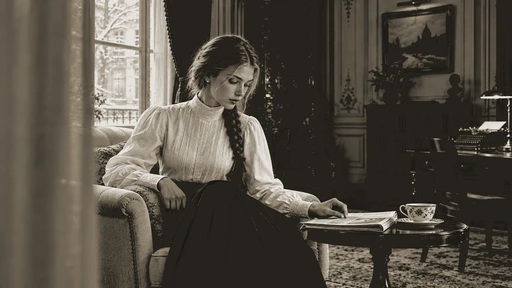

[Full-size lossless 1672×940](../../assets/looks-n002-20261024-r1/full/001-sp-1910s.webp) · [Original source](../../assets/looks-n002-20261024-r1/source.png) · [All 500 supplied-image samples](../FILTER_GALLERY.md)

| Input swatch | Input RGB | Actual output RGB |
|---|---|---|
| `gray_0` | `#000000` | `#26231D` |
| `gray_10` | `#1A1A1A` | `#26231D` |
| `gray_25` | `#404040` | `#6E6454` |
| `gray_50` | `#808080` | `#B8B0A3` |
| `gray_75` | `#BFBFBF` | `#E7E4DF` |
| `gray_90` | `#E6E6E6` | `#E7E4DF` |
| `gray_100` | `#FFFFFF` | `#E7E4DF` |
| `skin_light` | `#F5DBC6` | `#E7E4DF` |
| `skin_medium` | `#CF9B7B` | `#BEB6AA` |
| `skin_deep` | `#815438` | `#6D6354` |
| `red` | `#CC3333` | `#403A31` |
| `green` | `#33CC33` | `#060504` |
| `blue` | `#3333CC` | `#25211C` |

Creator: **Nixua / Striped Purple** · [Source](https://github.com/stripedpurple/color-grading-luts/blob/9757e8b5147693cab49c3fd674bf23dbe28d6c8e/Cinema%20Through%20The%20Ages/Striped%20Purple%20-%201910s.cube) · commit `9757e8b5147693cab49c3fd674bf23dbe28d6c8e`.

Conversion: `native-CUBE-grid-retained-v1`; 8,192 sampled RGB points; max error 0.0000000; mean 0.0000000. This is numerical approximation, not a perceptual quality score.

License obligations: Retain MIT copyright and license notice.

[License](../../../product/src/ai_ad_editor/look_data/licenses/sp-MIT.txt) · LUT SHA-256 `0101a722dc9cb26030901044ab4aa0b7aea60698925f2a9a7d6bf89d3cd7bdfc`.

[Actual preview PNG](../../assets/look500-20261024-r1/previews/sp-1910s.png) · [Actual video](../../assets/look500-20261024-r1/videos/sp-1910s.mp4)

## 002 · 电影 · 1920s

`sp-1920s` · `cinema` · MIT · 64³

50% 灰输出 Y′ 127.5/255（变化 +0.0 码值）；25%–75% 灰跨度比 1.000。中灰红减蓝 +0.0 码值。浅/中/深肤色色块分别输出 #D5D5D5、#959595、#4E4E4E；红/绿/蓝测试块分别输出 #525252、#080808、#4F4F4F。

建议试片：黑白叙事、字幕底片、档案风格

试用强度：1–1; default 1.0.

强度低于 1 会混回原始彩色。仅像素颜色映射，不生成颗粒、光晕、暗角、空间雾或美颜；未做自然画质验收。

补充选型说明：中性黑白。中性灰输入基本保持原码值，但彩色转灰使用明显不同的颜色权重：蓝色色块比红色亮，绿色最暗；不是简单把所有颜色按普通亮度去饱和。

**用户提供的 N002 母图：强度 1.0 的实际输出。**

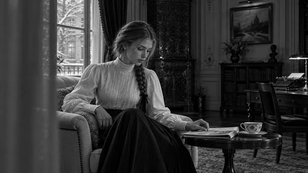

[Full-size lossless 1672×940](../../assets/looks-n002-20261024-r1/full/002-sp-1920s.webp) · [Original source](../../assets/looks-n002-20261024-r1/source.png) · [All 500 supplied-image samples](../FILTER_GALLERY.md)

| Input swatch | Input RGB | Actual output RGB |
|---|---|---|
| `gray_0` | `#000000` | `#000000` |
| `gray_10` | `#1A1A1A` | `#1A1A1A` |
| `gray_25` | `#404040` | `#404040` |
| `gray_50` | `#808080` | `#808080` |
| `gray_75` | `#BFBFBF` | `#BFBFBF` |
| `gray_90` | `#E6E6E6` | `#E5E5E5` |
| `gray_100` | `#FFFFFF` | `#FFFFFF` |
| `skin_light` | `#F5DBC6` | `#D5D5D5` |
| `skin_medium` | `#CF9B7B` | `#959595` |
| `skin_deep` | `#815438` | `#4E4E4E` |
| `red` | `#CC3333` | `#525252` |
| `green` | `#33CC33` | `#080808` |
| `blue` | `#3333CC` | `#4F4F4F` |

Creator: **Nixua / Striped Purple** · [Source](https://github.com/stripedpurple/color-grading-luts/blob/9757e8b5147693cab49c3fd674bf23dbe28d6c8e/Cinema%20Through%20The%20Ages/Striped%20Purple%20-%201920s.cube) · commit `9757e8b5147693cab49c3fd674bf23dbe28d6c8e`.

Conversion: `native-CUBE-grid-retained-v1`; 8,192 sampled RGB points; max error 0.0000000; mean 0.0000000. This is numerical approximation, not a perceptual quality score.

License obligations: Retain MIT copyright and license notice.

[License](../../../product/src/ai_ad_editor/look_data/licenses/sp-MIT.txt) · LUT SHA-256 `1433ad4babb27b3eba3348c55c538762745df81606b13487057eddca0a854a69`.

[Actual preview PNG](../../assets/look500-20261024-r1/previews/sp-1920s.png) · [Actual video](../../assets/look500-20261024-r1/videos/sp-1920s.mp4)

## 003 · 电影 · 1930s

`sp-1930s` · `cinema` · MIT · 64³

50% 灰输出 Y′ 137.2/255（变化 +9.7 码值）；25%–75% 灰跨度比 1.041。中灰红减蓝 +31.3 码值。浅/中/深肤色色块分别输出 #E1DFD7、#A7A38E、#5B5846；红/绿/蓝测试块分别输出 #5F5C4A、#11100C、#040402。

建议试片：复古纪实、历史标题、怀旧照片动画

试用强度：0.35–0.8; default 1.0.

逐项比较肤色与品牌色，强度过高可能改变产品颜色。仅像素颜色映射，不生成颗粒、光晕、暗角、空间雾或美颜；未做自然画质验收。

补充选型说明：黄橄榄单色。黑白端保留，中灰略提亮并偏黄绿，红绿蓝被映射为不同深浅的橄榄灰，较 1910s 更少褪黑、更保留端点。

**用户提供的 N002 母图：强度 1.0 的实际输出。**

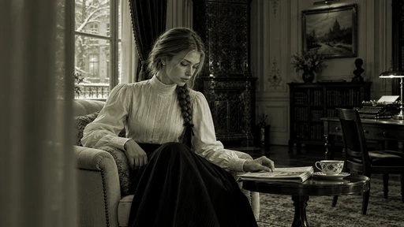

[Full-size lossless 1672×940](../../assets/looks-n002-20261024-r1/full/003-sp-1930s.webp) · [Original source](../../assets/looks-n002-20261024-r1/source.png) · [All 500 supplied-image samples](../FILTER_GALLERY.md)

| Input swatch | Input RGB | Actual output RGB |
|---|---|---|
| `gray_0` | `#000000` | `#000000` |
| `gray_10` | `#1A1A1A` | `#191712` |
| `gray_25` | `#404040` | `#454235` |
| `gray_50` | `#808080` | `#8F8A70` |
| `gray_75` | `#BFBFBF` | `#CAC7BA` |
| `gray_90` | `#E6E6E6` | `#EDECE6` |
| `gray_100` | `#FFFFFF` | `#FFFFFF` |
| `skin_light` | `#F5DBC6` | `#E1DFD7` |
| `skin_medium` | `#CF9B7B` | `#A7A38E` |
| `skin_deep` | `#815438` | `#5B5846` |
| `red` | `#CC3333` | `#5F5C4A` |
| `green` | `#33CC33` | `#11100C` |
| `blue` | `#3333CC` | `#040402` |

Creator: **Nixua / Striped Purple** · [Source](https://github.com/stripedpurple/color-grading-luts/blob/9757e8b5147693cab49c3fd674bf23dbe28d6c8e/Cinema%20Through%20The%20Ages/Striped%20Purple%20-%201930s.cube) · commit `9757e8b5147693cab49c3fd674bf23dbe28d6c8e`.

Conversion: `native-CUBE-grid-retained-v1`; 8,192 sampled RGB points; max error 0.0000000; mean 0.0000000. This is numerical approximation, not a perceptual quality score.

License obligations: Retain MIT copyright and license notice.

[License](../../../product/src/ai_ad_editor/look_data/licenses/sp-MIT.txt) · LUT SHA-256 `b8ecdd5ffd06c0a1e6e9c9a319223568a3a7ebed544c99741520642e84a0384f`.

[Actual preview PNG](../../assets/look500-20261024-r1/previews/sp-1930s.png) · [Actual video](../../assets/look500-20261024-r1/videos/sp-1930s.mp4)

## 004 · 电影 · 1940s

`sp-1940s` · `cinema` · MIT · 64³

50% 灰输出 Y′ 127.5/255（变化 +0.0 码值）；25%–75% 灰跨度比 1.000。中灰红减蓝 +0.0 码值。浅/中/深肤色色块分别输出 #F5D2D3、#CE9690、#845454；红/绿/蓝测试块分别输出 #BE133E、#14AEAD、#14B4BC。

建议试片：复古彩色叙事、海报感短片

试用强度：0.35–0.8; default 1.0.

逐项比较肤色与品牌色，强度过高可能改变产品颜色。仅像素颜色映射，不生成颗粒、光晕、暗角、空间雾或美颜；未做自然画质验收。

补充选型说明：灰阶基本不动，主要重新分配色相：红色变成玫红，绿色转深青，蓝色色块转浅青绿；中肤色色块明显偏粉，色彩带有选择性着色感。

**用户提供的 N002 母图：强度 1.0 的实际输出。**

[Full-size lossless 1672×940](../../assets/looks-n002-20261024-r1/full/004-sp-1940s.webp) · [Original source](../../assets/looks-n002-20261024-r1/source.png) · [All 500 supplied-image samples](../FILTER_GALLERY.md)

| Input swatch | Input RGB | Actual output RGB |
|---|---|---|
| `gray_0` | `#000000` | `#000000` |
| `gray_10` | `#1A1A1A` | `#1A1A1A` |
| `gray_25` | `#404040` | `#404040` |
| `gray_50` | `#808080` | `#808080` |
| `gray_75` | `#BFBFBF` | `#BFBFBF` |
| `gray_90` | `#E6E6E6` | `#E5E5E5` |
| `gray_100` | `#FFFFFF` | `#FFFFFF` |
| `skin_light` | `#F5DBC6` | `#F5D2D3` |
| `skin_medium` | `#CF9B7B` | `#CE9690` |
| `skin_deep` | `#815438` | `#845454` |
| `red` | `#CC3333` | `#BE133E` |
| `green` | `#33CC33` | `#14AEAD` |
| `blue` | `#3333CC` | `#14B4BC` |

Creator: **Nixua / Striped Purple** · [Source](https://github.com/stripedpurple/color-grading-luts/blob/9757e8b5147693cab49c3fd674bf23dbe28d6c8e/Cinema%20Through%20The%20Ages/Striped%20Purple%20-%201940s.cube) · commit `9757e8b5147693cab49c3fd674bf23dbe28d6c8e`.

Conversion: `native-CUBE-grid-retained-v1`; 8,192 sampled RGB points; max error 0.0000000; mean 0.0000000. This is numerical approximation, not a perceptual quality score.

License obligations: Retain MIT copyright and license notice.

[License](../../../product/src/ai_ad_editor/look_data/licenses/sp-MIT.txt) · LUT SHA-256 `f3d000747f996f705b915f18b2671aec2b1aeb3d05cb07d227c3f9d455301e9c`.

[Actual preview PNG](../../assets/look500-20261024-r1/previews/sp-1940s.png) · [Actual video](../../assets/look500-20261024-r1/videos/sp-1940s.mp4)

## 005 · 电影 · 1950s

`sp-1950s` · `cinema` · MIT · 64³

50% 灰输出 Y′ 127.5/255（变化 +0.0 码值）；25%–75% 灰跨度比 1.000。中灰红减蓝 -0.0 码值。浅/中/深肤色色块分别输出 #F5DBC8、#CE9C82、#7E5641；红/绿/蓝测试块分别输出 #D54214、#00AEBA、#2551CF。

建议试片：复古商品故事、街景、旅行片头

试用强度：0.35–0.8; default 1.0.

逐项比较肤色与品牌色，强度过高可能改变产品颜色。仅像素颜色映射，不生成颗粒、光晕、暗角、空间雾或美颜；未做自然画质验收。

补充选型说明：保留灰阶骨架，红色色块转更暖的橘红，绿色明显转青蓝，蓝色更鲜明；肤色保留暖调，但蓝分量略增，呈复古彩色印刷感。

**用户提供的 N002 母图：强度 1.0 的实际输出。**

[Full-size lossless 1672×940](../../assets/looks-n002-20261024-r1/full/005-sp-1950s.webp) · [Original source](../../assets/looks-n002-20261024-r1/source.png) · [All 500 supplied-image samples](../FILTER_GALLERY.md)

| Input swatch | Input RGB | Actual output RGB |
|---|---|---|
| `gray_0` | `#000000` | `#000000` |
| `gray_10` | `#1A1A1A` | `#1A1A1A` |
| `gray_25` | `#404040` | `#404040` |
| `gray_50` | `#808080` | `#7F8080` |
| `gray_75` | `#BFBFBF` | `#BFBFBF` |
| `gray_90` | `#E6E6E6` | `#E5E5E5` |
| `gray_100` | `#FFFFFF` | `#FFFFFF` |
| `skin_light` | `#F5DBC6` | `#F5DBC8` |
| `skin_medium` | `#CF9B7B` | `#CE9C82` |
| `skin_deep` | `#815438` | `#7E5641` |
| `red` | `#CC3333` | `#D54214` |
| `green` | `#33CC33` | `#00AEBA` |
| `blue` | `#3333CC` | `#2551CF` |

Creator: **Nixua / Striped Purple** · [Source](https://github.com/stripedpurple/color-grading-luts/blob/9757e8b5147693cab49c3fd674bf23dbe28d6c8e/Cinema%20Through%20The%20Ages/Striped%20Purple%20-%201950s.cube) · commit `9757e8b5147693cab49c3fd674bf23dbe28d6c8e`.

Conversion: `native-CUBE-grid-retained-v1`; 8,192 sampled RGB points; max error 0.0000000; mean 0.0000000. This is numerical approximation, not a perceptual quality score.

License obligations: Retain MIT copyright and license notice.

[License](../../../product/src/ai_ad_editor/look_data/licenses/sp-MIT.txt) · LUT SHA-256 `82f3efad7170ebeba3c6b2897d5fc2cbd0345b4a4b71824b269f4e94bbddc2dc`.

[Actual preview PNG](../../assets/look500-20261024-r1/previews/sp-1950s.png) · [Actual video](../../assets/look500-20261024-r1/videos/sp-1950s.mp4)

## 006 · 电影 · 1960s

`sp-1960s` · `cinema` · MIT · 64³

50% 灰输出 Y′ 127.5/255（变化 +0.0 码值）；25%–75% 灰跨度比 1.000。中灰红减蓝 -0.0 码值。浅/中/深肤色色块分别输出 #F5DAC8、#D29681、#884D3F；红/绿/蓝测试块分别输出 #D33335、#13BFB7、#1435D5。

建议试片：复古生活方式、音乐片段、街拍

试用强度：0.35–0.8; default 1.0.

逐项比较肤色与品牌色，强度过高可能改变产品颜色。仅像素颜色映射，不生成颗粒、光晕、暗角、空间雾或美颜；未做自然画质验收。

补充选型说明：灰阶近中性，红色更浓，绿色变青绿，蓝色稍压暗并保持蓝调；肤色增加红粉感，彩色区域比灰白区域更有存在感。

**用户提供的 N002 母图：强度 1.0 的实际输出。**

[Full-size lossless 1672×940](../../assets/looks-n002-20261024-r1/full/006-sp-1960s.webp) · [Original source](../../assets/looks-n002-20261024-r1/source.png) · [All 500 supplied-image samples](../FILTER_GALLERY.md)

| Input swatch | Input RGB | Actual output RGB |
|---|---|---|
| `gray_0` | `#000000` | `#000000` |
| `gray_10` | `#1A1A1A` | `#1A1A1A` |
| `gray_25` | `#404040` | `#404040` |
| `gray_50` | `#808080` | `#7F8080` |
| `gray_75` | `#BFBFBF` | `#BFBFBF` |
| `gray_90` | `#E6E6E6` | `#E5E5E5` |
| `gray_100` | `#FFFFFF` | `#FFFFFF` |
| `skin_light` | `#F5DBC6` | `#F5DAC8` |
| `skin_medium` | `#CF9B7B` | `#D29681` |
| `skin_deep` | `#815438` | `#884D3F` |
| `red` | `#CC3333` | `#D33335` |
| `green` | `#33CC33` | `#13BFB7` |
| `blue` | `#3333CC` | `#1435D5` |

Creator: **Nixua / Striped Purple** · [Source](https://github.com/stripedpurple/color-grading-luts/blob/9757e8b5147693cab49c3fd674bf23dbe28d6c8e/Cinema%20Through%20The%20Ages/Striped%20Purple%20-%201960s.cube) · commit `9757e8b5147693cab49c3fd674bf23dbe28d6c8e`.

Conversion: `native-CUBE-grid-retained-v1`; 8,192 sampled RGB points; max error 0.0000000; mean 0.0000000. This is numerical approximation, not a perceptual quality score.

License obligations: Retain MIT copyright and license notice.

[License](../../../product/src/ai_ad_editor/look_data/licenses/sp-MIT.txt) · LUT SHA-256 `131e8cec132469e5e99d9ef4b346e39dae9d606705f74811b9894bd0ca99d9a8`.

[Actual preview PNG](../../assets/look500-20261024-r1/previews/sp-1960s.png) · [Actual video](../../assets/look500-20261024-r1/videos/sp-1960s.mp4)

## 007 · 电影 · 1970s

`sp-1970s` · `cinema` · MIT · 64³

50% 灰输出 Y′ 128.3/255（变化 +0.8 码值）；25%–75% 灰跨度比 1.108。中灰红减蓝 +0.0 码值。浅/中/深肤色色块分别输出 #E0D8CC、#DFA375、#9F4F2F；红/绿/蓝测试块分别输出 #E03325、#62D687、#4A60CA。

建议试片：旅行回忆、生活记录、旧相册感广告

试用强度：0.35–0.8; default 1.0.

逐项比较肤色与品牌色，强度过高可能改变产品颜色。仅像素颜色映射，不生成颗粒、光晕、暗角、空间雾或美颜；未做自然画质验收。

补充选型说明：抬高纯黑并压低纯白，同时加强中段明暗分离。肤色更亮、更橙，绿色偏黄绿，蓝色转柔和青蓝；形成有褪色端点的暖复古彩色。

**用户提供的 N002 母图：强度 1.0 的实际输出。**

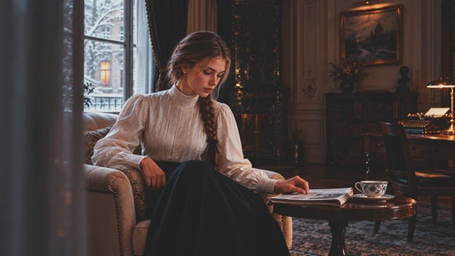

[Full-size lossless 1672×940](../../assets/looks-n002-20261024-r1/full/007-sp-1970s.webp) · [Original source](../../assets/looks-n002-20261024-r1/source.png) · [All 500 supplied-image samples](../FILTER_GALLERY.md)

| Input swatch | Input RGB | Actual output RGB |
|---|---|---|
| `gray_0` | `#000000` | `#212121` |
| `gray_10` | `#1A1A1A` | `#262626` |
| `gray_25` | `#404040` | `#3A3A3A` |
| `gray_50` | `#808080` | `#808080` |
| `gray_75` | `#BFBFBF` | `#C7C7C7` |
| `gray_90` | `#E6E6E6` | `#DBDBDB` |
| `gray_100` | `#FFFFFF` | `#DFDFDF` |
| `skin_light` | `#F5DBC6` | `#E0D8CC` |
| `skin_medium` | `#CF9B7B` | `#DFA375` |
| `skin_deep` | `#815438` | `#9F4F2F` |
| `red` | `#CC3333` | `#E03325` |
| `green` | `#33CC33` | `#62D687` |
| `blue` | `#3333CC` | `#4A60CA` |

Creator: **Nixua / Striped Purple** · [Source](https://github.com/stripedpurple/color-grading-luts/blob/9757e8b5147693cab49c3fd674bf23dbe28d6c8e/Cinema%20Through%20The%20Ages/Striped%20Purple%20-%201970s.cube) · commit `9757e8b5147693cab49c3fd674bf23dbe28d6c8e`.

Conversion: `native-CUBE-grid-retained-v1`; 8,192 sampled RGB points; max error 0.0000000; mean 0.0000000. This is numerical approximation, not a perceptual quality score.

License obligations: Retain MIT copyright and license notice.

[License](../../../product/src/ai_ad_editor/look_data/licenses/sp-MIT.txt) · LUT SHA-256 `ae3581409ff727f29825fc583aa3f345688086fc9a5b4b8fdcf21b0c91fc8194`.

[Actual preview PNG](../../assets/look500-20261024-r1/previews/sp-1970s.png) · [Actual video](../../assets/look500-20261024-r1/videos/sp-1970s.mp4)

## 008 · 电影 · 1980_s

`sp-1980-s` · `cinema` · MIT · 64³

50% 灰输出 Y′ 127.5/255（变化 -0.0 码值）；25%–75% 灰跨度比 1.370。中灰红减蓝 -0.0 码值。浅/中/深肤色色块分别输出 #FFFCE7、#F0A984、#81482B；红/绿/蓝测试块分别输出 #FF2808、#2FF6F1、#004EFF。

建议试片：音乐节奏片、街头、强视觉产品片

试用强度：0.35–0.8; default 1.0.

逐项比较肤色与品牌色，强度过高可能改变产品颜色。仅像素颜色映射，不生成颗粒、光晕、暗角、空间雾或美颜；未做自然画质验收。

补充选型说明：强对比彩色：10% 灰已压到接近黑，90% 灰接近白，中段两侧明显拉开；红橙更强，绿色转青，蓝色更亮、更鲜。

**用户提供的 N002 母图：强度 1.0 的实际输出。**

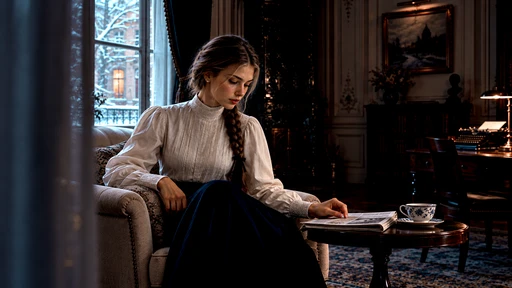

[Full-size lossless 1672×940](../../assets/looks-n002-20261024-r1/full/008-sp-1980-s.webp) · [Original source](../../assets/looks-n002-20261024-r1/source.png) · [All 500 supplied-image samples](../FILTER_GALLERY.md)

| Input swatch | Input RGB | Actual output RGB |
|---|---|---|
| `gray_0` | `#000000` | `#000000` |
| `gray_10` | `#1A1A1A` | `#000000` |
| `gray_25` | `#404040` | `#25292C` |
| `gray_50` | `#808080` | `#7F7F80` |
| `gray_75` | `#BFBFBF` | `#DAD6D3` |
| `gray_90` | `#E6E6E6` | `#FFFFFF` |
| `gray_100` | `#FFFFFF` | `#FFFFFF` |
| `skin_light` | `#F5DBC6` | `#FFFCE7` |
| `skin_medium` | `#CF9B7B` | `#F0A984` |
| `skin_deep` | `#815438` | `#81482B` |
| `red` | `#CC3333` | `#FF2808` |
| `green` | `#33CC33` | `#2FF6F1` |
| `blue` | `#3333CC` | `#004EFF` |

Creator: **Nixua / Striped Purple** · [Source](https://github.com/stripedpurple/color-grading-luts/blob/9757e8b5147693cab49c3fd674bf23dbe28d6c8e/Cinema%20Through%20The%20Ages/Striped%20Purple%20-%201980_s.cube) · commit `9757e8b5147693cab49c3fd674bf23dbe28d6c8e`.

Conversion: `native-CUBE-grid-retained-v1`; 8,192 sampled RGB points; max error 0.0000000; mean 0.0000000. This is numerical approximation, not a perceptual quality score.

License obligations: Retain MIT copyright and license notice.

[License](../../../product/src/ai_ad_editor/look_data/licenses/sp-MIT.txt) · LUT SHA-256 `51fbd944abcef4b6217a3e16cbd74432273728737b4894fb751c15c7fe2ffc48`.

[Actual preview PNG](../../assets/look500-20261024-r1/previews/sp-1980-s.png) · [Actual video](../../assets/look500-20261024-r1/videos/sp-1980-s.mp4)

## 009 · 创意色彩 · Amber Haze

`sp-amber-haze` · `creative` · MIT · 32³

50% 灰输出 Y′ 93.5/255（变化 -34.0 码值）；25%–75% 灰跨度比 0.740。中灰红减蓝 +8.0 码值。浅/中/深肤色色块分别输出 #B6A09E、#A06D62、#6F392D；红/绿/蓝测试块分别输出 #9F2229、#319429、#3122A3。

建议试片：暗调情绪、夜间氛围、复古静物

试用强度：0.35–0.8; default 1.0.

逐项比较肤色与品牌色，强度过高可能改变产品颜色。仅像素颜色映射，不生成颗粒、光晕、暗角、空间雾或美颜；未做自然画质验收。

补充选型说明：整体压暗，50% 灰降到约 94；中灰偏紫褐，白色变冷蓝灰，肤色转较暗的红棕。名字含 Amber，但实际不是单纯的暖黄滤镜。

**用户提供的 N002 母图：强度 1.0 的实际输出。**

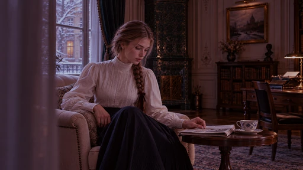

[Full-size lossless 1672×940](../../assets/looks-n002-20261024-r1/full/009-sp-amber-haze.webp) · [Original source](../../assets/looks-n002-20261024-r1/source.png) · [All 500 supplied-image samples](../FILTER_GALLERY.md)

| Input swatch | Input RGB | Actual output RGB |
|---|---|---|
| `gray_0` | `#000000` | `#040000` |
| `gray_10` | `#1A1A1A` | `#1B1114` |
| `gray_25` | `#404040` | `#3C2B33` |
| `gray_50` | `#808080` | `#6E5866` |
| `gray_75` | `#BFBFBF` | `#978998` |
| `gray_90` | `#E6E6E6` | `#ADA9B7` |
| `gray_100` | `#FFFFFF` | `#BBBFCB` |
| `skin_light` | `#F5DBC6` | `#B6A09E` |
| `skin_medium` | `#CF9B7B` | `#A06D62` |
| `skin_deep` | `#815438` | `#6F392D` |
| `red` | `#CC3333` | `#9F2229` |
| `green` | `#33CC33` | `#319429` |
| `blue` | `#3333CC` | `#3122A3` |

Creator: **Nixua / Striped Purple** · [Source](https://github.com/stripedpurple/color-grading-luts/blob/9757e8b5147693cab49c3fd674bf23dbe28d6c8e/Avant%20Garde/Striped%20Purple%20-%20Amber%20Haze.cube) · commit `9757e8b5147693cab49c3fd674bf23dbe28d6c8e`.

Conversion: `native-CUBE-grid-retained-v1`; 8,192 sampled RGB points; max error 0.0000000; mean 0.0000000. This is numerical approximation, not a perceptual quality score.

License obligations: Retain MIT copyright and license notice.

[License](../../../product/src/ai_ad_editor/look_data/licenses/sp-MIT.txt) · LUT SHA-256 `391f896bcd37959b63c8bf21d1d4667d916bae123f8b6976a1fdad8b832295b7`.

[Actual preview PNG](../../assets/look500-20261024-r1/previews/sp-amber-haze.png) · [Actual video](../../assets/look500-20261024-r1/videos/sp-amber-haze.mp4)

## 010 · 创意色彩 · Ara

`sp-ara` · `creative` · MIT · 64³

50% 灰输出 Y′ 123.9/255（变化 -3.6 码值）；25%–75% 灰跨度比 0.993。中灰红减蓝 +10.0 码值。浅/中/深肤色色块分别输出 #FFCE92、#CC8749、#7A4A19；红/绿/蓝测试块分别输出 #B6160C、#00E100、#1E08BB。

建议试片：鲜明户外、图形画面、暖色主体

试用强度：0.35–0.8; default 1.0.

逐项比较肤色与品牌色，强度过高可能改变产品颜色。仅像素颜色映射，不生成颗粒、光晕、暗角、空间雾或美颜；未做自然画质验收。

补充选型说明：中灰略暗并偏黄绿；红色更深，绿色更纯更强，蓝色色块更深蓝，肤色明显收蓝而偏金橙。灰白区域比彩色区域变化小。

**用户提供的 N002 母图：强度 1.0 的实际输出。**

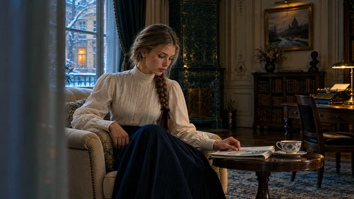

[Full-size lossless 1672×940](../../assets/looks-n002-20261024-r1/full/010-sp-ara.webp) · [Original source](../../assets/looks-n002-20261024-r1/source.png) · [All 500 supplied-image samples](../FILTER_GALLERY.md)

| Input swatch | Input RGB | Actual output RGB |
|---|---|---|
| `gray_0` | `#000000` | `#000000` |
| `gray_10` | `#1A1A1A` | `#111716` |
| `gray_25` | `#404040` | `#353D3A` |
| `gray_50` | `#808080` | `#7B7E71` |
| `gray_75` | `#BFBFBF` | `#BEBAA8` |
| `gray_90` | `#E6E6E6` | `#E8E3D7` |
| `gray_100` | `#FFFFFF` | `#FFFFFE` |
| `skin_light` | `#F5DBC6` | `#FFCE92` |
| `skin_medium` | `#CF9B7B` | `#CC8749` |
| `skin_deep` | `#815438` | `#7A4A19` |
| `red` | `#CC3333` | `#B6160C` |
| `green` | `#33CC33` | `#00E100` |
| `blue` | `#3333CC` | `#1E08BB` |

Creator: **Nixua / Striped Purple** · [Source](https://github.com/stripedpurple/color-grading-luts/blob/9757e8b5147693cab49c3fd674bf23dbe28d6c8e/Zoology/Striped%20Purple%20-%20Ara.cube) · commit `9757e8b5147693cab49c3fd674bf23dbe28d6c8e`.

Conversion: `native-CUBE-grid-retained-v1`; 8,192 sampled RGB points; max error 0.0000000; mean 0.0000000. This is numerical approximation, not a perceptual quality score.

License obligations: Retain MIT copyright and license notice.

[License](../../../product/src/ai_ad_editor/look_data/licenses/sp-MIT.txt) · LUT SHA-256 `b305a51c72c66460e32a908bb9fb05dad2f6890235a084d3fc5b317ca64903e9`.

[Actual preview PNG](../../assets/look500-20261024-r1/previews/sp-ara.png) · [Actual video](../../assets/look500-20261024-r1/videos/sp-ara.mp4)

## 011 · 创意色彩 · Arcade Dayz

`sp-arcade-dayz` · `creative` · MIT · 32³

50% 灰输出 Y′ 133.9/255（变化 +6.4 码值）；25%–75% 灰跨度比 0.907。中灰红减蓝 +16.8 码值。浅/中/深肤色色块分别输出 #F7E1D2、#D09177、#8D5C61；红/绿/蓝测试块分别输出 #CF3B5D、#5CC241、#2743D3。

建议试片：游戏、潮流、青春生活方式

试用强度：0.35–0.8; default 1.0.

逐项比较肤色与品牌色，强度过高可能改变产品颜色。仅像素颜色映射，不生成颗粒、光晕、暗角、空间雾或美颜；未做自然画质验收。

补充选型说明：灰阶中段染成紫粉，暗灰略提亮；红色转玫红，绿色稍灰，蓝色偏紫蓝，肤色仍偏暖。形成粉紫环境与暖主体的分离。

**用户提供的 N002 母图：强度 1.0 的实际输出。**

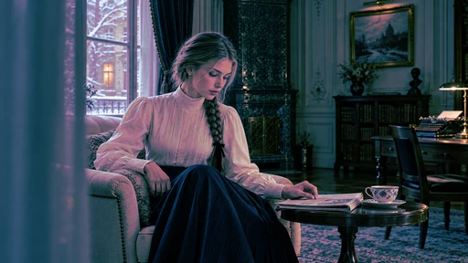

[Full-size lossless 1672×940](../../assets/looks-n002-20261024-r1/full/011-sp-arcade-dayz.webp) · [Original source](../../assets/looks-n002-20261024-r1/source.png) · [All 500 supplied-image samples](../FILTER_GALLERY.md)

| Input swatch | Input RGB | Actual output RGB |
|---|---|---|
| `gray_0` | `#000000` | `#000000` |
| `gray_10` | `#1A1A1A` | `#07222A` |
| `gray_25` | `#404040` | `#2D5164` |
| `gray_50` | `#808080` | `#A67B95` |
| `gray_75` | `#BFBFBF` | `#C4BCBD` |
| `gray_90` | `#E6E6E6` | `#ECEBEC` |
| `gray_100` | `#FFFFFF` | `#FFFFFF` |
| `skin_light` | `#F5DBC6` | `#F7E1D2` |
| `skin_medium` | `#CF9B7B` | `#D09177` |
| `skin_deep` | `#815438` | `#8D5C61` |
| `red` | `#CC3333` | `#CF3B5D` |
| `green` | `#33CC33` | `#5CC241` |
| `blue` | `#3333CC` | `#2743D3` |

Creator: **Nixua / Striped Purple** · [Source](https://github.com/stripedpurple/color-grading-luts/blob/9757e8b5147693cab49c3fd674bf23dbe28d6c8e/Avant%20Garde/Striped%20Purple%20-%20Arcade%20Dayz.cube) · commit `9757e8b5147693cab49c3fd674bf23dbe28d6c8e`.

Conversion: `native-CUBE-grid-retained-v1`; 8,192 sampled RGB points; max error 0.0000000; mean 0.0000000. This is numerical approximation, not a perceptual quality score.

License obligations: Retain MIT copyright and license notice.

[License](../../../product/src/ai_ad_editor/look_data/licenses/sp-MIT.txt) · LUT SHA-256 `ec68418dad22ed505e80dae87ecb63d4b1460db2d539768cb497cd6f260a3657`.

[Actual preview PNG](../../assets/look500-20261024-r1/previews/sp-arcade-dayz.png) · [Actual video](../../assets/look500-20261024-r1/videos/sp-arcade-dayz.mp4)

## 012 · 创意色彩 · Aricha Blend

`sp-aricha-blend` · `creative` · MIT · 32³

50% 灰输出 Y′ 128.0/255（变化 +0.5 码值）；25%–75% 灰跨度比 1.422。中灰红减蓝 +47.9 码值。浅/中/深肤色色块分别输出 #F4ECE2、#D59D6F、#733519；红/绿/蓝测试块分别输出 #D42D1C、#42CB1F、#2C20A7。

建议试片：咖啡、木质静物、秋日生活方式

试用强度：0.35–0.8; default 1.0.

逐项比较肤色与品牌色，强度过高可能改变产品颜色。仅像素颜色映射，不生成颗粒、光晕、暗角、空间雾或美颜；未做自然画质验收。

补充选型说明：黑位抬成暖深棕，但 25% 灰进一步压暗，75% 灰明显提亮；中段强对比并带棕黄倾向，绿偏黄、蓝偏紫，肤色更金暖。

**用户提供的 N002 母图：强度 1.0 的实际输出。**

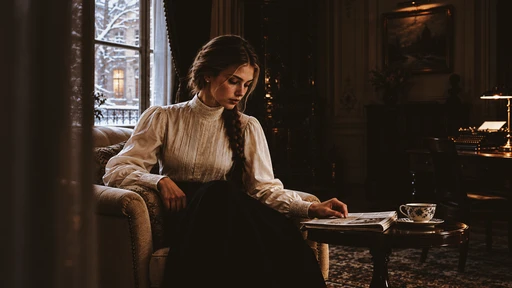

[Full-size lossless 1672×940](../../assets/looks-n002-20261024-r1/full/012-sp-aricha-blend.webp) · [Original source](../../assets/looks-n002-20261024-r1/source.png) · [All 500 supplied-image samples](../FILTER_GALLERY.md)

| Input swatch | Input RGB | Actual output RGB |
|---|---|---|
| `gray_0` | `#000000` | `#15110D` |
| `gray_10` | `#1A1A1A` | `#17130E` |
| `gray_25` | `#404040` | `#261E15` |
| `gray_50` | `#808080` | `#937D63` |
| `gray_75` | `#BFBFBF` | `#D7D4CF` |
| `gray_90` | `#E6E6E6` | `#F1F0EE` |
| `gray_100` | `#FFFFFF` | `#F7F7F6` |
| `skin_light` | `#F5DBC6` | `#F4ECE2` |
| `skin_medium` | `#CF9B7B` | `#D59D6F` |
| `skin_deep` | `#815438` | `#733519` |
| `red` | `#CC3333` | `#D42D1C` |
| `green` | `#33CC33` | `#42CB1F` |
| `blue` | `#3333CC` | `#2C20A7` |

Creator: **Nixua / Striped Purple** · [Source](https://github.com/stripedpurple/color-grading-luts/blob/9757e8b5147693cab49c3fd674bf23dbe28d6c8e/Drink%20it%20in%21/Striped%20Purple%20-%20Aricha%20Blend.cube) · commit `9757e8b5147693cab49c3fd674bf23dbe28d6c8e`.

Conversion: `native-CUBE-grid-retained-v1`; 8,192 sampled RGB points; max error 0.0000000; mean 0.0000000. This is numerical approximation, not a perceptual quality score.

License obligations: Retain MIT copyright and license notice.

[License](../../../product/src/ai_ad_editor/look_data/licenses/sp-MIT.txt) · LUT SHA-256 `36180adeddaec6f02ecb26d7cb91018911f04a3ade55e8eb427b379e7264239c`.

[Actual preview PNG](../../assets/look500-20261024-r1/previews/sp-aricha-blend.png) · [Actual video](../../assets/look500-20261024-r1/videos/sp-aricha-blend.mp4)

## 013 · 创意色彩 · Blow Me Down

`sp-blow-me-down` · `creative` · MIT · 32³

50% 灰输出 Y′ 144.6/255（变化 +17.1 码值）；25%–75% 灰跨度比 1.304。中灰红减蓝 +9.0 码值。浅/中/深肤色色块分别输出 #F8FEB9、#FBB213、#B55306；红/绿/蓝测试块分别输出 #FF3E01、#2B9D77、#87AFCA。

建议试片：海边创意、强色彩插片、暖色物件

试用强度：0.35–0.8; default 1.0.

逐项比较肤色与品牌色，强度过高可能改变产品颜色。仅像素颜色映射，不生成颗粒、光晕、暗角、空间雾或美颜；未做自然画质验收。

补充选型说明：抬黑、暖白，中灰和亮灰提亮；红橙推得很强，肤色色块转鲜黄橙，绿色收成暗青绿，蓝色变浅青蓝，色相分离非常明显。

**用户提供的 N002 母图：强度 1.0 的实际输出。**

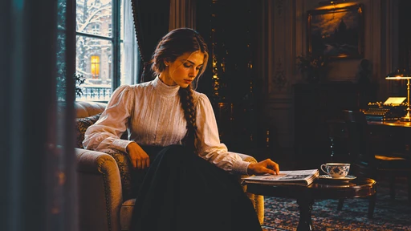

[Full-size lossless 1672×940](../../assets/looks-n002-20261024-r1/full/013-sp-blow-me-down.webp) · [Original source](../../assets/looks-n002-20261024-r1/source.png) · [All 500 supplied-image samples](../FILTER_GALLERY.md)

| Input swatch | Input RGB | Actual output RGB |
|---|---|---|
| `gray_0` | `#000000` | `#232425` |
| `gray_10` | `#1A1A1A` | `#242527` |
| `gray_25` | `#404040` | `#2C3136` |
| `gray_50` | `#808080` | `#94908B` |
| `gray_75` | `#BFBFBF` | `#E4D4C9` |
| `gray_90` | `#E6E6E6` | `#F9E7D3` |
| `gray_100` | `#FFFFFF` | `#F9E7D3` |
| `skin_light` | `#F5DBC6` | `#F8FEB9` |
| `skin_medium` | `#CF9B7B` | `#FBB213` |
| `skin_deep` | `#815438` | `#B55306` |
| `red` | `#CC3333` | `#FF3E01` |
| `green` | `#33CC33` | `#2B9D77` |
| `blue` | `#3333CC` | `#87AFCA` |

Creator: **Nixua / Striped Purple** · [Source](https://github.com/stripedpurple/color-grading-luts/blob/9757e8b5147693cab49c3fd674bf23dbe28d6c8e/Avant%20Garde/Striped%20Purple%20-%20Blow%20Me%20Down.cube) · commit `9757e8b5147693cab49c3fd674bf23dbe28d6c8e`.

Conversion: `native-CUBE-grid-retained-v1`; 8,192 sampled RGB points; max error 0.0000000; mean 0.0000000. This is numerical approximation, not a perceptual quality score.

License obligations: Retain MIT copyright and license notice.

[License](../../../product/src/ai_ad_editor/look_data/licenses/sp-MIT.txt) · LUT SHA-256 `a2a90af1e3795b37db6330abcc69d6004ec2064136207bc41099097ea9ffb0f7`.

[Actual preview PNG](../../assets/look500-20261024-r1/previews/sp-blow-me-down.png) · [Actual video](../../assets/look500-20261024-r1/videos/sp-blow-me-down.mp4)

## 014 · 创意色彩 · Blue Lagoon

`sp-blue-lagoon` · `creative` · MIT · 64³

50% 灰输出 Y′ 127.5/255（变化 +0.0 码值）；25%–75% 灰跨度比 1.000。中灰红减蓝 +0.0 码值。浅/中/深肤色色块分别输出 #F4DBC2、#CA9C6E、#845530；红/绿/蓝测试块分别输出 #E4232C、#0DA877、#2C69D3。

建议试片：水景、旅行、暖主体与冷背景对照

试用强度：0.35–0.8; default 1.0.

逐项比较肤色与品牌色，强度过高可能改变产品颜色。仅像素颜色映射，不生成颗粒、光晕、暗角、空间雾或美颜；未做自然画质验收。

补充选型说明：中性灰阶基本保持，主要把蓝色推向更明亮的青蓝、绿色转冷青绿；肤色减蓝偏金橙，红色色块更浓。

**用户提供的 N002 母图：强度 1.0 的实际输出。**

[Full-size lossless 1672×940](../../assets/looks-n002-20261024-r1/full/014-sp-blue-lagoon.webp) · [Original source](../../assets/looks-n002-20261024-r1/source.png) · [All 500 supplied-image samples](../FILTER_GALLERY.md)

| Input swatch | Input RGB | Actual output RGB |
|---|---|---|
| `gray_0` | `#000000` | `#000000` |
| `gray_10` | `#1A1A1A` | `#1A1A1A` |
| `gray_25` | `#404040` | `#404040` |
| `gray_50` | `#808080` | `#808080` |
| `gray_75` | `#BFBFBF` | `#BFBFBF` |
| `gray_90` | `#E6E6E6` | `#E5E5E5` |
| `gray_100` | `#FFFFFF` | `#FFFFFF` |
| `skin_light` | `#F5DBC6` | `#F4DBC2` |
| `skin_medium` | `#CF9B7B` | `#CA9C6E` |
| `skin_deep` | `#815438` | `#845530` |
| `red` | `#CC3333` | `#E4232C` |
| `green` | `#33CC33` | `#0DA877` |
| `blue` | `#3333CC` | `#2C69D3` |

Creator: **Nixua / Striped Purple** · [Source](https://github.com/stripedpurple/color-grading-luts/blob/9757e8b5147693cab49c3fd674bf23dbe28d6c8e/Drink%20it%20in%21/Striped%20Purple%20-%20Blue%20Lagoon.cube) · commit `9757e8b5147693cab49c3fd674bf23dbe28d6c8e`.

Conversion: `native-CUBE-grid-retained-v1`; 8,192 sampled RGB points; max error 0.0000000; mean 0.0000000. This is numerical approximation, not a perceptual quality score.

License obligations: Retain MIT copyright and license notice.

[License](../../../product/src/ai_ad_editor/look_data/licenses/sp-MIT.txt) · LUT SHA-256 `399efd6a99069015e2e01376ecd7ad3650f079cdfc78e31710e2ba8b8f56f233`.

[Actual preview PNG](../../assets/look500-20261024-r1/previews/sp-blue-lagoon.png) · [Actual video](../../assets/look500-20261024-r1/videos/sp-blue-lagoon.mp4)

## 015 · 创意色彩 · Boa

`sp-boa` · `creative` · MIT · 64³

50% 灰输出 Y′ 121.1/255（变化 -6.4 码值）；25%–75% 灰跨度比 1.057。中灰红减蓝 +21.0 码值。浅/中/深肤色色块分别输出 #FCD6AC、#C08956、#713E17；红/绿/蓝测试块分别输出 #AD0012、#91AB44、#005886。

建议试片：森林、户外装备、冷峻静物

试用强度：0.35–0.8; default 1.0.

逐项比较肤色与品牌色，强度过高可能改变产品颜色。仅像素颜色映射，不生成颗粒、光晕、暗角、空间雾或美颜；未做自然画质验收。

补充选型说明：压暗中灰并染黄绿，绿色去鲜变橄榄，蓝色明显转深青，红色更深；肤色偏棕金，整体是暗绿棕与青色关系。

**用户提供的 N002 母图：强度 1.0 的实际输出。**

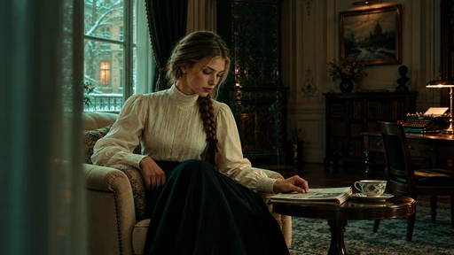

[Full-size lossless 1672×940](../../assets/looks-n002-20261024-r1/full/015-sp-boa.webp) · [Original source](../../assets/looks-n002-20261024-r1/source.png) · [All 500 supplied-image samples](../FILTER_GALLERY.md)

| Input swatch | Input RGB | Actual output RGB |
|---|---|---|
| `gray_0` | `#000000` | `#000000` |
| `gray_10` | `#1A1A1A` | `#09110A` |
| `gray_25` | `#404040` | `#283525` |
| `gray_50` | `#808080` | `#707F5B` |
| `gray_75` | `#BFBFBF` | `#B4BC94` |
| `gray_90` | `#E6E6E6` | `#E5E7D0` |
| `gray_100` | `#FFFFFF` | `#FFFFFF` |
| `skin_light` | `#F5DBC6` | `#FCD6AC` |
| `skin_medium` | `#CF9B7B` | `#C08956` |
| `skin_deep` | `#815438` | `#713E17` |
| `red` | `#CC3333` | `#AD0012` |
| `green` | `#33CC33` | `#91AB44` |
| `blue` | `#3333CC` | `#005886` |

Creator: **Nixua / Striped Purple** · [Source](https://github.com/stripedpurple/color-grading-luts/blob/9757e8b5147693cab49c3fd674bf23dbe28d6c8e/Zoology/Striped%20Purple%20-%20Boa.cube) · commit `9757e8b5147693cab49c3fd674bf23dbe28d6c8e`.

Conversion: `native-CUBE-grid-retained-v1`; 8,192 sampled RGB points; max error 0.0000000; mean 0.0000000. This is numerical approximation, not a perceptual quality score.

License obligations: Retain MIT copyright and license notice.

[License](../../../product/src/ai_ad_editor/look_data/licenses/sp-MIT.txt) · LUT SHA-256 `e32aaa5914cec54f7fa1610f51678c5f86f068f6141f80189d540264d93e79ef`.

[Actual preview PNG](../../assets/look500-20261024-r1/previews/sp-boa.png) · [Actual video](../../assets/look500-20261024-r1/videos/sp-boa.mp4)

## 016 · 创意色彩 · Caramel Plum Cake

`sp-caramel-plum-cake` · `creative` · MIT · 32³

50% 灰输出 Y′ 95.4/255（变化 -32.1 码值）；25%–75% 灰跨度比 0.984。中灰红减蓝 +21.3 码值。浅/中/深肤色色块分别输出 #F0D1B8、#DD8E63、#703B2F；红/绿/蓝测试块分别输出 #D22F2F、#21881E、#342CC2。

建议试片：甜品、木质桌面、暖调生活片

试用强度：0.35–0.8; default 1.0.

逐项比较肤色与品牌色，强度过高可能改变产品颜色。仅像素颜色映射，不生成颗粒、光晕、暗角、空间雾或美颜；未做自然画质验收。

补充选型说明：黑位抬至深灰，但大部分中间调明显变暗；中灰偏暖褐，肤色更红橙，绿色更深、蓝色偏紫，形成厚重暖褐氛围。

**用户提供的 N002 母图：强度 1.0 的实际输出。**

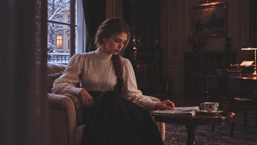

[Full-size lossless 1672×940](../../assets/looks-n002-20261024-r1/full/016-sp-caramel-plum-cake.webp) · [Original source](../../assets/looks-n002-20261024-r1/source.png) · [All 500 supplied-image samples](../FILTER_GALLERY.md)

| Input swatch | Input RGB | Actual output RGB |
|---|---|---|
| `gray_0` | `#000000` | `#1D1D1D` |
| `gray_10` | `#1A1A1A` | `#232121` |
| `gray_25` | `#404040` | `#312A2B` |
| `gray_50` | `#808080` | `#6D5C58` |
| `gray_75` | `#BFBFBF` | `#B1A7A4` |
| `gray_90` | `#E6E6E6` | `#D6D1CF` |
| `gray_100` | `#FFFFFF` | `#EBE8E7` |
| `skin_light` | `#F5DBC6` | `#F0D1B8` |
| `skin_medium` | `#CF9B7B` | `#DD8E63` |
| `skin_deep` | `#815438` | `#703B2F` |
| `red` | `#CC3333` | `#D22F2F` |
| `green` | `#33CC33` | `#21881E` |
| `blue` | `#3333CC` | `#342CC2` |

Creator: **Nixua / Striped Purple** · [Source](https://github.com/stripedpurple/color-grading-luts/blob/9757e8b5147693cab49c3fd674bf23dbe28d6c8e/Avant%20Garde/Striped%20Purple%20-%20Caramel%20Plum%20Cake.cube) · commit `9757e8b5147693cab49c3fd674bf23dbe28d6c8e`.

Conversion: `native-CUBE-grid-retained-v1`; 8,192 sampled RGB points; max error 0.0000000; mean 0.0000000. This is numerical approximation, not a perceptual quality score.

License obligations: Retain MIT copyright and license notice.

[License](../../../product/src/ai_ad_editor/look_data/licenses/sp-MIT.txt) · LUT SHA-256 `33512f89431ef8405e5652da3c95006bacf9898e44ad856a70b90aae00014a7e`.

[Actual preview PNG](../../assets/look500-20261024-r1/previews/sp-caramel-plum-cake.png) · [Actual video](../../assets/look500-20261024-r1/videos/sp-caramel-plum-cake.mp4)

## 017 · 创意色彩 · Cherry Champagne

`sp-cherry-champagne` · `creative` · MIT · 32³

50% 灰输出 Y′ 154.3/255（变化 +26.8 码值）；25%–75% 灰跨度比 0.620。中灰红减蓝 +8.5 码值。浅/中/深肤色色块分别输出 #ECD3CD、#DAA5A2、#AE7C80；红/绿/蓝测试块分别输出 #D96C7D、#69C77D、#696CD0。

建议试片：柔和人物、婚礼情绪、粉彩设计

试用强度：0.35–0.8; default 1.0.

逐项比较肤色与品牌色，强度过高可能改变产品颜色。仅像素颜色映射，不生成颗粒、光晕、暗角、空间雾或美颜；未做自然画质验收。

补充选型说明：显著抬高黑位和暗灰，黑色染成蓝青，中灰偏粉紫；红绿蓝均变柔、肤色偏粉，整体呈高雾面、粉彩效果。

**用户提供的 N002 母图：强度 1.0 的实际输出。**

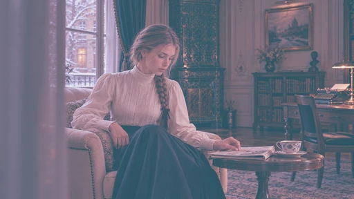

[Full-size lossless 1672×940](../../assets/looks-n002-20261024-r1/full/017-sp-cherry-champagne.webp) · [Original source](../../assets/looks-n002-20261024-r1/source.png) · [All 500 supplied-image samples](../FILTER_GALLERY.md)

| Input swatch | Input RGB | Actual output RGB |
|---|---|---|
| `gray_0` | `#000000` | `#2D5566` |
| `gray_10` | `#1A1A1A` | `#4C6071` |
| `gray_25` | `#404040` | `#767284` |
| `gray_50` | `#808080` | `#AD94A4` |
| `gray_75` | `#BFBFBF` | `#D3BEC9` |
| `gray_90` | `#E6E6E6` | `#E5DBE0` |
| `gray_100` | `#FFFFFF` | `#F1EEF0` |
| `skin_light` | `#F5DBC6` | `#ECD3CD` |
| `skin_medium` | `#CF9B7B` | `#DAA5A2` |
| `skin_deep` | `#815438` | `#AE7C80` |
| `red` | `#CC3333` | `#D96C7D` |
| `green` | `#33CC33` | `#69C77D` |
| `blue` | `#3333CC` | `#696CD0` |

Creator: **Nixua / Striped Purple** · [Source](https://github.com/stripedpurple/color-grading-luts/blob/9757e8b5147693cab49c3fd674bf23dbe28d6c8e/Avant%20Garde/Striped%20Purple%20-%20Cherry%20Champagne.cube) · commit `9757e8b5147693cab49c3fd674bf23dbe28d6c8e`.

Conversion: `native-CUBE-grid-retained-v1`; 8,192 sampled RGB points; max error 0.0000000; mean 0.0000000. This is numerical approximation, not a perceptual quality score.

License obligations: Retain MIT copyright and license notice.

[License](../../../product/src/ai_ad_editor/look_data/licenses/sp-MIT.txt) · LUT SHA-256 `c426f349af15b15615db3eeb32583946ad5a3db150d0af38c44c731842027630`.

[Actual preview PNG](../../assets/look500-20261024-r1/previews/sp-cherry-champagne.png) · [Actual video](../../assets/look500-20261024-r1/videos/sp-cherry-champagne.mp4)

## 018 · 风景 · December Greens

`sp-december-greens` · `landscape` · MIT · 64³

50% 灰输出 Y′ 127.5/255（变化 +0.0 码值）；25%–75% 灰跨度比 1.000。中灰红减蓝 +0.0 码值。浅/中/深肤色色块分别输出 #F4DBCA、#C89E89、#805948；红/绿/蓝测试块分别输出 #DE5A39、#14BA77、#253BC7。

建议试片：冬季绿景、冷暖均衡生活片

试用强度：0.35–0.8; default 1.0.

逐项比较肤色与品牌色，强度过高可能改变产品颜色。仅像素颜色映射，不生成颗粒、光晕、暗角、空间雾或美颜；未做自然画质验收。

补充选型说明：灰阶几乎不动，红色偏浅暖，绿色转青绿、蓝色维持偏冷；肤色稍降红并加蓝，暖度收敛。

**用户提供的 N002 母图：强度 1.0 的实际输出。**

[Full-size lossless 1672×940](../../assets/looks-n002-20261024-r1/full/018-sp-december-greens.webp) · [Original source](../../assets/looks-n002-20261024-r1/source.png) · [All 500 supplied-image samples](../FILTER_GALLERY.md)

| Input swatch | Input RGB | Actual output RGB |
|---|---|---|
| `gray_0` | `#000000` | `#000000` |
| `gray_10` | `#1A1A1A` | `#1A1A1A` |
| `gray_25` | `#404040` | `#404040` |
| `gray_50` | `#808080` | `#80807F` |
| `gray_75` | `#BFBFBF` | `#BFBFBF` |
| `gray_90` | `#E6E6E6` | `#E5E5E5` |
| `gray_100` | `#FFFFFF` | `#FFFFFF` |
| `skin_light` | `#F5DBC6` | `#F4DBCA` |
| `skin_medium` | `#CF9B7B` | `#C89E89` |
| `skin_deep` | `#815438` | `#805948` |
| `red` | `#CC3333` | `#DE5A39` |
| `green` | `#33CC33` | `#14BA77` |
| `blue` | `#3333CC` | `#253BC7` |

Creator: **Nixua / Striped Purple** · [Source](https://github.com/stripedpurple/color-grading-luts/blob/9757e8b5147693cab49c3fd674bf23dbe28d6c8e/Scenic%20Moods/Striped%20Purple%20-%20December%20Greens.cube) · commit `9757e8b5147693cab49c3fd674bf23dbe28d6c8e`.

Conversion: `native-CUBE-grid-retained-v1`; 8,192 sampled RGB points; max error 0.0000000; mean 0.0000000. This is numerical approximation, not a perceptual quality score.

License obligations: Retain MIT copyright and license notice.

[License](../../../product/src/ai_ad_editor/look_data/licenses/sp-MIT.txt) · LUT SHA-256 `c05bb89507b1e6c76f072e14a85c61c1e69e737b241fb75f4a3ee1b70047ddaa`.

[Actual preview PNG](../../assets/look500-20261024-r1/previews/sp-december-greens.png) · [Actual video](../../assets/look500-20261024-r1/videos/sp-december-greens.mp4)

## 019 · 创意色彩 · Dodo

`sp-dodo` · `creative` · MIT · 64³

50% 灰输出 Y′ 103.5/255（变化 -24.0 码值）；25%–75% 灰跨度比 0.837。中灰红减蓝 +0.0 码值。浅/中/深肤色色块分别输出 #E8BD9D、#C07B4A、#754321；红/绿/蓝测试块分别输出 #C22F05、#4E6C51、#79809C。

建议试片：低调静物、城市纪实、怀旧故事

试用强度：0.35–0.8; default 1.0.

逐项比较肤色与品牌色，强度过高可能改变产品颜色。仅像素颜色映射，不生成颗粒、光晕、暗角、空间雾或美颜；未做自然画质验收。

补充选型说明：保留色彩的暗调处理。纯黑抬灰，中灰降到约 104，绿与蓝明显去鲜并偏灰，肤色转深棕橙；红色相对更突出。

**用户提供的 N002 母图：强度 1.0 的实际输出。**

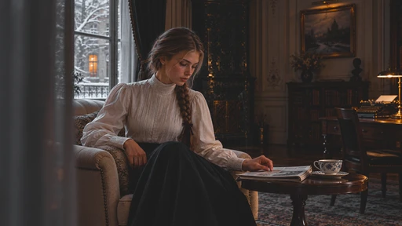

[Full-size lossless 1672×940](../../assets/looks-n002-20261024-r1/full/019-sp-dodo.webp) · [Original source](../../assets/looks-n002-20261024-r1/source.png) · [All 500 supplied-image samples](../FILTER_GALLERY.md)

| Input swatch | Input RGB | Actual output RGB |
|---|---|---|
| `gray_0` | `#000000` | `#1D1D1D` |
| `gray_10` | `#1A1A1A` | `#212121` |
| `gray_25` | `#404040` | `#363636` |
| `gray_50` | `#808080` | `#686868` |
| `gray_75` | `#BFBFBF` | `#A1A1A1` |
| `gray_90` | `#E6E6E6` | `#D0D0D0` |
| `gray_100` | `#FFFFFF` | `#FCFCFC` |
| `skin_light` | `#F5DBC6` | `#E8BD9D` |
| `skin_medium` | `#CF9B7B` | `#C07B4A` |
| `skin_deep` | `#815438` | `#754321` |
| `red` | `#CC3333` | `#C22F05` |
| `green` | `#33CC33` | `#4E6C51` |
| `blue` | `#3333CC` | `#79809C` |

Creator: **Nixua / Striped Purple** · [Source](https://github.com/stripedpurple/color-grading-luts/blob/9757e8b5147693cab49c3fd674bf23dbe28d6c8e/Zoology/Striped%20Purple%20-%20Dodo.cube) · commit `9757e8b5147693cab49c3fd674bf23dbe28d6c8e`.

Conversion: `native-CUBE-grid-retained-v1`; 8,192 sampled RGB points; max error 0.0000000; mean 0.0000000. This is numerical approximation, not a perceptual quality score.

License obligations: Retain MIT copyright and license notice.

[License](../../../product/src/ai_ad_editor/look_data/licenses/sp-MIT.txt) · LUT SHA-256 `2422d62ad806917badd1aee347343336ea4361b3f5c389dbf1cddbc60a51df25`.

[Actual preview PNG](../../assets/look500-20261024-r1/previews/sp-dodo.png) · [Actual video](../../assets/look500-20261024-r1/videos/sp-dodo.mp4)

## 020 · 风景 · Emerald Malaise

`sp-emerald-malaise` · `landscape` · MIT · 16³

50% 灰输出 Y′ 113.6/255（变化 -13.9 码值）；25%–75% 灰跨度比 0.764。中灰红减蓝 -4.7 码值。浅/中/深肤色色块分别输出 #D9B891、#B18B66、#665439；红/绿/蓝测试块分别输出 #AE3A36、#2DAD36、#2D3A95。

建议试片：复古绿景、森林情绪、冷暖叙事

试用强度：0.35–0.8; default 1.0.

逐项比较肤色与品牌色，强度过高可能改变产品颜色。仅像素颜色映射，不生成颗粒、光晕、暗角、空间雾或美颜；未做自然画质验收。

补充选型说明：抬黑并压低亮部上限，中灰偏绿，白色染奶油黄；绿色色块更鲜，红蓝去鲜，肤色降亮并偏棕，形成绿阴影与暖高光。

**用户提供的 N002 母图：强度 1.0 的实际输出。**

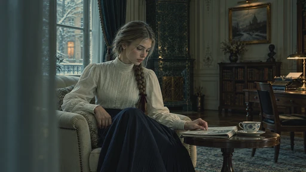

[Full-size lossless 1672×940](../../assets/looks-n002-20261024-r1/full/020-sp-emerald-malaise.webp) · [Original source](../../assets/looks-n002-20261024-r1/source.png) · [All 500 supplied-image samples](../FILTER_GALLERY.md)

| Input swatch | Input RGB | Actual output RGB |
|---|---|---|
| `gray_0` | `#000000` | `#0E0F11` |
| `gray_10` | `#1A1A1A` | `#1D2424` |
| `gray_25` | `#404040` | `#35443F` |
| `gray_50` | `#808080` | `#657669` |
| `gray_75` | `#BFBFBF` | `#A0A48E` |
| `gray_90` | `#E6E6E6` | `#C9BFA2` |
| `gray_100` | `#FFFFFF` | `#E4D0AF` |
| `skin_light` | `#F5DBC6` | `#D9B891` |
| `skin_medium` | `#CF9B7B` | `#B18B66` |
| `skin_deep` | `#815438` | `#665439` |
| `red` | `#CC3333` | `#AE3A36` |
| `green` | `#33CC33` | `#2DAD36` |
| `blue` | `#3333CC` | `#2D3A95` |

Creator: **Nixua / Striped Purple** · [Source](https://github.com/stripedpurple/color-grading-luts/blob/9757e8b5147693cab49c3fd674bf23dbe28d6c8e/Scenic%20Moods/Striped%20Purple%20-%20Emerald%20Malaise.cube) · commit `9757e8b5147693cab49c3fd674bf23dbe28d6c8e`.

Conversion: `native-CUBE-grid-retained-v1`; 8,192 sampled RGB points; max error 0.0000000; mean 0.0000000. This is numerical approximation, not a perceptual quality score.

License obligations: Retain MIT copyright and license notice.

[License](../../../product/src/ai_ad_editor/look_data/licenses/sp-MIT.txt) · LUT SHA-256 `3ca04ba3a3407ad275c314713523e91457d805c4609342c2293cbddb575be72f`.

[Actual preview PNG](../../assets/look500-20261024-r1/previews/sp-emerald-malaise.png) · [Actual video](../../assets/look500-20261024-r1/videos/sp-emerald-malaise.mp4)

## 021 · 创意色彩 · Great Auk

`sp-great-auk` · `creative` · MIT · 64³

50% 灰输出 Y′ 86.5/255（变化 -41.0 码值）；25%–75% 灰跨度比 1.046。中灰红减蓝 +0.0 码值。浅/中/深肤色色块分别输出 #D2D2D2、#828282、#313131；红/绿/蓝测试块分别输出 #343434、#656565、#1F1F1F。

建议试片：沉静黑白、暗调叙事、图形轮廓

试用强度：1–1; default 1.0.

强度低于 1 会混回原始彩色。仅像素颜色映射，不生成颗粒、光晕、暗角、空间雾或美颜；未做自然画质验收。

补充选型说明：中性黑白暗调，黑位约 29，但 25% 灰也仅约 30，低灰区被压缩；中灰明显变深。这里绿色色块比红、蓝亮，主体分离方式不同于 1920s。

**用户提供的 N002 母图：强度 1.0 的实际输出。**

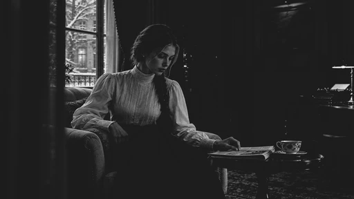

[Full-size lossless 1672×940](../../assets/looks-n002-20261024-r1/full/021-sp-great-auk.webp) · [Original source](../../assets/looks-n002-20261024-r1/source.png) · [All 500 supplied-image samples](../FILTER_GALLERY.md)

| Input swatch | Input RGB | Actual output RGB |
|---|---|---|
| `gray_0` | `#000000` | `#1D1D1D` |
| `gray_10` | `#1A1A1A` | `#1D1D1D` |
| `gray_25` | `#404040` | `#1E1E1E` |
| `gray_50` | `#808080` | `#575757` |
| `gray_75` | `#BFBFBF` | `#A3A3A3` |
| `gray_90` | `#E6E6E6` | `#D8D8D8` |
| `gray_100` | `#FFFFFF` | `#FFFFFF` |
| `skin_light` | `#F5DBC6` | `#D2D2D2` |
| `skin_medium` | `#CF9B7B` | `#828282` |
| `skin_deep` | `#815438` | `#313131` |
| `red` | `#CC3333` | `#343434` |
| `green` | `#33CC33` | `#656565` |
| `blue` | `#3333CC` | `#1F1F1F` |

Creator: **Nixua / Striped Purple** · [Source](https://github.com/stripedpurple/color-grading-luts/blob/9757e8b5147693cab49c3fd674bf23dbe28d6c8e/Zoology/Striped%20Purple%20-%20Great%20Auk.cube) · commit `9757e8b5147693cab49c3fd674bf23dbe28d6c8e`.

Conversion: `native-CUBE-grid-retained-v1`; 8,192 sampled RGB points; max error 0.0000000; mean 0.0000000. This is numerical approximation, not a perceptual quality score.

License obligations: Retain MIT copyright and license notice.

[License](../../../product/src/ai_ad_editor/look_data/licenses/sp-MIT.txt) · LUT SHA-256 `3d46d0c5f0fda375e1f09e4853bd0f1517c80d56fa4b25509df589ecbf2b5c05`.

[Actual preview PNG](../../assets/look500-20261024-r1/previews/sp-great-auk.png) · [Actual video](../../assets/look500-20261024-r1/videos/sp-great-auk.mp4)

## 022 · 创意色彩 · Grey Matter

`sp-grey-matter` · `creative` · MIT · 32³

50% 灰输出 Y′ 120.1/255（变化 -7.4 码值）；25%–75% 灰跨度比 1.325。中灰红减蓝 +21.5 码值。浅/中/深肤色色块分别输出 #E6E3E1、#B5ACA6、#4D4640；红/绿/蓝测试块分别输出 #85786F、#85786F、#7D7168。

建议试片：暖灰人物、旧纸质感、克制叙事

试用强度：0.35–0.8; default 1.0.

逐项比较肤色与品牌色，强度过高可能改变产品颜色。仅像素颜色映射，不生成颗粒、光晕、暗角、空间雾或美颜；未做自然画质验收。

补充选型说明：偏棕灰的近单色，纯黑略暖抬起，暗中间调压深、亮中间调提亮；原始彩色收敛为棕灰。灰阶曲线与 Horchata 接近，色彩保留程度大不相同。

**用户提供的 N002 母图：强度 1.0 的实际输出。**

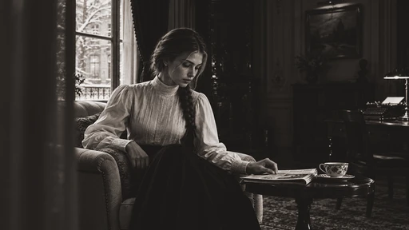

[Full-size lossless 1672×940](../../assets/looks-n002-20261024-r1/full/022-sp-grey-matter.webp) · [Original source](../../assets/looks-n002-20261024-r1/source.png) · [All 500 supplied-image samples](../FILTER_GALLERY.md)

| Input swatch | Input RGB | Actual output RGB |
|---|---|---|
| `gray_0` | `#000000` | `#1C1A18` |
| `gray_10` | `#1A1A1A` | `#1E1B19` |
| `gray_25` | `#404040` | `#2A2623` |
| `gray_50` | `#808080` | `#82766D` |
| `gray_75` | `#BFBFBF` | `#D4CFCC` |
| `gray_90` | `#E6E6E6` | `#EAE8E6` |
| `gray_100` | `#FFFFFF` | `#F2F1F0` |
| `skin_light` | `#F5DBC6` | `#E6E3E1` |
| `skin_medium` | `#CF9B7B` | `#B5ACA6` |
| `skin_deep` | `#815438` | `#4D4640` |
| `red` | `#CC3333` | `#85786F` |
| `green` | `#33CC33` | `#85786F` |
| `blue` | `#3333CC` | `#7D7168` |

Creator: **Nixua / Striped Purple** · [Source](https://github.com/stripedpurple/color-grading-luts/blob/9757e8b5147693cab49c3fd674bf23dbe28d6c8e/MISC/Striped%20Purple%20-%20Grey%20Matter.cube) · commit `9757e8b5147693cab49c3fd674bf23dbe28d6c8e`.

Conversion: `native-CUBE-grid-retained-v1`; 8,192 sampled RGB points; max error 0.0000000; mean 0.0000000. This is numerical approximation, not a perceptual quality score.

License obligations: Retain MIT copyright and license notice.

[License](../../../product/src/ai_ad_editor/look_data/licenses/sp-MIT.txt) · LUT SHA-256 `6a4d62fab181cb261b2226ef1507b3a42eacd6e1a8d0973debcdd2b752b9589c`.

[Actual preview PNG](../../assets/look500-20261024-r1/previews/sp-grey-matter.png) · [Actual video](../../assets/look500-20261024-r1/videos/sp-grey-matter.mp4)

## 023 · 创意色彩 · Horchata

`sp-horchata` · `creative` · MIT · 32³

50% 灰输出 Y′ 119.6/255（变化 -7.9 码值）；25%–75% 灰跨度比 1.324。中灰红减蓝 -0.0 码值。浅/中/深肤色色块分别输出 #EEE4DA、#D6A784、#643929；红/绿/蓝测试块分别输出 #C92A2A、#2AC92A、#2525C0。

建议试片：生活方式、咖啡、暖色商品故事

试用强度：0.35–0.8; default 1.0.

逐项比较肤色与品牌色，强度过高可能改变产品颜色。仅像素颜色映射，不生成颗粒、光晕、暗角、空间雾或美颜；未做自然画质验收。

补充选型说明：保留彩色的复古曲线：抬黑、压暗 25% 灰、提亮 75% 灰，灰阶本身接近中性；肤色变亮变金暖，红绿蓝仍较鲜。

**用户提供的 N002 母图：强度 1.0 的实际输出。**

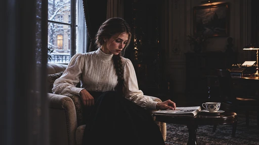

[Full-size lossless 1672×940](../../assets/looks-n002-20261024-r1/full/023-sp-horchata.webp) · [Original source](../../assets/looks-n002-20261024-r1/source.png) · [All 500 supplied-image samples](../FILTER_GALLERY.md)

| Input swatch | Input RGB | Actual output RGB |
|---|---|---|
| `gray_0` | `#000000` | `#1A1A1A` |
| `gray_10` | `#1A1A1A` | `#1C1C1C` |
| `gray_25` | `#404040` | `#272727` |
| `gray_50` | `#808080` | `#787878` |
| `gray_75` | `#BFBFBF` | `#D0D0D0` |
| `gray_90` | `#E6E6E6` | `#E8E8E8` |
| `gray_100` | `#FFFFFF` | `#F1F1F1` |
| `skin_light` | `#F5DBC6` | `#EEE4DA` |
| `skin_medium` | `#CF9B7B` | `#D6A784` |
| `skin_deep` | `#815438` | `#643929` |
| `red` | `#CC3333` | `#C92A2A` |
| `green` | `#33CC33` | `#2AC92A` |
| `blue` | `#3333CC` | `#2525C0` |

Creator: **Nixua / Striped Purple** · [Source](https://github.com/stripedpurple/color-grading-luts/blob/9757e8b5147693cab49c3fd674bf23dbe28d6c8e/Drink%20it%20in%21/Striped%20Purple%20-%20Horchata.cube) · commit `9757e8b5147693cab49c3fd674bf23dbe28d6c8e`.

Conversion: `native-CUBE-grid-retained-v1`; 8,192 sampled RGB points; max error 0.0000000; mean 0.0000000. This is numerical approximation, not a perceptual quality score.

License obligations: Retain MIT copyright and license notice.

[License](../../../product/src/ai_ad_editor/look_data/licenses/sp-MIT.txt) · LUT SHA-256 `7d299593177cf3b3026f4ce610b273d927f42452f40b6f50f1c006f4414a73db`.

[Actual preview PNG](../../assets/look500-20261024-r1/previews/sp-horchata.png) · [Actual video](../../assets/look500-20261024-r1/videos/sp-horchata.mp4)

## 024 · 红外创意 · Infrared

`sp-infrared` · `infrared` · MIT · 32³

50% 灰输出 Y′ 127.5/255（变化 +0.0 码值）；25%–75% 灰跨度比 1.000。中灰红减蓝 +0.0 码值。浅/中/深肤色色块分别输出 #FCDACB、#DD9277、#8D4C35；红/绿/蓝测试块分别输出 #8A3C00、#F9317E、#004C4C。

建议试片：音乐视觉、超现实植被、创意片段

试用强度：0.35–0.8; default 1.0.

逐项比较肤色与品牌色，强度过高可能改变产品颜色。仅像素颜色映射，不生成颗粒、光晕、暗角、空间雾或美颜；未做自然画质验收。

补充选型说明：假色置换，灰阶基本不动；绿色直接变洋红，红色转深棕橙，蓝色转青蓝，肤色偏红。适合制造与原场景明显不同的配色。

**用户提供的 N002 母图：强度 1.0 的实际输出。**

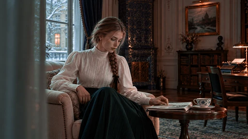

[Full-size lossless 1672×940](../../assets/looks-n002-20261024-r1/full/024-sp-infrared.webp) · [Original source](../../assets/looks-n002-20261024-r1/source.png) · [All 500 supplied-image samples](../FILTER_GALLERY.md)

| Input swatch | Input RGB | Actual output RGB |
|---|---|---|
| `gray_0` | `#000000` | `#000000` |
| `gray_10` | `#1A1A1A` | `#191919` |
| `gray_25` | `#404040` | `#404040` |
| `gray_50` | `#808080` | `#808080` |
| `gray_75` | `#BFBFBF` | `#BFBFBF` |
| `gray_90` | `#E6E6E6` | `#E6E6E6` |
| `gray_100` | `#FFFFFF` | `#FFFFFF` |
| `skin_light` | `#F5DBC6` | `#FCDACB` |
| `skin_medium` | `#CF9B7B` | `#DD9277` |
| `skin_deep` | `#815438` | `#8D4C35` |
| `red` | `#CC3333` | `#8A3C00` |
| `green` | `#33CC33` | `#F9317E` |
| `blue` | `#3333CC` | `#004C4C` |

Creator: **Nixua / Striped Purple** · [Source](https://github.com/stripedpurple/color-grading-luts/blob/9757e8b5147693cab49c3fd674bf23dbe28d6c8e/Film%20Simulations/Infrared/Striped%20Purple%20-%20Infrared.cube) · commit `9757e8b5147693cab49c3fd674bf23dbe28d6c8e`.

Conversion: `native-CUBE-grid-retained-v1`; 8,192 sampled RGB points; max error 0.0000000; mean 0.0000000. This is numerical approximation, not a perceptual quality score.

License obligations: Retain MIT copyright and license notice.

[License](../../../product/src/ai_ad_editor/look_data/licenses/sp-MIT.txt) · LUT SHA-256 `b9104f927582542b69f0a5219d47ada05b1db68741aa0949c4760887295c89ab`.

[Actual preview PNG](../../assets/look500-20261024-r1/previews/sp-infrared.png) · [Actual video](../../assets/look500-20261024-r1/videos/sp-infrared.mp4)

## 025 · 红外创意 · Infrared 2

`sp-infrared-2` · `infrared` · MIT · 64³

50% 灰输出 Y′ 127.5/255（变化 +0.0 码值）；25%–75% 灰跨度比 1.000。中灰红减蓝 +0.0 码值。浅/中/深肤色色块分别输出 #F9D8CA、#D59781、#86503D；红/绿/蓝测试块分别输出 #A54E0C、#F25994、#006161。

建议试片：较柔和假色旅行、梦境、MV

试用强度：0.35–0.8; default 1.0.

逐项比较肤色与品牌色，强度过高可能改变产品颜色。仅像素颜色映射，不生成颗粒、光晕、暗角、空间雾或美颜；未做自然画质验收。

补充选型说明：与 Infrared 同类但置换较柔：绿色变灰粉紫，红色成棕橙，蓝色变较明亮青蓝；中肤色更接近原色，保留更多原色分量。

**用户提供的 N002 母图：强度 1.0 的实际输出。**

[Full-size lossless 1672×940](../../assets/looks-n002-20261024-r1/full/025-sp-infrared-2.webp) · [Original source](../../assets/looks-n002-20261024-r1/source.png) · [All 500 supplied-image samples](../FILTER_GALLERY.md)

| Input swatch | Input RGB | Actual output RGB |
|---|---|---|
| `gray_0` | `#000000` | `#000000` |
| `gray_10` | `#1A1A1A` | `#1A1A1A` |
| `gray_25` | `#404040` | `#404040` |
| `gray_50` | `#808080` | `#808080` |
| `gray_75` | `#BFBFBF` | `#BFBFBF` |
| `gray_90` | `#E6E6E6` | `#E5E5E5` |
| `gray_100` | `#FFFFFF` | `#FFFFFF` |
| `skin_light` | `#F5DBC6` | `#F9D8CA` |
| `skin_medium` | `#CF9B7B` | `#D59781` |
| `skin_deep` | `#815438` | `#86503D` |
| `red` | `#CC3333` | `#A54E0C` |
| `green` | `#33CC33` | `#F25994` |
| `blue` | `#3333CC` | `#006161` |

Creator: **Nixua / Striped Purple** · [Source](https://github.com/stripedpurple/color-grading-luts/blob/9757e8b5147693cab49c3fd674bf23dbe28d6c8e/Film%20Simulations/Infrared/Infrared%202.cube) · commit `9757e8b5147693cab49c3fd674bf23dbe28d6c8e`.

Conversion: `native-CUBE-grid-retained-v1`; 8,192 sampled RGB points; max error 0.0000000; mean 0.0000000. This is numerical approximation, not a perceptual quality score.

License obligations: Retain MIT copyright and license notice.

[License](../../../product/src/ai_ad_editor/look_data/licenses/sp-MIT.txt) · LUT SHA-256 `67e9bbe0aee79fd8f315aec90b094742827f321b1ea19ce5183de2e389b30803`.

[Actual preview PNG](../../assets/look500-20261024-r1/previews/sp-infrared-2.png) · [Actual video](../../assets/look500-20261024-r1/videos/sp-infrared-2.mp4)

## 026 · 风景 · Irish Uprising

`sp-irish-uprising` · `landscape` · MIT · 32³

50% 灰输出 Y′ 135.8/255（变化 +8.3 码值）；25%–75% 灰跨度比 0.907。中灰红减蓝 +40.0 码值。浅/中/深肤色色块分别输出 #EDD7B2、#D2A164、#926033；红/绿/蓝测试块分别输出 #D0412F、#40CA2F、#4041B9。

建议试片：绿景、户外生活、暖人物冷背景

试用强度：0.35–0.8; default 1.0.

逐项比较肤色与品牌色，强度过高可能改变产品颜色。仅像素颜色映射，不生成颗粒、光晕、暗角、空间雾或美颜；未做自然画质验收。

补充选型说明：抬暗灰、中灰略亮，中性中灰偏黄橄榄；绿色偏黄绿且略提亮、蓝色去鲜，肤色偏金暖，黑色带轻微青色。

**用户提供的 N002 母图：强度 1.0 的实际输出。**

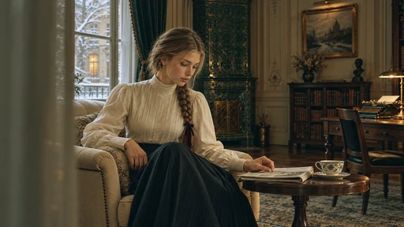

[Full-size lossless 1672×940](../../assets/looks-n002-20261024-r1/full/026-sp-irish-uprising.webp) · [Original source](../../assets/looks-n002-20261024-r1/source.png) · [All 500 supplied-image samples](../FILTER_GALLERY.md)

| Input swatch | Input RGB | Actual output RGB |
|---|---|---|
| `gray_0` | `#000000` | `#040F11` |
| `gray_10` | `#1A1A1A` | `#222820` |
| `gray_25` | `#404040` | `#4E4D38` |
| `gray_50` | `#808080` | `#908868` |
| `gray_75` | `#BFBFBF` | `#C6C0AA` |
| `gray_90` | `#E6E6E6` | `#E2DFD7` |
| `gray_100` | `#FFFFFF` | `#F4F4F6` |
| `skin_light` | `#F5DBC6` | `#EDD7B2` |
| `skin_medium` | `#CF9B7B` | `#D2A164` |
| `skin_deep` | `#815438` | `#926033` |
| `red` | `#CC3333` | `#D0412F` |
| `green` | `#33CC33` | `#40CA2F` |
| `blue` | `#3333CC` | `#4041B9` |

Creator: **Nixua / Striped Purple** · [Source](https://github.com/stripedpurple/color-grading-luts/blob/9757e8b5147693cab49c3fd674bf23dbe28d6c8e/Scenic%20Moods/Striped%20Purple%20-%20Irish%20Uprising.cube) · commit `9757e8b5147693cab49c3fd674bf23dbe28d6c8e`.

Conversion: `native-CUBE-grid-retained-v1`; 8,192 sampled RGB points; max error 0.0000000; mean 0.0000000. This is numerical approximation, not a perceptual quality score.

License obligations: Retain MIT copyright and license notice.

[License](../../../product/src/ai_ad_editor/look_data/licenses/sp-MIT.txt) · LUT SHA-256 `8ce17d53e0cb32bd32a4d7c0e4c2c348a7f302de4a3c968edc217137ba99432c`.

[Actual preview PNG](../../assets/look500-20261024-r1/previews/sp-irish-uprising.png) · [Actual video](../../assets/look500-20261024-r1/videos/sp-irish-uprising.mp4)

## 027 · 创意色彩 · Kraken

`sp-kraken` · `creative` · MIT · 64³

50% 灰输出 Y′ 112.3/255（变化 -15.2 码值）；25%–75% 灰跨度比 0.961。中灰红减蓝 +11.0 码值。浅/中/深肤色色块分别输出 #F0C9A3、#D27641、#8F361D；红/绿/蓝测试块分别输出 #CD4200、#52A946、#0050C9。

建议试片：暗调动作、复古街头、强色彩故事

试用强度：0.35–0.8; default 1.0.

逐项比较肤色与品牌色，强度过高可能改变产品颜色。仅像素颜色映射，不生成颗粒、光晕、暗角、空间雾或美颜；未做自然画质验收。

补充选型说明：抬黑为暗酒红，暗中间调和中灰压深；肤色变浓橙棕，红色偏橙、绿色偏黄绿，蓝色色块趋向更鲜青蓝。

**用户提供的 N002 母图：强度 1.0 的实际输出。**

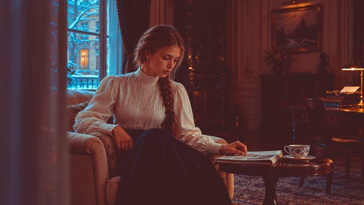

[Full-size lossless 1672×940](../../assets/looks-n002-20261024-r1/full/027-sp-kraken.webp) · [Original source](../../assets/looks-n002-20261024-r1/source.png) · [All 500 supplied-image samples](../FILTER_GALLERY.md)

| Input swatch | Input RGB | Actual output RGB |
|---|---|---|
| `gray_0` | `#000000` | `#381D20` |
| `gray_10` | `#1A1A1A` | `#3A1F21` |
| `gray_25` | `#404040` | `#4F3235` |
| `gray_50` | `#808080` | `#786E6C` |
| `gray_75` | `#BFBFBF` | `#9DBAAF` |
| `gray_90` | `#E6E6E6` | `#C8E3DA` |
| `gray_100` | `#FFFFFF` | `#FEFFFF` |
| `skin_light` | `#F5DBC6` | `#F0C9A3` |
| `skin_medium` | `#CF9B7B` | `#D27641` |
| `skin_deep` | `#815438` | `#8F361D` |
| `red` | `#CC3333` | `#CD4200` |
| `green` | `#33CC33` | `#52A946` |
| `blue` | `#3333CC` | `#0050C9` |

Creator: **Nixua / Striped Purple** · [Source](https://github.com/stripedpurple/color-grading-luts/blob/9757e8b5147693cab49c3fd674bf23dbe28d6c8e/Zoology/Striped%20Purple%20-%20Kraken.cube) · commit `9757e8b5147693cab49c3fd674bf23dbe28d6c8e`.

Conversion: `native-CUBE-grid-retained-v1`; 8,192 sampled RGB points; max error 0.0000000; mean 0.0000000. This is numerical approximation, not a perceptual quality score.

License obligations: Retain MIT copyright and license notice.

[License](../../../product/src/ai_ad_editor/look_data/licenses/sp-MIT.txt) · LUT SHA-256 `be3e304750faa590fe0ea6cc0197a05ee8c14cc68de170b1e01e50e6c5c9873b`.

[Actual preview PNG](../../assets/look500-20261024-r1/previews/sp-kraken.png) · [Actual video](../../assets/look500-20261024-r1/videos/sp-kraken.mp4)

## 028 · 创意色彩 · Lobster

`sp-lobster` · `creative` · MIT · 16³

50% 灰输出 Y′ 116.5/255（变化 -11.0 码值）；25%–75% 灰跨度比 0.894。中灰红减蓝 +4.9 码值。浅/中/深肤色色块分别输出 #EBB890、#C48247、#844C11；红/绿/蓝测试块分别输出 #C43200、#26B552、#2B55A0。

建议试片：暖静物、海岸情绪、复古生活

试用强度：0.35–0.8; default 1.0.

逐项比较肤色与品牌色，强度过高可能改变产品颜色。此表含超出 0..1 的输出，SDR 导出会截断。仅像素颜色映射，不生成颗粒、光晕、暗角、空间雾或美颜；未做自然画质验收。

补充选型说明：黑位抬成冷灰，高光染奶油暖色，灰阶中亮部压暗；肤色变棕橙，绿转青绿、蓝转灰青，整体冷暗部与暖亮部并置。

**用户提供的 N002 母图：强度 1.0 的实际输出。**

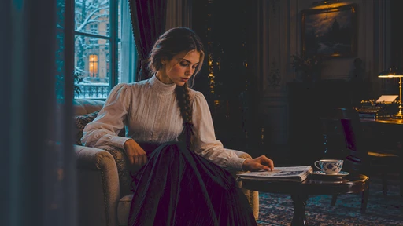

[Full-size lossless 1672×940](../../assets/looks-n002-20261024-r1/full/028-sp-lobster.webp) · [Original source](../../assets/looks-n002-20261024-r1/source.png) · [All 500 supplied-image samples](../FILTER_GALLERY.md)

| Input swatch | Input RGB | Actual output RGB |
|---|---|---|
| `gray_0` | `#000000` | `#252627` |
| `gray_10` | `#1A1A1A` | `#252729` |
| `gray_25` | `#404040` | `#2A323A` |
| `gray_50` | `#808080` | `#757570` |
| `gray_75` | `#BFBFBF` | `#AAA29A` |
| `gray_90` | `#E6E6E6` | `#D0C0B5` |
| `gray_100` | `#FFFFFF` | `#F7E1C8` |
| `skin_light` | `#F5DBC6` | `#EBB890` |
| `skin_medium` | `#CF9B7B` | `#C48247` |
| `skin_deep` | `#815438` | `#844C11` |
| `red` | `#CC3333` | `#C43200` |
| `green` | `#33CC33` | `#26B552` |
| `blue` | `#3333CC` | `#2B55A0` |

Creator: **Nixua / Striped Purple** · [Source](https://github.com/stripedpurple/color-grading-luts/blob/9757e8b5147693cab49c3fd674bf23dbe28d6c8e/Zoology/Striped%20Purple%20-%20Lobster.cube) · commit `9757e8b5147693cab49c3fd674bf23dbe28d6c8e`.

Conversion: `native-CUBE-grid-retained-v1`; 8,192 sampled RGB points; max error 0.0000000; mean 0.0000000. This is numerical approximation, not a perceptual quality score.

License obligations: Retain MIT copyright and license notice.

[License](../../../product/src/ai_ad_editor/look_data/licenses/sp-MIT.txt) · LUT SHA-256 `88650f721cf6127fa76563664d5222bb825573b3eb7dd0393fd1f52f8c72f7b4`.

[Actual preview PNG](../../assets/look500-20261024-r1/previews/sp-lobster.png) · [Actual video](../../assets/look500-20261024-r1/videos/sp-lobster.mp4)

## 029 · Lomo · Lomochrome Purple

`sp-lomochrome-purple` · `lomography` · MIT · 64³

50% 灰输出 Y′ 127.5/255（变化 +0.0 码值）；25%–75% 灰跨度比 1.000。中灰红减蓝 +0.0 码值。浅/中/深肤色色块分别输出 #FCD4D2、#CF729E、#663267；红/绿/蓝测试块分别输出 #4C1B56、#F819DA、#033282。

建议试片：超现实植被、音乐、紫色创意世界

试用强度：0.35–0.8; default 1.0.

逐项比较肤色与品牌色，强度过高可能改变产品颜色。仅像素颜色映射，不生成颗粒、光晕、暗角、空间雾或美颜；未做自然画质验收。

补充选型说明：强烈紫色置换：绿色变鲜洋红，红色反而变很暗的紫，蓝色更深；肤色明显偏紫红，中性灰仍基本保持。五个版本中对红色的压暗很突出。

**用户提供的 N002 母图：强度 1.0 的实际输出。**

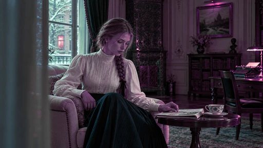

[Full-size lossless 1672×940](../../assets/looks-n002-20261024-r1/full/029-sp-lomochrome-purple.webp) · [Original source](../../assets/looks-n002-20261024-r1/source.png) · [All 500 supplied-image samples](../FILTER_GALLERY.md)

| Input swatch | Input RGB | Actual output RGB |
|---|---|---|
| `gray_0` | `#000000` | `#000000` |
| `gray_10` | `#1A1A1A` | `#1A1A1A` |
| `gray_25` | `#404040` | `#404040` |
| `gray_50` | `#808080` | `#80807F` |
| `gray_75` | `#BFBFBF` | `#BFBFBF` |
| `gray_90` | `#E6E6E6` | `#E5E5E5` |
| `gray_100` | `#FFFFFF` | `#FFFFFF` |
| `skin_light` | `#F5DBC6` | `#FCD4D2` |
| `skin_medium` | `#CF9B7B` | `#CF729E` |
| `skin_deep` | `#815438` | `#663267` |
| `red` | `#CC3333` | `#4C1B56` |
| `green` | `#33CC33` | `#F819DA` |
| `blue` | `#3333CC` | `#033282` |

Creator: **Nixua / Striped Purple** · [Source](https://github.com/stripedpurple/color-grading-luts/blob/9757e8b5147693cab49c3fd674bf23dbe28d6c8e/Film%20Simulations/Lomography/Lomochrome%20Purple.cube) · commit `9757e8b5147693cab49c3fd674bf23dbe28d6c8e`.

Conversion: `native-CUBE-grid-retained-v1`; 8,192 sampled RGB points; max error 0.0000000; mean 0.0000000. This is numerical approximation, not a perceptual quality score.

License obligations: Retain MIT copyright and license notice.

[License](../../../product/src/ai_ad_editor/look_data/licenses/sp-MIT.txt) · LUT SHA-256 `ff98d81fd60b96b36a196a2f21214d384ed5c93d69184cfbf0163884d6909ea4`.

[Actual preview PNG](../../assets/look500-20261024-r1/previews/sp-lomochrome-purple.png) · [Actual video](../../assets/look500-20261024-r1/videos/sp-lomochrome-purple.mp4)

## 030 · Lomo · Lomochrome Purple 2

`sp-lomochrome-purple-2` · `lomography` · MIT · 64³

50% 灰输出 Y′ 127.5/255（变化 +0.0 码值）；25%–75% 灰跨度比 1.000。中灰红减蓝 +0.0 码值。浅/中/深肤色色块分别输出 #FED4D2、#DE8AB1、#89418A；红/绿/蓝测试块分别输出 #A82AC3、#EA51D5、#124AAB。

建议试片：粉紫植物、时尚创意、梦境画面

试用强度：0.35–0.8; default 1.0.

逐项比较肤色与品牌色，强度过高可能改变产品颜色。仅像素颜色映射，不生成颗粒、光晕、暗角、空间雾或美颜；未做自然画质验收。

补充选型说明：绿色与红色都变较亮的紫洋红，蓝色仍保留蓝调；比第一版少了红色变深紫的强压暗，整体假色更均匀。肤色偏粉紫。

**用户提供的 N002 母图：强度 1.0 的实际输出。**

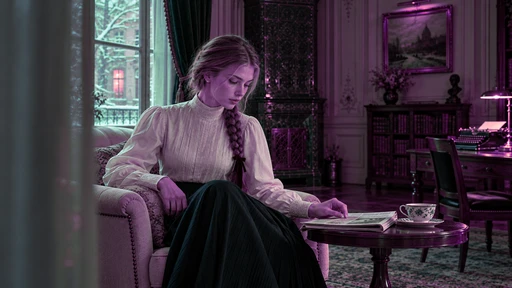

[Full-size lossless 1672×940](../../assets/looks-n002-20261024-r1/full/030-sp-lomochrome-purple-2.webp) · [Original source](../../assets/looks-n002-20261024-r1/source.png) · [All 500 supplied-image samples](../FILTER_GALLERY.md)

| Input swatch | Input RGB | Actual output RGB |
|---|---|---|
| `gray_0` | `#000000` | `#000000` |
| `gray_10` | `#1A1A1A` | `#1A1A1A` |
| `gray_25` | `#404040` | `#404040` |
| `gray_50` | `#808080` | `#808080` |
| `gray_75` | `#BFBFBF` | `#BFBFBF` |
| `gray_90` | `#E6E6E6` | `#E5E5E5` |
| `gray_100` | `#FFFFFF` | `#FFFFFF` |
| `skin_light` | `#F5DBC6` | `#FED4D2` |
| `skin_medium` | `#CF9B7B` | `#DE8AB1` |
| `skin_deep` | `#815438` | `#89418A` |
| `red` | `#CC3333` | `#A82AC3` |
| `green` | `#33CC33` | `#EA51D5` |
| `blue` | `#3333CC` | `#124AAB` |

Creator: **Nixua / Striped Purple** · [Source](https://github.com/stripedpurple/color-grading-luts/blob/9757e8b5147693cab49c3fd674bf23dbe28d6c8e/Film%20Simulations/Lomography/Lomochrome%20Purple%202.cube) · commit `9757e8b5147693cab49c3fd674bf23dbe28d6c8e`.

Conversion: `native-CUBE-grid-retained-v1`; 8,192 sampled RGB points; max error 0.0000000; mean 0.0000000. This is numerical approximation, not a perceptual quality score.

License obligations: Retain MIT copyright and license notice.

[License](../../../product/src/ai_ad_editor/look_data/licenses/sp-MIT.txt) · LUT SHA-256 `776f866fee0415858c31c0a2b228a51bf716f87032b606d00ad33e54ec6907a4`.

[Actual preview PNG](../../assets/look500-20261024-r1/previews/sp-lomochrome-purple-2.png) · [Actual video](../../assets/look500-20261024-r1/videos/sp-lomochrome-purple-2.mp4)

## 031 · Lomo · Lomochrome Purple 3

`sp-lomochrome-purple-3` · `lomography` · MIT · 64³

50% 灰输出 Y′ 127.5/255（变化 +0.0 码值）；25%–75% 灰跨度比 1.000。中灰红减蓝 +0.0 码值。浅/中/深肤色色块分别输出 #FED0E9、#DD89B7、#8D446C；红/绿/蓝测试块分别输出 #BE25A4、#9C9F06、#1548AE。

建议试片：紫黄对照、音乐片、非写实设计

试用强度：0.35–0.8; default 1.0.

逐项比较肤色与品牌色，强度过高可能改变产品颜色。仅像素颜色映射，不生成颗粒、光晕、暗角、空间雾或美颜；未做自然画质验收。

补充选型说明：红色变紫红，但绿色变黄橄榄而不是洋红，蓝色转深青；肤色偏粉紫，形成紫主体、黄绿背景和青色区域的三向置换。

**用户提供的 N002 母图：强度 1.0 的实际输出。**

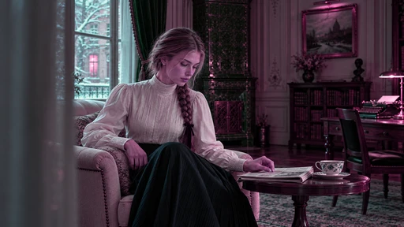

[Full-size lossless 1672×940](../../assets/looks-n002-20261024-r1/full/031-sp-lomochrome-purple-3.webp) · [Original source](../../assets/looks-n002-20261024-r1/source.png) · [All 500 supplied-image samples](../FILTER_GALLERY.md)

| Input swatch | Input RGB | Actual output RGB |
|---|---|---|
| `gray_0` | `#000000` | `#000000` |
| `gray_10` | `#1A1A1A` | `#1A1A1A` |
| `gray_25` | `#404040` | `#404040` |
| `gray_50` | `#808080` | `#808080` |
| `gray_75` | `#BFBFBF` | `#BFBFBF` |
| `gray_90` | `#E6E6E6` | `#E5E5E5` |
| `gray_100` | `#FFFFFF` | `#FFFFFF` |
| `skin_light` | `#F5DBC6` | `#FED0E9` |
| `skin_medium` | `#CF9B7B` | `#DD89B7` |
| `skin_deep` | `#815438` | `#8D446C` |
| `red` | `#CC3333` | `#BE25A4` |
| `green` | `#33CC33` | `#9C9F06` |
| `blue` | `#3333CC` | `#1548AE` |

Creator: **Nixua / Striped Purple** · [Source](https://github.com/stripedpurple/color-grading-luts/blob/9757e8b5147693cab49c3fd674bf23dbe28d6c8e/Film%20Simulations/Lomography/Lomochrome%20Purple%203.cube) · commit `9757e8b5147693cab49c3fd674bf23dbe28d6c8e`.

Conversion: `native-CUBE-grid-retained-v1`; 8,192 sampled RGB points; max error 0.0000000; mean 0.0000000. This is numerical approximation, not a perceptual quality score.

License obligations: Retain MIT copyright and license notice.

[License](../../../product/src/ai_ad_editor/look_data/licenses/sp-MIT.txt) · LUT SHA-256 `12295fbff8446d6840a00dd98b81de677bfd12de7d3ca20a6214ea204a36ec91`.

[Actual preview PNG](../../assets/look500-20261024-r1/previews/sp-lomochrome-purple-3.png) · [Actual video](../../assets/look500-20261024-r1/videos/sp-lomochrome-purple-3.mp4)

## 032 · Lomo · Lomochrome Purple 4

`sp-lomochrome-purple-4` · `lomography` · MIT · 64³

50% 灰输出 Y′ 127.5/255（变化 +0.0 码值）；25%–75% 灰跨度比 1.000。中灰红减蓝 +0.0 码值。浅/中/深肤色色块分别输出 #FBD2E8、#D68DB5、#87486A；红/绿/蓝测试块分别输出 #AE2F99、#939457、#1D479C。

建议试片：低饱和假色、时尚情绪、非写实旅行

试用强度：0.35–0.8; default 1.0.

逐项比较肤色与品牌色，强度过高可能改变产品颜色。仅像素颜色映射，不生成颗粒、光晕、暗角、空间雾或美颜；未做自然画质验收。

补充选型说明：延续红转紫、绿转橄榄、蓝转青的关系，但绿色更灰、更克制，肤色也比第三版稍柔；适合较低刺激度的紫青配色。

**用户提供的 N002 母图：强度 1.0 的实际输出。**

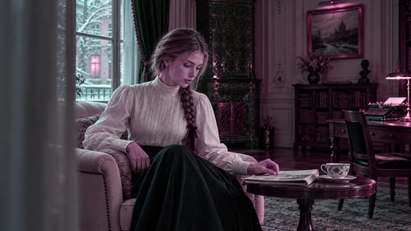

[Full-size lossless 1672×940](../../assets/looks-n002-20261024-r1/full/032-sp-lomochrome-purple-4.webp) · [Original source](../../assets/looks-n002-20261024-r1/source.png) · [All 500 supplied-image samples](../FILTER_GALLERY.md)

| Input swatch | Input RGB | Actual output RGB |
|---|---|---|
| `gray_0` | `#000000` | `#000000` |
| `gray_10` | `#1A1A1A` | `#1A1A1A` |
| `gray_25` | `#404040` | `#404040` |
| `gray_50` | `#808080` | `#808080` |
| `gray_75` | `#BFBFBF` | `#BFBFBF` |
| `gray_90` | `#E6E6E6` | `#E5E5E5` |
| `gray_100` | `#FFFFFF` | `#FFFFFF` |
| `skin_light` | `#F5DBC6` | `#FBD2E8` |
| `skin_medium` | `#CF9B7B` | `#D68DB5` |
| `skin_deep` | `#815438` | `#87486A` |
| `red` | `#CC3333` | `#AE2F99` |
| `green` | `#33CC33` | `#939457` |
| `blue` | `#3333CC` | `#1D479C` |

Creator: **Nixua / Striped Purple** · [Source](https://github.com/stripedpurple/color-grading-luts/blob/9757e8b5147693cab49c3fd674bf23dbe28d6c8e/Film%20Simulations/Lomography/Lomochrome%20Purple%204.cube) · commit `9757e8b5147693cab49c3fd674bf23dbe28d6c8e`.

Conversion: `native-CUBE-grid-retained-v1`; 8,192 sampled RGB points; max error 0.0000000; mean 0.0000000. This is numerical approximation, not a perceptual quality score.

License obligations: Retain MIT copyright and license notice.

[License](../../../product/src/ai_ad_editor/look_data/licenses/sp-MIT.txt) · LUT SHA-256 `29e6773ad0b89a42a995a59f13bcd413247c374c10fa3ade07ea267347542bcf`.

[Actual preview PNG](../../assets/look500-20261024-r1/previews/sp-lomochrome-purple-4.png) · [Actual video](../../assets/look500-20261024-r1/videos/sp-lomochrome-purple-4.mp4)

## 033 · Lomo · Lomochrome Purple 5

`sp-lomochrome-purple-5` · `lomography` · MIT · 64³

50% 灰输出 Y′ 127.5/255（变化 +0.0 码值）；25%–75% 灰跨度比 1.000。中灰红减蓝 +0.0 码值。浅/中/深肤色色块分别输出 #F0C7DD、#C77FA7、#7A3B5E；红/绿/蓝测试块分别输出 #BF40AA、#76773A、#406ABF。

建议试片：暗紫植被、青紫对照、创意短片

试用强度：0.35–0.8; default 1.0.

逐项比较肤色与品牌色，强度过高可能改变产品颜色。仅像素颜色映射，不生成颗粒、光晕、暗角、空间雾或美颜；未做自然画质验收。

补充选型说明：红色变较浅紫红，绿色压成较暗灰橄榄，蓝色提成明青；肤色比第三、四版更深，紫色主体与浅青区域的反差更明确。

**用户提供的 N002 母图：强度 1.0 的实际输出。**

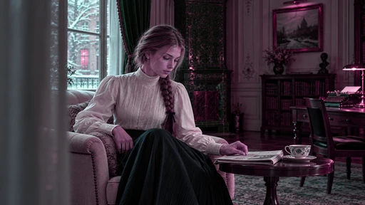

[Full-size lossless 1672×940](../../assets/looks-n002-20261024-r1/full/033-sp-lomochrome-purple-5.webp) · [Original source](../../assets/looks-n002-20261024-r1/source.png) · [All 500 supplied-image samples](../FILTER_GALLERY.md)

| Input swatch | Input RGB | Actual output RGB |
|---|---|---|
| `gray_0` | `#000000` | `#000000` |
| `gray_10` | `#1A1A1A` | `#1A1A1A` |
| `gray_25` | `#404040` | `#404040` |
| `gray_50` | `#808080` | `#808080` |
| `gray_75` | `#BFBFBF` | `#BFBFBF` |
| `gray_90` | `#E6E6E6` | `#E5E5E5` |
| `gray_100` | `#FFFFFF` | `#FFFFFF` |
| `skin_light` | `#F5DBC6` | `#F0C7DD` |
| `skin_medium` | `#CF9B7B` | `#C77FA7` |
| `skin_deep` | `#815438` | `#7A3B5E` |
| `red` | `#CC3333` | `#BF40AA` |
| `green` | `#33CC33` | `#76773A` |
| `blue` | `#3333CC` | `#406ABF` |

Creator: **Nixua / Striped Purple** · [Source](https://github.com/stripedpurple/color-grading-luts/blob/9757e8b5147693cab49c3fd674bf23dbe28d6c8e/Film%20Simulations/Lomography/Lomochrome%20Purple%205.cube) · commit `9757e8b5147693cab49c3fd674bf23dbe28d6c8e`.

Conversion: `native-CUBE-grid-retained-v1`; 8,192 sampled RGB points; max error 0.0000000; mean 0.0000000. This is numerical approximation, not a perceptual quality score.

License obligations: Retain MIT copyright and license notice.

[License](../../../product/src/ai_ad_editor/look_data/licenses/sp-MIT.txt) · LUT SHA-256 `fca9dc32e878aeb32440869044adc77fd1d6e998e253147fb129be0447872bfc`.

[Actual preview PNG](../../assets/look500-20261024-r1/previews/sp-lomochrome-purple-5.png) · [Actual video](../../assets/look500-20261024-r1/videos/sp-lomochrome-purple-5.mp4)

## 034 · 创意色彩 · Moa

`sp-moa` · `creative` · MIT · 64³

50% 灰输出 Y′ 123.6/255（变化 -3.9 码值）；25%–75% 灰跨度比 1.090。中灰红减蓝 +12.4 码值。浅/中/深肤色色块分别输出 #DCDBD7、#B0AEA7、#58544C；红/绿/蓝测试块分别输出 #5A574E、#928F86、#403D36。

建议试片：暖灰纪实、人物回忆、纸感画面

试用强度：0.35–0.8; default 1.0.

逐项比较肤色与品牌色，强度过高可能改变产品颜色。仅像素颜色映射，不生成颗粒、光晕、暗角、空间雾或美颜；未做自然画质验收。

补充选型说明：暖灰近单色，纯黑抬起且偏暖，纯白收成浅暖灰；中灰接近原亮度，彩色大幅收敛为不同深浅的米棕灰，比 Great Auk 更明亮柔和。

**用户提供的 N002 母图：强度 1.0 的实际输出。**

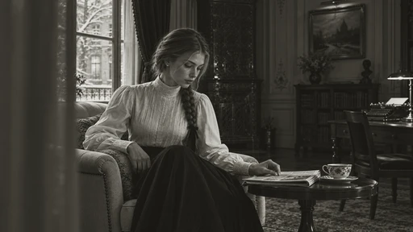

[Full-size lossless 1672×940](../../assets/looks-n002-20261024-r1/full/034-sp-moa.webp) · [Original source](../../assets/looks-n002-20261024-r1/source.png) · [All 500 supplied-image samples](../FILTER_GALLERY.md)

| Input swatch | Input RGB | Actual output RGB |
|---|---|---|
| `gray_0` | `#000000` | `#191814` |
| `gray_10` | `#1A1A1A` | `#24231E` |
| `gray_25` | `#404040` | `#3C3A33` |
| `gray_50` | `#808080` | `#7F7C73` |
| `gray_75` | `#BFBFBF` | `#C7C5BF` |
| `gray_90` | `#E6E6E6` | `#DEDDDA` |
| `gray_100` | `#FFFFFF` | `#E9E8E6` |
| `skin_light` | `#F5DBC6` | `#DCDBD7` |
| `skin_medium` | `#CF9B7B` | `#B0AEA7` |
| `skin_deep` | `#815438` | `#58544C` |
| `red` | `#CC3333` | `#5A574E` |
| `green` | `#33CC33` | `#928F86` |
| `blue` | `#3333CC` | `#403D36` |

Creator: **Nixua / Striped Purple** · [Source](https://github.com/stripedpurple/color-grading-luts/blob/9757e8b5147693cab49c3fd674bf23dbe28d6c8e/Zoology/Striped%20Purple%20-%20Moa.cube) · commit `9757e8b5147693cab49c3fd674bf23dbe28d6c8e`.

Conversion: `native-CUBE-grid-retained-v1`; 8,192 sampled RGB points; max error 0.0000000; mean 0.0000000. This is numerical approximation, not a perceptual quality score.

License obligations: Retain MIT copyright and license notice.

[License](../../../product/src/ai_ad_editor/look_data/licenses/sp-MIT.txt) · LUT SHA-256 `1dda89c88958ff2199325a910a4f8d929f239944874e9c6c5e800a5c600c6dba`.

[Actual preview PNG](../../assets/look500-20261024-r1/previews/sp-moa.png) · [Actual video](../../assets/look500-20261024-r1/videos/sp-moa.mp4)

## 035 · 创意色彩 · Pendleton

`sp-pendleton` · `creative` · MIT · 32³

50% 灰输出 Y′ 133.3/255（变化 +5.8 码值）；25%–75% 灰跨度比 1.287。中灰红减蓝 +8.2 码值。浅/中/深肤色色块分别输出 #FEFAD6、#F19066、#753B31；红/绿/蓝测试块分别输出 #DD3C60、#5BD970、#334494。

建议试片：日光生活方式、旅行、青春人物

试用强度：0.35–0.8; default 1.0.

逐项比较肤色与品牌色，强度过高可能改变产品颜色。仅像素颜色映射，不生成颗粒、光晕、暗角、空间雾或美颜；未做自然画质验收。

补充选型说明：暗部轻抬，中灰变化不大，但 75% 灰提得很亮、亮端接近白；肤色偏亮红橙，红色带粉，绿色偏青绿，呈明亮鲜活的暖主体。

**用户提供的 N002 母图：强度 1.0 的实际输出。**

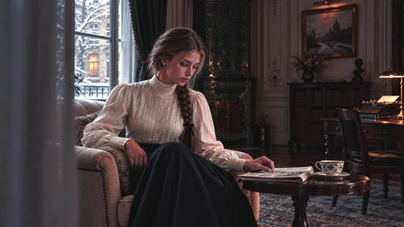

[Full-size lossless 1672×940](../../assets/looks-n002-20261024-r1/full/035-sp-pendleton.webp) · [Original source](../../assets/looks-n002-20261024-r1/source.png) · [All 500 supplied-image samples](../FILTER_GALLERY.md)

| Input swatch | Input RGB | Actual output RGB |
|---|---|---|
| `gray_0` | `#000000` | `#100F10` |
| `gray_10` | `#1A1A1A` | `#201F1F` |
| `gray_25` | `#404040` | `#414143` |
| `gray_50` | `#808080` | `#898581` |
| `gray_75` | `#BFBFBF` | `#EFE4D5` |
| `gray_90` | `#E6E6E6` | `#FDFDFB` |
| `gray_100` | `#FFFFFF` | `#FEFEFE` |
| `skin_light` | `#F5DBC6` | `#FEFAD6` |
| `skin_medium` | `#CF9B7B` | `#F19066` |
| `skin_deep` | `#815438` | `#753B31` |
| `red` | `#CC3333` | `#DD3C60` |
| `green` | `#33CC33` | `#5BD970` |
| `blue` | `#3333CC` | `#334494` |

Creator: **Nixua / Striped Purple** · [Source](https://github.com/stripedpurple/color-grading-luts/blob/9757e8b5147693cab49c3fd674bf23dbe28d6c8e/Avant%20Garde/Striped%20Purple%20-%20Pendleton.cube) · commit `9757e8b5147693cab49c3fd674bf23dbe28d6c8e`.

Conversion: `native-CUBE-grid-retained-v1`; 8,192 sampled RGB points; max error 0.0000000; mean 0.0000000. This is numerical approximation, not a perceptual quality score.

License obligations: Retain MIT copyright and license notice.

[License](../../../product/src/ai_ad_editor/look_data/licenses/sp-MIT.txt) · LUT SHA-256 `823ce14c1c10bd0c5432679afa856f40cd70bceaa0ce815840439994f5b8991c`.

[Actual preview PNG](../../assets/look500-20261024-r1/previews/sp-pendleton.png) · [Actual video](../../assets/look500-20261024-r1/videos/sp-pendleton.mp4)

## 036 · 风景 · Philly Fog

`sp-philly-fog` · `landscape` · MIT · 16³

50% 灰输出 Y′ 128.3/255（变化 +0.8 码值）；25%–75% 灰跨度比 1.150。中灰红减蓝 +1.7 码值。浅/中/深肤色色块分别输出 #E3D9CC、#D3A475、#955633；红/绿/蓝测试块分别输出 #C94B30、#83D395、#405DB3。

建议试片：城市漫步、海边生活、温和纪实

试用强度：0.35–0.8; default 1.0.

逐项比较肤色与品牌色，强度过高可能改变产品颜色。仅像素颜色映射，不生成颗粒、光晕、暗角、空间雾或美颜；未做自然画质验收。

补充选型说明：黑位抬为冷灰，白位压为暖灰，中段明暗稍拉开；绿色与蓝色变柔，肤色偏暖。两端褪色而中段仍有分离，属于克制复古色。

**用户提供的 N002 母图：强度 1.0 的实际输出。**

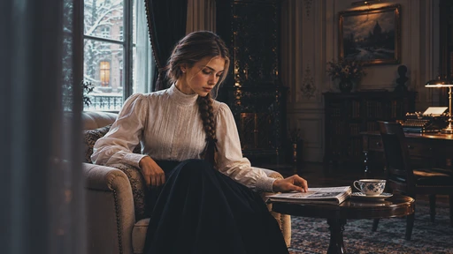

[Full-size lossless 1672×940](../../assets/looks-n002-20261024-r1/full/036-sp-philly-fog.webp) · [Original source](../../assets/looks-n002-20261024-r1/source.png) · [All 500 supplied-image samples](../FILTER_GALLERY.md)

| Input swatch | Input RGB | Actual output RGB |
|---|---|---|
| `gray_0` | `#000000` | `#191D21` |
| `gray_10` | `#1A1A1A` | `#1E2226` |
| `gray_25` | `#404040` | `#34383B` |
| `gray_50` | `#808080` | `#81807F` |
| `gray_75` | `#BFBFBF` | `#CEC9C5` |
| `gray_90` | `#E6E6E6` | `#E3DEDA` |
| `gray_100` | `#FFFFFF` | `#E7E3DF` |
| `skin_light` | `#F5DBC6` | `#E3D9CC` |
| `skin_medium` | `#CF9B7B` | `#D3A475` |
| `skin_deep` | `#815438` | `#955633` |
| `red` | `#CC3333` | `#C94B30` |
| `green` | `#33CC33` | `#83D395` |
| `blue` | `#3333CC` | `#405DB3` |

Creator: **Nixua / Striped Purple** · [Source](https://github.com/stripedpurple/color-grading-luts/blob/9757e8b5147693cab49c3fd674bf23dbe28d6c8e/Scenic%20Moods/Striped%20Purple%20-%20Philly%20Fog.cube) · commit `9757e8b5147693cab49c3fd674bf23dbe28d6c8e`.

Conversion: `native-CUBE-grid-retained-v1`; 8,192 sampled RGB points; max error 0.0000000; mean 0.0000000. This is numerical approximation, not a perceptual quality score.

License obligations: Retain MIT copyright and license notice.

[License](../../../product/src/ai_ad_editor/look_data/licenses/sp-MIT.txt) · LUT SHA-256 `63020776deceddd16cf8a753b9d040a61f43fd54a00ddacc2a92035cf5399919`.

[Actual preview PNG](../../assets/look500-20261024-r1/previews/sp-philly-fog.png) · [Actual video](../../assets/look500-20261024-r1/videos/sp-philly-fog.mp4)

## 037 · 创意色彩 · Polaroid Mint Cream

`sp-polaroid-mint-cream` · `creative` · MIT · 32³

50% 灰输出 Y′ 161.9/255（变化 +34.4 码值）；25%–75% 灰跨度比 0.968。中灰红减蓝 +27.0 码值。浅/中/深肤色色块分别输出 #FAEBC9、#ECC299、#AB7567；红/绿/蓝测试块分别输出 #E67571、#97E081、#615CBD。

建议试片：回忆、柔和生活方式、粉彩物件

试用强度：0.35–0.8; default 1.0.

逐项比较肤色与品牌色，强度过高可能改变产品颜色。仅像素颜色映射，不生成颗粒、光晕、暗角、空间雾或美颜；未做自然画质验收。

补充选型说明：强抬黑并提亮中间调，白色变奶油黄；绿偏黄、红色粉化、蓝偏淡紫，肤色明显变浅变暖，形成奶油粉彩的拍立得式配色。

**用户提供的 N002 母图：强度 1.0 的实际输出。**

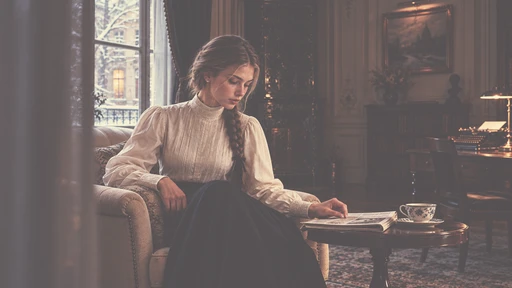

[Full-size lossless 1672×940](../../assets/looks-n002-20261024-r1/full/037-sp-polaroid-mint-cream.webp) · [Original source](../../assets/looks-n002-20261024-r1/source.png) · [All 500 supplied-image samples](../FILTER_GALLERY.md)

| Input swatch | Input RGB | Actual output RGB |
|---|---|---|
| `gray_0` | `#000000` | `#555153` |
| `gray_10` | `#1A1A1A` | `#595556` |
| `gray_25` | `#404040` | `#696261` |
| `gray_50` | `#808080` | `#AFA094` |
| `gray_75` | `#BFBFBF` | `#E9DEC4` |
| `gray_90` | `#E6E6E6` | `#F8EED0` |
| `gray_100` | `#FFFFFF` | `#FDF4D5` |
| `skin_light` | `#F5DBC6` | `#FAEBC9` |
| `skin_medium` | `#CF9B7B` | `#ECC299` |
| `skin_deep` | `#815438` | `#AB7567` |
| `red` | `#CC3333` | `#E67571` |
| `green` | `#33CC33` | `#97E081` |
| `blue` | `#3333CC` | `#615CBD` |

Creator: **Nixua / Striped Purple** · [Source](https://github.com/stripedpurple/color-grading-luts/blob/9757e8b5147693cab49c3fd674bf23dbe28d6c8e/Avant%20Garde/Striped%20Purple%20-%20Polaroid%20Mint%20Cream.cube) · commit `9757e8b5147693cab49c3fd674bf23dbe28d6c8e`.

Conversion: `native-CUBE-grid-retained-v1`; 8,192 sampled RGB points; max error 0.0000000; mean 0.0000000. This is numerical approximation, not a perceptual quality score.

License obligations: Retain MIT copyright and license notice.

[License](../../../product/src/ai_ad_editor/look_data/licenses/sp-MIT.txt) · LUT SHA-256 `5a1138e6ac8f86eedd2de4f570147f9452c1b4c2ca3c52152b438c93d7d40987`.

[Actual preview PNG](../../assets/look500-20261024-r1/previews/sp-polaroid-mint-cream.png) · [Actual video](../../assets/look500-20261024-r1/videos/sp-polaroid-mint-cream.mp4)

## 038 · 风景 · Sea Turtle

`sp-sea-turtle` · `landscape` · MIT · 64³

50% 灰输出 Y′ 127.5/255（变化 -0.0 码值）；25%–75% 灰跨度比 1.000。中灰红减蓝 -0.0 码值。浅/中/深肤色色块分别输出 #F8DAC2、#D9976D、#954E27；红/绿/蓝测试块分别输出 #D41C14、#B2F50A、#3333CC。

建议试片：热带绿景、户外、明亮旅行

试用强度：0.35–0.8; default 1.0.

逐项比较肤色与品牌色，强度过高可能改变产品颜色。仅像素颜色映射，不生成颗粒、光晕、暗角、空间雾或美颜；未做自然画质验收。

补充选型说明：中性灰阶基本保持，绿色明显提亮并转黄绿，蓝色略柔、红色更浓；肤色更暖。以绿色的明亮鲜活感为主要差异。

**用户提供的 N002 母图：强度 1.0 的实际输出。**

[Full-size lossless 1672×940](../../assets/looks-n002-20261024-r1/full/038-sp-sea-turtle.webp) · [Original source](../../assets/looks-n002-20261024-r1/source.png) · [All 500 supplied-image samples](../FILTER_GALLERY.md)

| Input swatch | Input RGB | Actual output RGB |
|---|---|---|
| `gray_0` | `#000000` | `#000000` |
| `gray_10` | `#1A1A1A` | `#1A1A1A` |
| `gray_25` | `#404040` | `#404040` |
| `gray_50` | `#808080` | `#7F7F80` |
| `gray_75` | `#BFBFBF` | `#BFBFBF` |
| `gray_90` | `#E6E6E6` | `#E5E5E5` |
| `gray_100` | `#FFFFFF` | `#FFFFFF` |
| `skin_light` | `#F5DBC6` | `#F8DAC2` |
| `skin_medium` | `#CF9B7B` | `#D9976D` |
| `skin_deep` | `#815438` | `#954E27` |
| `red` | `#CC3333` | `#D41C14` |
| `green` | `#33CC33` | `#B2F50A` |
| `blue` | `#3333CC` | `#3333CC` |

Creator: **Nixua / Striped Purple** · [Source](https://github.com/stripedpurple/color-grading-luts/blob/9757e8b5147693cab49c3fd674bf23dbe28d6c8e/Scenic%20Moods/Striped%20Purple%20-%20Sea%20Turtle.cube) · commit `9757e8b5147693cab49c3fd674bf23dbe28d6c8e`.

Conversion: `native-CUBE-grid-retained-v1`; 8,192 sampled RGB points; max error 0.0000000; mean 0.0000000. This is numerical approximation, not a perceptual quality score.

License obligations: Retain MIT copyright and license notice.

[License](../../../product/src/ai_ad_editor/look_data/licenses/sp-MIT.txt) · LUT SHA-256 `355963ce5e0dca7d30992e90cc7ff8e216cc397b0aebb718cdbabd407487eff0`.

[Actual preview PNG](../../assets/look500-20261024-r1/previews/sp-sea-turtle.png) · [Actual video](../../assets/look500-20261024-r1/videos/sp-sea-turtle.mp4)

## 039 · 风景 · Seagull Cove

`sp-seagull-cove` · `landscape` · MIT · 64³

50% 灰输出 Y′ 127.5/255（变化 +0.0 码值）；25%–75% 灰跨度比 1.000。中灰红减蓝 +0.0 码值。浅/中/深肤色色块分别输出 #F4D9C4、#D08D6E、#884731；红/绿/蓝测试块分别输出 #CD2D2D、#63B9A1、#2550B8。

建议试片：海岸、安静旅行、人物生活片

试用强度：0.35–0.8; default 1.0.

逐项比较肤色与品牌色，强度过高可能改变产品颜色。仅像素颜色映射，不生成颗粒、光晕、暗角、空间雾或美颜；未做自然画质验收。

补充选型说明：灰阶基本保持，绿色转柔青绿，蓝色去鲜成为灰青蓝；肤色偏红橙且略暗，色彩对照比 Sea Turtle 更克制。

**用户提供的 N002 母图：强度 1.0 的实际输出。**

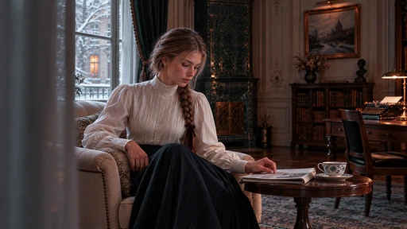

[Full-size lossless 1672×940](../../assets/looks-n002-20261024-r1/full/039-sp-seagull-cove.webp) · [Original source](../../assets/looks-n002-20261024-r1/source.png) · [All 500 supplied-image samples](../FILTER_GALLERY.md)

| Input swatch | Input RGB | Actual output RGB |
|---|---|---|
| `gray_0` | `#000000` | `#000000` |
| `gray_10` | `#1A1A1A` | `#1A1A1A` |
| `gray_25` | `#404040` | `#404040` |
| `gray_50` | `#808080` | `#808080` |
| `gray_75` | `#BFBFBF` | `#BFBFBF` |
| `gray_90` | `#E6E6E6` | `#E5E5E5` |
| `gray_100` | `#FFFFFF` | `#FFFFFF` |
| `skin_light` | `#F5DBC6` | `#F4D9C4` |
| `skin_medium` | `#CF9B7B` | `#D08D6E` |
| `skin_deep` | `#815438` | `#884731` |
| `red` | `#CC3333` | `#CD2D2D` |
| `green` | `#33CC33` | `#63B9A1` |
| `blue` | `#3333CC` | `#2550B8` |

Creator: **Nixua / Striped Purple** · [Source](https://github.com/stripedpurple/color-grading-luts/blob/9757e8b5147693cab49c3fd674bf23dbe28d6c8e/Scenic%20Moods/Striped%20Purple%20-%20Seagull%20Cove.cube) · commit `9757e8b5147693cab49c3fd674bf23dbe28d6c8e`.

Conversion: `native-CUBE-grid-retained-v1`; 8,192 sampled RGB points; max error 0.0000000; mean 0.0000000. This is numerical approximation, not a perceptual quality score.

License obligations: Retain MIT copyright and license notice.

[License](../../../product/src/ai_ad_editor/look_data/licenses/sp-MIT.txt) · LUT SHA-256 `724d6bd2d3671c75e2602875e4947924cd96974930a6bb35c1b118cd20dfcf80`.

[Actual preview PNG](../../assets/look500-20261024-r1/previews/sp-seagull-cove.png) · [Actual video](../../assets/look500-20261024-r1/videos/sp-seagull-cove.mp4)

## 040 · 风景 · Snowy Blues

`sp-snowy-blues` · `landscape` · MIT · 32³

50% 灰输出 Y′ 130.1/255（变化 +2.6 码值）；25%–75% 灰跨度比 0.895。中灰红减蓝 -40.9 码值。浅/中/深肤色色块分别输出 #E7D5CE、#BCA08F、#6C604C；红/绿/蓝测试块分别输出 #B94147、#2EC947、#2E41D2。

建议试片：冬景、冷调生活、安静人物

试用强度：0.35–0.8; default 1.0.

逐项比较肤色与品牌色，强度过高可能改变产品颜色。仅像素颜色映射，不生成颗粒、光晕、暗角、空间雾或美颜；未做自然画质验收。

补充选型说明：暗部抬起、亮端稍收，中灰染蓝青；红色变柔粉，蓝色更鲜，肤色去暖变灰粉，整体偏冷但保留柔和明暗。

**用户提供的 N002 母图：强度 1.0 的实际输出。**

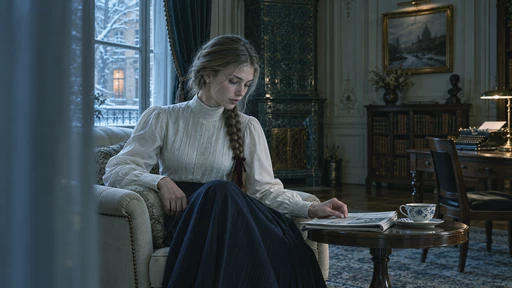

[Full-size lossless 1672×940](../../assets/looks-n002-20261024-r1/full/040-sp-snowy-blues.webp) · [Original source](../../assets/looks-n002-20261024-r1/source.png) · [All 500 supplied-image samples](../FILTER_GALLERY.md)

| Input swatch | Input RGB | Actual output RGB |
|---|---|---|
| `gray_0` | `#000000` | `#0C1010` |
| `gray_10` | `#1A1A1A` | `#1D282C` |
| `gray_25` | `#404040` | `#374D55` |
| `gray_50` | `#808080` | `#6A8793` |
| `gray_75` | `#BFBFBF` | `#ABBEC9` |
| `gray_90` | `#E6E6E6` | `#D6DEE5` |
| `gray_100` | `#FFFFFF` | `#F3F3F8` |
| `skin_light` | `#F5DBC6` | `#E7D5CE` |
| `skin_medium` | `#CF9B7B` | `#BCA08F` |
| `skin_deep` | `#815438` | `#6C604C` |
| `red` | `#CC3333` | `#B94147` |
| `green` | `#33CC33` | `#2EC947` |
| `blue` | `#3333CC` | `#2E41D2` |

Creator: **Nixua / Striped Purple** · [Source](https://github.com/stripedpurple/color-grading-luts/blob/9757e8b5147693cab49c3fd674bf23dbe28d6c8e/Scenic%20Moods/Striped%20Purple%20-%20Snowy%20Blues.cube) · commit `9757e8b5147693cab49c3fd674bf23dbe28d6c8e`.

Conversion: `native-CUBE-grid-retained-v1`; 8,192 sampled RGB points; max error 0.0000000; mean 0.0000000. This is numerical approximation, not a perceptual quality score.

License obligations: Retain MIT copyright and license notice.

[License](../../../product/src/ai_ad_editor/look_data/licenses/sp-MIT.txt) · LUT SHA-256 `bc8077203fbec5c93437c2b013a8e7b6f2232888bdf117be177761c7dbcf1fc4`.

[Actual preview PNG](../../assets/look500-20261024-r1/previews/sp-snowy-blues.png) · [Actual video](../../assets/look500-20261024-r1/videos/sp-snowy-blues.mp4)

## 041 · 风景 · Spring Water

`sp-spring-water` · `landscape` · MIT · 16³

50% 灰输出 Y′ 127.5/255（变化 +0.0 码值）；25%–75% 灰跨度比 1.000。中灰红减蓝 +0.0 码值。浅/中/深肤色色块分别输出 #E9DED3、#CA9C80、#875242；红/绿/蓝测试块分别输出 #BC4944、#33BD85、#243FB6。

建议试片：日常人物、清淡旅行、自然生活方式

试用强度：0.35–0.8; default 1.0.

逐项比较肤色与品牌色，强度过高可能改变产品颜色。仅像素颜色映射，不生成颗粒、光晕、暗角、空间雾或美颜；未做自然画质验收。

补充选型说明：灰阶接近原样，红色去鲜、绿色偏青绿，蓝色转柔青蓝；中肤色较原样更柔、更少红，属于温和冷暖整理。

**用户提供的 N002 母图：强度 1.0 的实际输出。**

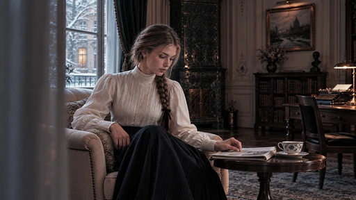

[Full-size lossless 1672×940](../../assets/looks-n002-20261024-r1/full/041-sp-spring-water.webp) · [Original source](../../assets/looks-n002-20261024-r1/source.png) · [All 500 supplied-image samples](../FILTER_GALLERY.md)

| Input swatch | Input RGB | Actual output RGB |
|---|---|---|
| `gray_0` | `#000000` | `#000000` |
| `gray_10` | `#1A1A1A` | `#1A1A1A` |
| `gray_25` | `#404040` | `#404040` |
| `gray_50` | `#808080` | `#808080` |
| `gray_75` | `#BFBFBF` | `#BFBFBF` |
| `gray_90` | `#E6E6E6` | `#E5E5E5` |
| `gray_100` | `#FFFFFF` | `#FFFFFF` |
| `skin_light` | `#F5DBC6` | `#E9DED3` |
| `skin_medium` | `#CF9B7B` | `#CA9C80` |
| `skin_deep` | `#815438` | `#875242` |
| `red` | `#CC3333` | `#BC4944` |
| `green` | `#33CC33` | `#33BD85` |
| `blue` | `#3333CC` | `#243FB6` |

Creator: **Nixua / Striped Purple** · [Source](https://github.com/stripedpurple/color-grading-luts/blob/9757e8b5147693cab49c3fd674bf23dbe28d6c8e/Scenic%20Moods/Striped%20Purple%20-%20Spring%20Water.cube) · commit `9757e8b5147693cab49c3fd674bf23dbe28d6c8e`.

Conversion: `native-CUBE-grid-retained-v1`; 8,192 sampled RGB points; max error 0.0000000; mean 0.0000000. This is numerical approximation, not a perceptual quality score.

License obligations: Retain MIT copyright and license notice.

[License](../../../product/src/ai_ad_editor/look_data/licenses/sp-MIT.txt) · LUT SHA-256 `d1ddba608afb1f4ec6c8bf6810634f1d8014705cb3c31704b0ff4ab66cfe29bb`.

[Actual preview PNG](../../assets/look500-20261024-r1/previews/sp-spring-water.png) · [Actual video](../../assets/look500-20261024-r1/videos/sp-spring-water.mp4)

## 042 · 创意色彩 · Sugar Plums

`sp-sugar-plums` · `creative` · MIT · 32³

50% 灰输出 Y′ 119.0/255（变化 -8.5 码值）；25%–75% 灰跨度比 1.097。中灰红减蓝 +20.7 码值。浅/中/深肤色色块分别输出 #F6DCBF、#D88C63、#8C3D45；红/绿/蓝测试块分别输出 #D12240、#4CBF29、#2A22C9。

建议试片：甜酷、时尚、音乐与夜间情绪

试用强度：0.35–0.8; default 1.0.

逐项比较肤色与品牌色，强度过高可能改变产品颜色。仅像素颜色映射，不生成颗粒、光晕、暗角、空间雾或美颜；未做自然画质验收。

补充选型说明：灰阶中段压暗且染紫红，红色色块偏玫红，蓝色偏紫蓝，绿色稍灰；肤色同时更红、更金暖，适合紫环境与暖主体关系。

**用户提供的 N002 母图：强度 1.0 的实际输出。**

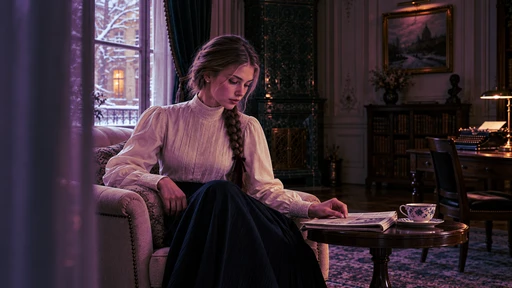

[Full-size lossless 1672×940](../../assets/looks-n002-20261024-r1/full/042-sp-sugar-plums.webp) · [Original source](../../assets/looks-n002-20261024-r1/source.png) · [All 500 supplied-image samples](../FILTER_GALLERY.md)

| Input swatch | Input RGB | Actual output RGB |
|---|---|---|
| `gray_0` | `#000000` | `#000000` |
| `gray_10` | `#1A1A1A` | `#111214` |
| `gray_25` | `#404040` | `#332C3B` |
| `gray_50` | `#808080` | `#936E7E` |
| `gray_75` | `#BFBFBF` | `#C7B8AD` |
| `gray_90` | `#E6E6E6` | `#EAE7E4` |
| `gray_100` | `#FFFFFF` | `#FFFFFF` |
| `skin_light` | `#F5DBC6` | `#F6DCBF` |
| `skin_medium` | `#CF9B7B` | `#D88C63` |
| `skin_deep` | `#815438` | `#8C3D45` |
| `red` | `#CC3333` | `#D12240` |
| `green` | `#33CC33` | `#4CBF29` |
| `blue` | `#3333CC` | `#2A22C9` |

Creator: **Nixua / Striped Purple** · [Source](https://github.com/stripedpurple/color-grading-luts/blob/9757e8b5147693cab49c3fd674bf23dbe28d6c8e/Avant%20Garde/Striped%20Purple%20-%20Sugar%20Plums.cube) · commit `9757e8b5147693cab49c3fd674bf23dbe28d6c8e`.

Conversion: `native-CUBE-grid-retained-v1`; 8,192 sampled RGB points; max error 0.0000000; mean 0.0000000. This is numerical approximation, not a perceptual quality score.

License obligations: Retain MIT copyright and license notice.

[License](../../../product/src/ai_ad_editor/look_data/licenses/sp-MIT.txt) · LUT SHA-256 `3fc32fed5e20076bfcfeb67208c61dd8fc89542a32472cf2b92d33c2aef7995a`.

[Actual preview PNG](../../assets/look500-20261024-r1/previews/sp-sugar-plums.png) · [Actual video](../../assets/look500-20261024-r1/videos/sp-sugar-plums.mp4)

## 043 · 风景 · Teal Embers

`sp-teal-embers` · `landscape` · MIT · 64³

50% 灰输出 Y′ 127.5/255（变化 +0.0 码值）；25%–75% 灰跨度比 1.000。中灰红减蓝 -0.0 码值。浅/中/深肤色色块分别输出 #F5D9C8、#CE9782、#7E5241；红/绿/蓝测试块分别输出 #D53214、#20699A、#264FCE。

建议试片：青橙叙事、城市夜景、人物短片

试用强度：0.35–0.8; default 1.0.

逐项比较肤色与品牌色，强度过高可能改变产品颜色。仅像素颜色映射，不生成颗粒、光晕、暗角、空间雾或美颜；未做自然画质验收。

补充选型说明：灰阶基本不动，但绿色被映射为较深的钢青蓝，蓝色保留更深蓝调；肤色偏红暖，红色色块更橙，冷背景与暖主体分离显著。

**用户提供的 N002 母图：强度 1.0 的实际输出。**

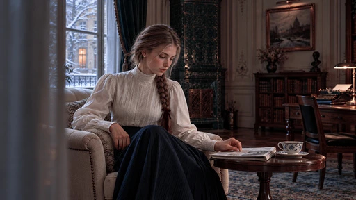

[Full-size lossless 1672×940](../../assets/looks-n002-20261024-r1/full/043-sp-teal-embers.webp) · [Original source](../../assets/looks-n002-20261024-r1/source.png) · [All 500 supplied-image samples](../FILTER_GALLERY.md)

| Input swatch | Input RGB | Actual output RGB |
|---|---|---|
| `gray_0` | `#000000` | `#000000` |
| `gray_10` | `#1A1A1A` | `#1A1A1A` |
| `gray_25` | `#404040` | `#404040` |
| `gray_50` | `#808080` | `#7F8080` |
| `gray_75` | `#BFBFBF` | `#BFBFBF` |
| `gray_90` | `#E6E6E6` | `#E5E5E5` |
| `gray_100` | `#FFFFFF` | `#FFFFFF` |
| `skin_light` | `#F5DBC6` | `#F5D9C8` |
| `skin_medium` | `#CF9B7B` | `#CE9782` |
| `skin_deep` | `#815438` | `#7E5241` |
| `red` | `#CC3333` | `#D53214` |
| `green` | `#33CC33` | `#20699A` |
| `blue` | `#3333CC` | `#264FCE` |

Creator: **Nixua / Striped Purple** · [Source](https://github.com/stripedpurple/color-grading-luts/blob/9757e8b5147693cab49c3fd674bf23dbe28d6c8e/Scenic%20Moods/Striped%20Purple%20-%20Teal%20Embers.cube) · commit `9757e8b5147693cab49c3fd674bf23dbe28d6c8e`.

Conversion: `native-CUBE-grid-retained-v1`; 8,192 sampled RGB points; max error 0.0000000; mean 0.0000000. This is numerical approximation, not a perceptual quality score.

License obligations: Retain MIT copyright and license notice.

[License](../../../product/src/ai_ad_editor/look_data/licenses/sp-MIT.txt) · LUT SHA-256 `1b8525d1594b24782bd19cbf66c73eb4d297451b57651c84b620ed6ed33ec48c`.

[Actual preview PNG](../../assets/look500-20261024-r1/previews/sp-teal-embers.png) · [Actual video](../../assets/look500-20261024-r1/videos/sp-teal-embers.mp4)

## 044 · 风景 · Teal Supreme

`sp-teal-supreme` · `landscape` · MIT · 32³

50% 灰输出 Y′ 127.5/255（变化 +0.0 码值）；25%–75% 灰跨度比 1.000。中灰红减蓝 +0.0 码值。浅/中/深肤色色块分别输出 #EFDBCC、#C89D82、#7B553E；红/绿/蓝测试块分别输出 #CC3333、#4D724D、#3333CC。

建议试片：克制冷调、城市生活、静物氛围

试用强度：0.35–0.8; default 1.0.

逐项比较肤色与品牌色，强度过高可能改变产品颜色。仅像素颜色映射，不生成颗粒、光晕、暗角、空间雾或美颜；未做自然画质验收。

补充选型说明：灰阶基本保持，绿色明显压暗、去鲜成灰绿，蓝色更柔；肤色较克制偏暖。比 Teal Embers 少了绿色直接转蓝的强置换。

**用户提供的 N002 母图：强度 1.0 的实际输出。**

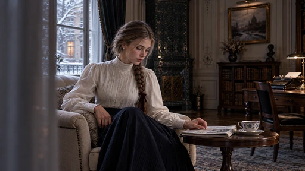

[Full-size lossless 1672×940](../../assets/looks-n002-20261024-r1/full/044-sp-teal-supreme.webp) · [Original source](../../assets/looks-n002-20261024-r1/source.png) · [All 500 supplied-image samples](../FILTER_GALLERY.md)

| Input swatch | Input RGB | Actual output RGB |
|---|---|---|
| `gray_0` | `#000000` | `#000000` |
| `gray_10` | `#1A1A1A` | `#191919` |
| `gray_25` | `#404040` | `#404040` |
| `gray_50` | `#808080` | `#808080` |
| `gray_75` | `#BFBFBF` | `#BFBFBF` |
| `gray_90` | `#E6E6E6` | `#E6E6E6` |
| `gray_100` | `#FFFFFF` | `#FFFFFF` |
| `skin_light` | `#F5DBC6` | `#EFDBCC` |
| `skin_medium` | `#CF9B7B` | `#C89D82` |
| `skin_deep` | `#815438` | `#7B553E` |
| `red` | `#CC3333` | `#CC3333` |
| `green` | `#33CC33` | `#4D724D` |
| `blue` | `#3333CC` | `#3333CC` |

Creator: **Nixua / Striped Purple** · [Source](https://github.com/stripedpurple/color-grading-luts/blob/9757e8b5147693cab49c3fd674bf23dbe28d6c8e/Scenic%20Moods/Striped%20Purple%20-%20Teal%20Supreme.cube) · commit `9757e8b5147693cab49c3fd674bf23dbe28d6c8e`.

Conversion: `native-CUBE-grid-retained-v1`; 8,192 sampled RGB points; max error 0.0000000; mean 0.0000000. This is numerical approximation, not a perceptual quality score.

License obligations: Retain MIT copyright and license notice.

[License](../../../product/src/ai_ad_editor/look_data/licenses/sp-MIT.txt) · LUT SHA-256 `a2d2fbe8eca1771046030274d6da77e1638626475ac4e48c708634cf24580d48`.

[Actual preview PNG](../../assets/look500-20261024-r1/previews/sp-teal-supreme.png) · [Actual video](../../assets/look500-20261024-r1/videos/sp-teal-supreme.mp4)

## 045 · 创意色彩 · Tiger

`sp-tiger` · `creative` · MIT · 64³

50% 灰输出 Y′ 124.0/255（变化 -3.5 码值）；25%–75% 灰跨度比 1.010。中灰红减蓝 -0.0 码值。浅/中/深肤色色块分别输出 #FFBC96、#E48237、#8C4800；红/绿/蓝测试块分别输出 #D15000、#D38700、#007DE3。

建议试片：运动、街头、橙蓝视觉广告

试用强度：0.35–0.8; default 1.0.

逐项比较肤色与品牌色，强度过高可能改变产品颜色。仅像素颜色映射，不生成颗粒、光晕、暗角、空间雾或美颜；未做自然画质验收。

补充选型说明：中灰略暗且大体中性，肤色明显偏橙，红色转橘红，绿色转深金棕，蓝色则偏亮青蓝；形成强橙蓝互补关系。

**用户提供的 N002 母图：强度 1.0 的实际输出。**

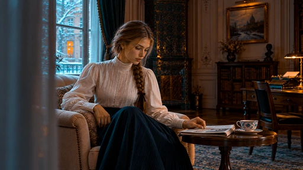

[Full-size lossless 1672×940](../../assets/looks-n002-20261024-r1/full/045-sp-tiger.webp) · [Original source](../../assets/looks-n002-20261024-r1/source.png) · [All 500 supplied-image samples](../FILTER_GALLERY.md)

| Input swatch | Input RGB | Actual output RGB |
|---|---|---|
| `gray_0` | `#000000` | `#000000` |
| `gray_10` | `#1A1A1A` | `#151515` |
| `gray_25` | `#404040` | `#3A3A3A` |
| `gray_50` | `#808080` | `#7C7C7C` |
| `gray_75` | `#BFBFBF` | `#BBBBBB` |
| `gray_90` | `#E6E6E6` | `#E5E5E5` |
| `gray_100` | `#FFFFFF` | `#FEFEFE` |
| `skin_light` | `#F5DBC6` | `#FFBC96` |
| `skin_medium` | `#CF9B7B` | `#E48237` |
| `skin_deep` | `#815438` | `#8C4800` |
| `red` | `#CC3333` | `#D15000` |
| `green` | `#33CC33` | `#D38700` |
| `blue` | `#3333CC` | `#007DE3` |

Creator: **Nixua / Striped Purple** · [Source](https://github.com/stripedpurple/color-grading-luts/blob/9757e8b5147693cab49c3fd674bf23dbe28d6c8e/Zoology/Striped%20Purple%20-%20Tiger.cube) · commit `9757e8b5147693cab49c3fd674bf23dbe28d6c8e`.

Conversion: `native-CUBE-grid-retained-v1`; 8,192 sampled RGB points; max error 0.0000000; mean 0.0000000. This is numerical approximation, not a perceptual quality score.

License obligations: Retain MIT copyright and license notice.

[License](../../../product/src/ai_ad_editor/look_data/licenses/sp-MIT.txt) · LUT SHA-256 `44cd29552ae66f3d15f28bfb3248355e06d490e91b251dc446988d9cb92e694b`.

[Actual preview PNG](../../assets/look500-20261024-r1/previews/sp-tiger.png) · [Actual video](../../assets/look500-20261024-r1/videos/sp-tiger.mp4)

## 046 · 创意色彩 · Turquoise

`sp-turquoise` · `creative` · MIT · 32³

50% 灰输出 Y′ 156.8/255（变化 +29.3 码值）；25%–75% 灰跨度比 0.590。中灰红减蓝 +2.2 码值。浅/中/深肤色色块分别输出 #F3D594、#CEB584、#888C79；红/绿/蓝测试块分别输出 #CB7778、#4FCD78、#4F7796。

建议试片：梦幻海边、粉彩创意、柔和旅行

试用强度：0.35–0.8; default 1.0.

逐项比较肤色与品牌色，强度过高可能改变产品颜色。仅像素颜色映射，不生成颗粒、光晕、暗角、空间雾或美颜；未做自然画质验收。

补充选型说明：黑色抬成蓝灰，中灰染绿，纯白变淡黄；暗部明显提亮、亮部收窄，红色粉化、蓝色转青绿，肤色变浅金色。

**用户提供的 N002 母图：强度 1.0 的实际输出。**

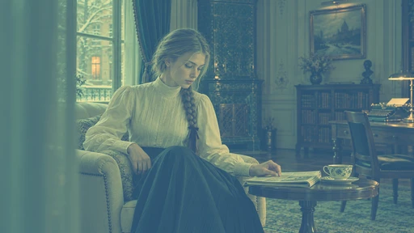

[Full-size lossless 1672×940](../../assets/looks-n002-20261024-r1/full/046-sp-turquoise.webp) · [Original source](../../assets/looks-n002-20261024-r1/source.png) · [All 500 supplied-image samples](../FILTER_GALLERY.md)

| Input swatch | Input RGB | Actual output RGB |
|---|---|---|
| `gray_0` | `#000000` | `#2D5472` |
| `gray_10` | `#1A1A1A` | `#3E6675` |
| `gray_25` | `#404040` | `#587F7A` |
| `gray_50` | `#808080` | `#87A685` |
| `gray_75` | `#BFBFBF` | `#BFC792` |
| `gray_90` | `#E6E6E6` | `#E4DA9C` |
| `gray_100` | `#FFFFFF` | `#FDE6A3` |
| `skin_light` | `#F5DBC6` | `#F3D594` |
| `skin_medium` | `#CF9B7B` | `#CEB584` |
| `skin_deep` | `#815438` | `#888C79` |
| `red` | `#CC3333` | `#CB7778` |
| `green` | `#33CC33` | `#4FCD78` |
| `blue` | `#3333CC` | `#4F7796` |

Creator: **Nixua / Striped Purple** · [Source](https://github.com/stripedpurple/color-grading-luts/blob/9757e8b5147693cab49c3fd674bf23dbe28d6c8e/Avant%20Garde/Striped%20Purple%20-%20Turquoise.cube) · commit `9757e8b5147693cab49c3fd674bf23dbe28d6c8e`.

Conversion: `native-CUBE-grid-retained-v1`; 8,192 sampled RGB points; max error 0.0000000; mean 0.0000000. This is numerical approximation, not a perceptual quality score.

License obligations: Retain MIT copyright and license notice.

[License](../../../product/src/ai_ad_editor/look_data/licenses/sp-MIT.txt) · LUT SHA-256 `0de60bc5f2ac3ac95c7ef6cb7cb8267d3bd344240f6328e105ec6724b583c046`.

[Actual preview PNG](../../assets/look500-20261024-r1/previews/sp-turquoise.png) · [Actual video](../../assets/look500-20261024-r1/videos/sp-turquoise.mp4)

## 047 · 创意色彩 · Vanilla Bean

`sp-vanilla-bean` · `creative` · MIT · 32³

50% 灰输出 Y′ 134.1/255（变化 +6.6 码值）；25%–75% 灰跨度比 1.496。中灰红减蓝 +23.1 码值。浅/中/深肤色色块分别输出 #F6F1E8、#E3BD94、#68331E；红/绿/蓝测试块分别输出 #CF2B23、#49D22F、#261FAF。

建议试片：奶油暖调、甜品、明亮室内生活

试用强度：0.35–0.8; default 1.0.

逐项比较肤色与品牌色，强度过高可能改变产品颜色。仅像素颜色映射，不生成颗粒、光晕、暗角、空间雾或美颜；未做自然画质验收。

补充选型说明：抬黑但压深暗中间调，同时大幅提亮亮中间调；中灰带米棕，肤色更亮更奶油暖，绿色偏黄绿、蓝色偏紫蓝。

**用户提供的 N002 母图：强度 1.0 的实际输出。**

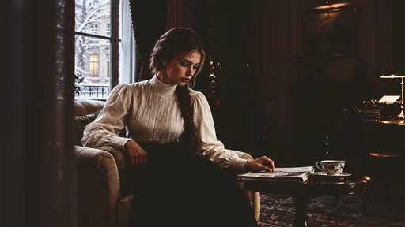

[Full-size lossless 1672×940](../../assets/looks-n002-20261024-r1/full/047-sp-vanilla-bean.webp) · [Original source](../../assets/looks-n002-20261024-r1/source.png) · [All 500 supplied-image samples](../FILTER_GALLERY.md)

| Input swatch | Input RGB | Actual output RGB |
|---|---|---|
| `gray_0` | `#000000` | `#201F19` |
| `gray_10` | `#1A1A1A` | `#211F1A` |
| `gray_25` | `#404040` | `#29241F` |
| `gray_50` | `#808080` | `#8F8577` |
| `gray_75` | `#BFBFBF` | `#E5E3DC` |
| `gray_90` | `#E6E6E6` | `#F3F3F1` |
| `gray_100` | `#FFFFFF` | `#F8F8F7` |
| `skin_light` | `#F5DBC6` | `#F6F1E8` |
| `skin_medium` | `#CF9B7B` | `#E3BD94` |
| `skin_deep` | `#815438` | `#68331E` |
| `red` | `#CC3333` | `#CF2B23` |
| `green` | `#33CC33` | `#49D22F` |
| `blue` | `#3333CC` | `#261FAF` |

Creator: **Nixua / Striped Purple** · [Source](https://github.com/stripedpurple/color-grading-luts/blob/9757e8b5147693cab49c3fd674bf23dbe28d6c8e/Drink%20it%20in%21/Striped%20Purple%20-%20Vanilla%20Bean.cube) · commit `9757e8b5147693cab49c3fd674bf23dbe28d6c8e`.

Conversion: `native-CUBE-grid-retained-v1`; 8,192 sampled RGB points; max error 0.0000000; mean 0.0000000. This is numerical approximation, not a perceptual quality score.

License obligations: Retain MIT copyright and license notice.

[License](../../../product/src/ai_ad_editor/look_data/licenses/sp-MIT.txt) · LUT SHA-256 `c68b935c25494afca6adede07d178269c4681284ebd20553a123d4cfa26cad9d`.

[Actual preview PNG](../../assets/look500-20261024-r1/previews/sp-vanilla-bean.png) · [Actual video](../../assets/look500-20261024-r1/videos/sp-vanilla-bean.mp4)

## 048 · 创意色彩 · Veggie Crisps

`sp-veggie-crisps` · `creative` · MIT · 32³

50% 灰输出 Y′ 125.8/255（变化 -1.7 码值）；25%–75% 灰跨度比 1.140。中灰红减蓝 -2.1 码值。浅/中/深肤色色块分别输出 #ECD4B9、#DAA580、#464835；红/绿/蓝测试块分别输出 #AF343B、#3FCE35、#2238D4。

建议试片：褪色但有鲜色的生活片、户外物件

试用强度：0.35–0.8; default 1.0.

逐项比较肤色与品牌色，强度过高可能改变产品颜色。仅像素颜色映射，不生成颗粒、光晕、暗角、空间雾或美颜；未做自然画质验收。

补充选型说明：黑白端明显收窄，黑色抬到约 42、白色压到约 226；中灰大致保持，红色更深、绿色更浓、蓝色更鲜，肤色偏暖。

**用户提供的 N002 母图：强度 1.0 的实际输出。**

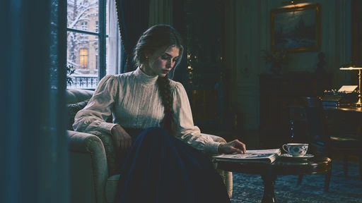

[Full-size lossless 1672×940](../../assets/looks-n002-20261024-r1/full/048-sp-veggie-crisps.webp) · [Original source](../../assets/looks-n002-20261024-r1/source.png) · [All 500 supplied-image samples](../FILTER_GALLERY.md)

| Input swatch | Input RGB | Actual output RGB |
|---|---|---|
| `gray_0` | `#000000` | `#2A2A2A` |
| `gray_10` | `#1A1A1A` | `#272F30` |
| `gray_25` | `#404040` | `#253D41` |
| `gray_50` | `#808080` | `#7C7E7E` |
| `gray_75` | `#BFBFBF` | `#D2C8C0` |
| `gray_90` | `#E6E6E6` | `#E0DAD6` |
| `gray_100` | `#FFFFFF` | `#E2E2E2` |
| `skin_light` | `#F5DBC6` | `#ECD4B9` |
| `skin_medium` | `#CF9B7B` | `#DAA580` |
| `skin_deep` | `#815438` | `#464835` |
| `red` | `#CC3333` | `#AF343B` |
| `green` | `#33CC33` | `#3FCE35` |
| `blue` | `#3333CC` | `#2238D4` |

Creator: **Nixua / Striped Purple** · [Source](https://github.com/stripedpurple/color-grading-luts/blob/9757e8b5147693cab49c3fd674bf23dbe28d6c8e/Avant%20Garde/Striped%20Purple%20-%20Veggie%20Crisps.cube) · commit `9757e8b5147693cab49c3fd674bf23dbe28d6c8e`.

Conversion: `native-CUBE-grid-retained-v1`; 8,192 sampled RGB points; max error 0.0000000; mean 0.0000000. This is numerical approximation, not a perceptual quality score.

License obligations: Retain MIT copyright and license notice.

[License](../../../product/src/ai_ad_editor/look_data/licenses/sp-MIT.txt) · LUT SHA-256 `71fa6ff5919804dc57050b11d6723e8c477efd544f00740f4e5addaddba62658`.

[Actual preview PNG](../../assets/look500-20261024-r1/previews/sp-veggie-crisps.png) · [Actual video](../../assets/look500-20261024-r1/videos/sp-veggie-crisps.mp4)

## 049 · 创意色彩 · Woelfelly Neon

`sp-woelfelly-neon` · `creative` · MIT · 32³

50% 灰输出 Y′ 92.3/255（变化 -35.2 码值）；25%–75% 灰跨度比 0.816。中灰红减蓝 -24.9 码值。浅/中/深肤色色块分别输出 #F8A9D7、#D7489B、#811958；红/绿/蓝测试块分别输出 #CB044D、#419D54、#158CE0。

建议试片：赛博情绪、音乐、霓虹配色设计

试用强度：0.35–0.8; default 1.0.

逐项比较肤色与品牌色，强度过高可能改变产品颜色。仅像素颜色映射，不生成颗粒、光晕、暗角、空间雾或美颜；未做自然画质验收。

补充选型说明：中灰明显压暗并染紫，肤色强烈转洋红，红色变深玫红，蓝色转亮青蓝；暗调紫红与青蓝的对照非常明显。

**用户提供的 N002 母图：强度 1.0 的实际输出。**

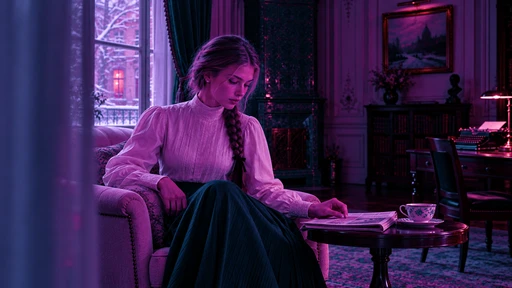

[Full-size lossless 1672×940](../../assets/looks-n002-20261024-r1/full/049-sp-woelfelly-neon.webp) · [Original source](../../assets/looks-n002-20261024-r1/source.png) · [All 500 supplied-image samples](../FILTER_GALLERY.md)

| Input swatch | Input RGB | Actual output RGB |
|---|---|---|
| `gray_0` | `#000000` | `#000000` |
| `gray_10` | `#1A1A1A` | `#0A132A` |
| `gray_25` | `#404040` | `#322D61` |
| `gray_50` | `#808080` | `#854A9E` |
| `gray_75` | `#BFBFBF` | `#C985D3` |
| `gray_90` | `#E6E6E6` | `#EBC1EE` |
| `gray_100` | `#FFFFFF` | `#FFFFFF` |
| `skin_light` | `#F5DBC6` | `#F8A9D7` |
| `skin_medium` | `#CF9B7B` | `#D7489B` |
| `skin_deep` | `#815438` | `#811958` |
| `red` | `#CC3333` | `#CB044D` |
| `green` | `#33CC33` | `#419D54` |
| `blue` | `#3333CC` | `#158CE0` |

Creator: **Nixua / Striped Purple** · [Source](https://github.com/stripedpurple/color-grading-luts/blob/9757e8b5147693cab49c3fd674bf23dbe28d6c8e/Avant%20Garde/Striped%20Purple%20-%20Woelfelly%20Neon.cube) · commit `9757e8b5147693cab49c3fd674bf23dbe28d6c8e`.

Conversion: `native-CUBE-grid-retained-v1`; 8,192 sampled RGB points; max error 0.0000000; mean 0.0000000. This is numerical approximation, not a perceptual quality score.

License obligations: Retain MIT copyright and license notice.

[License](../../../product/src/ai_ad_editor/look_data/licenses/sp-MIT.txt) · LUT SHA-256 `ce066831054d3e2e9a5d87fd35da0696b1345704069541514b5d62bb8e3e2212`.

[Actual preview PNG](../../assets/look500-20261024-r1/previews/sp-woelfelly-neon.png) · [Actual video](../../assets/look500-20261024-r1/videos/sp-woelfelly-neon.mp4)

## 050 · 黑白胶片 · AGFA APX 100

`t3-agfa-apx-100` · `film-bw` · MIT · 33³

50% 灰输出 Y′ 197.0/255（变化 +69.5 码值）；25%–75% 灰跨度比 1.059。中灰红减蓝 +0.0 码值。浅/中/深肤色色块分别输出 #F2F2F2、#DCDCDC、#838383；红/绿/蓝测试块分别输出 #959595、#D9D9D9、#CFCFCF。

建议试片：明亮黑白、柔和回忆、清晰人物

试用强度：1–1; default 1.0.

强度低于 1 会混回原始彩色。仅像素颜色映射，不生成颗粒、光晕、暗角、空间雾或美颜；未做自然画质验收。

补充选型说明：中性黑白并大幅提亮中段，50% 灰升到约 197；黑位轻抬、亮部较早收平。综合色转灰时蓝色色块较亮，绿色次之，红色最暗。

**用户提供的 N002 母图：强度 1.0 的实际输出。**

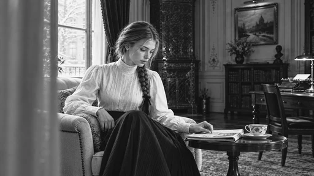

[Full-size lossless 1672×940](../../assets/looks-n002-20261024-r1/full/050-t3-agfa-apx-100.webp) · [Original source](../../assets/looks-n002-20261024-r1/source.png) · [All 500 supplied-image samples](../FILTER_GALLERY.md)

| Input swatch | Input RGB | Actual output RGB |
|---|---|---|
| `gray_0` | `#000000` | `#111111` |
| `gray_10` | `#1A1A1A` | `#2D2D2D` |
| `gray_25` | `#404040` | `#666666` |
| `gray_50` | `#808080` | `#C5C5C5` |
| `gray_75` | `#BFBFBF` | `#EDEDED` |
| `gray_90` | `#E6E6E6` | `#F4F4F4` |
| `gray_100` | `#FFFFFF` | `#F8F8F8` |
| `skin_light` | `#F5DBC6` | `#F2F2F2` |
| `skin_medium` | `#CF9B7B` | `#DCDCDC` |
| `skin_deep` | `#815438` | `#838383` |
| `red` | `#CC3333` | `#959595` |
| `green` | `#33CC33` | `#D9D9D9` |
| `blue` | `#3333CC` | `#CFCFCF` |

Creator: **João Almeida** · [Source](https://github.com/t3mujinpack/t3mujinpack/blob/0b421f3e25209ed78253d1724a29cc6255c5e7fe/haldcluts/t3mujinpack%20-%20Black%20and%20White%20-%20AGFA%20APX%20100.png) · commit `0b421f3e25209ed78253d1724a29cc6255c5e7fe`.

Conversion: `native-depth-Hald-to-33-tetrahedral-v1`; 8,192 sampled RGB points; max error 0.0030273; mean 0.0007068. This is numerical approximation, not a perceptual quality score.

License obligations: Retain MIT copyright and license notice.

[License](../../../product/src/ai_ad_editor/look_data/licenses/t3-MIT.txt) · LUT SHA-256 `4e7d1be74e25d29177216b94a02f5ddf9d50e8fa1ba8b67b10f18f796e772248`.

[Actual preview PNG](../../assets/look500-20261024-r1/previews/t3-agfa-apx-100.png) · [Actual video](../../assets/look500-20261024-r1/videos/t3-agfa-apx-100.mp4)

## 051 · 黑白胶片 · AGFA APX 25

`t3-agfa-apx-25` · `film-bw` · MIT · 33³

50% 灰输出 Y′ 174.0/255（变化 +46.5 码值）；25%–75% 灰跨度比 1.114。中灰红减蓝 +0.0 码值。浅/中/深肤色色块分别输出 #EBEBEB、#C4C4C4、#737373；红/绿/蓝测试块分别输出 #878787、#C1C1C1、#B7B7B7。

建议试片：较有深度的明亮黑白、人物纪实

试用强度：1–1; default 1.0.

强度低于 1 会混回原始彩色。仅像素颜色映射，不生成颗粒、光晕、暗角、空间雾或美颜；未做自然画质验收。

补充选型说明：中性黑白，中灰升到约 174，黑位与高光平台比 APX 100 更克制，保留更深的暗部；红绿蓝灰值都比 APX 100 深。

**用户提供的 N002 母图：强度 1.0 的实际输出。**

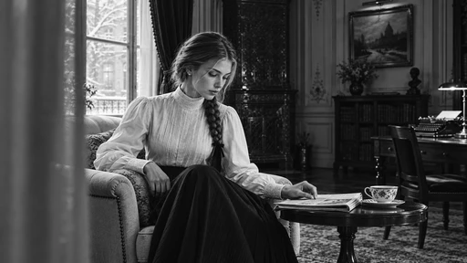

[Full-size lossless 1672×940](../../assets/looks-n002-20261024-r1/full/051-t3-agfa-apx-25.webp) · [Original source](../../assets/looks-n002-20261024-r1/source.png) · [All 500 supplied-image samples](../FILTER_GALLERY.md)

| Input swatch | Input RGB | Actual output RGB |
|---|---|---|
| `gray_0` | `#000000` | `#090909` |
| `gray_10` | `#1A1A1A` | `#1C1C1C` |
| `gray_25` | `#404040` | `#4F4F4F` |
| `gray_50` | `#808080` | `#AEAEAE` |
| `gray_75` | `#BFBFBF` | `#DDDDDD` |
| `gray_90` | `#E6E6E6` | `#F2F2F2` |
| `gray_100` | `#FFFFFF` | `#FFFFFF` |
| `skin_light` | `#F5DBC6` | `#EBEBEB` |
| `skin_medium` | `#CF9B7B` | `#C4C4C4` |
| `skin_deep` | `#815438` | `#737373` |
| `red` | `#CC3333` | `#878787` |
| `green` | `#33CC33` | `#C1C1C1` |
| `blue` | `#3333CC` | `#B7B7B7` |

Creator: **João Almeida** · [Source](https://github.com/t3mujinpack/t3mujinpack/blob/0b421f3e25209ed78253d1724a29cc6255c5e7fe/haldcluts/t3mujinpack%20-%20Black%20and%20White%20-%20AGFA%20APX%2025.png) · commit `0b421f3e25209ed78253d1724a29cc6255c5e7fe`.

Conversion: `native-depth-Hald-to-33-tetrahedral-v1`; 8,192 sampled RGB points; max error 0.0028451; mean 0.0006990. This is numerical approximation, not a perceptual quality score.

License obligations: Retain MIT copyright and license notice.

[License](../../../product/src/ai_ad_editor/look_data/licenses/t3-MIT.txt) · LUT SHA-256 `aed4e50b852990c84db2bce2457e8622942f426548eb6505cca21b31108b8472`.

[Actual preview PNG](../../assets/look500-20261024-r1/previews/t3-agfa-apx-25.png) · [Actual video](../../assets/look500-20261024-r1/videos/t3-agfa-apx-25.mp4)

## 052 · 彩色负片 · Agfa Vista 100

`t3-agfa-vista-100` · `film-negative` · MIT · 33³

50% 灰输出 Y′ 143.9/255（变化 +16.4 码值）；25%–75% 灰跨度比 1.316。中灰红减蓝 +2.0 码值。浅/中/深肤色色块分别输出 #FFE3CF、#FFB37C、#904E1E；红/绿/蓝测试块分别输出 #F20017、#5DEE2D、#5408C1。

建议试片：日光旅行、暖色商品故事、复古生活

试用强度：0.35–0.8; default 1.0.

逐项比较肤色与品牌色，强度过高可能改变产品颜色。仅像素颜色映射，不生成颗粒、光晕、暗角、空间雾或美颜；未做自然画质验收。

补充选型说明：暗部较深、中亮部明显提亮，亮端收在浅灰；肤色推成明亮金橙，红绿更鲜，蓝色更亮但饱和度略降，综合色彩存在感强。

**用户提供的 N002 母图：强度 1.0 的实际输出。**

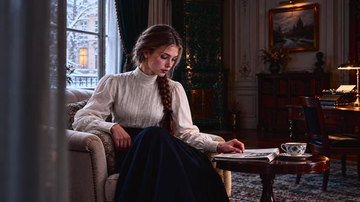

[Full-size lossless 1672×940](../../assets/looks-n002-20261024-r1/full/052-t3-agfa-vista-100.webp) · [Original source](../../assets/looks-n002-20261024-r1/source.png) · [All 500 supplied-image samples](../FILTER_GALLERY.md)

| Input swatch | Input RGB | Actual output RGB |
|---|---|---|
| `gray_0` | `#000000` | `#0B0808` |
| `gray_10` | `#1A1A1A` | `#131111` |
| `gray_25` | `#404040` | `#353434` |
| `gray_50` | `#808080` | `#919090` |
| `gray_75` | `#BFBFBF` | `#DDDBDB` |
| `gray_90` | `#E6E6E6` | `#ECEAEA` |
| `gray_100` | `#FFFFFF` | `#F0EEEE` |
| `skin_light` | `#F5DBC6` | `#FFE3CF` |
| `skin_medium` | `#CF9B7B` | `#FFB37C` |
| `skin_deep` | `#815438` | `#904E1E` |
| `red` | `#CC3333` | `#F20017` |
| `green` | `#33CC33` | `#5DEE2D` |
| `blue` | `#3333CC` | `#5408C1` |

Creator: **João Almeida** · [Source](https://github.com/t3mujinpack/t3mujinpack/blob/0b421f3e25209ed78253d1724a29cc6255c5e7fe/haldcluts/t3mujinpack%20-%20Color%20Negative%20-%20Agfa%20Vista%20100.png) · commit `0b421f3e25209ed78253d1724a29cc6255c5e7fe`.

Conversion: `native-depth-Hald-to-33-tetrahedral-v1`; 8,192 sampled RGB points; max error 0.0376260; mean 0.0010397. This is numerical approximation, not a perceptual quality score.

License obligations: Retain MIT copyright and license notice.

[License](../../../product/src/ai_ad_editor/look_data/licenses/t3-MIT.txt) · LUT SHA-256 `47be333a86017727c45b2da31d749acf66884a92df95213ca44d95ff37f51828`.

[Actual preview PNG](../../assets/look500-20261024-r1/previews/t3-agfa-vista-100.png) · [Actual video](../../assets/look500-20261024-r1/videos/t3-agfa-vista-100.mp4)

## 053 · 彩色负片 · Agfa Vista 200

`t3-agfa-vista-200` · `film-negative` · MIT · 33³

50% 灰输出 Y′ 130.2/255（变化 +2.7 码值）；25%–75% 灰跨度比 1.144。中灰红减蓝 +1.0 码值。浅/中/深肤色色块分别输出 #F8DCC4、#DC9E75、#824D2B；红/绿/蓝测试块分别输出 #DC0725、#0AD41D、#4211C3。

建议试片：日常彩色、城市旅行、温和复古

试用强度：0.35–0.8; default 1.0.

逐项比较肤色与品牌色，强度过高可能改变产品颜色。仅像素颜色映射，不生成颗粒、光晕、暗角、空间雾或美颜；未做自然画质验收。

补充选型说明：中灰接近原值但暗部压深，亮部较完整；红色更浓，绿蓝增强，肤色偏暖棕。比 Vista 100 更暗、更少提亮。

**用户提供的 N002 母图：强度 1.0 的实际输出。**

[Full-size lossless 1672×940](../../assets/looks-n002-20261024-r1/full/053-t3-agfa-vista-200.webp) · [Original source](../../assets/looks-n002-20261024-r1/source.png) · [All 500 supplied-image samples](../FILTER_GALLERY.md)

| Input swatch | Input RGB | Actual output RGB |
|---|---|---|
| `gray_0` | `#000000` | `#0A0809` |
| `gray_10` | `#1A1A1A` | `#131112` |
| `gray_25` | `#404040` | `#343232` |
| `gray_50` | `#808080` | `#838282` |
| `gray_75` | `#BFBFBF` | `#C5C4C4` |
| `gray_90` | `#E6E6E6` | `#E7E6E6` |
| `gray_100` | `#FFFFFF` | `#FDFBFC` |
| `skin_light` | `#F5DBC6` | `#F8DCC4` |
| `skin_medium` | `#CF9B7B` | `#DC9E75` |
| `skin_deep` | `#815438` | `#824D2B` |
| `red` | `#CC3333` | `#DC0725` |
| `green` | `#33CC33` | `#0AD41D` |
| `blue` | `#3333CC` | `#4211C3` |

Creator: **João Almeida** · [Source](https://github.com/t3mujinpack/t3mujinpack/blob/0b421f3e25209ed78253d1724a29cc6255c5e7fe/haldcluts/t3mujinpack%20-%20Color%20Negative%20-%20Agfa%20Vista%20200.png) · commit `0b421f3e25209ed78253d1724a29cc6255c5e7fe`.

Conversion: `native-depth-Hald-to-33-tetrahedral-v1`; 8,192 sampled RGB points; max error 0.0333623; mean 0.0009171. This is numerical approximation, not a perceptual quality score.

License obligations: Retain MIT copyright and license notice.

[License](../../../product/src/ai_ad_editor/look_data/licenses/t3-MIT.txt) · LUT SHA-256 `59e557bea68f6e8f1b31155cf9ea8ea116ee3b05d8cffa30acea52ffafacc1c8`.

[Actual preview PNG](../../assets/look500-20261024-r1/previews/t3-agfa-vista-200.png) · [Actual video](../../assets/look500-20261024-r1/videos/t3-agfa-vista-200.mp4)

## 054 · 彩色负片 · Agfa Vista 400

`t3-agfa-vista-400` · `film-negative` · MIT · 33³

50% 灰输出 Y′ 136.6/255（变化 +9.1 码值）；25%–75% 灰跨度比 1.291。中灰红减蓝 -1.0 码值。浅/中/深肤色色块分别输出 #FEE5D0、#F7B184、#834A24；红/绿/蓝测试块分别输出 #E90012、#30EB00、#4B08BB。

建议试片：鲜明街景、旅行、活泼生活片

试用强度：0.35–0.8; default 1.0.

逐项比较肤色与品牌色，强度过高可能改变产品颜色。仅像素颜色映射，不生成颗粒、光晕、暗角、空间雾或美颜；未做自然画质验收。

补充选型说明：压暗阴影、提亮中亮部，白端微冷收窄；红色色块尤其鲜，绿色增亮，肤色更亮金暖，力度介于清淡校色与强创意之间。

**用户提供的 N002 母图：强度 1.0 的实际输出。**

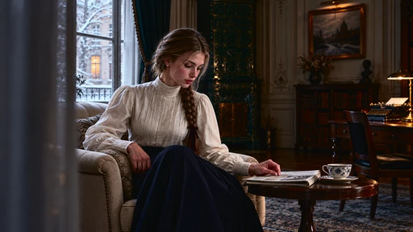

[Full-size lossless 1672×940](../../assets/looks-n002-20261024-r1/full/054-t3-agfa-vista-400.webp) · [Original source](../../assets/looks-n002-20261024-r1/source.png) · [All 500 supplied-image samples](../FILTER_GALLERY.md)

| Input swatch | Input RGB | Actual output RGB |
|---|---|---|
| `gray_0` | `#000000` | `#080909` |
| `gray_10` | `#1A1A1A` | `#111212` |
| `gray_25` | `#404040` | `#313132` |
| `gray_50` | `#808080` | `#88888A` |
| `gray_75` | `#BFBFBF` | `#D5D6D7` |
| `gray_90` | `#E6E6E6` | `#ECEDEE` |
| `gray_100` | `#FFFFFF` | `#F6F7F8` |
| `skin_light` | `#F5DBC6` | `#FEE5D0` |
| `skin_medium` | `#CF9B7B` | `#F7B184` |
| `skin_deep` | `#815438` | `#834A24` |
| `red` | `#CC3333` | `#E90012` |
| `green` | `#33CC33` | `#30EB00` |
| `blue` | `#3333CC` | `#4B08BB` |

Creator: **João Almeida** · [Source](https://github.com/t3mujinpack/t3mujinpack/blob/0b421f3e25209ed78253d1724a29cc6255c5e7fe/haldcluts/t3mujinpack%20-%20Color%20Negative%20-%20Agfa%20Vista%20400.png) · commit `0b421f3e25209ed78253d1724a29cc6255c5e7fe`.

Conversion: `native-depth-Hald-to-33-tetrahedral-v1`; 8,192 sampled RGB points; max error 0.0518095; mean 0.0010006. This is numerical approximation, not a perceptual quality score.

License obligations: Retain MIT copyright and license notice.

[License](../../../product/src/ai_ad_editor/look_data/licenses/t3-MIT.txt) · LUT SHA-256 `1d3cefbe475d1d88513467e04452ac6d93fecbbff406819c0b17d8fa3e787527`.

[Actual preview PNG](../../assets/look500-20261024-r1/previews/t3-agfa-vista-400.png) · [Actual video](../../assets/look500-20261024-r1/videos/t3-agfa-vista-400.mp4)

## 055 · 反转片 · Fuji Astia 100F

`t3-fuji-astia-100f` · `film-slide` · MIT · 33³

50% 灰输出 Y′ 135.4/255（变化 +7.9 码值）；25%–75% 灰跨度比 0.981。中灰红减蓝 -0.5 码值。浅/中/深肤色色块分别输出 #F2D8C8、#DB9B84、#8F5743；红/绿/蓝测试块分别输出 #E02A38、#47CE16、#592EC5。

建议试片：日光人物、柔和旅行、服装生活片

试用强度：0.35–0.8; default 1.0.

逐项比较肤色与品牌色，强度过高可能改变产品颜色。仅像素颜色映射，不生成颗粒、光晕、暗角、空间雾或美颜；未做自然画质验收。

补充选型说明：灰阶中段略提亮、白端轻收，红色稍增鲜，绿色和蓝色更亮但饱和度降低；肤色色块偏红粉，比暖金类负片少一些黄色倾向。

**用户提供的 N002 母图：强度 1.0 的实际输出。**

[Full-size lossless 1672×940](../../assets/looks-n002-20261024-r1/full/055-t3-fuji-astia-100f.webp) · [Original source](../../assets/looks-n002-20261024-r1/source.png) · [All 500 supplied-image samples](../FILTER_GALLERY.md)

| Input swatch | Input RGB | Actual output RGB |
|---|---|---|
| `gray_0` | `#000000` | `#030504` |
| `gray_10` | `#1A1A1A` | `#181918` |
| `gray_25` | `#404040` | `#424442` |
| `gray_50` | `#808080` | `#878787` |
| `gray_75` | `#BFBFBF` | `#C0C1C0` |
| `gray_90` | `#E6E6E6` | `#E2E3E3` |
| `gray_100` | `#FFFFFF` | `#F9FAFA` |
| `skin_light` | `#F5DBC6` | `#F2D8C8` |
| `skin_medium` | `#CF9B7B` | `#DB9B84` |
| `skin_deep` | `#815438` | `#8F5743` |
| `red` | `#CC3333` | `#E02A38` |
| `green` | `#33CC33` | `#47CE16` |
| `blue` | `#3333CC` | `#592EC5` |

Creator: **João Almeida** · [Source](https://github.com/t3mujinpack/t3mujinpack/blob/0b421f3e25209ed78253d1724a29cc6255c5e7fe/haldcluts/t3mujinpack%20-%20Color%20Slide%20-%20Fuji%20Astia%20100F.png) · commit `0b421f3e25209ed78253d1724a29cc6255c5e7fe`.

Conversion: `native-depth-Hald-to-33-tetrahedral-v1`; 8,192 sampled RGB points; max error 0.0202080; mean 0.0008376. This is numerical approximation, not a perceptual quality score.

License obligations: Retain MIT copyright and license notice.

[License](../../../product/src/ai_ad_editor/look_data/licenses/t3-MIT.txt) · LUT SHA-256 `dd3fb7067ef3d841795dafd9c4678a63b9518a021795286f9a81bc52136fcc5a`.

[Actual preview PNG](../../assets/look500-20261024-r1/previews/t3-fuji-astia-100f.png) · [Actual video](../../assets/look500-20261024-r1/videos/t3-fuji-astia-100f.mp4)

## 056 · 反转片 · Fuji Fortia SP 50

`t3-fuji-fortia-sp-50` · `film-slide` · MIT · 33³

50% 灰输出 Y′ 146.5/255（变化 +19.0 码值）；25%–75% 灰跨度比 1.269。中灰红减蓝 +0.0 码值。浅/中/深肤色色块分别输出 #FFE8C2、#FFB487、#974D27；红/绿/蓝测试块分别输出 #E5272A、#93EA46、#2021ED。

建议试片：高彩风景、蓝天、强色彩片段

试用强度：0.35–0.8; default 1.0.

逐项比较肤色与品牌色，强度过高可能改变产品颜色。仅像素颜色映射，不生成颗粒、光晕、暗角、空间雾或美颜；未做自然画质验收。

补充选型说明：强中段对比，阴影压深、中亮部明显提亮；蓝色样本变成非常鲜的亮蓝，绿偏黄且更亮，肤色推成明亮金橙。

**用户提供的 N002 母图：强度 1.0 的实际输出。**

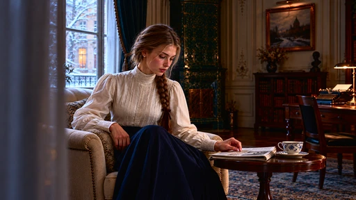

[Full-size lossless 1672×940](../../assets/looks-n002-20261024-r1/full/056-t3-fuji-fortia-sp-50.webp) · [Original source](../../assets/looks-n002-20261024-r1/source.png) · [All 500 supplied-image samples](../FILTER_GALLERY.md)

| Input swatch | Input RGB | Actual output RGB |
|---|---|---|
| `gray_0` | `#000000` | `#050505` |
| `gray_10` | `#1A1A1A` | `#121212` |
| `gray_25` | `#404040` | `#3C3C3C` |
| `gray_50` | `#808080` | `#929292` |
| `gray_75` | `#BFBFBF` | `#DEDEDE` |
| `gray_90` | `#E6E6E6` | `#F4F4F4` |
| `gray_100` | `#FFFFFF` | `#FFFFFF` |
| `skin_light` | `#F5DBC6` | `#FFE8C2` |
| `skin_medium` | `#CF9B7B` | `#FFB487` |
| `skin_deep` | `#815438` | `#974D27` |
| `red` | `#CC3333` | `#E5272A` |
| `green` | `#33CC33` | `#93EA46` |
| `blue` | `#3333CC` | `#2021ED` |

Creator: **João Almeida** · [Source](https://github.com/t3mujinpack/t3mujinpack/blob/0b421f3e25209ed78253d1724a29cc6255c5e7fe/haldcluts/t3mujinpack%20-%20Color%20Slide%20-%20Fuji%20Fortia%20SP%2050.png) · commit `0b421f3e25209ed78253d1724a29cc6255c5e7fe`.

Conversion: `native-depth-Hald-to-33-tetrahedral-v1`; 8,192 sampled RGB points; max error 0.0644893; mean 0.0008812. This is numerical approximation, not a perceptual quality score.

License obligations: Retain MIT copyright and license notice.

[License](../../../product/src/ai_ad_editor/look_data/licenses/t3-MIT.txt) · LUT SHA-256 `78be4d590637c63a6661baf0a04e809d4df20dcd22d666d797500440a4d1642c`.

[Actual preview PNG](../../assets/look500-20261024-r1/previews/t3-fuji-fortia-sp-50.png) · [Actual video](../../assets/look500-20261024-r1/videos/t3-fuji-fortia-sp-50.mp4)

## 057 · 黑白胶片 · Fuji Neopan 1600

`t3-fuji-neopan-1600` · `film-bw` · MIT · 33³

50% 灰输出 Y′ 145.0/255（变化 +17.5 码值）；25%–75% 灰跨度比 1.365。中灰红减蓝 +0.0 码值。浅/中/深肤色色块分别输出 #F0F0F0、#BEBEBE、#555555；红/绿/蓝测试块分别输出 #6A6A6A、#B7B7B7、#989898。

建议试片：反差黑白、街头、人物叙事

试用强度：1–1; default 1.0.

强度低于 1 会混回原始彩色。仅像素颜色映射，不生成颗粒、光晕、暗角、空间雾或美颜；未做自然画质验收。

补充选型说明：中性黑白，阴影压深，50% 灰略亮、75% 灰明显提亮，明暗跨度大；肤色转相对较亮灰，蓝色样本比红色亮。

**用户提供的 N002 母图：强度 1.0 的实际输出。**

[Full-size lossless 1672×940](../../assets/looks-n002-20261024-r1/full/057-t3-fuji-neopan-1600.webp) · [Original source](../../assets/looks-n002-20261024-r1/source.png) · [All 500 supplied-image samples](../FILTER_GALLERY.md)

| Input swatch | Input RGB | Actual output RGB |
|---|---|---|
| `gray_0` | `#000000` | `#040404` |
| `gray_10` | `#1A1A1A` | `#0B0B0B` |
| `gray_25` | `#404040` | `#353535` |
| `gray_50` | `#808080` | `#919191` |
| `gray_75` | `#BFBFBF` | `#E4E4E4` |
| `gray_90` | `#E6E6E6` | `#F5F5F5` |
| `gray_100` | `#FFFFFF` | `#FFFFFF` |
| `skin_light` | `#F5DBC6` | `#F0F0F0` |
| `skin_medium` | `#CF9B7B` | `#BEBEBE` |
| `skin_deep` | `#815438` | `#555555` |
| `red` | `#CC3333` | `#6A6A6A` |
| `green` | `#33CC33` | `#B7B7B7` |
| `blue` | `#3333CC` | `#989898` |

Creator: **João Almeida** · [Source](https://github.com/t3mujinpack/t3mujinpack/blob/0b421f3e25209ed78253d1724a29cc6255c5e7fe/haldcluts/t3mujinpack%20-%20Black%20and%20White%20-%20Fuji%20Neopan%201600.png) · commit `0b421f3e25209ed78253d1724a29cc6255c5e7fe`.

Conversion: `native-depth-Hald-to-33-tetrahedral-v1`; 8,192 sampled RGB points; max error 0.0037186; mean 0.0006889. This is numerical approximation, not a perceptual quality score.

License obligations: Retain MIT copyright and license notice.

[License](../../../product/src/ai_ad_editor/look_data/licenses/t3-MIT.txt) · LUT SHA-256 `e7fa984275220fe19904e4ab4eb4512cca9090284770900582e2e4e86dd2876d`.

[Actual preview PNG](../../assets/look500-20261024-r1/previews/t3-fuji-neopan-1600.png) · [Actual video](../../assets/look500-20261024-r1/videos/t3-fuji-neopan-1600.mp4)

## 058 · 黑白胶片 · Fuji Neopan Acros 100

`t3-fuji-neopan-acros-100` · `film-bw` · MIT · 33³

50% 灰输出 Y′ 118.0/255（变化 -9.5 码值）；25%–75% 灰跨度比 1.143。中灰红减蓝 +0.0 码值。浅/中/深肤色色块分别输出 #DBDBDB、#9A9A9A、#494949；红/绿/蓝测试块分别输出 #585858、#949494、#7C7C7C。

建议试片：安静黑白、建筑、低调人物

试用强度：1–1; default 1.0.

强度低于 1 会混回原始彩色。仅像素颜色映射，不生成颗粒、光晕、暗角、空间雾或美颜；未做自然画质验收。

补充选型说明：中性黑白，暗部和中灰整体偏深，白端轻收；相较 Neopan 1600 更沉静，肤色灰值也更深，蓝色转灰仍较红色亮。

**用户提供的 N002 母图：强度 1.0 的实际输出。**

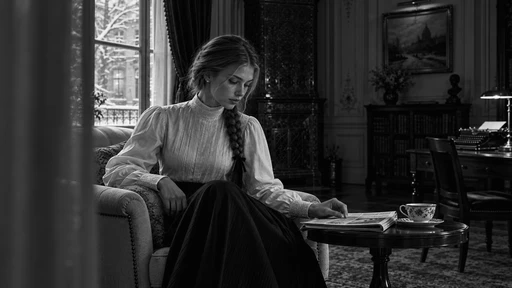

[Full-size lossless 1672×940](../../assets/looks-n002-20261024-r1/full/058-t3-fuji-neopan-acros-100.webp) · [Original source](../../assets/looks-n002-20261024-r1/source.png) · [All 500 supplied-image samples](../FILTER_GALLERY.md)

| Input swatch | Input RGB | Actual output RGB |
|---|---|---|
| `gray_0` | `#000000` | `#040404` |
| `gray_10` | `#1A1A1A` | `#141414` |
| `gray_25` | `#404040` | `#323232` |
| `gray_50` | `#808080` | `#767676` |
| `gray_75` | `#BFBFBF` | `#C4C4C4` |
| `gray_90` | `#E6E6E6` | `#E5E5E5` |
| `gray_100` | `#FFFFFF` | `#F9F9F9` |
| `skin_light` | `#F5DBC6` | `#DBDBDB` |
| `skin_medium` | `#CF9B7B` | `#9A9A9A` |
| `skin_deep` | `#815438` | `#494949` |
| `red` | `#CC3333` | `#585858` |
| `green` | `#33CC33` | `#949494` |
| `blue` | `#3333CC` | `#7C7C7C` |

Creator: **João Almeida** · [Source](https://github.com/t3mujinpack/t3mujinpack/blob/0b421f3e25209ed78253d1724a29cc6255c5e7fe/haldcluts/t3mujinpack%20-%20Black%20and%20White%20-%20Fuji%20Neopan%20Acros%20100.png) · commit `0b421f3e25209ed78253d1724a29cc6255c5e7fe`.

Conversion: `native-depth-Hald-to-33-tetrahedral-v1`; 8,192 sampled RGB points; max error 0.0031227; mean 0.0006806. This is numerical approximation, not a perceptual quality score.

License obligations: Retain MIT copyright and license notice.

[License](../../../product/src/ai_ad_editor/look_data/licenses/t3-MIT.txt) · LUT SHA-256 `351a761dd3b66012d8135f225b576f20f49ac04cda465a64a6a2ae0831e53eee`.

[Actual preview PNG](../../assets/look500-20261024-r1/previews/t3-fuji-neopan-acros-100.png) · [Actual video](../../assets/look500-20261024-r1/videos/t3-fuji-neopan-acros-100.mp4)

## 059 · 彩色负片 · Fuji Pro 160C

`t3-fuji-pro-160c` · `film-negative` · MIT · 33³

50% 灰输出 Y′ 139.1/255（变化 +11.6 码值）；25%–75% 灰跨度比 1.108。中灰红减蓝 +2.0 码值。浅/中/深肤色色块分别输出 #FEE1C2、#EBA473、#92562A；红/绿/蓝测试块分别输出 #E62426、#64D91C、#522ACC。

建议试片：暖调人物、生活方式、日光街拍

试用强度：0.35–0.8; default 1.0.

逐项比较肤色与品牌色，强度过高可能改变产品颜色。仅像素颜色映射，不生成颗粒、光晕、暗角、空间雾或美颜；未做自然画质验收。

补充选型说明：中灰略亮、阴影略深，黑白端带细微暖色；红色更浓、绿偏黄绿、蓝色更亮且更柔，肤色明显偏暖橙。

**用户提供的 N002 母图：强度 1.0 的实际输出。**

[Full-size lossless 1672×940](../../assets/looks-n002-20261024-r1/full/059-t3-fuji-pro-160c.webp) · [Original source](../../assets/looks-n002-20261024-r1/source.png) · [All 500 supplied-image samples](../FILTER_GALLERY.md)

| Input swatch | Input RGB | Actual output RGB |
|---|---|---|
| `gray_0` | `#000000` | `#040301` |
| `gray_10` | `#1A1A1A` | `#161514` |
| `gray_25` | `#404040` | `#41413F` |
| `gray_50` | `#808080` | `#8C8B8A` |
| `gray_75` | `#BFBFBF` | `#CECECD` |
| `gray_90` | `#E6E6E6` | `#EBEBE9` |
| `gray_100` | `#FFFFFF` | `#FAF9F8` |
| `skin_light` | `#F5DBC6` | `#FEE1C2` |
| `skin_medium` | `#CF9B7B` | `#EBA473` |
| `skin_deep` | `#815438` | `#92562A` |
| `red` | `#CC3333` | `#E62426` |
| `green` | `#33CC33` | `#64D91C` |
| `blue` | `#3333CC` | `#522ACC` |

Creator: **João Almeida** · [Source](https://github.com/t3mujinpack/t3mujinpack/blob/0b421f3e25209ed78253d1724a29cc6255c5e7fe/haldcluts/t3mujinpack%20-%20Color%20Negative%20-%20Fuji%20Pro%20160C.png) · commit `0b421f3e25209ed78253d1724a29cc6255c5e7fe`.

Conversion: `native-depth-Hald-to-33-tetrahedral-v1`; 8,192 sampled RGB points; max error 0.0233078; mean 0.0009218. This is numerical approximation, not a perceptual quality score.

License obligations: Retain MIT copyright and license notice.

[License](../../../product/src/ai_ad_editor/look_data/licenses/t3-MIT.txt) · LUT SHA-256 `73eeb5c95df3888fc6c18296225426eedea7626b9199dac2173e7db3b6db4d8b`.

[Actual preview PNG](../../assets/look500-20261024-r1/previews/t3-fuji-pro-160c.png) · [Actual video](../../assets/look500-20261024-r1/videos/t3-fuji-pro-160c.mp4)

## 060 · 彩色负片 · Fuji Pro 400H

`t3-fuji-pro-400h` · `film-negative` · MIT · 33³

50% 灰输出 Y′ 151.2/255（变化 +23.7 码值）；25%–75% 灰跨度比 1.034。中灰红减蓝 +3.5 码值。浅/中/深肤色色块分别输出 #FADDB9、#F2A87B、#9D5C35；红/绿/蓝测试块分别输出 #E94434、#1BDE27、#4736DB。

建议试片：明亮人物、旅行、彩色生活片

试用强度：0.35–0.8; default 1.0.

逐项比较肤色与品牌色，强度过高可能改变产品颜色。仅像素颜色映射，不生成颗粒、光晕、暗角、空间雾或美颜；未做自然画质验收。

补充选型说明：中灰提亮较明显，亮部轻收；绿色和蓝色更亮但饱和度略降，红色略增鲜，肤色变亮偏暖。实际是选择性提亮与配色，不能简单概括成全局加饱和或全局粉彩。

**用户提供的 N002 母图：强度 1.0 的实际输出。**

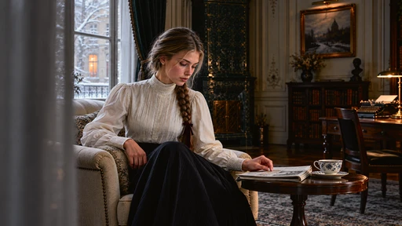

[Full-size lossless 1672×940](../../assets/looks-n002-20261024-r1/full/060-t3-fuji-pro-400h.webp) · [Original source](../../assets/looks-n002-20261024-r1/source.png) · [All 500 supplied-image samples](../FILTER_GALLERY.md)

| Input swatch | Input RGB | Actual output RGB |
|---|---|---|
| `gray_0` | `#000000` | `#090704` |
| `gray_10` | `#1A1A1A` | `#171614` |
| `gray_25` | `#404040` | `#464542` |
| `gray_50` | `#808080` | `#989795` |
| `gray_75` | `#BFBFBF` | `#CAC8C6` |
| `gray_90` | `#E6E6E6` | `#E9E7E5` |
| `gray_100` | `#FFFFFF` | `#FFFFFC` |
| `skin_light` | `#F5DBC6` | `#FADDB9` |
| `skin_medium` | `#CF9B7B` | `#F2A87B` |
| `skin_deep` | `#815438` | `#9D5C35` |
| `red` | `#CC3333` | `#E94434` |
| `green` | `#33CC33` | `#1BDE27` |
| `blue` | `#3333CC` | `#4736DB` |

Creator: **João Almeida** · [Source](https://github.com/t3mujinpack/t3mujinpack/blob/0b421f3e25209ed78253d1724a29cc6255c5e7fe/haldcluts/t3mujinpack%20-%20Color%20Negative%20-%20Fuji%20Pro%20400H.png) · commit `0b421f3e25209ed78253d1724a29cc6255c5e7fe`.

Conversion: `native-depth-Hald-to-33-tetrahedral-v1`; 8,192 sampled RGB points; max error 0.0270027; mean 0.0009605. This is numerical approximation, not a perceptual quality score.

License obligations: Retain MIT copyright and license notice.

[License](../../../product/src/ai_ad_editor/look_data/licenses/t3-MIT.txt) · LUT SHA-256 `8346d2dae42ae16571947a0b634d8dc83b5e804e82ae623a4866ad8199d14516`.

[Actual preview PNG](../../assets/look500-20261024-r1/previews/t3-fuji-pro-400h.png) · [Actual video](../../assets/look500-20261024-r1/videos/t3-fuji-pro-400h.mp4)

## 061 · 彩色负片 · Fuji Pro 800Z

`t3-fuji-pro-800z` · `film-negative` · MIT · 33³

50% 灰输出 Y′ 145.3/255（变化 +17.8 码值）；25%–75% 灰跨度比 1.070。中灰红减蓝 +8.0 码值。浅/中/深肤色色块分别输出 #FCE4BE、#E8A97B、#976238；红/绿/蓝测试块分别输出 #EC3B35、#6BDA32、#4539E3。

建议试片：暖室内故事、旅行、人物生活片

试用强度：0.35–0.8; default 1.0.

逐项比较肤色与品牌色，强度过高可能改变产品颜色。仅像素颜色映射，不生成颗粒、光晕、暗角、空间雾或美颜；未做自然画质验收。

补充选型说明：抬高带暖色的黑位，中灰提亮、白端偏米暖；蓝色增强明显，绿色偏黄绿，肤色变亮金暖，形成暖中性与较鲜冷色的配比。

**用户提供的 N002 母图：强度 1.0 的实际输出。**

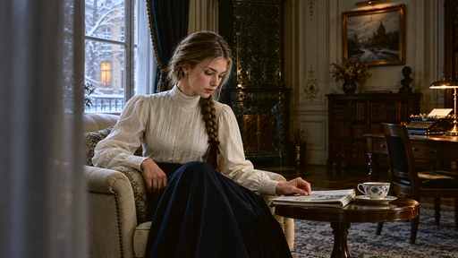

[Full-size lossless 1672×940](../../assets/looks-n002-20261024-r1/full/061-t3-fuji-pro-800z.webp) · [Original source](../../assets/looks-n002-20261024-r1/source.png) · [All 500 supplied-image samples](../FILTER_GALLERY.md)

| Input swatch | Input RGB | Actual output RGB |
|---|---|---|
| `gray_0` | `#000000` | `#0B0700` |
| `gray_10` | `#1A1A1A` | `#191612` |
| `gray_25` | `#404040` | `#484641` |
| `gray_50` | `#808080` | `#94918C` |
| `gray_75` | `#BFBFBF` | `#D1CEC9` |
| `gray_90` | `#E6E6E6` | `#EDEAE4` |
| `gray_100` | `#FFFFFF` | `#F9F6F0` |
| `skin_light` | `#F5DBC6` | `#FCE4BE` |
| `skin_medium` | `#CF9B7B` | `#E8A97B` |
| `skin_deep` | `#815438` | `#976238` |
| `red` | `#CC3333` | `#EC3B35` |
| `green` | `#33CC33` | `#6BDA32` |
| `blue` | `#3333CC` | `#4539E3` |

Creator: **João Almeida** · [Source](https://github.com/t3mujinpack/t3mujinpack/blob/0b421f3e25209ed78253d1724a29cc6255c5e7fe/haldcluts/t3mujinpack%20-%20Color%20Negative%20-%20Fuji%20Pro%20800Z.png) · commit `0b421f3e25209ed78253d1724a29cc6255c5e7fe`.

Conversion: `native-depth-Hald-to-33-tetrahedral-v1`; 8,192 sampled RGB points; max error 0.0360442; mean 0.0008662. This is numerical approximation, not a perceptual quality score.

License obligations: Retain MIT copyright and license notice.

[License](../../../product/src/ai_ad_editor/look_data/licenses/t3-MIT.txt) · LUT SHA-256 `177dcd112df69fea03d302db7c79825234a9b6bbd32845fee18915b30ce8e54a`.

[Actual preview PNG](../../assets/look500-20261024-r1/previews/t3-fuji-pro-800z.png) · [Actual video](../../assets/look500-20261024-r1/videos/t3-fuji-pro-800z.mp4)

## 062 · 反转片 · Fuji Provia 100F

`t3-fuji-provia-100f` · `film-slide` · MIT · 33³

50% 灰输出 Y′ 141.3/255（变化 +13.8 码值）；25%–75% 灰跨度比 1.144。中灰红减蓝 +1.0 码值。浅/中/深肤色色块分别输出 #FBE1C5、#DFAA81、#875936；红/绿/蓝测试块分别输出 #E13135、#4ADB33、#4326CF。

建议试片：旅行、城市风景、日光生活

试用强度：0.35–0.8; default 1.0.

逐项比较肤色与品牌色，强度过高可能改变产品颜色。仅像素颜色映射，不生成颗粒、光晕、暗角、空间雾或美颜；未做自然画质验收。

补充选型说明：阴影略压、中灰提亮、亮部较完整；红蓝更鲜，绿色更亮，肤色偏金暖，是较均衡但明显增强的反转片配色。

**用户提供的 N002 母图：强度 1.0 的实际输出。**

[Full-size lossless 1672×940](../../assets/looks-n002-20261024-r1/full/062-t3-fuji-provia-100f.webp) · [Original source](../../assets/looks-n002-20261024-r1/source.png) · [All 500 supplied-image samples](../FILTER_GALLERY.md)

| Input swatch | Input RGB | Actual output RGB |
|---|---|---|
| `gray_0` | `#000000` | `#000000` |
| `gray_10` | `#1A1A1A` | `#131412` |
| `gray_25` | `#404040` | `#3B3B3A` |
| `gray_50` | `#808080` | `#8D8E8C` |
| `gray_75` | `#BFBFBF` | `#CDCDCB` |
| `gray_90` | `#E6E6E6` | `#E9EAE8` |
| `gray_100` | `#FFFFFF` | `#FEFEFD` |
| `skin_light` | `#F5DBC6` | `#FBE1C5` |
| `skin_medium` | `#CF9B7B` | `#DFAA81` |
| `skin_deep` | `#815438` | `#875936` |
| `red` | `#CC3333` | `#E13135` |
| `green` | `#33CC33` | `#4ADB33` |
| `blue` | `#3333CC` | `#4326CF` |

Creator: **João Almeida** · [Source](https://github.com/t3mujinpack/t3mujinpack/blob/0b421f3e25209ed78253d1724a29cc6255c5e7fe/haldcluts/t3mujinpack%20-%20Color%20Slide%20-%20Fuji%20Provia%20100F.png) · commit `0b421f3e25209ed78253d1724a29cc6255c5e7fe`.

Conversion: `native-depth-Hald-to-33-tetrahedral-v1`; 8,192 sampled RGB points; max error 0.0244207; mean 0.0008875. This is numerical approximation, not a perceptual quality score.

License obligations: Retain MIT copyright and license notice.

[License](../../../product/src/ai_ad_editor/look_data/licenses/t3-MIT.txt) · LUT SHA-256 `4cd3658520057bc5240c04fe91269f00683594946f912884bbf14c7d6621ac44`.

[Actual preview PNG](../../assets/look500-20261024-r1/previews/t3-fuji-provia-100f.png) · [Actual video](../../assets/look500-20261024-r1/videos/t3-fuji-provia-100f.mp4)

## 063 · 反转片 · Fuji Provia 400F

`t3-fuji-provia-400f` · `film-slide` · MIT · 33³

50% 灰输出 Y′ 125.9/255（变化 -1.6 码值）；25%–75% 灰跨度比 1.037。中灰红减蓝 -1.0 码值。浅/中/深肤色色块分别输出 #EBDDC7、#CC9881、#80523E；红/绿/蓝测试块分别输出 #D41745、#00CE50、#1831CF。

建议试片：克制风景、人物环境、城市纪实

试用强度：0.35–0.8; default 1.0.

逐项比较肤色与品牌色，强度过高可能改变产品颜色。仅像素颜色映射，不生成颗粒、光晕、暗角、空间雾或美颜；未做自然画质验收。

补充选型说明：中灰接近原值，暗部压深、白位轻收；绿色趋青、蓝色偏深蓝，红色略浓，肤色变化较克制。比 100F 更沉稳。

**用户提供的 N002 母图：强度 1.0 的实际输出。**

[Full-size lossless 1672×940](../../assets/looks-n002-20261024-r1/full/063-t3-fuji-provia-400f.webp) · [Original source](../../assets/looks-n002-20261024-r1/source.png) · [All 500 supplied-image samples](../FILTER_GALLERY.md)

| Input swatch | Input RGB | Actual output RGB |
|---|---|---|
| `gray_0` | `#000000` | `#000001` |
| `gray_10` | `#1A1A1A` | `#131314` |
| `gray_25` | `#404040` | `#3B3B3B` |
| `gray_50` | `#808080` | `#7E7E7E` |
| `gray_75` | `#BFBFBF` | `#BEC0C0` |
| `gray_90` | `#E6E6E6` | `#E2E3E3` |
| `gray_100` | `#FFFFFF` | `#F1F2F2` |
| `skin_light` | `#F5DBC6` | `#EBDDC7` |
| `skin_medium` | `#CF9B7B` | `#CC9881` |
| `skin_deep` | `#815438` | `#80523E` |
| `red` | `#CC3333` | `#D41745` |
| `green` | `#33CC33` | `#00CE50` |
| `blue` | `#3333CC` | `#1831CF` |

Creator: **João Almeida** · [Source](https://github.com/t3mujinpack/t3mujinpack/blob/0b421f3e25209ed78253d1724a29cc6255c5e7fe/haldcluts/t3mujinpack%20-%20Color%20Slide%20-%20Fuji%20Provia%20400F.png) · commit `0b421f3e25209ed78253d1724a29cc6255c5e7fe`.

Conversion: `native-depth-Hald-to-33-tetrahedral-v1`; 8,192 sampled RGB points; max error 0.0450277; mean 0.0009666. This is numerical approximation, not a perceptual quality score.

License obligations: Retain MIT copyright and license notice.

[License](../../../product/src/ai_ad_editor/look_data/licenses/t3-MIT.txt) · LUT SHA-256 `2a73a310d697d1382491094eb57ae1b979cedf976fc7939b5819ea4216c92dd4`.

[Actual preview PNG](../../assets/look500-20261024-r1/previews/t3-fuji-provia-400f.png) · [Actual video](../../assets/look500-20261024-r1/videos/t3-fuji-provia-400f.mp4)

## 064 · 反转片 · Fuji Provia 400X

`t3-fuji-provia-400x` · `film-slide` · MIT · 33³

50% 灰输出 Y′ 134.4/255（变化 +6.9 码值）；25%–75% 灰跨度比 1.033。中灰红减蓝 +0.0 码值。浅/中/深肤色色块分别输出 #F1CEA7、#E09971、#8D502C；红/绿/蓝测试块分别输出 #DC2639、#3DCE00、#4B1FC8。

建议试片：复古风景、彩色生活、低白端氛围

试用强度：0.35–0.8; default 1.0.

逐项比较肤色与品牌色，强度过高可能改变产品颜色。仅像素颜色映射，不生成颗粒、光晕、暗角、空间雾或美颜；未做自然画质验收。

补充选型说明：中灰稍亮，但亮部上限明显收至约 232；红色更浓，绿色和蓝色变亮但饱和度略降，绿偏黄绿，肤色偏橙。颜色改动与柔白端同时存在。

**用户提供的 N002 母图：强度 1.0 的实际输出。**

[Full-size lossless 1672×940](../../assets/looks-n002-20261024-r1/full/064-t3-fuji-provia-400x.webp) · [Original source](../../assets/looks-n002-20261024-r1/source.png) · [All 500 supplied-image samples](../FILTER_GALLERY.md)

| Input swatch | Input RGB | Actual output RGB |
|---|---|---|
| `gray_0` | `#000000` | `#060706` |
| `gray_10` | `#1A1A1A` | `#171817` |
| `gray_25` | `#404040` | `#3B3B3A` |
| `gray_50` | `#808080` | `#868786` |
| `gray_75` | `#BFBFBF` | `#BEBEBE` |
| `gray_90` | `#E6E6E6` | `#D7D8D7` |
| `gray_100` | `#FFFFFF` | `#E7E8E7` |
| `skin_light` | `#F5DBC6` | `#F1CEA7` |
| `skin_medium` | `#CF9B7B` | `#E09971` |
| `skin_deep` | `#815438` | `#8D502C` |
| `red` | `#CC3333` | `#DC2639` |
| `green` | `#33CC33` | `#3DCE00` |
| `blue` | `#3333CC` | `#4B1FC8` |

Creator: **João Almeida** · [Source](https://github.com/t3mujinpack/t3mujinpack/blob/0b421f3e25209ed78253d1724a29cc6255c5e7fe/haldcluts/t3mujinpack%20-%20Color%20Slide%20-%20Fuji%20Provia%20400X.png) · commit `0b421f3e25209ed78253d1724a29cc6255c5e7fe`.

Conversion: `native-depth-Hald-to-33-tetrahedral-v1`; 8,192 sampled RGB points; max error 0.0312341; mean 0.0009209. This is numerical approximation, not a perceptual quality score.

License obligations: Retain MIT copyright and license notice.

[License](../../../product/src/ai_ad_editor/look_data/licenses/t3-MIT.txt) · LUT SHA-256 `0d4693876a53acff9eea6a91fa3494ffd18c7bf3333ae9f0a6c42100c05d2d5f`.

[Actual preview PNG](../../assets/look500-20261024-r1/previews/t3-fuji-provia-400x.png) · [Actual video](../../assets/look500-20261024-r1/videos/t3-fuji-provia-400x.mp4)

## 065 · 反转片 · Fuji Sensia 100

`t3-fuji-sensia-100` · `film-slide` · MIT · 33³

50% 灰输出 Y′ 145.0/255（变化 +17.5 码值）；25%–75% 灰跨度比 1.175。中灰红减蓝 +0.0 码值。浅/中/深肤色色块分别输出 #FFE9CE、#EFB796、#8A5B3E；红/绿/蓝测试块分别输出 #E2333A、#62E94A、#4233D9。

建议试片：旅行回忆、日常人物、暖日光

试用强度：0.35–0.8; default 1.0.

逐项比较肤色与品牌色，强度过高可能改变产品颜色。仅像素颜色映射，不生成颗粒、光晕、暗角、空间雾或美颜；未做自然画质验收。

补充选型说明：黑位抬灰，中灰和亮中间调提亮，白端轻收；肤色更亮更暖，绿色更亮更柔、蓝色略提亮，整体比深黑类反转片更轻快。

**用户提供的 N002 母图：强度 1.0 的实际输出。**

[Full-size lossless 1672×940](../../assets/looks-n002-20261024-r1/full/065-t3-fuji-sensia-100.webp) · [Original source](../../assets/looks-n002-20261024-r1/source.png) · [All 500 supplied-image samples](../FILTER_GALLERY.md)

| Input swatch | Input RGB | Actual output RGB |
|---|---|---|
| `gray_0` | `#000000` | `#0D0D0D` |
| `gray_10` | `#1A1A1A` | `#1F1F1F` |
| `gray_25` | `#404040` | `#454545` |
| `gray_50` | `#808080` | `#919191` |
| `gray_75` | `#BFBFBF` | `#DADADA` |
| `gray_90` | `#E6E6E6` | `#EFEFEF` |
| `gray_100` | `#FFFFFF` | `#F5F5F5` |
| `skin_light` | `#F5DBC6` | `#FFE9CE` |
| `skin_medium` | `#CF9B7B` | `#EFB796` |
| `skin_deep` | `#815438` | `#8A5B3E` |
| `red` | `#CC3333` | `#E2333A` |
| `green` | `#33CC33` | `#62E94A` |
| `blue` | `#3333CC` | `#4233D9` |

Creator: **João Almeida** · [Source](https://github.com/t3mujinpack/t3mujinpack/blob/0b421f3e25209ed78253d1724a29cc6255c5e7fe/haldcluts/t3mujinpack%20-%20Color%20Slide%20-%20Fuji%20Sensia%20100.png) · commit `0b421f3e25209ed78253d1724a29cc6255c5e7fe`.

Conversion: `native-depth-Hald-to-33-tetrahedral-v1`; 8,192 sampled RGB points; max error 0.0199336; mean 0.0007940. This is numerical approximation, not a perceptual quality score.

License obligations: Retain MIT copyright and license notice.

[License](../../../product/src/ai_ad_editor/look_data/licenses/t3-MIT.txt) · LUT SHA-256 `70aae35875f84a0e534e6ad41de1e369eafbb589f1e50cfb70cbd48bdc78e85c`.

[Actual preview PNG](../../assets/look500-20261024-r1/previews/t3-fuji-sensia-100.png) · [Actual video](../../assets/look500-20261024-r1/videos/t3-fuji-sensia-100.mp4)

## 066 · 彩色负片 · Fuji Superia 100

`t3-fuji-superia-100` · `film-negative` · MIT · 33³

50% 灰输出 Y′ 140.4/255（变化 +12.9 码值）；25%–75% 灰跨度比 1.132。中灰红减蓝 -7.0 码值。浅/中/深肤色色块分别输出 #FAE6CD、#DFAB86、#885C3B；红/绿/蓝测试块分别输出 #DF3740、#00DF5B、#3A2FD0。

建议试片：城市日常、旅行、冷暖人物环境

试用强度：0.35–0.8; default 1.0.

逐项比较肤色与品牌色，强度过高可能改变产品颜色。仅像素颜色映射，不生成颗粒、光晕、暗角、空间雾或美颜；未做自然画质验收。

补充选型说明：黑白端和中灰略带冷蓝，中灰提亮；绿色更鲜偏青绿，红蓝也加强，肤色仍变暖，形成冷中性与暖肤色的分离。

**用户提供的 N002 母图：强度 1.0 的实际输出。**

[Full-size lossless 1672×940](../../assets/looks-n002-20261024-r1/full/066-t3-fuji-superia-100.webp) · [Original source](../../assets/looks-n002-20261024-r1/source.png) · [All 500 supplied-image samples](../FILTER_GALLERY.md)

| Input swatch | Input RGB | Actual output RGB |
|---|---|---|
| `gray_0` | `#000000` | `#0A0F11` |
| `gray_10` | `#1A1A1A` | `#181B1D` |
| `gray_25` | `#404040` | `#3B3E41` |
| `gray_50` | `#808080` | `#898D90` |
| `gray_75` | `#BFBFBF` | `#CACFD2` |
| `gray_90` | `#E6E6E6` | `#E9EDF1` |
| `gray_100` | `#FFFFFF` | `#F4F8FC` |
| `skin_light` | `#F5DBC6` | `#FAE6CD` |
| `skin_medium` | `#CF9B7B` | `#DFAB86` |
| `skin_deep` | `#815438` | `#885C3B` |
| `red` | `#CC3333` | `#DF3740` |
| `green` | `#33CC33` | `#00DF5B` |
| `blue` | `#3333CC` | `#3A2FD0` |

Creator: **João Almeida** · [Source](https://github.com/t3mujinpack/t3mujinpack/blob/0b421f3e25209ed78253d1724a29cc6255c5e7fe/haldcluts/t3mujinpack%20-%20Color%20Negative%20-%20Fuji%20Superia%20100.png) · commit `0b421f3e25209ed78253d1724a29cc6255c5e7fe`.

Conversion: `native-depth-Hald-to-33-tetrahedral-v1`; 8,192 sampled RGB points; max error 0.0418877; mean 0.0009339. This is numerical approximation, not a perceptual quality score.

License obligations: Retain MIT copyright and license notice.

[License](../../../product/src/ai_ad_editor/look_data/licenses/t3-MIT.txt) · LUT SHA-256 `52db7e1262f6ee1a51b8f831de08560837e70cf8e9798d24ec4d27dcde7ee94e`.

[Actual preview PNG](../../assets/look500-20261024-r1/previews/t3-fuji-superia-100.png) · [Actual video](../../assets/look500-20261024-r1/videos/t3-fuji-superia-100.mp4)

## 067 · 彩色负片 · Fuji Superia 1600

`t3-fuji-superia-1600` · `film-negative` · MIT · 33³

50% 灰输出 Y′ 154.1/255（变化 +26.6 码值）；25%–75% 灰跨度比 1.114。中灰红减蓝 -1.0 码值。浅/中/深肤色色块分别输出 #F5E5D3、#EEB48F、#996646；红/绿/蓝测试块分别输出 #F3433E、#54E64D、#5A31DD。

建议试片：明亮街头、生活记录、暖人物

试用强度：0.35–0.8; default 1.0.

逐项比较肤色与品牌色，强度过高可能改变产品颜色。仅像素颜色映射，不生成颗粒、光晕、暗角、空间雾或美颜；未做自然画质验收。

补充选型说明：黑位轻抬，中灰明显提亮，白端略收；红绿蓝均提亮，绿蓝饱和度略降，肤色更亮暖，综合色彩轻快而不是所有颜色一律增鲜。

**用户提供的 N002 母图：强度 1.0 的实际输出。**

[Full-size lossless 1672×940](../../assets/looks-n002-20261024-r1/full/067-t3-fuji-superia-1600.webp) · [Original source](../../assets/looks-n002-20261024-r1/source.png) · [All 500 supplied-image samples](../FILTER_GALLERY.md)

| Input swatch | Input RGB | Actual output RGB |
|---|---|---|
| `gray_0` | `#000000` | `#0D0D0E` |
| `gray_10` | `#1A1A1A` | `#181819` |
| `gray_25` | `#404040` | `#454646` |
| `gray_50` | `#808080` | `#9A9A9B` |
| `gray_75` | `#BFBFBF` | `#D4D4D4` |
| `gray_90` | `#E6E6E6` | `#EAEAEB` |
| `gray_100` | `#FFFFFF` | `#F5F5F6` |
| `skin_light` | `#F5DBC6` | `#F5E5D3` |
| `skin_medium` | `#CF9B7B` | `#EEB48F` |
| `skin_deep` | `#815438` | `#996646` |
| `red` | `#CC3333` | `#F3433E` |
| `green` | `#33CC33` | `#54E64D` |
| `blue` | `#3333CC` | `#5A31DD` |

Creator: **João Almeida** · [Source](https://github.com/t3mujinpack/t3mujinpack/blob/0b421f3e25209ed78253d1724a29cc6255c5e7fe/haldcluts/t3mujinpack%20-%20Color%20Negative%20-%20Fuji%20Superia%201600.png) · commit `0b421f3e25209ed78253d1724a29cc6255c5e7fe`.

Conversion: `native-depth-Hald-to-33-tetrahedral-v1`; 8,192 sampled RGB points; max error 0.0495462; mean 0.0009063. This is numerical approximation, not a perceptual quality score.

License obligations: Retain MIT copyright and license notice.

[License](../../../product/src/ai_ad_editor/look_data/licenses/t3-MIT.txt) · LUT SHA-256 `f1b91cdd6e66b0e8dfdf475f110c22f735183a653224f86bb60168d6fe280650`.

[Actual preview PNG](../../assets/look500-20261024-r1/previews/t3-fuji-superia-1600.png) · [Actual video](../../assets/look500-20261024-r1/videos/t3-fuji-superia-1600.mp4)

## 068 · 彩色负片 · Fuji Superia 200

`t3-fuji-superia-200` · `film-negative` · MIT · 33³

50% 灰输出 Y′ 143.0/255（变化 +15.5 码值）；25%–75% 灰跨度比 1.216。中灰红减蓝 +0.0 码值。浅/中/深肤色色块分别输出 #FFE9D4、#F0B08F、#8D573A；红/绿/蓝测试块分别输出 #EF0932、#46E906、#4423DA。

建议试片：彩色街景、旅行、生活方式

试用强度：0.35–0.8; default 1.0.

逐项比较肤色与品牌色，强度过高可能改变产品颜色。仅像素颜色映射，不生成颗粒、光晕、暗角、空间雾或美颜；未做自然画质验收。

补充选型说明：端点接近完整，中灰与亮中间调提亮、阴影略深；红色更鲜，绿色更亮，肤色偏亮红暖，颜色比灰阶变化更显眼。

**用户提供的 N002 母图：强度 1.0 的实际输出。**

[Full-size lossless 1672×940](../../assets/looks-n002-20261024-r1/full/068-t3-fuji-superia-200.webp) · [Original source](../../assets/looks-n002-20261024-r1/source.png) · [All 500 supplied-image samples](../FILTER_GALLERY.md)

| Input swatch | Input RGB | Actual output RGB |
|---|---|---|
| `gray_0` | `#000000` | `#010101` |
| `gray_10` | `#1A1A1A` | `#171717` |
| `gray_25` | `#404040` | `#3E3E3E` |
| `gray_50` | `#808080` | `#8F8F8F` |
| `gray_75` | `#BFBFBF` | `#D8D8D8` |
| `gray_90` | `#E6E6E6` | `#F2F2F2` |
| `gray_100` | `#FFFFFF` | `#FFFFFF` |
| `skin_light` | `#F5DBC6` | `#FFE9D4` |
| `skin_medium` | `#CF9B7B` | `#F0B08F` |
| `skin_deep` | `#815438` | `#8D573A` |
| `red` | `#CC3333` | `#EF0932` |
| `green` | `#33CC33` | `#46E906` |
| `blue` | `#3333CC` | `#4423DA` |

Creator: **João Almeida** · [Source](https://github.com/t3mujinpack/t3mujinpack/blob/0b421f3e25209ed78253d1724a29cc6255c5e7fe/haldcluts/t3mujinpack%20-%20Color%20Negative%20-%20Fuji%20Superia%20200.png) · commit `0b421f3e25209ed78253d1724a29cc6255c5e7fe`.

Conversion: `native-depth-Hald-to-33-tetrahedral-v1`; 8,192 sampled RGB points; max error 0.0263597; mean 0.0009054. This is numerical approximation, not a perceptual quality score.

License obligations: Retain MIT copyright and license notice.

[License](../../../product/src/ai_ad_editor/look_data/licenses/t3-MIT.txt) · LUT SHA-256 `91aec3e57ea98708a514263f25c41cc5a902800978715046d31a3f3cbadcfc86`.

[Actual preview PNG](../../assets/look500-20261024-r1/previews/t3-fuji-superia-200.png) · [Actual video](../../assets/look500-20261024-r1/videos/t3-fuji-superia-200.mp4)

## 069 · 彩色负片 · Fuji Superia 400

`t3-fuji-superia-400` · `film-negative` · MIT · 33³

50% 灰输出 Y′ 150.1/255（变化 +22.6 码值）；25%–75% 灰跨度比 1.201。中灰红减蓝 +2.0 码值。浅/中/深肤色色块分别输出 #FFEFD0、#F3B686、#935F35；红/绿/蓝测试块分别输出 #F62535、#70E84B、#5929D8。

建议试片：日光生活、旅行、暖色人物

试用强度：0.35–0.8; default 1.0.

逐项比较肤色与品牌色，强度过高可能改变产品颜色。仅像素颜色映射，不生成颗粒、光晕、暗角、空间雾或美颜；未做自然画质验收。

补充选型说明：微暖黑位、中灰明显提亮，75% 灰更亮；绿色提亮且偏黄绿，红色更浓，蓝色更亮但饱和度略降，肤色变亮金暖。

**用户提供的 N002 母图：强度 1.0 的实际输出。**

[Full-size lossless 1672×940](../../assets/looks-n002-20261024-r1/full/069-t3-fuji-superia-400.webp) · [Original source](../../assets/looks-n002-20261024-r1/source.png) · [All 500 supplied-image samples](../FILTER_GALLERY.md)

| Input swatch | Input RGB | Actual output RGB |
|---|---|---|
| `gray_0` | `#000000` | `#0A0807` |
| `gray_10` | `#1A1A1A` | `#161514` |
| `gray_25` | `#404040` | `#444241` |
| `gray_50` | `#808080` | `#979695` |
| `gray_75` | `#BFBFBF` | `#DDDBDA` |
| `gray_90` | `#E6E6E6` | `#F6F4F3` |
| `gray_100` | `#FFFFFF` | `#FFFFFE` |
| `skin_light` | `#F5DBC6` | `#FFEFD0` |
| `skin_medium` | `#CF9B7B` | `#F3B686` |
| `skin_deep` | `#815438` | `#935F35` |
| `red` | `#CC3333` | `#F62535` |
| `green` | `#33CC33` | `#70E84B` |
| `blue` | `#3333CC` | `#5929D8` |

Creator: **João Almeida** · [Source](https://github.com/t3mujinpack/t3mujinpack/blob/0b421f3e25209ed78253d1724a29cc6255c5e7fe/haldcluts/t3mujinpack%20-%20Color%20Negative%20-%20Fuji%20Superia%20400.png) · commit `0b421f3e25209ed78253d1724a29cc6255c5e7fe`.

Conversion: `native-depth-Hald-to-33-tetrahedral-v1`; 8,192 sampled RGB points; max error 0.0432132; mean 0.0009460. This is numerical approximation, not a perceptual quality score.

License obligations: Retain MIT copyright and license notice.

[License](../../../product/src/ai_ad_editor/look_data/licenses/t3-MIT.txt) · LUT SHA-256 `6f47d2184b46a9c22b1bb5e3e1da4b2930383fdffd1a9c2913f87436889bc85f`.

[Actual preview PNG](../../assets/look500-20261024-r1/previews/t3-fuji-superia-400.png) · [Actual video](../../assets/look500-20261024-r1/videos/t3-fuji-superia-400.mp4)

## 070 · 彩色负片 · Fuji Superia 800

`t3-fuji-superia-800` · `film-negative` · MIT · 33³

50% 灰输出 Y′ 143.3/255（变化 +15.8 码值）；25%–75% 灰跨度比 1.114。中灰红减蓝 -6.0 码值。浅/中/深肤色色块分别输出 #FAE3C4、#E1AB80、#8A5C36；红/绿/蓝测试块分别输出 #E23A3E、#51DA5B、#1E36CF。

建议试片：城市傍晚配色、冷暖环境人物

试用强度：0.35–0.8; default 1.0.

逐项比较肤色与品牌色，强度过高可能改变产品颜色。仅像素颜色映射，不生成颗粒、光晕、暗角、空间雾或美颜；未做自然画质验收。

补充选型说明：黑位和中性灰带冷青，灰阶中段提亮；绿蓝主要提亮，绿色饱和度下降，肤色转暖金，冷暗部与暖主体更明确。

**用户提供的 N002 母图：强度 1.0 的实际输出。**

[Full-size lossless 1672×940](../../assets/looks-n002-20261024-r1/full/070-t3-fuji-superia-800.webp) · [Original source](../../assets/looks-n002-20261024-r1/source.png) · [All 500 supplied-image samples](../FILTER_GALLERY.md)

| Input swatch | Input RGB | Actual output RGB |
|---|---|---|
| `gray_0` | `#000000` | `#0C1113` |
| `gray_10` | `#1A1A1A` | `#171A1C` |
| `gray_25` | `#404040` | `#3B3E3F` |
| `gray_50` | `#808080` | `#8C9092` |
| `gray_75` | `#BFBFBF` | `#C8CDCE` |
| `gray_90` | `#E6E6E6` | `#E7ECEE` |
| `gray_100` | `#FFFFFF` | `#FBFFFF` |
| `skin_light` | `#F5DBC6` | `#FAE3C4` |
| `skin_medium` | `#CF9B7B` | `#E1AB80` |
| `skin_deep` | `#815438` | `#8A5C36` |
| `red` | `#CC3333` | `#E23A3E` |
| `green` | `#33CC33` | `#51DA5B` |
| `blue` | `#3333CC` | `#1E36CF` |

Creator: **João Almeida** · [Source](https://github.com/t3mujinpack/t3mujinpack/blob/0b421f3e25209ed78253d1724a29cc6255c5e7fe/haldcluts/t3mujinpack%20-%20Color%20Negative%20-%20Fuji%20Superia%20800.png) · commit `0b421f3e25209ed78253d1724a29cc6255c5e7fe`.

Conversion: `native-depth-Hald-to-33-tetrahedral-v1`; 8,192 sampled RGB points; max error 0.0293813; mean 0.0009285. This is numerical approximation, not a perceptual quality score.

License obligations: Retain MIT copyright and license notice.

[License](../../../product/src/ai_ad_editor/look_data/licenses/t3-MIT.txt) · LUT SHA-256 `e442a0e70701977f38ccef8d62c75dc4ab42d7fadcec0f653073694ac38d6c3b`.

[Actual preview PNG](../../assets/look500-20261024-r1/previews/t3-fuji-superia-800.png) · [Actual video](../../assets/look500-20261024-r1/videos/t3-fuji-superia-800.mp4)

## 071 · 彩色负片 · Fuji Superia HG 1600

`t3-fuji-superia-hg-1600` · `film-negative` · MIT · 33³

50% 灰输出 Y′ 135.5/255（变化 +8.0 码值）；25%–75% 灰跨度比 1.040。中灰红减蓝 -1.0 码值。浅/中/深肤色色块分别输出 #FCE0D6、#D8A491、#875A49；红/绿/蓝测试块分别输出 #D33D46、#53D450、#3638D4。

建议试片：较克制生活片、人物与环境共存

试用强度：0.35–0.8; default 1.0.

逐项比较肤色与品牌色，强度过高可能改变产品颜色。仅像素颜色映射，不生成颗粒、光晕、暗角、空间雾或美颜；未做自然画质验收。

补充选型说明：轻抬黑、中灰稍亮，绿蓝略提亮，绿色饱和度下降；肤色色块保留更多蓝分量，比 Superia 1600 少一些金黄，也少一些中段提亮。

**用户提供的 N002 母图：强度 1.0 的实际输出。**

[Full-size lossless 1672×940](../../assets/looks-n002-20261024-r1/full/071-t3-fuji-superia-hg-1600.webp) · [Original source](../../assets/looks-n002-20261024-r1/source.png) · [All 500 supplied-image samples](../FILTER_GALLERY.md)

| Input swatch | Input RGB | Actual output RGB |
|---|---|---|
| `gray_0` | `#000000` | `#0F1010` |
| `gray_10` | `#1A1A1A` | `#1E1F1F` |
| `gray_25` | `#404040` | `#444544` |
| `gray_50` | `#808080` | `#868887` |
| `gray_75` | `#BFBFBF` | `#C7C9C8` |
| `gray_90` | `#E6E6E6` | `#E9EBEA` |
| `gray_100` | `#FFFFFF` | `#FEFFFF` |
| `skin_light` | `#F5DBC6` | `#FCE0D6` |
| `skin_medium` | `#CF9B7B` | `#D8A491` |
| `skin_deep` | `#815438` | `#875A49` |
| `red` | `#CC3333` | `#D33D46` |
| `green` | `#33CC33` | `#53D450` |
| `blue` | `#3333CC` | `#3638D4` |

Creator: **João Almeida** · [Source](https://github.com/t3mujinpack/t3mujinpack/blob/0b421f3e25209ed78253d1724a29cc6255c5e7fe/haldcluts/t3mujinpack%20-%20Color%20Negative%20-%20Fuji%20Superia%20HG%201600.png) · commit `0b421f3e25209ed78253d1724a29cc6255c5e7fe`.

Conversion: `native-depth-Hald-to-33-tetrahedral-v1`; 8,192 sampled RGB points; max error 0.0293846; mean 0.0008477. This is numerical approximation, not a perceptual quality score.

License obligations: Retain MIT copyright and license notice.

[License](../../../product/src/ai_ad_editor/look_data/licenses/t3-MIT.txt) · LUT SHA-256 `422183807ef2ec20e4d2c496baa457a83fda33a8ac2d85a3158c37214e791d05`.

[Actual preview PNG](../../assets/look500-20261024-r1/previews/t3-fuji-superia-hg-1600.png) · [Actual video](../../assets/look500-20261024-r1/videos/t3-fuji-superia-hg-1600.mp4)

## 072 · 反转片 · Fuji Velvia 100

`t3-fuji-velvia-100` · `film-slide` · MIT · 33³

50% 灰输出 Y′ 135.1/255（变化 +7.6 码值）；25%–75% 灰跨度比 1.136。中灰红减蓝 -1.5 码值。浅/中/深肤色色块分别输出 #F6DFC8、#E0A57B、#85532F；红/绿/蓝测试块分别输出 #E30A2B、#29DA22、#2F22D6。

建议试片：高彩风景、绿植、城市色块

试用强度：0.35–0.8; default 1.0.

逐项比较肤色与品牌色，强度过高可能改变产品颜色。仅像素颜色映射，不生成颗粒、光晕、暗角、空间雾或美颜；未做自然画质验收。

补充选型说明：阴影压深，中灰略提亮，白端轻收；红蓝更浓，绿色更亮且饱和度接近原样，肤色偏金暖，是偏浓彩的风景候选。

**用户提供的 N002 母图：强度 1.0 的实际输出。**

[Full-size lossless 1672×940](../../assets/looks-n002-20261024-r1/full/072-t3-fuji-velvia-100.webp) · [Original source](../../assets/looks-n002-20261024-r1/source.png) · [All 500 supplied-image samples](../FILTER_GALLERY.md)

| Input swatch | Input RGB | Actual output RGB |
|---|---|---|
| `gray_0` | `#000000` | `#050406` |
| `gray_10` | `#1A1A1A` | `#151517` |
| `gray_25` | `#404040` | `#3A3A3B` |
| `gray_50` | `#808080` | `#878788` |
| `gray_75` | `#BFBFBF` | `#CACACB` |
| `gray_90` | `#E6E6E6` | `#E7E7E8` |
| `gray_100` | `#FFFFFF` | `#F6F5F7` |
| `skin_light` | `#F5DBC6` | `#F6DFC8` |
| `skin_medium` | `#CF9B7B` | `#E0A57B` |
| `skin_deep` | `#815438` | `#85532F` |
| `red` | `#CC3333` | `#E30A2B` |
| `green` | `#33CC33` | `#29DA22` |
| `blue` | `#3333CC` | `#2F22D6` |

Creator: **João Almeida** · [Source](https://github.com/t3mujinpack/t3mujinpack/blob/0b421f3e25209ed78253d1724a29cc6255c5e7fe/haldcluts/t3mujinpack%20-%20Color%20Slide%20-%20Fuji%20Velvia%20100.png) · commit `0b421f3e25209ed78253d1724a29cc6255c5e7fe`.

Conversion: `native-depth-Hald-to-33-tetrahedral-v1`; 8,192 sampled RGB points; max error 0.0338481; mean 0.0009255. This is numerical approximation, not a perceptual quality score.

License obligations: Retain MIT copyright and license notice.

[License](../../../product/src/ai_ad_editor/look_data/licenses/t3-MIT.txt) · LUT SHA-256 `64e5eab0c1d6219457c96edfb27c09451fa2b91d782770ff02b40f32da629a62`.

[Actual preview PNG](../../assets/look500-20261024-r1/previews/t3-fuji-velvia-100.png) · [Actual video](../../assets/look500-20261024-r1/videos/t3-fuji-velvia-100.mp4)

## 073 · 反转片 · Fuji Velvia 50

`t3-fuji-velvia-50` · `film-slide` · MIT · 33³

50% 灰输出 Y′ 123.1/255（变化 -4.4 码值）；25%–75% 灰跨度比 1.118。中灰红减蓝 +3.0 码值。浅/中/深肤色色块分别输出 #F2D6CA、#D6937C、#7F4532；红/绿/蓝测试块分别输出 #D5002A、#00CD21、#2A0AC8。

建议试片：深色风景、绿植、强色彩构图

试用强度：0.35–0.8; default 1.0.

逐项比较肤色与品牌色，强度过高可能改变产品颜色。仅像素颜色映射，不生成颗粒、光晕、暗角、空间雾或美颜；未做自然画质验收。

补充选型说明：阴影明显压深，50% 灰也略暗；红绿蓝饱和与深度增强，绿色尤其鲜，肤色转较深红暖。比 Velvia 100 更低调、更有深黑感。

**用户提供的 N002 母图：强度 1.0 的实际输出。**

[Full-size lossless 1672×940](../../assets/looks-n002-20261024-r1/full/073-t3-fuji-velvia-50.webp) · [Original source](../../assets/looks-n002-20261024-r1/source.png) · [All 500 supplied-image samples](../FILTER_GALLERY.md)

| Input swatch | Input RGB | Actual output RGB |
|---|---|---|
| `gray_0` | `#000000` | `#010000` |
| `gray_10` | `#1A1A1A` | `#080805` |
| `gray_25` | `#404040` | `#2E2E2C` |
| `gray_50` | `#808080` | `#7C7B79` |
| `gray_75` | `#BFBFBF` | `#BDBCBA` |
| `gray_90` | `#E6E6E6` | `#E2E2DF` |
| `gray_100` | `#FFFFFF` | `#FBFAF8` |
| `skin_light` | `#F5DBC6` | `#F2D6CA` |
| `skin_medium` | `#CF9B7B` | `#D6937C` |
| `skin_deep` | `#815438` | `#7F4532` |
| `red` | `#CC3333` | `#D5002A` |
| `green` | `#33CC33` | `#00CD21` |
| `blue` | `#3333CC` | `#2A0AC8` |

Creator: **João Almeida** · [Source](https://github.com/t3mujinpack/t3mujinpack/blob/0b421f3e25209ed78253d1724a29cc6255c5e7fe/haldcluts/t3mujinpack%20-%20Color%20Slide%20-%20Fuji%20Velvia%2050.png) · commit `0b421f3e25209ed78253d1724a29cc6255c5e7fe`.

Conversion: `native-depth-Hald-to-33-tetrahedral-v1`; 8,192 sampled RGB points; max error 0.0381718; mean 0.0009592. This is numerical approximation, not a perceptual quality score.

License obligations: Retain MIT copyright and license notice.

[License](../../../product/src/ai_ad_editor/look_data/licenses/t3-MIT.txt) · LUT SHA-256 `3e21d8b286eae440ff1b98ef2e7b9acf4b6971c6307a2bf216ad4f92615971d0`.

[Actual preview PNG](../../assets/look500-20261024-r1/previews/t3-fuji-velvia-50.png) · [Actual video](../../assets/look500-20261024-r1/videos/t3-fuji-velvia-50.mp4)

## 074 · 黑白胶片 · Ilford Delta 100

`t3-ilford-delta-100` · `film-bw` · MIT · 33³

50% 灰输出 Y′ 137.0/255（变化 +9.5 码值）；25%–75% 灰跨度比 1.145。中灰红减蓝 +0.0 码值。浅/中/深肤色色块分别输出 #E1E1E1、#A8A8A8、#565656；红/绿/蓝测试块分别输出 #686868、#A3A3A3、#8E8E8E。

建议试片：黑白人物、建筑、均衡纪实

试用强度：1–1; default 1.0.

强度低于 1 会混回原始彩色。仅像素颜色映射，不生成颗粒、光晕、暗角、空间雾或美颜；未做自然画质验收。

补充选型说明：中性黑白，阴影压深、中灰略提亮，白端完整；肤色转较清晰的中亮灰。红色比绿色深，蓝色样本转灰最亮。

**用户提供的 N002 母图：强度 1.0 的实际输出。**

[Full-size lossless 1672×940](../../assets/looks-n002-20261024-r1/full/074-t3-ilford-delta-100.webp) · [Original source](../../assets/looks-n002-20261024-r1/source.png) · [All 500 supplied-image samples](../FILTER_GALLERY.md)

| Input swatch | Input RGB | Actual output RGB |
|---|---|---|
| `gray_0` | `#000000` | `#000000` |
| `gray_10` | `#1A1A1A` | `#0F0F0F` |
| `gray_25` | `#404040` | `#393939` |
| `gray_50` | `#808080` | `#898989` |
| `gray_75` | `#BFBFBF` | `#CBCBCB` |
| `gray_90` | `#E6E6E6` | `#EAEAEA` |
| `gray_100` | `#FFFFFF` | `#FFFFFF` |
| `skin_light` | `#F5DBC6` | `#E1E1E1` |
| `skin_medium` | `#CF9B7B` | `#A8A8A8` |
| `skin_deep` | `#815438` | `#565656` |
| `red` | `#CC3333` | `#686868` |
| `green` | `#33CC33` | `#A3A3A3` |
| `blue` | `#3333CC` | `#8E8E8E` |

Creator: **João Almeida** · [Source](https://github.com/t3mujinpack/t3mujinpack/blob/0b421f3e25209ed78253d1724a29cc6255c5e7fe/haldcluts/t3mujinpack%20-%20Black%20and%20White%20-%20Ilford%20Delta%20100.png) · commit `0b421f3e25209ed78253d1724a29cc6255c5e7fe`.

Conversion: `native-depth-Hald-to-33-tetrahedral-v1`; 8,192 sampled RGB points; max error 0.0027835; mean 0.0006525. This is numerical approximation, not a perceptual quality score.

License obligations: Retain MIT copyright and license notice.

[License](../../../product/src/ai_ad_editor/look_data/licenses/t3-MIT.txt) · LUT SHA-256 `537bb0d6866978d4122b9a7b64aa23e1f02fa4c49f121d46b796e0249f01c040`.

[Actual preview PNG](../../assets/look500-20261024-r1/previews/t3-ilford-delta-100.png) · [Actual video](../../assets/look500-20261024-r1/videos/t3-ilford-delta-100.mp4)

## 075 · 黑白胶片 · Ilford Delta 3200

`t3-ilford-delta-3200` · `film-bw` · MIT · 33³

50% 灰输出 Y′ 139.5/255（变化 +12.0 码值）；25%–75% 灰跨度比 1.206。中灰红减蓝 +0.0 码值。浅/中/深肤色色块分别输出 #E8E8E8、#B5B5B5、#5B5B5B；红/绿/蓝测试块分别输出 #777777、#A6A6A6、#8B8B8B。

建议试片：抬黑黑白、人物回忆、柔和街头

试用强度：1–1; default 1.0.

强度低于 1 会混回原始彩色。仅像素颜色映射，不生成颗粒、光晕、暗角、空间雾或美颜；未做自然画质验收。

补充选型说明：中性黑白，黑位明显抬起，中灰和亮部提亮；相较 Delta 100 肤色灰值更高，红色色块也更亮，暗部较柔。

**用户提供的 N002 母图：强度 1.0 的实际输出。**

[Full-size lossless 1672×940](../../assets/looks-n002-20261024-r1/full/075-t3-ilford-delta-3200.webp) · [Original source](../../assets/looks-n002-20261024-r1/source.png) · [All 500 supplied-image samples](../FILTER_GALLERY.md)

| Input swatch | Input RGB | Actual output RGB |
|---|---|---|
| `gray_0` | `#000000` | `#0C0C0C` |
| `gray_10` | `#1A1A1A` | `#191919` |
| `gray_25` | `#404040` | `#3B3B3B` |
| `gray_50` | `#808080` | `#8B8B8B` |
| `gray_75` | `#BFBFBF` | `#D4D4D4` |
| `gray_90` | `#E6E6E6` | `#EFEFEF` |
| `gray_100` | `#FFFFFF` | `#FFFFFF` |
| `skin_light` | `#F5DBC6` | `#E8E8E8` |
| `skin_medium` | `#CF9B7B` | `#B5B5B5` |
| `skin_deep` | `#815438` | `#5B5B5B` |
| `red` | `#CC3333` | `#777777` |
| `green` | `#33CC33` | `#A6A6A6` |
| `blue` | `#3333CC` | `#8B8B8B` |

Creator: **João Almeida** · [Source](https://github.com/t3mujinpack/t3mujinpack/blob/0b421f3e25209ed78253d1724a29cc6255c5e7fe/haldcluts/t3mujinpack%20-%20Black%20and%20White%20-%20Ilford%20Delta%203200.png) · commit `0b421f3e25209ed78253d1724a29cc6255c5e7fe`.

Conversion: `native-depth-Hald-to-33-tetrahedral-v1`; 8,192 sampled RGB points; max error 0.0027305; mean 0.0006780. This is numerical approximation, not a perceptual quality score.

License obligations: Retain MIT copyright and license notice.

[License](../../../product/src/ai_ad_editor/look_data/licenses/t3-MIT.txt) · LUT SHA-256 `2450d27bb15e78f3ebded6d6b802d6a48443ee7e9d7c81fc0f2a987437bfa9b3`.

[Actual preview PNG](../../assets/look500-20261024-r1/previews/t3-ilford-delta-3200.png) · [Actual video](../../assets/look500-20261024-r1/videos/t3-ilford-delta-3200.mp4)

## 076 · 黑白胶片 · Ilford Delta 400

`t3-ilford-delta-400` · `film-bw` · MIT · 33³

50% 灰输出 Y′ 131.0/255（变化 +3.5 码值）；25%–75% 灰跨度比 1.184。中灰红减蓝 +0.0 码值。浅/中/深肤色色块分别输出 #E3E3E3、#A5A5A5、#505050；红/绿/蓝测试块分别输出 #636363、#9F9F9F、#888888。

建议试片：深黑纪实、建筑轮廓、黑白故事

试用强度：1–1; default 1.0.

强度低于 1 会混回原始彩色。仅像素颜色映射，不生成颗粒、光晕、暗角、空间雾或美颜；未做自然画质验收。

补充选型说明：中性黑白，低灰区比 Delta 100 更深，中灰也更低；高灰仍提亮，形成更有深黑感的反差。肤色略深。

**用户提供的 N002 母图：强度 1.0 的实际输出。**

[Full-size lossless 1672×940](../../assets/looks-n002-20261024-r1/full/076-t3-ilford-delta-400.webp) · [Original source](../../assets/looks-n002-20261024-r1/source.png) · [All 500 supplied-image samples](../FILTER_GALLERY.md)

| Input swatch | Input RGB | Actual output RGB |
|---|---|---|
| `gray_0` | `#000000` | `#000000` |
| `gray_10` | `#1A1A1A` | `#070707` |
| `gray_25` | `#404040` | `#353535` |
| `gray_50` | `#808080` | `#838383` |
| `gray_75` | `#BFBFBF` | `#CBCBCB` |
| `gray_90` | `#E6E6E6` | `#ECECEC` |
| `gray_100` | `#FFFFFF` | `#FFFFFF` |
| `skin_light` | `#F5DBC6` | `#E3E3E3` |
| `skin_medium` | `#CF9B7B` | `#A5A5A5` |
| `skin_deep` | `#815438` | `#505050` |
| `red` | `#CC3333` | `#636363` |
| `green` | `#33CC33` | `#9F9F9F` |
| `blue` | `#3333CC` | `#888888` |

Creator: **João Almeida** · [Source](https://github.com/t3mujinpack/t3mujinpack/blob/0b421f3e25209ed78253d1724a29cc6255c5e7fe/haldcluts/t3mujinpack%20-%20Black%20and%20White%20-%20Ilford%20Delta%20400.png) · commit `0b421f3e25209ed78253d1724a29cc6255c5e7fe`.

Conversion: `native-depth-Hald-to-33-tetrahedral-v1`; 8,192 sampled RGB points; max error 0.0032386; mean 0.0006764. This is numerical approximation, not a perceptual quality score.

License obligations: Retain MIT copyright and license notice.

[License](../../../product/src/ai_ad_editor/look_data/licenses/t3-MIT.txt) · LUT SHA-256 `c839e1d5e16ddcf4acc8ca93b7453fa14c61f9e6814db45b1b8ae1e3b66b92b5`.

[Actual preview PNG](../../assets/look500-20261024-r1/previews/t3-ilford-delta-400.png) · [Actual video](../../assets/look500-20261024-r1/videos/t3-ilford-delta-400.mp4)

## 077 · 黑白胶片 · Ilford FP4 125

`t3-ilford-fp4-125` · `film-bw` · MIT · 33³

50% 灰输出 Y′ 142.0/255（变化 +14.5 码值）；25%–75% 灰跨度比 1.098。中灰红减蓝 +0.0 码值。浅/中/深肤色色块分别输出 #E6E6E6、#B3B3B3、#636363；红/绿/蓝测试块分别输出 #797979、#AAAAAA、#898989。

建议试片：温和黑白人物、日常纪实、回忆

试用强度：1–1; default 1.0.

强度低于 1 会混回原始彩色。仅像素颜色映射，不生成颗粒、光晕、暗角、空间雾或美颜；未做自然画质验收。

补充选型说明：中性黑白，黑位轻抬、中灰提亮，红绿蓝灰值差距相对较小；红色色块与肤色比 Delta 100 更亮，观感较平缓。

**用户提供的 N002 母图：强度 1.0 的实际输出。**

[Full-size lossless 1672×940](../../assets/looks-n002-20261024-r1/full/077-t3-ilford-fp4-125.webp) · [Original source](../../assets/looks-n002-20261024-r1/source.png) · [All 500 supplied-image samples](../FILTER_GALLERY.md)

| Input swatch | Input RGB | Actual output RGB |
|---|---|---|
| `gray_0` | `#000000` | `#0A0A0A` |
| `gray_10` | `#1A1A1A` | `#1D1D1D` |
| `gray_25` | `#404040` | `#454545` |
| `gray_50` | `#808080` | `#8E8E8E` |
| `gray_75` | `#BFBFBF` | `#D1D1D1` |
| `gray_90` | `#E6E6E6` | `#EEEEEE` |
| `gray_100` | `#FFFFFF` | `#FFFFFF` |
| `skin_light` | `#F5DBC6` | `#E6E6E6` |
| `skin_medium` | `#CF9B7B` | `#B3B3B3` |
| `skin_deep` | `#815438` | `#636363` |
| `red` | `#CC3333` | `#797979` |
| `green` | `#33CC33` | `#AAAAAA` |
| `blue` | `#3333CC` | `#898989` |

Creator: **João Almeida** · [Source](https://github.com/t3mujinpack/t3mujinpack/blob/0b421f3e25209ed78253d1724a29cc6255c5e7fe/haldcluts/t3mujinpack%20-%20Black%20and%20White%20-%20Ilford%20FP4%20125.png) · commit `0b421f3e25209ed78253d1724a29cc6255c5e7fe`.

Conversion: `native-depth-Hald-to-33-tetrahedral-v1`; 8,192 sampled RGB points; max error 0.0026869; mean 0.0006660. This is numerical approximation, not a perceptual quality score.

License obligations: Retain MIT copyright and license notice.

[License](../../../product/src/ai_ad_editor/look_data/licenses/t3-MIT.txt) · LUT SHA-256 `99db338b515b25448b97b56a8769b8bd37f1aa9970d645d9b5b2cf9f2dfef5f6`.

[Actual preview PNG](../../assets/look500-20261024-r1/previews/t3-ilford-fp4-125.png) · [Actual video](../../assets/look500-20261024-r1/videos/t3-ilford-fp4-125.mp4)

## 078 · 黑白胶片 · Ilford HP5 Plus 400

`t3-ilford-hp5-plus-400` · `film-bw` · MIT · 33³

50% 灰输出 Y′ 119.0/255（变化 -8.5 码值）；25%–75% 灰跨度比 1.310。中灰红减蓝 +0.0 码值。浅/中/深肤色色块分别输出 #E8E8E8、#9D9D9D、#424242；红/绿/蓝测试块分别输出 #565656、#909090、#828282。

建议试片：街头、戏剧人物、强明暗叙事

试用强度：1–1; default 1.0.

强度低于 1 会混回原始彩色。仅像素颜色映射，不生成颗粒、光晕、暗角、空间雾或美颜；未做自然画质验收。

补充选型说明：中性黑白，25% 灰压到约 42，中灰略暗、75% 灰提亮，中段跨度较大；肤色和红色比 FP4 更深。

**用户提供的 N002 母图：强度 1.0 的实际输出。**

[Full-size lossless 1672×940](../../assets/looks-n002-20261024-r1/full/078-t3-ilford-hp5-plus-400.webp) · [Original source](../../assets/looks-n002-20261024-r1/source.png) · [All 500 supplied-image samples](../FILTER_GALLERY.md)

| Input swatch | Input RGB | Actual output RGB |
|---|---|---|
| `gray_0` | `#000000` | `#000000` |
| `gray_10` | `#1A1A1A` | `#0B0B0B` |
| `gray_25` | `#404040` | `#2A2A2A` |
| `gray_50` | `#808080` | `#777777` |
| `gray_75` | `#BFBFBF` | `#D1D1D1` |
| `gray_90` | `#E6E6E6` | `#F1F1F1` |
| `gray_100` | `#FFFFFF` | `#FFFFFF` |
| `skin_light` | `#F5DBC6` | `#E8E8E8` |
| `skin_medium` | `#CF9B7B` | `#9D9D9D` |
| `skin_deep` | `#815438` | `#424242` |
| `red` | `#CC3333` | `#565656` |
| `green` | `#33CC33` | `#909090` |
| `blue` | `#3333CC` | `#828282` |

Creator: **João Almeida** · [Source](https://github.com/t3mujinpack/t3mujinpack/blob/0b421f3e25209ed78253d1724a29cc6255c5e7fe/haldcluts/t3mujinpack%20-%20Black%20and%20White%20-%20Ilford%20HP5%20Plus%20400.png) · commit `0b421f3e25209ed78253d1724a29cc6255c5e7fe`.

Conversion: `native-depth-Hald-to-33-tetrahedral-v1`; 8,192 sampled RGB points; max error 0.0029891; mean 0.0006798. This is numerical approximation, not a perceptual quality score.

License obligations: Retain MIT copyright and license notice.

[License](../../../product/src/ai_ad_editor/look_data/licenses/t3-MIT.txt) · LUT SHA-256 `180bd9641b3bded8260d1666435b407f3c8b7f87deb7ee4c0bb5b125ab2aa914`.

[Actual preview PNG](../../assets/look500-20261024-r1/previews/t3-ilford-hp5-plus-400.png) · [Actual video](../../assets/look500-20261024-r1/videos/t3-ilford-hp5-plus-400.mp4)

## 079 · 黑白胶片 · Ilford XP2

`t3-ilford-xp2` · `film-bw` · MIT · 33³

50% 灰输出 Y′ 104.0/255（变化 -23.5 码值）；25%–75% 灰跨度比 1.106。中灰红减蓝 +0.0 码值。浅/中/深肤色色块分别输出 #D3D3D3、#898989、#3C3C3C；红/绿/蓝测试块分别输出 #4B4B4B、#848484、#6D6D6D。

建议试片：暗调人像、安静纪实、轮廓叙事

试用强度：1–1; default 1.0.

强度低于 1 会混回原始彩色。仅像素颜色映射，不生成颗粒、光晕、暗角、空间雾或美颜；未做自然画质验收。

补充选型说明：中性黑白整体偏暗，中灰约 104、75% 灰约 180；肤色和红绿蓝样本均比 HP5 更深，形成沉稳低调的黑白。

**用户提供的 N002 母图：强度 1.0 的实际输出。**

[Full-size lossless 1672×940](../../assets/looks-n002-20261024-r1/full/079-t3-ilford-xp2.webp) · [Original source](../../assets/looks-n002-20261024-r1/source.png) · [All 500 supplied-image samples](../FILTER_GALLERY.md)

| Input swatch | Input RGB | Actual output RGB |
|---|---|---|
| `gray_0` | `#000000` | `#000000` |
| `gray_10` | `#1A1A1A` | `#0A0A0A` |
| `gray_25` | `#404040` | `#282828` |
| `gray_50` | `#808080` | `#686868` |
| `gray_75` | `#BFBFBF` | `#B4B4B4` |
| `gray_90` | `#E6E6E6` | `#E2E2E2` |
| `gray_100` | `#FFFFFF` | `#FFFFFF` |
| `skin_light` | `#F5DBC6` | `#D3D3D3` |
| `skin_medium` | `#CF9B7B` | `#898989` |
| `skin_deep` | `#815438` | `#3C3C3C` |
| `red` | `#CC3333` | `#4B4B4B` |
| `green` | `#33CC33` | `#848484` |
| `blue` | `#3333CC` | `#6D6D6D` |

Creator: **João Almeida** · [Source](https://github.com/t3mujinpack/t3mujinpack/blob/0b421f3e25209ed78253d1724a29cc6255c5e7fe/haldcluts/t3mujinpack%20-%20Black%20and%20White%20-%20Ilford%20XP2.png) · commit `0b421f3e25209ed78253d1724a29cc6255c5e7fe`.

Conversion: `native-depth-Hald-to-33-tetrahedral-v1`; 8,192 sampled RGB points; max error 0.0029788; mean 0.0006909. This is numerical approximation, not a perceptual quality score.

License obligations: Retain MIT copyright and license notice.

[License](../../../product/src/ai_ad_editor/look_data/licenses/t3-MIT.txt) · LUT SHA-256 `94ac377016d116d6203137c2d6eab05d505282ee47c608cf0d55bd14c1b77c3b`.

[Actual preview PNG](../../assets/look500-20261024-r1/previews/t3-ilford-xp2.png) · [Actual video](../../assets/look500-20261024-r1/videos/t3-ilford-xp2.mp4)

## 080 · 彩色负片 · Kodak ColorPlus 200

`t3-kodak-colorplus-200` · `film-negative` · MIT · 33³

50% 灰输出 Y′ 157.2/255（变化 +29.7 码值）；25%–75% 灰跨度比 1.343。中灰红减蓝 +2.0 码值。浅/中/深肤色色块分别输出 #FFEBCE、#FFC289、#965E2B；红/绿/蓝测试块分别输出 #F83223、#43FC44、#511FCF。

建议试片：阳光生活、旅行、暖色复古广告

试用强度：0.35–0.8; default 1.0.

逐项比较肤色与品牌色，强度过高可能改变产品颜色。仅像素颜色映射，不生成颗粒、光晕、暗角、空间雾或美颜；未做自然画质验收。

补充选型说明：阴影压深但中灰明显提亮，亮部也亮；红绿更鲜，蓝色更亮且稍柔，肤色转很亮金橙，综合色彩饱满而偏暖。

**用户提供的 N002 母图：强度 1.0 的实际输出。**

[Full-size lossless 1672×940](../../assets/looks-n002-20261024-r1/full/080-t3-kodak-colorplus-200.webp) · [Original source](../../assets/looks-n002-20261024-r1/source.png) · [All 500 supplied-image samples](../FILTER_GALLERY.md)

| Input swatch | Input RGB | Actual output RGB |
|---|---|---|
| `gray_0` | `#000000` | `#030000` |
| `gray_10` | `#1A1A1A` | `#121011` |
| `gray_25` | `#404040` | `#3A3838` |
| `gray_50` | `#808080` | `#A09D9E` |
| `gray_75` | `#BFBFBF` | `#E6E3E4` |
| `gray_90` | `#E6E6E6` | `#F4F2F3` |
| `gray_100` | `#FFFFFF` | `#FCF9FA` |
| `skin_light` | `#F5DBC6` | `#FFEBCE` |
| `skin_medium` | `#CF9B7B` | `#FFC289` |
| `skin_deep` | `#815438` | `#965E2B` |
| `red` | `#CC3333` | `#F83223` |
| `green` | `#33CC33` | `#43FC44` |
| `blue` | `#3333CC` | `#511FCF` |

Creator: **João Almeida** · [Source](https://github.com/t3mujinpack/t3mujinpack/blob/0b421f3e25209ed78253d1724a29cc6255c5e7fe/haldcluts/t3mujinpack%20-%20Color%20Negative%20-%20Kodak%20ColorPlus%20200.png) · commit `0b421f3e25209ed78253d1724a29cc6255c5e7fe`.

Conversion: `native-depth-Hald-to-33-tetrahedral-v1`; 8,192 sampled RGB points; max error 0.0372405; mean 0.0009323. This is numerical approximation, not a perceptual quality score.

License obligations: Retain MIT copyright and license notice.

[License](../../../product/src/ai_ad_editor/look_data/licenses/t3-MIT.txt) · LUT SHA-256 `23852967b783a0b38f19e7f2c558cf48f0e78c43cb46d82dffee2950d0f3fbb9`.

[Actual preview PNG](../../assets/look500-20261024-r1/previews/t3-kodak-colorplus-200.png) · [Actual video](../../assets/look500-20261024-r1/videos/t3-kodak-colorplus-200.mp4)

## 081 · 反转片 · Kodak Ektachrome 100 G

`t3-kodak-ektachrome-100-g` · `film-slide` · MIT · 33³

50% 灰输出 Y′ 149.5/255（变化 +22.0 码值）；25%–75% 灰跨度比 1.244。中灰红减蓝 -2.0 码值。浅/中/深肤色色块分别输出 #FDEBC3、#F6B389、#955C37；红/绿/蓝测试块分别输出 #E93D3B、#00EF43、#502AC7。

建议试片：旅行、风景、冷暖人物场景

试用强度：0.35–0.8; default 1.0.

逐项比较肤色与品牌色，强度过高可能改变产品颜色。仅像素颜色映射，不生成颗粒、光晕、暗角、空间雾或美颜；未做自然画质验收。

补充选型说明：中性灰略冷、阴影较深、中灰明显提亮；绿色更鲜偏青，蓝色更亮且稍柔，肤色偏明亮暖橙，冷中性与暖肤色分离清楚。

**用户提供的 N002 母图：强度 1.0 的实际输出。**

[Full-size lossless 1672×940](../../assets/looks-n002-20261024-r1/full/081-t3-kodak-ektachrome-100-g.webp) · [Original source](../../assets/looks-n002-20261024-r1/source.png) · [All 500 supplied-image samples](../FILTER_GALLERY.md)

| Input swatch | Input RGB | Actual output RGB |
|---|---|---|
| `gray_0` | `#000000` | `#030406` |
| `gray_10` | `#1A1A1A` | `#0F1011` |
| `gray_25` | `#404040` | `#3A3B3C` |
| `gray_50` | `#808080` | `#959597` |
| `gray_75` | `#BFBFBF` | `#D8D9DB` |
| `gray_90` | `#E6E6E6` | `#F0F0F2` |
| `gray_100` | `#FFFFFF` | `#FAFBFD` |
| `skin_light` | `#F5DBC6` | `#FDEBC3` |
| `skin_medium` | `#CF9B7B` | `#F6B389` |
| `skin_deep` | `#815438` | `#955C37` |
| `red` | `#CC3333` | `#E93D3B` |
| `green` | `#33CC33` | `#00EF43` |
| `blue` | `#3333CC` | `#502AC7` |

Creator: **João Almeida** · [Source](https://github.com/t3mujinpack/t3mujinpack/blob/0b421f3e25209ed78253d1724a29cc6255c5e7fe/haldcluts/t3mujinpack%20-%20Color%20Slide%20-%20Kodak%20Ektachrome%20100%20G.png) · commit `0b421f3e25209ed78253d1724a29cc6255c5e7fe`.

Conversion: `native-depth-Hald-to-33-tetrahedral-v1`; 8,192 sampled RGB points; max error 0.0505745; mean 0.0010048. This is numerical approximation, not a perceptual quality score.

License obligations: Retain MIT copyright and license notice.

[License](../../../product/src/ai_ad_editor/look_data/licenses/t3-MIT.txt) · LUT SHA-256 `902da64d77a7490f5989a76a4839676fcdc643feeb7645ed6360e13b3cea6c24`.

[Actual preview PNG](../../assets/look500-20261024-r1/previews/t3-kodak-ektachrome-100-g.png) · [Actual video](../../assets/look500-20261024-r1/videos/t3-kodak-ektachrome-100-g.mp4)

## 082 · 反转片 · Kodak Ektachrome 100 GX

`t3-kodak-ektachrome-100-gx` · `film-slide` · MIT · 33³

50% 灰输出 Y′ 130.0/255（变化 +2.5 码值）；25%–75% 灰跨度比 1.064。中灰红减蓝 +0.0 码值。浅/中/深肤色色块分别输出 #F7E1D0、#D89E86、#85533E；红/绿/蓝测试块分别输出 #D32A3F、#5FCF4F、#4E2CC0。

建议试片：较柔和人物环境、温暖日常

试用强度：0.35–0.8; default 1.0.

逐项比较肤色与品牌色，强度过高可能改变产品颜色。仅像素颜色映射，不生成颗粒、光晕、暗角、空间雾或美颜；未做自然画质验收。

补充选型说明：灰阶较接近原样，中段稍拉开；红色略浓、绿偏黄绿、蓝色稍柔，肤色偏暖粉。比 100 G 提亮和绿色增强都少。

**用户提供的 N002 母图：强度 1.0 的实际输出。**

[Full-size lossless 1672×940](../../assets/looks-n002-20261024-r1/full/082-t3-kodak-ektachrome-100-gx.webp) · [Original source](../../assets/looks-n002-20261024-r1/source.png) · [All 500 supplied-image samples](../FILTER_GALLERY.md)

| Input swatch | Input RGB | Actual output RGB |
|---|---|---|
| `gray_0` | `#000000` | `#050404` |
| `gray_10` | `#1A1A1A` | `#171717` |
| `gray_25` | `#404040` | `#3F3F3E` |
| `gray_50` | `#808080` | `#828282` |
| `gray_75` | `#BFBFBF` | `#C7C7C7` |
| `gray_90` | `#E6E6E6` | `#EAEAEA` |
| `gray_100` | `#FFFFFF` | `#FFFFFF` |
| `skin_light` | `#F5DBC6` | `#F7E1D0` |
| `skin_medium` | `#CF9B7B` | `#D89E86` |
| `skin_deep` | `#815438` | `#85533E` |
| `red` | `#CC3333` | `#D32A3F` |
| `green` | `#33CC33` | `#5FCF4F` |
| `blue` | `#3333CC` | `#4E2CC0` |

Creator: **João Almeida** · [Source](https://github.com/t3mujinpack/t3mujinpack/blob/0b421f3e25209ed78253d1724a29cc6255c5e7fe/haldcluts/t3mujinpack%20-%20Color%20Slide%20-%20Kodak%20Ektachrome%20100%20GX.png) · commit `0b421f3e25209ed78253d1724a29cc6255c5e7fe`.

Conversion: `native-depth-Hald-to-33-tetrahedral-v1`; 8,192 sampled RGB points; max error 0.0209828; mean 0.0008513. This is numerical approximation, not a perceptual quality score.

License obligations: Retain MIT copyright and license notice.

[License](../../../product/src/ai_ad_editor/look_data/licenses/t3-MIT.txt) · LUT SHA-256 `d6395f1323d491bde76fb2627380ad90ac6d93e3d933ec70ada8082fd8e62e24`.

[Actual preview PNG](../../assets/look500-20261024-r1/previews/t3-kodak-ektachrome-100-gx.png) · [Actual video](../../assets/look500-20261024-r1/videos/t3-kodak-ektachrome-100-gx.mp4)

## 083 · 反转片 · Kodak Ektachrome 100 VS

`t3-kodak-ektachrome-100-vs` · `film-slide` · MIT · 33³

50% 灰输出 Y′ 133.2/255（变化 +5.7 码值）；25%–75% 灰跨度比 1.122。中灰红减蓝 +1.0 码值。浅/中/深肤色色块分别输出 #F7DAC7、#E59E89、#8A4D3C；红/绿/蓝测试块分别输出 #DA2232、#00DB03、#511CB7。

建议试片：彩色街景、复古人物、浓彩设计

试用强度：0.35–0.8; default 1.0.

逐项比较肤色与品牌色，强度过高可能改变产品颜色。仅像素颜色映射，不生成颗粒、光晕、暗角、空间雾或美颜；未做自然画质验收。

补充选型说明：阴影压深、中灰略亮、白端轻收；红绿更浓，蓝色略柔，肤色更红粉。综合色彩比 GX 更有压深和浓度。

**用户提供的 N002 母图：强度 1.0 的实际输出。**

[Full-size lossless 1672×940](../../assets/looks-n002-20261024-r1/full/083-t3-kodak-ektachrome-100-vs.webp) · [Original source](../../assets/looks-n002-20261024-r1/source.png) · [All 500 supplied-image samples](../FILTER_GALLERY.md)

| Input swatch | Input RGB | Actual output RGB |
|---|---|---|
| `gray_0` | `#000000` | `#010000` |
| `gray_10` | `#1A1A1A` | `#131212` |
| `gray_25` | `#404040` | `#383838` |
| `gray_50` | `#808080` | `#868585` |
| `gray_75` | `#BFBFBF` | `#C7C7C7` |
| `gray_90` | `#E6E6E6` | `#E4E3E3` |
| `gray_100` | `#FFFFFF` | `#F4F3F3` |
| `skin_light` | `#F5DBC6` | `#F7DAC7` |
| `skin_medium` | `#CF9B7B` | `#E59E89` |
| `skin_deep` | `#815438` | `#8A4D3C` |
| `red` | `#CC3333` | `#DA2232` |
| `green` | `#33CC33` | `#00DB03` |
| `blue` | `#3333CC` | `#511CB7` |

Creator: **João Almeida** · [Source](https://github.com/t3mujinpack/t3mujinpack/blob/0b421f3e25209ed78253d1724a29cc6255c5e7fe/haldcluts/t3mujinpack%20-%20Color%20Slide%20-%20Kodak%20Ektachrome%20100%20VS.png) · commit `0b421f3e25209ed78253d1724a29cc6255c5e7fe`.

Conversion: `native-depth-Hald-to-33-tetrahedral-v1`; 8,192 sampled RGB points; max error 0.0626294; mean 0.0009970. This is numerical approximation, not a perceptual quality score.

License obligations: Retain MIT copyright and license notice.

[License](../../../product/src/ai_ad_editor/look_data/licenses/t3-MIT.txt) · LUT SHA-256 `139ba5fea9e52f9597af5235bc2acc39dbfba219c5a53f47f3d88c926d902692`.

[Actual preview PNG](../../assets/look500-20261024-r1/previews/t3-kodak-ektachrome-100-vs.png) · [Actual video](../../assets/look500-20261024-r1/videos/t3-kodak-ektachrome-100-vs.mp4)

## 084 · 彩色负片 · Kodak Ektar 100

`t3-kodak-ektar-100` · `film-negative` · MIT · 33³

50% 灰输出 Y′ 151.1/255（变化 +23.6 码值）；25%–75% 灰跨度比 1.301。中灰红减蓝 +1.0 码值。浅/中/深肤色色块分别输出 #FFE5C3、#FFB98A、#9E562E；红/绿/蓝测试块分别输出 #F12F29、#73F42B、#491FE0。

建议试片：高彩商品故事、旅行、色块风景

试用强度：0.35–0.8; default 1.0.

逐项比较肤色与品牌色，强度过高可能改变产品颜色。仅像素颜色映射，不生成颗粒、光晕、暗角、空间雾或美颜；未做自然画质验收。

补充选型说明：阴影较深、中灰和亮中间调明显提亮，白位收在浅灰；红色更浓、绿色更亮、蓝色很鲜，肤色变亮金橙。

**用户提供的 N002 母图：强度 1.0 的实际输出。**

[Full-size lossless 1672×940](../../assets/looks-n002-20261024-r1/full/084-t3-kodak-ektar-100.webp) · [Original source](../../assets/looks-n002-20261024-r1/source.png) · [All 500 supplied-image samples](../FILTER_GALLERY.md)

| Input swatch | Input RGB | Actual output RGB |
|---|---|---|
| `gray_0` | `#000000` | `#000000` |
| `gray_10` | `#1A1A1A` | `#131313` |
| `gray_25` | `#404040` | `#3C3C3C` |
| `gray_50` | `#808080` | `#979797` |
| `gray_75` | `#BFBFBF` | `#E2E2E1` |
| `gray_90` | `#E6E6E6` | `#EFEFEF` |
| `gray_100` | `#FFFFFF` | `#F5F5F5` |
| `skin_light` | `#F5DBC6` | `#FFE5C3` |
| `skin_medium` | `#CF9B7B` | `#FFB98A` |
| `skin_deep` | `#815438` | `#9E562E` |
| `red` | `#CC3333` | `#F12F29` |
| `green` | `#33CC33` | `#73F42B` |
| `blue` | `#3333CC` | `#491FE0` |

Creator: **João Almeida** · [Source](https://github.com/t3mujinpack/t3mujinpack/blob/0b421f3e25209ed78253d1724a29cc6255c5e7fe/haldcluts/t3mujinpack%20-%20Color%20Negative%20-%20Kodak%20Ektar%20100.png) · commit `0b421f3e25209ed78253d1724a29cc6255c5e7fe`.

Conversion: `native-depth-Hald-to-33-tetrahedral-v1`; 8,192 sampled RGB points; max error 0.0637246; mean 0.0011288. This is numerical approximation, not a perceptual quality score.

License obligations: Retain MIT copyright and license notice.

[License](../../../product/src/ai_ad_editor/look_data/licenses/t3-MIT.txt) · LUT SHA-256 `fd998d2f7f8a9bdd50e346e029e783b6d2b83333abc03552041380c7011ff2e2`.

[Actual preview PNG](../../assets/look500-20261024-r1/previews/t3-kodak-ektar-100.png) · [Actual video](../../assets/look500-20261024-r1/videos/t3-kodak-ektar-100.mp4)

## 085 · 反转片 · Kodak Elite Chrome 400

`t3-kodak-elite-chrome-400` · `film-slide` · MIT · 33³

50% 灰输出 Y′ 121.1/255（变化 -6.4 码值）；25%–75% 灰跨度比 1.120。中灰红减蓝 -1.0 码值。浅/中/深肤色色块分别输出 #FADBCD、#D29982、#774734；红/绿/蓝测试块分别输出 #C22332、#4CCC40、#3522B2。

建议试片：深色街景、克制复古、静物叙事

试用强度：0.35–0.8; default 1.0.

逐项比较肤色与品牌色，强度过高可能改变产品颜色。仅像素颜色映射，不生成颗粒、光晕、暗角、空间雾或美颜；未做自然画质验收。

补充选型说明：中灰略压暗、阴影更深，高光端完整；红色略浓、绿蓝去鲜，三色色块亮度均降低，肤色较原样稍红暖，画面更沉稳。

**用户提供的 N002 母图：强度 1.0 的实际输出。**

[Full-size lossless 1672×940](../../assets/looks-n002-20261024-r1/full/085-t3-kodak-elite-chrome-400.webp) · [Original source](../../assets/looks-n002-20261024-r1/source.png) · [All 500 supplied-image samples](../FILTER_GALLERY.md)

| Input swatch | Input RGB | Actual output RGB |
|---|---|---|
| `gray_0` | `#000000` | `#000001` |
| `gray_10` | `#1A1A1A` | `#141415` |
| `gray_25` | `#404040` | `#323334` |
| `gray_50` | `#808080` | `#79797A` |
| `gray_75` | `#BFBFBF` | `#C1C1C3` |
| `gray_90` | `#E6E6E6` | `#E7E7E8` |
| `gray_100` | `#FFFFFF` | `#FFFFFF` |
| `skin_light` | `#F5DBC6` | `#FADBCD` |
| `skin_medium` | `#CF9B7B` | `#D29982` |
| `skin_deep` | `#815438` | `#774734` |
| `red` | `#CC3333` | `#C22332` |
| `green` | `#33CC33` | `#4CCC40` |
| `blue` | `#3333CC` | `#3522B2` |

Creator: **João Almeida** · [Source](https://github.com/t3mujinpack/t3mujinpack/blob/0b421f3e25209ed78253d1724a29cc6255c5e7fe/haldcluts/t3mujinpack%20-%20Color%20Slide%20-%20Kodak%20Elite%20Chrome%20400.png) · commit `0b421f3e25209ed78253d1724a29cc6255c5e7fe`.

Conversion: `native-depth-Hald-to-33-tetrahedral-v1`; 8,192 sampled RGB points; max error 0.0177147; mean 0.0007387. This is numerical approximation, not a perceptual quality score.

License obligations: Retain MIT copyright and license notice.

[License](../../../product/src/ai_ad_editor/look_data/licenses/t3-MIT.txt) · LUT SHA-256 `73ba46d3710fc3b42cd3ce913d9e09455060f40dcaa8f39c7f34749b05d8a4d3`.

[Actual preview PNG](../../assets/look500-20261024-r1/previews/t3-kodak-elite-chrome-400.png) · [Actual video](../../assets/look500-20261024-r1/videos/t3-kodak-elite-chrome-400.mp4)

## 086 · 彩色负片 · Kodak Gold 200

`t3-kodak-gold-200` · `film-negative` · MIT · 33³

50% 灰输出 Y′ 155.5/255（变化 +28.0 码值）；25%–75% 灰跨度比 1.351。中灰红减蓝 +1.5 码值。浅/中/深肤色色块分别输出 #FFEBC7、#FFBE82、#975D28；红/绿/蓝测试块分别输出 #F53525、#3CF73E、#5320C3。

建议试片：日光回忆、暖人物、生活方式广告

试用强度：0.35–0.8; default 1.0.

逐项比较肤色与品牌色，强度过高可能改变产品颜色。仅像素颜色映射，不生成颗粒、光晕、暗角、空间雾或美颜；未做自然画质验收。

补充选型说明：黑位轻抬但暗中间调压深，中灰与亮中间调明显提亮；肤色变亮金橙，绿色更鲜、红色更暖、蓝色趋紫蓝。

**用户提供的 N002 母图：强度 1.0 的实际输出。**

[Full-size lossless 1672×940](../../assets/looks-n002-20261024-r1/full/086-t3-kodak-gold-200.webp) · [Original source](../../assets/looks-n002-20261024-r1/source.png) · [All 500 supplied-image samples](../FILTER_GALLERY.md)

| Input swatch | Input RGB | Actual output RGB |
|---|---|---|
| `gray_0` | `#000000` | `#090807` |
| `gray_10` | `#1A1A1A` | `#0F0E0E` |
| `gray_25` | `#404040` | `#353534` |
| `gray_50` | `#808080` | `#9C9B9B` |
| `gray_75` | `#BFBFBF` | `#E2E1E0` |
| `gray_90` | `#E6E6E6` | `#F3F2F2` |
| `gray_100` | `#FFFFFF` | `#FAFAF9` |
| `skin_light` | `#F5DBC6` | `#FFEBC7` |
| `skin_medium` | `#CF9B7B` | `#FFBE82` |
| `skin_deep` | `#815438` | `#975D28` |
| `red` | `#CC3333` | `#F53525` |
| `green` | `#33CC33` | `#3CF73E` |
| `blue` | `#3333CC` | `#5320C3` |

Creator: **João Almeida** · [Source](https://github.com/t3mujinpack/t3mujinpack/blob/0b421f3e25209ed78253d1724a29cc6255c5e7fe/haldcluts/t3mujinpack%20-%20Color%20Negative%20-%20Kodak%20Gold%20200.png) · commit `0b421f3e25209ed78253d1724a29cc6255c5e7fe`.

Conversion: `native-depth-Hald-to-33-tetrahedral-v1`; 8,192 sampled RGB points; max error 0.0333995; mean 0.0009068. This is numerical approximation, not a perceptual quality score.

License obligations: Retain MIT copyright and license notice.

[License](../../../product/src/ai_ad_editor/look_data/licenses/t3-MIT.txt) · LUT SHA-256 `0f7c91e14e0e8e2938e9a8aaca48e09b602eabaeb9a7cf5892a138af220a8399`.

[Actual preview PNG](../../assets/look500-20261024-r1/previews/t3-kodak-gold-200.png) · [Actual video](../../assets/look500-20261024-r1/videos/t3-kodak-gold-200.mp4)

## 087 · 反转片 · Kodak Kodakchrome 200

`t3-kodak-kodakchrome-200` · `film-slide` · MIT · 33³

50% 灰输出 Y′ 139.0/255（变化 +11.5 码值）；25%–75% 灰跨度比 1.103。中灰红减蓝 +0.0 码值。浅/中/深肤色色块分别输出 #FADDC2、#E3A88E、#8C5942；红/绿/蓝测试块分别输出 #DD3842、#00DC47、#5726BC。

建议试片：克制复古彩色、旅行、人物环境

试用强度：0.35–0.8; default 1.0.

逐项比较肤色与品牌色，强度过高可能改变产品颜色。仅像素颜色映射，不生成颗粒、光晕、暗角、空间雾或美颜；未做自然画质验收。

补充选型说明：阴影压深、中灰稍亮，高光端完整；红色稍浓、绿色更亮、蓝色更亮却更柔，肤色偏暖红。与 64 的总体关系接近，主要有细微肤色、蓝色和低灰差别。

**用户提供的 N002 母图：强度 1.0 的实际输出。**

[Full-size lossless 1672×940](../../assets/looks-n002-20261024-r1/full/087-t3-kodak-kodakchrome-200.webp) · [Original source](../../assets/looks-n002-20261024-r1/source.png) · [All 500 supplied-image samples](../FILTER_GALLERY.md)

| Input swatch | Input RGB | Actual output RGB |
|---|---|---|
| `gray_0` | `#000000` | `#000000` |
| `gray_10` | `#1A1A1A` | `#0B0B0A` |
| `gray_25` | `#404040` | `#3B3B3B` |
| `gray_50` | `#808080` | `#8B8B8B` |
| `gray_75` | `#BFBFBF` | `#C7C7C7` |
| `gray_90` | `#E6E6E6` | `#E8E8E8` |
| `gray_100` | `#FFFFFF` | `#FFFFFF` |
| `skin_light` | `#F5DBC6` | `#FADDC2` |
| `skin_medium` | `#CF9B7B` | `#E3A88E` |
| `skin_deep` | `#815438` | `#8C5942` |
| `red` | `#CC3333` | `#DD3842` |
| `green` | `#33CC33` | `#00DC47` |
| `blue` | `#3333CC` | `#5726BC` |

Creator: **João Almeida** · [Source](https://github.com/t3mujinpack/t3mujinpack/blob/0b421f3e25209ed78253d1724a29cc6255c5e7fe/haldcluts/t3mujinpack%20-%20Color%20Slide%20-%20Kodak%20Kodakchrome%20200.png) · commit `0b421f3e25209ed78253d1724a29cc6255c5e7fe`.

Conversion: `native-depth-Hald-to-33-tetrahedral-v1`; 8,192 sampled RGB points; max error 0.0300983; mean 0.0008410. This is numerical approximation, not a perceptual quality score.

License obligations: Retain MIT copyright and license notice.

[License](../../../product/src/ai_ad_editor/look_data/licenses/t3-MIT.txt) · LUT SHA-256 `a4ca243842d4b97807aa3bb3e63f4b69af29efa4794ddfea7b65089e4fb2169e`.

[Actual preview PNG](../../assets/look500-20261024-r1/previews/t3-kodak-kodakchrome-200.png) · [Actual video](../../assets/look500-20261024-r1/videos/t3-kodak-kodakchrome-200.mp4)

## 088 · 反转片 · Kodak Kodakchrome 25

`t3-kodak-kodakchrome-25` · `film-slide` · MIT · 33³

50% 灰输出 Y′ 138.1/255（变化 +10.6 码值）；25%–75% 灰跨度比 1.219。中灰红减蓝 -4.0 码值。浅/中/深肤色色块分别输出 #FCDFC1、#E8B68E、#865C39；红/绿/蓝测试块分别输出 #EA013B、#00EA65、#4E1FC4。

建议试片：青影暖肤、复古旅行、轻冷纪实

试用强度：0.35–0.8; default 1.0.

逐项比较肤色与品牌色，强度过高可能改变产品颜色。仅像素颜色映射，不生成颗粒、光晕、暗角、空间雾或美颜；未做自然画质验收。

补充选型说明：黑白端及中灰略带青色，中灰与亮中间调提亮、白端收窄；红色较鲜，绿更亮，肤色偏浅金暖。比 64/200 有更明显冷中性和亮部变化。

**用户提供的 N002 母图：强度 1.0 的实际输出。**

[Full-size lossless 1672×940](../../assets/looks-n002-20261024-r1/full/088-t3-kodak-kodakchrome-25.webp) · [Original source](../../assets/looks-n002-20261024-r1/source.png) · [All 500 supplied-image samples](../FILTER_GALLERY.md)

| Input swatch | Input RGB | Actual output RGB |
|---|---|---|
| `gray_0` | `#000000` | `#000404` |
| `gray_10` | `#1A1A1A` | `#0D1211` |
| `gray_25` | `#404040` | `#353838` |
| `gray_50` | `#808080` | `#878B8B` |
| `gray_75` | `#BFBFBF` | `#D0D4D4` |
| `gray_90` | `#E6E6E6` | `#E3E7E7` |
| `gray_100` | `#FFFFFF` | `#EDF2F2` |
| `skin_light` | `#F5DBC6` | `#FCDFC1` |
| `skin_medium` | `#CF9B7B` | `#E8B68E` |
| `skin_deep` | `#815438` | `#865C39` |
| `red` | `#CC3333` | `#EA013B` |
| `green` | `#33CC33` | `#00EA65` |
| `blue` | `#3333CC` | `#4E1FC4` |

Creator: **João Almeida** · [Source](https://github.com/t3mujinpack/t3mujinpack/blob/0b421f3e25209ed78253d1724a29cc6255c5e7fe/haldcluts/t3mujinpack%20-%20Color%20Slide%20-%20Kodak%20Kodakchrome%2025.png) · commit `0b421f3e25209ed78253d1724a29cc6255c5e7fe`.

Conversion: `native-depth-Hald-to-33-tetrahedral-v1`; 8,192 sampled RGB points; max error 0.0503102; mean 0.0011633. This is numerical approximation, not a perceptual quality score.

License obligations: Retain MIT copyright and license notice.

[License](../../../product/src/ai_ad_editor/look_data/licenses/t3-MIT.txt) · LUT SHA-256 `960b545fab1e364b0e69f66f9a960ac9936950336043caf650a4618ab33b54a6`.

[Actual preview PNG](../../assets/look500-20261024-r1/previews/t3-kodak-kodakchrome-25.png) · [Actual video](../../assets/look500-20261024-r1/videos/t3-kodak-kodakchrome-25.mp4)

## 089 · 反转片 · Kodak Kodakchrome 64

`t3-kodak-kodakchrome-64` · `film-slide` · MIT · 33³

50% 灰输出 Y′ 139.0/255（变化 +11.5 码值）；25%–75% 灰跨度比 1.099。中灰红减蓝 +0.0 码值。浅/中/深肤色色块分别输出 #F7DFC2、#E0A68C、#8B5942；红/绿/蓝测试块分别输出 #DD3842、#00DB46、#5725BC。

建议试片：轻复古彩色、人物与环境、旅行

试用强度：0.35–0.8; default 1.0.

逐项比较肤色与品牌色，强度过高可能改变产品颜色。仅像素颜色映射，不生成颗粒、光晕、暗角、空间雾或美颜；未做自然画质验收。

补充选型说明：中性灰与端点基本中性，阴影略压、中灰稍亮；肤色偏暖红，蓝色较柔。与 200 的曲线高度接近，属于细微配色区别。

**用户提供的 N002 母图：强度 1.0 的实际输出。**

[Full-size lossless 1672×940](../../assets/looks-n002-20261024-r1/full/089-t3-kodak-kodakchrome-64.webp) · [Original source](../../assets/looks-n002-20261024-r1/source.png) · [All 500 supplied-image samples](../FILTER_GALLERY.md)

| Input swatch | Input RGB | Actual output RGB |
|---|---|---|
| `gray_0` | `#000000` | `#000000` |
| `gray_10` | `#1A1A1A` | `#101010` |
| `gray_25` | `#404040` | `#3B3B3B` |
| `gray_50` | `#808080` | `#8B8B8B` |
| `gray_75` | `#BFBFBF` | `#C7C7C6` |
| `gray_90` | `#E6E6E6` | `#E8E8E8` |
| `gray_100` | `#FFFFFF` | `#FFFFFF` |
| `skin_light` | `#F5DBC6` | `#F7DFC2` |
| `skin_medium` | `#CF9B7B` | `#E0A68C` |
| `skin_deep` | `#815438` | `#8B5942` |
| `red` | `#CC3333` | `#DD3842` |
| `green` | `#33CC33` | `#00DB46` |
| `blue` | `#3333CC` | `#5725BC` |

Creator: **João Almeida** · [Source](https://github.com/t3mujinpack/t3mujinpack/blob/0b421f3e25209ed78253d1724a29cc6255c5e7fe/haldcluts/t3mujinpack%20-%20Color%20Slide%20-%20Kodak%20Kodakchrome%2064.png) · commit `0b421f3e25209ed78253d1724a29cc6255c5e7fe`.

Conversion: `native-depth-Hald-to-33-tetrahedral-v1`; 8,192 sampled RGB points; max error 0.0312869; mean 0.0008775. This is numerical approximation, not a perceptual quality score.

License obligations: Retain MIT copyright and license notice.

[License](../../../product/src/ai_ad_editor/look_data/licenses/t3-MIT.txt) · LUT SHA-256 `dfd622735401b20f15364d57b45e79a31e36d97aaf99fb25894833c0588d532f`.

[Actual preview PNG](../../assets/look500-20261024-r1/previews/t3-kodak-kodakchrome-64.png) · [Actual video](../../assets/look500-20261024-r1/videos/t3-kodak-kodakchrome-64.mp4)

## 090 · 彩色负片 · Kodak Portra 160

`t3-kodak-portra-160` · `film-negative` · MIT · 33³

50% 灰输出 Y′ 149.4/255（变化 +21.9 码值）；25%–75% 灰跨度比 1.113。中灰红减蓝 -3.5 码值。浅/中/深肤色色块分别输出 #F9E0C1、#EBAB76、#965F2F；红/绿/蓝测试块分别输出 #EC403C、#00E14D、#4E28D6。

建议试片：日光人物、生活方式、旅行

试用强度：0.35–0.8; default 1.0.

逐项比较肤色与品牌色，强度过高可能改变产品颜色。仅像素颜色映射，不生成颗粒、光晕、暗角、空间雾或美颜；未做自然画质验收。

补充选型说明：中性灰微冷，中灰明显提亮；绿蓝增强，肤色转较亮金橙。与 160 NC 相比亮端更完整，色彩变化更强。

**用户提供的 N002 母图：强度 1.0 的实际输出。**

[Full-size lossless 1672×940](../../assets/looks-n002-20261024-r1/full/090-t3-kodak-portra-160.webp) · [Original source](../../assets/looks-n002-20261024-r1/source.png) · [All 500 supplied-image samples](../FILTER_GALLERY.md)

| Input swatch | Input RGB | Actual output RGB |
|---|---|---|
| `gray_0` | `#000000` | `#000102` |
| `gray_10` | `#1A1A1A` | `#101314` |
| `gray_25` | `#404040` | `#3E3F41` |
| `gray_50` | `#808080` | `#939697` |
| `gray_75` | `#BFBFBF` | `#CBCECE` |
| `gray_90` | `#E6E6E6` | `#E6E9EA` |
| `gray_100` | `#FFFFFF` | `#FBFEFF` |
| `skin_light` | `#F5DBC6` | `#F9E0C1` |
| `skin_medium` | `#CF9B7B` | `#EBAB76` |
| `skin_deep` | `#815438` | `#965F2F` |
| `red` | `#CC3333` | `#EC403C` |
| `green` | `#33CC33` | `#00E14D` |
| `blue` | `#3333CC` | `#4E28D6` |

Creator: **João Almeida** · [Source](https://github.com/t3mujinpack/t3mujinpack/blob/0b421f3e25209ed78253d1724a29cc6255c5e7fe/haldcluts/t3mujinpack%20-%20Color%20Negative%20-%20Kodak%20Portra%20160.png) · commit `0b421f3e25209ed78253d1724a29cc6255c5e7fe`.

Conversion: `native-depth-Hald-to-33-tetrahedral-v1`; 8,192 sampled RGB points; max error 0.0443468; mean 0.0009393. This is numerical approximation, not a perceptual quality score.

License obligations: Retain MIT copyright and license notice.

[License](../../../product/src/ai_ad_editor/look_data/licenses/t3-MIT.txt) · LUT SHA-256 `02bbd68d1ad7f9ce59e36261b5cedc3ca619cff2ad60994e495e0edf1f9425d0`.

[Actual preview PNG](../../assets/look500-20261024-r1/previews/t3-kodak-portra-160.png) · [Actual video](../../assets/look500-20261024-r1/videos/t3-kodak-portra-160.mp4)

## 091 · 彩色负片 · Kodak Portra 160 NC

`t3-kodak-portra-160-nc` · `film-negative` · MIT · 33³

50% 灰输出 Y′ 150.9/255（变化 +23.4 码值）；25%–75% 灰跨度比 0.996。中灰红减蓝 -1.0 码值。浅/中/深肤色色块分别输出 #E8D6BB、#E0AD7E、#94673D；红/绿/蓝测试块分别输出 #E74E3C、#00DD52、#0642F3。

建议试片：柔和人物、明亮回忆、低反差日光

试用强度：0.35–0.8; default 1.0.

逐项比较肤色与品牌色，强度过高可能改变产品颜色。仅像素颜色映射，不生成颗粒、光晕、暗角、空间雾或美颜；未做自然画质验收。

补充选型说明：暗中间调和中灰提亮，但高光收至灰白，整体中段跨度较小；肤色更柔、更少红橙，红色也较克制。比标准 160 有更明显柔白端。

**用户提供的 N002 母图：强度 1.0 的实际输出。**

[Full-size lossless 1672×940](../../assets/looks-n002-20261024-r1/full/091-t3-kodak-portra-160-nc.webp) · [Original source](../../assets/looks-n002-20261024-r1/source.png) · [All 500 supplied-image samples](../FILTER_GALLERY.md)

| Input swatch | Input RGB | Actual output RGB |
|---|---|---|
| `gray_0` | `#000000` | `#000001` |
| `gray_10` | `#1A1A1A` | `#151616` |
| `gray_25` | `#404040` | `#484949` |
| `gray_50` | `#808080` | `#979797` |
| `gray_75` | `#BFBFBF` | `#C7C8C8` |
| `gray_90` | `#E6E6E6` | `#DADBDB` |
| `gray_100` | `#FFFFFF` | `#E3E4E5` |
| `skin_light` | `#F5DBC6` | `#E8D6BB` |
| `skin_medium` | `#CF9B7B` | `#E0AD7E` |
| `skin_deep` | `#815438` | `#94673D` |
| `red` | `#CC3333` | `#E74E3C` |
| `green` | `#33CC33` | `#00DD52` |
| `blue` | `#3333CC` | `#0642F3` |

Creator: **João Almeida** · [Source](https://github.com/t3mujinpack/t3mujinpack/blob/0b421f3e25209ed78253d1724a29cc6255c5e7fe/haldcluts/t3mujinpack%20-%20Color%20Negative%20-%20Kodak%20Portra%20160%20NC.png) · commit `0b421f3e25209ed78253d1724a29cc6255c5e7fe`.

Conversion: `native-depth-Hald-to-33-tetrahedral-v1`; 8,192 sampled RGB points; max error 0.0512773; mean 0.0009006. This is numerical approximation, not a perceptual quality score.

License obligations: Retain MIT copyright and license notice.

[License](../../../product/src/ai_ad_editor/look_data/licenses/t3-MIT.txt) · LUT SHA-256 `18007a176ba227f7264227690d8669e9fbb6ad9ecc6426086a4578fa088a3e1a`.

[Actual preview PNG](../../assets/look500-20261024-r1/previews/t3-kodak-portra-160-nc.png) · [Actual video](../../assets/look500-20261024-r1/videos/t3-kodak-portra-160-nc.mp4)

## 092 · 彩色负片 · Kodak Portra 160 VC

`t3-kodak-portra-160-vc` · `film-negative` · MIT · 33³

50% 灰输出 Y′ 144.1/255（变化 +16.6 码值）；25%–75% 灰跨度比 1.112。中灰红减蓝 -1.0 码值。浅/中/深肤色色块分别输出 #FDE1C6、#EDAC84、#925A37；红/绿/蓝测试块分别输出 #E73333、#00E341、#5924CC。

建议试片：彩色人物环境、暖调旅行

试用强度：0.35–0.8; default 1.0.

逐项比较肤色与品牌色，强度过高可能改变产品颜色。仅像素颜色映射，不生成颗粒、光晕、暗角、空间雾或美颜；未做自然画质验收。

补充选型说明：阴影较深、中灰提亮，灰阶与 400 VC 基本一致；红绿更鲜，肤色偏暖红，蓝色色块偏较柔的紫蓝。

**用户提供的 N002 母图：强度 1.0 的实际输出。**

[Full-size lossless 1672×940](../../assets/looks-n002-20261024-r1/full/092-t3-kodak-portra-160-vc.webp) · [Original source](../../assets/looks-n002-20261024-r1/source.png) · [All 500 supplied-image samples](../FILTER_GALLERY.md)

| Input swatch | Input RGB | Actual output RGB |
|---|---|---|
| `gray_0` | `#000000` | `#050506` |
| `gray_10` | `#1A1A1A` | `#0E0E0F` |
| `gray_25` | `#404040` | `#3F3F40` |
| `gray_50` | `#808080` | `#909091` |
| `gray_75` | `#BFBFBF` | `#CDCDCE` |
| `gray_90` | `#E6E6E6` | `#EBEBEC` |
| `gray_100` | `#FFFFFF` | `#FEFEFF` |
| `skin_light` | `#F5DBC6` | `#FDE1C6` |
| `skin_medium` | `#CF9B7B` | `#EDAC84` |
| `skin_deep` | `#815438` | `#925A37` |
| `red` | `#CC3333` | `#E73333` |
| `green` | `#33CC33` | `#00E341` |
| `blue` | `#3333CC` | `#5924CC` |

Creator: **João Almeida** · [Source](https://github.com/t3mujinpack/t3mujinpack/blob/0b421f3e25209ed78253d1724a29cc6255c5e7fe/haldcluts/t3mujinpack%20-%20Color%20Negative%20-%20Kodak%20Portra%20160%20VC.png) · commit `0b421f3e25209ed78253d1724a29cc6255c5e7fe`.

Conversion: `native-depth-Hald-to-33-tetrahedral-v1`; 8,192 sampled RGB points; max error 0.0429196; mean 0.0009000. This is numerical approximation, not a perceptual quality score.

License obligations: Retain MIT copyright and license notice.

[License](../../../product/src/ai_ad_editor/look_data/licenses/t3-MIT.txt) · LUT SHA-256 `9b4ee600104d3c10e232d18855416feef9cf27b7275aa35f65ce8504049ac2f5`.

[Actual preview PNG](../../assets/look500-20261024-r1/previews/t3-kodak-portra-160-vc.png) · [Actual video](../../assets/look500-20261024-r1/videos/t3-kodak-portra-160-vc.mp4)

## 093 · 彩色负片 · Kodak Portra 400

`t3-kodak-portra-400` · `film-negative` · MIT · 33³

50% 灰输出 Y′ 140.9/255（变化 +13.4 码值）；25%–75% 灰跨度比 1.153。中灰红减蓝 +2.0 码值。浅/中/深肤色色块分别输出 #FFDFBF、#FAAB7F、#98542E；红/绿/蓝测试块分别输出 #E52E28、#58E432、#4A28D9。

建议试片：暖人物、日常广告、旅行故事

试用强度：0.35–0.8; default 1.0.

逐项比较肤色与品牌色，强度过高可能改变产品颜色。仅像素颜色映射，不生成颗粒、光晕、暗角、空间雾或美颜；未做自然画质验收。

补充选型说明：阴影略深、中灰提亮、亮部轻收，中性灰微暖；绿色更亮且偏黄绿，蓝色更鲜，肤色转明亮红橙。

**用户提供的 N002 母图：强度 1.0 的实际输出。**

[Full-size lossless 1672×940](../../assets/looks-n002-20261024-r1/full/093-t3-kodak-portra-400.webp) · [Original source](../../assets/looks-n002-20261024-r1/source.png) · [All 500 supplied-image samples](../FILTER_GALLERY.md)

| Input swatch | Input RGB | Actual output RGB |
|---|---|---|
| `gray_0` | `#000000` | `#020200` |
| `gray_10` | `#1A1A1A` | `#161614` |
| `gray_25` | `#404040` | `#40403E` |
| `gray_50` | `#808080` | `#8D8D8B` |
| `gray_75` | `#BFBFBF` | `#D3D3D1` |
| `gray_90` | `#E6E6E6` | `#EAEAE7` |
| `gray_100` | `#FFFFFF` | `#FAFAF8` |
| `skin_light` | `#F5DBC6` | `#FFDFBF` |
| `skin_medium` | `#CF9B7B` | `#FAAB7F` |
| `skin_deep` | `#815438` | `#98542E` |
| `red` | `#CC3333` | `#E52E28` |
| `green` | `#33CC33` | `#58E432` |
| `blue` | `#3333CC` | `#4A28D9` |

Creator: **João Almeida** · [Source](https://github.com/t3mujinpack/t3mujinpack/blob/0b421f3e25209ed78253d1724a29cc6255c5e7fe/haldcluts/t3mujinpack%20-%20Color%20Negative%20-%20Kodak%20Portra%20400.png) · commit `0b421f3e25209ed78253d1724a29cc6255c5e7fe`.

Conversion: `native-depth-Hald-to-33-tetrahedral-v1`; 8,192 sampled RGB points; max error 0.0485860; mean 0.0009658. This is numerical approximation, not a perceptual quality score.

License obligations: Retain MIT copyright and license notice.

[License](../../../product/src/ai_ad_editor/look_data/licenses/t3-MIT.txt) · LUT SHA-256 `47b2d18fe96e7a839ce80f636b3df830c5f8e1540c788cfbaa05bdf552d767f6`.

[Actual preview PNG](../../assets/look500-20261024-r1/previews/t3-kodak-portra-400.png) · [Actual video](../../assets/look500-20261024-r1/videos/t3-kodak-portra-400.mp4)

## 094 · 彩色负片 · Kodak Portra 400 NC

`t3-kodak-portra-400-nc` · `film-negative` · MIT · 33³

50% 灰输出 Y′ 146.5/255（变化 +19.0 码值）；25%–75% 灰跨度比 1.113。中灰红减蓝 -2.5 码值。浅/中/深肤色色块分别输出 #EDD6BB、#EEAD80、#905831；红/绿/蓝测试块分别输出 #DF4133、#3BDF3A、#1C32D3。

建议试片：柔白端人物、复古纪实、生活片

试用强度：0.35–0.8; default 1.0.

逐项比较肤色与品牌色，强度过高可能改变产品颜色。仅像素颜色映射，不生成颗粒、光晕、暗角、空间雾或美颜；未做自然画质验收。

补充选型说明：阴影压深，中灰提亮，白端收成略带绿的灰白；肤色偏柔暖、红色较标准 400 克制，绿色提亮但稍去鲜，蓝色仍增鲜。比标准 400 有更柔的亮部。

**用户提供的 N002 母图：强度 1.0 的实际输出。**

[Full-size lossless 1672×940](../../assets/looks-n002-20261024-r1/full/094-t3-kodak-portra-400-nc.webp) · [Original source](../../assets/looks-n002-20261024-r1/source.png) · [All 500 supplied-image samples](../FILTER_GALLERY.md)

| Input swatch | Input RGB | Actual output RGB |
|---|---|---|
| `gray_0` | `#000000` | `#020805` |
| `gray_10` | `#1A1A1A` | `#0C110F` |
| `gray_25` | `#404040` | `#383C3B` |
| `gray_50` | `#808080` | `#909492` |
| `gray_75` | `#BFBFBF` | `#C6CAC9` |
| `gray_90` | `#E6E6E6` | `#D9DDDC` |
| `gray_100` | `#FFFFFF` | `#E5E9E7` |
| `skin_light` | `#F5DBC6` | `#EDD6BB` |
| `skin_medium` | `#CF9B7B` | `#EEAD80` |
| `skin_deep` | `#815438` | `#905831` |
| `red` | `#CC3333` | `#DF4133` |
| `green` | `#33CC33` | `#3BDF3A` |
| `blue` | `#3333CC` | `#1C32D3` |

Creator: **João Almeida** · [Source](https://github.com/t3mujinpack/t3mujinpack/blob/0b421f3e25209ed78253d1724a29cc6255c5e7fe/haldcluts/t3mujinpack%20-%20Color%20Negative%20-%20Kodak%20Portra%20400%20NC.png) · commit `0b421f3e25209ed78253d1724a29cc6255c5e7fe`.

Conversion: `native-depth-Hald-to-33-tetrahedral-v1`; 8,192 sampled RGB points; max error 0.0312281; mean 0.0008884. This is numerical approximation, not a perceptual quality score.

License obligations: Retain MIT copyright and license notice.

[License](../../../product/src/ai_ad_editor/look_data/licenses/t3-MIT.txt) · LUT SHA-256 `f40cb7c0e4c897ce25d5fc96310496c5f884de06b9746e3d834396ed85fa95ca`.

[Actual preview PNG](../../assets/look500-20261024-r1/previews/t3-kodak-portra-400-nc.png) · [Actual video](../../assets/look500-20261024-r1/videos/t3-kodak-portra-400-nc.mp4)

## 095 · 彩色负片 · Kodak Portra 400 UC

`t3-kodak-portra-400-uc` · `film-negative` · MIT · 33³

50% 灰输出 Y′ 144.9/255（变化 +17.4 码值）；25%–75% 灰跨度比 1.122。中灰红减蓝 +1.0 码值。浅/中/深肤色色块分别输出 #FFE9C9、#ECAA81、#955C38；红/绿/蓝测试块分别输出 #F2203B、#60DD51、#5026E5。

建议试片：高彩日常、街拍、暖人物广告

试用强度：0.35–0.8; default 1.0.

逐项比较肤色与品牌色，强度过高可能改变产品颜色。仅像素颜色映射，不生成颗粒、光晕、暗角、空间雾或美颜；未做自然画质验收。

补充选型说明：轻抬黑、中灰提亮、亮端相对完整；红色更鲜，蓝色明显增强，肤色偏亮暖，绿偏黄绿。综合色彩比 NC 更有活力。

**用户提供的 N002 母图：强度 1.0 的实际输出。**

[Full-size lossless 1672×940](../../assets/looks-n002-20261024-r1/full/095-t3-kodak-portra-400-uc.webp) · [Original source](../../assets/looks-n002-20261024-r1/source.png) · [All 500 supplied-image samples](../FILTER_GALLERY.md)

| Input swatch | Input RGB | Actual output RGB |
|---|---|---|
| `gray_0` | `#000000` | `#0A0B08` |
| `gray_10` | `#1A1A1A` | `#151514` |
| `gray_25` | `#404040` | `#424241` |
| `gray_50` | `#808080` | `#919190` |
| `gray_75` | `#BFBFBF` | `#D1D1D0` |
| `gray_90` | `#E6E6E6` | `#F1F2F0` |
| `gray_100` | `#FFFFFF` | `#F9F9F7` |
| `skin_light` | `#F5DBC6` | `#FFE9C9` |
| `skin_medium` | `#CF9B7B` | `#ECAA81` |
| `skin_deep` | `#815438` | `#955C38` |
| `red` | `#CC3333` | `#F2203B` |
| `green` | `#33CC33` | `#60DD51` |
| `blue` | `#3333CC` | `#5026E5` |

Creator: **João Almeida** · [Source](https://github.com/t3mujinpack/t3mujinpack/blob/0b421f3e25209ed78253d1724a29cc6255c5e7fe/haldcluts/t3mujinpack%20-%20Color%20Negative%20-%20Kodak%20Portra%20400%20UC.png) · commit `0b421f3e25209ed78253d1724a29cc6255c5e7fe`.

Conversion: `native-depth-Hald-to-33-tetrahedral-v1`; 8,192 sampled RGB points; max error 0.0339189; mean 0.0009297. This is numerical approximation, not a perceptual quality score.

License obligations: Retain MIT copyright and license notice.

[License](../../../product/src/ai_ad_editor/look_data/licenses/t3-MIT.txt) · LUT SHA-256 `97ffb06cd2b99fba944a022747723171d5f7cc7b47707612a2caf305dc1c7dde`.

[Actual preview PNG](../../assets/look500-20261024-r1/previews/t3-kodak-portra-400-uc.png) · [Actual video](../../assets/look500-20261024-r1/videos/t3-kodak-portra-400-uc.mp4)

## 096 · 彩色负片 · Kodak Portra 400 VC

`t3-kodak-portra-400-vc` · `film-negative` · MIT · 33³

50% 灰输出 Y′ 144.1/255（变化 +16.6 码值）；25%–75% 灰跨度比 1.112。中灰红减蓝 -1.0 码值。浅/中/深肤色色块分别输出 #FEE0C6、#EFAB84、#945937；红/绿/蓝测试块分别输出 #E73333、#00E341、#4228DF。

建议试片：有人物也有蓝天蓝衣的彩色场景

试用强度：0.35–0.8; default 1.0.

逐项比较肤色与品牌色，强度过高可能改变产品颜色。仅像素颜色映射，不生成颗粒、光晕、暗角、空间雾或美颜；未做自然画质验收。

补充选型说明：与 160 VC 的灰阶和多数红绿变换几乎一致，但蓝色更鲜、更偏正蓝，肤色略有红蓝差异；属于同曲线下的细部配色差异。

**用户提供的 N002 母图：强度 1.0 的实际输出。**

[Full-size lossless 1672×940](../../assets/looks-n002-20261024-r1/full/096-t3-kodak-portra-400-vc.webp) · [Original source](../../assets/looks-n002-20261024-r1/source.png) · [All 500 supplied-image samples](../FILTER_GALLERY.md)

| Input swatch | Input RGB | Actual output RGB |
|---|---|---|
| `gray_0` | `#000000` | `#050506` |
| `gray_10` | `#1A1A1A` | `#0E0E0F` |
| `gray_25` | `#404040` | `#3F3F40` |
| `gray_50` | `#808080` | `#909091` |
| `gray_75` | `#BFBFBF` | `#CDCDCE` |
| `gray_90` | `#E6E6E6` | `#EBEBEC` |
| `gray_100` | `#FFFFFF` | `#FEFEFF` |
| `skin_light` | `#F5DBC6` | `#FEE0C6` |
| `skin_medium` | `#CF9B7B` | `#EFAB84` |
| `skin_deep` | `#815438` | `#945937` |
| `red` | `#CC3333` | `#E73333` |
| `green` | `#33CC33` | `#00E341` |
| `blue` | `#3333CC` | `#4228DF` |

Creator: **João Almeida** · [Source](https://github.com/t3mujinpack/t3mujinpack/blob/0b421f3e25209ed78253d1724a29cc6255c5e7fe/haldcluts/t3mujinpack%20-%20Color%20Negative%20-%20Kodak%20Portra%20400%20VC.png) · commit `0b421f3e25209ed78253d1724a29cc6255c5e7fe`.

Conversion: `native-depth-Hald-to-33-tetrahedral-v1`; 8,192 sampled RGB points; max error 0.0360788; mean 0.0009209. This is numerical approximation, not a perceptual quality score.

License obligations: Retain MIT copyright and license notice.

[License](../../../product/src/ai_ad_editor/look_data/licenses/t3-MIT.txt) · LUT SHA-256 `c952308d3a1888c7bf89e5c10886d3474a65b6ec80ce82893bd48487783355c4`.

[Actual preview PNG](../../assets/look500-20261024-r1/previews/t3-kodak-portra-400-vc.png) · [Actual video](../../assets/look500-20261024-r1/videos/t3-kodak-portra-400-vc.mp4)

## 097 · 彩色负片 · Kodak Portra 800

`t3-kodak-portra-800` · `film-negative` · MIT · 33³

50% 灰输出 Y′ 152.1/255（变化 +24.6 码值）；25%–75% 灰跨度比 1.200。中灰红减蓝 -1.0 码值。浅/中/深肤色色块分别输出 #FFE6B9、#FFB07D、#A35C2F；红/绿/蓝测试块分别输出 #F63930、#61EA31、#502ADD。

建议试片：明亮人物、彩色生活方式、旅行

试用强度：0.35–0.8; default 1.0.

逐项比较肤色与品牌色，强度过高可能改变产品颜色。仅像素颜色映射，不生成颗粒、光晕、暗角、空间雾或美颜；未做自然画质验收。

补充选型说明：中灰和亮中间调提亮较明显，白端轻收；红蓝更鲜，绿色更亮且饱和度近原样，蓝色尤其亮，肤色变亮金橙。

**用户提供的 N002 母图：强度 1.0 的实际输出。**

[Full-size lossless 1672×940](../../assets/looks-n002-20261024-r1/full/097-t3-kodak-portra-800.webp) · [Original source](../../assets/looks-n002-20261024-r1/source.png) · [All 500 supplied-image samples](../FILTER_GALLERY.md)

| Input swatch | Input RGB | Actual output RGB |
|---|---|---|
| `gray_0` | `#000000` | `#040405` |
| `gray_10` | `#1A1A1A` | `#141515` |
| `gray_25` | `#404040` | `#3F4040` |
| `gray_50` | `#808080` | `#989899` |
| `gray_75` | `#BFBFBF` | `#D8D9D9` |
| `gray_90` | `#E6E6E6` | `#EEEEEE` |
| `gray_100` | `#FFFFFF` | `#FAFAFA` |
| `skin_light` | `#F5DBC6` | `#FFE6B9` |
| `skin_medium` | `#CF9B7B` | `#FFB07D` |
| `skin_deep` | `#815438` | `#A35C2F` |
| `red` | `#CC3333` | `#F63930` |
| `green` | `#33CC33` | `#61EA31` |
| `blue` | `#3333CC` | `#502ADD` |

Creator: **João Almeida** · [Source](https://github.com/t3mujinpack/t3mujinpack/blob/0b421f3e25209ed78253d1724a29cc6255c5e7fe/haldcluts/t3mujinpack%20-%20Color%20Negative%20-%20Kodak%20Portra%20800.png) · commit `0b421f3e25209ed78253d1724a29cc6255c5e7fe`.

Conversion: `native-depth-Hald-to-33-tetrahedral-v1`; 8,192 sampled RGB points; max error 0.0291700; mean 0.0009017. This is numerical approximation, not a perceptual quality score.

License obligations: Retain MIT copyright and license notice.

[License](../../../product/src/ai_ad_editor/look_data/licenses/t3-MIT.txt) · LUT SHA-256 `09f821cd70098849911a0aadb348b8ddd93a2948bffb077eeb2c863d7e114c65`.

[Actual preview PNG](../../assets/look500-20261024-r1/previews/t3-kodak-portra-800.png) · [Actual video](../../assets/look500-20261024-r1/videos/t3-kodak-portra-800.mp4)

## 098 · 黑白胶片 · Kodak T-Max 3200

`t3-kodak-t-max-3200` · `film-bw` · MIT · 33³

50% 灰输出 Y′ 149.5/255（变化 +22.0 码值）；25%–75% 灰跨度比 1.318。中灰红减蓝 +0.0 码值。浅/中/深肤色色块分别输出 #F4F4F4、#C1C1C1、#5B5B5B；红/绿/蓝测试块分别输出 #6F6F6F、#BBBBBB、#9C9C9C。

建议试片：明亮反差黑白、街头、人物叙事

试用强度：1–1; default 1.0.

强度低于 1 会混回原始彩色。仅像素颜色映射，不生成颗粒、光晕、暗角、空间雾或美颜；未做自然画质验收。

补充选型说明：中性黑白，黑位轻抬、中灰和亮中间调明显提亮，白端完整；蓝色转灰比绿色亮，红色最暗，肤色较亮。

**用户提供的 N002 母图：强度 1.0 的实际输出。**

[Full-size lossless 1672×940](../../assets/looks-n002-20261024-r1/full/098-t3-kodak-t-max-3200.webp) · [Original source](../../assets/looks-n002-20261024-r1/source.png) · [All 500 supplied-image samples](../FILTER_GALLERY.md)

| Input swatch | Input RGB | Actual output RGB |
|---|---|---|
| `gray_0` | `#000000` | `#050505` |
| `gray_10` | `#1A1A1A` | `#181818` |
| `gray_25` | `#404040` | `#3D3D3D` |
| `gray_50` | `#808080` | `#959595` |
| `gray_75` | `#BFBFBF` | `#E5E5E5` |
| `gray_90` | `#E6E6E6` | `#F8F8F8` |
| `gray_100` | `#FFFFFF` | `#FFFFFF` |
| `skin_light` | `#F5DBC6` | `#F4F4F4` |
| `skin_medium` | `#CF9B7B` | `#C1C1C1` |
| `skin_deep` | `#815438` | `#5B5B5B` |
| `red` | `#CC3333` | `#6F6F6F` |
| `green` | `#33CC33` | `#BBBBBB` |
| `blue` | `#3333CC` | `#9C9C9C` |

Creator: **João Almeida** · [Source](https://github.com/t3mujinpack/t3mujinpack/blob/0b421f3e25209ed78253d1724a29cc6255c5e7fe/haldcluts/t3mujinpack%20-%20Black%20and%20White%20-%20Kodak%20T-Max%203200.png) · commit `0b421f3e25209ed78253d1724a29cc6255c5e7fe`.

Conversion: `native-depth-Hald-to-33-tetrahedral-v1`; 8,192 sampled RGB points; max error 0.0028734; mean 0.0006893. This is numerical approximation, not a perceptual quality score.

License obligations: Retain MIT copyright and license notice.

[License](../../../product/src/ai_ad_editor/look_data/licenses/t3-MIT.txt) · LUT SHA-256 `acab5e8a0d10fbca23d220c57c95a377caef052144b59376ee28e65bd5c22422`.

[Actual preview PNG](../../assets/look500-20261024-r1/previews/t3-kodak-t-max-3200.png) · [Actual video](../../assets/look500-20261024-r1/videos/t3-kodak-t-max-3200.mp4)

## 099 · 黑白胶片 · Kodak Tri-X 400

`t3-kodak-tri-x-400` · `film-bw` · MIT · 33³

50% 灰输出 Y′ 155.0/255（变化 +27.5 码值）；25%–75% 灰跨度比 1.316。中灰红减蓝 +0.0 码值。浅/中/深肤色色块分别输出 #F3F3F3、#BFBFBF、#626262；红/绿/蓝测试块分别输出 #7C7C7C、#B2B2B2、#A6A6A6。

建议试片：戏剧黑白、人物纪实、街拍

试用强度：1–1; default 1.0.

强度低于 1 会混回原始彩色。仅像素颜色映射，不生成颗粒、光晕、暗角、空间雾或美颜；未做自然画质验收。

补充选型说明：中性黑白，低灰区明显压深，中灰提到约 155，亮部接近白；相比 T-Max 3200 红色色块更亮、低灰更深，肤色略深。

**用户提供的 N002 母图：强度 1.0 的实际输出。**

[Full-size lossless 1672×940](../../assets/looks-n002-20261024-r1/full/099-t3-kodak-tri-x-400.webp) · [Original source](../../assets/looks-n002-20261024-r1/source.png) · [All 500 supplied-image samples](../FILTER_GALLERY.md)

| Input swatch | Input RGB | Actual output RGB |
|---|---|---|
| `gray_0` | `#000000` | `#060606` |
| `gray_10` | `#1A1A1A` | `#0B0B0B` |
| `gray_25` | `#404040` | `#3B3B3B` |
| `gray_50` | `#808080` | `#9B9B9B` |
| `gray_75` | `#BFBFBF` | `#E3E3E3` |
| `gray_90` | `#E6E6E6` | `#F8F8F8` |
| `gray_100` | `#FFFFFF` | `#FFFFFF` |
| `skin_light` | `#F5DBC6` | `#F3F3F3` |
| `skin_medium` | `#CF9B7B` | `#BFBFBF` |
| `skin_deep` | `#815438` | `#626262` |
| `red` | `#CC3333` | `#7C7C7C` |
| `green` | `#33CC33` | `#B2B2B2` |
| `blue` | `#3333CC` | `#A6A6A6` |

Creator: **João Almeida** · [Source](https://github.com/t3mujinpack/t3mujinpack/blob/0b421f3e25209ed78253d1724a29cc6255c5e7fe/haldcluts/t3mujinpack%20-%20Black%20and%20White%20-%20Kodak%20Tri-X%20400.png) · commit `0b421f3e25209ed78253d1724a29cc6255c5e7fe`.

Conversion: `native-depth-Hald-to-33-tetrahedral-v1`; 8,192 sampled RGB points; max error 0.0027565; mean 0.0006811. This is numerical approximation, not a perceptual quality score.

License obligations: Retain MIT copyright and license notice.

[License](../../../product/src/ai_ad_editor/look_data/licenses/t3-MIT.txt) · LUT SHA-256 `5a05a373cb98d8ee65822b9bcd27f1e83c33b555162777552d02e58b83ed556b`.

[Actual preview PNG](../../assets/look500-20261024-r1/previews/t3-kodak-tri-x-400.png) · [Actual video](../../assets/look500-20261024-r1/videos/t3-kodak-tri-x-400.mp4)

## 100 · 彩色负片 · Kodak Ultra Max 400

`t3-kodak-ultra-max-400` · `film-negative` · MIT · 33³

50% 灰输出 Y′ 147.9/255（变化 +20.4 码值）；25%–75% 灰跨度比 1.320。中灰红减蓝 -1.5 码值。浅/中/深肤色色块分别输出 #FFF2D3、#F6BB84、#8D5C2B；红/绿/蓝测试块分别输出 #EC2D24、#40F432、#4728CF。

建议试片：日光旅行、生活方式、活泼彩色广告

试用强度：0.35–0.8; default 1.0.

逐项比较肤色与品牌色，强度过高可能改变产品颜色。仅像素颜色映射，不生成颗粒、光晕、暗角、空间雾或美颜；未做自然画质验收。

补充选型说明：中性灰略青，中灰和亮中间调明显提亮，白端微冷；红绿更鲜、蓝色更亮且饱和度近原样，肤色偏亮金暖，色彩活跃。

**用户提供的 N002 母图：强度 1.0 的实际输出。**

[Full-size lossless 1672×940](../../assets/looks-n002-20261024-r1/full/100-t3-kodak-ultra-max-400.webp) · [Original source](../../assets/looks-n002-20261024-r1/source.png) · [All 500 supplied-image samples](../FILTER_GALLERY.md)

| Input swatch | Input RGB | Actual output RGB |
|---|---|---|
| `gray_0` | `#000000` | `#040806` |
| `gray_10` | `#1A1A1A` | `#141715` |
| `gray_25` | `#404040` | `#3B3C3B` |
| `gray_50` | `#808080` | `#929494` |
| `gray_75` | `#BFBFBF` | `#E1E5E4` |
| `gray_90` | `#E6E6E6` | `#F6F9F8` |
| `gray_100` | `#FFFFFF` | `#FAFDFC` |
| `skin_light` | `#F5DBC6` | `#FFF2D3` |
| `skin_medium` | `#CF9B7B` | `#F6BB84` |
| `skin_deep` | `#815438` | `#8D5C2B` |
| `red` | `#CC3333` | `#EC2D24` |
| `green` | `#33CC33` | `#40F432` |
| `blue` | `#3333CC` | `#4728CF` |

Creator: **João Almeida** · [Source](https://github.com/t3mujinpack/t3mujinpack/blob/0b421f3e25209ed78253d1724a29cc6255c5e7fe/haldcluts/t3mujinpack%20-%20Color%20Negative%20-%20Kodak%20Ultra%20Max%20400.png) · commit `0b421f3e25209ed78253d1724a29cc6255c5e7fe`.

Conversion: `native-depth-Hald-to-33-tetrahedral-v1`; 8,192 sampled RGB points; max error 0.0533439; mean 0.0009334. This is numerical approximation, not a perceptual quality score.

License obligations: Retain MIT copyright and license notice.

[License](../../../product/src/ai_ad_editor/look_data/licenses/t3-MIT.txt) · LUT SHA-256 `305928190a4de5e90276fd1d87cf24a7becf1f48f4f8a99a5250da83d604b03b`.

[Actual preview PNG](../../assets/look500-20261024-r1/previews/t3-kodak-ultra-max-400.png) · [Actual video](../../assets/look500-20261024-r1/videos/t3-kodak-ultra-max-400.mp4)

