# 101–200 actual look profiles

[500-look index](../LOOK_PRESETS.en.md) · [Functional guide](../FILTERS.en.md)

## 101 · Agfa Apx 100

`nt-bw-agfa-apx-100` · `film-bw` · CC-BY-SA-4.0 · 33³

50% gray Y′ 189.0/255 (+61.5 code values); 25–75% gray span ratio 1.067; mid-gray red minus blue +0.0 code values. Light/medium/deep skin swatches: #F2F2F2, #D5D5D5, #818181. Red/green/blue swatches: #828282, #D9D9D9, #A1A1A1.

Suggested use: Compare on your own SDR product, portrait and landscape footage before selecting.

Trial strength: 1–1; default 1.0.

Pixel color mapping only; no grain, glow, vignette, spatial haze or beauty effects. Natural footage quality is unaccepted. Check skin/product colors and clipped output.

**Supplied N002 still: actual output at strength 1.0.**

[Full-size lossless 1672×940](../../assets/looks-n002-20261024-r1/full/101-nt-bw-agfa-apx-100.webp) · [Original source](../../assets/looks-n002-20261024-r1/source.png) · [All 500 supplied-image samples](../FILTER_GALLERY.en.md)

| Input swatch | Input RGB | Actual output RGB |
|---|---|---|
| `gray_0` | `#000000` | `#050505` |
| `gray_10` | `#1A1A1A` | `#292929` |
| `gray_25` | `#404040` | `#606060` |
| `gray_50` | `#808080` | `#BDBDBD` |
| `gray_75` | `#BFBFBF` | `#E8E8E8` |
| `gray_90` | `#E6E6E6` | `#F8F8F8` |
| `gray_100` | `#FFFFFF` | `#FDFDFD` |
| `skin_light` | `#F5DBC6` | `#F2F2F2` |
| `skin_medium` | `#CF9B7B` | `#D5D5D5` |
| `skin_deep` | `#815438` | `#818181` |
| `red` | `#CC3333` | `#828282` |
| `green` | `#33CC33` | `#D9D9D9` |
| `blue` | `#3333CC` | `#A1A1A1` |

Creator: **Pat David** · [Source](https://github.com/NatronGitHub/clut/blob/af7b50d4caf6244fb6895a647f5b6a84efe7931a/bw/agfa_apx_100.png) · commit `af7b50d4caf6244fb6895a647f5b6a84efe7931a`.

Conversion: `native-depth-Hald-to-33-tetrahedral-v1`; 8,192 sampled RGB points; max error 0.0115356; mean 0.0006772. This is numerical approximation, not a perceptual quality score.

License obligations: Credit the named creator and source; retain the CC-BY-SA-4.0 notice and indicate changes. Redistributed adapted LUT data and thumbnails must use CC-BY-SA-4.0 or a compatible license; no additional restrictions.

[License](../../../product/src/ai_ad_editor/look_data/licenses/CC-BY-SA-4.0.txt) · LUT SHA-256 `c0c5d574cb60368c360a0f1d65413359bd56963fe990dc01bc5a1487e4f5387a`.

[Actual preview PNG](../../assets/look500-20261024-r1/previews/nt-bw-agfa-apx-100.png) · [Actual video](../../assets/look500-20261024-r1/videos/nt-bw-agfa-apx-100.mp4)

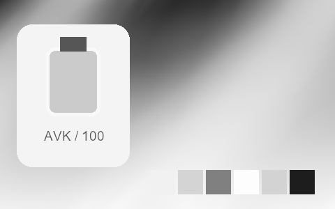

## 102 · Agfa Apx 25

`nt-bw-agfa-apx-25` · `film-bw` · CC-BY-SA-4.0 · 33³

50% gray Y′ 154.5/255 (+27.0 code values); 25–75% gray span ratio 1.202; mid-gray red minus blue +0.0 code values. Light/medium/deep skin swatches: #EDEDED, #C1C1C1, #676767. Red/green/blue swatches: #787878, #C3C3C3, #6F6F6F.

Suggested use: Compare on your own SDR product, portrait and landscape footage before selecting.

Trial strength: 1–1; default 1.0.

Pixel color mapping only; no grain, glow, vignette, spatial haze or beauty effects. Natural footage quality is unaccepted. Check skin/product colors and clipped output.

**Supplied N002 still: actual output at strength 1.0.**

[Full-size lossless 1672×940](../../assets/looks-n002-20261024-r1/full/102-nt-bw-agfa-apx-25.webp) · [Original source](../../assets/looks-n002-20261024-r1/source.png) · [All 500 supplied-image samples](../FILTER_GALLERY.en.md)

| Input swatch | Input RGB | Actual output RGB |
|---|---|---|
| `gray_0` | `#000000` | `#060606` |
| `gray_10` | `#1A1A1A` | `#131313` |
| `gray_25` | `#404040` | `#414141` |
| `gray_50` | `#808080` | `#9B9B9B` |
| `gray_75` | `#BFBFBF` | `#DADADA` |
| `gray_90` | `#E6E6E6` | `#F0F0F0` |
| `gray_100` | `#FFFFFF` | `#F8F8F8` |
| `skin_light` | `#F5DBC6` | `#EDEDED` |
| `skin_medium` | `#CF9B7B` | `#C1C1C1` |
| `skin_deep` | `#815438` | `#676767` |
| `red` | `#CC3333` | `#787878` |
| `green` | `#33CC33` | `#C3C3C3` |
| `blue` | `#3333CC` | `#6F6F6F` |

Creator: **Pat David** · [Source](https://github.com/NatronGitHub/clut/blob/af7b50d4caf6244fb6895a647f5b6a84efe7931a/bw/agfa_apx_25.png) · commit `af7b50d4caf6244fb6895a647f5b6a84efe7931a`.

Conversion: `native-depth-Hald-to-33-tetrahedral-v1`; 8,192 sampled RGB points; max error 0.0109343; mean 0.0006608. This is numerical approximation, not a perceptual quality score.

License obligations: Credit the named creator and source; retain the CC-BY-SA-4.0 notice and indicate changes. Redistributed adapted LUT data and thumbnails must use CC-BY-SA-4.0 or a compatible license; no additional restrictions.

[License](../../../product/src/ai_ad_editor/look_data/licenses/CC-BY-SA-4.0.txt) · LUT SHA-256 `d15131d760ac23db93e02256ef016eb705eda6230176740953959b144f4c8074`.

[Actual preview PNG](../../assets/look500-20261024-r1/previews/nt-bw-agfa-apx-25.png) · [Actual video](../../assets/look500-20261024-r1/videos/nt-bw-agfa-apx-25.mp4)

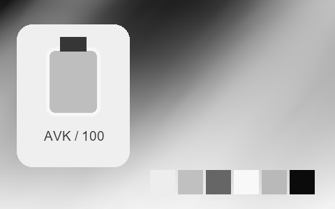

## 103 · Fuji Neopan 1600

`nt-bw-fuji-neopan-1600` · `film-bw` · CC-BY-SA-4.0 · 33³

50% gray Y′ 134.5/255 (+7.0 code values); 25–75% gray span ratio 1.263; mid-gray red minus blue +0.0 code values. Light/medium/deep skin swatches: #E5E5E5, #B4B4B4, #4F4F4F. Red/green/blue swatches: #656565, #AEAEAE, #6A6A6A.

Suggested use: Compare on your own SDR product, portrait and landscape footage before selecting.

Trial strength: 1–1; default 1.0.

Pixel color mapping only; no grain, glow, vignette, spatial haze or beauty effects. Natural footage quality is unaccepted. Check skin/product colors and clipped output.

**Supplied N002 still: actual output at strength 1.0.**

[Full-size lossless 1672×940](../../assets/looks-n002-20261024-r1/full/103-nt-bw-fuji-neopan-1600.webp) · [Original source](../../assets/looks-n002-20261024-r1/source.png) · [All 500 supplied-image samples](../FILTER_GALLERY.en.md)

| Input swatch | Input RGB | Actual output RGB |
|---|---|---|
| `gray_0` | `#000000` | `#060606` |
| `gray_10` | `#1A1A1A` | `#080808` |
| `gray_25` | `#404040` | `#2E2E2E` |
| `gray_50` | `#808080` | `#868686` |
| `gray_75` | `#BFBFBF` | `#CFCFCF` |
| `gray_90` | `#E6E6E6` | `#ECECEC` |
| `gray_100` | `#FFFFFF` | `#F9F9F9` |
| `skin_light` | `#F5DBC6` | `#E5E5E5` |
| `skin_medium` | `#CF9B7B` | `#B4B4B4` |
| `skin_deep` | `#815438` | `#4F4F4F` |
| `red` | `#CC3333` | `#656565` |
| `green` | `#33CC33` | `#AEAEAE` |
| `blue` | `#3333CC` | `#6A6A6A` |

Creator: **Pat David** · [Source](https://github.com/NatronGitHub/clut/blob/af7b50d4caf6244fb6895a647f5b6a84efe7931a/bw/fuji_neopan_1600.png) · commit `af7b50d4caf6244fb6895a647f5b6a84efe7931a`.

Conversion: `native-depth-Hald-to-33-tetrahedral-v1`; 8,192 sampled RGB points; max error 0.0099857; mean 0.0006522. This is numerical approximation, not a perceptual quality score.

License obligations: Credit the named creator and source; retain the CC-BY-SA-4.0 notice and indicate changes. Redistributed adapted LUT data and thumbnails must use CC-BY-SA-4.0 or a compatible license; no additional restrictions.

[License](../../../product/src/ai_ad_editor/look_data/licenses/CC-BY-SA-4.0.txt) · LUT SHA-256 `bb0d2a23c73a3fcee3a4996ea677f0c7b8e85198c2473a2cea8e075fa3bcbb98`.

[Actual preview PNG](../../assets/look500-20261024-r1/previews/nt-bw-fuji-neopan-1600.png) · [Actual video](../../assets/look500-20261024-r1/videos/nt-bw-fuji-neopan-1600.mp4)

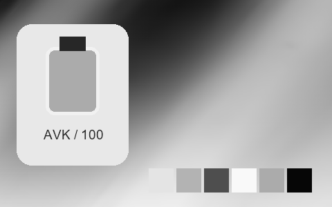

## 104 · Fuji Neopan Acros 100

`nt-bw-fuji-neopan-acros-100` · `film-bw` · CC-BY-SA-4.0 · 33³

50% gray Y′ 113.0/255 (-14.5 code values); 25–75% gray span ratio 1.035; mid-gray red minus blue +0.0 code values. Light/medium/deep skin swatches: #D2D2D2, #959595, #484848. Red/green/blue swatches: #494949, #AFAFAF, #313131.

Suggested use: Compare on your own SDR product, portrait and landscape footage before selecting.

Trial strength: 1–1; default 1.0.

Pixel color mapping only; no grain, glow, vignette, spatial haze or beauty effects. Natural footage quality is unaccepted. Check skin/product colors and clipped output.

**Supplied N002 still: actual output at strength 1.0.**

[Full-size lossless 1672×940](../../assets/looks-n002-20261024-r1/full/104-nt-bw-fuji-neopan-acros-100.webp) · [Original source](../../assets/looks-n002-20261024-r1/source.png) · [All 500 supplied-image samples](../FILTER_GALLERY.en.md)

| Input swatch | Input RGB | Actual output RGB |
|---|---|---|
| `gray_0` | `#000000` | `#070707` |
| `gray_10` | `#1A1A1A` | `#141414` |
| `gray_25` | `#404040` | `#303030` |
| `gray_50` | `#808080` | `#717171` |
| `gray_75` | `#BFBFBF` | `#B4B4B4` |
| `gray_90` | `#E6E6E6` | `#DCDCDC` |
| `gray_100` | `#FFFFFF` | `#EDEDED` |
| `skin_light` | `#F5DBC6` | `#D2D2D2` |
| `skin_medium` | `#CF9B7B` | `#959595` |
| `skin_deep` | `#815438` | `#484848` |
| `red` | `#CC3333` | `#494949` |
| `green` | `#33CC33` | `#AFAFAF` |
| `blue` | `#3333CC` | `#313131` |

Creator: **Pat David** · [Source](https://github.com/NatronGitHub/clut/blob/af7b50d4caf6244fb6895a647f5b6a84efe7931a/bw/fuji_neopan_acros_100.png) · commit `af7b50d4caf6244fb6895a647f5b6a84efe7931a`.

Conversion: `native-depth-Hald-to-33-tetrahedral-v1`; 8,192 sampled RGB points; max error 0.0224216; mean 0.0006335. This is numerical approximation, not a perceptual quality score.

License obligations: Credit the named creator and source; retain the CC-BY-SA-4.0 notice and indicate changes. Redistributed adapted LUT data and thumbnails must use CC-BY-SA-4.0 or a compatible license; no additional restrictions.

[License](../../../product/src/ai_ad_editor/look_data/licenses/CC-BY-SA-4.0.txt) · LUT SHA-256 `6fa1d1ab9628b3cd74ed4aaafab282029f01449eb462040fa08da2b8bf8c8dc1`.

[Actual preview PNG](../../assets/look500-20261024-r1/previews/nt-bw-fuji-neopan-acros-100.png) · [Actual video](../../assets/look500-20261024-r1/videos/nt-bw-fuji-neopan-acros-100.mp4)

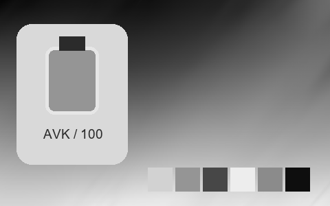

## 105 · Ilford Delta 100

`nt-bw-ilford-delta-100` · `film-bw` · CC-BY-SA-4.0 · 33³

50% gray Y′ 144.5/255 (+17.0 code values); 25–75% gray span ratio 1.106; mid-gray red minus blue +0.0 code values. Light/medium/deep skin swatches: #E1E1E1, #AAAAAA, #595959. Red/green/blue swatches: #525252, #B5B5B5, #838383.

Suggested use: Compare on your own SDR product, portrait and landscape footage before selecting.

Trial strength: 1–1; default 1.0.

Pixel color mapping only; no grain, glow, vignette, spatial haze or beauty effects. Natural footage quality is unaccepted. Check skin/product colors and clipped output.

**Supplied N002 still: actual output at strength 1.0.**

[Full-size lossless 1672×940](../../assets/looks-n002-20261024-r1/full/105-nt-bw-ilford-delta-100.webp) · [Original source](../../assets/looks-n002-20261024-r1/source.png) · [All 500 supplied-image samples](../FILTER_GALLERY.en.md)

| Input swatch | Input RGB | Actual output RGB |
|---|---|---|
| `gray_0` | `#000000` | `#050505` |
| `gray_10` | `#1A1A1A` | `#161616` |
| `gray_25` | `#404040` | `#414141` |
| `gray_50` | `#808080` | `#909090` |
| `gray_75` | `#BFBFBF` | `#CECECE` |
| `gray_90` | `#E6E6E6` | `#EBEBEB` |
| `gray_100` | `#FFFFFF` | `#F6F6F6` |
| `skin_light` | `#F5DBC6` | `#E1E1E1` |
| `skin_medium` | `#CF9B7B` | `#AAAAAA` |
| `skin_deep` | `#815438` | `#595959` |
| `red` | `#CC3333` | `#525252` |
| `green` | `#33CC33` | `#B5B5B5` |
| `blue` | `#3333CC` | `#838383` |

Creator: **Pat David** · [Source](https://github.com/NatronGitHub/clut/blob/af7b50d4caf6244fb6895a647f5b6a84efe7931a/bw/ilford_delta_100.png) · commit `af7b50d4caf6244fb6895a647f5b6a84efe7931a`.

Conversion: `native-depth-Hald-to-33-tetrahedral-v1`; 8,192 sampled RGB points; max error 0.0081090; mean 0.0006406. This is numerical approximation, not a perceptual quality score.

License obligations: Credit the named creator and source; retain the CC-BY-SA-4.0 notice and indicate changes. Redistributed adapted LUT data and thumbnails must use CC-BY-SA-4.0 or a compatible license; no additional restrictions.

[License](../../../product/src/ai_ad_editor/look_data/licenses/CC-BY-SA-4.0.txt) · LUT SHA-256 `94352500b279c79e721af54396b5b28180ce1b53a4cc08663b123e7ffd0ac1fe`.

[Actual preview PNG](../../assets/look500-20261024-r1/previews/nt-bw-ilford-delta-100.png) · [Actual video](../../assets/look500-20261024-r1/videos/nt-bw-ilford-delta-100.mp4)

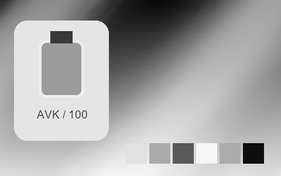

## 106 · Ilford Delta 3200

`nt-bw-ilford-delta-3200` · `film-bw` · CC-BY-SA-4.0 · 33³

50% gray Y′ 125.0/255 (-2.5 code values); 25–75% gray span ratio 1.059; mid-gray red minus blue +0.0 code values. Light/medium/deep skin swatches: #DFDFDF, #AAAAAA, #595959. Red/green/blue swatches: #797979, #8E8E8E, #636363.

Suggested use: Compare on your own SDR product, portrait and landscape footage before selecting.

Trial strength: 1–1; default 1.0.

Pixel color mapping only; no grain, glow, vignette, spatial haze or beauty effects. Natural footage quality is unaccepted. Check skin/product colors and clipped output.

**Supplied N002 still: actual output at strength 1.0.**

[Full-size lossless 1672×940](../../assets/looks-n002-20261024-r1/full/106-nt-bw-ilford-delta-3200.webp) · [Original source](../../assets/looks-n002-20261024-r1/source.png) · [All 500 supplied-image samples](../FILTER_GALLERY.en.md)

| Input swatch | Input RGB | Actual output RGB |
|---|---|---|
| `gray_0` | `#000000` | `#080808` |
| `gray_10` | `#1A1A1A` | `#1A1A1A` |
| `gray_25` | `#404040` | `#3C3C3C` |
| `gray_50` | `#808080` | `#7D7D7D` |
| `gray_75` | `#BFBFBF` | `#C3C3C3` |
| `gray_90` | `#E6E6E6` | `#E4E4E4` |
| `gray_100` | `#FFFFFF` | `#ECECEC` |
| `skin_light` | `#F5DBC6` | `#DFDFDF` |
| `skin_medium` | `#CF9B7B` | `#AAAAAA` |
| `skin_deep` | `#815438` | `#595959` |
| `red` | `#CC3333` | `#797979` |
| `green` | `#33CC33` | `#8E8E8E` |
| `blue` | `#3333CC` | `#636363` |

Creator: **Pat David** · [Source](https://github.com/NatronGitHub/clut/blob/af7b50d4caf6244fb6895a647f5b6a84efe7931a/bw/ilford_delta_3200.png) · commit `af7b50d4caf6244fb6895a647f5b6a84efe7931a`.

Conversion: `native-depth-Hald-to-33-tetrahedral-v1`; 8,192 sampled RGB points; max error 0.0056955; mean 0.0006249. This is numerical approximation, not a perceptual quality score.

License obligations: Credit the named creator and source; retain the CC-BY-SA-4.0 notice and indicate changes. Redistributed adapted LUT data and thumbnails must use CC-BY-SA-4.0 or a compatible license; no additional restrictions.

[License](../../../product/src/ai_ad_editor/look_data/licenses/CC-BY-SA-4.0.txt) · LUT SHA-256 `554a426c3908c79259778b03b3690495f6f59b7486ad8fded4e84cc4593d6615`.

[Actual preview PNG](../../assets/look500-20261024-r1/previews/nt-bw-ilford-delta-3200.png) · [Actual video](../../assets/look500-20261024-r1/videos/nt-bw-ilford-delta-3200.mp4)

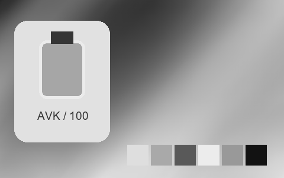

## 107 · Ilford Delta 400

`nt-bw-ilford-delta-400` · `film-bw` · CC-BY-SA-4.0 · 33³

50% gray Y′ 120.5/255 (-7.0 code values); 25–75% gray span ratio 1.098; mid-gray red minus blue +0.0 code values. Light/medium/deep skin swatches: #DDDDDD, #9C9C9C, #4B4B4B. Red/green/blue swatches: #5C5C5C, #8B8B8B, #707070.

Suggested use: Compare on your own SDR product, portrait and landscape footage before selecting.

Trial strength: 1–1; default 1.0.

Pixel color mapping only; no grain, glow, vignette, spatial haze or beauty effects. Natural footage quality is unaccepted. Check skin/product colors and clipped output.

**Supplied N002 still: actual output at strength 1.0.**

[Full-size lossless 1672×940](../../assets/looks-n002-20261024-r1/full/107-nt-bw-ilford-delta-400.webp) · [Original source](../../assets/looks-n002-20261024-r1/source.png) · [All 500 supplied-image samples](../FILTER_GALLERY.en.md)

| Input swatch | Input RGB | Actual output RGB |
|---|---|---|
| `gray_0` | `#000000` | `#0A0A0A` |
| `gray_10` | `#1A1A1A` | `#151515` |
| `gray_25` | `#404040` | `#363636` |
| `gray_50` | `#808080` | `#787878` |
| `gray_75` | `#BFBFBF` | `#C2C2C2` |
| `gray_90` | `#E6E6E6` | `#E5E5E5` |
| `gray_100` | `#FFFFFF` | `#EBEBEB` |
| `skin_light` | `#F5DBC6` | `#DDDDDD` |
| `skin_medium` | `#CF9B7B` | `#9C9C9C` |
| `skin_deep` | `#815438` | `#4B4B4B` |
| `red` | `#CC3333` | `#5C5C5C` |
| `green` | `#33CC33` | `#8B8B8B` |
| `blue` | `#3333CC` | `#707070` |

Creator: **Pat David** · [Source](https://github.com/NatronGitHub/clut/blob/af7b50d4caf6244fb6895a647f5b6a84efe7931a/bw/ilford_delta_400.png) · commit `af7b50d4caf6244fb6895a647f5b6a84efe7931a`.

Conversion: `native-depth-Hald-to-33-tetrahedral-v1`; 8,192 sampled RGB points; max error 0.0077009; mean 0.0006355. This is numerical approximation, not a perceptual quality score.

License obligations: Credit the named creator and source; retain the CC-BY-SA-4.0 notice and indicate changes. Redistributed adapted LUT data and thumbnails must use CC-BY-SA-4.0 or a compatible license; no additional restrictions.

[License](../../../product/src/ai_ad_editor/look_data/licenses/CC-BY-SA-4.0.txt) · LUT SHA-256 `459d35dcead703612bbee162ecb175a528bdcac8a624a6f5af8f3556701fbce7`.

[Actual preview PNG](../../assets/look500-20261024-r1/previews/nt-bw-ilford-delta-400.png) · [Actual video](../../assets/look500-20261024-r1/videos/nt-bw-ilford-delta-400.mp4)

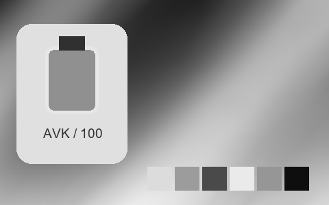

## 108 · Ilford Fp4 Plus 125

`nt-bw-ilford-fp4-plus-125` · `film-bw` · CC-BY-SA-4.0 · 33³

50% gray Y′ 144.5/255 (+17.0 code values); 25–75% gray span ratio 1.041; mid-gray red minus blue +0.0 code values. Light/medium/deep skin swatches: #DDDDDD, #AEAEAE, #5D5D5D. Red/green/blue swatches: #636363, #B0B0B0, #868686.

Suggested use: Compare on your own SDR product, portrait and landscape footage before selecting.

Trial strength: 1–1; default 1.0.

Pixel color mapping only; no grain, glow, vignette, spatial haze or beauty effects. Natural footage quality is unaccepted. Check skin/product colors and clipped output.

**Supplied N002 still: actual output at strength 1.0.**

[Full-size lossless 1672×940](../../assets/looks-n002-20261024-r1/full/108-nt-bw-ilford-fp4-plus-125.webp) · [Original source](../../assets/looks-n002-20261024-r1/source.png) · [All 500 supplied-image samples](../FILTER_GALLERY.en.md)

| Input swatch | Input RGB | Actual output RGB |
|---|---|---|
| `gray_0` | `#000000` | `#090909` |
| `gray_10` | `#1A1A1A` | `#242424` |
| `gray_25` | `#404040` | `#494949` |
| `gray_50` | `#808080` | `#909090` |
| `gray_75` | `#BFBFBF` | `#CECECE` |
| `gray_90` | `#E6E6E6` | `#E6E6E6` |
| `gray_100` | `#FFFFFF` | `#F4F4F4` |
| `skin_light` | `#F5DBC6` | `#DDDDDD` |
| `skin_medium` | `#CF9B7B` | `#AEAEAE` |
| `skin_deep` | `#815438` | `#5D5D5D` |
| `red` | `#CC3333` | `#636363` |
| `green` | `#33CC33` | `#B0B0B0` |
| `blue` | `#3333CC` | `#868686` |

Creator: **Pat David** · [Source](https://github.com/NatronGitHub/clut/blob/af7b50d4caf6244fb6895a647f5b6a84efe7931a/bw/ilford_fp4_plus_125.png) · commit `af7b50d4caf6244fb6895a647f5b6a84efe7931a`.

Conversion: `native-depth-Hald-to-33-tetrahedral-v1`; 8,192 sampled RGB points; max error 0.0038723; mean 0.0006174. This is numerical approximation, not a perceptual quality score.

License obligations: Credit the named creator and source; retain the CC-BY-SA-4.0 notice and indicate changes. Redistributed adapted LUT data and thumbnails must use CC-BY-SA-4.0 or a compatible license; no additional restrictions.

[License](../../../product/src/ai_ad_editor/look_data/licenses/CC-BY-SA-4.0.txt) · LUT SHA-256 `97f32e2b4389a8bfa84f06d0e41563f5eca8b1df1fccbacac9f40d20d0f168ae`.

[Actual preview PNG](../../assets/look500-20261024-r1/previews/nt-bw-ilford-fp4-plus-125.png) · [Actual video](../../assets/look500-20261024-r1/videos/nt-bw-ilford-fp4-plus-125.mp4)

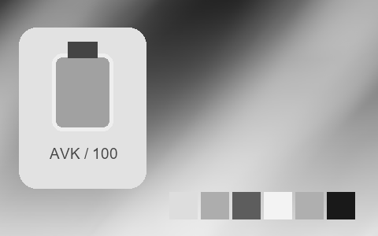

## 109 · Ilford Hp5 Plus 400

`nt-bw-ilford-hp5-plus-400` · `film-bw` · CC-BY-SA-4.0 · 33³

50% gray Y′ 131.0/255 (+3.5 code values); 25–75% gray span ratio 1.284; mid-gray red minus blue +0.0 code values. Light/medium/deep skin swatches: #EAEAEA, #AEAEAE, #4C4C4C. Red/green/blue swatches: #616161, #989898, #7D7D7D.

Suggested use: Compare on your own SDR product, portrait and landscape footage before selecting.

Trial strength: 1–1; default 1.0.

Pixel color mapping only; no grain, glow, vignette, spatial haze or beauty effects. Natural footage quality is unaccepted. Check skin/product colors and clipped output.

**Supplied N002 still: actual output at strength 1.0.**

[Full-size lossless 1672×940](../../assets/looks-n002-20261024-r1/full/109-nt-bw-ilford-hp5-plus-400.webp) · [Original source](../../assets/looks-n002-20261024-r1/source.png) · [All 500 supplied-image samples](../FILTER_GALLERY.en.md)

| Input swatch | Input RGB | Actual output RGB |
|---|---|---|
| `gray_0` | `#000000` | `#030303` |
| `gray_10` | `#1A1A1A` | `#0E0E0E` |
| `gray_25` | `#404040` | `#303030` |
| `gray_50` | `#808080` | `#838383` |
| `gray_75` | `#BFBFBF` | `#D4D4D4` |
| `gray_90` | `#E6E6E6` | `#EFEFEF` |
| `gray_100` | `#FFFFFF` | `#F6F6F6` |
| `skin_light` | `#F5DBC6` | `#EAEAEA` |
| `skin_medium` | `#CF9B7B` | `#AEAEAE` |
| `skin_deep` | `#815438` | `#4C4C4C` |
| `red` | `#CC3333` | `#616161` |
| `green` | `#33CC33` | `#989898` |
| `blue` | `#3333CC` | `#7D7D7D` |

Creator: **Pat David** · [Source](https://github.com/NatronGitHub/clut/blob/af7b50d4caf6244fb6895a647f5b6a84efe7931a/bw/ilford_hp5_plus_400.png) · commit `af7b50d4caf6244fb6895a647f5b6a84efe7931a`.

Conversion: `native-depth-Hald-to-33-tetrahedral-v1`; 8,192 sampled RGB points; max error 0.0045920; mean 0.0006457. This is numerical approximation, not a perceptual quality score.

License obligations: Credit the named creator and source; retain the CC-BY-SA-4.0 notice and indicate changes. Redistributed adapted LUT data and thumbnails must use CC-BY-SA-4.0 or a compatible license; no additional restrictions.

[License](../../../product/src/ai_ad_editor/look_data/licenses/CC-BY-SA-4.0.txt) · LUT SHA-256 `1123f79ece20d1319dc975203566419ae78acd7e0b682e586f6e949278ed4525`.

[Actual preview PNG](../../assets/look500-20261024-r1/previews/nt-bw-ilford-hp5-plus-400.png) · [Actual video](../../assets/look500-20261024-r1/videos/nt-bw-ilford-hp5-plus-400.mp4)

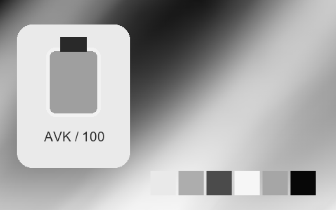

## 110 · Ilford Hps 800

`nt-bw-ilford-hps-800` · `film-bw` · CC-BY-SA-4.0 · 33³

50% gray Y′ 130.5/255 (+3.0 code values); 25–75% gray span ratio 1.294; mid-gray red minus blue +0.0 code values. Light/medium/deep skin swatches: #EBEBEB, #AEAEAE, #4A4A4A. Red/green/blue swatches: #616161, #979797, #7B7B7B.

Suggested use: Compare on your own SDR product, portrait and landscape footage before selecting.

Trial strength: 1–1; default 1.0.

Pixel color mapping only; no grain, glow, vignette, spatial haze or beauty effects. Natural footage quality is unaccepted. Check skin/product colors and clipped output.

**Supplied N002 still: actual output at strength 1.0.**

[Full-size lossless 1672×940](../../assets/looks-n002-20261024-r1/full/110-nt-bw-ilford-hps-800.webp) · [Original source](../../assets/looks-n002-20261024-r1/source.png) · [All 500 supplied-image samples](../FILTER_GALLERY.en.md)

| Input swatch | Input RGB | Actual output RGB |
|---|---|---|
| `gray_0` | `#000000` | `#030303` |
| `gray_10` | `#1A1A1A` | `#0D0D0D` |
| `gray_25` | `#404040` | `#303030` |
| `gray_50` | `#808080` | `#828282` |
| `gray_75` | `#BFBFBF` | `#D5D5D5` |
| `gray_90` | `#E6E6E6` | `#F2F2F2` |
| `gray_100` | `#FFFFFF` | `#F6F6F6` |
| `skin_light` | `#F5DBC6` | `#EBEBEB` |
| `skin_medium` | `#CF9B7B` | `#AEAEAE` |
| `skin_deep` | `#815438` | `#4A4A4A` |
| `red` | `#CC3333` | `#616161` |
| `green` | `#33CC33` | `#979797` |
| `blue` | `#3333CC` | `#7B7B7B` |

Creator: **Pat David** · [Source](https://github.com/NatronGitHub/clut/blob/af7b50d4caf6244fb6895a647f5b6a84efe7931a/bw/ilford_hps_800.png) · commit `af7b50d4caf6244fb6895a647f5b6a84efe7931a`.

Conversion: `native-depth-Hald-to-33-tetrahedral-v1`; 8,192 sampled RGB points; max error 0.0079010; mean 0.0006666. This is numerical approximation, not a perceptual quality score.

License obligations: Credit the named creator and source; retain the CC-BY-SA-4.0 notice and indicate changes. Redistributed adapted LUT data and thumbnails must use CC-BY-SA-4.0 or a compatible license; no additional restrictions.

[License](../../../product/src/ai_ad_editor/look_data/licenses/CC-BY-SA-4.0.txt) · LUT SHA-256 `64519e91c7630e588ed71c84ec00a6f2648a7ba6204cd6ce3d5867e5e9780e6f`.

[Actual preview PNG](../../assets/look500-20261024-r1/previews/nt-bw-ilford-hps-800.png) · [Actual video](../../assets/look500-20261024-r1/videos/nt-bw-ilford-hps-800.mp4)

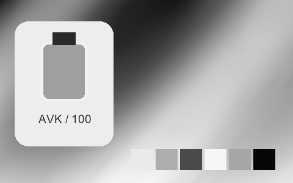

## 111 · Ilford Pan F Plus 50

`nt-bw-ilford-pan-f-plus-50` · `film-bw` · CC-BY-SA-4.0 · 33³

50% gray Y′ 143.5/255 (+16.0 code values); 25–75% gray span ratio 1.127; mid-gray red minus blue +0.0 code values. Light/medium/deep skin swatches: #E2E2E2, #B2B2B2, #595959. Red/green/blue swatches: #575757, #BEBEBE, #707070.

Suggested use: Compare on your own SDR product, portrait and landscape footage before selecting.

Trial strength: 1–1; default 1.0.

Pixel color mapping only; no grain, glow, vignette, spatial haze or beauty effects. Natural footage quality is unaccepted. Check skin/product colors and clipped output.

**Supplied N002 still: actual output at strength 1.0.**

[Full-size lossless 1672×940](../../assets/looks-n002-20261024-r1/full/111-nt-bw-ilford-pan-f-plus-50.webp) · [Original source](../../assets/looks-n002-20261024-r1/source.png) · [All 500 supplied-image samples](../FILTER_GALLERY.en.md)

| Input swatch | Input RGB | Actual output RGB |
|---|---|---|
| `gray_0` | `#000000` | `#050505` |
| `gray_10` | `#1A1A1A` | `#161616` |
| `gray_25` | `#404040` | `#404040` |
| `gray_50` | `#808080` | `#909090` |
| `gray_75` | `#BFBFBF` | `#D0D0D0` |
| `gray_90` | `#E6E6E6` | `#EAEAEA` |
| `gray_100` | `#FFFFFF` | `#F4F4F4` |
| `skin_light` | `#F5DBC6` | `#E2E2E2` |
| `skin_medium` | `#CF9B7B` | `#B2B2B2` |
| `skin_deep` | `#815438` | `#595959` |
| `red` | `#CC3333` | `#575757` |
| `green` | `#33CC33` | `#BEBEBE` |
| `blue` | `#3333CC` | `#707070` |

Creator: **Pat David** · [Source](https://github.com/NatronGitHub/clut/blob/af7b50d4caf6244fb6895a647f5b6a84efe7931a/bw/ilford_pan_f_plus_50.png) · commit `af7b50d4caf6244fb6895a647f5b6a84efe7931a`.

Conversion: `native-depth-Hald-to-33-tetrahedral-v1`; 8,192 sampled RGB points; max error 0.0050047; mean 0.0006282. This is numerical approximation, not a perceptual quality score.

License obligations: Credit the named creator and source; retain the CC-BY-SA-4.0 notice and indicate changes. Redistributed adapted LUT data and thumbnails must use CC-BY-SA-4.0 or a compatible license; no additional restrictions.

[License](../../../product/src/ai_ad_editor/look_data/licenses/CC-BY-SA-4.0.txt) · LUT SHA-256 `03d78c6370acb83763e7c608a142a8f923e84992fd4e6708758ab3d58219ab6e`.

[Actual preview PNG](../../assets/look500-20261024-r1/previews/nt-bw-ilford-pan-f-plus-50.png) · [Actual video](../../assets/look500-20261024-r1/videos/nt-bw-ilford-pan-f-plus-50.mp4)

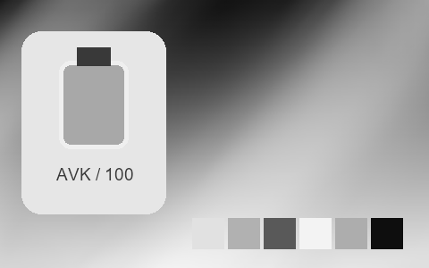

## 112 · Ilford Xp2

`nt-bw-ilford-xp2` · `film-bw` · CC-BY-SA-4.0 · 33³

50% gray Y′ 116.5/255 (-11.0 code values); 25–75% gray span ratio 1.080; mid-gray red minus blue +0.0 code values. Light/medium/deep skin swatches: #D5D5D5, #919191, #424242. Red/green/blue swatches: #464646, #888888, #787878.

Suggested use: Compare on your own SDR product, portrait and landscape footage before selecting.

Trial strength: 1–1; default 1.0.

Pixel color mapping only; no grain, glow, vignette, spatial haze or beauty effects. Natural footage quality is unaccepted. Check skin/product colors and clipped output.

**Supplied N002 still: actual output at strength 1.0.**

[Full-size lossless 1672×940](../../assets/looks-n002-20261024-r1/full/112-nt-bw-ilford-xp2.webp) · [Original source](../../assets/looks-n002-20261024-r1/source.png) · [All 500 supplied-image samples](../FILTER_GALLERY.en.md)

| Input swatch | Input RGB | Actual output RGB |
|---|---|---|
| `gray_0` | `#000000` | `#070707` |
| `gray_10` | `#1A1A1A` | `#0F0F0F` |
| `gray_25` | `#404040` | `#323232` |
| `gray_50` | `#808080` | `#757575` |
| `gray_75` | `#BFBFBF` | `#BCBCBC` |
| `gray_90` | `#E6E6E6` | `#E2E2E2` |
| `gray_100` | `#FFFFFF` | `#FCFCFC` |
| `skin_light` | `#F5DBC6` | `#D5D5D5` |
| `skin_medium` | `#CF9B7B` | `#919191` |
| `skin_deep` | `#815438` | `#424242` |
| `red` | `#CC3333` | `#464646` |
| `green` | `#33CC33` | `#888888` |
| `blue` | `#3333CC` | `#787878` |

Creator: **Pat David** · [Source](https://github.com/NatronGitHub/clut/blob/af7b50d4caf6244fb6895a647f5b6a84efe7931a/bw/ilford_xp2.png) · commit `af7b50d4caf6244fb6895a647f5b6a84efe7931a`.

Conversion: `native-depth-Hald-to-33-tetrahedral-v1`; 8,192 sampled RGB points; max error 0.0036036; mean 0.0006292. This is numerical approximation, not a perceptual quality score.

License obligations: Credit the named creator and source; retain the CC-BY-SA-4.0 notice and indicate changes. Redistributed adapted LUT data and thumbnails must use CC-BY-SA-4.0 or a compatible license; no additional restrictions.

[License](../../../product/src/ai_ad_editor/look_data/licenses/CC-BY-SA-4.0.txt) · LUT SHA-256 `88e90d9080a1150bd0a8d4bcfb70478c477df532ea2bbe7625a23fb53d89de52`.

[Actual preview PNG](../../assets/look500-20261024-r1/previews/nt-bw-ilford-xp2.png) · [Actual video](../../assets/look500-20261024-r1/videos/nt-bw-ilford-xp2.mp4)

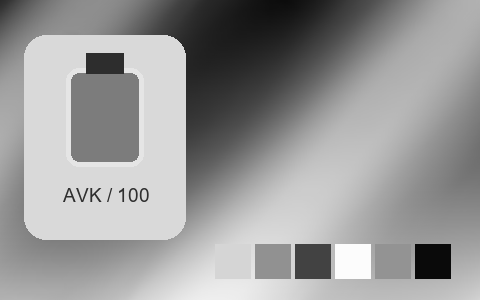

## 113 · Kodak Bw 400 Cn

`nt-bw-kodak-bw-400-cn` · `film-bw` · CC-BY-SA-4.0 · 33³

50% gray Y′ 123.5/255 (-4.0 code values); 25–75% gray span ratio 1.067; mid-gray red minus blue +0.0 code values. Light/medium/deep skin swatches: #D8D8D8, #A0A0A0, #515151. Red/green/blue swatches: #575757, #ACACAC, #5B5B5B.

Suggested use: Compare on your own SDR product, portrait and landscape footage before selecting.

Trial strength: 1–1; default 1.0.

Pixel color mapping only; no grain, glow, vignette, spatial haze or beauty effects. Natural footage quality is unaccepted. Check skin/product colors and clipped output.

**Supplied N002 still: actual output at strength 1.0.**

[Full-size lossless 1672×940](../../assets/looks-n002-20261024-r1/full/113-nt-bw-kodak-bw-400-cn.webp) · [Original source](../../assets/looks-n002-20261024-r1/source.png) · [All 500 supplied-image samples](../FILTER_GALLERY.en.md)

| Input swatch | Input RGB | Actual output RGB |
|---|---|---|
| `gray_0` | `#000000` | `#050505` |
| `gray_10` | `#1A1A1A` | `#191919` |
| `gray_25` | `#404040` | `#3A3A3A` |
| `gray_50` | `#808080` | `#7B7B7B` |
| `gray_75` | `#BFBFBF` | `#C2C2C2` |
| `gray_90` | `#E6E6E6` | `#E4E4E4` |
| `gray_100` | `#FFFFFF` | `#F6F6F6` |
| `skin_light` | `#F5DBC6` | `#D8D8D8` |
| `skin_medium` | `#CF9B7B` | `#A0A0A0` |
| `skin_deep` | `#815438` | `#515151` |
| `red` | `#CC3333` | `#575757` |
| `green` | `#33CC33` | `#ACACAC` |
| `blue` | `#3333CC` | `#5B5B5B` |

Creator: **Pat David** · [Source](https://github.com/NatronGitHub/clut/blob/af7b50d4caf6244fb6895a647f5b6a84efe7931a/bw/kodak_bw_400_cn.png) · commit `af7b50d4caf6244fb6895a647f5b6a84efe7931a`.

Conversion: `native-depth-Hald-to-33-tetrahedral-v1`; 8,192 sampled RGB points; max error 0.0056460; mean 0.0006287. This is numerical approximation, not a perceptual quality score.

License obligations: Credit the named creator and source; retain the CC-BY-SA-4.0 notice and indicate changes. Redistributed adapted LUT data and thumbnails must use CC-BY-SA-4.0 or a compatible license; no additional restrictions.

[License](../../../product/src/ai_ad_editor/look_data/licenses/CC-BY-SA-4.0.txt) · LUT SHA-256 `f49820ef8cdc8f91e2ee09c4e2fab0abcb6d10c2e785e5bf4da02130d1854286`.

[Actual preview PNG](../../assets/look500-20261024-r1/previews/nt-bw-kodak-bw-400-cn.png) · [Actual video](../../assets/look500-20261024-r1/videos/nt-bw-kodak-bw-400-cn.mp4)

## 114 · Kodak Hie (Hs Infra)

`nt-bw-kodak-hie-hs-infra` · `film-bw` · CC-BY-SA-4.0 · 33³

50% gray Y′ 169.0/255 (+41.5 code values); 25–75% gray span ratio 1.233; mid-gray red minus blue +0.0 code values. Light/medium/deep skin swatches: #FDFDFD, #E8E8E8, #919191. Red/green/blue swatches: #D9D9D9, #FAFAFA, #6F6F6F.

Suggested use: Compare on your own SDR product, portrait and landscape footage before selecting.

Trial strength: 1–1; default 1.0.

Pixel color mapping only; no grain, glow, vignette, spatial haze or beauty effects. Natural footage quality is unaccepted. Check skin/product colors and clipped output.

**Supplied N002 still: actual output at strength 1.0.**

[Full-size lossless 1672×940](../../assets/looks-n002-20261024-r1/full/114-nt-bw-kodak-hie-hs-infra.webp) · [Original source](../../assets/looks-n002-20261024-r1/source.png) · [All 500 supplied-image samples](../FILTER_GALLERY.en.md)

| Input swatch | Input RGB | Actual output RGB |
|---|---|---|
| `gray_0` | `#000000` | `#030303` |
| `gray_10` | `#1A1A1A` | `#222222` |
| `gray_25` | `#404040` | `#4E4E4E` |
| `gray_50` | `#808080` | `#A9A9A9` |
| `gray_75` | `#BFBFBF` | `#ECECEC` |
| `gray_90` | `#E6E6E6` | `#FEFEFE` |
| `gray_100` | `#FFFFFF` | `#FFFFFF` |
| `skin_light` | `#F5DBC6` | `#FDFDFD` |
| `skin_medium` | `#CF9B7B` | `#E8E8E8` |
| `skin_deep` | `#815438` | `#919191` |
| `red` | `#CC3333` | `#D9D9D9` |
| `green` | `#33CC33` | `#FAFAFA` |
| `blue` | `#3333CC` | `#6F6F6F` |

Creator: **Pat David** · [Source](https://github.com/NatronGitHub/clut/blob/af7b50d4caf6244fb6895a647f5b6a84efe7931a/bw/kodak_hie_(hs_infra).png) · commit `af7b50d4caf6244fb6895a647f5b6a84efe7931a`.

Conversion: `native-depth-Hald-to-33-tetrahedral-v1`; 8,192 sampled RGB points; max error 0.0130707; mean 0.0007745. This is numerical approximation, not a perceptual quality score.

License obligations: Credit the named creator and source; retain the CC-BY-SA-4.0 notice and indicate changes. Redistributed adapted LUT data and thumbnails must use CC-BY-SA-4.0 or a compatible license; no additional restrictions.

[License](../../../product/src/ai_ad_editor/look_data/licenses/CC-BY-SA-4.0.txt) · LUT SHA-256 `77165eec72df4d8ae2d4e94a3db1de02c9feb862cc4f2c4484d98c7b9b23b3d4`.

[Actual preview PNG](../../assets/look500-20261024-r1/previews/nt-bw-kodak-hie-hs-infra.png) · [Actual video](../../assets/look500-20261024-r1/videos/nt-bw-kodak-hie-hs-infra.mp4)

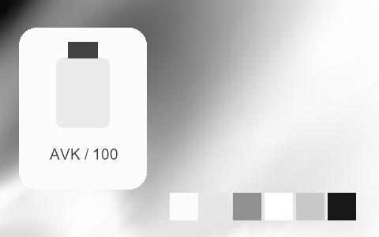

## 115 · Kodak T-Max 100

`nt-bw-kodak-t-max-100` · `film-bw` · CC-BY-SA-4.0 · 33³

50% gray Y′ 120.0/255 (-7.5 code values); 25–75% gray span ratio 1.084; mid-gray red minus blue +0.0 code values. Light/medium/deep skin swatches: #D7D7D7, #9C9C9C, #484848. Red/green/blue swatches: #4D4D4D, #A6A6A6, #5C5C5C.

Suggested use: Compare on your own SDR product, portrait and landscape footage before selecting.

Trial strength: 1–1; default 1.0.

Pixel color mapping only; no grain, glow, vignette, spatial haze or beauty effects. Natural footage quality is unaccepted. Check skin/product colors and clipped output.

**Supplied N002 still: actual output at strength 1.0.**

[Full-size lossless 1672×940](../../assets/looks-n002-20261024-r1/full/115-nt-bw-kodak-t-max-100.webp) · [Original source](../../assets/looks-n002-20261024-r1/source.png) · [All 500 supplied-image samples](../FILTER_GALLERY.en.md)

| Input swatch | Input RGB | Actual output RGB |
|---|---|---|
| `gray_0` | `#000000` | `#010101` |
| `gray_10` | `#1A1A1A` | `#141414` |
| `gray_25` | `#404040` | `#343434` |
| `gray_50` | `#808080` | `#787878` |
| `gray_75` | `#BFBFBF` | `#BEBEBE` |
| `gray_90` | `#E6E6E6` | `#E5E5E5` |
| `gray_100` | `#FFFFFF` | `#F8F8F8` |
| `skin_light` | `#F5DBC6` | `#D7D7D7` |
| `skin_medium` | `#CF9B7B` | `#9C9C9C` |
| `skin_deep` | `#815438` | `#484848` |
| `red` | `#CC3333` | `#4D4D4D` |
| `green` | `#33CC33` | `#A6A6A6` |
| `blue` | `#3333CC` | `#5C5C5C` |

Creator: **Pat David** · [Source](https://github.com/NatronGitHub/clut/blob/af7b50d4caf6244fb6895a647f5b6a84efe7931a/bw/kodak_t-max_100.png) · commit `af7b50d4caf6244fb6895a647f5b6a84efe7931a`.

Conversion: `native-depth-Hald-to-33-tetrahedral-v1`; 8,192 sampled RGB points; max error 0.0145289; mean 0.0006325. This is numerical approximation, not a perceptual quality score.

License obligations: Credit the named creator and source; retain the CC-BY-SA-4.0 notice and indicate changes. Redistributed adapted LUT data and thumbnails must use CC-BY-SA-4.0 or a compatible license; no additional restrictions.

[License](../../../product/src/ai_ad_editor/look_data/licenses/CC-BY-SA-4.0.txt) · LUT SHA-256 `c307f96e88af8a27603348bf3aef8f9cfcd6320240cea18773026ade2f00097e`.

[Actual preview PNG](../../assets/look500-20261024-r1/previews/nt-bw-kodak-t-max-100.png) · [Actual video](../../assets/look500-20261024-r1/videos/nt-bw-kodak-t-max-100.mp4)

## 116 · Kodak T-Max 3200

`nt-bw-kodak-t-max-3200` · `film-bw` · CC-BY-SA-4.0 · 33³

50% gray Y′ 144.0/255 (+16.5 code values); 25–75% gray span ratio 1.239; mid-gray red minus blue +0.0 code values. Light/medium/deep skin swatches: #E6E6E6, #B0B0B0, #4F4F4F. Red/green/blue swatches: #4B4B4B, #C2C2C2, #636363.

Suggested use: Compare on your own SDR product, portrait and landscape footage before selecting.

Trial strength: 1–1; default 1.0.

Pixel color mapping only; no grain, glow, vignette, spatial haze or beauty effects. Natural footage quality is unaccepted. Check skin/product colors and clipped output.

**Supplied N002 still: actual output at strength 1.0.**

[Full-size lossless 1672×940](../../assets/looks-n002-20261024-r1/full/116-nt-bw-kodak-t-max-3200.webp) · [Original source](../../assets/looks-n002-20261024-r1/source.png) · [All 500 supplied-image samples](../FILTER_GALLERY.en.md)

| Input swatch | Input RGB | Actual output RGB |
|---|---|---|
| `gray_0` | `#000000` | `#030303` |
| `gray_10` | `#1A1A1A` | `#111111` |
| `gray_25` | `#404040` | `#333333` |
| `gray_50` | `#808080` | `#909090` |
| `gray_75` | `#BFBFBF` | `#D1D1D1` |
| `gray_90` | `#E6E6E6` | `#ECECEC` |
| `gray_100` | `#FFFFFF` | `#EEEEEE` |
| `skin_light` | `#F5DBC6` | `#E6E6E6` |
| `skin_medium` | `#CF9B7B` | `#B0B0B0` |
| `skin_deep` | `#815438` | `#4F4F4F` |
| `red` | `#CC3333` | `#4B4B4B` |
| `green` | `#33CC33` | `#C2C2C2` |
| `blue` | `#3333CC` | `#636363` |

Creator: **Pat David** · [Source](https://github.com/NatronGitHub/clut/blob/af7b50d4caf6244fb6895a647f5b6a84efe7931a/bw/kodak_t-max_3200.png) · commit `af7b50d4caf6244fb6895a647f5b6a84efe7931a`.

Conversion: `native-depth-Hald-to-33-tetrahedral-v1`; 8,192 sampled RGB points; max error 0.0085484; mean 0.0006622. This is numerical approximation, not a perceptual quality score.

License obligations: Credit the named creator and source; retain the CC-BY-SA-4.0 notice and indicate changes. Redistributed adapted LUT data and thumbnails must use CC-BY-SA-4.0 or a compatible license; no additional restrictions.

[License](../../../product/src/ai_ad_editor/look_data/licenses/CC-BY-SA-4.0.txt) · LUT SHA-256 `6cfe8dc5d686c3e10a9725cd99ee6707a8d955e67e0255e017ba928e556912e5`.

[Actual preview PNG](../../assets/look500-20261024-r1/previews/nt-bw-kodak-t-max-3200.png) · [Actual video](../../assets/look500-20261024-r1/videos/nt-bw-kodak-t-max-3200.mp4)

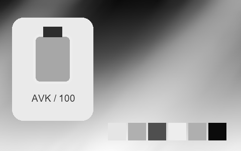

## 117 · Kodak T-Max 400

`nt-bw-kodak-t-max-400` · `film-bw` · CC-BY-SA-4.0 · 33³

50% gray Y′ 131.5/255 (+4.0 code values); 25–75% gray span ratio 1.169; mid-gray red minus blue +0.0 code values. Light/medium/deep skin swatches: #DCDCDC, #9B9B9B, #434343. Red/green/blue swatches: #262626, #BEBEBE, #646464.

Suggested use: Compare on your own SDR product, portrait and landscape footage before selecting.

Trial strength: 1–1; default 1.0.

Pixel color mapping only; no grain, glow, vignette, spatial haze or beauty effects. Natural footage quality is unaccepted. Check skin/product colors and clipped output.

**Supplied N002 still: actual output at strength 1.0.**

[Full-size lossless 1672×940](../../assets/looks-n002-20261024-r1/full/117-nt-bw-kodak-t-max-400.webp) · [Original source](../../assets/looks-n002-20261024-r1/source.png) · [All 500 supplied-image samples](../FILTER_GALLERY.en.md)

| Input swatch | Input RGB | Actual output RGB |
|---|---|---|
| `gray_0` | `#000000` | `#080808` |
| `gray_10` | `#1A1A1A` | `#0E0E0E` |
| `gray_25` | `#404040` | `#333333` |
| `gray_50` | `#808080` | `#848484` |
| `gray_75` | `#BFBFBF` | `#C8C8C8` |
| `gray_90` | `#E6E6E6` | `#E9E9E9` |
| `gray_100` | `#FFFFFF` | `#F5F5F5` |
| `skin_light` | `#F5DBC6` | `#DCDCDC` |
| `skin_medium` | `#CF9B7B` | `#9B9B9B` |
| `skin_deep` | `#815438` | `#434343` |
| `red` | `#CC3333` | `#262626` |
| `green` | `#33CC33` | `#BEBEBE` |
| `blue` | `#3333CC` | `#646464` |

Creator: **Pat David** · [Source](https://github.com/NatronGitHub/clut/blob/af7b50d4caf6244fb6895a647f5b6a84efe7931a/bw/kodak_t-max_400.png) · commit `af7b50d4caf6244fb6895a647f5b6a84efe7931a`.

Conversion: `native-depth-Hald-to-33-tetrahedral-v1`; 8,192 sampled RGB points; max error 0.0070245; mean 0.0006244. This is numerical approximation, not a perceptual quality score.

License obligations: Credit the named creator and source; retain the CC-BY-SA-4.0 notice and indicate changes. Redistributed adapted LUT data and thumbnails must use CC-BY-SA-4.0 or a compatible license; no additional restrictions.

[License](../../../product/src/ai_ad_editor/look_data/licenses/CC-BY-SA-4.0.txt) · LUT SHA-256 `3151b077789a9151ff556108f29588d8a2c4a20685f2cb1c8ca24f11e60836a1`.

[Actual preview PNG](../../assets/look500-20261024-r1/previews/nt-bw-kodak-t-max-400.png) · [Actual video](../../assets/look500-20261024-r1/videos/nt-bw-kodak-t-max-400.mp4)

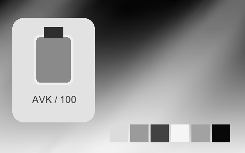

## 118 · Kodak Tri-X 400

`nt-bw-kodak-tri-x-400` · `film-bw` · CC-BY-SA-4.0 · 33³

50% gray Y′ 134.0/255 (+6.5 code values); 25–75% gray span ratio 1.059; mid-gray red minus blue +0.0 code values. Light/medium/deep skin swatches: #D9D9D9, #A3A3A3, #565656. Red/green/blue swatches: #616161, #9E9E9E, #818181.

Suggested use: Compare on your own SDR product, portrait and landscape footage before selecting.

Trial strength: 1–1; default 1.0.

Pixel color mapping only; no grain, glow, vignette, spatial haze or beauty effects. Natural footage quality is unaccepted. Check skin/product colors and clipped output.

**Supplied N002 still: actual output at strength 1.0.**

[Full-size lossless 1672×940](../../assets/looks-n002-20261024-r1/full/118-nt-bw-kodak-tri-x-400.webp) · [Original source](../../assets/looks-n002-20261024-r1/source.png) · [All 500 supplied-image samples](../FILTER_GALLERY.en.md)

| Input swatch | Input RGB | Actual output RGB |
|---|---|---|
| `gray_0` | `#000000` | `#0A0A0A` |
| `gray_10` | `#1A1A1A` | `#0E0E0E` |
| `gray_25` | `#404040` | `#3E3E3E` |
| `gray_50` | `#808080` | `#868686` |
| `gray_75` | `#BFBFBF` | `#C5C5C5` |
| `gray_90` | `#E6E6E6` | `#E5E5E5` |
| `gray_100` | `#FFFFFF` | `#F3F3F3` |
| `skin_light` | `#F5DBC6` | `#D9D9D9` |
| `skin_medium` | `#CF9B7B` | `#A3A3A3` |
| `skin_deep` | `#815438` | `#565656` |
| `red` | `#CC3333` | `#616161` |
| `green` | `#33CC33` | `#9E9E9E` |
| `blue` | `#3333CC` | `#818181` |

Creator: **Pat David** · [Source](https://github.com/NatronGitHub/clut/blob/af7b50d4caf6244fb6895a647f5b6a84efe7931a/bw/kodak_tri-x_400.png) · commit `af7b50d4caf6244fb6895a647f5b6a84efe7931a`.

Conversion: `native-depth-Hald-to-33-tetrahedral-v1`; 8,192 sampled RGB points; max error 0.0123131; mean 0.0006331. This is numerical approximation, not a perceptual quality score.

License obligations: Credit the named creator and source; retain the CC-BY-SA-4.0 notice and indicate changes. Redistributed adapted LUT data and thumbnails must use CC-BY-SA-4.0 or a compatible license; no additional restrictions.

[License](../../../product/src/ai_ad_editor/look_data/licenses/CC-BY-SA-4.0.txt) · LUT SHA-256 `66e5f58ffde8a8815e7ef9782c4346d8029922d07f8bbe073b8fc543d7f6b940`.

[Actual preview PNG](../../assets/look500-20261024-r1/previews/nt-bw-kodak-tri-x-400.png) · [Actual video](../../assets/look500-20261024-r1/videos/nt-bw-kodak-tri-x-400.mp4)

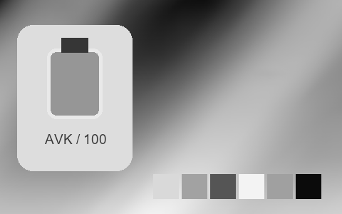

## 119 · Polaroid 664

`nt-bw-polaroid-664` · `film-bw` · CC-BY-SA-4.0 · 33³

50% gray Y′ 149.5/255 (+22.0 code values); 25–75% gray span ratio 0.822; mid-gray red minus blue +0.0 code values. Light/medium/deep skin swatches: #DFDFDF, #B0B0B0, #7F7F7F. Red/green/blue swatches: #9A9A9A, #8D8D8D, #919191.

Suggested use: Compare on your own SDR product, portrait and landscape footage before selecting.

Trial strength: 1–1; default 1.0.

Pixel color mapping only; no grain, glow, vignette, spatial haze or beauty effects. Natural footage quality is unaccepted. Check skin/product colors and clipped output.

**Supplied N002 still: actual output at strength 1.0.**

[Full-size lossless 1672×940](../../assets/looks-n002-20261024-r1/full/119-nt-bw-polaroid-664.webp) · [Original source](../../assets/looks-n002-20261024-r1/source.png) · [All 500 supplied-image samples](../FILTER_GALLERY.en.md)

| Input swatch | Input RGB | Actual output RGB |
|---|---|---|
| `gray_0` | `#000000` | `#070707` |
| `gray_10` | `#1A1A1A` | `#141414` |
| `gray_25` | `#404040` | `#585858` |
| `gray_50` | `#808080` | `#969696` |
| `gray_75` | `#BFBFBF` | `#C1C1C1` |
| `gray_90` | `#E6E6E6` | `#E3E3E3` |
| `gray_100` | `#FFFFFF` | `#FEFEFE` |
| `skin_light` | `#F5DBC6` | `#DFDFDF` |
| `skin_medium` | `#CF9B7B` | `#B0B0B0` |
| `skin_deep` | `#815438` | `#7F7F7F` |
| `red` | `#CC3333` | `#9A9A9A` |
| `green` | `#33CC33` | `#8D8D8D` |
| `blue` | `#3333CC` | `#919191` |

Creator: **Pat David** · [Source](https://github.com/NatronGitHub/clut/blob/af7b50d4caf6244fb6895a647f5b6a84efe7931a/bw/polaroid_664.png) · commit `af7b50d4caf6244fb6895a647f5b6a84efe7931a`.

Conversion: `native-depth-Hald-to-33-tetrahedral-v1`; 8,192 sampled RGB points; max error 0.0107509; mean 0.0006353. This is numerical approximation, not a perceptual quality score.

License obligations: Credit the named creator and source; retain the CC-BY-SA-4.0 notice and indicate changes. Redistributed adapted LUT data and thumbnails must use CC-BY-SA-4.0 or a compatible license; no additional restrictions.

[License](../../../product/src/ai_ad_editor/look_data/licenses/CC-BY-SA-4.0.txt) · LUT SHA-256 `6498f239c3fa7c14aef71c32b3a9856a67c88dd65ec2cd120c153e4689dacfdf`.

[Actual preview PNG](../../assets/look500-20261024-r1/previews/nt-bw-polaroid-664.png) · [Actual video](../../assets/look500-20261024-r1/videos/nt-bw-polaroid-664.mp4)

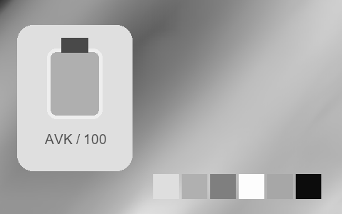

## 120 · Polaroid 667

`nt-bw-polaroid-667` · `film-bw` · CC-BY-SA-4.0 · 33³

50% gray Y′ 146.0/255 (+18.5 code values); 25–75% gray span ratio 1.129; mid-gray red minus blue +0.0 code values. Light/medium/deep skin swatches: #E1E1E1, #BDBDBD, #6F6F6F. Red/green/blue swatches: #9F9F9F, #A0A0A0, #6F6F6F.

Suggested use: Compare on your own SDR product, portrait and landscape footage before selecting.

Trial strength: 1–1; default 1.0.

Pixel color mapping only; no grain, glow, vignette, spatial haze or beauty effects. Natural footage quality is unaccepted. Check skin/product colors and clipped output.

**Supplied N002 still: actual output at strength 1.0.**

[Full-size lossless 1672×940](../../assets/looks-n002-20261024-r1/full/120-nt-bw-polaroid-667.webp) · [Original source](../../assets/looks-n002-20261024-r1/source.png) · [All 500 supplied-image samples](../FILTER_GALLERY.en.md)

| Input swatch | Input RGB | Actual output RGB |
|---|---|---|
| `gray_0` | `#000000` | `#070707` |
| `gray_10` | `#1A1A1A` | `#171717` |
| `gray_25` | `#404040` | `#3D3D3D` |
| `gray_50` | `#808080` | `#929292` |
| `gray_75` | `#BFBFBF` | `#CDCDCD` |
| `gray_90` | `#E6E6E6` | `#E7E7E7` |
| `gray_100` | `#FFFFFF` | `#FCFCFC` |
| `skin_light` | `#F5DBC6` | `#E1E1E1` |
| `skin_medium` | `#CF9B7B` | `#BDBDBD` |
| `skin_deep` | `#815438` | `#6F6F6F` |
| `red` | `#CC3333` | `#9F9F9F` |
| `green` | `#33CC33` | `#A0A0A0` |
| `blue` | `#3333CC` | `#6F6F6F` |

Creator: **Pat David** · [Source](https://github.com/NatronGitHub/clut/blob/af7b50d4caf6244fb6895a647f5b6a84efe7931a/bw/polaroid_667.png) · commit `af7b50d4caf6244fb6895a647f5b6a84efe7931a`.

Conversion: `native-depth-Hald-to-33-tetrahedral-v1`; 8,192 sampled RGB points; max error 0.0040316; mean 0.0006103. This is numerical approximation, not a perceptual quality score.

License obligations: Credit the named creator and source; retain the CC-BY-SA-4.0 notice and indicate changes. Redistributed adapted LUT data and thumbnails must use CC-BY-SA-4.0 or a compatible license; no additional restrictions.

[License](../../../product/src/ai_ad_editor/look_data/licenses/CC-BY-SA-4.0.txt) · LUT SHA-256 `43314def1937e7121ef302df1a49d277df898caa225e9cffb8d075b46684339a`.

[Actual preview PNG](../../assets/look500-20261024-r1/previews/nt-bw-polaroid-667.png) · [Actual video](../../assets/look500-20261024-r1/videos/nt-bw-polaroid-667.mp4)

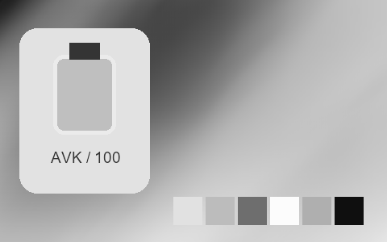

## 121 · Polaroid 672

`nt-bw-polaroid-672` · `film-bw` · CC-BY-SA-4.0 · 33³

50% gray Y′ 110.5/255 (-17.0 code values); 25–75% gray span ratio 1.112; mid-gray red minus blue +0.0 code values. Light/medium/deep skin swatches: #D5D5D5, #9E9E9E, #494949. Red/green/blue swatches: #6E6E6E, #848484, #535353.

Suggested use: Compare on your own SDR product, portrait and landscape footage before selecting.

Trial strength: 1–1; default 1.0.

Pixel color mapping only; no grain, glow, vignette, spatial haze or beauty effects. Natural footage quality is unaccepted. Check skin/product colors and clipped output.

**Supplied N002 still: actual output at strength 1.0.**

[Full-size lossless 1672×940](../../assets/looks-n002-20261024-r1/full/121-nt-bw-polaroid-672.webp) · [Original source](../../assets/looks-n002-20261024-r1/source.png) · [All 500 supplied-image samples](../FILTER_GALLERY.en.md)

| Input swatch | Input RGB | Actual output RGB |
|---|---|---|
| `gray_0` | `#000000` | `#030303` |
| `gray_10` | `#1A1A1A` | `#0E0E0E` |
| `gray_25` | `#404040` | `#292929` |
| `gray_50` | `#808080` | `#6E6E6E` |
| `gray_75` | `#BFBFBF` | `#B7B7B7` |
| `gray_90` | `#E6E6E6` | `#DCDCDC` |
| `gray_100` | `#FFFFFF` | `#FBFBFB` |
| `skin_light` | `#F5DBC6` | `#D5D5D5` |
| `skin_medium` | `#CF9B7B` | `#9E9E9E` |
| `skin_deep` | `#815438` | `#494949` |
| `red` | `#CC3333` | `#6E6E6E` |
| `green` | `#33CC33` | `#848484` |
| `blue` | `#3333CC` | `#535353` |

Creator: **Pat David** · [Source](https://github.com/NatronGitHub/clut/blob/af7b50d4caf6244fb6895a647f5b6a84efe7931a/bw/polaroid_672.png) · commit `af7b50d4caf6244fb6895a647f5b6a84efe7931a`.

Conversion: `native-depth-Hald-to-33-tetrahedral-v1`; 8,192 sampled RGB points; max error 0.0084748; mean 0.0006266. This is numerical approximation, not a perceptual quality score.

License obligations: Credit the named creator and source; retain the CC-BY-SA-4.0 notice and indicate changes. Redistributed adapted LUT data and thumbnails must use CC-BY-SA-4.0 or a compatible license; no additional restrictions.

[License](../../../product/src/ai_ad_editor/look_data/licenses/CC-BY-SA-4.0.txt) · LUT SHA-256 `1620f7f6bbe96c2d8b3f59277d646a777e68d41f50f46ce161eb48a6461dc140`.

[Actual preview PNG](../../assets/look500-20261024-r1/previews/nt-bw-polaroid-672.png) · [Actual video](../../assets/look500-20261024-r1/videos/nt-bw-polaroid-672.mp4)

## 122 · Rollei Ir 400

`nt-bw-rollei-ir-400` · `film-bw` · CC-BY-SA-4.0 · 33³

50% gray Y′ 107.5/255 (-20.0 code values); 25–75% gray span ratio 1.255; mid-gray red minus blue +0.0 code values. Light/medium/deep skin swatches: #F8F8F8, #D7D7D7, #616161. Red/green/blue swatches: #626262, #FFFFFF, #000000.

Suggested use: Compare on your own SDR product, portrait and landscape footage before selecting.

Trial strength: 1–1; default 1.0.

Pixel color mapping only; no grain, glow, vignette, spatial haze or beauty effects. Natural footage quality is unaccepted. Check skin/product colors and clipped output.

**Supplied N002 still: actual output at strength 1.0.**

[Full-size lossless 1672×940](../../assets/looks-n002-20261024-r1/full/122-nt-bw-rollei-ir-400.webp) · [Original source](../../assets/looks-n002-20261024-r1/source.png) · [All 500 supplied-image samples](../FILTER_GALLERY.en.md)

| Input swatch | Input RGB | Actual output RGB |
|---|---|---|
| `gray_0` | `#000000` | `#000000` |
| `gray_10` | `#1A1A1A` | `#0C0C0C` |
| `gray_25` | `#404040` | `#242424` |
| `gray_50` | `#808080` | `#6B6B6B` |
| `gray_75` | `#BFBFBF` | `#C3C3C3` |
| `gray_90` | `#E6E6E6` | `#E9E9E9` |
| `gray_100` | `#FFFFFF` | `#EFEFEF` |
| `skin_light` | `#F5DBC6` | `#F8F8F8` |
| `skin_medium` | `#CF9B7B` | `#D7D7D7` |
| `skin_deep` | `#815438` | `#616161` |
| `red` | `#CC3333` | `#626262` |
| `green` | `#33CC33` | `#FFFFFF` |
| `blue` | `#3333CC` | `#000000` |

Creator: **Pat David** · [Source](https://github.com/NatronGitHub/clut/blob/af7b50d4caf6244fb6895a647f5b6a84efe7931a/bw/rollei_ir_400.png) · commit `af7b50d4caf6244fb6895a647f5b6a84efe7931a`.

Conversion: `native-depth-Hald-to-33-tetrahedral-v1`; 8,192 sampled RGB points; max error 0.0133371; mean 0.0008156. This is numerical approximation, not a perceptual quality score.

License obligations: Credit the named creator and source; retain the CC-BY-SA-4.0 notice and indicate changes. Redistributed adapted LUT data and thumbnails must use CC-BY-SA-4.0 or a compatible license; no additional restrictions.

[License](../../../product/src/ai_ad_editor/look_data/licenses/CC-BY-SA-4.0.txt) · LUT SHA-256 `a10d8253029344c16be015934eb2b770009675c9a71da9b767233afc763d4b5c`.

[Actual preview PNG](../../assets/look500-20261024-r1/previews/nt-bw-rollei-ir-400.png) · [Actual video](../../assets/look500-20261024-r1/videos/nt-bw-rollei-ir-400.mp4)

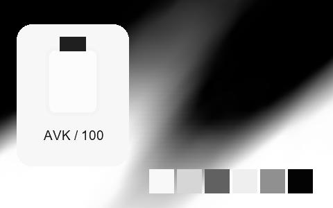

## 123 · Rollei Ortho 25

`nt-bw-rollei-ortho-25` · `film-bw` · CC-BY-SA-4.0 · 33³

50% gray Y′ 157.5/255 (+30.0 code values); 25–75% gray span ratio 1.376; mid-gray red minus blue +0.0 code values. Light/medium/deep skin swatches: #F2F2F2, #B7B7B7, #3F3F3F. Red/green/blue swatches: #323232, #A8A8A8, #BFBFBF.

Suggested use: Compare on your own SDR product, portrait and landscape footage before selecting.

Trial strength: 1–1; default 1.0.

Pixel color mapping only; no grain, glow, vignette, spatial haze or beauty effects. Natural footage quality is unaccepted. Check skin/product colors and clipped output.

**Supplied N002 still: actual output at strength 1.0.**

[Full-size lossless 1672×940](../../assets/looks-n002-20261024-r1/full/123-nt-bw-rollei-ortho-25.webp) · [Original source](../../assets/looks-n002-20261024-r1/source.png) · [All 500 supplied-image samples](../FILTER_GALLERY.en.md)

| Input swatch | Input RGB | Actual output RGB |
|---|---|---|
| `gray_0` | `#000000` | `#000000` |
| `gray_10` | `#1A1A1A` | `#171717` |
| `gray_25` | `#404040` | `#3A3A3A` |
| `gray_50` | `#808080` | `#9E9E9E` |
| `gray_75` | `#BFBFBF` | `#EAEAEA` |
| `gray_90` | `#E6E6E6` | `#FCFCFC` |
| `gray_100` | `#FFFFFF` | `#FEFEFE` |
| `skin_light` | `#F5DBC6` | `#F2F2F2` |
| `skin_medium` | `#CF9B7B` | `#B7B7B7` |
| `skin_deep` | `#815438` | `#3F3F3F` |
| `red` | `#CC3333` | `#323232` |
| `green` | `#33CC33` | `#A8A8A8` |
| `blue` | `#3333CC` | `#BFBFBF` |

Creator: **Pat David** · [Source](https://github.com/NatronGitHub/clut/blob/af7b50d4caf6244fb6895a647f5b6a84efe7931a/bw/rollei_ortho_25.png) · commit `af7b50d4caf6244fb6895a647f5b6a84efe7931a`.

Conversion: `native-depth-Hald-to-33-tetrahedral-v1`; 8,192 sampled RGB points; max error 0.0121161; mean 0.0008863. This is numerical approximation, not a perceptual quality score.

License obligations: Credit the named creator and source; retain the CC-BY-SA-4.0 notice and indicate changes. Redistributed adapted LUT data and thumbnails must use CC-BY-SA-4.0 or a compatible license; no additional restrictions.

[License](../../../product/src/ai_ad_editor/look_data/licenses/CC-BY-SA-4.0.txt) · LUT SHA-256 `d720ac87a85ea5dcd65f9fa6e042c85047ee095c7a0bedd2a295ea22d785b776`.

[Actual preview PNG](../../assets/look500-20261024-r1/previews/nt-bw-rollei-ortho-25.png) · [Actual video](../../assets/look500-20261024-r1/videos/nt-bw-rollei-ortho-25.mp4)

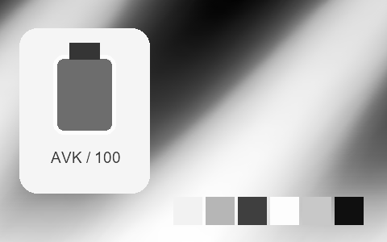

## 124 · Rollei Retro 100 Tonal

`nt-bw-rollei-retro-100-tonal` · `film-bw` · CC-BY-SA-4.0 · 33³

50% gray Y′ 140.5/255 (+13.0 code values); 25–75% gray span ratio 1.114; mid-gray red minus blue +0.0 code values. Light/medium/deep skin swatches: #E2E2E2, #9F9F9F, #525252. Red/green/blue swatches: #3E3E3E, #ADADAD, #919191.

Suggested use: Compare on your own SDR product, portrait and landscape footage before selecting.

Trial strength: 1–1; default 1.0.

Pixel color mapping only; no grain, glow, vignette, spatial haze or beauty effects. Natural footage quality is unaccepted. Check skin/product colors and clipped output.

**Supplied N002 still: actual output at strength 1.0.**

[Full-size lossless 1672×940](../../assets/looks-n002-20261024-r1/full/124-nt-bw-rollei-retro-100-tonal.webp) · [Original source](../../assets/looks-n002-20261024-r1/source.png) · [All 500 supplied-image samples](../FILTER_GALLERY.en.md)

| Input swatch | Input RGB | Actual output RGB |
|---|---|---|
| `gray_0` | `#000000` | `#0F0F0F` |
| `gray_10` | `#1A1A1A` | `#1E1E1E` |
| `gray_25` | `#404040` | `#444444` |
| `gray_50` | `#808080` | `#8C8C8C` |
| `gray_75` | `#BFBFBF` | `#D2D2D2` |
| `gray_90` | `#E6E6E6` | `#EAEAEA` |
| `gray_100` | `#FFFFFF` | `#EDEDED` |
| `skin_light` | `#F5DBC6` | `#E2E2E2` |
| `skin_medium` | `#CF9B7B` | `#9F9F9F` |
| `skin_deep` | `#815438` | `#525252` |
| `red` | `#CC3333` | `#3E3E3E` |
| `green` | `#33CC33` | `#ADADAD` |
| `blue` | `#3333CC` | `#919191` |

Creator: **Pat David** · [Source](https://github.com/NatronGitHub/clut/blob/af7b50d4caf6244fb6895a647f5b6a84efe7931a/bw/rollei_retro_100_tonal.png) · commit `af7b50d4caf6244fb6895a647f5b6a84efe7931a`.

Conversion: `native-depth-Hald-to-33-tetrahedral-v1`; 8,192 sampled RGB points; max error 0.0054125; mean 0.0006219. This is numerical approximation, not a perceptual quality score.

License obligations: Credit the named creator and source; retain the CC-BY-SA-4.0 notice and indicate changes. Redistributed adapted LUT data and thumbnails must use CC-BY-SA-4.0 or a compatible license; no additional restrictions.

[License](../../../product/src/ai_ad_editor/look_data/licenses/CC-BY-SA-4.0.txt) · LUT SHA-256 `bc270a53ec9eb571dfa0667cc8f7502d20ee13ab005f1824d80a34eebf2a4c48`.

[Actual preview PNG](../../assets/look500-20261024-r1/previews/nt-bw-rollei-retro-100-tonal.png) · [Actual video](../../assets/look500-20261024-r1/videos/nt-bw-rollei-retro-100-tonal.mp4)

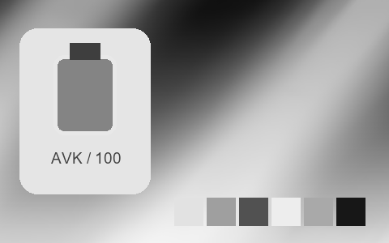

## 125 · Rollei Retro 80S

`nt-bw-rollei-retro-80s` · `film-bw` · CC-BY-SA-4.0 · 33³

50% gray Y′ 115.5/255 (-12.0 code values); 25–75% gray span ratio 1.488; mid-gray red minus blue +0.0 code values. Light/medium/deep skin swatches: #F5F5F5, #C7C7C7, #454545. Red/green/blue swatches: #9A9A9A, #5C5C5C, #505050.

Suggested use: Compare on your own SDR product, portrait and landscape footage before selecting.

Trial strength: 1–1; default 1.0.

Pixel color mapping only; no grain, glow, vignette, spatial haze or beauty effects. Natural footage quality is unaccepted. Check skin/product colors and clipped output.

**Supplied N002 still: actual output at strength 1.0.**

[Full-size lossless 1672×940](../../assets/looks-n002-20261024-r1/full/125-nt-bw-rollei-retro-80s.webp) · [Original source](../../assets/looks-n002-20261024-r1/source.png) · [All 500 supplied-image samples](../FILTER_GALLERY.en.md)

| Input swatch | Input RGB | Actual output RGB |
|---|---|---|
| `gray_0` | `#000000` | `#010101` |
| `gray_10` | `#1A1A1A` | `#080808` |
| `gray_25` | `#404040` | `#1E1E1E` |
| `gray_50` | `#808080` | `#737373` |
| `gray_75` | `#BFBFBF` | `#DCDCDC` |
| `gray_90` | `#E6E6E6` | `#F7F7F7` |
| `gray_100` | `#FFFFFF` | `#F9F9F9` |
| `skin_light` | `#F5DBC6` | `#F5F5F5` |
| `skin_medium` | `#CF9B7B` | `#C7C7C7` |
| `skin_deep` | `#815438` | `#454545` |
| `red` | `#CC3333` | `#9A9A9A` |
| `green` | `#33CC33` | `#5C5C5C` |
| `blue` | `#3333CC` | `#505050` |

Creator: **Pat David** · [Source](https://github.com/NatronGitHub/clut/blob/af7b50d4caf6244fb6895a647f5b6a84efe7931a/bw/rollei_retro_80s.png) · commit `af7b50d4caf6244fb6895a647f5b6a84efe7931a`.

Conversion: `native-depth-Hald-to-33-tetrahedral-v1`; 8,192 sampled RGB points; max error 0.0095588; mean 0.0007348. This is numerical approximation, not a perceptual quality score.

License obligations: Credit the named creator and source; retain the CC-BY-SA-4.0 notice and indicate changes. Redistributed adapted LUT data and thumbnails must use CC-BY-SA-4.0 or a compatible license; no additional restrictions.

[License](../../../product/src/ai_ad_editor/look_data/licenses/CC-BY-SA-4.0.txt) · LUT SHA-256 `38438bbcd30c19eab11b1f101a7e47ebb1f152bcffb54ee16770ef41f8e8170c`.

[Actual preview PNG](../../assets/look500-20261024-r1/previews/nt-bw-rollei-retro-80s.png) · [Actual video](../../assets/look500-20261024-r1/videos/nt-bw-rollei-retro-80s.mp4)

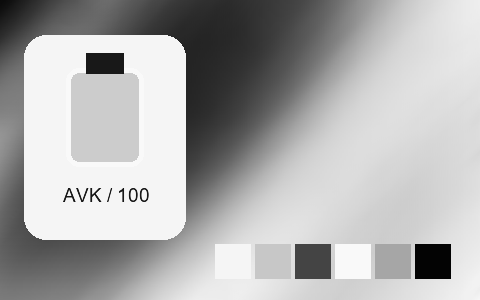

## 126 · Agfa Precisa 100

`nt-colorslide-agfa-precisa-100` · `film-slide` · CC-BY-SA-4.0 · 33³

50% gray Y′ 120.6/255 (-6.9 code values); 25–75% gray span ratio 1.146; mid-gray red minus blue -1.0 code values. Light/medium/deep skin swatches: #F6E3CC, #D6A072, #794B2F. Red/green/blue swatches: #CA2A26, #66CF74, #10219B.

Suggested use: Compare on your own SDR product, portrait and landscape footage before selecting.

Trial strength: 0.35–0.8; default 1.0.

Pixel color mapping only; no grain, glow, vignette, spatial haze or beauty effects. Natural footage quality is unaccepted. Check skin/product colors and clipped output.

**Supplied N002 still: actual output at strength 1.0.**

[Full-size lossless 1672×940](../../assets/looks-n002-20261024-r1/full/126-nt-colorslide-agfa-precisa-100.webp) · [Original source](../../assets/looks-n002-20261024-r1/source.png) · [All 500 supplied-image samples](../FILTER_GALLERY.en.md)

| Input swatch | Input RGB | Actual output RGB |
|---|---|---|
| `gray_0` | `#000000` | `#000000` |
| `gray_10` | `#1A1A1A` | `#171413` |
| `gray_25` | `#404040` | `#333232` |
| `gray_50` | `#808080` | `#78787A` |
| `gray_75` | `#BFBFBF` | `#C5C4C4` |
| `gray_90` | `#E6E6E6` | `#EAEAE9` |
| `gray_100` | `#FFFFFF` | `#FEFEFE` |
| `skin_light` | `#F5DBC6` | `#F6E3CC` |
| `skin_medium` | `#CF9B7B` | `#D6A072` |
| `skin_deep` | `#815438` | `#794B2F` |
| `red` | `#CC3333` | `#CA2A26` |
| `green` | `#33CC33` | `#66CF74` |
| `blue` | `#3333CC` | `#10219B` |

Creator: **Pat David** · [Source](https://github.com/NatronGitHub/clut/blob/af7b50d4caf6244fb6895a647f5b6a84efe7931a/colorslide/agfa_precisa_100.png) · commit `af7b50d4caf6244fb6895a647f5b6a84efe7931a`.

Conversion: `native-depth-Hald-to-33-tetrahedral-v1`; 8,192 sampled RGB points; max error 0.0271159; mean 0.0007298. This is numerical approximation, not a perceptual quality score.

License obligations: Credit the named creator and source; retain the CC-BY-SA-4.0 notice and indicate changes. Redistributed adapted LUT data and thumbnails must use CC-BY-SA-4.0 or a compatible license; no additional restrictions.

[License](../../../product/src/ai_ad_editor/look_data/licenses/CC-BY-SA-4.0.txt) · LUT SHA-256 `9b3a06687080260e5f802731181d238d9d941764231ad28fa09cdea64ca2cf1d`.

[Actual preview PNG](../../assets/look500-20261024-r1/previews/nt-colorslide-agfa-precisa-100.png) · [Actual video](../../assets/look500-20261024-r1/videos/nt-colorslide-agfa-precisa-100.mp4)

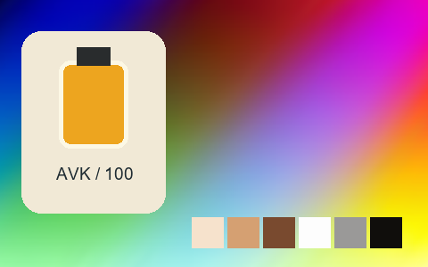

## 127 · Fuji Astia 100F

`nt-colorslide-fuji-astia-100f` · `film-slide` · CC-BY-SA-4.0 · 33³

50% gray Y′ 125.2/255 (-2.3 code values); 25–75% gray span ratio 1.012; mid-gray red minus blue +1.0 code values. Light/medium/deep skin swatches: #EFD1C4, #D59481, #834D3D. Red/green/blue swatches: #C71321, #87C75F, #301D70.

Suggested use: Compare on your own SDR product, portrait and landscape footage before selecting.

Trial strength: 0.35–0.8; default 1.0.

Pixel color mapping only; no grain, glow, vignette, spatial haze or beauty effects. Natural footage quality is unaccepted. Check skin/product colors and clipped output.

**Supplied N002 still: actual output at strength 1.0.**

[Full-size lossless 1672×940](../../assets/looks-n002-20261024-r1/full/127-nt-colorslide-fuji-astia-100f.webp) · [Original source](../../assets/looks-n002-20261024-r1/source.png) · [All 500 supplied-image samples](../FILTER_GALLERY.en.md)

| Input swatch | Input RGB | Actual output RGB |
|---|---|---|
| `gray_0` | `#000000` | `#030609` |
| `gray_10` | `#1A1A1A` | `#181717` |
| `gray_25` | `#404040` | `#3D3C3C` |
| `gray_50` | `#808080` | `#7E7D7D` |
| `gray_75` | `#BFBFBF` | `#C0BDBB` |
| `gray_90` | `#E6E6E6` | `#E1DED9` |
| `gray_100` | `#FFFFFF` | `#FBFAFA` |
| `skin_light` | `#F5DBC6` | `#EFD1C4` |
| `skin_medium` | `#CF9B7B` | `#D59481` |
| `skin_deep` | `#815438` | `#834D3D` |
| `red` | `#CC3333` | `#C71321` |
| `green` | `#33CC33` | `#87C75F` |
| `blue` | `#3333CC` | `#301D70` |

Creator: **Pat David** · [Source](https://github.com/NatronGitHub/clut/blob/af7b50d4caf6244fb6895a647f5b6a84efe7931a/colorslide/fuji_astia_100f.png) · commit `af7b50d4caf6244fb6895a647f5b6a84efe7931a`.

Conversion: `native-depth-Hald-to-33-tetrahedral-v1`; 8,192 sampled RGB points; max error 0.0252646; mean 0.0007644. This is numerical approximation, not a perceptual quality score.

License obligations: Credit the named creator and source; retain the CC-BY-SA-4.0 notice and indicate changes. Redistributed adapted LUT data and thumbnails must use CC-BY-SA-4.0 or a compatible license; no additional restrictions.

[License](../../../product/src/ai_ad_editor/look_data/licenses/CC-BY-SA-4.0.txt) · LUT SHA-256 `f19bd640eda3634404c9b18d3214287637510ff4b552df65f915abba23b4c1d6`.

[Actual preview PNG](../../assets/look500-20261024-r1/previews/nt-colorslide-fuji-astia-100f.png) · [Actual video](../../assets/look500-20261024-r1/videos/nt-colorslide-fuji-astia-100f.mp4)

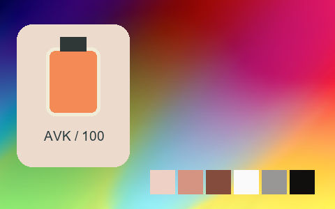

## 128 · Fuji Fp 100C

`nt-colorslide-fuji-fp-100c` · `film-slide` · CC-BY-SA-4.0 · 33³

50% gray Y′ 129.0/255 (+1.5 code values); 25–75% gray span ratio 1.215; mid-gray red minus blue +1.5 code values. Light/medium/deep skin swatches: #EBDACD, #CE977A, #6C3923. Red/green/blue swatches: #AC0606, #9AC726, #2233B4.

Suggested use: Compare on your own SDR product, portrait and landscape footage before selecting.

Trial strength: 0.35–0.8; default 1.0.

Pixel color mapping only; no grain, glow, vignette, spatial haze or beauty effects. Natural footage quality is unaccepted. Check skin/product colors and clipped output.

**Supplied N002 still: actual output at strength 1.0.**

[Full-size lossless 1672×940](../../assets/looks-n002-20261024-r1/full/128-nt-colorslide-fuji-fp-100c.webp) · [Original source](../../assets/looks-n002-20261024-r1/source.png) · [All 500 supplied-image samples](../FILTER_GALLERY.en.md)

| Input swatch | Input RGB | Actual output RGB |
|---|---|---|
| `gray_0` | `#000000` | `#020501` |
| `gray_10` | `#1A1A1A` | `#11110F` |
| `gray_25` | `#404040` | `#2E2F2D` |
| `gray_50` | `#808080` | `#828180` |
| `gray_75` | `#BFBFBF` | `#CBCAC8` |
| `gray_90` | `#E6E6E6` | `#E6E6E4` |
| `gray_100` | `#FFFFFF` | `#F1F8F1` |
| `skin_light` | `#F5DBC6` | `#EBDACD` |
| `skin_medium` | `#CF9B7B` | `#CE977A` |
| `skin_deep` | `#815438` | `#6C3923` |
| `red` | `#CC3333` | `#AC0606` |
| `green` | `#33CC33` | `#9AC726` |
| `blue` | `#3333CC` | `#2233B4` |

Creator: **Pat David** · [Source](https://github.com/NatronGitHub/clut/blob/af7b50d4caf6244fb6895a647f5b6a84efe7931a/colorslide/fuji_fp_100c.png) · commit `af7b50d4caf6244fb6895a647f5b6a84efe7931a`.

Conversion: `native-depth-Hald-to-33-tetrahedral-v1`; 8,192 sampled RGB points; max error 0.0193562; mean 0.0007284. This is numerical approximation, not a perceptual quality score.

License obligations: Credit the named creator and source; retain the CC-BY-SA-4.0 notice and indicate changes. Redistributed adapted LUT data and thumbnails must use CC-BY-SA-4.0 or a compatible license; no additional restrictions.

[License](../../../product/src/ai_ad_editor/look_data/licenses/CC-BY-SA-4.0.txt) · LUT SHA-256 `af652476a13d5b81eb27d855993c5a82d67492d558fd9db912b8389b748ca2b4`.

[Actual preview PNG](../../assets/look500-20261024-r1/previews/nt-colorslide-fuji-fp-100c.png) · [Actual video](../../assets/look500-20261024-r1/videos/nt-colorslide-fuji-fp-100c.mp4)

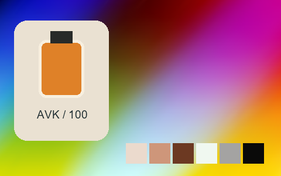

## 129 · Fuji Provia 100F

`nt-colorslide-fuji-provia-100f` · `film-slide` · CC-BY-SA-4.0 · 33³

50% gray Y′ 120.6/255 (-6.9 code values); 25–75% gray span ratio 1.078; mid-gray red minus blue -1.5 code values. Light/medium/deep skin swatches: #F9DDD0, #DE997E, #824A39. Red/green/blue swatches: #E02018, #53DB7F, #0B108A.

Suggested use: Compare on your own SDR product, portrait and landscape footage before selecting.

Trial strength: 0.35–0.8; default 1.0.

Pixel color mapping only; no grain, glow, vignette, spatial haze or beauty effects. Natural footage quality is unaccepted. Check skin/product colors and clipped output.

**Supplied N002 still: actual output at strength 1.0.**

[Full-size lossless 1672×940](../../assets/looks-n002-20261024-r1/full/129-nt-colorslide-fuji-provia-100f.webp) · [Original source](../../assets/looks-n002-20261024-r1/source.png) · [All 500 supplied-image samples](../FILTER_GALLERY.en.md)

| Input swatch | Input RGB | Actual output RGB |
|---|---|---|
| `gray_0` | `#000000` | `#071005` |
| `gray_10` | `#1A1A1A` | `#191715` |
| `gray_25` | `#404040` | `#373838` |
| `gray_50` | `#808080` | `#78787A` |
| `gray_75` | `#BFBFBF` | `#C2C1C2` |
| `gray_90` | `#E6E6E6` | `#E8E7EA` |
| `gray_100` | `#FFFFFF` | `#F0FBFB` |
| `skin_light` | `#F5DBC6` | `#F9DDD0` |
| `skin_medium` | `#CF9B7B` | `#DE997E` |
| `skin_deep` | `#815438` | `#824A39` |
| `red` | `#CC3333` | `#E02018` |
| `green` | `#33CC33` | `#53DB7F` |
| `blue` | `#3333CC` | `#0B108A` |

Creator: **Pat David** · [Source](https://github.com/NatronGitHub/clut/blob/af7b50d4caf6244fb6895a647f5b6a84efe7931a/colorslide/fuji_provia_100f.png) · commit `af7b50d4caf6244fb6895a647f5b6a84efe7931a`.

Conversion: `native-depth-Hald-to-33-tetrahedral-v1`; 8,192 sampled RGB points; max error 0.0160660; mean 0.0007131. This is numerical approximation, not a perceptual quality score.

License obligations: Credit the named creator and source; retain the CC-BY-SA-4.0 notice and indicate changes. Redistributed adapted LUT data and thumbnails must use CC-BY-SA-4.0 or a compatible license; no additional restrictions.

[License](../../../product/src/ai_ad_editor/look_data/licenses/CC-BY-SA-4.0.txt) · LUT SHA-256 `03af4347cabb33aee877fc4dba64ad66625e16fa57dd66511ee0fba37de9349b`.

[Actual preview PNG](../../assets/look500-20261024-r1/previews/nt-colorslide-fuji-provia-100f.png) · [Actual video](../../assets/look500-20261024-r1/videos/nt-colorslide-fuji-provia-100f.mp4)

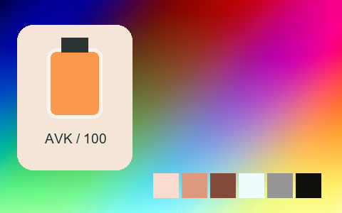

## 130 · Fuji Provia 400F

`nt-colorslide-fuji-provia-400f` · `film-slide` · CC-BY-SA-4.0 · 33³

50% gray Y′ 128.0/255 (+0.5 code values); 25–75% gray span ratio 1.074; mid-gray red minus blue -1.5 code values. Light/medium/deep skin swatches: #EDD3C7, #C99280, #7D432F. Red/green/blue swatches: #B10C06, #7BCB92, #1C3D94.

Suggested use: Compare on your own SDR product, portrait and landscape footage before selecting.

Trial strength: 0.35–0.8; default 1.0.

Pixel color mapping only; no grain, glow, vignette, spatial haze or beauty effects. Natural footage quality is unaccepted. Check skin/product colors and clipped output.

**Supplied N002 still: actual output at strength 1.0.**

[Full-size lossless 1672×940](../../assets/looks-n002-20261024-r1/full/130-nt-colorslide-fuji-provia-400f.webp) · [Original source](../../assets/looks-n002-20261024-r1/source.png) · [All 500 supplied-image samples](../FILTER_GALLERY.en.md)

| Input swatch | Input RGB | Actual output RGB |
|---|---|---|
| `gray_0` | `#000000` | `#020200` |
| `gray_10` | `#1A1A1A` | `#121210` |
| `gray_25` | `#404040` | `#363637` |
| `gray_50` | `#808080` | `#818082` |
| `gray_75` | `#BFBFBF` | `#BFBFBF` |
| `gray_90` | `#E6E6E6` | `#E0DFDF` |
| `gray_100` | `#FFFFFF` | `#FBFAF2` |
| `skin_light` | `#F5DBC6` | `#EDD3C7` |
| `skin_medium` | `#CF9B7B` | `#C99280` |
| `skin_deep` | `#815438` | `#7D432F` |
| `red` | `#CC3333` | `#B10C06` |
| `green` | `#33CC33` | `#7BCB92` |
| `blue` | `#3333CC` | `#1C3D94` |

Creator: **Pat David** · [Source](https://github.com/NatronGitHub/clut/blob/af7b50d4caf6244fb6895a647f5b6a84efe7931a/colorslide/fuji_provia_400f.png) · commit `af7b50d4caf6244fb6895a647f5b6a84efe7931a`.

Conversion: `native-depth-Hald-to-33-tetrahedral-v1`; 8,192 sampled RGB points; max error 0.0175300; mean 0.0006926. This is numerical approximation, not a perceptual quality score.

License obligations: Credit the named creator and source; retain the CC-BY-SA-4.0 notice and indicate changes. Redistributed adapted LUT data and thumbnails must use CC-BY-SA-4.0 or a compatible license; no additional restrictions.

[License](../../../product/src/ai_ad_editor/look_data/licenses/CC-BY-SA-4.0.txt) · LUT SHA-256 `acfd14eb0e43d48d6e8e0ab4bcc1dbe00106b6bea223258d4db1a6334ac7452c`.

[Actual preview PNG](../../assets/look500-20261024-r1/previews/nt-colorslide-fuji-provia-400f.png) · [Actual video](../../assets/look500-20261024-r1/videos/nt-colorslide-fuji-provia-400f.mp4)

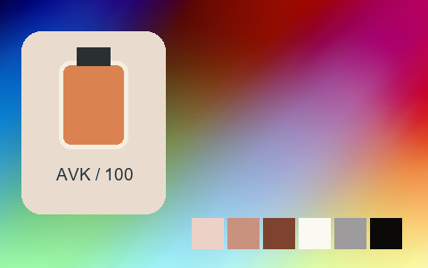

## 131 · Fuji Provia 400X

`nt-colorslide-fuji-provia-400x` · `film-slide` · CC-BY-SA-4.0 · 33³

50% gray Y′ 124.0/255 (-3.5 code values); 25–75% gray span ratio 0.954; mid-gray red minus blue -1.5 code values. Light/medium/deep skin swatches: #EDCAB9, #D49679, #914F37. Red/green/blue swatches: #E01E22, #04CC39, #29068F.

Suggested use: Compare on your own SDR product, portrait and landscape footage before selecting.

Trial strength: 0.35–0.8; default 1.0.

Pixel color mapping only; no grain, glow, vignette, spatial haze or beauty effects. Natural footage quality is unaccepted. Check skin/product colors and clipped output.

**Supplied N002 still: actual output at strength 1.0.**

[Full-size lossless 1672×940](../../assets/looks-n002-20261024-r1/full/131-nt-colorslide-fuji-provia-400x.webp) · [Original source](../../assets/looks-n002-20261024-r1/source.png) · [All 500 supplied-image samples](../FILTER_GALLERY.en.md)

| Input swatch | Input RGB | Actual output RGB |
|---|---|---|
| `gray_0` | `#000000` | `#020403` |
| `gray_10` | `#1A1A1A` | `#1C1817` |
| `gray_25` | `#404040` | `#383938` |
| `gray_50` | `#808080` | `#7C7C7D` |
| `gray_75` | `#BFBFBF` | `#B2B3B2` |
| `gray_90` | `#E6E6E6` | `#D1D4D2` |
| `gray_100` | `#FFFFFF` | `#F6F7EF` |
| `skin_light` | `#F5DBC6` | `#EDCAB9` |
| `skin_medium` | `#CF9B7B` | `#D49679` |
| `skin_deep` | `#815438` | `#914F37` |
| `red` | `#CC3333` | `#E01E22` |
| `green` | `#33CC33` | `#04CC39` |
| `blue` | `#3333CC` | `#29068F` |

Creator: **Pat David** · [Source](https://github.com/NatronGitHub/clut/blob/af7b50d4caf6244fb6895a647f5b6a84efe7931a/colorslide/fuji_provia_400x.png) · commit `af7b50d4caf6244fb6895a647f5b6a84efe7931a`.

Conversion: `native-depth-Hald-to-33-tetrahedral-v1`; 8,192 sampled RGB points; max error 0.0235030; mean 0.0007731. This is numerical approximation, not a perceptual quality score.

License obligations: Credit the named creator and source; retain the CC-BY-SA-4.0 notice and indicate changes. Redistributed adapted LUT data and thumbnails must use CC-BY-SA-4.0 or a compatible license; no additional restrictions.

[License](../../../product/src/ai_ad_editor/look_data/licenses/CC-BY-SA-4.0.txt) · LUT SHA-256 `30ebb37d402e61819c9631c993a6effa902c8983557082de7696306b317522e6`.

[Actual preview PNG](../../assets/look500-20261024-r1/previews/nt-colorslide-fuji-provia-400x.png) · [Actual video](../../assets/look500-20261024-r1/videos/nt-colorslide-fuji-provia-400x.mp4)

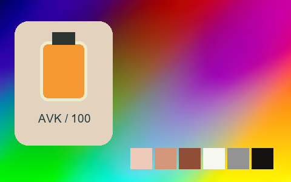

## 132 · Fuji Sensia 100

`nt-colorslide-fuji-sensia-100` · `film-slide` · CC-BY-SA-4.0 · 33³

50% gray Y′ 142.4/255 (+14.9 code values); 25–75% gray span ratio 1.134; mid-gray red minus blue +1.0 code values. Light/medium/deep skin swatches: #F5E6DC, #E2B394, #8A583D. Red/green/blue swatches: #CF3024, #68E05F, #31059B.

Suggested use: Compare on your own SDR product, portrait and landscape footage before selecting.

Trial strength: 0.35–0.8; default 1.0.

Pixel color mapping only; no grain, glow, vignette, spatial haze or beauty effects. Natural footage quality is unaccepted. Check skin/product colors and clipped output.

**Supplied N002 still: actual output at strength 1.0.**

[Full-size lossless 1672×940](../../assets/looks-n002-20261024-r1/full/132-nt-colorslide-fuji-sensia-100.webp) · [Original source](../../assets/looks-n002-20261024-r1/source.png) · [All 500 supplied-image samples](../FILTER_GALLERY.en.md)

| Input swatch | Input RGB | Actual output RGB |
|---|---|---|
| `gray_0` | `#000000` | `#010100` |
| `gray_10` | `#1A1A1A` | `#1D1B1B` |
| `gray_25` | `#404040` | `#414141` |
| `gray_50` | `#808080` | `#8E8E8E` |
| `gray_75` | `#BFBFBF` | `#D4D1D2` |
| `gray_90` | `#E6E6E6` | `#ECEAEA` |
| `gray_100` | `#FFFFFF` | `#F7F3F5` |
| `skin_light` | `#F5DBC6` | `#F5E6DC` |
| `skin_medium` | `#CF9B7B` | `#E2B394` |
| `skin_deep` | `#815438` | `#8A583D` |
| `red` | `#CC3333` | `#CF3024` |
| `green` | `#33CC33` | `#68E05F` |
| `blue` | `#3333CC` | `#31059B` |

Creator: **Pat David** · [Source](https://github.com/NatronGitHub/clut/blob/af7b50d4caf6244fb6895a647f5b6a84efe7931a/colorslide/fuji_sensia_100.png) · commit `af7b50d4caf6244fb6895a647f5b6a84efe7931a`.

Conversion: `native-depth-Hald-to-33-tetrahedral-v1`; 8,192 sampled RGB points; max error 0.0140098; mean 0.0007203. This is numerical approximation, not a perceptual quality score.

License obligations: Credit the named creator and source; retain the CC-BY-SA-4.0 notice and indicate changes. Redistributed adapted LUT data and thumbnails must use CC-BY-SA-4.0 or a compatible license; no additional restrictions.

[License](../../../product/src/ai_ad_editor/look_data/licenses/CC-BY-SA-4.0.txt) · LUT SHA-256 `a2e6511eec34ccffd5ad6e238c9f5a01ed41eb5dc820f2b2efa5e2066805ff0d`.

[Actual preview PNG](../../assets/look500-20261024-r1/previews/nt-colorslide-fuji-sensia-100.png) · [Actual video](../../assets/look500-20261024-r1/videos/nt-colorslide-fuji-sensia-100.mp4)

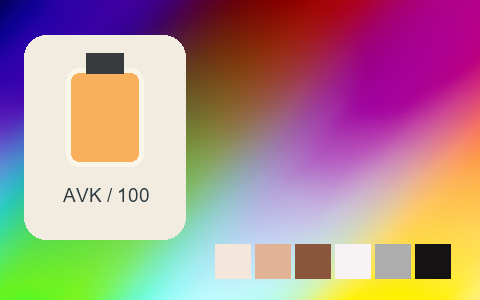

## 133 · Fuji Superia 200 Xpro

`nt-colorslide-fuji-superia-200-xpro` · `film-slide` · CC-BY-SA-4.0 · 33³

50% gray Y′ 113.1/255 (-14.4 code values); 25–75% gray span ratio 0.928; mid-gray red minus blue -175.5 code values. Light/medium/deep skin swatches: #B8D9E7, #6896B5, #045C85. Red/green/blue swatches: #36316C, #51FFE1, #0348BB.

Suggested use: Compare on your own SDR product, portrait and landscape footage before selecting.

Trial strength: 0.35–0.8; default 1.0.

Pixel color mapping only; no grain, glow, vignette, spatial haze or beauty effects. Natural footage quality is unaccepted. Check skin/product colors and clipped output.

**Supplied N002 still: actual output at strength 1.0.**

[Full-size lossless 1672×940](../../assets/looks-n002-20261024-r1/full/133-nt-colorslide-fuji-superia-200-xpro.webp) · [Original source](../../assets/looks-n002-20261024-r1/source.png) · [All 500 supplied-image samples](../FILTER_GALLERY.en.md)

| Input swatch | Input RGB | Actual output RGB |
|---|---|---|
| `gray_0` | `#000000` | `#000005` |
| `gray_10` | `#1A1A1A` | `#002155` |
| `gray_25` | `#404040` | `#024D83` |
| `gray_50` | `#808080` | `#0889B8` |
| `gray_75` | `#BFBFBF` | `#7DC4E3` |
| `gray_90` | `#E6E6E6` | `#BCE4F6` |
| `gray_100` | `#FFFFFF` | `#EAFCFD` |
| `skin_light` | `#F5DBC6` | `#B8D9E7` |
| `skin_medium` | `#CF9B7B` | `#6896B5` |
| `skin_deep` | `#815438` | `#045C85` |
| `red` | `#CC3333` | `#36316C` |
| `green` | `#33CC33` | `#51FFE1` |
| `blue` | `#3333CC` | `#0348BB` |

Creator: **Pat David** · [Source](https://github.com/NatronGitHub/clut/blob/af7b50d4caf6244fb6895a647f5b6a84efe7931a/colorslide/fuji_superia_200_xpro.png) · commit `af7b50d4caf6244fb6895a647f5b6a84efe7931a`.

Conversion: `native-depth-Hald-to-33-tetrahedral-v1`; 8,192 sampled RGB points; max error 0.0226786; mean 0.0008277. This is numerical approximation, not a perceptual quality score.

License obligations: Credit the named creator and source; retain the CC-BY-SA-4.0 notice and indicate changes. Redistributed adapted LUT data and thumbnails must use CC-BY-SA-4.0 or a compatible license; no additional restrictions.

[License](../../../product/src/ai_ad_editor/look_data/licenses/CC-BY-SA-4.0.txt) · LUT SHA-256 `c5ce7749442497af9a55b3ac5182891b2ccc60ee3313a9d6f568c98c6c7ab2d6`.

[Actual preview PNG](../../assets/look500-20261024-r1/previews/nt-colorslide-fuji-superia-200-xpro.png) · [Actual video](../../assets/look500-20261024-r1/videos/nt-colorslide-fuji-superia-200-xpro.mp4)

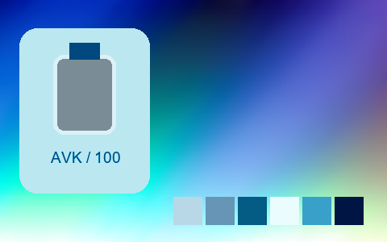

## 134 · Fuji Velvia 50

`nt-colorslide-fuji-velvia-50` · `film-slide` · CC-BY-SA-4.0 · 33³

50% gray Y′ 116.1/255 (-11.4 code values); 25–75% gray span ratio 1.101; mid-gray red minus blue -2.0 code values. Light/medium/deep skin swatches: #F1D2C3, #CA8A75, #783C29. Red/green/blue swatches: #C60617, #03D441, #1817A0.

Suggested use: Compare on your own SDR product, portrait and landscape footage before selecting.

Trial strength: 0.35–0.8; default 1.0.

Pixel color mapping only; no grain, glow, vignette, spatial haze or beauty effects. Natural footage quality is unaccepted. Check skin/product colors and clipped output.

**Supplied N002 still: actual output at strength 1.0.**

[Full-size lossless 1672×940](../../assets/looks-n002-20261024-r1/full/134-nt-colorslide-fuji-velvia-50.webp) · [Original source](../../assets/looks-n002-20261024-r1/source.png) · [All 500 supplied-image samples](../FILTER_GALLERY.en.md)

| Input swatch | Input RGB | Actual output RGB |
|---|---|---|
| `gray_0` | `#000000` | `#010000` |
| `gray_10` | `#1A1A1A` | `#0E0C0B` |
| `gray_25` | `#404040` | `#2B2D2A` |
| `gray_50` | `#808080` | `#747476` |
| `gray_75` | `#BFBFBF` | `#B7B9B8` |
| `gray_90` | `#E6E6E6` | `#E1E1E1` |
| `gray_100` | `#FFFFFF` | `#FAFBF0` |
| `skin_light` | `#F5DBC6` | `#F1D2C3` |
| `skin_medium` | `#CF9B7B` | `#CA8A75` |
| `skin_deep` | `#815438` | `#783C29` |
| `red` | `#CC3333` | `#C60617` |
| `green` | `#33CC33` | `#03D441` |
| `blue` | `#3333CC` | `#1817A0` |

Creator: **Pat David** · [Source](https://github.com/NatronGitHub/clut/blob/af7b50d4caf6244fb6895a647f5b6a84efe7931a/colorslide/fuji_velvia_50.png) · commit `af7b50d4caf6244fb6895a647f5b6a84efe7931a`.

Conversion: `native-depth-Hald-to-33-tetrahedral-v1`; 8,192 sampled RGB points; max error 0.0212190; mean 0.0007108. This is numerical approximation, not a perceptual quality score.

License obligations: Credit the named creator and source; retain the CC-BY-SA-4.0 notice and indicate changes. Redistributed adapted LUT data and thumbnails must use CC-BY-SA-4.0 or a compatible license; no additional restrictions.

[License](../../../product/src/ai_ad_editor/look_data/licenses/CC-BY-SA-4.0.txt) · LUT SHA-256 `e23a9399031f26cd1d2fe65c5188aac6bf5d11657dac26ec38c4612b281cc05c`.

[Actual preview PNG](../../assets/look500-20261024-r1/previews/nt-colorslide-fuji-velvia-50.png) · [Actual video](../../assets/look500-20261024-r1/videos/nt-colorslide-fuji-velvia-50.mp4)

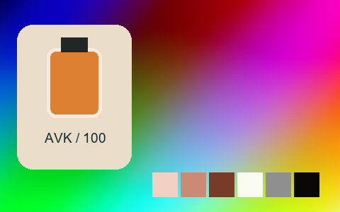

## 135 · Generic Fuji Astia 100

`nt-colorslide-generic-fuji-astia-100` · `film-slide` · CC-BY-SA-4.0 · 33³

50% gray Y′ 127.6/255 (+0.1 code values); 25–75% gray span ratio 1.057; mid-gray red minus blue -1.0 code values. Light/medium/deep skin swatches: #F1D9C5, #D19D79, #825033. Red/green/blue swatches: #CE2C26, #32CE33, #2E2CCB.

Suggested use: Compare on your own SDR product, portrait and landscape footage before selecting.

Trial strength: 0.35–0.8; default 1.0.

Pixel color mapping only; no grain, glow, vignette, spatial haze or beauty effects. Natural footage quality is unaccepted. Check skin/product colors and clipped output.

**Supplied N002 still: actual output at strength 1.0.**

[Full-size lossless 1672×940](../../assets/looks-n002-20261024-r1/full/135-nt-colorslide-generic-fuji-astia-100.webp) · [Original source](../../assets/looks-n002-20261024-r1/source.png) · [All 500 supplied-image samples](../FILTER_GALLERY.en.md)

| Input swatch | Input RGB | Actual output RGB |
|---|---|---|
| `gray_0` | `#000000` | `#000000` |
| `gray_10` | `#1A1A1A` | `#1D1718` |
| `gray_25` | `#404040` | `#3A3A39` |
| `gray_50` | `#808080` | `#817F82` |
| `gray_75` | `#BFBFBF` | `#C2C0C2` |
| `gray_90` | `#E6E6E6` | `#E4E2E3` |
| `gray_100` | `#FFFFFF` | `#FDFDFD` |
| `skin_light` | `#F5DBC6` | `#F1D9C5` |
| `skin_medium` | `#CF9B7B` | `#D19D79` |
| `skin_deep` | `#815438` | `#825033` |
| `red` | `#CC3333` | `#CE2C26` |
| `green` | `#33CC33` | `#32CE33` |
| `blue` | `#3333CC` | `#2E2CCB` |

Creator: **Pat David** · [Source](https://github.com/NatronGitHub/clut/blob/af7b50d4caf6244fb6895a647f5b6a84efe7931a/colorslide/generic_fuji_astia_100.png) · commit `af7b50d4caf6244fb6895a647f5b6a84efe7931a`.

Conversion: `native-depth-Hald-to-33-tetrahedral-v1`; 8,192 sampled RGB points; max error 0.0155835; mean 0.0006748. This is numerical approximation, not a perceptual quality score.

License obligations: Credit the named creator and source; retain the CC-BY-SA-4.0 notice and indicate changes. Redistributed adapted LUT data and thumbnails must use CC-BY-SA-4.0 or a compatible license; no additional restrictions.

[License](../../../product/src/ai_ad_editor/look_data/licenses/CC-BY-SA-4.0.txt) · LUT SHA-256 `196a4b5ee9c93891fbab21866238351c6a1782867f370b01a32498e629049c22`.

[Actual preview PNG](../../assets/look500-20261024-r1/previews/nt-colorslide-generic-fuji-astia-100.png) · [Actual video](../../assets/look500-20261024-r1/videos/nt-colorslide-generic-fuji-astia-100.mp4)

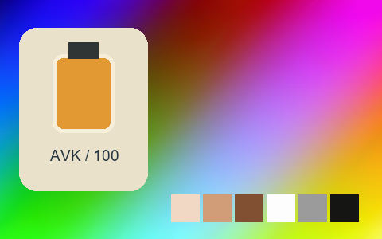

## 136 · Generic Fuji Provia 100

`nt-colorslide-generic-fuji-provia-100` · `film-slide` · CC-BY-SA-4.0 · 33³

50% gray Y′ 135.5/255 (+8.0 code values); 25–75% gray span ratio 1.145; mid-gray red minus blue +0.5 code values. Light/medium/deep skin swatches: #F4E0CE, #DDA682, #8F5130. Red/green/blue swatches: #F02C2B, #08D320, #312BD8.

Suggested use: Compare on your own SDR product, portrait and landscape footage before selecting.

Trial strength: 0.35–0.8; default 1.0.

Pixel color mapping only; no grain, glow, vignette, spatial haze or beauty effects. Natural footage quality is unaccepted. Check skin/product colors and clipped output.

**Supplied N002 still: actual output at strength 1.0.**

[Full-size lossless 1672×940](../../assets/looks-n002-20261024-r1/full/136-nt-colorslide-generic-fuji-provia-100.webp) · [Original source](../../assets/looks-n002-20261024-r1/source.png) · [All 500 supplied-image samples](../FILTER_GALLERY.en.md)

| Input swatch | Input RGB | Actual output RGB |
|---|---|---|
| `gray_0` | `#000000` | `#030801` |
| `gray_10` | `#1A1A1A` | `#181415` |
| `gray_25` | `#404040` | `#35383A` |
| `gray_50` | `#808080` | `#898788` |
| `gray_75` | `#BFBFBF` | `#CBC9CA` |
| `gray_90` | `#E6E6E6` | `#E8E8E9` |
| `gray_100` | `#FFFFFF` | `#FAF3F1` |
| `skin_light` | `#F5DBC6` | `#F4E0CE` |
| `skin_medium` | `#CF9B7B` | `#DDA682` |
| `skin_deep` | `#815438` | `#8F5130` |
| `red` | `#CC3333` | `#F02C2B` |
| `green` | `#33CC33` | `#08D320` |
| `blue` | `#3333CC` | `#312BD8` |

Creator: **Pat David** · [Source](https://github.com/NatronGitHub/clut/blob/af7b50d4caf6244fb6895a647f5b6a84efe7931a/colorslide/generic_fuji_provia_100.png) · commit `af7b50d4caf6244fb6895a647f5b6a84efe7931a`.

Conversion: `native-depth-Hald-to-33-tetrahedral-v1`; 8,192 sampled RGB points; max error 0.0183561; mean 0.0006911. This is numerical approximation, not a perceptual quality score.

License obligations: Credit the named creator and source; retain the CC-BY-SA-4.0 notice and indicate changes. Redistributed adapted LUT data and thumbnails must use CC-BY-SA-4.0 or a compatible license; no additional restrictions.

[License](../../../product/src/ai_ad_editor/look_data/licenses/CC-BY-SA-4.0.txt) · LUT SHA-256 `a913b21e80f65af9c71a385f01ea0080b05e164a5c3258c737c1b554c69fe962`.

[Actual preview PNG](../../assets/look500-20261024-r1/previews/nt-colorslide-generic-fuji-provia-100.png) · [Actual video](../../assets/look500-20261024-r1/videos/nt-colorslide-generic-fuji-provia-100.mp4)

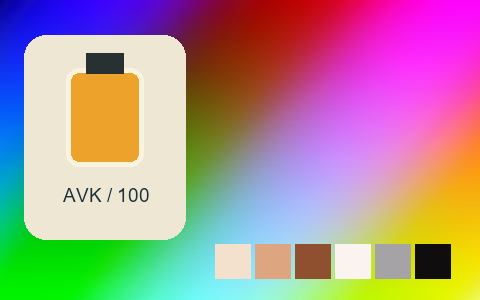

## 137 · Generic Fuji Velvia 100

`nt-colorslide-generic-fuji-velvia-100` · `film-slide` · CC-BY-SA-4.0 · 33³

50% gray Y′ 130.9/255 (+3.4 code values); 25–75% gray span ratio 1.249; mid-gray red minus blue -1.0 code values. Light/medium/deep skin swatches: #F8E9D4, #E7A87A, #8B4C25. Red/green/blue swatches: #F41C22, #01EA02, #2E12E8.

Suggested use: Compare on your own SDR product, portrait and landscape footage before selecting.

Trial strength: 0.35–0.8; default 1.0.

Pixel color mapping only; no grain, glow, vignette, spatial haze or beauty effects. Natural footage quality is unaccepted. Check skin/product colors and clipped output.

**Supplied N002 still: actual output at strength 1.0.**

[Full-size lossless 1672×940](../../assets/looks-n002-20261024-r1/full/137-nt-colorslide-generic-fuji-velvia-100.webp) · [Original source](../../assets/looks-n002-20261024-r1/source.png) · [All 500 supplied-image samples](../FILTER_GALLERY.en.md)

| Input swatch | Input RGB | Actual output RGB |
|---|---|---|
| `gray_0` | `#000000` | `#070A06` |
| `gray_10` | `#1A1A1A` | `#100F0F` |
| `gray_25` | `#404040` | `#303130` |
| `gray_50` | `#808080` | `#848284` |
| `gray_75` | `#BFBFBF` | `#D0D0CE` |
| `gray_90` | `#E6E6E6` | `#EDEEED` |
| `gray_100` | `#FFFFFF` | `#FEFEFE` |
| `skin_light` | `#F5DBC6` | `#F8E9D4` |
| `skin_medium` | `#CF9B7B` | `#E7A87A` |
| `skin_deep` | `#815438` | `#8B4C25` |
| `red` | `#CC3333` | `#F41C22` |
| `green` | `#33CC33` | `#01EA02` |
| `blue` | `#3333CC` | `#2E12E8` |

Creator: **Pat David** · [Source](https://github.com/NatronGitHub/clut/blob/af7b50d4caf6244fb6895a647f5b6a84efe7931a/colorslide/generic_fuji_velvia_100.png) · commit `af7b50d4caf6244fb6895a647f5b6a84efe7931a`.

Conversion: `native-depth-Hald-to-33-tetrahedral-v1`; 8,192 sampled RGB points; max error 0.0223112; mean 0.0007774. This is numerical approximation, not a perceptual quality score.

License obligations: Credit the named creator and source; retain the CC-BY-SA-4.0 notice and indicate changes. Redistributed adapted LUT data and thumbnails must use CC-BY-SA-4.0 or a compatible license; no additional restrictions.

[License](../../../product/src/ai_ad_editor/look_data/licenses/CC-BY-SA-4.0.txt) · LUT SHA-256 `2d0f596a602f3093cf57af2c633f6d64c2822007d638dfec812c4e67f208321c`.

[Actual preview PNG](../../assets/look500-20261024-r1/previews/nt-colorslide-generic-fuji-velvia-100.png) · [Actual video](../../assets/look500-20261024-r1/videos/nt-colorslide-generic-fuji-velvia-100.mp4)

## 138 · Generic Kodachrome 64

`nt-colorslide-generic-kodachrome-64` · `film-slide` · CC-BY-SA-4.0 · 33³

50% gray Y′ 125.9/255 (-1.6 code values); 25–75% gray span ratio 1.264; mid-gray red minus blue +0.5 code values. Light/medium/deep skin swatches: #F9E2D5, #E4A281, #89462A. Red/green/blue swatches: #EE2725, #02D326, #211AC9.

Suggested use: Compare on your own SDR product, portrait and landscape footage before selecting.

Trial strength: 0.35–0.8; default 1.0.

Pixel color mapping only; no grain, glow, vignette, spatial haze or beauty effects. Natural footage quality is unaccepted. Check skin/product colors and clipped output.

**Supplied N002 still: actual output at strength 1.0.**

[Full-size lossless 1672×940](../../assets/looks-n002-20261024-r1/full/138-nt-colorslide-generic-kodachrome-64.webp) · [Original source](../../assets/looks-n002-20261024-r1/source.png) · [All 500 supplied-image samples](../FILTER_GALLERY.en.md)

| Input swatch | Input RGB | Actual output RGB |
|---|---|---|
| `gray_0` | `#000000` | `#040902` |
| `gray_10` | `#1A1A1A` | `#0E0B0D` |
| `gray_25` | `#404040` | `#2B282D` |
| `gray_50` | `#808080` | `#827D81` |
| `gray_75` | `#BFBFBF` | `#CFC9CE` |
| `gray_90` | `#E6E6E6` | `#ECE9EE` |
| `gray_100` | `#FFFFFF` | `#F9FCF5` |
| `skin_light` | `#F5DBC6` | `#F9E2D5` |
| `skin_medium` | `#CF9B7B` | `#E4A281` |
| `skin_deep` | `#815438` | `#89462A` |
| `red` | `#CC3333` | `#EE2725` |
| `green` | `#33CC33` | `#02D326` |
| `blue` | `#3333CC` | `#211AC9` |

Creator: **Pat David** · [Source](https://github.com/NatronGitHub/clut/blob/af7b50d4caf6244fb6895a647f5b6a84efe7931a/colorslide/generic_kodachrome_64.png) · commit `af7b50d4caf6244fb6895a647f5b6a84efe7931a`.

Conversion: `native-depth-Hald-to-33-tetrahedral-v1`; 8,192 sampled RGB points; max error 0.0264376; mean 0.0007330. This is numerical approximation, not a perceptual quality score.

License obligations: Credit the named creator and source; retain the CC-BY-SA-4.0 notice and indicate changes. Redistributed adapted LUT data and thumbnails must use CC-BY-SA-4.0 or a compatible license; no additional restrictions.

[License](../../../product/src/ai_ad_editor/look_data/licenses/CC-BY-SA-4.0.txt) · LUT SHA-256 `f9c01daf6ac8fa4116c5d11ead902ddefc5bd5bb88ddfbd90943b1895a901b93`.

[Actual preview PNG](../../assets/look500-20261024-r1/previews/nt-colorslide-generic-kodachrome-64.png) · [Actual video](../../assets/look500-20261024-r1/videos/nt-colorslide-generic-kodachrome-64.mp4)

## 139 · Generic Kodak Ektachrome 100 Vs

`nt-colorslide-generic-kodak-ektachrome-100-vs` · `film-slide` · CC-BY-SA-4.0 · 33³

50% gray Y′ 125.2/255 (-2.3 code values); 25–75% gray span ratio 1.207; mid-gray red minus blue +9.0 code values. Light/medium/deep skin swatches: #FFE0CF, #F09C76, #934228. Red/green/blue swatches: #FD171C, #01D92E, #2823C4.

Suggested use: Compare on your own SDR product, portrait and landscape footage before selecting.

Trial strength: 0.35–0.8; default 1.0.

Pixel color mapping only; no grain, glow, vignette, spatial haze or beauty effects. Natural footage quality is unaccepted. Check skin/product colors and clipped output.

**Supplied N002 still: actual output at strength 1.0.**

[Full-size lossless 1672×940](../../assets/looks-n002-20261024-r1/full/139-nt-colorslide-generic-kodak-ektachrome-100-vs.webp) · [Original source](../../assets/looks-n002-20261024-r1/source.png) · [All 500 supplied-image samples](../FILTER_GALLERY.en.md)

| Input swatch | Input RGB | Actual output RGB |
|---|---|---|
| `gray_0` | `#000000` | `#010401` |
| `gray_10` | `#1A1A1A` | `#150F10` |
| `gray_25` | `#404040` | `#352E2E` |
| `gray_50` | `#808080` | `#857B7C` |
| `gray_75` | `#BFBFBF` | `#D5C6C6` |
| `gray_90` | `#E6E6E6` | `#FAEAE8` |
| `gray_100` | `#FFFFFF` | `#FFFFFD` |
| `skin_light` | `#F5DBC6` | `#FFE0CF` |
| `skin_medium` | `#CF9B7B` | `#F09C76` |
| `skin_deep` | `#815438` | `#934228` |
| `red` | `#CC3333` | `#FD171C` |
| `green` | `#33CC33` | `#01D92E` |
| `blue` | `#3333CC` | `#2823C4` |

Creator: **Pat David** · [Source](https://github.com/NatronGitHub/clut/blob/af7b50d4caf6244fb6895a647f5b6a84efe7931a/colorslide/generic_kodak_ektachrome_100_vs.png) · commit `af7b50d4caf6244fb6895a647f5b6a84efe7931a`.

Conversion: `native-depth-Hald-to-33-tetrahedral-v1`; 8,192 sampled RGB points; max error 0.0243554; mean 0.0007521. This is numerical approximation, not a perceptual quality score.

License obligations: Credit the named creator and source; retain the CC-BY-SA-4.0 notice and indicate changes. Redistributed adapted LUT data and thumbnails must use CC-BY-SA-4.0 or a compatible license; no additional restrictions.

[License](../../../product/src/ai_ad_editor/look_data/licenses/CC-BY-SA-4.0.txt) · LUT SHA-256 `5e9bd7ca3eecf6556c63fcc8e875ee3c519481bce2d2c0d7b1c945ab91c21264`.

[Actual preview PNG](../../assets/look500-20261024-r1/previews/nt-colorslide-generic-kodak-ektachrome-100-vs.png) · [Actual video](../../assets/look500-20261024-r1/videos/nt-colorslide-generic-kodak-ektachrome-100-vs.mp4)

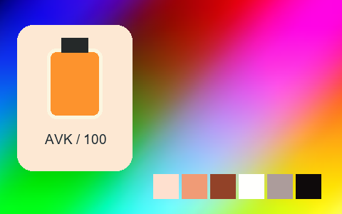

## 140 · Kodak E-100 Gx Ektachrome 100

`nt-colorslide-kodak-e-100-gx-ektachrome-100` · `film-slide` · CC-BY-SA-4.0 · 33³

50% gray Y′ 127.3/255 (-0.2 code values); 25–75% gray span ratio 1.087; mid-gray red minus blue -4.0 code values. Light/medium/deep skin swatches: #EFD5D7, #CC9088, #794238. Red/green/blue swatches: #AE061C, #89CC73, #113EB0.

Suggested use: Compare on your own SDR product, portrait and landscape footage before selecting.

Trial strength: 0.35–0.8; default 1.0.

Pixel color mapping only; no grain, glow, vignette, spatial haze or beauty effects. Natural footage quality is unaccepted. Check skin/product colors and clipped output.

**Supplied N002 still: actual output at strength 1.0.**

[Full-size lossless 1672×940](../../assets/looks-n002-20261024-r1/full/140-nt-colorslide-kodak-e-100-gx-ektachrome-100.webp) · [Original source](../../assets/looks-n002-20261024-r1/source.png) · [All 500 supplied-image samples](../FILTER_GALLERY.en.md)

| Input swatch | Input RGB | Actual output RGB |
|---|---|---|
| `gray_0` | `#000000` | `#0E0203` |
| `gray_10` | `#1A1A1A` | `#161415` |
| `gray_25` | `#404040` | `#3A373B` |
| `gray_50` | `#808080` | `#827E85` |
| `gray_75` | `#BFBFBF` | `#C4C1CC` |
| `gray_90` | `#E6E6E6` | `#E8E2EC` |
| `gray_100` | `#FFFFFF` | `#FAF6EE` |
| `skin_light` | `#F5DBC6` | `#EFD5D7` |
| `skin_medium` | `#CF9B7B` | `#CC9088` |
| `skin_deep` | `#815438` | `#794238` |
| `red` | `#CC3333` | `#AE061C` |
| `green` | `#33CC33` | `#89CC73` |
| `blue` | `#3333CC` | `#113EB0` |

Creator: **Pat David** · [Source](https://github.com/NatronGitHub/clut/blob/af7b50d4caf6244fb6895a647f5b6a84efe7931a/colorslide/kodak_e-100_gx_ektachrome_100.png) · commit `af7b50d4caf6244fb6895a647f5b6a84efe7931a`.

Conversion: `native-depth-Hald-to-33-tetrahedral-v1`; 8,192 sampled RGB points; max error 0.0109300; mean 0.0006807. This is numerical approximation, not a perceptual quality score.

License obligations: Credit the named creator and source; retain the CC-BY-SA-4.0 notice and indicate changes. Redistributed adapted LUT data and thumbnails must use CC-BY-SA-4.0 or a compatible license; no additional restrictions.

[License](../../../product/src/ai_ad_editor/look_data/licenses/CC-BY-SA-4.0.txt) · LUT SHA-256 `c90441367dafd4629b8149066612123e1bbf724a12b603dcb6d0c20d19462363`.

[Actual preview PNG](../../assets/look500-20261024-r1/previews/nt-colorslide-kodak-e-100-gx-ektachrome-100.png) · [Actual video](../../assets/look500-20261024-r1/videos/nt-colorslide-kodak-e-100-gx-ektachrome-100.mp4)

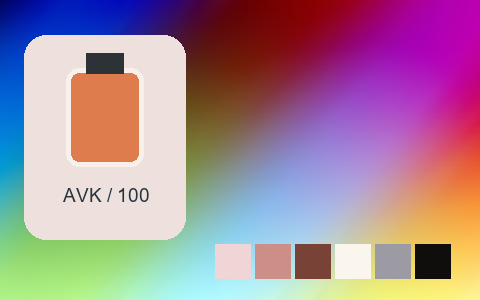

## 141 · Kodak Ektachrome 100 Vs

`nt-colorslide-kodak-ektachrome-100-vs` · `film-slide` · CC-BY-SA-4.0 · 33³

50% gray Y′ 116.9/255 (-10.6 code values); 25–75% gray span ratio 1.096; mid-gray red minus blue +0.0 code values. Light/medium/deep skin swatches: #FBD3C9, #D78D7B, #803E2B. Red/green/blue swatches: #D30A0C, #92D14C, #021789.

Suggested use: Compare on your own SDR product, portrait and landscape footage before selecting.

Trial strength: 0.35–0.8; default 1.0.

Pixel color mapping only; no grain, glow, vignette, spatial haze or beauty effects. Natural footage quality is unaccepted. Check skin/product colors and clipped output.

**Supplied N002 still: actual output at strength 1.0.**

[Full-size lossless 1672×940](../../assets/looks-n002-20261024-r1/full/141-nt-colorslide-kodak-ektachrome-100-vs.webp) · [Original source](../../assets/looks-n002-20261024-r1/source.png) · [All 500 supplied-image samples](../FILTER_GALLERY.en.md)

| Input swatch | Input RGB | Actual output RGB |
|---|---|---|
| `gray_0` | `#000000` | `#000000` |
| `gray_10` | `#1A1A1A` | `#0D0C0B` |
| `gray_25` | `#404040` | `#2F2C2F` |
| `gray_50` | `#808080` | `#787478` |
| `gray_75` | `#BFBFBF` | `#BFB6BE` |
| `gray_90` | `#E6E6E6` | `#EADFE6` |
| `gray_100` | `#FFFFFF` | `#FAF9FA` |
| `skin_light` | `#F5DBC6` | `#FBD3C9` |
| `skin_medium` | `#CF9B7B` | `#D78D7B` |
| `skin_deep` | `#815438` | `#803E2B` |
| `red` | `#CC3333` | `#D30A0C` |
| `green` | `#33CC33` | `#92D14C` |
| `blue` | `#3333CC` | `#021789` |

Creator: **Pat David** · [Source](https://github.com/NatronGitHub/clut/blob/af7b50d4caf6244fb6895a647f5b6a84efe7931a/colorslide/kodak_ektachrome_100_vs.png) · commit `af7b50d4caf6244fb6895a647f5b6a84efe7931a`.

Conversion: `native-depth-Hald-to-33-tetrahedral-v1`; 8,192 sampled RGB points; max error 0.0185515; mean 0.0007673. This is numerical approximation, not a perceptual quality score.

License obligations: Credit the named creator and source; retain the CC-BY-SA-4.0 notice and indicate changes. Redistributed adapted LUT data and thumbnails must use CC-BY-SA-4.0 or a compatible license; no additional restrictions.

[License](../../../product/src/ai_ad_editor/look_data/licenses/CC-BY-SA-4.0.txt) · LUT SHA-256 `139f6054c64a865c69b98039561ea7b94b9c5989404e2ba73be0f2a64f040988`.

[Actual preview PNG](../../assets/look500-20261024-r1/previews/nt-colorslide-kodak-ektachrome-100-vs.png) · [Actual video](../../assets/look500-20261024-r1/videos/nt-colorslide-kodak-ektachrome-100-vs.mp4)

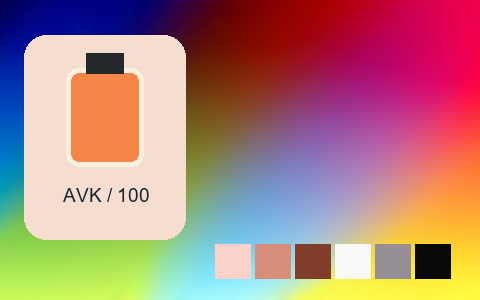

## 142 · Kodak Elite Chrome 200

`nt-colorslide-kodak-elite-chrome-200` · `film-slide` · CC-BY-SA-4.0 · 33³

50% gray Y′ 123.5/255 (-4.0 code values); 25–75% gray span ratio 1.101; mid-gray red minus blue +0.5 code values. Light/medium/deep skin swatches: #F0D6C8, #D0947A, #7E462D. Red/green/blue swatches: #B3070A, #8AD367, #0A1299.

Suggested use: Compare on your own SDR product, portrait and landscape footage before selecting.

Trial strength: 0.35–0.8; default 1.0.

Pixel color mapping only; no grain, glow, vignette, spatial haze or beauty effects. Natural footage quality is unaccepted. Check skin/product colors and clipped output.

**Supplied N002 still: actual output at strength 1.0.**

[Full-size lossless 1672×940](../../assets/looks-n002-20261024-r1/full/142-nt-colorslide-kodak-elite-chrome-200.webp) · [Original source](../../assets/looks-n002-20261024-r1/source.png) · [All 500 supplied-image samples](../FILTER_GALLERY.en.md)

| Input swatch | Input RGB | Actual output RGB |
|---|---|---|
| `gray_0` | `#000000` | `#000000` |
| `gray_10` | `#1A1A1A` | `#131112` |
| `gray_25` | `#404040` | `#363333` |
| `gray_50` | `#808080` | `#7D7B7D` |
| `gray_75` | `#BFBFBF` | `#C1C0BF` |
| `gray_90` | `#E6E6E6` | `#E3E0E2` |
| `gray_100` | `#FFFFFF` | `#FBF3F4` |
| `skin_light` | `#F5DBC6` | `#F0D6C8` |
| `skin_medium` | `#CF9B7B` | `#D0947A` |
| `skin_deep` | `#815438` | `#7E462D` |
| `red` | `#CC3333` | `#B3070A` |
| `green` | `#33CC33` | `#8AD367` |
| `blue` | `#3333CC` | `#0A1299` |

Creator: **Pat David** · [Source](https://github.com/NatronGitHub/clut/blob/af7b50d4caf6244fb6895a647f5b6a84efe7931a/colorslide/kodak_elite_chrome_200.png) · commit `af7b50d4caf6244fb6895a647f5b6a84efe7931a`.

Conversion: `native-depth-Hald-to-33-tetrahedral-v1`; 8,192 sampled RGB points; max error 0.0132583; mean 0.0006819. This is numerical approximation, not a perceptual quality score.

License obligations: Credit the named creator and source; retain the CC-BY-SA-4.0 notice and indicate changes. Redistributed adapted LUT data and thumbnails must use CC-BY-SA-4.0 or a compatible license; no additional restrictions.

[License](../../../product/src/ai_ad_editor/look_data/licenses/CC-BY-SA-4.0.txt) · LUT SHA-256 `5d075584e4d88acf5c15b4070f2afbcde96e189c8b6c799da9cd6f8211e0f528`.

[Actual preview PNG](../../assets/look500-20261024-r1/previews/nt-colorslide-kodak-elite-chrome-200.png) · [Actual video](../../assets/look500-20261024-r1/videos/nt-colorslide-kodak-elite-chrome-200.mp4)

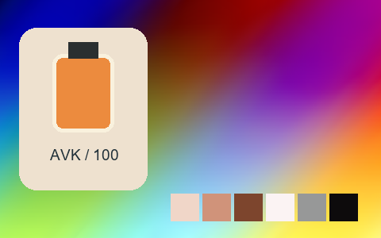

## 143 · Kodak Elite Chrome 400

`nt-colorslide-kodak-elite-chrome-400` · `film-slide` · CC-BY-SA-4.0 · 33³

50% gray Y′ 126.2/255 (-1.3 code values); 25–75% gray span ratio 1.101; mid-gray red minus blue +1.0 code values. Light/medium/deep skin swatches: #EED3C5, #CA9373, #794227. Red/green/blue swatches: #B91005, #88CC73, #0A2CA3.

Suggested use: Compare on your own SDR product, portrait and landscape footage before selecting.

Trial strength: 0.35–0.8; default 1.0.

Pixel color mapping only; no grain, glow, vignette, spatial haze or beauty effects. Natural footage quality is unaccepted. Check skin/product colors and clipped output.

**Supplied N002 still: actual output at strength 1.0.**

[Full-size lossless 1672×940](../../assets/looks-n002-20261024-r1/full/143-nt-colorslide-kodak-elite-chrome-400.webp) · [Original source](../../assets/looks-n002-20261024-r1/source.png) · [All 500 supplied-image samples](../FILTER_GALLERY.en.md)

| Input swatch | Input RGB | Actual output RGB |
|---|---|---|
| `gray_0` | `#000000` | `#000000` |
| `gray_10` | `#1A1A1A` | `#161212` |
| `gray_25` | `#404040` | `#333132` |
| `gray_50` | `#808080` | `#7F7E7E` |
| `gray_75` | `#BFBFBF` | `#BEBEBF` |
| `gray_90` | `#E6E6E6` | `#E3E0E2` |
| `gray_100` | `#FFFFFF` | `#FDFDFD` |
| `skin_light` | `#F5DBC6` | `#EED3C5` |
| `skin_medium` | `#CF9B7B` | `#CA9373` |
| `skin_deep` | `#815438` | `#794227` |
| `red` | `#CC3333` | `#B91005` |
| `green` | `#33CC33` | `#88CC73` |
| `blue` | `#3333CC` | `#0A2CA3` |

Creator: **Pat David** · [Source](https://github.com/NatronGitHub/clut/blob/af7b50d4caf6244fb6895a647f5b6a84efe7931a/colorslide/kodak_elite_chrome_400.png) · commit `af7b50d4caf6244fb6895a647f5b6a84efe7931a`.

Conversion: `native-depth-Hald-to-33-tetrahedral-v1`; 8,192 sampled RGB points; max error 0.0194065; mean 0.0007157. This is numerical approximation, not a perceptual quality score.

License obligations: Credit the named creator and source; retain the CC-BY-SA-4.0 notice and indicate changes. Redistributed adapted LUT data and thumbnails must use CC-BY-SA-4.0 or a compatible license; no additional restrictions.

[License](../../../product/src/ai_ad_editor/look_data/licenses/CC-BY-SA-4.0.txt) · LUT SHA-256 `9c8f3d1003a558f842e16c234304fd1c8df876bc6fd90c8efd36242c16a10e13`.

[Actual preview PNG](../../assets/look500-20261024-r1/previews/nt-colorslide-kodak-elite-chrome-400.png) · [Actual video](../../assets/look500-20261024-r1/videos/nt-colorslide-kodak-elite-chrome-400.mp4)

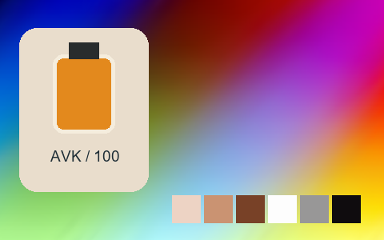

## 144 · Kodak Elite Extracolor 100

`nt-colorslide-kodak-elite-extracolor-100` · `film-slide` · CC-BY-SA-4.0 · 33³

50% gray Y′ 120.8/255 (-6.7 code values); 25–75% gray span ratio 1.136; mid-gray red minus blue -2.5 code values. Light/medium/deep skin swatches: #F1DBC9, #D39471, #793E29. Red/green/blue swatches: #B00810, #63DE1B, #0930AA.

Suggested use: Compare on your own SDR product, portrait and landscape footage before selecting.

Trial strength: 0.35–0.8; default 1.0.

Pixel color mapping only; no grain, glow, vignette, spatial haze or beauty effects. Natural footage quality is unaccepted. Check skin/product colors and clipped output.

**Supplied N002 still: actual output at strength 1.0.**

[Full-size lossless 1672×940](../../assets/looks-n002-20261024-r1/full/144-nt-colorslide-kodak-elite-extracolor-100.webp) · [Original source](../../assets/looks-n002-20261024-r1/source.png) · [All 500 supplied-image samples](../FILTER_GALLERY.en.md)

| Input swatch | Input RGB | Actual output RGB |
|---|---|---|
| `gray_0` | `#000000` | `#000000` |
| `gray_10` | `#1A1A1A` | `#171514` |
| `gray_25` | `#404040` | `#323233` |
| `gray_50` | `#808080` | `#78797A` |
| `gray_75` | `#BFBFBF` | `#C3C3C2` |
| `gray_90` | `#E6E6E6` | `#E7E9E7` |
| `gray_100` | `#FFFFFF` | `#FDFCFA` |
| `skin_light` | `#F5DBC6` | `#F1DBC9` |
| `skin_medium` | `#CF9B7B` | `#D39471` |
| `skin_deep` | `#815438` | `#793E29` |
| `red` | `#CC3333` | `#B00810` |
| `green` | `#33CC33` | `#63DE1B` |
| `blue` | `#3333CC` | `#0930AA` |

Creator: **Pat David** · [Source](https://github.com/NatronGitHub/clut/blob/af7b50d4caf6244fb6895a647f5b6a84efe7931a/colorslide/kodak_elite_extracolor_100.png) · commit `af7b50d4caf6244fb6895a647f5b6a84efe7931a`.

Conversion: `native-depth-Hald-to-33-tetrahedral-v1`; 8,192 sampled RGB points; max error 0.0153852; mean 0.0007457. This is numerical approximation, not a perceptual quality score.

License obligations: Credit the named creator and source; retain the CC-BY-SA-4.0 notice and indicate changes. Redistributed adapted LUT data and thumbnails must use CC-BY-SA-4.0 or a compatible license; no additional restrictions.

[License](../../../product/src/ai_ad_editor/look_data/licenses/CC-BY-SA-4.0.txt) · LUT SHA-256 `2bb5e4712c8274ea666585ed8a6de0fc3fb20b2cd41b030d0dab9cdb90e27fa4`.

[Actual preview PNG](../../assets/look500-20261024-r1/previews/nt-colorslide-kodak-elite-extracolor-100.png) · [Actual video](../../assets/look500-20261024-r1/videos/nt-colorslide-kodak-elite-extracolor-100.mp4)

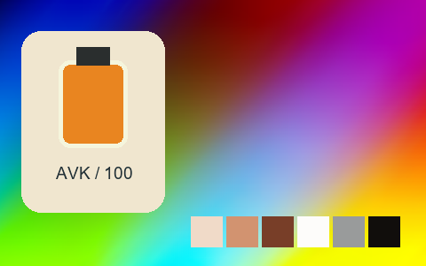

## 145 · Kodak Kodachrome 200

`nt-colorslide-kodak-kodachrome-200` · `film-slide` · CC-BY-SA-4.0 · 33³

50% gray Y′ 133.9/255 (+6.4 code values); 25–75% gray span ratio 1.052; mid-gray red minus blue +1.5 code values. Light/medium/deep skin swatches: #ECD2CE, #CE9E94, #8B5043. Red/green/blue swatches: #CC2023, #7CC68E, #1B1F86.

Suggested use: Compare on your own SDR product, portrait and landscape footage before selecting.

Trial strength: 0.35–0.8; default 1.0.

Pixel color mapping only; no grain, glow, vignette, spatial haze or beauty effects. Natural footage quality is unaccepted. Check skin/product colors and clipped output.

**Supplied N002 still: actual output at strength 1.0.**

[Full-size lossless 1672×940](../../assets/looks-n002-20261024-r1/full/145-nt-colorslide-kodak-kodachrome-200.webp) · [Original source](../../assets/looks-n002-20261024-r1/source.png) · [All 500 supplied-image samples](../FILTER_GALLERY.en.md)

| Input swatch | Input RGB | Actual output RGB |
|---|---|---|
| `gray_0` | `#000000` | `#050406` |
| `gray_10` | `#1A1A1A` | `#141312` |
| `gray_25` | `#404040` | `#383738` |
| `gray_50` | `#808080` | `#8B848A` |
| `gray_75` | `#BFBFBF` | `#C1BCC1` |
| `gray_90` | `#E6E6E6` | `#E4D9E0` |
| `gray_100` | `#FFFFFF` | `#FCF8FA` |
| `skin_light` | `#F5DBC6` | `#ECD2CE` |
| `skin_medium` | `#CF9B7B` | `#CE9E94` |
| `skin_deep` | `#815438` | `#8B5043` |
| `red` | `#CC3333` | `#CC2023` |
| `green` | `#33CC33` | `#7CC68E` |
| `blue` | `#3333CC` | `#1B1F86` |

Creator: **Pat David** · [Source](https://github.com/NatronGitHub/clut/blob/af7b50d4caf6244fb6895a647f5b6a84efe7931a/colorslide/kodak_kodachrome_200.png) · commit `af7b50d4caf6244fb6895a647f5b6a84efe7931a`.

Conversion: `native-depth-Hald-to-33-tetrahedral-v1`; 8,192 sampled RGB points; max error 0.0135256; mean 0.0006796. This is numerical approximation, not a perceptual quality score.

License obligations: Credit the named creator and source; retain the CC-BY-SA-4.0 notice and indicate changes. Redistributed adapted LUT data and thumbnails must use CC-BY-SA-4.0 or a compatible license; no additional restrictions.

[License](../../../product/src/ai_ad_editor/look_data/licenses/CC-BY-SA-4.0.txt) · LUT SHA-256 `aa96a769589fbb4eaf40d8ec267bc64a2e5c80b3fb1d2fd337af3226cffec376`.

[Actual preview PNG](../../assets/look500-20261024-r1/previews/nt-colorslide-kodak-kodachrome-200.png) · [Actual video](../../assets/look500-20261024-r1/videos/nt-colorslide-kodak-kodachrome-200.mp4)

## 146 · Kodak Kodachrome 25

`nt-colorslide-kodak-kodachrome-25` · `film-slide` · CC-BY-SA-4.0 · 33³

50% gray Y′ 145.3/255 (+17.8 code values); 25–75% gray span ratio 1.127; mid-gray red minus blue -6.5 code values. Light/medium/deep skin swatches: #F0E3D4, #CCAE97, #976341. Red/green/blue swatches: #E74F43, #B9D766, #020977.

Suggested use: Compare on your own SDR product, portrait and landscape footage before selecting.

Trial strength: 0.35–0.8; default 1.0.

Pixel color mapping only; no grain, glow, vignette, spatial haze or beauty effects. Natural footage quality is unaccepted. Check skin/product colors and clipped output.

**Supplied N002 still: actual output at strength 1.0.**

[Full-size lossless 1672×940](../../assets/looks-n002-20261024-r1/full/146-nt-colorslide-kodak-kodachrome-25.webp) · [Original source](../../assets/looks-n002-20261024-r1/source.png) · [All 500 supplied-image samples](../FILTER_GALLERY.en.md)

| Input swatch | Input RGB | Actual output RGB |
|---|---|---|
| `gray_0` | `#000000` | `#070B05` |
| `gray_10` | `#1A1A1A` | `#0D0D0F` |
| `gray_25` | `#404040` | `#32373B` |
| `gray_50` | `#808080` | `#8E9294` |
| `gray_75` | `#BFBFBF` | `#C0C7CC` |
| `gray_90` | `#E6E6E6` | `#E1ECF1` |
| `gray_100` | `#FFFFFF` | `#FAFEFE` |
| `skin_light` | `#F5DBC6` | `#F0E3D4` |
| `skin_medium` | `#CF9B7B` | `#CCAE97` |
| `skin_deep` | `#815438` | `#976341` |
| `red` | `#CC3333` | `#E74F43` |
| `green` | `#33CC33` | `#B9D766` |
| `blue` | `#3333CC` | `#020977` |

Creator: **Pat David** · [Source](https://github.com/NatronGitHub/clut/blob/af7b50d4caf6244fb6895a647f5b6a84efe7931a/colorslide/kodak_kodachrome_25.png) · commit `af7b50d4caf6244fb6895a647f5b6a84efe7931a`.

Conversion: `native-depth-Hald-to-33-tetrahedral-v1`; 8,192 sampled RGB points; max error 0.0462922; mean 0.0010303. This is numerical approximation, not a perceptual quality score.

License obligations: Credit the named creator and source; retain the CC-BY-SA-4.0 notice and indicate changes. Redistributed adapted LUT data and thumbnails must use CC-BY-SA-4.0 or a compatible license; no additional restrictions.

[License](../../../product/src/ai_ad_editor/look_data/licenses/CC-BY-SA-4.0.txt) · LUT SHA-256 `f78369cecde2675bbd3543b93d2b075e1ccf445712d6a769b3f0d6accd300b31`.

[Actual preview PNG](../../assets/look500-20261024-r1/previews/nt-colorslide-kodak-kodachrome-25.png) · [Actual video](../../assets/look500-20261024-r1/videos/nt-colorslide-kodak-kodachrome-25.mp4)

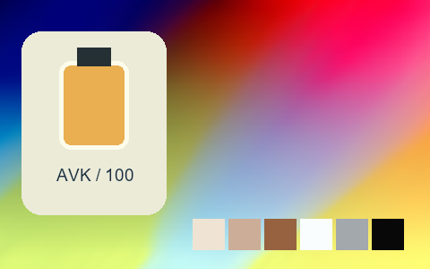

## 147 · Kodak Kodachrome 64

`nt-colorslide-kodak-kodachrome-64` · `film-slide` · CC-BY-SA-4.0 · 33³

50% gray Y′ 135.2/255 (+7.7 code values); 25–75% gray span ratio 1.069; mid-gray red minus blue -2.5 code values. Light/medium/deep skin swatches: #F5D8D5, #D8A696, #97573D. Red/green/blue swatches: #D32A1C, #82CD90, #091092.

Suggested use: Compare on your own SDR product, portrait and landscape footage before selecting.

Trial strength: 0.35–0.8; default 1.0.

Pixel color mapping only; no grain, glow, vignette, spatial haze or beauty effects. Natural footage quality is unaccepted. Check skin/product colors and clipped output.

**Supplied N002 still: actual output at strength 1.0.**

[Full-size lossless 1672×940](../../assets/looks-n002-20261024-r1/full/147-nt-colorslide-kodak-kodachrome-64.webp) · [Original source](../../assets/looks-n002-20261024-r1/source.png) · [All 500 supplied-image samples](../FILTER_GALLERY.en.md)

| Input swatch | Input RGB | Actual output RGB |
|---|---|---|
| `gray_0` | `#000000` | `#040702` |
| `gray_10` | `#1A1A1A` | `#0F0E0F` |
| `gray_25` | `#404040` | `#3C373A` |
| `gray_50` | `#808080` | `#8B858E` |
| `gray_75` | `#BFBFBF` | `#C7BEC8` |
| `gray_90` | `#E6E6E6` | `#E9E0E7` |
| `gray_100` | `#FFFFFF` | `#FBF6F6` |
| `skin_light` | `#F5DBC6` | `#F5D8D5` |
| `skin_medium` | `#CF9B7B` | `#D8A696` |
| `skin_deep` | `#815438` | `#97573D` |
| `red` | `#CC3333` | `#D32A1C` |
| `green` | `#33CC33` | `#82CD90` |
| `blue` | `#3333CC` | `#091092` |

Creator: **Pat David** · [Source](https://github.com/NatronGitHub/clut/blob/af7b50d4caf6244fb6895a647f5b6a84efe7931a/colorslide/kodak_kodachrome_64.png) · commit `af7b50d4caf6244fb6895a647f5b6a84efe7931a`.

Conversion: `native-depth-Hald-to-33-tetrahedral-v1`; 8,192 sampled RGB points; max error 0.0180990; mean 0.0006958. This is numerical approximation, not a perceptual quality score.

License obligations: Credit the named creator and source; retain the CC-BY-SA-4.0 notice and indicate changes. Redistributed adapted LUT data and thumbnails must use CC-BY-SA-4.0 or a compatible license; no additional restrictions.

[License](../../../product/src/ai_ad_editor/look_data/licenses/CC-BY-SA-4.0.txt) · LUT SHA-256 `379f64a6b7381631125ee51aadac7a2f062345c7750842073e95a7f86c54a01d`.

[Actual preview PNG](../../assets/look500-20261024-r1/previews/nt-colorslide-kodak-kodachrome-64.png) · [Actual video](../../assets/look500-20261024-r1/videos/nt-colorslide-kodak-kodachrome-64.mp4)

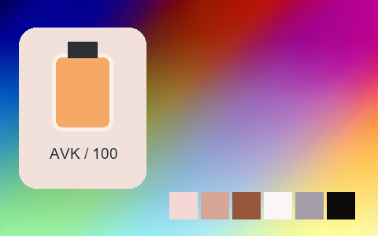

## 148 · Lomography X-Pro Slide 200

`nt-colorslide-lomography-x-pro-slide-200` · `film-slide` · CC-BY-SA-4.0 · 33³

50% gray Y′ 133.8/255 (+6.3 code values); 25–75% gray span ratio 1.226; mid-gray red minus blue -1.0 code values. Light/medium/deep skin swatches: #F1E5DB, #DAB68E, #7D5237. Red/green/blue swatches: #D6422B, #6CD569, #2614B4.

Suggested use: Compare on your own SDR product, portrait and landscape footage before selecting.

Trial strength: 0.35–0.8; default 1.0.

Pixel color mapping only; no grain, glow, vignette, spatial haze or beauty effects. Natural footage quality is unaccepted. Check skin/product colors and clipped output.

**Supplied N002 still: actual output at strength 1.0.**

[Full-size lossless 1672×940](../../assets/looks-n002-20261024-r1/full/148-nt-colorslide-lomography-x-pro-slide-200.webp) · [Original source](../../assets/looks-n002-20261024-r1/source.png) · [All 500 supplied-image samples](../FILTER_GALLERY.en.md)

| Input swatch | Input RGB | Actual output RGB |
|---|---|---|
| `gray_0` | `#000000` | `#050A02` |
| `gray_10` | `#1A1A1A` | `#151412` |
| `gray_25` | `#404040` | `#343433` |
| `gray_50` | `#808080` | `#858686` |
| `gray_75` | `#BFBFBF` | `#D2D0D2` |
| `gray_90` | `#E6E6E6` | `#E8E8E8` |
| `gray_100` | `#FFFFFF` | `#FCFCFC` |
| `skin_light` | `#F5DBC6` | `#F1E5DB` |
| `skin_medium` | `#CF9B7B` | `#DAB68E` |
| `skin_deep` | `#815438` | `#7D5237` |
| `red` | `#CC3333` | `#D6422B` |
| `green` | `#33CC33` | `#6CD569` |
| `blue` | `#3333CC` | `#2614B4` |

Creator: **Pat David** · [Source](https://github.com/NatronGitHub/clut/blob/af7b50d4caf6244fb6895a647f5b6a84efe7931a/colorslide/lomography_x-pro_slide_200.png) · commit `af7b50d4caf6244fb6895a647f5b6a84efe7931a`.

Conversion: `native-depth-Hald-to-33-tetrahedral-v1`; 8,192 sampled RGB points; max error 0.0184028; mean 0.0007285. This is numerical approximation, not a perceptual quality score.

License obligations: Credit the named creator and source; retain the CC-BY-SA-4.0 notice and indicate changes. Redistributed adapted LUT data and thumbnails must use CC-BY-SA-4.0 or a compatible license; no additional restrictions.

[License](../../../product/src/ai_ad_editor/look_data/licenses/CC-BY-SA-4.0.txt) · LUT SHA-256 `0b831ecd7222d90d52af3d294122a0a586597d3cc08ac421cc2ec5aeda68ce21`.

[Actual preview PNG](../../assets/look500-20261024-r1/previews/nt-colorslide-lomography-x-pro-slide-200.png) · [Actual video](../../assets/look500-20261024-r1/videos/nt-colorslide-lomography-x-pro-slide-200.mp4)

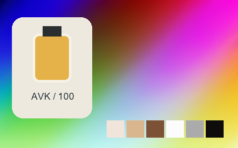

## 149 · Polaroid 669

`nt-colorslide-polaroid-669` · `film-slide` · CC-BY-SA-4.0 · 33³

50% gray Y′ 136.5/255 (+9.0 code values); 25–75% gray span ratio 1.132; mid-gray red minus blue +3.5 code values. Light/medium/deep skin swatches: #E8DCD8, #CDA399, #7A4D42. Red/green/blue swatches: #BA2E35, #ACC18C, #17439A.

Suggested use: Compare on your own SDR product, portrait and landscape footage before selecting.

Trial strength: 0.35–0.8; default 1.0.

Pixel color mapping only; no grain, glow, vignette, spatial haze or beauty effects. Natural footage quality is unaccepted. Check skin/product colors and clipped output.

**Supplied N002 still: actual output at strength 1.0.**

[Full-size lossless 1672×940](../../assets/looks-n002-20261024-r1/full/149-nt-colorslide-polaroid-669.webp) · [Original source](../../assets/looks-n002-20261024-r1/source.png) · [All 500 supplied-image samples](../FILTER_GALLERY.en.md)

| Input swatch | Input RGB | Actual output RGB |
|---|---|---|
| `gray_0` | `#000000` | `#030101` |
| `gray_10` | `#1A1A1A` | `#161414` |
| `gray_25` | `#404040` | `#3B393A` |
| `gray_50` | `#808080` | `#8C8888` |
| `gray_75` | `#BFBFBF` | `#CACACA` |
| `gray_90` | `#E6E6E6` | `#E6E6E5` |
| `gray_100` | `#FFFFFF` | `#FCFBFB` |
| `skin_light` | `#F5DBC6` | `#E8DCD8` |
| `skin_medium` | `#CF9B7B` | `#CDA399` |
| `skin_deep` | `#815438` | `#7A4D42` |
| `red` | `#CC3333` | `#BA2E35` |
| `green` | `#33CC33` | `#ACC18C` |
| `blue` | `#3333CC` | `#17439A` |

Creator: **Pat David** · [Source](https://github.com/NatronGitHub/clut/blob/af7b50d4caf6244fb6895a647f5b6a84efe7931a/colorslide/polaroid_669.png) · commit `af7b50d4caf6244fb6895a647f5b6a84efe7931a`.

Conversion: `native-depth-Hald-to-33-tetrahedral-v1`; 8,192 sampled RGB points; max error 0.0116769; mean 0.0006597. This is numerical approximation, not a perceptual quality score.

License obligations: Credit the named creator and source; retain the CC-BY-SA-4.0 notice and indicate changes. Redistributed adapted LUT data and thumbnails must use CC-BY-SA-4.0 or a compatible license; no additional restrictions.

[License](../../../product/src/ai_ad_editor/look_data/licenses/CC-BY-SA-4.0.txt) · LUT SHA-256 `a6e401c1d9545e1b4e45fefd0fe6a97d6a74a0c13b20376a41cbbac4d50fbad9`.

[Actual preview PNG](../../assets/look500-20261024-r1/previews/nt-colorslide-polaroid-669.png) · [Actual video](../../assets/look500-20261024-r1/videos/nt-colorslide-polaroid-669.mp4)

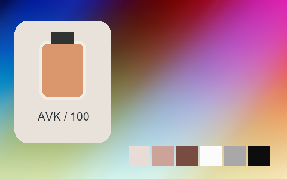

## 150 · Polaroid 690

`nt-colorslide-polaroid-690` · `film-slide` · CC-BY-SA-4.0 · 33³

50% gray Y′ 130.9/255 (+3.4 code values); 25–75% gray span ratio 1.203; mid-gray red minus blue +2.0 code values. Light/medium/deep skin swatches: #F2E3CD, #D5A46F, #73482D. Red/green/blue swatches: #B82C1A, #ABCC28, #0F4DB0.

Suggested use: Compare on your own SDR product, portrait and landscape footage before selecting.

Trial strength: 0.35–0.8; default 1.0.

Pixel color mapping only; no grain, glow, vignette, spatial haze or beauty effects. Natural footage quality is unaccepted. Check skin/product colors and clipped output.

**Supplied N002 still: actual output at strength 1.0.**

[Full-size lossless 1672×940](../../assets/looks-n002-20261024-r1/full/150-nt-colorslide-polaroid-690.webp) · [Original source](../../assets/looks-n002-20261024-r1/source.png) · [All 500 supplied-image samples](../FILTER_GALLERY.en.md)

| Input swatch | Input RGB | Actual output RGB |
|---|---|---|
| `gray_0` | `#000000` | `#000000` |
| `gray_10` | `#1A1A1A` | `#181515` |
| `gray_25` | `#404040` | `#363636` |
| `gray_50` | `#808080` | `#838381` |
| `gray_75` | `#BFBFBF` | `#D0D0CB` |
| `gray_90` | `#E6E6E6` | `#EBEAE6` |
| `gray_100` | `#FFFFFF` | `#FDFDFC` |
| `skin_light` | `#F5DBC6` | `#F2E3CD` |
| `skin_medium` | `#CF9B7B` | `#D5A46F` |
| `skin_deep` | `#815438` | `#73482D` |
| `red` | `#CC3333` | `#B82C1A` |
| `green` | `#33CC33` | `#ABCC28` |
| `blue` | `#3333CC` | `#0F4DB0` |

Creator: **Pat David** · [Source](https://github.com/NatronGitHub/clut/blob/af7b50d4caf6244fb6895a647f5b6a84efe7931a/colorslide/polaroid_690.png) · commit `af7b50d4caf6244fb6895a647f5b6a84efe7931a`.

Conversion: `native-depth-Hald-to-33-tetrahedral-v1`; 8,192 sampled RGB points; max error 0.0301367; mean 0.0007562. This is numerical approximation, not a perceptual quality score.

License obligations: Credit the named creator and source; retain the CC-BY-SA-4.0 notice and indicate changes. Redistributed adapted LUT data and thumbnails must use CC-BY-SA-4.0 or a compatible license; no additional restrictions.

[License](../../../product/src/ai_ad_editor/look_data/licenses/CC-BY-SA-4.0.txt) · LUT SHA-256 `053a5de09ec98624930fd5d6c0ef9c313a36ad0e2f2ebc12b460e3008a03ac1b`.

[Actual preview PNG](../../assets/look500-20261024-r1/previews/nt-colorslide-polaroid-690.png) · [Actual video](../../assets/look500-20261024-r1/videos/nt-colorslide-polaroid-690.mp4)

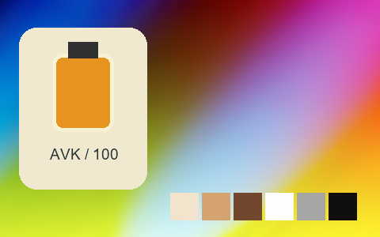

## 151 · Polaroid Polachrome

`nt-colorslide-polaroid-polachrome` · `film-slide` · CC-BY-SA-4.0 · 33³

50% gray Y′ 144.3/255 (+16.8 code values); 25–75% gray span ratio 1.092; mid-gray red minus blue +3.5 code values. Light/medium/deep skin swatches: #E6DAD5, #C9AA9D, #805948. Red/green/blue swatches: #C04344, #72B668, #7C68AE.

Suggested use: Compare on your own SDR product, portrait and landscape footage before selecting.

Trial strength: 0.35–0.8; default 1.0.

Pixel color mapping only; no grain, glow, vignette, spatial haze or beauty effects. Natural footage quality is unaccepted. Check skin/product colors and clipped output.

**Supplied N002 still: actual output at strength 1.0.**

[Full-size lossless 1672×940](../../assets/looks-n002-20261024-r1/full/151-nt-colorslide-polaroid-polachrome.webp) · [Original source](../../assets/looks-n002-20261024-r1/source.png) · [All 500 supplied-image samples](../FILTER_GALLERY.en.md)

| Input swatch | Input RGB | Actual output RGB |
|---|---|---|
| `gray_0` | `#000000` | `#050803` |
| `gray_10` | `#1A1A1A` | `#131011` |
| `gray_25` | `#404040` | `#40383C` |
| `gray_50` | `#808080` | `#948F91` |
| `gray_75` | `#BFBFBF` | `#CBC4C8` |
| `gray_90` | `#E6E6E6` | `#E5E3E7` |
| `gray_100` | `#FFFFFF` | `#FDFBFC` |
| `skin_light` | `#F5DBC6` | `#E6DAD5` |
| `skin_medium` | `#CF9B7B` | `#C9AA9D` |
| `skin_deep` | `#815438` | `#805948` |
| `red` | `#CC3333` | `#C04344` |
| `green` | `#33CC33` | `#72B668` |
| `blue` | `#3333CC` | `#7C68AE` |

Creator: **Pat David** · [Source](https://github.com/NatronGitHub/clut/blob/af7b50d4caf6244fb6895a647f5b6a84efe7931a/colorslide/polaroid_polachrome.png) · commit `af7b50d4caf6244fb6895a647f5b6a84efe7931a`.

Conversion: `native-depth-Hald-to-33-tetrahedral-v1`; 8,192 sampled RGB points; max error 0.0197480; mean 0.0006613. This is numerical approximation, not a perceptual quality score.

License obligations: Credit the named creator and source; retain the CC-BY-SA-4.0 notice and indicate changes. Redistributed adapted LUT data and thumbnails must use CC-BY-SA-4.0 or a compatible license; no additional restrictions.

[License](../../../product/src/ai_ad_editor/look_data/licenses/CC-BY-SA-4.0.txt) · LUT SHA-256 `9abc9c61e035880f5211ee5fcdfc20ccf0518e3dd31a223d451b2997b3a68a54`.

[Actual preview PNG](../../assets/look500-20261024-r1/previews/nt-colorslide-polaroid-polachrome.png) · [Actual video](../../assets/look500-20261024-r1/videos/nt-colorslide-polaroid-polachrome.mp4)

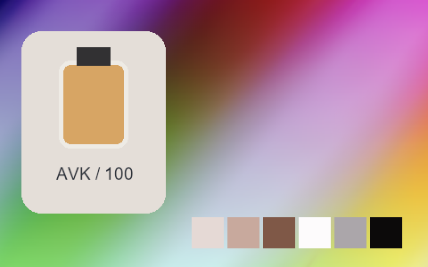

## 152 · Polaroid Px-100Uv+ Cold

`nt-instant-consumer-polaroid-px-100uv-plus-cold` · `instant-consumer` · CC-BY-SA-4.0 · 33³

50% gray Y′ 145.2/255 (+17.7 code values); 25–75% gray span ratio 0.811; mid-gray red minus blue -2.0 code values. Light/medium/deep skin swatches: #D4D5C6, #A7ACA3, #697374. Red/green/blue swatches: #878C8A, #989D97, #ADB0A7.

Suggested use: Compare on your own SDR product, portrait and landscape footage before selecting.

Trial strength: 0.35–0.8; default 1.0.

Pixel color mapping only; no grain, glow, vignette, spatial haze or beauty effects. Natural footage quality is unaccepted. Check skin/product colors and clipped output.

**Supplied N002 still: actual output at strength 1.0.**

[Full-size lossless 1672×940](../../assets/looks-n002-20261024-r1/full/152-nt-instant-consumer-polaroid-px-100uv-plus-cold.webp) · [Original source](../../assets/looks-n002-20261024-r1/source.png) · [All 500 supplied-image samples](../FILTER_GALLERY.en.md)

| Input swatch | Input RGB | Actual output RGB |
|---|---|---|
| `gray_0` | `#000000` | `#334547` |
| `gray_10` | `#1A1A1A` | `#394A4C` |
| `gray_25` | `#404040` | `#535F61` |
| `gray_50` | `#808080` | `#8E9290` |
| `gray_75` | `#BFBFBF` | `#C3C6B8` |
| `gray_90` | `#E6E6E6` | `#D9D9C9` |
| `gray_100` | `#FFFFFF` | `#DBDBCA` |
| `skin_light` | `#F5DBC6` | `#D4D5C6` |
| `skin_medium` | `#CF9B7B` | `#A7ACA3` |
| `skin_deep` | `#815438` | `#697374` |
| `red` | `#CC3333` | `#878C8A` |
| `green` | `#33CC33` | `#989D97` |
| `blue` | `#3333CC` | `#ADB0A7` |

Creator: **Pat David** · [Source](https://github.com/NatronGitHub/clut/blob/af7b50d4caf6244fb6895a647f5b6a84efe7931a/instant_consumer/polaroid_px-100uv+_cold.png) · commit `af7b50d4caf6244fb6895a647f5b6a84efe7931a`.

Conversion: `native-depth-Hald-to-33-tetrahedral-v1`; 8,192 sampled RGB points; max error 0.0046071; mean 0.0006084. This is numerical approximation, not a perceptual quality score.

License obligations: Credit the named creator and source; retain the CC-BY-SA-4.0 notice and indicate changes. Redistributed adapted LUT data and thumbnails must use CC-BY-SA-4.0 or a compatible license; no additional restrictions.

[License](../../../product/src/ai_ad_editor/look_data/licenses/CC-BY-SA-4.0.txt) · LUT SHA-256 `c5ebc3df854f628f793dc1b4431c4a7eb056f4bae46e5f1dc883de78977fb048`.

[Actual preview PNG](../../assets/look500-20261024-r1/previews/nt-instant-consumer-polaroid-px-100uv-plus-cold.png) · [Actual video](../../assets/look500-20261024-r1/videos/nt-instant-consumer-polaroid-px-100uv-plus-cold.mp4)

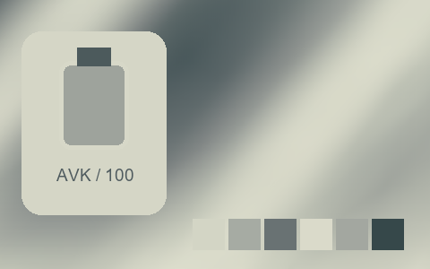

## 153 · Polaroid Px-100Uv+ Cold +++

`nt-instant-consumer-polaroid-px-100uv-plus-cold-curve-plus-3` · `instant-consumer` · CC-BY-SA-4.0 · 33³

50% gray Y′ 146.1/255 (+18.6 code values); 25–75% gray span ratio 0.672; mid-gray red minus blue +5.5 code values. Light/medium/deep skin swatches: #D0CCAD, #ADAD9B, #737976. Red/green/blue swatches: #8A8F86, #989B8F, #B3B29E.

Suggested use: Compare on your own SDR product, portrait and landscape footage before selecting.

Trial strength: 0.35–0.8; default 1.0.

Pixel color mapping only; no grain, glow, vignette, spatial haze or beauty effects. Natural footage quality is unaccepted. Check skin/product colors and clipped output.

**Supplied N002 still: actual output at strength 1.0.**

[Full-size lossless 1672×940](../../assets/looks-n002-20261024-r1/full/153-nt-instant-consumer-polaroid-px-100uv-plus-cold-curve-plus-3.webp) · [Original source](../../assets/looks-n002-20261024-r1/source.png) · [All 500 supplied-image samples](../FILTER_GALLERY.en.md)

| Input swatch | Input RGB | Actual output RGB |
|---|---|---|
| `gray_0` | `#000000` | `#616969` |
| `gray_10` | `#1A1A1A` | `#636A6A` |
| `gray_25` | `#404040` | `#69706F` |
| `gray_50` | `#808080` | `#90938B` |
| `gray_75` | `#BFBFBF` | `#C8C6A8` |
| `gray_90` | `#E6E6E6` | `#D3CEAE` |
| `gray_100` | `#FFFFFF` | `#D4CFAF` |
| `skin_light` | `#F5DBC6` | `#D0CCAD` |
| `skin_medium` | `#CF9B7B` | `#ADAD9B` |
| `skin_deep` | `#815438` | `#737976` |
| `red` | `#CC3333` | `#8A8F86` |
| `green` | `#33CC33` | `#989B8F` |
| `blue` | `#3333CC` | `#B3B29E` |

Creator: **Pat David** · [Source](https://github.com/NatronGitHub/clut/blob/af7b50d4caf6244fb6895a647f5b6a84efe7931a/instant_consumer/polaroid_px-100uv+_cold_+++.png) · commit `af7b50d4caf6244fb6895a647f5b6a84efe7931a`.

Conversion: `native-depth-Hald-to-33-tetrahedral-v1`; 8,192 sampled RGB points; max error 0.0058053; mean 0.0006085. This is numerical approximation, not a perceptual quality score.

License obligations: Credit the named creator and source; retain the CC-BY-SA-4.0 notice and indicate changes. Redistributed adapted LUT data and thumbnails must use CC-BY-SA-4.0 or a compatible license; no additional restrictions.

[License](../../../product/src/ai_ad_editor/look_data/licenses/CC-BY-SA-4.0.txt) · LUT SHA-256 `dde32149d52224108aef05764bb5fc89801bed7dbd6a209a0373e774d2aa3f06`.

[Actual preview PNG](../../assets/look500-20261024-r1/previews/nt-instant-consumer-polaroid-px-100uv-plus-cold-curve-plus-3.png) · [Actual video](../../assets/look500-20261024-r1/videos/nt-instant-consumer-polaroid-px-100uv-plus-cold-curve-plus-3.mp4)

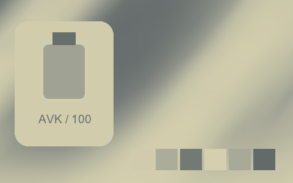

## 154 · Polaroid Px-100Uv+ Cold ++

`nt-instant-consumer-polaroid-px-100uv-plus-cold-curve-plus-2` · `instant-consumer` · CC-BY-SA-4.0 · 33³

50% gray Y′ 147.0/255 (+19.5 code values); 25–75% gray span ratio 0.666; mid-gray red minus blue -1.5 code values. Light/medium/deep skin swatches: #CCCDBE, #ABAFA5, #717979. Red/green/blue swatches: #878D8B, #959A95, #ADB0A7.

Suggested use: Compare on your own SDR product, portrait and landscape footage before selecting.

Trial strength: 0.35–0.8; default 1.0.

Pixel color mapping only; no grain, glow, vignette, spatial haze or beauty effects. Natural footage quality is unaccepted. Check skin/product colors and clipped output.

**Supplied N002 still: actual output at strength 1.0.**

[Full-size lossless 1672×940](../../assets/looks-n002-20261024-r1/full/154-nt-instant-consumer-polaroid-px-100uv-plus-cold-curve-plus-2.webp) · [Original source](../../assets/looks-n002-20261024-r1/source.png) · [All 500 supplied-image samples](../FILTER_GALLERY.en.md)

| Input swatch | Input RGB | Actual output RGB |
|---|---|---|
| `gray_0` | `#000000` | `#636C6E` |
| `gray_10` | `#1A1A1A` | `#646D6F` |
| `gray_25` | `#404040` | `#697172` |
| `gray_50` | `#808080` | `#8F9490` |
| `gray_75` | `#BFBFBF` | `#C4C5B8` |
| `gray_90` | `#E6E6E6` | `#CECFC0` |
| `gray_100` | `#FFFFFF` | `#D2D2C3` |
| `skin_light` | `#F5DBC6` | `#CCCDBE` |
| `skin_medium` | `#CF9B7B` | `#ABAFA5` |
| `skin_deep` | `#815438` | `#717979` |
| `red` | `#CC3333` | `#878D8B` |
| `green` | `#33CC33` | `#959A95` |
| `blue` | `#3333CC` | `#ADB0A7` |

Creator: **Pat David** · [Source](https://github.com/NatronGitHub/clut/blob/af7b50d4caf6244fb6895a647f5b6a84efe7931a/instant_consumer/polaroid_px-100uv+_cold_++.png) · commit `af7b50d4caf6244fb6895a647f5b6a84efe7931a`.

Conversion: `native-depth-Hald-to-33-tetrahedral-v1`; 8,192 sampled RGB points; max error 0.0051622; mean 0.0006129. This is numerical approximation, not a perceptual quality score.

License obligations: Credit the named creator and source; retain the CC-BY-SA-4.0 notice and indicate changes. Redistributed adapted LUT data and thumbnails must use CC-BY-SA-4.0 or a compatible license; no additional restrictions.

[License](../../../product/src/ai_ad_editor/look_data/licenses/CC-BY-SA-4.0.txt) · LUT SHA-256 `a35bb941843b1a683dd0f5788e176733368798c5f494257bf7412838e2977821`.

[Actual preview PNG](../../assets/look500-20261024-r1/previews/nt-instant-consumer-polaroid-px-100uv-plus-cold-curve-plus-2.png) · [Actual video](../../assets/look500-20261024-r1/videos/nt-instant-consumer-polaroid-px-100uv-plus-cold-curve-plus-2.mp4)

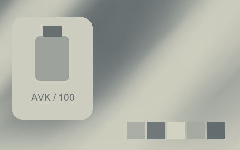

## 155 · Polaroid Px-100Uv+ Cold +

`nt-instant-consumer-polaroid-px-100uv-plus-cold-curve-plus-1` · `instant-consumer` · CC-BY-SA-4.0 · 33³

50% gray Y′ 145.1/255 (+17.6 code values); 25–75% gray span ratio 0.763; mid-gray red minus blue -2.5 code values. Light/medium/deep skin swatches: #CED1C1, #A9ADA5, #6A7374. Red/green/blue swatches: #888E8B, #989D97, #AFB2A9.

Suggested use: Compare on your own SDR product, portrait and landscape footage before selecting.

Trial strength: 0.35–0.8; default 1.0.

Pixel color mapping only; no grain, glow, vignette, spatial haze or beauty effects. Natural footage quality is unaccepted. Check skin/product colors and clipped output.

**Supplied N002 still: actual output at strength 1.0.**

[Full-size lossless 1672×940](../../assets/looks-n002-20261024-r1/full/155-nt-instant-consumer-polaroid-px-100uv-plus-cold-curve-plus-1.webp) · [Original source](../../assets/looks-n002-20261024-r1/source.png) · [All 500 supplied-image samples](../FILTER_GALLERY.en.md)

| Input swatch | Input RGB | Actual output RGB |
|---|---|---|
| `gray_0` | `#000000` | `#3C4D4F` |
| `gray_10` | `#1A1A1A` | `#415154` |
| `gray_25` | `#404040` | `#586466` |
| `gray_50` | `#808080` | `#8D9290` |
| `gray_75` | `#BFBFBF` | `#C2C4B8` |
| `gray_90` | `#E6E6E6` | `#D3D5C5` |
| `gray_100` | `#FFFFFF` | `#D4D6C6` |
| `skin_light` | `#F5DBC6` | `#CED1C1` |
| `skin_medium` | `#CF9B7B` | `#A9ADA5` |
| `skin_deep` | `#815438` | `#6A7374` |
| `red` | `#CC3333` | `#888E8B` |
| `green` | `#33CC33` | `#989D97` |
| `blue` | `#3333CC` | `#AFB2A9` |

Creator: **Pat David** · [Source](https://github.com/NatronGitHub/clut/blob/af7b50d4caf6244fb6895a647f5b6a84efe7931a/instant_consumer/polaroid_px-100uv+_cold_+.png) · commit `af7b50d4caf6244fb6895a647f5b6a84efe7931a`.

Conversion: `native-depth-Hald-to-33-tetrahedral-v1`; 8,192 sampled RGB points; max error 0.0064756; mean 0.0006043. This is numerical approximation, not a perceptual quality score.

License obligations: Credit the named creator and source; retain the CC-BY-SA-4.0 notice and indicate changes. Redistributed adapted LUT data and thumbnails must use CC-BY-SA-4.0 or a compatible license; no additional restrictions.

[License](../../../product/src/ai_ad_editor/look_data/licenses/CC-BY-SA-4.0.txt) · LUT SHA-256 `b652c99362ff8b28d425ae661da9a868bd321a2aadc2703aef698ac1da9814aa`.

[Actual preview PNG](../../assets/look500-20261024-r1/previews/nt-instant-consumer-polaroid-px-100uv-plus-cold-curve-plus-1.png) · [Actual video](../../assets/look500-20261024-r1/videos/nt-instant-consumer-polaroid-px-100uv-plus-cold-curve-plus-1.mp4)

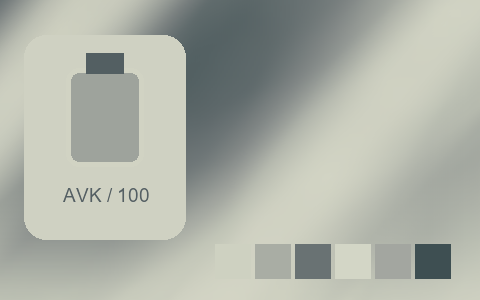

## 156 · Polaroid Px-100Uv+ Cold --

`nt-instant-consumer-polaroid-px-100uv-plus-cold-curve-minus-2` · `instant-consumer` · CC-BY-SA-4.0 · 33³

50% gray Y′ 146.4/255 (+18.9 code values); 25–75% gray span ratio 0.926; mid-gray red minus blue -0.5 code values. Light/medium/deep skin swatches: #EAEADD, #ABAFA7, #707473. Red/green/blue swatches: #8C908D, #9BA09A, #AFB3AB.

Suggested use: Compare on your own SDR product, portrait and landscape footage before selecting.

Trial strength: 0.35–0.8; default 1.0.

Pixel color mapping only; no grain, glow, vignette, spatial haze or beauty effects. Natural footage quality is unaccepted. Check skin/product colors and clipped output.

**Supplied N002 still: actual output at strength 1.0.**

[Full-size lossless 1672×940](../../assets/looks-n002-20261024-r1/full/156-nt-instant-consumer-polaroid-px-100uv-plus-cold-curve-minus-2.webp) · [Original source](../../assets/looks-n002-20261024-r1/source.png) · [All 500 supplied-image samples](../FILTER_GALLERY.en.md)

| Input swatch | Input RGB | Actual output RGB |
|---|---|---|
| `gray_0` | `#000000` | `#0A0B0B` |
| `gray_10` | `#1A1A1A` | `#171A1A` |
| `gray_25` | `#404040` | `#555A5A` |
| `gray_50` | `#808080` | `#909390` |
| `gray_75` | `#BFBFBF` | `#CDD0C4` |
| `gray_90` | `#E6E6E6` | `#F3F2E5` |
| `gray_100` | `#FFFFFF` | `#FFFEF1` |
| `skin_light` | `#F5DBC6` | `#EAEADD` |
| `skin_medium` | `#CF9B7B` | `#ABAFA7` |
| `skin_deep` | `#815438` | `#707473` |
| `red` | `#CC3333` | `#8C908D` |
| `green` | `#33CC33` | `#9BA09A` |
| `blue` | `#3333CC` | `#AFB3AB` |

Creator: **Pat David** · [Source](https://github.com/NatronGitHub/clut/blob/af7b50d4caf6244fb6895a647f5b6a84efe7931a/instant_consumer/polaroid_px-100uv+_cold_--.png) · commit `af7b50d4caf6244fb6895a647f5b6a84efe7931a`.

Conversion: `native-depth-Hald-to-33-tetrahedral-v1`; 8,192 sampled RGB points; max error 0.0114316; mean 0.0006902. This is numerical approximation, not a perceptual quality score.

License obligations: Credit the named creator and source; retain the CC-BY-SA-4.0 notice and indicate changes. Redistributed adapted LUT data and thumbnails must use CC-BY-SA-4.0 or a compatible license; no additional restrictions.

[License](../../../product/src/ai_ad_editor/look_data/licenses/CC-BY-SA-4.0.txt) · LUT SHA-256 `1d74d381f0fb63ecafdc70f4a8d9896e1a62738b458119493bb103c2bcc8fbba`.

[Actual preview PNG](../../assets/look500-20261024-r1/previews/nt-instant-consumer-polaroid-px-100uv-plus-cold-curve-minus-2.png) · [Actual video](../../assets/look500-20261024-r1/videos/nt-instant-consumer-polaroid-px-100uv-plus-cold-curve-minus-2.mp4)

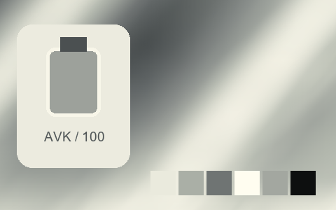

## 157 · Polaroid Px-100Uv+ Cold -

`nt-instant-consumer-polaroid-px-100uv-plus-cold-curve-minus-1` · `instant-consumer` · CC-BY-SA-4.0 · 33³

50% gray Y′ 145.1/255 (+17.6 code values); 25–75% gray span ratio 0.940; mid-gray red minus blue -1.0 code values. Light/medium/deep skin swatches: #E0E0D2, #A9ADA5, #676B6B. Red/green/blue swatches: #878C88, #989C97, #ADB1A9.

Suggested use: Compare on your own SDR product, portrait and landscape footage before selecting.

Trial strength: 0.35–0.8; default 1.0.

Pixel color mapping only; no grain, glow, vignette, spatial haze or beauty effects. Natural footage quality is unaccepted. Check skin/product colors and clipped output.

**Supplied N002 still: actual output at strength 1.0.**

[Full-size lossless 1672×940](../../assets/looks-n002-20261024-r1/full/157-nt-instant-consumer-polaroid-px-100uv-plus-cold-curve-minus-1.webp) · [Original source](../../assets/looks-n002-20261024-r1/source.png) · [All 500 supplied-image samples](../FILTER_GALLERY.en.md)

| Input swatch | Input RGB | Actual output RGB |
|---|---|---|
| `gray_0` | `#000000` | `#1E2223` |
| `gray_10` | `#1A1A1A` | `#25292A` |
| `gray_25` | `#404040` | `#4E5353` |
| `gray_50` | `#808080` | `#8E928E` |
| `gray_75` | `#BFBFBF` | `#C8CBBF` |
| `gray_90` | `#E6E6E6` | `#E7E7D8` |
| `gray_100` | `#FFFFFF` | `#ECEBDD` |
| `skin_light` | `#F5DBC6` | `#E0E0D2` |
| `skin_medium` | `#CF9B7B` | `#A9ADA5` |
| `skin_deep` | `#815438` | `#676B6B` |
| `red` | `#CC3333` | `#878C88` |
| `green` | `#33CC33` | `#989C97` |
| `blue` | `#3333CC` | `#ADB1A9` |

Creator: **Pat David** · [Source](https://github.com/NatronGitHub/clut/blob/af7b50d4caf6244fb6895a647f5b6a84efe7931a/instant_consumer/polaroid_px-100uv+_cold_-.png) · commit `af7b50d4caf6244fb6895a647f5b6a84efe7931a`.

Conversion: `native-depth-Hald-to-33-tetrahedral-v1`; 8,192 sampled RGB points; max error 0.0160411; mean 0.0006488. This is numerical approximation, not a perceptual quality score.

License obligations: Credit the named creator and source; retain the CC-BY-SA-4.0 notice and indicate changes. Redistributed adapted LUT data and thumbnails must use CC-BY-SA-4.0 or a compatible license; no additional restrictions.

[License](../../../product/src/ai_ad_editor/look_data/licenses/CC-BY-SA-4.0.txt) · LUT SHA-256 `95efdf6543726b88e1445318f52a23ae9c4f0356cc2953d74e0651a4940e7932`.

[Actual preview PNG](../../assets/look500-20261024-r1/previews/nt-instant-consumer-polaroid-px-100uv-plus-cold-curve-minus-1.png) · [Actual video](../../assets/look500-20261024-r1/videos/nt-instant-consumer-polaroid-px-100uv-plus-cold-curve-minus-1.mp4)

## 158 · Polaroid Px-100Uv+ Warm

`nt-instant-consumer-polaroid-px-100uv-plus-warm` · `instant-consumer` · CC-BY-SA-4.0 · 33³

50% gray Y′ 147.5/255 (+20.0 code values); 25–75% gray span ratio 0.814; mid-gray red minus blue +4.5 code values. Light/medium/deep skin swatches: #DBD6CD, #B0AAA6, #747273. Red/green/blue swatches: #8E8B8A, #9F9B99, #B4AFAB.

Suggested use: Compare on your own SDR product, portrait and landscape footage before selecting.

Trial strength: 0.35–0.8; default 1.0.

Pixel color mapping only; no grain, glow, vignette, spatial haze or beauty effects. Natural footage quality is unaccepted. Check skin/product colors and clipped output.

**Supplied N002 still: actual output at strength 1.0.**

[Full-size lossless 1672×940](../../assets/looks-n002-20261024-r1/full/158-nt-instant-consumer-polaroid-px-100uv-plus-warm.webp) · [Original source](../../assets/looks-n002-20261024-r1/source.png) · [All 500 supplied-image samples](../FILTER_GALLERY.en.md)

| Input swatch | Input RGB | Actual output RGB |
|---|---|---|
| `gray_0` | `#000000` | `#4A4546` |
| `gray_10` | `#1A1A1A` | `#4C4848` |
| `gray_25` | `#404040` | `#605E5E` |
| `gray_50` | `#808080` | `#969392` |
| `gray_75` | `#BFBFBF` | `#CCC6BF` |
| `gray_90` | `#E6E6E6` | `#E0DAD2` |
| `gray_100` | `#FFFFFF` | `#E1DCD3` |
| `skin_light` | `#F5DBC6` | `#DBD6CD` |
| `skin_medium` | `#CF9B7B` | `#B0AAA6` |
| `skin_deep` | `#815438` | `#747273` |
| `red` | `#CC3333` | `#8E8B8A` |
| `green` | `#33CC33` | `#9F9B99` |
| `blue` | `#3333CC` | `#B4AFAB` |

Creator: **Pat David** · [Source](https://github.com/NatronGitHub/clut/blob/af7b50d4caf6244fb6895a647f5b6a84efe7931a/instant_consumer/polaroid_px-100uv+_warm.png) · commit `af7b50d4caf6244fb6895a647f5b6a84efe7931a`.

Conversion: `native-depth-Hald-to-33-tetrahedral-v1`; 8,192 sampled RGB points; max error 0.0058317; mean 0.0006299. This is numerical approximation, not a perceptual quality score.

License obligations: Credit the named creator and source; retain the CC-BY-SA-4.0 notice and indicate changes. Redistributed adapted LUT data and thumbnails must use CC-BY-SA-4.0 or a compatible license; no additional restrictions.

[License](../../../product/src/ai_ad_editor/look_data/licenses/CC-BY-SA-4.0.txt) · LUT SHA-256 `f0ff12830faf35c36223e0d33fe54dee2a8049a8b4f3693ec996cd2f0fb6f4a8`.

[Actual preview PNG](../../assets/look500-20261024-r1/previews/nt-instant-consumer-polaroid-px-100uv-plus-warm.png) · [Actual video](../../assets/look500-20261024-r1/videos/nt-instant-consumer-polaroid-px-100uv-plus-warm.mp4)

## 159 · Polaroid Px-100Uv+ Warm +++

`nt-instant-consumer-polaroid-px-100uv-plus-warm-curve-plus-3` · `instant-consumer` · CC-BY-SA-4.0 · 33³

50% gray Y′ 148.0/255 (+20.5 code values); 25–75% gray span ratio 0.587; mid-gray red minus blue +19.5 code values. Light/medium/deep skin swatches: #CDC4AA, #B0A797, #807570. Red/green/blue swatches: #958B82, #A2988B, #B1A898.

Suggested use: Compare on your own SDR product, portrait and landscape footage before selecting.

Trial strength: 0.35–0.8; default 1.0.

Pixel color mapping only; no grain, glow, vignette, spatial haze or beauty effects. Natural footage quality is unaccepted. Check skin/product colors and clipped output.

**Supplied N002 still: actual output at strength 1.0.**

[Full-size lossless 1672×940](../../assets/looks-n002-20261024-r1/full/159-nt-instant-consumer-polaroid-px-100uv-plus-warm-curve-plus-3.webp) · [Original source](../../assets/looks-n002-20261024-r1/source.png) · [All 500 supplied-image samples](../FILTER_GALLERY.en.md)

| Input swatch | Input RGB | Actual output RGB |
|---|---|---|
| `gray_0` | `#000000` | `#716562` |
| `gray_10` | `#1A1A1A` | `#716562` |
| `gray_25` | `#404040` | `#766B67` |
| `gray_50` | `#808080` | `#9C9388` |
| `gray_75` | `#BFBFBF` | `#C0B8A2` |
| `gray_90` | `#E6E6E6` | `#D1C8AC` |
| `gray_100` | `#FFFFFF` | `#D5CCAE` |
| `skin_light` | `#F5DBC6` | `#CDC4AA` |
| `skin_medium` | `#CF9B7B` | `#B0A797` |
| `skin_deep` | `#815438` | `#807570` |
| `red` | `#CC3333` | `#958B82` |
| `green` | `#33CC33` | `#A2988B` |
| `blue` | `#3333CC` | `#B1A898` |

Creator: **Pat David** · [Source](https://github.com/NatronGitHub/clut/blob/af7b50d4caf6244fb6895a647f5b6a84efe7931a/instant_consumer/polaroid_px-100uv+_warm_+++.png) · commit `af7b50d4caf6244fb6895a647f5b6a84efe7931a`.

Conversion: `native-depth-Hald-to-33-tetrahedral-v1`; 8,192 sampled RGB points; max error 0.0066444; mean 0.0005966. This is numerical approximation, not a perceptual quality score.

License obligations: Credit the named creator and source; retain the CC-BY-SA-4.0 notice and indicate changes. Redistributed adapted LUT data and thumbnails must use CC-BY-SA-4.0 or a compatible license; no additional restrictions.

[License](../../../product/src/ai_ad_editor/look_data/licenses/CC-BY-SA-4.0.txt) · LUT SHA-256 `c0de1a14d7a3756d6e4c4e31244bc3916f3bda51414b8ef87cc91bf87d93bcf3`.

[Actual preview PNG](../../assets/look500-20261024-r1/previews/nt-instant-consumer-polaroid-px-100uv-plus-warm-curve-plus-3.png) · [Actual video](../../assets/look500-20261024-r1/videos/nt-instant-consumer-polaroid-px-100uv-plus-warm-curve-plus-3.mp4)

## 160 · Polaroid Px-100Uv+ Warm ++

`nt-instant-consumer-polaroid-px-100uv-plus-warm-curve-plus-2` · `instant-consumer` · CC-BY-SA-4.0 · 33³

50% gray Y′ 146.3/255 (+18.8 code values); 25–75% gray span ratio 0.595; mid-gray red minus blue +7.0 code values. Light/medium/deep skin swatches: #C7C3BD, #ACA7A4, #7F7778. Red/green/blue swatches: #938C8C, #A09A98, #ADA8A5.

Suggested use: Compare on your own SDR product, portrait and landscape footage before selecting.

Trial strength: 0.35–0.8; default 1.0.

Pixel color mapping only; no grain, glow, vignette, spatial haze or beauty effects. Natural footage quality is unaccepted. Check skin/product colors and clipped output.

**Supplied N002 still: actual output at strength 1.0.**

[Full-size lossless 1672×940](../../assets/looks-n002-20261024-r1/full/160-nt-instant-consumer-polaroid-px-100uv-plus-warm-curve-plus-2.webp) · [Original source](../../assets/looks-n002-20261024-r1/source.png) · [All 500 supplied-image samples](../FILTER_GALLERY.en.md)

| Input swatch | Input RGB | Actual output RGB |
|---|---|---|
| `gray_0` | `#000000` | `#6E6364` |
| `gray_10` | `#1A1A1A` | `#706667` |
| `gray_25` | `#404040` | `#756B6C` |
| `gray_50` | `#808080` | `#989190` |
| `gray_75` | `#BFBFBF` | `#BCB8B3` |
| `gray_90` | `#E6E6E6` | `#CBC7C1` |
| `gray_100` | `#FFFFFF` | `#CECBC4` |
| `skin_light` | `#F5DBC6` | `#C7C3BD` |
| `skin_medium` | `#CF9B7B` | `#ACA7A4` |
| `skin_deep` | `#815438` | `#7F7778` |
| `red` | `#CC3333` | `#938C8C` |
| `green` | `#33CC33` | `#A09A98` |
| `blue` | `#3333CC` | `#ADA8A5` |

Creator: **Pat David** · [Source](https://github.com/NatronGitHub/clut/blob/af7b50d4caf6244fb6895a647f5b6a84efe7931a/instant_consumer/polaroid_px-100uv+_warm_++.png) · commit `af7b50d4caf6244fb6895a647f5b6a84efe7931a`.

Conversion: `native-depth-Hald-to-33-tetrahedral-v1`; 8,192 sampled RGB points; max error 0.0084652; mean 0.0005981. This is numerical approximation, not a perceptual quality score.

License obligations: Credit the named creator and source; retain the CC-BY-SA-4.0 notice and indicate changes. Redistributed adapted LUT data and thumbnails must use CC-BY-SA-4.0 or a compatible license; no additional restrictions.

[License](../../../product/src/ai_ad_editor/look_data/licenses/CC-BY-SA-4.0.txt) · LUT SHA-256 `51a7f1c7277385c41921737ade4bc9663998abb866dc51b3c3faaff71ac9d2a6`.

[Actual preview PNG](../../assets/look500-20261024-r1/previews/nt-instant-consumer-polaroid-px-100uv-plus-warm-curve-plus-2.png) · [Actual video](../../assets/look500-20261024-r1/videos/nt-instant-consumer-polaroid-px-100uv-plus-warm-curve-plus-2.mp4)

## 161 · Polaroid Px-100Uv+ Warm +

`nt-instant-consumer-polaroid-px-100uv-plus-warm-curve-plus-1` · `instant-consumer` · CC-BY-SA-4.0 · 33³

50% gray Y′ 145.7/255 (+18.2 code values); 25–75% gray span ratio 0.768; mid-gray red minus blue +3.5 code values. Light/medium/deep skin swatches: #D8D5CD, #AFACA8, #767374. Red/green/blue swatches: #8E8C8A, #9E9B98, #B1AEAA.

Suggested use: Compare on your own SDR product, portrait and landscape footage before selecting.

Trial strength: 0.35–0.8; default 1.0.

Pixel color mapping only; no grain, glow, vignette, spatial haze or beauty effects. Natural footage quality is unaccepted. Check skin/product colors and clipped output.

**Supplied N002 still: actual output at strength 1.0.**

[Full-size lossless 1672×940](../../assets/looks-n002-20261024-r1/full/161-nt-instant-consumer-polaroid-px-100uv-plus-warm-curve-plus-1.webp) · [Original source](../../assets/looks-n002-20261024-r1/source.png) · [All 500 supplied-image samples](../FILTER_GALLERY.en.md)

| Input swatch | Input RGB | Actual output RGB |
|---|---|---|
| `gray_0` | `#000000` | `#565050` |
| `gray_10` | `#1A1A1A` | `#585353` |
| `gray_25` | `#404040` | `#646262` |
| `gray_50` | `#808080` | `#939290` |
| `gray_75` | `#BFBFBF` | `#C8C4BD` |
| `gray_90` | `#E6E6E6` | `#DCD9D1` |
| `gray_100` | `#FFFFFF` | `#E0DDD4` |
| `skin_light` | `#F5DBC6` | `#D8D5CD` |
| `skin_medium` | `#CF9B7B` | `#AFACA8` |
| `skin_deep` | `#815438` | `#767374` |
| `red` | `#CC3333` | `#8E8C8A` |
| `green` | `#33CC33` | `#9E9B98` |
| `blue` | `#3333CC` | `#B1AEAA` |

Creator: **Pat David** · [Source](https://github.com/NatronGitHub/clut/blob/af7b50d4caf6244fb6895a647f5b6a84efe7931a/instant_consumer/polaroid_px-100uv+_warm_+.png) · commit `af7b50d4caf6244fb6895a647f5b6a84efe7931a`.

Conversion: `native-depth-Hald-to-33-tetrahedral-v1`; 8,192 sampled RGB points; max error 0.0057144; mean 0.0006130. This is numerical approximation, not a perceptual quality score.

License obligations: Credit the named creator and source; retain the CC-BY-SA-4.0 notice and indicate changes. Redistributed adapted LUT data and thumbnails must use CC-BY-SA-4.0 or a compatible license; no additional restrictions.

[License](../../../product/src/ai_ad_editor/look_data/licenses/CC-BY-SA-4.0.txt) · LUT SHA-256 `1a92a2fe30427be11e1219a5ee79b015793ecc1c51d151ef8ebd0b927e85e243`.

[Actual preview PNG](../../assets/look500-20261024-r1/previews/nt-instant-consumer-polaroid-px-100uv-plus-warm-curve-plus-1.png) · [Actual video](../../assets/look500-20261024-r1/videos/nt-instant-consumer-polaroid-px-100uv-plus-warm-curve-plus-1.mp4)

## 162 · Polaroid Px-100Uv+ Warm --

`nt-instant-consumer-polaroid-px-100uv-plus-warm-curve-minus-2` · `instant-consumer` · CC-BY-SA-4.0 · 33³

50% gray Y′ 148.4/255 (+20.9 code values); 25–75% gray span ratio 0.906; mid-gray red minus blue +7.0 code values. Light/medium/deep skin swatches: #E9E7E5, #B2AEA9, #767171. Red/green/blue swatches: #938E8D, #A19D9A, #B6B2AE.

Suggested use: Compare on your own SDR product, portrait and landscape footage before selecting.

Trial strength: 0.35–0.8; default 1.0.

Pixel color mapping only; no grain, glow, vignette, spatial haze or beauty effects. Natural footage quality is unaccepted. Check skin/product colors and clipped output.

**Supplied N002 still: actual output at strength 1.0.**

[Full-size lossless 1672×940](../../assets/looks-n002-20261024-r1/full/162-nt-instant-consumer-polaroid-px-100uv-plus-warm-curve-minus-2.webp) · [Original source](../../assets/looks-n002-20261024-r1/source.png) · [All 500 supplied-image samples](../FILTER_GALLERY.en.md)

| Input swatch | Input RGB | Actual output RGB |
|---|---|---|
| `gray_0` | `#000000` | `#010205` |
| `gray_10` | `#1A1A1A` | `#1E1C1E` |
| `gray_25` | `#404040` | `#5E5A5A` |
| `gray_50` | `#808080` | `#989392` |
| `gray_75` | `#BFBFBF` | `#D1CEC9` |
| `gray_90` | `#E6E6E6` | `#F3F2F1` |
| `gray_100` | `#FFFFFF` | `#F6F5F4` |
| `skin_light` | `#F5DBC6` | `#E9E7E5` |
| `skin_medium` | `#CF9B7B` | `#B2AEA9` |
| `skin_deep` | `#815438` | `#767171` |
| `red` | `#CC3333` | `#938E8D` |
| `green` | `#33CC33` | `#A19D9A` |
| `blue` | `#3333CC` | `#B6B2AE` |

Creator: **Pat David** · [Source](https://github.com/NatronGitHub/clut/blob/af7b50d4caf6244fb6895a647f5b6a84efe7931a/instant_consumer/polaroid_px-100uv+_warm_--.png) · commit `af7b50d4caf6244fb6895a647f5b6a84efe7931a`.

Conversion: `native-depth-Hald-to-33-tetrahedral-v1`; 8,192 sampled RGB points; max error 0.0134777; mean 0.0006892. This is numerical approximation, not a perceptual quality score.

License obligations: Credit the named creator and source; retain the CC-BY-SA-4.0 notice and indicate changes. Redistributed adapted LUT data and thumbnails must use CC-BY-SA-4.0 or a compatible license; no additional restrictions.

[License](../../../product/src/ai_ad_editor/look_data/licenses/CC-BY-SA-4.0.txt) · LUT SHA-256 `24fa9b58bb32410a300da23983820e1ea7a78654c4993eeb09d1d96a62eb142c`.

[Actual preview PNG](../../assets/look500-20261024-r1/previews/nt-instant-consumer-polaroid-px-100uv-plus-warm-curve-minus-2.png) · [Actual video](../../assets/look500-20261024-r1/videos/nt-instant-consumer-polaroid-px-100uv-plus-warm-curve-minus-2.mp4)

## 163 · Polaroid Px-100Uv+ Warm -

`nt-instant-consumer-polaroid-px-100uv-plus-warm-curve-minus-1` · `instant-consumer` · CC-BY-SA-4.0 · 33³

50% gray Y′ 144.5/255 (+17.0 code values); 25–75% gray span ratio 0.925; mid-gray red minus blue +5.5 code values. Light/medium/deep skin swatches: #E1DFDA, #B0ACA8, #706D6C. Red/green/blue swatches: #8D8A88, #A29E9B, #B4B0AC.

Suggested use: Compare on your own SDR product, portrait and landscape footage before selecting.

Trial strength: 0.35–0.8; default 1.0.

Pixel color mapping only; no grain, glow, vignette, spatial haze or beauty effects. Natural footage quality is unaccepted. Check skin/product colors and clipped output.

**Supplied N002 still: actual output at strength 1.0.**

[Full-size lossless 1672×940](../../assets/looks-n002-20261024-r1/full/163-nt-instant-consumer-polaroid-px-100uv-plus-warm-curve-minus-1.webp) · [Original source](../../assets/looks-n002-20261024-r1/source.png) · [All 500 supplied-image samples](../FILTER_GALLERY.en.md)

| Input swatch | Input RGB | Actual output RGB |
|---|---|---|
| `gray_0` | `#000000` | `#262122` |
| `gray_10` | `#1A1A1A` | `#2D2829` |
| `gray_25` | `#404040` | `#585454` |
| `gray_50` | `#808080` | `#93908E` |
| `gray_75` | `#BFBFBF` | `#CECAC6` |
| `gray_90` | `#E6E6E6` | `#E9E6E2` |
| `gray_100` | `#FFFFFF` | `#EDEBE7` |
| `skin_light` | `#F5DBC6` | `#E1DFDA` |
| `skin_medium` | `#CF9B7B` | `#B0ACA8` |
| `skin_deep` | `#815438` | `#706D6C` |
| `red` | `#CC3333` | `#8D8A88` |
| `green` | `#33CC33` | `#A29E9B` |
| `blue` | `#3333CC` | `#B4B0AC` |

Creator: **Pat David** · [Source](https://github.com/NatronGitHub/clut/blob/af7b50d4caf6244fb6895a647f5b6a84efe7931a/instant_consumer/polaroid_px-100uv+_warm_-.png) · commit `af7b50d4caf6244fb6895a647f5b6a84efe7931a`.

Conversion: `native-depth-Hald-to-33-tetrahedral-v1`; 8,192 sampled RGB points; max error 0.0099230; mean 0.0006477. This is numerical approximation, not a perceptual quality score.

License obligations: Credit the named creator and source; retain the CC-BY-SA-4.0 notice and indicate changes. Redistributed adapted LUT data and thumbnails must use CC-BY-SA-4.0 or a compatible license; no additional restrictions.

[License](../../../product/src/ai_ad_editor/look_data/licenses/CC-BY-SA-4.0.txt) · LUT SHA-256 `25db6170491ea1676c4aa9224b6fc2baf6a9299f166ede4069cb3dcbd5792d5e`.

[Actual preview PNG](../../assets/look500-20261024-r1/previews/nt-instant-consumer-polaroid-px-100uv-plus-warm-curve-minus-1.png) · [Actual video](../../assets/look500-20261024-r1/videos/nt-instant-consumer-polaroid-px-100uv-plus-warm-curve-minus-1.mp4)

## 164 · Polaroid Px-680

`nt-instant-consumer-polaroid-px-680` · `instant-consumer` · CC-BY-SA-4.0 · 33³

50% gray Y′ 159.3/255 (+31.8 code values); 25–75% gray span ratio 1.097; mid-gray red minus blue +58.5 code values. Light/medium/deep skin swatches: #E4E0A8, #DBB77D, #A16642. Red/green/blue swatches: #E47F50, #68BB55, #A57FA0.

Suggested use: Compare on your own SDR product, portrait and landscape footage before selecting.

Trial strength: 0.35–0.8; default 1.0.

Pixel color mapping only; no grain, glow, vignette, spatial haze or beauty effects. Natural footage quality is unaccepted. Check skin/product colors and clipped output.

**Supplied N002 still: actual output at strength 1.0.**

[Full-size lossless 1672×940](../../assets/looks-n002-20261024-r1/full/164-nt-instant-consumer-polaroid-px-680.webp) · [Original source](../../assets/looks-n002-20261024-r1/source.png) · [All 500 supplied-image samples](../FILTER_GALLERY.en.md)

| Input swatch | Input RGB | Actual output RGB |
|---|---|---|
| `gray_0` | `#000000` | `#052F34` |
| `gray_10` | `#1A1A1A` | `#083236` |
| `gray_25` | `#404040` | `#344541` |
| `gray_50` | `#808080` | `#B29E77` |
| `gray_75` | `#BFBFBF` | `#D6CF9E` |
| `gray_90` | `#E6E6E6` | `#DFE6B2` |
| `gray_100` | `#FFFFFF` | `#EAF3C3` |
| `skin_light` | `#F5DBC6` | `#E4E0A8` |
| `skin_medium` | `#CF9B7B` | `#DBB77D` |
| `skin_deep` | `#815438` | `#A16642` |
| `red` | `#CC3333` | `#E47F50` |
| `green` | `#33CC33` | `#68BB55` |
| `blue` | `#3333CC` | `#A57FA0` |

Creator: **Pat David** · [Source](https://github.com/NatronGitHub/clut/blob/af7b50d4caf6244fb6895a647f5b6a84efe7931a/instant_consumer/polaroid_px-680.png) · commit `af7b50d4caf6244fb6895a647f5b6a84efe7931a`.

Conversion: `native-depth-Hald-to-33-tetrahedral-v1`; 8,192 sampled RGB points; max error 0.0260704; mean 0.0007830. This is numerical approximation, not a perceptual quality score.

License obligations: Credit the named creator and source; retain the CC-BY-SA-4.0 notice and indicate changes. Redistributed adapted LUT data and thumbnails must use CC-BY-SA-4.0 or a compatible license; no additional restrictions.

[License](../../../product/src/ai_ad_editor/look_data/licenses/CC-BY-SA-4.0.txt) · LUT SHA-256 `25463c92418e47886767080221e4d6d8b525a2b5f35226a698cd5a48932e26d3`.

[Actual preview PNG](../../assets/look500-20261024-r1/previews/nt-instant-consumer-polaroid-px-680.png) · [Actual video](../../assets/look500-20261024-r1/videos/nt-instant-consumer-polaroid-px-680.mp4)

## 165 · Polaroid Px-680 ++

`nt-instant-consumer-polaroid-px-680-curve-plus-2` · `instant-consumer` · CC-BY-SA-4.0 · 33³

50% gray Y′ 159.0/255 (+31.5 code values); 25–75% gray span ratio 0.964; mid-gray red minus blue +54.5 code values. Light/medium/deep skin swatches: #EBCE9C, #DEB77A, #936748. Red/green/blue swatches: #E57B4F, #5CBE55, #957C90.

Suggested use: Compare on your own SDR product, portrait and landscape footage before selecting.

Trial strength: 0.35–0.8; default 1.0.

Pixel color mapping only; no grain, glow, vignette, spatial haze or beauty effects. Natural footage quality is unaccepted. Check skin/product colors and clipped output.

**Supplied N002 still: actual output at strength 1.0.**

[Full-size lossless 1672×940](../../assets/looks-n002-20261024-r1/full/165-nt-instant-consumer-polaroid-px-680-curve-plus-2.webp) · [Original source](../../assets/looks-n002-20261024-r1/source.png) · [All 500 supplied-image samples](../FILTER_GALLERY.en.md)

| Input swatch | Input RGB | Actual output RGB |
|---|---|---|
| `gray_0` | `#000000` | `#3D4C46` |
| `gray_10` | `#1A1A1A` | `#3E4B46` |
| `gray_25` | `#404040` | `#45504A` |
| `gray_50` | `#808080` | `#ACA075` |
| `gray_75` | `#BFBFBF` | `#DBC794` |
| `gray_90` | `#E6E6E6` | `#EACFA2` |
| `gray_100` | `#FFFFFF` | `#F6D4AB` |
| `skin_light` | `#F5DBC6` | `#EBCE9C` |
| `skin_medium` | `#CF9B7B` | `#DEB77A` |
| `skin_deep` | `#815438` | `#936748` |
| `red` | `#CC3333` | `#E57B4F` |
| `green` | `#33CC33` | `#5CBE55` |
| `blue` | `#3333CC` | `#957C90` |

Creator: **Pat David** · [Source](https://github.com/NatronGitHub/clut/blob/af7b50d4caf6244fb6895a647f5b6a84efe7931a/instant_consumer/polaroid_px-680_++.png) · commit `af7b50d4caf6244fb6895a647f5b6a84efe7931a`.

Conversion: `native-depth-Hald-to-33-tetrahedral-v1`; 8,192 sampled RGB points; max error 0.0119877; mean 0.0007569. This is numerical approximation, not a perceptual quality score.

License obligations: Credit the named creator and source; retain the CC-BY-SA-4.0 notice and indicate changes. Redistributed adapted LUT data and thumbnails must use CC-BY-SA-4.0 or a compatible license; no additional restrictions.

[License](../../../product/src/ai_ad_editor/look_data/licenses/CC-BY-SA-4.0.txt) · LUT SHA-256 `77c1ff47c5e8f4eafdd396a28c9ba2916e1e005ed0e9a63a92e699c61c596cac`.

[Actual preview PNG](../../assets/look500-20261024-r1/previews/nt-instant-consumer-polaroid-px-680-curve-plus-2.png) · [Actual video](../../assets/look500-20261024-r1/videos/nt-instant-consumer-polaroid-px-680-curve-plus-2.mp4)

## 166 · Polaroid Px-680 +

`nt-instant-consumer-polaroid-px-680-curve-plus-1` · `instant-consumer` · CC-BY-SA-4.0 · 33³

50% gray Y′ 158.2/255 (+30.7 code values); 25–75% gray span ratio 1.005; mid-gray red minus blue +54.5 code values. Light/medium/deep skin swatches: #E9D8A4, #DBB981, #9F6C45. Red/green/blue swatches: #E57E4C, #63BB53, #A17E9D.

Suggested use: Compare on your own SDR product, portrait and landscape footage before selecting.

Trial strength: 0.35–0.8; default 1.0.

Pixel color mapping only; no grain, glow, vignette, spatial haze or beauty effects. Natural footage quality is unaccepted. Check skin/product colors and clipped output.

**Supplied N002 still: actual output at strength 1.0.**

[Full-size lossless 1672×940](../../assets/looks-n002-20261024-r1/full/166-nt-instant-consumer-polaroid-px-680-curve-plus-1.webp) · [Original source](../../assets/looks-n002-20261024-r1/source.png) · [All 500 supplied-image samples](../FILTER_GALLERY.en.md)

| Input swatch | Input RGB | Actual output RGB |
|---|---|---|
| `gray_0` | `#000000` | `#1F3938` |
| `gray_10` | `#1A1A1A` | `#253D3B` |
| `gray_25` | `#404040` | `#3D4E44` |
| `gray_50` | `#808080` | `#AF9D78` |
| `gray_75` | `#BFBFBF` | `#D8CB9C` |
| `gray_90` | `#E6E6E6` | `#E9DDAD` |
| `gray_100` | `#FFFFFF` | `#F1E1B4` |
| `skin_light` | `#F5DBC6` | `#E9D8A4` |
| `skin_medium` | `#CF9B7B` | `#DBB981` |
| `skin_deep` | `#815438` | `#9F6C45` |
| `red` | `#CC3333` | `#E57E4C` |
| `green` | `#33CC33` | `#63BB53` |
| `blue` | `#3333CC` | `#A17E9D` |

Creator: **Pat David** · [Source](https://github.com/NatronGitHub/clut/blob/af7b50d4caf6244fb6895a647f5b6a84efe7931a/instant_consumer/polaroid_px-680_+.png) · commit `af7b50d4caf6244fb6895a647f5b6a84efe7931a`.

Conversion: `native-depth-Hald-to-33-tetrahedral-v1`; 8,192 sampled RGB points; max error 0.0207326; mean 0.0007600. This is numerical approximation, not a perceptual quality score.

License obligations: Credit the named creator and source; retain the CC-BY-SA-4.0 notice and indicate changes. Redistributed adapted LUT data and thumbnails must use CC-BY-SA-4.0 or a compatible license; no additional restrictions.

[License](../../../product/src/ai_ad_editor/look_data/licenses/CC-BY-SA-4.0.txt) · LUT SHA-256 `c10223b014dab65eebfdabfaf86b9a8917de0ce63498ed372a661e7974475a2b`.

[Actual preview PNG](../../assets/look500-20261024-r1/previews/nt-instant-consumer-polaroid-px-680-curve-plus-1.png) · [Actual video](../../assets/look500-20261024-r1/videos/nt-instant-consumer-polaroid-px-680-curve-plus-1.mp4)

## 167 · Polaroid Px-680 --

`nt-instant-consumer-polaroid-px-680-curve-minus-2` · `instant-consumer` · CC-BY-SA-4.0 · 33³

50% gray Y′ 162.3/255 (+34.8 code values); 25–75% gray span ratio 1.034; mid-gray red minus blue +57.5 code values. Light/medium/deep skin swatches: #E8E4A9, #E0B87A, #A96941. Red/green/blue swatches: #EA7E4A, #4BC44A, #AA84A4.

Suggested use: Compare on your own SDR product, portrait and landscape footage before selecting.

Trial strength: 0.35–0.8; default 1.0.

Pixel color mapping only; no grain, glow, vignette, spatial haze or beauty effects. Natural footage quality is unaccepted. Check skin/product colors and clipped output.

**Supplied N002 still: actual output at strength 1.0.**

[Full-size lossless 1672×940](../../assets/looks-n002-20261024-r1/full/167-nt-instant-consumer-polaroid-px-680-curve-minus-2.webp) · [Original source](../../assets/looks-n002-20261024-r1/source.png) · [All 500 supplied-image samples](../FILTER_GALLERY.en.md)

| Input swatch | Input RGB | Actual output RGB |
|---|---|---|
| `gray_0` | `#000000` | `#00161C` |
| `gray_10` | `#1A1A1A` | `#001F28` |
| `gray_25` | `#404040` | `#404C44` |
| `gray_50` | `#808080` | `#B3A27A` |
| `gray_75` | `#BFBFBF` | `#D7CEA0` |
| `gray_90` | `#E6E6E6` | `#E0ECB8` |
| `gray_100` | `#FFFFFF` | `#F1F8CB` |
| `skin_light` | `#F5DBC6` | `#E8E4A9` |
| `skin_medium` | `#CF9B7B` | `#E0B87A` |
| `skin_deep` | `#815438` | `#A96941` |
| `red` | `#CC3333` | `#EA7E4A` |
| `green` | `#33CC33` | `#4BC44A` |
| `blue` | `#3333CC` | `#AA84A4` |

Creator: **Pat David** · [Source](https://github.com/NatronGitHub/clut/blob/af7b50d4caf6244fb6895a647f5b6a84efe7931a/instant_consumer/polaroid_px-680_--.png) · commit `af7b50d4caf6244fb6895a647f5b6a84efe7931a`.

Conversion: `native-depth-Hald-to-33-tetrahedral-v1`; 8,192 sampled RGB points; max error 0.0246982; mean 0.0008256. This is numerical approximation, not a perceptual quality score.

License obligations: Credit the named creator and source; retain the CC-BY-SA-4.0 notice and indicate changes. Redistributed adapted LUT data and thumbnails must use CC-BY-SA-4.0 or a compatible license; no additional restrictions.

[License](../../../product/src/ai_ad_editor/look_data/licenses/CC-BY-SA-4.0.txt) · LUT SHA-256 `4d481c35191c8dd025f3c13de5bd186ff8037f3b2727dd1a32a2495168b9e51c`.

[Actual preview PNG](../../assets/look500-20261024-r1/previews/nt-instant-consumer-polaroid-px-680-curve-minus-2.png) · [Actual video](../../assets/look500-20261024-r1/videos/nt-instant-consumer-polaroid-px-680-curve-minus-2.mp4)

## 168 · Polaroid Px-680 -

`nt-instant-consumer-polaroid-px-680-curve-minus-1` · `instant-consumer` · CC-BY-SA-4.0 · 33³

50% gray Y′ 157.3/255 (+29.8 code values); 25–75% gray span ratio 1.136; mid-gray red minus blue +26.0 code values. Light/medium/deep skin swatches: #E2E1B5, #D4B888, #9A6A46. Red/green/blue swatches: #E07454, #1EC05B, #9284AE.

Suggested use: Compare on your own SDR product, portrait and landscape footage before selecting.

Trial strength: 0.35–0.8; default 1.0.

Pixel color mapping only; no grain, glow, vignette, spatial haze or beauty effects. Natural footage quality is unaccepted. Check skin/product colors and clipped output.

**Supplied N002 still: actual output at strength 1.0.**

[Full-size lossless 1672×940](../../assets/looks-n002-20261024-r1/full/168-nt-instant-consumer-polaroid-px-680-curve-minus-1.webp) · [Original source](../../assets/looks-n002-20261024-r1/source.png) · [All 500 supplied-image samples](../FILTER_GALLERY.en.md)

| Input swatch | Input RGB | Actual output RGB |
|---|---|---|
| `gray_0` | `#000000` | `#001A28` |
| `gray_10` | `#1A1A1A` | `#04212E` |
| `gray_25` | `#404040` | `#2E3E44` |
| `gray_50` | `#808080` | `#A09F86` |
| `gray_75` | `#BFBFBF` | `#CCCFAC` |
| `gray_90` | `#E6E6E6` | `#DCE6C5` |
| `gray_100` | `#FFFFFF` | `#E6F1D8` |
| `skin_light` | `#F5DBC6` | `#E2E1B5` |
| `skin_medium` | `#CF9B7B` | `#D4B888` |
| `skin_deep` | `#815438` | `#9A6A46` |
| `red` | `#CC3333` | `#E07454` |
| `green` | `#33CC33` | `#1EC05B` |
| `blue` | `#3333CC` | `#9284AE` |

Creator: **Pat David** · [Source](https://github.com/NatronGitHub/clut/blob/af7b50d4caf6244fb6895a647f5b6a84efe7931a/instant_consumer/polaroid_px-680_-.png) · commit `af7b50d4caf6244fb6895a647f5b6a84efe7931a`.

Conversion: `native-depth-Hald-to-33-tetrahedral-v1`; 8,192 sampled RGB points; max error 0.0280667; mean 0.0008451. This is numerical approximation, not a perceptual quality score.

License obligations: Credit the named creator and source; retain the CC-BY-SA-4.0 notice and indicate changes. Redistributed adapted LUT data and thumbnails must use CC-BY-SA-4.0 or a compatible license; no additional restrictions.

[License](../../../product/src/ai_ad_editor/look_data/licenses/CC-BY-SA-4.0.txt) · LUT SHA-256 `b227e0e721e795058b9c2708357a1ff4394ddf08ec5b2d63bf8fce1e3e762ce0`.

[Actual preview PNG](../../assets/look500-20261024-r1/previews/nt-instant-consumer-polaroid-px-680-curve-minus-1.png) · [Actual video](../../assets/look500-20261024-r1/videos/nt-instant-consumer-polaroid-px-680-curve-minus-1.mp4)

## 169 · Polaroid Px-680 Cold

`nt-instant-consumer-polaroid-px-680-cold` · `instant-consumer` · CC-BY-SA-4.0 · 33³

50% gray Y′ 148.6/255 (+21.1 code values); 25–75% gray span ratio 1.064; mid-gray red minus blue +22.5 code values. Light/medium/deep skin swatches: #DFDCB4, #CEB588, #855B44. Red/green/blue swatches: #DC694C, #27BA5B, #8072AB.

Suggested use: Compare on your own SDR product, portrait and landscape footage before selecting.

Trial strength: 0.35–0.8; default 1.0.

Pixel color mapping only; no grain, glow, vignette, spatial haze or beauty effects. Natural footage quality is unaccepted. Check skin/product colors and clipped output.

**Supplied N002 still: actual output at strength 1.0.**

[Full-size lossless 1672×940](../../assets/looks-n002-20261024-r1/full/169-nt-instant-consumer-polaroid-px-680-cold.webp) · [Original source](../../assets/looks-n002-20261024-r1/source.png) · [All 500 supplied-image samples](../FILTER_GALLERY.en.md)

| Input swatch | Input RGB | Actual output RGB |
|---|---|---|
| `gray_0` | `#000000` | `#2A3A3F` |
| `gray_10` | `#1A1A1A` | `#293A3F` |
| `gray_25` | `#404040` | `#324244` |
| `gray_50` | `#808080` | `#989582` |
| `gray_75` | `#BFBFBF` | `#C6C9A8` |
| `gray_90` | `#E6E6E6` | `#DAE1C2` |
| `gray_100` | `#FFFFFF` | `#E3EDCF` |
| `skin_light` | `#F5DBC6` | `#DFDCB4` |
| `skin_medium` | `#CF9B7B` | `#CEB588` |
| `skin_deep` | `#815438` | `#855B44` |
| `red` | `#CC3333` | `#DC694C` |
| `green` | `#33CC33` | `#27BA5B` |
| `blue` | `#3333CC` | `#8072AB` |

Creator: **Pat David** · [Source](https://github.com/NatronGitHub/clut/blob/af7b50d4caf6244fb6895a647f5b6a84efe7931a/instant_consumer/polaroid_px-680_cold.png) · commit `af7b50d4caf6244fb6895a647f5b6a84efe7931a`.

Conversion: `native-depth-Hald-to-33-tetrahedral-v1`; 8,192 sampled RGB points; max error 0.0374163; mean 0.0008549. This is numerical approximation, not a perceptual quality score.

License obligations: Credit the named creator and source; retain the CC-BY-SA-4.0 notice and indicate changes. Redistributed adapted LUT data and thumbnails must use CC-BY-SA-4.0 or a compatible license; no additional restrictions.

[License](../../../product/src/ai_ad_editor/look_data/licenses/CC-BY-SA-4.0.txt) · LUT SHA-256 `d936f2e2f1ce70511ed14ea007dbc74d1730faf1459dca7ea8a7fd98ad13e3e8`.

[Actual preview PNG](../../assets/look500-20261024-r1/previews/nt-instant-consumer-polaroid-px-680-cold.png) · [Actual video](../../assets/look500-20261024-r1/videos/nt-instant-consumer-polaroid-px-680-cold.mp4)

## 170 · Polaroid Px-680 Cold ++

`nt-instant-consumer-polaroid-px-680-cold-curve-plus-2` · `instant-consumer` · CC-BY-SA-4.0 · 33³

50% gray Y′ 158.6/255 (+31.1 code values); 25–75% gray span ratio 1.035; mid-gray red minus blue +49.0 code values. Light/medium/deep skin swatches: #E6E2A4, #D4BD76, #956D53. Red/green/blue swatches: #DB7F59, #54BE59, #98859A.

Suggested use: Compare on your own SDR product, portrait and landscape footage before selecting.

Trial strength: 0.35–0.8; default 1.0.

Pixel color mapping only; no grain, glow, vignette, spatial haze or beauty effects. Natural footage quality is unaccepted. Check skin/product colors and clipped output.

**Supplied N002 still: actual output at strength 1.0.**

[Full-size lossless 1672×940](../../assets/looks-n002-20261024-r1/full/170-nt-instant-consumer-polaroid-px-680-cold-curve-plus-2.webp) · [Original source](../../assets/looks-n002-20261024-r1/source.png) · [All 500 supplied-image samples](../FILTER_GALLERY.en.md)

| Input swatch | Input RGB | Actual output RGB |
|---|---|---|
| `gray_0` | `#000000` | `#003549` |
| `gray_10` | `#1A1A1A` | `#023B4B` |
| `gray_25` | `#404040` | `#2E5254` |
| `gray_50` | `#808080` | `#A5A174` |
| `gray_75` | `#BFBFBF` | `#D0D398` |
| `gray_90` | `#E6E6E6` | `#E0E6B4` |
| `gray_100` | `#FFFFFF` | `#F1F5D0` |
| `skin_light` | `#F5DBC6` | `#E6E2A4` |
| `skin_medium` | `#CF9B7B` | `#D4BD76` |
| `skin_deep` | `#815438` | `#956D53` |
| `red` | `#CC3333` | `#DB7F59` |
| `green` | `#33CC33` | `#54BE59` |
| `blue` | `#3333CC` | `#98859A` |

Creator: **Pat David** · [Source](https://github.com/NatronGitHub/clut/blob/af7b50d4caf6244fb6895a647f5b6a84efe7931a/instant_consumer/polaroid_px-680_cold_++.png) · commit `af7b50d4caf6244fb6895a647f5b6a84efe7931a`.

Conversion: `native-depth-Hald-to-33-tetrahedral-v1`; 8,192 sampled RGB points; max error 0.0219256; mean 0.0007684. This is numerical approximation, not a perceptual quality score.

License obligations: Credit the named creator and source; retain the CC-BY-SA-4.0 notice and indicate changes. Redistributed adapted LUT data and thumbnails must use CC-BY-SA-4.0 or a compatible license; no additional restrictions.

[License](../../../product/src/ai_ad_editor/look_data/licenses/CC-BY-SA-4.0.txt) · LUT SHA-256 `1e10aad5ac01874f1b337e846effb9a4637817ee2a4a4c4c3e5bc7e980f4ef78`.

[Actual preview PNG](../../assets/look500-20261024-r1/previews/nt-instant-consumer-polaroid-px-680-cold-curve-plus-2.png) · [Actual video](../../assets/look500-20261024-r1/videos/nt-instant-consumer-polaroid-px-680-cold-curve-plus-2.mp4)

## 171 · Polaroid Px-680 Cold ++ Alt

`nt-instant-consumer-polaroid-px-680-cold-plus-plus-alt` · `instant-consumer` · CC-BY-SA-4.0 · 33³

50% gray Y′ 124.4/255 (-3.1 code values); 25–75% gray span ratio 0.861; mid-gray red minus blue +12.5 code values. Light/medium/deep skin swatches: #DBD6AE, #C29E7B, #6F5F59. Red/green/blue swatches: #BB675D, #42A262, #6C6598.

Suggested use: Compare on your own SDR product, portrait and landscape footage before selecting.

Trial strength: 0.35–0.8; default 1.0.

Pixel color mapping only; no grain, glow, vignette, spatial haze or beauty effects. Natural footage quality is unaccepted. Check skin/product colors and clipped output.

**Supplied N002 still: actual output at strength 1.0.**

[Full-size lossless 1672×940](../../assets/looks-n002-20261024-r1/full/171-nt-instant-consumer-polaroid-px-680-cold-plus-plus-alt.webp) · [Original source](../../assets/looks-n002-20261024-r1/source.png) · [All 500 supplied-image samples](../FILTER_GALLERY.en.md)

| Input swatch | Input RGB | Actual output RGB |
|---|---|---|
| `gray_0` | `#000000` | `#284850` |
| `gray_10` | `#1A1A1A` | `#2A4B51` |
| `gray_25` | `#404040` | `#395056` |
| `gray_50` | `#808080` | `#807C74` |
| `gray_75` | `#BFBFBF` | `#BEBB9F` |
| `gray_90` | `#E6E6E6` | `#D6DCBF` |
| `gray_100` | `#FFFFFF` | `#E2EBCC` |
| `skin_light` | `#F5DBC6` | `#DBD6AE` |
| `skin_medium` | `#CF9B7B` | `#C29E7B` |
| `skin_deep` | `#815438` | `#6F5F59` |
| `red` | `#CC3333` | `#BB675D` |
| `green` | `#33CC33` | `#42A262` |
| `blue` | `#3333CC` | `#6C6598` |

Creator: **Pat David** · [Source](https://github.com/NatronGitHub/clut/blob/af7b50d4caf6244fb6895a647f5b6a84efe7931a/instant_consumer/polaroid_px-680_cold_++_alt.png) · commit `af7b50d4caf6244fb6895a647f5b6a84efe7931a`.

Conversion: `native-depth-Hald-to-33-tetrahedral-v1`; 8,192 sampled RGB points; max error 0.0253155; mean 0.0007429. This is numerical approximation, not a perceptual quality score.

License obligations: Credit the named creator and source; retain the CC-BY-SA-4.0 notice and indicate changes. Redistributed adapted LUT data and thumbnails must use CC-BY-SA-4.0 or a compatible license; no additional restrictions.

[License](../../../product/src/ai_ad_editor/look_data/licenses/CC-BY-SA-4.0.txt) · LUT SHA-256 `8b056e7d7fb723dff14c10ed7fb10d19e64e3e6f14f6b0081895df5503e3eb20`.

[Actual preview PNG](../../assets/look500-20261024-r1/previews/nt-instant-consumer-polaroid-px-680-cold-plus-plus-alt.png) · [Actual video](../../assets/look500-20261024-r1/videos/nt-instant-consumer-polaroid-px-680-cold-plus-plus-alt.mp4)

## 172 · Polaroid Px-680 Cold +

`nt-instant-consumer-polaroid-px-680-cold-curve-plus-1` · `instant-consumer` · CC-BY-SA-4.0 · 33³

50% gray Y′ 147.4/255 (+19.9 code values); 25–75% gray span ratio 1.085; mid-gray red minus blue +40.5 code values. Light/medium/deep skin swatches: #F0D1AF, #DDAC75, #816048. Red/green/blue swatches: #DF6F4B, #39B653, #8C76A1.

Suggested use: Compare on your own SDR product, portrait and landscape footage before selecting.

Trial strength: 0.35–0.8; default 1.0.

Pixel color mapping only; no grain, glow, vignette, spatial haze or beauty effects. Natural footage quality is unaccepted. Check skin/product colors and clipped output.

**Supplied N002 still: actual output at strength 1.0.**

[Full-size lossless 1672×940](../../assets/looks-n002-20261024-r1/full/172-nt-instant-consumer-polaroid-px-680-cold-curve-plus-1.webp) · [Original source](../../assets/looks-n002-20261024-r1/source.png) · [All 500 supplied-image samples](../FILTER_GALLERY.en.md)

| Input swatch | Input RGB | Actual output RGB |
|---|---|---|
| `gray_0` | `#000000` | `#0A3541` |
| `gray_10` | `#1A1A1A` | `#0A3642` |
| `gray_25` | `#404040` | `#224348` |
| `gray_50` | `#808080` | `#9C9474` |
| `gray_75` | `#BFBFBF` | `#DAC4A1` |
| `gray_90` | `#E6E6E6` | `#EED4BE` |
| `gray_100` | `#FFFFFF` | `#FBE2D7` |
| `skin_light` | `#F5DBC6` | `#F0D1AF` |
| `skin_medium` | `#CF9B7B` | `#DDAC75` |
| `skin_deep` | `#815438` | `#816048` |
| `red` | `#CC3333` | `#DF6F4B` |
| `green` | `#33CC33` | `#39B653` |
| `blue` | `#3333CC` | `#8C76A1` |

Creator: **Pat David** · [Source](https://github.com/NatronGitHub/clut/blob/af7b50d4caf6244fb6895a647f5b6a84efe7931a/instant_consumer/polaroid_px-680_cold_+.png) · commit `af7b50d4caf6244fb6895a647f5b6a84efe7931a`.

Conversion: `native-depth-Hald-to-33-tetrahedral-v1`; 8,192 sampled RGB points; max error 0.0200463; mean 0.0008334. This is numerical approximation, not a perceptual quality score.

License obligations: Credit the named creator and source; retain the CC-BY-SA-4.0 notice and indicate changes. Redistributed adapted LUT data and thumbnails must use CC-BY-SA-4.0 or a compatible license; no additional restrictions.

[License](../../../product/src/ai_ad_editor/look_data/licenses/CC-BY-SA-4.0.txt) · LUT SHA-256 `5d771a92f5feff0f8df4b4df07d9278d1027569e8f143d3da0f579ef262493d4`.

[Actual preview PNG](../../assets/look500-20261024-r1/previews/nt-instant-consumer-polaroid-px-680-cold-curve-plus-1.png) · [Actual video](../../assets/look500-20261024-r1/videos/nt-instant-consumer-polaroid-px-680-cold-curve-plus-1.mp4)

## 173 · Polaroid Px-680 Cold --

`nt-instant-consumer-polaroid-px-680-cold-curve-minus-2` · `instant-consumer` · CC-BY-SA-4.0 · 33³

50% gray Y′ 150.4/255 (+22.9 code values); 25–75% gray span ratio 1.056; mid-gray red minus blue +30.0 code values. Light/medium/deep skin swatches: #F3E5B4, #D6B47B, #95664A. Red/green/blue swatches: #DB7359, #12BD59, #9283A6.

Suggested use: Compare on your own SDR product, portrait and landscape footage before selecting.

Trial strength: 0.35–0.8; default 1.0.

Pixel color mapping only; no grain, glow, vignette, spatial haze or beauty effects. Natural footage quality is unaccepted. Check skin/product colors and clipped output.

**Supplied N002 still: actual output at strength 1.0.**

[Full-size lossless 1672×940](../../assets/looks-n002-20261024-r1/full/173-nt-instant-consumer-polaroid-px-680-cold-curve-minus-2.webp) · [Original source](../../assets/looks-n002-20261024-r1/source.png) · [All 500 supplied-image samples](../FILTER_GALLERY.en.md)

| Input swatch | Input RGB | Actual output RGB |
|---|---|---|
| `gray_0` | `#000000` | `#000000` |
| `gray_10` | `#1A1A1A` | `#06131A` |
| `gray_25` | `#404040` | `#35474D` |
| `gray_50` | `#808080` | `#9A987C` |
| `gray_75` | `#BFBFBF` | `#CDCEA4` |
| `gray_90` | `#E6E6E6` | `#EEEED6` |
| `gray_100` | `#FFFFFF` | `#FDFDFC` |
| `skin_light` | `#F5DBC6` | `#F3E5B4` |
| `skin_medium` | `#CF9B7B` | `#D6B47B` |
| `skin_deep` | `#815438` | `#95664A` |
| `red` | `#CC3333` | `#DB7359` |
| `green` | `#33CC33` | `#12BD59` |
| `blue` | `#3333CC` | `#9283A6` |

Creator: **Pat David** · [Source](https://github.com/NatronGitHub/clut/blob/af7b50d4caf6244fb6895a647f5b6a84efe7931a/instant_consumer/polaroid_px-680_cold_--.png) · commit `af7b50d4caf6244fb6895a647f5b6a84efe7931a`.

Conversion: `native-depth-Hald-to-33-tetrahedral-v1`; 8,192 sampled RGB points; max error 0.0224515; mean 0.0008599. This is numerical approximation, not a perceptual quality score.

License obligations: Credit the named creator and source; retain the CC-BY-SA-4.0 notice and indicate changes. Redistributed adapted LUT data and thumbnails must use CC-BY-SA-4.0 or a compatible license; no additional restrictions.

[License](../../../product/src/ai_ad_editor/look_data/licenses/CC-BY-SA-4.0.txt) · LUT SHA-256 `fafe994d40d14f69fd867a8a7c3f2b655735b307e761115e775ea6c7cf67b884`.

[Actual preview PNG](../../assets/look500-20261024-r1/previews/nt-instant-consumer-polaroid-px-680-cold-curve-minus-2.png) · [Actual video](../../assets/look500-20261024-r1/videos/nt-instant-consumer-polaroid-px-680-cold-curve-minus-2.mp4)

## 174 · Polaroid Px-680 Cold -

`nt-instant-consumer-polaroid-px-680-cold-curve-minus-1` · `instant-consumer` · CC-BY-SA-4.0 · 33³

50% gray Y′ 150.0/255 (+22.5 code values); 25–75% gray span ratio 1.126; mid-gray red minus blue +22.5 code values. Light/medium/deep skin swatches: #E2DEB1, #D1B382, #936645. Red/green/blue swatches: #DC7152, #12BC59, #8C7FAB.

Suggested use: Compare on your own SDR product, portrait and landscape footage before selecting.

Trial strength: 0.35–0.8; default 1.0.

Pixel color mapping only; no grain, glow, vignette, spatial haze or beauty effects. Natural footage quality is unaccepted. Check skin/product colors and clipped output.

**Supplied N002 still: actual output at strength 1.0.**

[Full-size lossless 1672×940](../../assets/looks-n002-20261024-r1/full/174-nt-instant-consumer-polaroid-px-680-cold-curve-minus-1.webp) · [Original source](../../assets/looks-n002-20261024-r1/source.png) · [All 500 supplied-image samples](../FILTER_GALLERY.en.md)

| Input swatch | Input RGB | Actual output RGB |
|---|---|---|
| `gray_0` | `#000000` | `#011A28` |
| `gray_10` | `#1A1A1A` | `#081F2C` |
| `gray_25` | `#404040` | `#2E3D44` |
| `gray_50` | `#808080` | `#989882` |
| `gray_75` | `#BFBFBF` | `#CBCCA9` |
| `gray_90` | `#E6E6E6` | `#DBE5C6` |
| `gray_100` | `#FFFFFF` | `#E7F4DC` |
| `skin_light` | `#F5DBC6` | `#E2DEB1` |
| `skin_medium` | `#CF9B7B` | `#D1B382` |
| `skin_deep` | `#815438` | `#936645` |
| `red` | `#CC3333` | `#DC7152` |
| `green` | `#33CC33` | `#12BC59` |
| `blue` | `#3333CC` | `#8C7FAB` |

Creator: **Pat David** · [Source](https://github.com/NatronGitHub/clut/blob/af7b50d4caf6244fb6895a647f5b6a84efe7931a/instant_consumer/polaroid_px-680_cold_-.png) · commit `af7b50d4caf6244fb6895a647f5b6a84efe7931a`.

Conversion: `native-depth-Hald-to-33-tetrahedral-v1`; 8,192 sampled RGB points; max error 0.0283386; mean 0.0008329. This is numerical approximation, not a perceptual quality score.

License obligations: Credit the named creator and source; retain the CC-BY-SA-4.0 notice and indicate changes. Redistributed adapted LUT data and thumbnails must use CC-BY-SA-4.0 or a compatible license; no additional restrictions.

[License](../../../product/src/ai_ad_editor/look_data/licenses/CC-BY-SA-4.0.txt) · LUT SHA-256 `4f618a98d29ff760808921ad8cedf120cfb5224580bc8b166ced00af9451a328`.

[Actual preview PNG](../../assets/look500-20261024-r1/previews/nt-instant-consumer-polaroid-px-680-cold-curve-minus-1.png) · [Actual video](../../assets/look500-20261024-r1/videos/nt-instant-consumer-polaroid-px-680-cold-curve-minus-1.mp4)

## 175 · Polaroid Px-680 Warm

`nt-instant-consumer-polaroid-px-680-warm` · `instant-consumer` · CC-BY-SA-4.0 · 33³

50% gray Y′ 149.6/255 (+22.1 code values); 25–75% gray span ratio 0.961; mid-gray red minus blue +60.0 code values. Light/medium/deep skin swatches: #EAD2AE, #DBAF75, #A25F25. Red/green/blue swatches: #E37039, #6EB241, #9E769F.

Suggested use: Compare on your own SDR product, portrait and landscape footage before selecting.

Trial strength: 0.35–0.8; default 1.0.

Pixel color mapping only; no grain, glow, vignette, spatial haze or beauty effects. Natural footage quality is unaccepted. Check skin/product colors and clipped output.

**Supplied N002 still: actual output at strength 1.0.**

[Full-size lossless 1672×940](../../assets/looks-n002-20261024-r1/full/175-nt-instant-consumer-polaroid-px-680-warm.webp) · [Original source](../../assets/looks-n002-20261024-r1/source.png) · [All 500 supplied-image samples](../FILTER_GALLERY.en.md)

| Input swatch | Input RGB | Actual output RGB |
|---|---|---|
| `gray_0` | `#000000` | `#413615` |
| `gray_10` | `#1A1A1A` | `#433717` |
| `gray_25` | `#404040` | `#574B26` |
| `gray_50` | `#808080` | `#AC9270` |
| `gray_75` | `#BFBFBF` | `#D6C4A0` |
| `gray_90` | `#E6E6E6` | `#E6D5BA` |
| `gray_100` | `#FFFFFF` | `#E9DCC1` |
| `skin_light` | `#F5DBC6` | `#EAD2AE` |
| `skin_medium` | `#CF9B7B` | `#DBAF75` |
| `skin_deep` | `#815438` | `#A25F25` |
| `red` | `#CC3333` | `#E37039` |
| `green` | `#33CC33` | `#6EB241` |
| `blue` | `#3333CC` | `#9E769F` |

Creator: **Pat David** · [Source](https://github.com/NatronGitHub/clut/blob/af7b50d4caf6244fb6895a647f5b6a84efe7931a/instant_consumer/polaroid_px-680_warm.png) · commit `af7b50d4caf6244fb6895a647f5b6a84efe7931a`.

Conversion: `native-depth-Hald-to-33-tetrahedral-v1`; 8,192 sampled RGB points; max error 0.0127890; mean 0.0007400. This is numerical approximation, not a perceptual quality score.

License obligations: Credit the named creator and source; retain the CC-BY-SA-4.0 notice and indicate changes. Redistributed adapted LUT data and thumbnails must use CC-BY-SA-4.0 or a compatible license; no additional restrictions.

[License](../../../product/src/ai_ad_editor/look_data/licenses/CC-BY-SA-4.0.txt) · LUT SHA-256 `c272912f5f072939211998ea5aa2779777ca10691c8505856e193fbef363647f`.

[Actual preview PNG](../../assets/look500-20261024-r1/previews/nt-instant-consumer-polaroid-px-680-warm.png) · [Actual video](../../assets/look500-20261024-r1/videos/nt-instant-consumer-polaroid-px-680-warm.mp4)

## 176 · Polaroid Px-680 Warm ++

`nt-instant-consumer-polaroid-px-680-warm-curve-plus-2` · `instant-consumer` · CC-BY-SA-4.0 · 33³

50% gray Y′ 143.3/255 (+15.8 code values); 25–75% gray span ratio 0.905; mid-gray red minus blue +67.5 code values. Light/medium/deep skin swatches: #E2D8B1, #DAA86D, #9A6127. Red/green/blue swatches: #E26B2F, #68AF33, #97719D.

Suggested use: Compare on your own SDR product, portrait and landscape footage before selecting.

Trial strength: 0.35–0.8; default 1.0.

Pixel color mapping only; no grain, glow, vignette, spatial haze or beauty effects. Natural footage quality is unaccepted. Check skin/product colors and clipped output.

**Supplied N002 still: actual output at strength 1.0.**

[Full-size lossless 1672×940](../../assets/looks-n002-20261024-r1/full/176-nt-instant-consumer-polaroid-px-680-warm-curve-plus-2.webp) · [Original source](../../assets/looks-n002-20261024-r1/source.png) · [All 500 supplied-image samples](../FILTER_GALLERY.en.md)

| Input swatch | Input RGB | Actual output RGB |
|---|---|---|
| `gray_0` | `#000000` | `#5C4722` |
| `gray_10` | `#1A1A1A` | `#5D4823` |
| `gray_25` | `#404040` | `#644E2A` |
| `gray_50` | `#808080` | `#AA8C66` |
| `gray_75` | `#BFBFBF` | `#D0C49E` |
| `gray_90` | `#E6E6E6` | `#DFDCBE` |
| `gray_100` | `#FFFFFF` | `#E6E2C7` |
| `skin_light` | `#F5DBC6` | `#E2D8B1` |
| `skin_medium` | `#CF9B7B` | `#DAA86D` |
| `skin_deep` | `#815438` | `#9A6127` |
| `red` | `#CC3333` | `#E26B2F` |
| `green` | `#33CC33` | `#68AF33` |
| `blue` | `#3333CC` | `#97719D` |

Creator: **Pat David** · [Source](https://github.com/NatronGitHub/clut/blob/af7b50d4caf6244fb6895a647f5b6a84efe7931a/instant_consumer/polaroid_px-680_warm_++.png) · commit `af7b50d4caf6244fb6895a647f5b6a84efe7931a`.

Conversion: `native-depth-Hald-to-33-tetrahedral-v1`; 8,192 sampled RGB points; max error 0.0111434; mean 0.0007409. This is numerical approximation, not a perceptual quality score.

License obligations: Credit the named creator and source; retain the CC-BY-SA-4.0 notice and indicate changes. Redistributed adapted LUT data and thumbnails must use CC-BY-SA-4.0 or a compatible license; no additional restrictions.

[License](../../../product/src/ai_ad_editor/look_data/licenses/CC-BY-SA-4.0.txt) · LUT SHA-256 `86a8fb63af0c908fe7749c76007bb0b17babc723b922247c8c01d9d670f3dc37`.

[Actual preview PNG](../../assets/look500-20261024-r1/previews/nt-instant-consumer-polaroid-px-680-warm-curve-plus-2.png) · [Actual video](../../assets/look500-20261024-r1/videos/nt-instant-consumer-polaroid-px-680-warm-curve-plus-2.mp4)

## 177 · Polaroid Px-680 Warm +

`nt-instant-consumer-polaroid-px-680-warm-curve-plus-1` · `instant-consumer` · CC-BY-SA-4.0 · 33³

50% gray Y′ 146.0/255 (+18.5 code values); 25–75% gray span ratio 0.932; mid-gray red minus blue +58.0 code values. Light/medium/deep skin swatches: #D6D6B1, #D4AC75, #A0602B. Red/green/blue swatches: #DD6E3A, #70B042, #9A74A2.

Suggested use: Compare on your own SDR product, portrait and landscape footage before selecting.

Trial strength: 0.35–0.8; default 1.0.

Pixel color mapping only; no grain, glow, vignette, spatial haze or beauty effects. Natural footage quality is unaccepted. Check skin/product colors and clipped output.

**Supplied N002 still: actual output at strength 1.0.**

[Full-size lossless 1672×940](../../assets/looks-n002-20261024-r1/full/177-nt-instant-consumer-polaroid-px-680-warm-curve-plus-1.webp) · [Original source](../../assets/looks-n002-20261024-r1/source.png) · [All 500 supplied-image samples](../FILTER_GALLERY.en.md)

| Input swatch | Input RGB | Actual output RGB |
|---|---|---|
| `gray_0` | `#000000` | `#513C20` |
| `gray_10` | `#1A1A1A` | `#523F22` |
| `gray_25` | `#404040` | `#614C2D` |
| `gray_50` | `#808080` | `#A7906D` |
| `gray_75` | `#BFBFBF` | `#CCC7A6` |
| `gray_90` | `#E6E6E6` | `#D5DDBF` |
| `gray_100` | `#FFFFFF` | `#E5E6D1` |
| `skin_light` | `#F5DBC6` | `#D6D6B1` |
| `skin_medium` | `#CF9B7B` | `#D4AC75` |
| `skin_deep` | `#815438` | `#A0602B` |
| `red` | `#CC3333` | `#DD6E3A` |
| `green` | `#33CC33` | `#70B042` |
| `blue` | `#3333CC` | `#9A74A2` |

Creator: **Pat David** · [Source](https://github.com/NatronGitHub/clut/blob/af7b50d4caf6244fb6895a647f5b6a84efe7931a/instant_consumer/polaroid_px-680_warm_+.png) · commit `af7b50d4caf6244fb6895a647f5b6a84efe7931a`.

Conversion: `native-depth-Hald-to-33-tetrahedral-v1`; 8,192 sampled RGB points; max error 0.0184664; mean 0.0007163. This is numerical approximation, not a perceptual quality score.

License obligations: Credit the named creator and source; retain the CC-BY-SA-4.0 notice and indicate changes. Redistributed adapted LUT data and thumbnails must use CC-BY-SA-4.0 or a compatible license; no additional restrictions.

[License](../../../product/src/ai_ad_editor/look_data/licenses/CC-BY-SA-4.0.txt) · LUT SHA-256 `bcb9aedd593d9c8679d9788a1e7b932ba1d8b14af76c2890502dd3bff2269002`.

[Actual preview PNG](../../assets/look500-20261024-r1/previews/nt-instant-consumer-polaroid-px-680-warm-curve-plus-1.png) · [Actual video](../../assets/look500-20261024-r1/videos/nt-instant-consumer-polaroid-px-680-warm-curve-plus-1.mp4)

## 178 · Polaroid Px-680 Warm --

`nt-instant-consumer-polaroid-px-680-warm-curve-minus-2` · `instant-consumer` · CC-BY-SA-4.0 · 33³

50% gray Y′ 145.8/255 (+18.3 code values); 25–75% gray span ratio 1.110; mid-gray red minus blue +58.0 code values. Light/medium/deep skin swatches: #F5E1BB, #E1AE74, #9F5B0D. Red/green/blue swatches: #E66726, #56B432, #9975A7.

Suggested use: Compare on your own SDR product, portrait and landscape footage before selecting.

Trial strength: 0.35–0.8; default 1.0.

Pixel color mapping only; no grain, glow, vignette, spatial haze or beauty effects. Natural footage quality is unaccepted. Check skin/product colors and clipped output.

**Supplied N002 still: actual output at strength 1.0.**

[Full-size lossless 1672×940](../../assets/looks-n002-20261024-r1/full/178-nt-instant-consumer-polaroid-px-680-warm-curve-minus-2.webp) · [Original source](../../assets/looks-n002-20261024-r1/source.png) · [All 500 supplied-image samples](../FILTER_GALLERY.en.md)

| Input swatch | Input RGB | Actual output RGB |
|---|---|---|
| `gray_0` | `#000000` | `#010700` |
| `gray_10` | `#1A1A1A` | `#101204` |
| `gray_25` | `#404040` | `#443C19` |
| `gray_50` | `#808080` | `#AA8E70` |
| `gray_75` | `#BFBFBF` | `#D7C8A9` |
| `gray_90` | `#E6E6E6` | `#EDE8D8` |
| `gray_100` | `#FFFFFF` | `#FDFDFC` |
| `skin_light` | `#F5DBC6` | `#F5E1BB` |
| `skin_medium` | `#CF9B7B` | `#E1AE74` |
| `skin_deep` | `#815438` | `#9F5B0D` |
| `red` | `#CC3333` | `#E66726` |
| `green` | `#33CC33` | `#56B432` |
| `blue` | `#3333CC` | `#9975A7` |

Creator: **Pat David** · [Source](https://github.com/NatronGitHub/clut/blob/af7b50d4caf6244fb6895a647f5b6a84efe7931a/instant_consumer/polaroid_px-680_warm_--.png) · commit `af7b50d4caf6244fb6895a647f5b6a84efe7931a`.

Conversion: `native-depth-Hald-to-33-tetrahedral-v1`; 8,192 sampled RGB points; max error 0.0257641; mean 0.0008030. This is numerical approximation, not a perceptual quality score.

License obligations: Credit the named creator and source; retain the CC-BY-SA-4.0 notice and indicate changes. Redistributed adapted LUT data and thumbnails must use CC-BY-SA-4.0 or a compatible license; no additional restrictions.

[License](../../../product/src/ai_ad_editor/look_data/licenses/CC-BY-SA-4.0.txt) · LUT SHA-256 `704df07932b6cb750f5d4ec3ba7f6dd0db112b16ef6a1ab3956e047787b89f8d`.

[Actual preview PNG](../../assets/look500-20261024-r1/previews/nt-instant-consumer-polaroid-px-680-warm-curve-minus-2.png) · [Actual video](../../assets/look500-20261024-r1/videos/nt-instant-consumer-polaroid-px-680-warm-curve-minus-2.mp4)

## 179 · Polaroid Px-680 Warm -

`nt-instant-consumer-polaroid-px-680-warm-curve-minus-1` · `instant-consumer` · CC-BY-SA-4.0 · 33³

50% gray Y′ 149.4/255 (+21.9 code values); 25–75% gray span ratio 1.034; mid-gray red minus blue +61.0 code values. Light/medium/deep skin swatches: #EED6B0, #DEB173, #9E5A14. Red/green/blue swatches: #E76728, #55B72C, #9D75A3.

Suggested use: Compare on your own SDR product, portrait and landscape footage before selecting.

Trial strength: 0.35–0.8; default 1.0.

Pixel color mapping only; no grain, glow, vignette, spatial haze or beauty effects. Natural footage quality is unaccepted. Check skin/product colors and clipped output.

**Supplied N002 still: actual output at strength 1.0.**

[Full-size lossless 1672×940](../../assets/looks-n002-20261024-r1/full/179-nt-instant-consumer-polaroid-px-680-warm-curve-minus-1.webp) · [Original source](../../assets/looks-n002-20261024-r1/source.png) · [All 500 supplied-image samples](../FILTER_GALLERY.en.md)

| Input swatch | Input RGB | Actual output RGB |
|---|---|---|
| `gray_0` | `#000000` | `#2A2502` |
| `gray_10` | `#1A1A1A` | `#312806` |
| `gray_25` | `#404040` | `#4D441E` |
| `gray_50` | `#808080` | `#AC926F` |
| `gray_75` | `#BFBFBF` | `#D6C6A1` |
| `gray_90` | `#E6E6E6` | `#E8D8BD` |
| `gray_100` | `#FFFFFF` | `#F1DDCA` |
| `skin_light` | `#F5DBC6` | `#EED6B0` |
| `skin_medium` | `#CF9B7B` | `#DEB173` |
| `skin_deep` | `#815438` | `#9E5A14` |
| `red` | `#CC3333` | `#E76728` |
| `green` | `#33CC33` | `#55B72C` |
| `blue` | `#3333CC` | `#9D75A3` |

Creator: **Pat David** · [Source](https://github.com/NatronGitHub/clut/blob/af7b50d4caf6244fb6895a647f5b6a84efe7931a/instant_consumer/polaroid_px-680_warm_-.png) · commit `af7b50d4caf6244fb6895a647f5b6a84efe7931a`.

Conversion: `native-depth-Hald-to-33-tetrahedral-v1`; 8,192 sampled RGB points; max error 0.0145927; mean 0.0007778. This is numerical approximation, not a perceptual quality score.

License obligations: Credit the named creator and source; retain the CC-BY-SA-4.0 notice and indicate changes. Redistributed adapted LUT data and thumbnails must use CC-BY-SA-4.0 or a compatible license; no additional restrictions.

[License](../../../product/src/ai_ad_editor/look_data/licenses/CC-BY-SA-4.0.txt) · LUT SHA-256 `eb3275a4d94a4d2c81d147133b76d3befe2b53e694af566809d016dbc931995a`.

[Actual preview PNG](../../assets/look500-20261024-r1/previews/nt-instant-consumer-polaroid-px-680-warm-curve-minus-1.png) · [Actual video](../../assets/look500-20261024-r1/videos/nt-instant-consumer-polaroid-px-680-warm-curve-minus-1.mp4)

## 180 · Polaroid Px-70

`nt-instant-consumer-polaroid-px-70` · `instant-consumer` · CC-BY-SA-4.0 · 33³

50% gray Y′ 159.4/255 (+31.9 code values); 25–75% gray span ratio 1.224; mid-gray red minus blue +71.5 code values. Light/medium/deep skin swatches: #EEE594, #E1C06C, #836039. Red/green/blue swatches: #E7773C, #99D05B, #967892.

Suggested use: Compare on your own SDR product, portrait and landscape footage before selecting.

Trial strength: 0.35–0.8; default 1.0.

Pixel color mapping only; no grain, glow, vignette, spatial haze or beauty effects. Natural footage quality is unaccepted. Check skin/product colors and clipped output.

**Supplied N002 still: actual output at strength 1.0.**

[Full-size lossless 1672×940](../../assets/looks-n002-20261024-r1/full/180-nt-instant-consumer-polaroid-px-70.webp) · [Original source](../../assets/looks-n002-20261024-r1/source.png) · [All 500 supplied-image samples](../FILTER_GALLERY.en.md)

| Input swatch | Input RGB | Actual output RGB |
|---|---|---|
| `gray_0` | `#000000` | `#002C35` |
| `gray_10` | `#1A1A1A` | `#002C35` |
| `gray_25` | `#404040` | `#0E3F3C` |
| `gray_50` | `#808080` | `#AEA166` |
| `gray_75` | `#BFBFBF` | `#DCD48D` |
| `gray_90` | `#E6E6E6` | `#EDEA9C` |
| `gray_100` | `#FFFFFF` | `#F3F3A6` |
| `skin_light` | `#F5DBC6` | `#EEE594` |
| `skin_medium` | `#CF9B7B` | `#E1C06C` |
| `skin_deep` | `#815438` | `#836039` |
| `red` | `#CC3333` | `#E7773C` |
| `green` | `#33CC33` | `#99D05B` |
| `blue` | `#3333CC` | `#967892` |

Creator: **Pat David** · [Source](https://github.com/NatronGitHub/clut/blob/af7b50d4caf6244fb6895a647f5b6a84efe7931a/instant_consumer/polaroid_px-70.png) · commit `af7b50d4caf6244fb6895a647f5b6a84efe7931a`.

Conversion: `native-depth-Hald-to-33-tetrahedral-v1`; 8,192 sampled RGB points; max error 0.0290019; mean 0.0007789. This is numerical approximation, not a perceptual quality score.

License obligations: Credit the named creator and source; retain the CC-BY-SA-4.0 notice and indicate changes. Redistributed adapted LUT data and thumbnails must use CC-BY-SA-4.0 or a compatible license; no additional restrictions.

[License](../../../product/src/ai_ad_editor/look_data/licenses/CC-BY-SA-4.0.txt) · LUT SHA-256 `5cc3da5db175eab0a5d7754fef3b93cabc74aa6e2e6473dd70c8e2d85b09d475`.

[Actual preview PNG](../../assets/look500-20261024-r1/previews/nt-instant-consumer-polaroid-px-70.png) · [Actual video](../../assets/look500-20261024-r1/videos/nt-instant-consumer-polaroid-px-70.mp4)

## 181 · Polaroid Px-70 +++

`nt-instant-consumer-polaroid-px-70-curve-plus-3` · `instant-consumer` · CC-BY-SA-4.0 · 33³

50% gray Y′ 147.5/255 (+20.0 code values); 25–75% gray span ratio 0.763; mid-gray red minus blue +79.5 code values. Light/medium/deep skin swatches: #EECF69, #DEB556, #85714A. Red/green/blue swatches: #D27B48, #A9C24E, #977A6E.

Suggested use: Compare on your own SDR product, portrait and landscape footage before selecting.

Trial strength: 0.35–0.8; default 1.0.

Pixel color mapping only; no grain, glow, vignette, spatial haze or beauty effects. Natural footage quality is unaccepted. Check skin/product colors and clipped output.

**Supplied N002 still: actual output at strength 1.0.**

[Full-size lossless 1672×940](../../assets/looks-n002-20261024-r1/full/181-nt-instant-consumer-polaroid-px-70-curve-plus-3.webp) · [Original source](../../assets/looks-n002-20261024-r1/source.png) · [All 500 supplied-image samples](../FILTER_GALLERY.en.md)

| Input swatch | Input RGB | Actual output RGB |
|---|---|---|
| `gray_0` | `#000000` | `#54684A` |
| `gray_10` | `#1A1A1A` | `#55674A` |
| `gray_25` | `#404040` | `#5C694B` |
| `gray_50` | `#808080` | `#A59456` |
| `gray_75` | `#BFBFBF` | `#E2C666` |
| `gray_90` | `#E6E6E6` | `#EDD06B` |
| `gray_100` | `#FFFFFF` | `#EDD06B` |
| `skin_light` | `#F5DBC6` | `#EECF69` |
| `skin_medium` | `#CF9B7B` | `#DEB556` |
| `skin_deep` | `#815438` | `#85714A` |
| `red` | `#CC3333` | `#D27B48` |
| `green` | `#33CC33` | `#A9C24E` |
| `blue` | `#3333CC` | `#977A6E` |

Creator: **Pat David** · [Source](https://github.com/NatronGitHub/clut/blob/af7b50d4caf6244fb6895a647f5b6a84efe7931a/instant_consumer/polaroid_px-70_+++.png) · commit `af7b50d4caf6244fb6895a647f5b6a84efe7931a`.

Conversion: `native-depth-Hald-to-33-tetrahedral-v1`; 8,192 sampled RGB points; max error 0.0072660; mean 0.0006377. This is numerical approximation, not a perceptual quality score.

License obligations: Credit the named creator and source; retain the CC-BY-SA-4.0 notice and indicate changes. Redistributed adapted LUT data and thumbnails must use CC-BY-SA-4.0 or a compatible license; no additional restrictions.

[License](../../../product/src/ai_ad_editor/look_data/licenses/CC-BY-SA-4.0.txt) · LUT SHA-256 `f58e01183c92f022342dfea0568ea0bdb1b4efb9605aaed3c6f950781ca57dd2`.

[Actual preview PNG](../../assets/look500-20261024-r1/previews/nt-instant-consumer-polaroid-px-70-curve-plus-3.png) · [Actual video](../../assets/look500-20261024-r1/videos/nt-instant-consumer-polaroid-px-70-curve-plus-3.mp4)

## 182 · Polaroid Px-70 ++

`nt-instant-consumer-polaroid-px-70-curve-plus-2` · `instant-consumer` · CC-BY-SA-4.0 · 33³

50% gray Y′ 152.8/255 (+25.3 code values); 25–75% gray span ratio 0.963; mid-gray red minus blue +66.0 code values. Light/medium/deep skin swatches: #E4D888, #DEBB69, #826742. Red/green/blue swatches: #E07842, #95CB59, #987A8A.

Suggested use: Compare on your own SDR product, portrait and landscape footage before selecting.

Trial strength: 0.35–0.8; default 1.0.

Pixel color mapping only; no grain, glow, vignette, spatial haze or beauty effects. Natural footage quality is unaccepted. Check skin/product colors and clipped output.

**Supplied N002 still: actual output at strength 1.0.**

[Full-size lossless 1672×940](../../assets/looks-n002-20261024-r1/full/182-nt-instant-consumer-polaroid-px-70-curve-plus-2.webp) · [Original source](../../assets/looks-n002-20261024-r1/source.png) · [All 500 supplied-image samples](../FILTER_GALLERY.en.md)

| Input swatch | Input RGB | Actual output RGB |
|---|---|---|
| `gray_0` | `#000000` | `#355142` |
| `gray_10` | `#1A1A1A` | `#365142` |
| `gray_25` | `#404040` | `#425A44` |
| `gray_50` | `#808080` | `#A69A65` |
| `gray_75` | `#BFBFBF` | `#DAD284` |
| `gray_90` | `#E6E6E6` | `#E4DC8B` |
| `gray_100` | `#FFFFFF` | `#E5DD8C` |
| `skin_light` | `#F5DBC6` | `#E4D888` |
| `skin_medium` | `#CF9B7B` | `#DEBB69` |
| `skin_deep` | `#815438` | `#826742` |
| `red` | `#CC3333` | `#E07842` |
| `green` | `#33CC33` | `#95CB59` |
| `blue` | `#3333CC` | `#987A8A` |

Creator: **Pat David** · [Source](https://github.com/NatronGitHub/clut/blob/af7b50d4caf6244fb6895a647f5b6a84efe7931a/instant_consumer/polaroid_px-70_++.png) · commit `af7b50d4caf6244fb6895a647f5b6a84efe7931a`.

Conversion: `native-depth-Hald-to-33-tetrahedral-v1`; 8,192 sampled RGB points; max error 0.0102680; mean 0.0007108. This is numerical approximation, not a perceptual quality score.

License obligations: Credit the named creator and source; retain the CC-BY-SA-4.0 notice and indicate changes. Redistributed adapted LUT data and thumbnails must use CC-BY-SA-4.0 or a compatible license; no additional restrictions.

[License](../../../product/src/ai_ad_editor/look_data/licenses/CC-BY-SA-4.0.txt) · LUT SHA-256 `98b4b79905225993045faa115a51b8f742da33f78af66d46ae3cd5d1f8983d3d`.

[Actual preview PNG](../../assets/look500-20261024-r1/previews/nt-instant-consumer-polaroid-px-70-curve-plus-2.png) · [Actual video](../../assets/look500-20261024-r1/videos/nt-instant-consumer-polaroid-px-70-curve-plus-2.mp4)

## 183 · Polaroid Px-70 +

`nt-instant-consumer-polaroid-px-70-curve-plus-1` · `instant-consumer` · CC-BY-SA-4.0 · 33³

50% gray Y′ 152.2/255 (+24.7 code values); 25–75% gray span ratio 1.136; mid-gray red minus blue +65.5 code values. Light/medium/deep skin swatches: #EFE797, #E4BF6A, #7B5E3E. Red/green/blue swatches: #E6773E, #93D357, #967395.

Suggested use: Compare on your own SDR product, portrait and landscape footage before selecting.

Trial strength: 0.35–0.8; default 1.0.

Pixel color mapping only; no grain, glow, vignette, spatial haze or beauty effects. Natural footage quality is unaccepted. Check skin/product colors and clipped output.

**Supplied N002 still: actual output at strength 1.0.**

[Full-size lossless 1672×940](../../assets/looks-n002-20261024-r1/full/183-nt-instant-consumer-polaroid-px-70-curve-plus-1.webp) · [Original source](../../assets/looks-n002-20261024-r1/source.png) · [All 500 supplied-image samples](../FILTER_GALLERY.en.md)

| Input swatch | Input RGB | Actual output RGB |
|---|---|---|
| `gray_0` | `#000000` | `#1F443D` |
| `gray_10` | `#1A1A1A` | `#21433E` |
| `gray_25` | `#404040` | `#304A40` |
| `gray_50` | `#808080` | `#A59A64` |
| `gray_75` | `#BFBFBF` | `#DED88E` |
| `gray_90` | `#E6E6E6` | `#EFEC9E` |
| `gray_100` | `#FFFFFF` | `#F2F1A4` |
| `skin_light` | `#F5DBC6` | `#EFE797` |
| `skin_medium` | `#CF9B7B` | `#E4BF6A` |
| `skin_deep` | `#815438` | `#7B5E3E` |
| `red` | `#CC3333` | `#E6773E` |
| `green` | `#33CC33` | `#93D357` |
| `blue` | `#3333CC` | `#967395` |

Creator: **Pat David** · [Source](https://github.com/NatronGitHub/clut/blob/af7b50d4caf6244fb6895a647f5b6a84efe7931a/instant_consumer/polaroid_px-70_+.png) · commit `af7b50d4caf6244fb6895a647f5b6a84efe7931a`.

Conversion: `native-depth-Hald-to-33-tetrahedral-v1`; 8,192 sampled RGB points; max error 0.0128145; mean 0.0007728. This is numerical approximation, not a perceptual quality score.

License obligations: Credit the named creator and source; retain the CC-BY-SA-4.0 notice and indicate changes. Redistributed adapted LUT data and thumbnails must use CC-BY-SA-4.0 or a compatible license; no additional restrictions.

[License](../../../product/src/ai_ad_editor/look_data/licenses/CC-BY-SA-4.0.txt) · LUT SHA-256 `32e7e29c14284a073d9ebef9be120d8e3af30087e90ed408e5e2f9668d0b1ab8`.

[Actual preview PNG](../../assets/look500-20261024-r1/previews/nt-instant-consumer-polaroid-px-70-curve-plus-1.png) · [Actual video](../../assets/look500-20261024-r1/videos/nt-instant-consumer-polaroid-px-70-curve-plus-1.mp4)

## 184 · Polaroid Px-70 --

`nt-instant-consumer-polaroid-px-70-curve-minus-2` · `instant-consumer` · CC-BY-SA-4.0 · 33³

50% gray Y′ 150.5/255 (+23.0 code values); 25–75% gray span ratio 1.163; mid-gray red minus blue +68.0 code values. Light/medium/deep skin swatches: #F4E3AC, #E2B366, #915E2C. Red/green/blue swatches: #E76F32, #8ECB4F, #9F7D9D.

Suggested use: Compare on your own SDR product, portrait and landscape footage before selecting.

Trial strength: 0.35–0.8; default 1.0.

Pixel color mapping only; no grain, glow, vignette, spatial haze or beauty effects. Natural footage quality is unaccepted. Check skin/product colors and clipped output.

**Supplied N002 still: actual output at strength 1.0.**

[Full-size lossless 1672×940](../../assets/looks-n002-20261024-r1/full/184-nt-instant-consumer-polaroid-px-70-curve-minus-2.webp) · [Original source](../../assets/looks-n002-20261024-r1/source.png) · [All 500 supplied-image samples](../FILTER_GALLERY.en.md)

| Input swatch | Input RGB | Actual output RGB |
|---|---|---|
| `gray_0` | `#000000` | `#000000` |
| `gray_10` | `#1A1A1A` | `#031415` |
| `gray_25` | `#404040` | `#283E31` |
| `gray_50` | `#808080` | `#A99665` |
| `gray_75` | `#BFBFBF` | `#DBCD9D` |
| `gray_90` | `#E6E6E6` | `#EAEFD0` |
| `gray_100` | `#FFFFFF` | `#EDFEF6` |
| `skin_light` | `#F5DBC6` | `#F4E3AC` |
| `skin_medium` | `#CF9B7B` | `#E2B366` |
| `skin_deep` | `#815438` | `#915E2C` |
| `red` | `#CC3333` | `#E76F32` |
| `green` | `#33CC33` | `#8ECB4F` |
| `blue` | `#3333CC` | `#9F7D9D` |

Creator: **Pat David** · [Source](https://github.com/NatronGitHub/clut/blob/af7b50d4caf6244fb6895a647f5b6a84efe7931a/instant_consumer/polaroid_px-70_--.png) · commit `af7b50d4caf6244fb6895a647f5b6a84efe7931a`.

Conversion: `native-depth-Hald-to-33-tetrahedral-v1`; 8,192 sampled RGB points; max error 0.0202786; mean 0.0007774. This is numerical approximation, not a perceptual quality score.

License obligations: Credit the named creator and source; retain the CC-BY-SA-4.0 notice and indicate changes. Redistributed adapted LUT data and thumbnails must use CC-BY-SA-4.0 or a compatible license; no additional restrictions.

[License](../../../product/src/ai_ad_editor/look_data/licenses/CC-BY-SA-4.0.txt) · LUT SHA-256 `74c2768c6100850c549c9be1e87ad558259d43266ec696df52be7f413003640e`.

[Actual preview PNG](../../assets/look500-20261024-r1/previews/nt-instant-consumer-polaroid-px-70-curve-minus-2.png) · [Actual video](../../assets/look500-20261024-r1/videos/nt-instant-consumer-polaroid-px-70-curve-minus-2.mp4)

## 185 · Polaroid Px-70 -

`nt-instant-consumer-polaroid-px-70-curve-minus-1` · `instant-consumer` · CC-BY-SA-4.0 · 33³

50% gray Y′ 160.0/255 (+32.5 code values); 25–75% gray span ratio 1.226; mid-gray red minus blue +73.5 code values. Light/medium/deep skin swatches: #F3E7A4, #E8BF68, #926530. Red/green/blue swatches: #F07C32, #90D852, #A4859E.

Suggested use: Compare on your own SDR product, portrait and landscape footage before selecting.

Trial strength: 0.35–0.8; default 1.0.

Pixel color mapping only; no grain, glow, vignette, spatial haze or beauty effects. Natural footage quality is unaccepted. Check skin/product colors and clipped output.

**Supplied N002 still: actual output at strength 1.0.**

[Full-size lossless 1672×940](../../assets/looks-n002-20261024-r1/full/185-nt-instant-consumer-polaroid-px-70-curve-minus-1.webp) · [Original source](../../assets/looks-n002-20261024-r1/source.png) · [All 500 supplied-image samples](../FILTER_GALLERY.en.md)

| Input swatch | Input RGB | Actual output RGB |
|---|---|---|
| `gray_0` | `#000000` | `#001320` |
| `gray_10` | `#1A1A1A` | `#022027` |
| `gray_25` | `#404040` | `#214137` |
| `gray_50` | `#808080` | `#B0A166` |
| `gray_75` | `#BFBFBF` | `#E0D89A` |
| `gray_90` | `#E6E6E6` | `#ECEEBA` |
| `gray_100` | `#FFFFFF` | `#F1F3C7` |
| `skin_light` | `#F5DBC6` | `#F3E7A4` |
| `skin_medium` | `#CF9B7B` | `#E8BF68` |
| `skin_deep` | `#815438` | `#926530` |
| `red` | `#CC3333` | `#F07C32` |
| `green` | `#33CC33` | `#90D852` |
| `blue` | `#3333CC` | `#A4859E` |

Creator: **Pat David** · [Source](https://github.com/NatronGitHub/clut/blob/af7b50d4caf6244fb6895a647f5b6a84efe7931a/instant_consumer/polaroid_px-70_-.png) · commit `af7b50d4caf6244fb6895a647f5b6a84efe7931a`.

Conversion: `native-depth-Hald-to-33-tetrahedral-v1`; 8,192 sampled RGB points; max error 0.0319077; mean 0.0008088. This is numerical approximation, not a perceptual quality score.

License obligations: Credit the named creator and source; retain the CC-BY-SA-4.0 notice and indicate changes. Redistributed adapted LUT data and thumbnails must use CC-BY-SA-4.0 or a compatible license; no additional restrictions.

[License](../../../product/src/ai_ad_editor/look_data/licenses/CC-BY-SA-4.0.txt) · LUT SHA-256 `d8ad9554556a560c2d336898c659802abc35057afe079a3f7aba6a6902c7c56c`.

[Actual preview PNG](../../assets/look500-20261024-r1/previews/nt-instant-consumer-polaroid-px-70-curve-minus-1.png) · [Actual video](../../assets/look500-20261024-r1/videos/nt-instant-consumer-polaroid-px-70-curve-minus-1.mp4)

## 186 · Polaroid Px-70 Cold

`nt-instant-consumer-polaroid-px-70-cold` · `instant-consumer` · CC-BY-SA-4.0 · 33³

50% gray Y′ 147.1/255 (+19.6 code values); 25–75% gray span ratio 1.307; mid-gray red minus blue +34.0 code values. Light/medium/deep skin swatches: #F1E997, #E1BD74, #6A594B. Red/green/blue swatches: #DD704F, #76D665, #837099.

Suggested use: Compare on your own SDR product, portrait and landscape footage before selecting.

Trial strength: 0.35–0.8; default 1.0.

Pixel color mapping only; no grain, glow, vignette, spatial haze or beauty effects. Natural footage quality is unaccepted. Check skin/product colors and clipped output.

**Supplied N002 still: actual output at strength 1.0.**

[Full-size lossless 1672×940](../../assets/looks-n002-20261024-r1/full/186-nt-instant-consumer-polaroid-px-70-cold.webp) · [Original source](../../assets/looks-n002-20261024-r1/source.png) · [All 500 supplied-image samples](../FILTER_GALLERY.en.md)

| Input swatch | Input RGB | Actual output RGB |
|---|---|---|
| `gray_0` | `#000000` | `#00283F` |
| `gray_10` | `#1A1A1A` | `#012D42` |
| `gray_25` | `#404040` | `#013C4A` |
| `gray_50` | `#808080` | `#949672` |
| `gray_75` | `#BFBFBF` | `#E0DB92` |
| `gray_90` | `#E6E6E6` | `#F2EFA0` |
| `gray_100` | `#FFFFFF` | `#F2F3A6` |
| `skin_light` | `#F5DBC6` | `#F1E997` |
| `skin_medium` | `#CF9B7B` | `#E1BD74` |
| `skin_deep` | `#815438` | `#6A594B` |
| `red` | `#CC3333` | `#DD704F` |
| `green` | `#33CC33` | `#76D665` |
| `blue` | `#3333CC` | `#837099` |

Creator: **Pat David** · [Source](https://github.com/NatronGitHub/clut/blob/af7b50d4caf6244fb6895a647f5b6a84efe7931a/instant_consumer/polaroid_px-70_cold.png) · commit `af7b50d4caf6244fb6895a647f5b6a84efe7931a`.

Conversion: `native-depth-Hald-to-33-tetrahedral-v1`; 8,192 sampled RGB points; max error 0.0263894; mean 0.0008436. This is numerical approximation, not a perceptual quality score.

License obligations: Credit the named creator and source; retain the CC-BY-SA-4.0 notice and indicate changes. Redistributed adapted LUT data and thumbnails must use CC-BY-SA-4.0 or a compatible license; no additional restrictions.

[License](../../../product/src/ai_ad_editor/look_data/licenses/CC-BY-SA-4.0.txt) · LUT SHA-256 `7515d07214f128c8dfcf447545772ec9aca8b819d72bb55bba400676f1080f9e`.

[Actual preview PNG](../../assets/look500-20261024-r1/previews/nt-instant-consumer-polaroid-px-70-cold.png) · [Actual video](../../assets/look500-20261024-r1/videos/nt-instant-consumer-polaroid-px-70-cold.mp4)

## 187 · Polaroid Px-70 Cold ++

`nt-instant-consumer-polaroid-px-70-cold-curve-plus-2` · `instant-consumer` · CC-BY-SA-4.0 · 33³

50% gray Y′ 143.1/255 (+15.6 code values); 25–75% gray span ratio 0.963; mid-gray red minus blue -30.0 code values. Light/medium/deep skin swatches: #DEE09A, #C0BD8C, #547674. Red/green/blue swatches: #B48076, #3CD083, #6080A0.

Suggested use: Compare on your own SDR product, portrait and landscape footage before selecting.

Trial strength: 0.35–0.8; default 1.0.

Pixel color mapping only; no grain, glow, vignette, spatial haze or beauty effects. Natural footage quality is unaccepted. Check skin/product colors and clipped output.

**Supplied N002 still: actual output at strength 1.0.**

[Full-size lossless 1672×940](../../assets/looks-n002-20261024-r1/full/187-nt-instant-consumer-polaroid-px-70-cold-curve-plus-2.webp) · [Original source](../../assets/looks-n002-20261024-r1/source.png) · [All 500 supplied-image samples](../FILTER_GALLERY.en.md)

| Input swatch | Input RGB | Actual output RGB |
|---|---|---|
| `gray_0` | `#000000` | `#006171` |
| `gray_10` | `#1A1A1A` | `#016271` |
| `gray_25` | `#404040` | `#046874` |
| `gray_50` | `#808080` | `#6E9A8C` |
| `gray_75` | `#BFBFBF` | `#C3D798` |
| `gray_90` | `#E6E6E6` | `#DEE39C` |
| `gray_100` | `#FFFFFF` | `#E1E59E` |
| `skin_light` | `#F5DBC6` | `#DEE09A` |
| `skin_medium` | `#CF9B7B` | `#C0BD8C` |
| `skin_deep` | `#815438` | `#547674` |
| `red` | `#CC3333` | `#B48076` |
| `green` | `#33CC33` | `#3CD083` |
| `blue` | `#3333CC` | `#6080A0` |

Creator: **Pat David** · [Source](https://github.com/NatronGitHub/clut/blob/af7b50d4caf6244fb6895a647f5b6a84efe7931a/instant_consumer/polaroid_px-70_cold_++.png) · commit `af7b50d4caf6244fb6895a647f5b6a84efe7931a`.

Conversion: `native-depth-Hald-to-33-tetrahedral-v1`; 8,192 sampled RGB points; max error 0.0162746; mean 0.0007425. This is numerical approximation, not a perceptual quality score.

License obligations: Credit the named creator and source; retain the CC-BY-SA-4.0 notice and indicate changes. Redistributed adapted LUT data and thumbnails must use CC-BY-SA-4.0 or a compatible license; no additional restrictions.

[License](../../../product/src/ai_ad_editor/look_data/licenses/CC-BY-SA-4.0.txt) · LUT SHA-256 `5ad0309e6098dfcf2d3956b57617a3b171592a3a9dd44fffa76675ed849be02c`.

[Actual preview PNG](../../assets/look500-20261024-r1/previews/nt-instant-consumer-polaroid-px-70-cold-curve-plus-2.png) · [Actual video](../../assets/look500-20261024-r1/videos/nt-instant-consumer-polaroid-px-70-cold-curve-plus-2.mp4)

## 188 · Polaroid Px-70 Cold +

`nt-instant-consumer-polaroid-px-70-cold-curve-plus-1` · `instant-consumer` · CC-BY-SA-4.0 · 33³

50% gray Y′ 147.4/255 (+19.9 code values); 25–75% gray span ratio 1.278; mid-gray red minus blue +10.5 code values. Light/medium/deep skin swatches: #F5E99C, #DBC282, #635B55. Red/green/blue swatches: #DB735B, #6AD975, #7873A2.

Suggested use: Compare on your own SDR product, portrait and landscape footage before selecting.

Trial strength: 0.35–0.8; default 1.0.

Pixel color mapping only; no grain, glow, vignette, spatial haze or beauty effects. Natural footage quality is unaccepted. Check skin/product colors and clipped output.

**Supplied N002 still: actual output at strength 1.0.**

[Full-size lossless 1672×940](../../assets/looks-n002-20261024-r1/full/188-nt-instant-consumer-polaroid-px-70-cold-curve-plus-1.webp) · [Original source](../../assets/looks-n002-20261024-r1/source.png) · [All 500 supplied-image samples](../FILTER_GALLERY.en.md)

| Input swatch | Input RGB | Actual output RGB |
|---|---|---|
| `gray_0` | `#000000` | `#003D51` |
| `gray_10` | `#1A1A1A` | `#003D51` |
| `gray_25` | `#404040` | `#014455` |
| `gray_50` | `#808080` | `#8B9880` |
| `gray_75` | `#BFBFBF` | `#DFE099` |
| `gray_90` | `#E6E6E6` | `#F5EEA2` |
| `gray_100` | `#FFFFFF` | `#FDF4AB` |
| `skin_light` | `#F5DBC6` | `#F5E99C` |
| `skin_medium` | `#CF9B7B` | `#DBC282` |
| `skin_deep` | `#815438` | `#635B55` |
| `red` | `#CC3333` | `#DB735B` |
| `green` | `#33CC33` | `#6AD975` |
| `blue` | `#3333CC` | `#7873A2` |

Creator: **Pat David** · [Source](https://github.com/NatronGitHub/clut/blob/af7b50d4caf6244fb6895a647f5b6a84efe7931a/instant_consumer/polaroid_px-70_cold_+.png) · commit `af7b50d4caf6244fb6895a647f5b6a84efe7931a`.

Conversion: `native-depth-Hald-to-33-tetrahedral-v1`; 8,192 sampled RGB points; max error 0.0337164; mean 0.0008728. This is numerical approximation, not a perceptual quality score.

License obligations: Credit the named creator and source; retain the CC-BY-SA-4.0 notice and indicate changes. Redistributed adapted LUT data and thumbnails must use CC-BY-SA-4.0 or a compatible license; no additional restrictions.

[License](../../../product/src/ai_ad_editor/look_data/licenses/CC-BY-SA-4.0.txt) · LUT SHA-256 `8eda824a6c3e3f55f94851f34cb16baf46bb927613cd1993db4aab33c748dbed`.

[Actual preview PNG](../../assets/look500-20261024-r1/previews/nt-instant-consumer-polaroid-px-70-cold-curve-plus-1.png) · [Actual video](../../assets/look500-20261024-r1/videos/nt-instant-consumer-polaroid-px-70-cold-curve-plus-1.mp4)

## 189 · Polaroid Px-70 Cold --

`nt-instant-consumer-polaroid-px-70-cold-curve-minus-2` · `instant-consumer` · CC-BY-SA-4.0 · 33³

50% gray Y′ 152.3/255 (+24.8 code values); 25–75% gray span ratio 1.205; mid-gray red minus blue +39.0 code values. Light/medium/deep skin swatches: #FBE2B5, #E5B36C, #8C6133. Red/green/blue swatches: #EB713E, #48D453, #9C8AB0.

Suggested use: Compare on your own SDR product, portrait and landscape footage before selecting.

Trial strength: 0.35–0.8; default 1.0.

Pixel color mapping only; no grain, glow, vignette, spatial haze or beauty effects. Natural footage quality is unaccepted. Check skin/product colors and clipped output.

**Supplied N002 still: actual output at strength 1.0.**

[Full-size lossless 1672×940](../../assets/looks-n002-20261024-r1/full/189-nt-instant-consumer-polaroid-px-70-cold-curve-minus-2.webp) · [Original source](../../assets/looks-n002-20261024-r1/source.png) · [All 500 supplied-image samples](../FILTER_GALLERY.en.md)

| Input swatch | Input RGB | Actual output RGB |
|---|---|---|
| `gray_0` | `#000000` | `#000000` |
| `gray_10` | `#1A1A1A` | `#021417` |
| `gray_25` | `#404040` | `#1C423C` |
| `gray_50` | `#808080` | `#9C9B76` |
| `gray_75` | `#BFBFBF` | `#DFD3A8` |
| `gray_90` | `#E6E6E6` | `#F6EBD5` |
| `gray_100` | `#FFFFFF` | `#FFFDF0` |
| `skin_light` | `#F5DBC6` | `#FBE2B5` |
| `skin_medium` | `#CF9B7B` | `#E5B36C` |
| `skin_deep` | `#815438` | `#8C6133` |
| `red` | `#CC3333` | `#EB713E` |
| `green` | `#33CC33` | `#48D453` |
| `blue` | `#3333CC` | `#9C8AB0` |

Creator: **Pat David** · [Source](https://github.com/NatronGitHub/clut/blob/af7b50d4caf6244fb6895a647f5b6a84efe7931a/instant_consumer/polaroid_px-70_cold_--.png) · commit `af7b50d4caf6244fb6895a647f5b6a84efe7931a`.

Conversion: `native-depth-Hald-to-33-tetrahedral-v1`; 8,192 sampled RGB points; max error 0.0293316; mean 0.0008541. This is numerical approximation, not a perceptual quality score.

License obligations: Credit the named creator and source; retain the CC-BY-SA-4.0 notice and indicate changes. Redistributed adapted LUT data and thumbnails must use CC-BY-SA-4.0 or a compatible license; no additional restrictions.

[License](../../../product/src/ai_ad_editor/look_data/licenses/CC-BY-SA-4.0.txt) · LUT SHA-256 `70340fe6ebd9539a2f5c0742825fa802fd9861c1ef3dd0073d0c195bfffc9414`.

[Actual preview PNG](../../assets/look500-20261024-r1/previews/nt-instant-consumer-polaroid-px-70-cold-curve-minus-2.png) · [Actual video](../../assets/look500-20261024-r1/videos/nt-instant-consumer-polaroid-px-70-cold-curve-minus-2.mp4)

## 190 · Polaroid Px-70 Cold -

`nt-instant-consumer-polaroid-px-70-cold-curve-minus-1` · `instant-consumer` · CC-BY-SA-4.0 · 33³

50% gray Y′ 155.8/255 (+28.3 code values); 25–75% gray span ratio 1.211; mid-gray red minus blue +37.5 code values. Light/medium/deep skin swatches: #F3E7A1, #E0BF75, #846248. Red/green/blue swatches: #E4794F, #74D866, #9785A0.

Suggested use: Compare on your own SDR product, portrait and landscape footage before selecting.

Trial strength: 0.35–0.8; default 1.0.

Pixel color mapping only; no grain, glow, vignette, spatial haze or beauty effects. Natural footage quality is unaccepted. Check skin/product colors and clipped output.

**Supplied N002 still: actual output at strength 1.0.**

[Full-size lossless 1672×940](../../assets/looks-n002-20261024-r1/full/190-nt-instant-consumer-polaroid-px-70-cold-curve-minus-1.webp) · [Original source](../../assets/looks-n002-20261024-r1/source.png) · [All 500 supplied-image samples](../FILTER_GALLERY.en.md)

| Input swatch | Input RGB | Actual output RGB |
|---|---|---|
| `gray_0` | `#000000` | `#001F32` |
| `gray_10` | `#1A1A1A` | `#002637` |
| `gray_25` | `#404040` | `#124548` |
| `gray_50` | `#808080` | `#9CA076` |
| `gray_75` | `#BFBFBF` | `#DDD898` |
| `gray_90` | `#E6E6E6` | `#F0ECB0` |
| `gray_100` | `#FFFFFF` | `#F6F3C0` |
| `skin_light` | `#F5DBC6` | `#F3E7A1` |
| `skin_medium` | `#CF9B7B` | `#E0BF75` |
| `skin_deep` | `#815438` | `#846248` |
| `red` | `#CC3333` | `#E4794F` |
| `green` | `#33CC33` | `#74D866` |
| `blue` | `#3333CC` | `#9785A0` |

Creator: **Pat David** · [Source](https://github.com/NatronGitHub/clut/blob/af7b50d4caf6244fb6895a647f5b6a84efe7931a/instant_consumer/polaroid_px-70_cold_-.png) · commit `af7b50d4caf6244fb6895a647f5b6a84efe7931a`.

Conversion: `native-depth-Hald-to-33-tetrahedral-v1`; 8,192 sampled RGB points; max error 0.0273723; mean 0.0007700. This is numerical approximation, not a perceptual quality score.

License obligations: Credit the named creator and source; retain the CC-BY-SA-4.0 notice and indicate changes. Redistributed adapted LUT data and thumbnails must use CC-BY-SA-4.0 or a compatible license; no additional restrictions.

[License](../../../product/src/ai_ad_editor/look_data/licenses/CC-BY-SA-4.0.txt) · LUT SHA-256 `b3fda8635a5164eeb37e292f8897fe4f60215d40883d69a9808ad1ecfa5af5fa`.

[Actual preview PNG](../../assets/look500-20261024-r1/previews/nt-instant-consumer-polaroid-px-70-cold-curve-minus-1.png) · [Actual video](../../assets/look500-20261024-r1/videos/nt-instant-consumer-polaroid-px-70-cold-curve-minus-1.mp4)

## 191 · Polaroid Px-70 Warm

`nt-instant-consumer-polaroid-px-70-warm` · `instant-consumer` · CC-BY-SA-4.0 · 33³

50% gray Y′ 152.8/255 (+25.3 code values); 25–75% gray span ratio 1.207; mid-gray red minus blue +74.5 code values. Light/medium/deep skin swatches: #F3E595, #E8BB6C, #8F5035. Red/green/blue swatches: #E96C3A, #A2D15B, #A36F94.

Suggested use: Compare on your own SDR product, portrait and landscape footage before selecting.

Trial strength: 0.35–0.8; default 1.0.

Pixel color mapping only; no grain, glow, vignette, spatial haze or beauty effects. Natural footage quality is unaccepted. Check skin/product colors and clipped output.

**Supplied N002 still: actual output at strength 1.0.**

[Full-size lossless 1672×940](../../assets/looks-n002-20261024-r1/full/191-nt-instant-consumer-polaroid-px-70-warm.webp) · [Original source](../../assets/looks-n002-20261024-r1/source.png) · [All 500 supplied-image samples](../FILTER_GALLERY.en.md)

| Input swatch | Input RGB | Actual output RGB |
|---|---|---|
| `gray_0` | `#000000` | `#222126` |
| `gray_10` | `#1A1A1A` | `#232428` |
| `gray_25` | `#404040` | `#3F3734` |
| `gray_50` | `#808080` | `#B29667` |
| `gray_75` | `#BFBFBF` | `#E2D58E` |
| `gray_90` | `#E6E6E6` | `#F2E99C` |
| `gray_100` | `#FFFFFF` | `#F6EFA2` |
| `skin_light` | `#F5DBC6` | `#F3E595` |
| `skin_medium` | `#CF9B7B` | `#E8BB6C` |
| `skin_deep` | `#815438` | `#8F5035` |
| `red` | `#CC3333` | `#E96C3A` |
| `green` | `#33CC33` | `#A2D15B` |
| `blue` | `#3333CC` | `#A36F94` |

Creator: **Pat David** · [Source](https://github.com/NatronGitHub/clut/blob/af7b50d4caf6244fb6895a647f5b6a84efe7931a/instant_consumer/polaroid_px-70_warm.png) · commit `af7b50d4caf6244fb6895a647f5b6a84efe7931a`.

Conversion: `native-depth-Hald-to-33-tetrahedral-v1`; 8,192 sampled RGB points; max error 0.0132064; mean 0.0007411. This is numerical approximation, not a perceptual quality score.

License obligations: Credit the named creator and source; retain the CC-BY-SA-4.0 notice and indicate changes. Redistributed adapted LUT data and thumbnails must use CC-BY-SA-4.0 or a compatible license; no additional restrictions.

[License](../../../product/src/ai_ad_editor/look_data/licenses/CC-BY-SA-4.0.txt) · LUT SHA-256 `0c4b07bb970abeacb90fc2067affe2d05476ae9990138c79193bd7991812249e`.

[Actual preview PNG](../../assets/look500-20261024-r1/previews/nt-instant-consumer-polaroid-px-70-warm.png) · [Actual video](../../assets/look500-20261024-r1/videos/nt-instant-consumer-polaroid-px-70-warm.mp4)

## 192 · Polaroid Px-70 Warm ++

`nt-instant-consumer-polaroid-px-70-warm-curve-plus-2` · `instant-consumer` · CC-BY-SA-4.0 · 33³

50% gray Y′ 141.5/255 (+14.0 code values); 25–75% gray span ratio 1.031; mid-gray red minus blue +72.0 code values. Light/medium/deep skin swatches: #FAE496, #EDB869, #965B2E. Red/green/blue swatches: #EA6E2D, #97CF54, #A26894.

Suggested use: Compare on your own SDR product, portrait and landscape footage before selecting.

Trial strength: 0.35–0.8; default 1.0.

Pixel color mapping only; no grain, glow, vignette, spatial haze or beauty effects. Natural footage quality is unaccepted. Check skin/product colors and clipped output.

**Supplied N002 still: actual output at strength 1.0.**

[Full-size lossless 1672×940](../../assets/looks-n002-20261024-r1/full/192-nt-instant-consumer-polaroid-px-70-warm-curve-plus-2.webp) · [Original source](../../assets/looks-n002-20261024-r1/source.png) · [All 500 supplied-image samples](../FILTER_GALLERY.en.md)

| Input swatch | Input RGB | Actual output RGB |
|---|---|---|
| `gray_0` | `#000000` | `#6D432A` |
| `gray_10` | `#1A1A1A` | `#6E452C` |
| `gray_25` | `#404040` | `#724B2E` |
| `gray_50` | `#808080` | `#A88A60` |
| `gray_75` | `#BFBFBF` | `#ECD58E` |
| `gray_90` | `#E6E6E6` | `#F8E9A0` |
| `gray_100` | `#FFFFFF` | `#FAF1AA` |
| `skin_light` | `#F5DBC6` | `#FAE496` |
| `skin_medium` | `#CF9B7B` | `#EDB869` |
| `skin_deep` | `#815438` | `#965B2E` |
| `red` | `#CC3333` | `#EA6E2D` |
| `green` | `#33CC33` | `#97CF54` |
| `blue` | `#3333CC` | `#A26894` |

Creator: **Pat David** · [Source](https://github.com/NatronGitHub/clut/blob/af7b50d4caf6244fb6895a647f5b6a84efe7931a/instant_consumer/polaroid_px-70_warm_++.png) · commit `af7b50d4caf6244fb6895a647f5b6a84efe7931a`.

Conversion: `native-depth-Hald-to-33-tetrahedral-v1`; 8,192 sampled RGB points; max error 0.0121571; mean 0.0007659. This is numerical approximation, not a perceptual quality score.

License obligations: Credit the named creator and source; retain the CC-BY-SA-4.0 notice and indicate changes. Redistributed adapted LUT data and thumbnails must use CC-BY-SA-4.0 or a compatible license; no additional restrictions.

[License](../../../product/src/ai_ad_editor/look_data/licenses/CC-BY-SA-4.0.txt) · LUT SHA-256 `359f505af676fded63617fa657e0bd7f3cfd404a6a79caac0d75efac8dd37002`.

[Actual preview PNG](../../assets/look500-20261024-r1/previews/nt-instant-consumer-polaroid-px-70-warm-curve-plus-2.png) · [Actual video](../../assets/look500-20261024-r1/videos/nt-instant-consumer-polaroid-px-70-warm-curve-plus-2.mp4)

## 193 · Polaroid Px-70 Warm +

`nt-instant-consumer-polaroid-px-70-warm-curve-plus-1` · `instant-consumer` · CC-BY-SA-4.0 · 33³

50% gray Y′ 150.2/255 (+22.7 code values); 25–75% gray span ratio 1.260; mid-gray red minus blue +70.5 code values. Light/medium/deep skin swatches: #F4E796, #EBC06C, #8C4D2D. Red/green/blue swatches: #ED6B2C, #98D457, #9F6598.

Suggested use: Compare on your own SDR product, portrait and landscape footage before selecting.

Trial strength: 0.35–0.8; default 1.0.

Pixel color mapping only; no grain, glow, vignette, spatial haze or beauty effects. Natural footage quality is unaccepted. Check skin/product colors and clipped output.

**Supplied N002 still: actual output at strength 1.0.**

[Full-size lossless 1672×940](../../assets/looks-n002-20261024-r1/full/193-nt-instant-consumer-polaroid-px-70-warm-curve-plus-1.webp) · [Original source](../../assets/looks-n002-20261024-r1/source.png) · [All 500 supplied-image samples](../FILTER_GALLERY.en.md)

| Input swatch | Input RGB | Actual output RGB |
|---|---|---|
| `gray_0` | `#000000` | `#3D2727` |
| `gray_10` | `#1A1A1A` | `#402A28` |
| `gray_25` | `#404040` | `#49342D` |
| `gray_50` | `#808080` | `#AB9565` |
| `gray_75` | `#BFBFBF` | `#E8DB90` |
| `gray_90` | `#E6E6E6` | `#F4EC9F` |
| `gray_100` | `#FFFFFF` | `#F6EFA3` |
| `skin_light` | `#F5DBC6` | `#F4E796` |
| `skin_medium` | `#CF9B7B` | `#EBC06C` |
| `skin_deep` | `#815438` | `#8C4D2D` |
| `red` | `#CC3333` | `#ED6B2C` |
| `green` | `#33CC33` | `#98D457` |
| `blue` | `#3333CC` | `#9F6598` |

Creator: **Pat David** · [Source](https://github.com/NatronGitHub/clut/blob/af7b50d4caf6244fb6895a647f5b6a84efe7931a/instant_consumer/polaroid_px-70_warm_+.png) · commit `af7b50d4caf6244fb6895a647f5b6a84efe7931a`.

Conversion: `native-depth-Hald-to-33-tetrahedral-v1`; 8,192 sampled RGB points; max error 0.0133656; mean 0.0008008. This is numerical approximation, not a perceptual quality score.

License obligations: Credit the named creator and source; retain the CC-BY-SA-4.0 notice and indicate changes. Redistributed adapted LUT data and thumbnails must use CC-BY-SA-4.0 or a compatible license; no additional restrictions.

[License](../../../product/src/ai_ad_editor/look_data/licenses/CC-BY-SA-4.0.txt) · LUT SHA-256 `84d0bbd1438f077ed19cb4d5958fa7de0edc6dbe2800b6e16a31c8f70ea80bc4`.

[Actual preview PNG](../../assets/look500-20261024-r1/previews/nt-instant-consumer-polaroid-px-70-warm-curve-plus-1.png) · [Actual video](../../assets/look500-20261024-r1/videos/nt-instant-consumer-polaroid-px-70-warm-curve-plus-1.mp4)

## 194 · Polaroid Px-70 Warm --

`nt-instant-consumer-polaroid-px-70-warm-curve-minus-2` · `instant-consumer` · CC-BY-SA-4.0 · 33³

50% gray Y′ 160.1/255 (+32.6 code values); 25–75% gray span ratio 1.277; mid-gray red minus blue +67.5 code values. Light/medium/deep skin swatches: #FBEAC0, #EBBC6F, #A1592B. Red/green/blue swatches: #F17534, #98D960, #A985AC.

Suggested use: Compare on your own SDR product, portrait and landscape footage before selecting.

Trial strength: 0.35–0.8; default 1.0.

Pixel color mapping only; no grain, glow, vignette, spatial haze or beauty effects. Natural footage quality is unaccepted. Check skin/product colors and clipped output.

**Supplied N002 still: actual output at strength 1.0.**

[Full-size lossless 1672×940](../../assets/looks-n002-20261024-r1/full/194-nt-instant-consumer-polaroid-px-70-warm-curve-minus-2.webp) · [Original source](../../assets/looks-n002-20261024-r1/source.png) · [All 500 supplied-image samples](../FILTER_GALLERY.en.md)

| Input swatch | Input RGB | Actual output RGB |
|---|---|---|
| `gray_0` | `#000000` | `#000000` |
| `gray_10` | `#1A1A1A` | `#0B1115` |
| `gray_25` | `#404040` | `#333532` |
| `gray_50` | `#808080` | `#B49F70` |
| `gray_75` | `#BFBFBF` | `#E4D8AD` |
| `gray_90` | `#E6E6E6` | `#F7F0DB` |
| `gray_100` | `#FFFFFF` | `#FEF9EF` |
| `skin_light` | `#F5DBC6` | `#FBEAC0` |
| `skin_medium` | `#CF9B7B` | `#EBBC6F` |
| `skin_deep` | `#815438` | `#A1592B` |
| `red` | `#CC3333` | `#F17534` |
| `green` | `#33CC33` | `#98D960` |
| `blue` | `#3333CC` | `#A985AC` |

Creator: **Pat David** · [Source](https://github.com/NatronGitHub/clut/blob/af7b50d4caf6244fb6895a647f5b6a84efe7931a/instant_consumer/polaroid_px-70_warm_--.png) · commit `af7b50d4caf6244fb6895a647f5b6a84efe7931a`.

Conversion: `native-depth-Hald-to-33-tetrahedral-v1`; 8,192 sampled RGB points; max error 0.0273734; mean 0.0008079. This is numerical approximation, not a perceptual quality score.

License obligations: Credit the named creator and source; retain the CC-BY-SA-4.0 notice and indicate changes. Redistributed adapted LUT data and thumbnails must use CC-BY-SA-4.0 or a compatible license; no additional restrictions.

[License](../../../product/src/ai_ad_editor/look_data/licenses/CC-BY-SA-4.0.txt) · LUT SHA-256 `db193020809d7ddfe93db433454ddeb9d70f5dae91f0a21720f7f415c85e17e5`.

[Actual preview PNG](../../assets/look500-20261024-r1/previews/nt-instant-consumer-polaroid-px-70-warm-curve-minus-2.png) · [Actual video](../../assets/look500-20261024-r1/videos/nt-instant-consumer-polaroid-px-70-warm-curve-minus-2.mp4)

## 195 · Polaroid Px-70 Warm -

`nt-instant-consumer-polaroid-px-70-warm-curve-minus-1` · `instant-consumer` · CC-BY-SA-4.0 · 33³

50% gray Y′ 161.0/255 (+33.5 code values); 25–75% gray span ratio 1.217; mid-gray red minus blue +77.5 code values. Light/medium/deep skin swatches: #F4EAA1, #EDC16B, #A25B33. Red/green/blue swatches: #F57A39, #9CD759, #B4839D.

Suggested use: Compare on your own SDR product, portrait and landscape footage before selecting.

Trial strength: 0.35–0.8; default 1.0.

Pixel color mapping only; no grain, glow, vignette, spatial haze or beauty effects. Natural footage quality is unaccepted. Check skin/product colors and clipped output.

**Supplied N002 still: actual output at strength 1.0.**

[Full-size lossless 1672×940](../../assets/looks-n002-20261024-r1/full/195-nt-instant-consumer-polaroid-px-70-warm-curve-minus-1.webp) · [Original source](../../assets/looks-n002-20261024-r1/source.png) · [All 500 supplied-image samples](../FILTER_GALLERY.en.md)

| Input swatch | Input RGB | Actual output RGB |
|---|---|---|
| `gray_0` | `#000000` | `#05161A` |
| `gray_10` | `#1A1A1A` | `#151D20` |
| `gray_25` | `#404040` | `#453A37` |
| `gray_50` | `#808080` | `#BA9F6C` |
| `gray_75` | `#BFBFBF` | `#E6DA96` |
| `gray_90` | `#E6E6E6` | `#F1EEB0` |
| `gray_100` | `#FFFFFF` | `#F1F5C1` |
| `skin_light` | `#F5DBC6` | `#F4EAA1` |
| `skin_medium` | `#CF9B7B` | `#EDC16B` |
| `skin_deep` | `#815438` | `#A25B33` |
| `red` | `#CC3333` | `#F57A39` |
| `green` | `#33CC33` | `#9CD759` |
| `blue` | `#3333CC` | `#B4839D` |

Creator: **Pat David** · [Source](https://github.com/NatronGitHub/clut/blob/af7b50d4caf6244fb6895a647f5b6a84efe7931a/instant_consumer/polaroid_px-70_warm_-.png) · commit `af7b50d4caf6244fb6895a647f5b6a84efe7931a`.

Conversion: `native-depth-Hald-to-33-tetrahedral-v1`; 8,192 sampled RGB points; max error 0.0166523; mean 0.0007488. This is numerical approximation, not a perceptual quality score.

License obligations: Credit the named creator and source; retain the CC-BY-SA-4.0 notice and indicate changes. Redistributed adapted LUT data and thumbnails must use CC-BY-SA-4.0 or a compatible license; no additional restrictions.

[License](../../../product/src/ai_ad_editor/look_data/licenses/CC-BY-SA-4.0.txt) · LUT SHA-256 `9e7764f7d660aaf8fe2395a5fdec9f7d3e86b3823bb5698759a7fd24b3457b31`.

[Actual preview PNG](../../assets/look500-20261024-r1/previews/nt-instant-consumer-polaroid-px-70-warm-curve-minus-1.png) · [Actual video](../../assets/look500-20261024-r1/videos/nt-instant-consumer-polaroid-px-70-warm-curve-minus-1.mp4)

## 196 · Polaroid Time Zero (Expired)

`nt-instant-consumer-polaroid-time-zero-expired` · `instant-consumer` · CC-BY-SA-4.0 · 33³

50% gray Y′ 142.2/255 (+14.7 code values); 25–75% gray span ratio 0.597; mid-gray red minus blue +130.5 code values. Light/medium/deep skin swatches: #EFC68B, #E19947, #BA6C23. Red/green/blue swatches: #D66629, #BFB002, #D0818B.

Suggested use: Compare on your own SDR product, portrait and landscape footage before selecting.

Trial strength: 0.35–0.8; default 1.0.

Pixel color mapping only; no grain, glow, vignette, spatial haze or beauty effects. Natural footage quality is unaccepted. Check skin/product colors and clipped output.

**Supplied N002 still: actual output at strength 1.0.**

[Full-size lossless 1672×940](../../assets/looks-n002-20261024-r1/full/196-nt-instant-consumer-polaroid-time-zero-expired.webp) · [Original source](../../assets/looks-n002-20261024-r1/source.png) · [All 500 supplied-image samples](../FILTER_GALLERY.en.md)

| Input swatch | Input RGB | Actual output RGB |
|---|---|---|
| `gray_0` | `#000000` | `#9D5921` |
| `gray_10` | `#1A1A1A` | `#A15D22` |
| `gray_25` | `#404040` | `#A86429` |
| `gray_50` | `#808080` | `#C58642` |
| `gray_75` | `#BFBFBF` | `#E2B57A` |
| `gray_90` | `#E6E6E6` | `#EDD0A9` |
| `gray_100` | `#FFFFFF` | `#F2DAC6` |
| `skin_light` | `#F5DBC6` | `#EFC68B` |
| `skin_medium` | `#CF9B7B` | `#E19947` |
| `skin_deep` | `#815438` | `#BA6C23` |
| `red` | `#CC3333` | `#D66629` |
| `green` | `#33CC33` | `#BFB002` |
| `blue` | `#3333CC` | `#D0818B` |

Creator: **Pat David** · [Source](https://github.com/NatronGitHub/clut/blob/af7b50d4caf6244fb6895a647f5b6a84efe7931a/instant_consumer/polaroid_time_zero_(expired).png) · commit `af7b50d4caf6244fb6895a647f5b6a84efe7931a`.

Conversion: `native-depth-Hald-to-33-tetrahedral-v1`; 8,192 sampled RGB points; max error 0.0153894; mean 0.0006438. This is numerical approximation, not a perceptual quality score.

License obligations: Credit the named creator and source; retain the CC-BY-SA-4.0 notice and indicate changes. Redistributed adapted LUT data and thumbnails must use CC-BY-SA-4.0 or a compatible license; no additional restrictions.

[License](../../../product/src/ai_ad_editor/look_data/licenses/CC-BY-SA-4.0.txt) · LUT SHA-256 `43a61bb21b750832e77856a551be89e9f5b890d774c95841098a1e1619b4afee`.

[Actual preview PNG](../../assets/look500-20261024-r1/previews/nt-instant-consumer-polaroid-time-zero-expired.png) · [Actual video](../../assets/look500-20261024-r1/videos/nt-instant-consumer-polaroid-time-zero-expired.mp4)

## 197 · Polaroid Time Zero (Expired) ++

`nt-instant-consumer-polaroid-time-zero-expired-curve-plus-2` · `instant-consumer` · CC-BY-SA-4.0 · 33³

50% gray Y′ 157.9/255 (+30.4 code values); 25–75% gray span ratio 0.399; mid-gray red minus blue +142.5 code values. Light/medium/deep skin swatches: #EEC984, #E1A73F, #CA8B28. Red/green/blue swatches: #DA8929, #C8B404, #D5958D.

Suggested use: Compare on your own SDR product, portrait and landscape footage before selecting.

Trial strength: 0.35–0.8; default 1.0.

Pixel color mapping only; no grain, glow, vignette, spatial haze or beauty effects. Natural footage quality is unaccepted. Check skin/product colors and clipped output.

**Supplied N002 still: actual output at strength 1.0.**

[Full-size lossless 1672×940](../../assets/looks-n002-20261024-r1/full/197-nt-instant-consumer-polaroid-time-zero-expired-curve-plus-2.webp) · [Original source](../../assets/looks-n002-20261024-r1/source.png) · [All 500 supplied-image samples](../FILTER_GALLERY.en.md)

| Input swatch | Input RGB | Actual output RGB |
|---|---|---|
| `gray_0` | `#000000` | `#C08324` |
| `gray_10` | `#1A1A1A` | `#C18324` |
| `gray_25` | `#404040` | `#C48729` |
| `gray_50` | `#808080` | `#CE9940` |
| `gray_75` | `#BFBFBF` | `#E1BD7B` |
| `gray_90` | `#E6E6E6` | `#ECD1A5` |
| `gray_100` | `#FFFFFF` | `#EED5BD` |
| `skin_light` | `#F5DBC6` | `#EEC984` |
| `skin_medium` | `#CF9B7B` | `#E1A73F` |
| `skin_deep` | `#815438` | `#CA8B28` |
| `red` | `#CC3333` | `#DA8929` |
| `green` | `#33CC33` | `#C8B404` |
| `blue` | `#3333CC` | `#D5958D` |

Creator: **Pat David** · [Source](https://github.com/NatronGitHub/clut/blob/af7b50d4caf6244fb6895a647f5b6a84efe7931a/instant_consumer/polaroid_time_zero_(expired)_++.png) · commit `af7b50d4caf6244fb6895a647f5b6a84efe7931a`.

Conversion: `native-depth-Hald-to-33-tetrahedral-v1`; 8,192 sampled RGB points; max error 0.0196028; mean 0.0006209. This is numerical approximation, not a perceptual quality score.

License obligations: Credit the named creator and source; retain the CC-BY-SA-4.0 notice and indicate changes. Redistributed adapted LUT data and thumbnails must use CC-BY-SA-4.0 or a compatible license; no additional restrictions.

[License](../../../product/src/ai_ad_editor/look_data/licenses/CC-BY-SA-4.0.txt) · LUT SHA-256 `2934b3ae36bbd94866c747854c25fe59f1a38583beb7abdfc5c01c00bb8f189d`.

[Actual preview PNG](../../assets/look500-20261024-r1/previews/nt-instant-consumer-polaroid-time-zero-expired-curve-plus-2.png) · [Actual video](../../assets/look500-20261024-r1/videos/nt-instant-consumer-polaroid-time-zero-expired-curve-plus-2.mp4)

## 198 · Polaroid Time Zero (Expired) +

`nt-instant-consumer-polaroid-time-zero-expired-curve-plus-1` · `instant-consumer` · CC-BY-SA-4.0 · 33³

50% gray Y′ 165.4/255 (+37.9 code values); 25–75% gray span ratio 0.344; mid-gray red minus blue +126.5 code values. Light/medium/deep skin swatches: #EFC992, #E7A960, #D78E46. Red/green/blue swatches: #E48E48, #D4B83F, #DD9990.

Suggested use: Compare on your own SDR product, portrait and landscape footage before selecting.

Trial strength: 0.35–0.8; default 1.0.

Pixel color mapping only; no grain, glow, vignette, spatial haze or beauty effects. Natural footage quality is unaccepted. Check skin/product colors and clipped output.

**Supplied N002 still: actual output at strength 1.0.**

[Full-size lossless 1672×940](../../assets/looks-n002-20261024-r1/full/198-nt-instant-consumer-polaroid-time-zero-expired-curve-plus-1.webp) · [Original source](../../assets/looks-n002-20261024-r1/source.png) · [All 500 supplied-image samples](../FILTER_GALLERY.en.md)

| Input swatch | Input RGB | Actual output RGB |
|---|---|---|
| `gray_0` | `#000000` | `#CE8641` |
| `gray_10` | `#1A1A1A` | `#D08942` |
| `gray_25` | `#404040` | `#D28C47` |
| `gray_50` | `#808080` | `#DA9D5C` |
| `gray_75` | `#BFBFBF` | `#E5BD86` |
| `gray_90` | `#E6E6E6` | `#EBD0A6` |
| `gray_100` | `#FFFFFF` | `#EBD6B6` |
| `skin_light` | `#F5DBC6` | `#EFC992` |
| `skin_medium` | `#CF9B7B` | `#E7A960` |
| `skin_deep` | `#815438` | `#D78E46` |
| `red` | `#CC3333` | `#E48E48` |
| `green` | `#33CC33` | `#D4B83F` |
| `blue` | `#3333CC` | `#DD9990` |

Creator: **Pat David** · [Source](https://github.com/NatronGitHub/clut/blob/af7b50d4caf6244fb6895a647f5b6a84efe7931a/instant_consumer/polaroid_time_zero_(expired)_+.png) · commit `af7b50d4caf6244fb6895a647f5b6a84efe7931a`.

Conversion: `native-depth-Hald-to-33-tetrahedral-v1`; 8,192 sampled RGB points; max error 0.0091595; mean 0.0005734. This is numerical approximation, not a perceptual quality score.

License obligations: Credit the named creator and source; retain the CC-BY-SA-4.0 notice and indicate changes. Redistributed adapted LUT data and thumbnails must use CC-BY-SA-4.0 or a compatible license; no additional restrictions.

[License](../../../product/src/ai_ad_editor/look_data/licenses/CC-BY-SA-4.0.txt) · LUT SHA-256 `cd0cb04f1dd16d853aafd9eb45630f79c5e6dbd745286febefb1eec666757be0`.

[Actual preview PNG](../../assets/look500-20261024-r1/previews/nt-instant-consumer-polaroid-time-zero-expired-curve-plus-1.png) · [Actual video](../../assets/look500-20261024-r1/videos/nt-instant-consumer-polaroid-time-zero-expired-curve-plus-1.mp4)

## 199 · Polaroid Time Zero (Expired) ---

`nt-instant-consumer-polaroid-time-zero-expired-curve-minus-3` · `instant-consumer` · CC-BY-SA-4.0 · 33³

50% gray Y′ 136.5/255 (+9.0 code values); 25–75% gray span ratio 1.129; mid-gray red minus blue +79.0 code values. Light/medium/deep skin swatches: #EFD3C1, #DE9B67, #954614. Red/green/blue swatches: #D31620, #9CBD01, #BC75BE.

Suggested use: Compare on your own SDR product, portrait and landscape footage before selecting.

Trial strength: 0.35–0.8; default 1.0.

Pixel color mapping only; no grain, glow, vignette, spatial haze or beauty effects. Natural footage quality is unaccepted. Check skin/product colors and clipped output.

**Supplied N002 still: actual output at strength 1.0.**

[Full-size lossless 1672×940](../../assets/looks-n002-20261024-r1/full/199-nt-instant-consumer-polaroid-time-zero-expired-curve-minus-3.webp) · [Original source](../../assets/looks-n002-20261024-r1/source.png) · [All 500 supplied-image samples](../FILTER_GALLERY.en.md)

| Input swatch | Input RGB | Actual output RGB |
|---|---|---|
| `gray_0` | `#000000` | `#1E0706` |
| `gray_10` | `#1A1A1A` | `#24090A` |
| `gray_25` | `#404040` | `#4D2C1D` |
| `gray_50` | `#808080` | `#AD825E` |
| `gray_75` | `#BFBFBF` | `#DABDAB` |
| `gray_90` | `#E6E6E6` | `#ECDED9` |
| `gray_100` | `#FFFFFF` | `#F0E8EA` |
| `skin_light` | `#F5DBC6` | `#EFD3C1` |
| `skin_medium` | `#CF9B7B` | `#DE9B67` |
| `skin_deep` | `#815438` | `#954614` |
| `red` | `#CC3333` | `#D31620` |
| `green` | `#33CC33` | `#9CBD01` |
| `blue` | `#3333CC` | `#BC75BE` |

Creator: **Pat David** · [Source](https://github.com/NatronGitHub/clut/blob/af7b50d4caf6244fb6895a647f5b6a84efe7931a/instant_consumer/polaroid_time_zero_(expired)_---.png) · commit `af7b50d4caf6244fb6895a647f5b6a84efe7931a`.

Conversion: `native-depth-Hald-to-33-tetrahedral-v1`; 8,192 sampled RGB points; max error 0.0174555; mean 0.0007673. This is numerical approximation, not a perceptual quality score.

License obligations: Credit the named creator and source; retain the CC-BY-SA-4.0 notice and indicate changes. Redistributed adapted LUT data and thumbnails must use CC-BY-SA-4.0 or a compatible license; no additional restrictions.

[License](../../../product/src/ai_ad_editor/look_data/licenses/CC-BY-SA-4.0.txt) · LUT SHA-256 `30519c67dd295e3c0f5fe7ee8aa58bbe39f34b8d6e7daaec67d5dd89cfa4aa0f`.

[Actual preview PNG](../../assets/look500-20261024-r1/previews/nt-instant-consumer-polaroid-time-zero-expired-curve-minus-3.png) · [Actual video](../../assets/look500-20261024-r1/videos/nt-instant-consumer-polaroid-time-zero-expired-curve-minus-3.mp4)

## 200 · Polaroid Time Zero (Expired) --

`nt-instant-consumer-polaroid-time-zero-expired-curve-minus-2` · `instant-consumer` · CC-BY-SA-4.0 · 33³

50% gray Y′ 132.2/255 (+4.7 code values); 25–75% gray span ratio 1.106; mid-gray red minus blue +97.0 code values. Light/medium/deep skin swatches: #E9CBB0, #DE9C58, #923F0D. Red/green/blue swatches: #D21A0D, #9FBB02, #BE6CB5.

Suggested use: Compare on your own SDR product, portrait and landscape footage before selecting.

Trial strength: 0.35–0.8; default 1.0.

Pixel color mapping only; no grain, glow, vignette, spatial haze or beauty effects. Natural footage quality is unaccepted. Check skin/product colors and clipped output.

**Supplied N002 still: actual output at strength 1.0.**

[Full-size lossless 1672×940](../../assets/looks-n002-20261024-r1/full/200-nt-instant-consumer-polaroid-time-zero-expired-curve-minus-2.webp) · [Original source](../../assets/looks-n002-20261024-r1/source.png) · [All 500 supplied-image samples](../FILTER_GALLERY.en.md)

| Input swatch | Input RGB | Actual output RGB |
|---|---|---|
| `gray_0` | `#000000` | `#3F1309` |
| `gray_10` | `#1A1A1A` | `#44180A` |
| `gray_25` | `#404040` | `#5A2C14` |
| `gray_50` | `#808080` | `#B27C52` |
| `gray_75` | `#BFBFBF` | `#DABDA5` |
| `gray_90` | `#E6E6E6` | `#EAD6CE` |
| `gray_100` | `#FFFFFF` | `#F2DEE2` |
| `skin_light` | `#F5DBC6` | `#E9CBB0` |
| `skin_medium` | `#CF9B7B` | `#DE9C58` |
| `skin_deep` | `#815438` | `#923F0D` |
| `red` | `#CC3333` | `#D21A0D` |
| `green` | `#33CC33` | `#9FBB02` |
| `blue` | `#3333CC` | `#BE6CB5` |

Creator: **Pat David** · [Source](https://github.com/NatronGitHub/clut/blob/af7b50d4caf6244fb6895a647f5b6a84efe7931a/instant_consumer/polaroid_time_zero_(expired)_--.png) · commit `af7b50d4caf6244fb6895a647f5b6a84efe7931a`.

Conversion: `native-depth-Hald-to-33-tetrahedral-v1`; 8,192 sampled RGB points; max error 0.0200434; mean 0.0007799. This is numerical approximation, not a perceptual quality score.

License obligations: Credit the named creator and source; retain the CC-BY-SA-4.0 notice and indicate changes. Redistributed adapted LUT data and thumbnails must use CC-BY-SA-4.0 or a compatible license; no additional restrictions.

[License](../../../product/src/ai_ad_editor/look_data/licenses/CC-BY-SA-4.0.txt) · LUT SHA-256 `62f67a4a52c80529dc4f6c81b5ac6aed9221ee20c1842f35de4a5be165891a12`.

[Actual preview PNG](../../assets/look500-20261024-r1/previews/nt-instant-consumer-polaroid-time-zero-expired-curve-minus-2.png) · [Actual video](../../assets/look500-20261024-r1/videos/nt-instant-consumer-polaroid-time-zero-expired-curve-minus-2.mp4)

