# 201–300 風格實際效果詳情

[500-look index](../LOOK_PRESETS.zh-TW.md) · [Functional guide](../FILTERS.zh-TW.md)

## 201 · 大眾拍立得 · Polaroid Time Zero (Expired) -｜暖色 · 提亮中灰 · 中段收窄

`nt-instant-consumer-polaroid-time-zero-expired-curve-minus-1` · `instant-consumer` · CC-BY-SA-4.0 · 33³

50% 灰輸出 Y′ 134.6/255（變化 +7.1 碼值）；25%–75% 灰跨度比 0.846。中灰紅減藍 +128.0 碼值。淺/中/深膚色色塊分別輸出 #EEC994、#E2983D、#AD5510；紅/綠/藍測試塊分別輸出 #D64812、#B2B401、#CC7697。

建議試片：暖色生活、餐飲與懷舊試片

試用強度：0.35–0.8; default 1.0.

逐項比較膚色與品牌色，強度過高可能改變產品顏色。僅像素顏色映射，不生成顆粒、光暈、暗角、空間霧或美顏；未做自然畫質驗收。

| Input swatch | Input RGB | Actual output RGB |
|---|---|---|
| `gray_0` | `#000000` | `#6B2F0E` |
| `gray_10` | `#1A1A1A` | `#6D330D` |
| `gray_25` | `#404040` | `#844714` |
| `gray_50` | `#808080` | `#BC7E3C` |
| `gray_75` | `#BFBFBF` | `#E0B881` |
| `gray_90` | `#E6E6E6` | `#ECD0AE` |
| `gray_100` | `#FFFFFF` | `#F2DAC7` |
| `skin_light` | `#F5DBC6` | `#EEC994` |
| `skin_medium` | `#CF9B7B` | `#E2983D` |
| `skin_deep` | `#815438` | `#AD5510` |
| `red` | `#CC3333` | `#D64812` |
| `green` | `#33CC33` | `#B2B401` |
| `blue` | `#3333CC` | `#CC7697` |

Creator: **Pat David** · [Source](https://github.com/NatronGitHub/clut/blob/af7b50d4caf6244fb6895a647f5b6a84efe7931a/instant_consumer/polaroid_time_zero_(expired)_-.png) · commit `af7b50d4caf6244fb6895a647f5b6a84efe7931a`.

Conversion: `native-depth-Hald-to-33-tetrahedral-v1`; 8,192 sampled RGB points; max error 0.0201781; mean 0.0006760. This is numerical approximation, not a perceptual quality score.

License obligations: Credit the named creator and source; retain the CC-BY-SA-4.0 notice and indicate changes. Redistributed adapted LUT data and thumbnails must use CC-BY-SA-4.0 or a compatible license; no additional restrictions.

[License](../../../product/src/ai_ad_editor/look_data/licenses/CC-BY-SA-4.0.txt) · LUT SHA-256 `abdfcd3edc4df4324ba6219f89ca0b8e6732ea7370efe3e34fc357de9bbad9bf`.

[Actual preview PNG](../../assets/look500-20261024-r1/previews/nt-instant-consumer-polaroid-time-zero-expired-curve-minus-1.png) · [Actual video](../../assets/look500-20261024-r1/videos/nt-instant-consumer-polaroid-time-zero-expired-curve-minus-1.mp4)

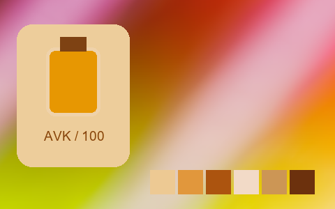

## 202 · 大眾拍立得 · Polaroid Time Zero (Expired) Cold｜暖色 · 提亮中灰 · 中段收窄

`nt-instant-consumer-polaroid-time-zero-expired-cold` · `instant-consumer` · CC-BY-SA-4.0 · 33³

50% 灰輸出 Y′ 141.8/255（變化 +14.3 碼值）；25%–75% 灰跨度比 0.604。中灰紅減藍 +101.5 碼值。淺/中/深膚色色塊分別輸出 #E9C691、#D49C52、#AD6D36；紅/綠/藍測試塊分別輸出 #CA6737、#AFB122、#C38192。

建議試片：暖色生活、餐飲與懷舊試片

試用強度：0.35–0.8; default 1.0.

逐項比較膚色與品牌色，強度過高可能改變產品顏色。僅像素顏色映射，不生成顆粒、光暈、暗角、空間霧或美顏；未做自然畫質驗收。

| Input swatch | Input RGB | Actual output RGB |
|---|---|---|
| `gray_0` | `#000000` | `#986034` |
| `gray_10` | `#1A1A1A` | `#986033` |
| `gray_25` | `#404040` | `#9C6536` |
| `gray_50` | `#808080` | `#B88753` |
| `gray_75` | `#BFBFBF` | `#D6B880` |
| `gray_90` | `#E6E6E6` | `#E7CFA9` |
| `gray_100` | `#FFFFFF` | `#E7D3B9` |
| `skin_light` | `#F5DBC6` | `#E9C691` |
| `skin_medium` | `#CF9B7B` | `#D49C52` |
| `skin_deep` | `#815438` | `#AD6D36` |
| `red` | `#CC3333` | `#CA6737` |
| `green` | `#33CC33` | `#AFB122` |
| `blue` | `#3333CC` | `#C38192` |

Creator: **Pat David** · [Source](https://github.com/NatronGitHub/clut/blob/af7b50d4caf6244fb6895a647f5b6a84efe7931a/instant_consumer/polaroid_time_zero_(expired)_cold.png) · commit `af7b50d4caf6244fb6895a647f5b6a84efe7931a`.

Conversion: `native-depth-Hald-to-33-tetrahedral-v1`; 8,192 sampled RGB points; max error 0.0102406; mean 0.0006190. This is numerical approximation, not a perceptual quality score.

License obligations: Credit the named creator and source; retain the CC-BY-SA-4.0 notice and indicate changes. Redistributed adapted LUT data and thumbnails must use CC-BY-SA-4.0 or a compatible license; no additional restrictions.

[License](../../../product/src/ai_ad_editor/look_data/licenses/CC-BY-SA-4.0.txt) · LUT SHA-256 `19772fd2f2074e60c4352a7c38dd35a28bf209a7a6a0233676299d5e8359d17d`.

[Actual preview PNG](../../assets/look500-20261024-r1/previews/nt-instant-consumer-polaroid-time-zero-expired-cold.png) · [Actual video](../../assets/look500-20261024-r1/videos/nt-instant-consumer-polaroid-time-zero-expired-cold.mp4)

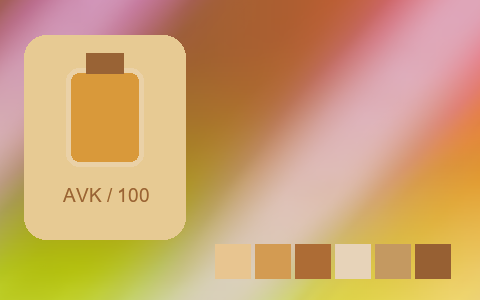

## 203 · 大眾拍立得 · Polaroid Time Zero (Expired) Cold ---｜暖色 · 提亮中灰 · 中段拉開

`nt-instant-consumer-polaroid-time-zero-expired-cold-curve-minus-3` · `instant-consumer` · CC-BY-SA-4.0 · 33³

50% 灰輸出 Y′ 134.8/255（變化 +7.3 碼值）；25%–75% 灰跨度比 1.114。中灰紅減藍 +40.5 碼值。淺/中/深膚色色塊分別輸出 #EFD3C3、#CE9D70、#86491D；紅/綠/藍測試塊分別輸出 #C42427、#7CBF01、#A979C5。

建議試片：暖色生活、餐飲與懷舊試片

試用強度：0.35–0.8; default 1.0.

逐項比較膚色與品牌色，強度過高可能改變產品顏色。僅像素顏色映射，不生成顆粒、光暈、暗角、空間霧或美顏；未做自然畫質驗收。

| Input swatch | Input RGB | Actual output RGB |
|---|---|---|
| `gray_0` | `#000000` | `#21080A` |
| `gray_10` | `#1A1A1A` | `#24080B` |
| `gray_25` | `#404040` | `#482E25` |
| `gray_50` | `#808080` | `#97846E` |
| `gray_75` | `#BFBFBF` | `#CEBFB2` |
| `gray_90` | `#E6E6E6` | `#ECE0D7` |
| `gray_100` | `#FFFFFF` | `#F7EBED` |
| `skin_light` | `#F5DBC6` | `#EFD3C3` |
| `skin_medium` | `#CF9B7B` | `#CE9D70` |
| `skin_deep` | `#815438` | `#86491D` |
| `red` | `#CC3333` | `#C42427` |
| `green` | `#33CC33` | `#7CBF01` |
| `blue` | `#3333CC` | `#A979C5` |

Creator: **Pat David** · [Source](https://github.com/NatronGitHub/clut/blob/af7b50d4caf6244fb6895a647f5b6a84efe7931a/instant_consumer/polaroid_time_zero_(expired)_cold_---.png) · commit `af7b50d4caf6244fb6895a647f5b6a84efe7931a`.

Conversion: `native-depth-Hald-to-33-tetrahedral-v1`; 8,192 sampled RGB points; max error 0.0172385; mean 0.0007538. This is numerical approximation, not a perceptual quality score.

License obligations: Credit the named creator and source; retain the CC-BY-SA-4.0 notice and indicate changes. Redistributed adapted LUT data and thumbnails must use CC-BY-SA-4.0 or a compatible license; no additional restrictions.

[License](../../../product/src/ai_ad_editor/look_data/licenses/CC-BY-SA-4.0.txt) · LUT SHA-256 `3afa50eb5f6af3a4f5ae519f7ca3977b01f85f3ad23e6efa8cdc75b3effa6f5d`.

[Actual preview PNG](../../assets/look500-20261024-r1/previews/nt-instant-consumer-polaroid-time-zero-expired-cold-curve-minus-3.png) · [Actual video](../../assets/look500-20261024-r1/videos/nt-instant-consumer-polaroid-time-zero-expired-cold-curve-minus-3.mp4)

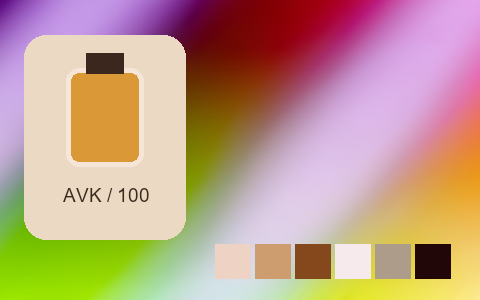

## 204 · 大眾拍立得 · Polaroid Time Zero (Expired) Cold --｜暖色 · 提亮中灰 · 中段拉開

`nt-instant-consumer-polaroid-time-zero-expired-cold-curve-minus-2` · `instant-consumer` · CC-BY-SA-4.0 · 33³

50% 灰輸出 Y′ 132.5/255（變化 +5.0 碼值）；25%–75% 灰跨度比 1.092。中灰紅減藍 +79.0 碼值。淺/中/深膚色色塊分別輸出 #E7D1BC、#DB9C5E、#8F420C；紅/綠/藍測試塊分別輸出 #D01C12、#9CBB04、#B96BBA。

建議試片：暖色生活、餐飲與懷舊試片

試用強度：0.35–0.8; default 1.0.

逐項比較膚色與品牌色，強度過高可能改變產品顏色。僅像素顏色映射，不生成顆粒、光暈、暗角、空間霧或美顏；未做自然畫質驗收。

| Input swatch | Input RGB | Actual output RGB |
|---|---|---|
| `gray_0` | `#000000` | `#42190A` |
| `gray_10` | `#1A1A1A` | `#421A09` |
| `gray_25` | `#404040` | `#582F16` |
| `gray_50` | `#808080` | `#AC7D5C` |
| `gray_75` | `#BFBFBF` | `#D6BEA8` |
| `gray_90` | `#E6E6E6` | `#E6D8CF` |
| `gray_100` | `#FFFFFF` | `#E9E1DD` |
| `skin_light` | `#F5DBC6` | `#E7D1BC` |
| `skin_medium` | `#CF9B7B` | `#DB9C5E` |
| `skin_deep` | `#815438` | `#8F420C` |
| `red` | `#CC3333` | `#D01C12` |
| `green` | `#33CC33` | `#9CBB04` |
| `blue` | `#3333CC` | `#B96BBA` |

Creator: **Pat David** · [Source](https://github.com/NatronGitHub/clut/blob/af7b50d4caf6244fb6895a647f5b6a84efe7931a/instant_consumer/polaroid_time_zero_(expired)_cold_--.png) · commit `af7b50d4caf6244fb6895a647f5b6a84efe7931a`.

Conversion: `native-depth-Hald-to-33-tetrahedral-v1`; 8,192 sampled RGB points; max error 0.0298085; mean 0.0007923. This is numerical approximation, not a perceptual quality score.

License obligations: Credit the named creator and source; retain the CC-BY-SA-4.0 notice and indicate changes. Redistributed adapted LUT data and thumbnails must use CC-BY-SA-4.0 or a compatible license; no additional restrictions.

[License](../../../product/src/ai_ad_editor/look_data/licenses/CC-BY-SA-4.0.txt) · LUT SHA-256 `e782597f9e5a7e78ef1228cc32c70ea6e0f283ceea9c42dd6cd1aa93e979897d`.

[Actual preview PNG](../../assets/look500-20261024-r1/previews/nt-instant-consumer-polaroid-time-zero-expired-cold-curve-minus-2.png) · [Actual video](../../assets/look500-20261024-r1/videos/nt-instant-consumer-polaroid-time-zero-expired-cold-curve-minus-2.mp4)

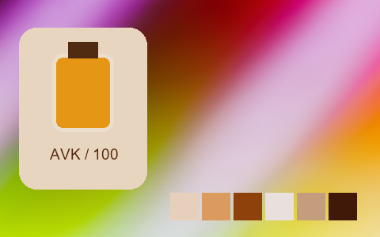

## 205 · 大眾拍立得 · Polaroid Time Zero (Expired) Cold -｜暖色 · 提亮中灰 · 中段收窄

`nt-instant-consumer-polaroid-time-zero-expired-cold-curve-minus-1` · `instant-consumer` · CC-BY-SA-4.0 · 33³

50% 灰輸出 Y′ 136.9/255（變化 +9.4 碼值）；25%–75% 灰跨度比 0.857。中灰紅減藍 +93.0 碼值。淺/中/深膚色色塊分別輸出 #ECC89C、#D69955、#9E5A24；紅/綠/藍測試塊分別輸出 #C94D27、#A0B701、#BE78A1。

建議試片：暖色生活、餐飲與懷舊試片

試用強度：0.35–0.8; default 1.0.

逐項比較膚色與品牌色，強度過高可能改變產品顏色。僅像素顏色映射，不生成顆粒、光暈、暗角、空間霧或美顏；未做自然畫質驗收。

| Input swatch | Input RGB | Actual output RGB |
|---|---|---|
| `gray_0` | `#000000` | `#623013` |
| `gray_10` | `#1A1A1A` | `#673218` |
| `gray_25` | `#404040` | `#7A4925` |
| `gray_50` | `#808080` | `#B08253` |
| `gray_75` | `#BFBFBF` | `#DABB8F` |
| `gray_90` | `#E6E6E6` | `#EBD2B3` |
| `gray_100` | `#FFFFFF` | `#F1DAC7` |
| `skin_light` | `#F5DBC6` | `#ECC89C` |
| `skin_medium` | `#CF9B7B` | `#D69955` |
| `skin_deep` | `#815438` | `#9E5A24` |
| `red` | `#CC3333` | `#C94D27` |
| `green` | `#33CC33` | `#A0B701` |
| `blue` | `#3333CC` | `#BE78A1` |

Creator: **Pat David** · [Source](https://github.com/NatronGitHub/clut/blob/af7b50d4caf6244fb6895a647f5b6a84efe7931a/instant_consumer/polaroid_time_zero_(expired)_cold_-.png) · commit `af7b50d4caf6244fb6895a647f5b6a84efe7931a`.

Conversion: `native-depth-Hald-to-33-tetrahedral-v1`; 8,192 sampled RGB points; max error 0.0108384; mean 0.0006642. This is numerical approximation, not a perceptual quality score.

License obligations: Credit the named creator and source; retain the CC-BY-SA-4.0 notice and indicate changes. Redistributed adapted LUT data and thumbnails must use CC-BY-SA-4.0 or a compatible license; no additional restrictions.

[License](../../../product/src/ai_ad_editor/look_data/licenses/CC-BY-SA-4.0.txt) · LUT SHA-256 `82ad20e5cdc144ed09c1a5c593eb33282e69289c40bbac9aae5214044422fc98`.

[Actual preview PNG](../../assets/look500-20261024-r1/previews/nt-instant-consumer-polaroid-time-zero-expired-cold-curve-minus-1.png) · [Actual video](../../assets/look500-20261024-r1/videos/nt-instant-consumer-polaroid-time-zero-expired-cold-curve-minus-1.mp4)

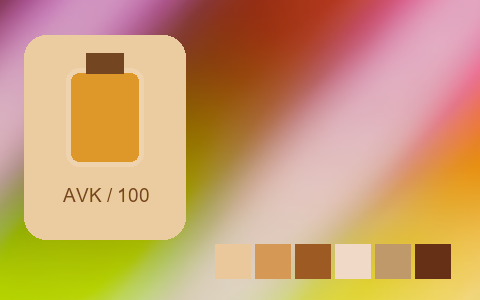

## 206 · 專業拍立得 · Fuji Fp-100C｜暖色 · 提亮中灰 · 中段拉開

`nt-instant-pro-fuji-fp-100c` · `instant-pro` · CC-BY-SA-4.0 · 33³

50% 灰輸出 Y′ 156.3/255（變化 +28.8 碼值）；25%–75% 灰跨度比 1.120。中灰紅減藍 +6.0 碼值。淺/中/深膚色色塊分別輸出 #F1E2D3、#DFAF8E、#9C5D3D；紅/綠/藍測試塊分別輸出 #DB3234、#34C143、#6A24CF。

建議試片：暖色生活、餐飲與懷舊試片

試用強度：0.35–0.8; default 1.0.

逐項比較膚色與品牌色，強度過高可能改變產品顏色。僅像素顏色映射，不生成顆粒、光暈、暗角、空間霧或美顏；未做自然畫質驗收。

| Input swatch | Input RGB | Actual output RGB |
|---|---|---|
| `gray_0` | `#000000` | `#0E1011` |
| `gray_10` | `#1A1A1A` | `#16171B` |
| `gray_25` | `#404040` | `#494246` |
| `gray_50` | `#808080` | `#A09C9A` |
| `gray_75` | `#BFBFBF` | `#D4D3D2` |
| `gray_90` | `#E6E6E6` | `#ECEBEC` |
| `gray_100` | `#FFFFFF` | `#FAFCFC` |
| `skin_light` | `#F5DBC6` | `#F1E2D3` |
| `skin_medium` | `#CF9B7B` | `#DFAF8E` |
| `skin_deep` | `#815438` | `#9C5D3D` |
| `red` | `#CC3333` | `#DB3234` |
| `green` | `#33CC33` | `#34C143` |
| `blue` | `#3333CC` | `#6A24CF` |

Creator: **Pat David** · [Source](https://github.com/NatronGitHub/clut/blob/af7b50d4caf6244fb6895a647f5b6a84efe7931a/instant_pro/fuji_fp-100c.png) · commit `af7b50d4caf6244fb6895a647f5b6a84efe7931a`.

Conversion: `native-depth-Hald-to-33-tetrahedral-v1`; 8,192 sampled RGB points; max error 0.0277983; mean 0.0009915. This is numerical approximation, not a perceptual quality score.

License obligations: Credit the named creator and source; retain the CC-BY-SA-4.0 notice and indicate changes. Redistributed adapted LUT data and thumbnails must use CC-BY-SA-4.0 or a compatible license; no additional restrictions.

[License](../../../product/src/ai_ad_editor/look_data/licenses/CC-BY-SA-4.0.txt) · LUT SHA-256 `e05a014ddcc2766d35e6e7681415507c4bc4c2c95b78aeec546f7515bd89949d`.

[Actual preview PNG](../../assets/look500-20261024-r1/previews/nt-instant-pro-fuji-fp-100c.png) · [Actual video](../../assets/look500-20261024-r1/videos/nt-instant-pro-fuji-fp-100c.mp4)

## 207 · 專業拍立得 · Fuji Fp-100C +++｜冷色 · 提亮中灰 · 中段收窄

`nt-instant-pro-fuji-fp-100c-curve-plus-3` · `instant-pro` · CC-BY-SA-4.0 · 33³

50% 灰輸出 Y′ 143.2/255（變化 +15.7 碼值）；25%–75% 灰跨度比 0.929。中灰紅減藍 -3.5 碼值。淺/中/深膚色色塊分別輸出 #EFDAD7、#D8A58C、#8B6357；紅/綠/藍測試塊分別輸出 #C95252、#4FB75A、#6448CF。

建議試片：冷色城市、夜景與科技試片

試用強度：0.35–0.8; default 1.0.

逐項比較膚色與品牌色，強度過高可能改變產品顏色。僅像素顏色映射，不生成顆粒、光暈、暗角、空間霧或美顏；未做自然畫質驗收。

| Input swatch | Input RGB | Actual output RGB |
|---|---|---|
| `gray_0` | `#000000` | `#4A454A` |
| `gray_10` | `#1A1A1A` | `#4A464C` |
| `gray_25` | `#404040` | `#58535A` |
| `gray_50` | `#808080` | `#988C9B` |
| `gray_75` | `#BFBFBF` | `#D1C9D5` |
| `gray_90` | `#E6E6E6` | `#EAE2EC` |
| `gray_100` | `#FFFFFF` | `#F5EEF9` |
| `skin_light` | `#F5DBC6` | `#EFDAD7` |
| `skin_medium` | `#CF9B7B` | `#D8A58C` |
| `skin_deep` | `#815438` | `#8B6357` |
| `red` | `#CC3333` | `#C95252` |
| `green` | `#33CC33` | `#4FB75A` |
| `blue` | `#3333CC` | `#6448CF` |

Creator: **Pat David** · [Source](https://github.com/NatronGitHub/clut/blob/af7b50d4caf6244fb6895a647f5b6a84efe7931a/instant_pro/fuji_fp-100c_+++.png) · commit `af7b50d4caf6244fb6895a647f5b6a84efe7931a`.

Conversion: `native-depth-Hald-to-33-tetrahedral-v1`; 8,192 sampled RGB points; max error 0.0594184; mean 0.0008616. This is numerical approximation, not a perceptual quality score.

License obligations: Credit the named creator and source; retain the CC-BY-SA-4.0 notice and indicate changes. Redistributed adapted LUT data and thumbnails must use CC-BY-SA-4.0 or a compatible license; no additional restrictions.

[License](../../../product/src/ai_ad_editor/look_data/licenses/CC-BY-SA-4.0.txt) · LUT SHA-256 `270c59512e01adb5385ea9bef7b51506f0bbbb2e423e6ad6448d48b8d9d5102f`.

[Actual preview PNG](../../assets/look500-20261024-r1/previews/nt-instant-pro-fuji-fp-100c-curve-plus-3.png) · [Actual video](../../assets/look500-20261024-r1/videos/nt-instant-pro-fuji-fp-100c-curve-plus-3.mp4)

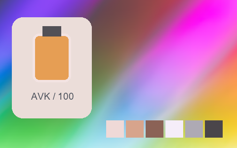

## 208 · 專業拍立得 · Fuji Fp-100C ++｜暖色 · 提亮中灰 · 中段拉開

`nt-instant-pro-fuji-fp-100c-curve-plus-2` · `instant-pro` · CC-BY-SA-4.0 · 33³

50% 灰輸出 Y′ 153.3/255（變化 +25.8 碼值）；25%–75% 灰跨度比 1.173。中灰紅減藍 +11.5 碼值。淺/中/深膚色色塊分別輸出 #F1E1D1、#E0B08A、#955629；紅/綠/藍測試塊分別輸出 #DC3221、#3DC029、#5F22CE。

建議試片：暖色生活、餐飲與懷舊試片

試用強度：0.35–0.8; default 1.0.

逐項比較膚色與品牌色，強度過高可能改變產品顏色。僅像素顏色映射，不生成顆粒、光暈、暗角、空間霧或美顏；未做自然畫質驗收。

| Input swatch | Input RGB | Actual output RGB |
|---|---|---|
| `gray_0` | `#000000` | `#37291D` |
| `gray_10` | `#1A1A1A` | `#39271F` |
| `gray_25` | `#404040` | `#4B3C32` |
| `gray_50` | `#808080` | `#A09894` |
| `gray_75` | `#BFBFBF` | `#D4D4D3` |
| `gray_90` | `#E6E6E6` | `#ECE8EA` |
| `gray_100` | `#FFFFFF` | `#FBFBFB` |
| `skin_light` | `#F5DBC6` | `#F1E1D1` |
| `skin_medium` | `#CF9B7B` | `#E0B08A` |
| `skin_deep` | `#815438` | `#955629` |
| `red` | `#CC3333` | `#DC3221` |
| `green` | `#33CC33` | `#3DC029` |
| `blue` | `#3333CC` | `#5F22CE` |

Creator: **Pat David** · [Source](https://github.com/NatronGitHub/clut/blob/af7b50d4caf6244fb6895a647f5b6a84efe7931a/instant_pro/fuji_fp-100c_++.png) · commit `af7b50d4caf6244fb6895a647f5b6a84efe7931a`.

Conversion: `native-depth-Hald-to-33-tetrahedral-v1`; 8,192 sampled RGB points; max error 0.0286243; mean 0.0009975. This is numerical approximation, not a perceptual quality score.

License obligations: Credit the named creator and source; retain the CC-BY-SA-4.0 notice and indicate changes. Redistributed adapted LUT data and thumbnails must use CC-BY-SA-4.0 or a compatible license; no additional restrictions.

[License](../../../product/src/ai_ad_editor/look_data/licenses/CC-BY-SA-4.0.txt) · LUT SHA-256 `18c1b5e237a6c4e491745981e93b04bd11eb45478ebb5725deeb657cc4e9b34a`.

[Actual preview PNG](../../assets/look500-20261024-r1/previews/nt-instant-pro-fuji-fp-100c-curve-plus-2.png) · [Actual video](../../assets/look500-20261024-r1/videos/nt-instant-pro-fuji-fp-100c-curve-plus-2.mp4)

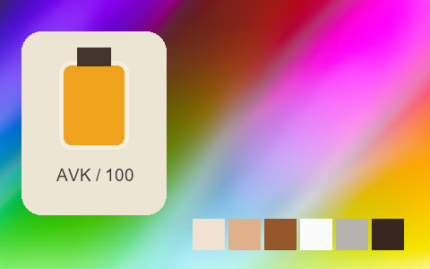

## 209 · 專業拍立得 · Fuji Fp-100C ++ Alt｜暖色 · 提亮中灰 · 中段跨度接近原值

`nt-instant-pro-fuji-fp-100c-plus-plus-alt` · `instant-pro` · CC-BY-SA-4.0 · 33³

50% 灰輸出 Y′ 142.0/255（變化 +14.5 碼值）；25%–75% 灰跨度比 0.971。中灰紅減藍 +15.5 碼值。淺/中/深膚色色塊分別輸出 #E3D6C9、#CCA67B、#855E33；紅/綠/藍測試塊分別輸出 #BF4C30、#50B43E、#5E40B4。

建議試片：暖色生活、餐飲與懷舊試片

試用強度：0.35–0.8; default 1.0.

逐項比較膚色與品牌色，強度過高可能改變產品顏色。僅像素顏色映射，不生成顆粒、光暈、暗角、空間霧或美顏；未做自然畫質驗收。

| Input swatch | Input RGB | Actual output RGB |
|---|---|---|
| `gray_0` | `#000000` | `#443725` |
| `gray_10` | `#1A1A1A` | `#463927` |
| `gray_25` | `#404040` | `#554939` |
| `gray_50` | `#808080` | `#8D907E` |
| `gray_75` | `#BFBFBF` | `#C6C7C3` |
| `gray_90` | `#E6E6E6` | `#DDDBDD` |
| `gray_100` | `#FFFFFF` | `#E9E9EF` |
| `skin_light` | `#F5DBC6` | `#E3D6C9` |
| `skin_medium` | `#CF9B7B` | `#CCA67B` |
| `skin_deep` | `#815438` | `#855E33` |
| `red` | `#CC3333` | `#BF4C30` |
| `green` | `#33CC33` | `#50B43E` |
| `blue` | `#3333CC` | `#5E40B4` |

Creator: **Pat David** · [Source](https://github.com/NatronGitHub/clut/blob/af7b50d4caf6244fb6895a647f5b6a84efe7931a/instant_pro/fuji_fp-100c_++_alt.png) · commit `af7b50d4caf6244fb6895a647f5b6a84efe7931a`.

Conversion: `native-depth-Hald-to-33-tetrahedral-v1`; 8,192 sampled RGB points; max error 0.0182191; mean 0.0008181. This is numerical approximation, not a perceptual quality score.

License obligations: Credit the named creator and source; retain the CC-BY-SA-4.0 notice and indicate changes. Redistributed adapted LUT data and thumbnails must use CC-BY-SA-4.0 or a compatible license; no additional restrictions.

[License](../../../product/src/ai_ad_editor/look_data/licenses/CC-BY-SA-4.0.txt) · LUT SHA-256 `263543593bde4f1383deee3d1a3ffd29144f6bc98935f11eae94543d3c8aef79`.

[Actual preview PNG](../../assets/look500-20261024-r1/previews/nt-instant-pro-fuji-fp-100c-plus-plus-alt.png) · [Actual video](../../assets/look500-20261024-r1/videos/nt-instant-pro-fuji-fp-100c-plus-plus-alt.mp4)

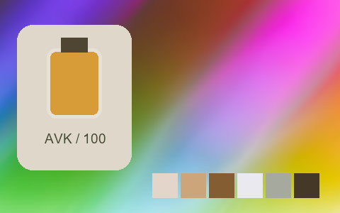

## 210 · 專業拍立得 · Fuji Fp-100C +｜暖色 · 提亮中灰 · 中段拉開

`nt-instant-pro-fuji-fp-100c-curve-plus-1` · `instant-pro` · CC-BY-SA-4.0 · 33³

50% 灰輸出 Y′ 153.4/255（變化 +25.9 碼值）；25%–75% 灰跨度比 1.191。中灰紅減藍 +9.5 碼值。淺/中/深膚色色塊分別輸出 #F1E2D4、#DFB08B、#9B5829；紅/綠/藍測試塊分別輸出 #DB2C1E、#42C034、#591FCE。

建議試片：暖色生活、餐飲與懷舊試片

試用強度：0.35–0.8; default 1.0.

逐項比較膚色與品牌色，強度過高可能改變產品顏色。僅像素顏色映射，不生成顆粒、光暈、暗角、空間霧或美顏；未做自然畫質驗收。

| Input swatch | Input RGB | Actual output RGB |
|---|---|---|
| `gray_0` | `#000000` | `#170F06` |
| `gray_10` | `#1A1A1A` | `#20170C` |
| `gray_25` | `#404040` | `#463A33` |
| `gray_50` | `#808080` | `#A09897` |
| `gray_75` | `#BFBFBF` | `#D5D3D3` |
| `gray_90` | `#E6E6E6` | `#ECEAEB` |
| `gray_100` | `#FFFFFF` | `#FAF7FA` |
| `skin_light` | `#F5DBC6` | `#F1E2D4` |
| `skin_medium` | `#CF9B7B` | `#DFB08B` |
| `skin_deep` | `#815438` | `#9B5829` |
| `red` | `#CC3333` | `#DB2C1E` |
| `green` | `#33CC33` | `#42C034` |
| `blue` | `#3333CC` | `#591FCE` |

Creator: **Pat David** · [Source](https://github.com/NatronGitHub/clut/blob/af7b50d4caf6244fb6895a647f5b6a84efe7931a/instant_pro/fuji_fp-100c_+.png) · commit `af7b50d4caf6244fb6895a647f5b6a84efe7931a`.

Conversion: `native-depth-Hald-to-33-tetrahedral-v1`; 8,192 sampled RGB points; max error 0.0295817; mean 0.0009869. This is numerical approximation, not a perceptual quality score.

License obligations: Credit the named creator and source; retain the CC-BY-SA-4.0 notice and indicate changes. Redistributed adapted LUT data and thumbnails must use CC-BY-SA-4.0 or a compatible license; no additional restrictions.

[License](../../../product/src/ai_ad_editor/look_data/licenses/CC-BY-SA-4.0.txt) · LUT SHA-256 `c398150537360e723c24b040adefba931505b0af547ab29e1c1145384298c017`.

[Actual preview PNG](../../assets/look500-20261024-r1/previews/nt-instant-pro-fuji-fp-100c-curve-plus-1.png) · [Actual video](../../assets/look500-20261024-r1/videos/nt-instant-pro-fuji-fp-100c-curve-plus-1.mp4)

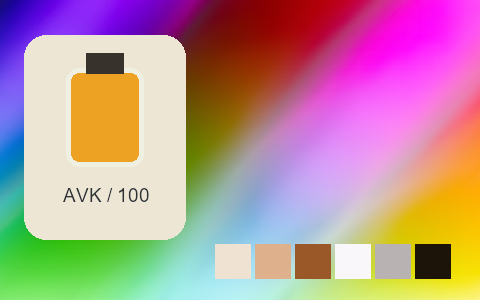

## 211 · 專業拍立得 · Fuji Fp-100C --｜暖色 · 提亮中灰 · 中段拉開

`nt-instant-pro-fuji-fp-100c-curve-minus-2` · `instant-pro` · CC-BY-SA-4.0 · 33³

50% 灰輸出 Y′ 155.9/255（變化 +28.4 碼值）；25%–75% 灰跨度比 1.155。中灰紅減藍 +13.5 碼值。淺/中/深膚色色塊分別輸出 #F4E4D1、#E2AE8C、#A15E39；紅/綠/藍測試塊分別輸出 #E1282E、#3EC443、#661DCE。

建議試片：暖色生活、餐飲與懷舊試片

試用強度：0.35–0.8; default 1.0.

逐項比較膚色與品牌色，強度過高可能改變產品顏色。僅像素顏色映射，不生成顆粒、光暈、暗角、空間霧或美顏；未做自然畫質驗收。

| Input swatch | Input RGB | Actual output RGB |
|---|---|---|
| `gray_0` | `#000000` | `#000100` |
| `gray_10` | `#1A1A1A` | `#0D0F11` |
| `gray_25` | `#404040` | `#3F4244` |
| `gray_50` | `#808080` | `#A69999` |
| `gray_75` | `#BFBFBF` | `#D8D4D2` |
| `gray_90` | `#E6E6E6` | `#ECECEA` |
| `gray_100` | `#FFFFFF` | `#FCF7FB` |
| `skin_light` | `#F5DBC6` | `#F4E4D1` |
| `skin_medium` | `#CF9B7B` | `#E2AE8C` |
| `skin_deep` | `#815438` | `#A15E39` |
| `red` | `#CC3333` | `#E1282E` |
| `green` | `#33CC33` | `#3EC443` |
| `blue` | `#3333CC` | `#661DCE` |

Creator: **Pat David** · [Source](https://github.com/NatronGitHub/clut/blob/af7b50d4caf6244fb6895a647f5b6a84efe7931a/instant_pro/fuji_fp-100c_--.png) · commit `af7b50d4caf6244fb6895a647f5b6a84efe7931a`.

Conversion: `native-depth-Hald-to-33-tetrahedral-v1`; 8,192 sampled RGB points; max error 0.0269834; mean 0.0010262. This is numerical approximation, not a perceptual quality score.

License obligations: Credit the named creator and source; retain the CC-BY-SA-4.0 notice and indicate changes. Redistributed adapted LUT data and thumbnails must use CC-BY-SA-4.0 or a compatible license; no additional restrictions.

[License](../../../product/src/ai_ad_editor/look_data/licenses/CC-BY-SA-4.0.txt) · LUT SHA-256 `a3f5e61e12a601124355f08e7e1be9bb873761370d61df58ed7cc146e1486264`.

[Actual preview PNG](../../assets/look500-20261024-r1/previews/nt-instant-pro-fuji-fp-100c-curve-minus-2.png) · [Actual video](../../assets/look500-20261024-r1/videos/nt-instant-pro-fuji-fp-100c-curve-minus-2.mp4)

## 212 · 專業拍立得 · Fuji Fp-100C -｜暖色 · 提亮中灰 · 中段拉開

`nt-instant-pro-fuji-fp-100c-curve-minus-1` · `instant-pro` · CC-BY-SA-4.0 · 33³

50% 灰輸出 Y′ 156.6/255（變化 +29.1 碼值）；25%–75% 灰跨度比 1.172。中灰紅減藍 +11.0 碼值。淺/中/深膚色色塊分別輸出 #F1E2D0、#E2AF8D、#9A5834；紅/綠/藍測試塊分別輸出 #E02B2D、#32C23D、#651BCE。

建議試片：暖色生活、餐飲與懷舊試片

試用強度：0.35–0.8; default 1.0.

逐項比較膚色與品牌色，強度過高可能改變產品顏色。僅像素顏色映射，不生成顆粒、光暈、暗角、空間霧或美顏；未做自然畫質驗收。

| Input swatch | Input RGB | Actual output RGB |
|---|---|---|
| `gray_0` | `#000000` | `#0A0607` |
| `gray_10` | `#1A1A1A` | `#0F1113` |
| `gray_25` | `#404040` | `#3B3F42` |
| `gray_50` | `#808080` | `#A49B9A` |
| `gray_75` | `#BFBFBF` | `#D7D3D1` |
| `gray_90` | `#E6E6E6` | `#EBECE9` |
| `gray_100` | `#FFFFFF` | `#FBFBFB` |
| `skin_light` | `#F5DBC6` | `#F1E2D0` |
| `skin_medium` | `#CF9B7B` | `#E2AF8D` |
| `skin_deep` | `#815438` | `#9A5834` |
| `red` | `#CC3333` | `#E02B2D` |
| `green` | `#33CC33` | `#32C23D` |
| `blue` | `#3333CC` | `#651BCE` |

Creator: **Pat David** · [Source](https://github.com/NatronGitHub/clut/blob/af7b50d4caf6244fb6895a647f5b6a84efe7931a/instant_pro/fuji_fp-100c_-.png) · commit `af7b50d4caf6244fb6895a647f5b6a84efe7931a`.

Conversion: `native-depth-Hald-to-33-tetrahedral-v1`; 8,192 sampled RGB points; max error 0.0300041; mean 0.0010828. This is numerical approximation, not a perceptual quality score.

License obligations: Credit the named creator and source; retain the CC-BY-SA-4.0 notice and indicate changes. Redistributed adapted LUT data and thumbnails must use CC-BY-SA-4.0 or a compatible license; no additional restrictions.

[License](../../../product/src/ai_ad_editor/look_data/licenses/CC-BY-SA-4.0.txt) · LUT SHA-256 `4d3eb64429f8d23d638d8e7793f93b71c642c587aab0067931f28c6ffdc665dc`.

[Actual preview PNG](../../assets/look500-20261024-r1/previews/nt-instant-pro-fuji-fp-100c-curve-minus-1.png) · [Actual video](../../assets/look500-20261024-r1/videos/nt-instant-pro-fuji-fp-100c-curve-minus-1.mp4)

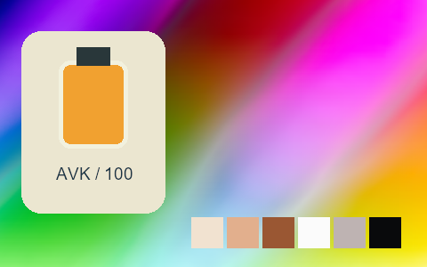

## 213 · 專業拍立得 · Fuji Fp-100C Cool｜冷色 · 提亮中灰 · 中段拉開

`nt-instant-pro-fuji-fp-100c-cool` · `instant-pro` · CC-BY-SA-4.0 · 33³

50% 灰輸出 Y′ 155.9/255（變化 +28.4 碼值）；25%–75% 灰跨度比 1.096。中灰紅減藍 -7.0 碼值。淺/中/深膚色色塊分別輸出 #E3E3D8、#D5B197、#975E44；紅/綠/藍測試塊分別輸出 #D5393D、#36C151、#6325D3。

建議試片：冷色城市、夜景與科技試片

試用強度：0.35–0.8; default 1.0.

逐項比較膚色與品牌色，強度過高可能改變產品顏色。僅像素顏色映射，不生成顆粒、光暈、暗角、空間霧或美顏；未做自然畫質驗收。

| Input swatch | Input RGB | Actual output RGB |
|---|---|---|
| `gray_0` | `#000000` | `#030E13` |
| `gray_10` | `#1A1A1A` | `#10161E` |
| `gray_25` | `#404040` | `#43414C` |
| `gray_50` | `#808080` | `#9A9CA1` |
| `gray_75` | `#BFBFBF` | `#C5D0D3` |
| `gray_90` | `#E6E6E6` | `#E0ECEF` |
| `gray_100` | `#FFFFFF` | `#F3FCFC` |
| `skin_light` | `#F5DBC6` | `#E3E3D8` |
| `skin_medium` | `#CF9B7B` | `#D5B197` |
| `skin_deep` | `#815438` | `#975E44` |
| `red` | `#CC3333` | `#D5393D` |
| `green` | `#33CC33` | `#36C151` |
| `blue` | `#3333CC` | `#6325D3` |

Creator: **Pat David** · [Source](https://github.com/NatronGitHub/clut/blob/af7b50d4caf6244fb6895a647f5b6a84efe7931a/instant_pro/fuji_fp-100c_cool.png) · commit `af7b50d4caf6244fb6895a647f5b6a84efe7931a`.

Conversion: `native-depth-Hald-to-33-tetrahedral-v1`; 8,192 sampled RGB points; max error 0.0278036; mean 0.0009459. This is numerical approximation, not a perceptual quality score.

License obligations: Credit the named creator and source; retain the CC-BY-SA-4.0 notice and indicate changes. Redistributed adapted LUT data and thumbnails must use CC-BY-SA-4.0 or a compatible license; no additional restrictions.

[License](../../../product/src/ai_ad_editor/look_data/licenses/CC-BY-SA-4.0.txt) · LUT SHA-256 `4b38dbbe6202552b88ce4067fdd87b9d17ffcd5b675b5bc3ad058d35ac6ff461`.

[Actual preview PNG](../../assets/look500-20261024-r1/previews/nt-instant-pro-fuji-fp-100c-cool.png) · [Actual video](../../assets/look500-20261024-r1/videos/nt-instant-pro-fuji-fp-100c-cool.mp4)

## 214 · 專業拍立得 · Fuji Fp-100C Cool ++｜冷色 · 提亮中灰 · 中段拉開

`nt-instant-pro-fuji-fp-100c-cool-curve-plus-2` · `instant-pro` · CC-BY-SA-4.0 · 33³

50% 灰輸出 Y′ 149.4/255（變化 +21.9 碼值）；25%–75% 灰跨度比 1.131。中灰紅減藍 -5.0 碼值。淺/中/深膚色色塊分別輸出 #EFD9D4、#DAA993、#905641；紅/綠/藍測試塊分別輸出 #D23139、#35BA4C、#5126CF。

建議試片：冷色城市、夜景與科技試片

試用強度：0.35–0.8; default 1.0.

逐項比較膚色與品牌色，強度過高可能改變產品顏色。僅像素顏色映射，不生成顆粒、光暈、暗角、空間霧或美顏；未做自然畫質驗收。

| Input swatch | Input RGB | Actual output RGB |
|---|---|---|
| `gray_0` | `#000000` | `#2A2129` |
| `gray_10` | `#1A1A1A` | `#2C232C` |
| `gray_25` | `#404040` | `#443B46` |
| `gray_50` | `#808080` | `#99939E` |
| `gray_75` | `#BFBFBF` | `#D2CCD5` |
| `gray_90` | `#E6E6E6` | `#E9E1EC` |
| `gray_100` | `#FFFFFF` | `#FAEBFA` |
| `skin_light` | `#F5DBC6` | `#EFD9D4` |
| `skin_medium` | `#CF9B7B` | `#DAA993` |
| `skin_deep` | `#815438` | `#905641` |
| `red` | `#CC3333` | `#D23139` |
| `green` | `#33CC33` | `#35BA4C` |
| `blue` | `#3333CC` | `#5126CF` |

Creator: **Pat David** · [Source](https://github.com/NatronGitHub/clut/blob/af7b50d4caf6244fb6895a647f5b6a84efe7931a/instant_pro/fuji_fp-100c_cool_++.png) · commit `af7b50d4caf6244fb6895a647f5b6a84efe7931a`.

Conversion: `native-depth-Hald-to-33-tetrahedral-v1`; 8,192 sampled RGB points; max error 0.0256145; mean 0.0009717. This is numerical approximation, not a perceptual quality score.

License obligations: Credit the named creator and source; retain the CC-BY-SA-4.0 notice and indicate changes. Redistributed adapted LUT data and thumbnails must use CC-BY-SA-4.0 or a compatible license; no additional restrictions.

[License](../../../product/src/ai_ad_editor/look_data/licenses/CC-BY-SA-4.0.txt) · LUT SHA-256 `5651a123ad7e51fbe8997ec4a8fb1a0b6625732d97b7ff167b96810662c876f4`.

[Actual preview PNG](../../assets/look500-20261024-r1/previews/nt-instant-pro-fuji-fp-100c-cool-curve-plus-2.png) · [Actual video](../../assets/look500-20261024-r1/videos/nt-instant-pro-fuji-fp-100c-cool-curve-plus-2.mp4)

## 215 · 專業拍立得 · Fuji Fp-100C Cool +｜冷色 · 提亮中灰 · 中段拉開

`nt-instant-pro-fuji-fp-100c-cool-curve-plus-1` · `instant-pro` · CC-BY-SA-4.0 · 33³

50% 灰輸出 Y′ 154.6/255（變化 +27.1 碼值）；25%–75% 灰跨度比 1.183。中灰紅減藍 -6.5 碼值。淺/中/深膚色色塊分別輸出 #EAE2D9、#D9B098、#935748；紅/綠/藍測試塊分別輸出 #D62D41、#22C051、#4F1AD5。

建議試片：冷色城市、夜景與科技試片

試用強度：0.35–0.8; default 1.0.

逐項比較膚色與品牌色，強度過高可能改變產品顏色。僅像素顏色映射，不生成顆粒、光暈、暗角、空間霧或美顏；未做自然畫質驗收。

| Input swatch | Input RGB | Actual output RGB |
|---|---|---|
| `gray_0` | `#000000` | `#180E1F` |
| `gray_10` | `#1A1A1A` | `#1F132A` |
| `gray_25` | `#404040` | `#40374C` |
| `gray_50` | `#808080` | `#9B9AA1` |
| `gray_75` | `#BFBFBF` | `#CCD2D6` |
| `gray_90` | `#E6E6E6` | `#E1E9ED` |
| `gray_100` | `#FFFFFF` | `#E9F8F9` |
| `skin_light` | `#F5DBC6` | `#EAE2D9` |
| `skin_medium` | `#CF9B7B` | `#D9B098` |
| `skin_deep` | `#815438` | `#935748` |
| `red` | `#CC3333` | `#D62D41` |
| `green` | `#33CC33` | `#22C051` |
| `blue` | `#3333CC` | `#4F1AD5` |

Creator: **Pat David** · [Source](https://github.com/NatronGitHub/clut/blob/af7b50d4caf6244fb6895a647f5b6a84efe7931a/instant_pro/fuji_fp-100c_cool_+.png) · commit `af7b50d4caf6244fb6895a647f5b6a84efe7931a`.

Conversion: `native-depth-Hald-to-33-tetrahedral-v1`; 8,192 sampled RGB points; max error 0.0469258; mean 0.0009930. This is numerical approximation, not a perceptual quality score.

License obligations: Credit the named creator and source; retain the CC-BY-SA-4.0 notice and indicate changes. Redistributed adapted LUT data and thumbnails must use CC-BY-SA-4.0 or a compatible license; no additional restrictions.

[License](../../../product/src/ai_ad_editor/look_data/licenses/CC-BY-SA-4.0.txt) · LUT SHA-256 `16d5933bb63d918a19eff8527e3d83f3bbf3703ca5641334d51e9ee48b781e6f`.

[Actual preview PNG](../../assets/look500-20261024-r1/previews/nt-instant-pro-fuji-fp-100c-cool-curve-plus-1.png) · [Actual video](../../assets/look500-20261024-r1/videos/nt-instant-pro-fuji-fp-100c-cool-curve-plus-1.mp4)

## 216 · 專業拍立得 · Fuji Fp-100C Cool --｜暖色 · 提亮中灰 · 中段拉開

`nt-instant-pro-fuji-fp-100c-cool-curve-minus-2` · `instant-pro` · CC-BY-SA-4.0 · 33³

50% 灰輸出 Y′ 156.6/255（變化 +29.1 碼值）；25%–75% 灰跨度比 1.159。中灰紅減藍 +7.5 碼值。淺/中/深膚色色塊分別輸出 #EFE4C8、#DEAF86、#9F5D32；紅/綠/藍測試塊分別輸出 #E02327、#03C632、#6717D0。

建議試片：暖色生活、餐飲與懷舊試片

試用強度：0.35–0.8; default 1.0.

逐項比較膚色與品牌色，強度過高可能改變產品顏色。僅像素顏色映射，不生成顆粒、光暈、暗角、空間霧或美顏；未做自然畫質驗收。

| Input swatch | Input RGB | Actual output RGB |
|---|---|---|
| `gray_0` | `#000000` | `#000000` |
| `gray_10` | `#1A1A1A` | `#0A0D11` |
| `gray_25` | `#404040` | `#3B4146` |
| `gray_50` | `#808080` | `#A09C98` |
| `gray_75` | `#BFBFBF` | `#D2D5D1` |
| `gray_90` | `#E6E6E6` | `#E8EEEA` |
| `gray_100` | `#FFFFFF` | `#FCF6FB` |
| `skin_light` | `#F5DBC6` | `#EFE4C8` |
| `skin_medium` | `#CF9B7B` | `#DEAF86` |
| `skin_deep` | `#815438` | `#9F5D32` |
| `red` | `#CC3333` | `#E02327` |
| `green` | `#33CC33` | `#03C632` |
| `blue` | `#3333CC` | `#6717D0` |

Creator: **Pat David** · [Source](https://github.com/NatronGitHub/clut/blob/af7b50d4caf6244fb6895a647f5b6a84efe7931a/instant_pro/fuji_fp-100c_cool_--.png) · commit `af7b50d4caf6244fb6895a647f5b6a84efe7931a`.

Conversion: `native-depth-Hald-to-33-tetrahedral-v1`; 8,192 sampled RGB points; max error 0.0391719; mean 0.0011830. This is numerical approximation, not a perceptual quality score.

License obligations: Credit the named creator and source; retain the CC-BY-SA-4.0 notice and indicate changes. Redistributed adapted LUT data and thumbnails must use CC-BY-SA-4.0 or a compatible license; no additional restrictions.

[License](../../../product/src/ai_ad_editor/look_data/licenses/CC-BY-SA-4.0.txt) · LUT SHA-256 `6c194dfe283cecd1049cf6621b46a597137428c054c1b8c6dfa05b72e7ae4ac5`.

[Actual preview PNG](../../assets/look500-20261024-r1/previews/nt-instant-pro-fuji-fp-100c-cool-curve-minus-2.png) · [Actual video](../../assets/look500-20261024-r1/videos/nt-instant-pro-fuji-fp-100c-cool-curve-minus-2.mp4)

## 217 · 專業拍立得 · Fuji Fp-100C Cool -｜中性 · 提亮中灰 · 中段拉開

`nt-instant-pro-fuji-fp-100c-cool-curve-minus-1` · `instant-pro` · CC-BY-SA-4.0 · 33³

50% 灰輸出 Y′ 151.5/255（變化 +24.0 碼值）；25%–75% 灰跨度比 1.158。中灰紅減藍 +2.5 碼值。淺/中/深膚色色塊分別輸出 #EAE3CD、#D8B08D、#975B3B；紅/綠/藍測試塊分別輸出 #D83131、#1BC23F、#5F1DCE。

建議試片：產品、生活與風景對照試片

試用強度：0.35–0.8; default 1.0.

逐項比較膚色與品牌色，強度過高可能改變產品顏色。僅像素顏色映射，不生成顆粒、光暈、暗角、空間霧或美顏；未做自然畫質驗收。

| Input swatch | Input RGB | Actual output RGB |
|---|---|---|
| `gray_0` | `#000000` | `#040507` |
| `gray_10` | `#1A1A1A` | `#0C1216` |
| `gray_25` | `#404040` | `#384045` |
| `gray_50` | `#808080` | `#9B9698` |
| `gray_75` | `#BFBFBF` | `#CCD4D2` |
| `gray_90` | `#E6E6E6` | `#E4ECEA` |
| `gray_100` | `#FFFFFF` | `#E9F8F8` |
| `skin_light` | `#F5DBC6` | `#EAE3CD` |
| `skin_medium` | `#CF9B7B` | `#D8B08D` |
| `skin_deep` | `#815438` | `#975B3B` |
| `red` | `#CC3333` | `#D83131` |
| `green` | `#33CC33` | `#1BC23F` |
| `blue` | `#3333CC` | `#5F1DCE` |

Creator: **Pat David** · [Source](https://github.com/NatronGitHub/clut/blob/af7b50d4caf6244fb6895a647f5b6a84efe7931a/instant_pro/fuji_fp-100c_cool_-.png) · commit `af7b50d4caf6244fb6895a647f5b6a84efe7931a`.

Conversion: `native-depth-Hald-to-33-tetrahedral-v1`; 8,192 sampled RGB points; max error 0.0418865; mean 0.0010277. This is numerical approximation, not a perceptual quality score.

License obligations: Credit the named creator and source; retain the CC-BY-SA-4.0 notice and indicate changes. Redistributed adapted LUT data and thumbnails must use CC-BY-SA-4.0 or a compatible license; no additional restrictions.

[License](../../../product/src/ai_ad_editor/look_data/licenses/CC-BY-SA-4.0.txt) · LUT SHA-256 `5738e76690deba4ad9b7c20f43da522af65a470c5a6a3df84b7e37c1d9424e57`.

[Actual preview PNG](../../assets/look500-20261024-r1/previews/nt-instant-pro-fuji-fp-100c-cool-curve-minus-1.png) · [Actual video](../../assets/look500-20261024-r1/videos/nt-instant-pro-fuji-fp-100c-cool-curve-minus-1.mp4)

## 218 · 專業拍立得 · Fuji Fp-100C Negative｜暖色 · 提亮中灰 · 中段拉開

`nt-instant-pro-fuji-fp-100c-negative` · `instant-pro` · CC-BY-SA-4.0 · 33³

50% 灰輸出 Y′ 148.3/255（變化 +20.8 碼值）；25%–75% 灰跨度比 1.279。中灰紅減藍 +10.0 碼值。淺/中/深膚色色塊分別輸出 #FDE3CC、#E0B697、#8E5236；紅/綠/藍測試塊分別輸出 #DC4F3D、#75BC83、#9F07C0。

建議試片：暖色生活、餐飲與懷舊試片

試用強度：0.35–0.8; default 1.0.

逐項比較膚色與品牌色，強度過高可能改變產品顏色。僅像素顏色映射，不生成顆粒、光暈、暗角、空間霧或美顏；未做自然畫質驗收。

| Input swatch | Input RGB | Actual output RGB |
|---|---|---|
| `gray_0` | `#000000` | `#0E1B15` |
| `gray_10` | `#1A1A1A` | `#111C18` |
| `gray_25` | `#404040` | `#312D33` |
| `gray_50` | `#808080` | `#9C9292` |
| `gray_75` | `#BFBFBF` | `#DECFC3` |
| `gray_90` | `#E6E6E6` | `#FEE9DF` |
| `gray_100` | `#FFFFFF` | `#FDEFE6` |
| `skin_light` | `#F5DBC6` | `#FDE3CC` |
| `skin_medium` | `#CF9B7B` | `#E0B697` |
| `skin_deep` | `#815438` | `#8E5236` |
| `red` | `#CC3333` | `#DC4F3D` |
| `green` | `#33CC33` | `#75BC83` |
| `blue` | `#3333CC` | `#9F07C0` |

Creator: **Pat David** · [Source](https://github.com/NatronGitHub/clut/blob/af7b50d4caf6244fb6895a647f5b6a84efe7931a/instant_pro/fuji_fp-100c_negative.png) · commit `af7b50d4caf6244fb6895a647f5b6a84efe7931a`.

Conversion: `native-depth-Hald-to-33-tetrahedral-v1`; 8,192 sampled RGB points; max error 0.0386146; mean 0.0009448. This is numerical approximation, not a perceptual quality score.

License obligations: Credit the named creator and source; retain the CC-BY-SA-4.0 notice and indicate changes. Redistributed adapted LUT data and thumbnails must use CC-BY-SA-4.0 or a compatible license; no additional restrictions.

[License](../../../product/src/ai_ad_editor/look_data/licenses/CC-BY-SA-4.0.txt) · LUT SHA-256 `217b2425b579af3c1f3bda8e9b48eff7f53a88739f2fa99690b2ca761e1410f0`.

[Actual preview PNG](../../assets/look500-20261024-r1/previews/nt-instant-pro-fuji-fp-100c-negative.png) · [Actual video](../../assets/look500-20261024-r1/videos/nt-instant-pro-fuji-fp-100c-negative.mp4)

## 219 · 專業拍立得 · Fuji Fp-100C Negative +++｜暖色 · 提亮中灰 · 中段拉開

`nt-instant-pro-fuji-fp-100c-negative-curve-plus-3` · `instant-pro` · CC-BY-SA-4.0 · 33³

50% 灰輸出 Y′ 149.3/255（變化 +21.8 碼值）；25%–75% 灰跨度比 1.126。中灰紅減藍 +30.0 碼值。淺/中/深膚色色塊分別輸出 #FEDCAE、#E5B584、#8F5A46；紅/綠/藍測試塊分別輸出 #DB5B47、#7DBE75、#AC2CAA。

建議試片：暖色生活、餐飲與懷舊試片

試用強度：0.35–0.8; default 1.0.

逐項比較膚色與品牌色，強度過高可能改變產品顏色。僅像素顏色映射，不生成顆粒、光暈、暗角、空間霧或美顏；未做自然畫質驗收。

| Input swatch | Input RGB | Actual output RGB |
|---|---|---|
| `gray_0` | `#000000` | `#342638` |
| `gray_10` | `#1A1A1A` | `#372A3B` |
| `gray_25` | `#404040` | `#4A3D48` |
| `gray_50` | `#808080` | `#A29384` |
| `gray_75` | `#BFBFBF` | `#E8CEA6` |
| `gray_90` | `#E6E6E6` | `#FEE2BD` |
| `gray_100` | `#FFFFFF` | `#FFEDCD` |
| `skin_light` | `#F5DBC6` | `#FEDCAE` |
| `skin_medium` | `#CF9B7B` | `#E5B584` |
| `skin_deep` | `#815438` | `#8F5A46` |
| `red` | `#CC3333` | `#DB5B47` |
| `green` | `#33CC33` | `#7DBE75` |
| `blue` | `#3333CC` | `#AC2CAA` |

Creator: **Pat David** · [Source](https://github.com/NatronGitHub/clut/blob/af7b50d4caf6244fb6895a647f5b6a84efe7931a/instant_pro/fuji_fp-100c_negative_+++.png) · commit `af7b50d4caf6244fb6895a647f5b6a84efe7931a`.

Conversion: `native-depth-Hald-to-33-tetrahedral-v1`; 8,192 sampled RGB points; max error 0.0412896; mean 0.0008429. This is numerical approximation, not a perceptual quality score.

License obligations: Credit the named creator and source; retain the CC-BY-SA-4.0 notice and indicate changes. Redistributed adapted LUT data and thumbnails must use CC-BY-SA-4.0 or a compatible license; no additional restrictions.

[License](../../../product/src/ai_ad_editor/look_data/licenses/CC-BY-SA-4.0.txt) · LUT SHA-256 `2111c80c5ed20aefc8ebdfb737a0e2a131f6c31f78790a639e124f7a9c4c9660`.

[Actual preview PNG](../../assets/look500-20261024-r1/previews/nt-instant-pro-fuji-fp-100c-negative-curve-plus-3.png) · [Actual video](../../assets/look500-20261024-r1/videos/nt-instant-pro-fuji-fp-100c-negative-curve-plus-3.mp4)

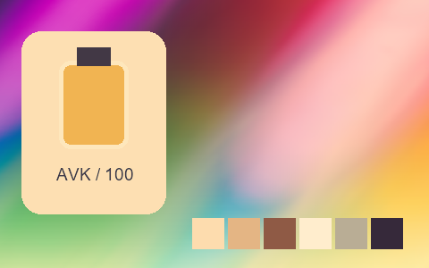

## 220 · 專業拍立得 · Fuji Fp-100C Negative ++｜暖色 · 提亮中灰 · 中段拉開

`nt-instant-pro-fuji-fp-100c-negative-curve-plus-2` · `instant-pro` · CC-BY-SA-4.0 · 33³

50% 灰輸出 Y′ 144.8/255（變化 +17.3 碼值）；25%–75% 灰跨度比 1.156。中灰紅減藍 +19.0 碼值。淺/中/深膚色色塊分別輸出 #FEDFB1、#E5B88A、#8B533E；紅/綠/藍測試塊分別輸出 #DC5640、#75C078、#A618AE。

建議試片：暖色生活、餐飲與懷舊試片

試用強度：0.35–0.8; default 1.0.

逐項比較膚色與品牌色，強度過高可能改變產品顏色。僅像素顏色映射，不生成顆粒、光暈、暗角、空間霧或美顏；未做自然畫質驗收。

| Input swatch | Input RGB | Actual output RGB |
|---|---|---|
| `gray_0` | `#000000` | `#44252A` |
| `gray_10` | `#1A1A1A` | `#46262C` |
| `gray_25` | `#404040` | `#52363D` |
| `gray_50` | `#808080` | `#989084` |
| `gray_75` | `#BFBFBF` | `#E5CEA9` |
| `gray_90` | `#E6E6E6` | `#FDE2BE` |
| `gray_100` | `#FFFFFF` | `#FFEDCD` |
| `skin_light` | `#F5DBC6` | `#FEDFB1` |
| `skin_medium` | `#CF9B7B` | `#E5B88A` |
| `skin_deep` | `#815438` | `#8B533E` |
| `red` | `#CC3333` | `#DC5640` |
| `green` | `#33CC33` | `#75C078` |
| `blue` | `#3333CC` | `#A618AE` |

Creator: **Pat David** · [Source](https://github.com/NatronGitHub/clut/blob/af7b50d4caf6244fb6895a647f5b6a84efe7931a/instant_pro/fuji_fp-100c_negative_++.png) · commit `af7b50d4caf6244fb6895a647f5b6a84efe7931a`.

Conversion: `native-depth-Hald-to-33-tetrahedral-v1`; 8,192 sampled RGB points; max error 0.0426769; mean 0.0008883. This is numerical approximation, not a perceptual quality score.

License obligations: Credit the named creator and source; retain the CC-BY-SA-4.0 notice and indicate changes. Redistributed adapted LUT data and thumbnails must use CC-BY-SA-4.0 or a compatible license; no additional restrictions.

[License](../../../product/src/ai_ad_editor/look_data/licenses/CC-BY-SA-4.0.txt) · LUT SHA-256 `3f39e4cd8159e435830611b84a29a4489b3e38b95aae72d51a091e50a9366bde`.

[Actual preview PNG](../../assets/look500-20261024-r1/previews/nt-instant-pro-fuji-fp-100c-negative-curve-plus-2.png) · [Actual video](../../assets/look500-20261024-r1/videos/nt-instant-pro-fuji-fp-100c-negative-curve-plus-2.mp4)

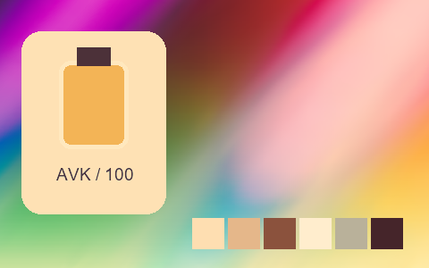

## 221 · 專業拍立得 · Fuji Fp-100C Negative ++ Alt｜暖色 · 提亮中灰 · 中段拉開

`nt-instant-pro-fuji-fp-100c-negative-plus-plus-alt` · `instant-pro` · CC-BY-SA-4.0 · 33³

50% 灰輸出 Y′ 146.6/255（變化 +19.1 碼值）；25%–75% 灰跨度比 1.147。中灰紅減藍 +38.0 碼值。淺/中/深膚色色塊分別輸出 #FDDFBE、#E6B283、#8C5946；紅/綠/藍測試塊分別輸出 #E25648、#86BB74、#AE26AE。

建議試片：暖色生活、餐飲與懷舊試片

試用強度：0.35–0.8; default 1.0.

逐項比較膚色與品牌色，強度過高可能改變產品顏色。僅像素顏色映射，不生成顆粒、光暈、暗角、空間霧或美顏；未做自然畫質驗收。

| Input swatch | Input RGB | Actual output RGB |
|---|---|---|
| `gray_0` | `#000000` | `#1A2C3A` |
| `gray_10` | `#1A1A1A` | `#1B2C3A` |
| `gray_25` | `#404040` | `#304148` |
| `gray_50` | `#808080` | `#A68E80` |
| `gray_75` | `#BFBFBF` | `#E5CDB3` |
| `gray_90` | `#E6E6E6` | `#FDE2CD` |
| `gray_100` | `#FFFFFF` | `#FEE6D6` |
| `skin_light` | `#F5DBC6` | `#FDDFBE` |
| `skin_medium` | `#CF9B7B` | `#E6B283` |
| `skin_deep` | `#815438` | `#8C5946` |
| `red` | `#CC3333` | `#E25648` |
| `green` | `#33CC33` | `#86BB74` |
| `blue` | `#3333CC` | `#AE26AE` |

Creator: **Pat David** · [Source](https://github.com/NatronGitHub/clut/blob/af7b50d4caf6244fb6895a647f5b6a84efe7931a/instant_pro/fuji_fp-100c_negative_++_alt.png) · commit `af7b50d4caf6244fb6895a647f5b6a84efe7931a`.

Conversion: `native-depth-Hald-to-33-tetrahedral-v1`; 8,192 sampled RGB points; max error 0.0603735; mean 0.0009295. This is numerical approximation, not a perceptual quality score.

License obligations: Credit the named creator and source; retain the CC-BY-SA-4.0 notice and indicate changes. Redistributed adapted LUT data and thumbnails must use CC-BY-SA-4.0 or a compatible license; no additional restrictions.

[License](../../../product/src/ai_ad_editor/look_data/licenses/CC-BY-SA-4.0.txt) · LUT SHA-256 `ce81d2a158c81cb140affe80f8ee144cbf4a6d0fbe17bbfdf7d826751b08002b`.

[Actual preview PNG](../../assets/look500-20261024-r1/previews/nt-instant-pro-fuji-fp-100c-negative-plus-plus-alt.png) · [Actual video](../../assets/look500-20261024-r1/videos/nt-instant-pro-fuji-fp-100c-negative-plus-plus-alt.mp4)

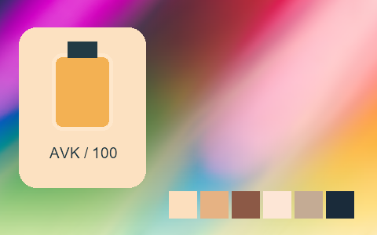

## 222 · 專業拍立得 · Fuji Fp-100C Negative +｜暖色 · 提亮中灰 · 中段拉開

`nt-instant-pro-fuji-fp-100c-negative-curve-plus-1` · `instant-pro` · CC-BY-SA-4.0 · 33³

50% 灰輸出 Y′ 149.1/255（變化 +21.6 碼值）；25%–75% 灰跨度比 1.317。中灰紅減藍 +12.0 碼值。淺/中/深膚色色塊分別輸出 #FDE4C9、#E3B799、#8E4E3F；紅/綠/藍測試塊分別輸出 #DD4F42、#77BF86、#A109BE。

建議試片：暖色生活、餐飲與懷舊試片

試用強度：0.35–0.8; default 1.0.

逐項比較膚色與品牌色，強度過高可能改變產品顏色。僅像素顏色映射，不生成顆粒、光暈、暗角、空間霧或美顏；未做自然畫質驗收。

| Input swatch | Input RGB | Actual output RGB |
|---|---|---|
| `gray_0` | `#000000` | `#021733` |
| `gray_10` | `#1A1A1A` | `#051A35` |
| `gray_25` | `#404040` | `#2A2C41` |
| `gray_50` | `#808080` | `#9E9392` |
| `gray_75` | `#BFBFBF` | `#E3D3C0` |
| `gray_90` | `#E6E6E6` | `#FBE7D7` |
| `gray_100` | `#FFFFFF` | `#FFF0E4` |
| `skin_light` | `#F5DBC6` | `#FDE4C9` |
| `skin_medium` | `#CF9B7B` | `#E3B799` |
| `skin_deep` | `#815438` | `#8E4E3F` |
| `red` | `#CC3333` | `#DD4F42` |
| `green` | `#33CC33` | `#77BF86` |
| `blue` | `#3333CC` | `#A109BE` |

Creator: **Pat David** · [Source](https://github.com/NatronGitHub/clut/blob/af7b50d4caf6244fb6895a647f5b6a84efe7931a/instant_pro/fuji_fp-100c_negative_+.png) · commit `af7b50d4caf6244fb6895a647f5b6a84efe7931a`.

Conversion: `native-depth-Hald-to-33-tetrahedral-v1`; 8,192 sampled RGB points; max error 0.0477085; mean 0.0009842. This is numerical approximation, not a perceptual quality score.

License obligations: Credit the named creator and source; retain the CC-BY-SA-4.0 notice and indicate changes. Redistributed adapted LUT data and thumbnails must use CC-BY-SA-4.0 or a compatible license; no additional restrictions.

[License](../../../product/src/ai_ad_editor/look_data/licenses/CC-BY-SA-4.0.txt) · LUT SHA-256 `a9ca2fe7efacf862ceece4bf149e9731fff092237bd3c468907dd14d34cdee59`.

[Actual preview PNG](../../assets/look500-20261024-r1/previews/nt-instant-pro-fuji-fp-100c-negative-curve-plus-1.png) · [Actual video](../../assets/look500-20261024-r1/videos/nt-instant-pro-fuji-fp-100c-negative-curve-plus-1.mp4)

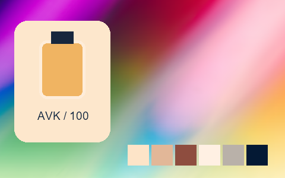

## 223 · 專業拍立得 · Fuji Fp-100C Negative --｜暖色 · 提亮中灰 · 中段拉開

`nt-instant-pro-fuji-fp-100c-negative-curve-minus-2` · `instant-pro` · CC-BY-SA-4.0 · 33³

50% 灰輸出 Y′ 156.6/255（變化 +29.1 碼值）；25%–75% 灰跨度比 1.110。中灰紅減藍 +13.0 碼值。淺/中/深膚色色塊分別輸出 #FBE4CB、#E9B592、#AD693E；紅/綠/藍測試塊分別輸出 #F06241、#71BE7E、#B935CB。

建議試片：暖色生活、餐飲與懷舊試片

試用強度：0.35–0.8; default 1.0.

逐項比較膚色與品牌色，強度過高可能改變產品顏色。僅像素顏色映射，不生成顆粒、光暈、暗角、空間霧或美顏；未做自然畫質驗收。

| Input swatch | Input RGB | Actual output RGB |
|---|---|---|
| `gray_0` | `#000000` | `#01150A` |
| `gray_10` | `#1A1A1A` | `#041A16` |
| `gray_25` | `#404040` | `#49444B` |
| `gray_50` | `#808080` | `#A59B98` |
| `gray_75` | `#BFBFBF` | `#E2D0C3` |
| `gray_90` | `#E6E6E6` | `#F8E4DB` |
| `gray_100` | `#FFFFFF` | `#FFF2F0` |
| `skin_light` | `#F5DBC6` | `#FBE4CB` |
| `skin_medium` | `#CF9B7B` | `#E9B592` |
| `skin_deep` | `#815438` | `#AD693E` |
| `red` | `#CC3333` | `#F06241` |
| `green` | `#33CC33` | `#71BE7E` |
| `blue` | `#3333CC` | `#B935CB` |

Creator: **Pat David** · [Source](https://github.com/NatronGitHub/clut/blob/af7b50d4caf6244fb6895a647f5b6a84efe7931a/instant_pro/fuji_fp-100c_negative_--.png) · commit `af7b50d4caf6244fb6895a647f5b6a84efe7931a`.

Conversion: `native-depth-Hald-to-33-tetrahedral-v1`; 8,192 sampled RGB points; max error 0.0460910; mean 0.0010835. This is numerical approximation, not a perceptual quality score.

License obligations: Credit the named creator and source; retain the CC-BY-SA-4.0 notice and indicate changes. Redistributed adapted LUT data and thumbnails must use CC-BY-SA-4.0 or a compatible license; no additional restrictions.

[License](../../../product/src/ai_ad_editor/look_data/licenses/CC-BY-SA-4.0.txt) · LUT SHA-256 `51c667c2d76e39e6c61bc94d4fe0bf2f59afa6be23d9aadfd6df9504f9e1372f`.

[Actual preview PNG](../../assets/look500-20261024-r1/previews/nt-instant-pro-fuji-fp-100c-negative-curve-minus-2.png) · [Actual video](../../assets/look500-20261024-r1/videos/nt-instant-pro-fuji-fp-100c-negative-curve-minus-2.mp4)

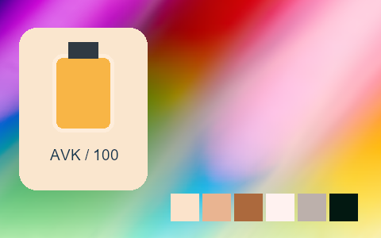

## 224 · 專業拍立得 · Fuji Fp-100C Negative -｜暖色 · 提亮中灰 · 中段拉開

`nt-instant-pro-fuji-fp-100c-negative-curve-minus-1` · `instant-pro` · CC-BY-SA-4.0 · 33³

50% 灰輸出 Y′ 147.8/255（變化 +20.3 碼值）；25%–75% 灰跨度比 1.151。中灰紅減藍 +12.0 碼值。淺/中/深膚色色塊分別輸出 #FFE4CA、#E4B090、#995F41；紅/綠/藍測試塊分別輸出 #DC5A48、#7AB982、#A733C0。

建議試片：暖色生活、餐飲與懷舊試片

試用強度：0.35–0.8; default 1.0.

逐項比較膚色與品牌色，強度過高可能改變產品顏色。僅像素顏色映射，不生成顆粒、光暈、暗角、空間霧或美顏；未做自然畫質驗收。

| Input swatch | Input RGB | Actual output RGB |
|---|---|---|
| `gray_0` | `#000000` | `#011D18` |
| `gray_10` | `#1A1A1A` | `#081F1F` |
| `gray_25` | `#404040` | `#3F3E43` |
| `gray_50` | `#808080` | `#9C9290` |
| `gray_75` | `#BFBFBF` | `#E0CEC3` |
| `gray_90` | `#E6E6E6` | `#FAE7DD` |
| `gray_100` | `#FFFFFF` | `#FFF2F0` |
| `skin_light` | `#F5DBC6` | `#FFE4CA` |
| `skin_medium` | `#CF9B7B` | `#E4B090` |
| `skin_deep` | `#815438` | `#995F41` |
| `red` | `#CC3333` | `#DC5A48` |
| `green` | `#33CC33` | `#7AB982` |
| `blue` | `#3333CC` | `#A733C0` |

Creator: **Pat David** · [Source](https://github.com/NatronGitHub/clut/blob/af7b50d4caf6244fb6895a647f5b6a84efe7931a/instant_pro/fuji_fp-100c_negative_-.png) · commit `af7b50d4caf6244fb6895a647f5b6a84efe7931a`.

Conversion: `native-depth-Hald-to-33-tetrahedral-v1`; 8,192 sampled RGB points; max error 0.0682222; mean 0.0009098. This is numerical approximation, not a perceptual quality score.

License obligations: Credit the named creator and source; retain the CC-BY-SA-4.0 notice and indicate changes. Redistributed adapted LUT data and thumbnails must use CC-BY-SA-4.0 or a compatible license; no additional restrictions.

[License](../../../product/src/ai_ad_editor/look_data/licenses/CC-BY-SA-4.0.txt) · LUT SHA-256 `766077bee8ab648ddff075dc993c3e8b9bfc5f84680c8b41f6a950a0e318966d`.

[Actual preview PNG](../../assets/look500-20261024-r1/previews/nt-instant-pro-fuji-fp-100c-negative-curve-minus-1.png) · [Actual video](../../assets/look500-20261024-r1/videos/nt-instant-pro-fuji-fp-100c-negative-curve-minus-1.mp4)

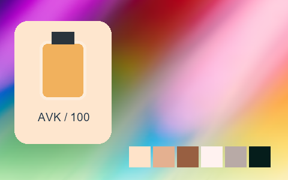

## 225 · 專業拍立得 · Fuji Fp-3000B｜黑白 · 提亮中灰 · 中段拉開

`nt-instant-pro-fuji-fp-3000b` · `instant-pro` · CC-BY-SA-4.0 · 33³

50% 灰輸出 Y′ 147.5/255（變化 +20.0 碼值）；25%–75% 灰跨度比 1.178。中灰紅減藍 +0.0 碼值。淺/中/深膚色色塊分別輸出 #E9E9E9、#C1C1C1、#686868；紅/綠/藍測試塊分別輸出 #888888、#949494、#ADADAD。

建議試片：黑白紀實、建筑與輪廓試片

試用強度：1–1; default 1.0.

強度低於 1 會混回原始彩色。僅像素顏色映射，不生成顆粒、光暈、暗角、空間霧或美顏；未做自然畫質驗收。

| Input swatch | Input RGB | Actual output RGB |
|---|---|---|
| `gray_0` | `#000000` | `#161616` |
| `gray_10` | `#1A1A1A` | `#202020` |
| `gray_25` | `#404040` | `#404040` |
| `gray_50` | `#808080` | `#939393` |
| `gray_75` | `#BFBFBF` | `#D6D6D6` |
| `gray_90` | `#E6E6E6` | `#EFEFEF` |
| `gray_100` | `#FFFFFF` | `#F7F7F7` |
| `skin_light` | `#F5DBC6` | `#E9E9E9` |
| `skin_medium` | `#CF9B7B` | `#C1C1C1` |
| `skin_deep` | `#815438` | `#686868` |
| `red` | `#CC3333` | `#888888` |
| `green` | `#33CC33` | `#949494` |
| `blue` | `#3333CC` | `#ADADAD` |

Creator: **Pat David** · [Source](https://github.com/NatronGitHub/clut/blob/af7b50d4caf6244fb6895a647f5b6a84efe7931a/instant_pro/fuji_fp-3000b.png) · commit `af7b50d4caf6244fb6895a647f5b6a84efe7931a`.

Conversion: `native-depth-Hald-to-33-tetrahedral-v1`; 8,192 sampled RGB points; max error 0.0057218; mean 0.0006763. This is numerical approximation, not a perceptual quality score.

License obligations: Credit the named creator and source; retain the CC-BY-SA-4.0 notice and indicate changes. Redistributed adapted LUT data and thumbnails must use CC-BY-SA-4.0 or a compatible license; no additional restrictions.

[License](../../../product/src/ai_ad_editor/look_data/licenses/CC-BY-SA-4.0.txt) · LUT SHA-256 `daa1b99eaa0b72d3a8b6ffe2111387b3104944746279919164504e6c22bcd667`.

[Actual preview PNG](../../assets/look500-20261024-r1/previews/nt-instant-pro-fuji-fp-3000b.png) · [Actual video](../../assets/look500-20261024-r1/videos/nt-instant-pro-fuji-fp-3000b.mp4)

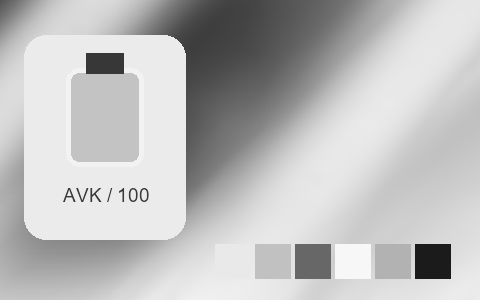

## 226 · 專業拍立得 · Fuji Fp-3000B +++｜黑白 · 提亮中灰 · 中段跨度接近原值

`nt-instant-pro-fuji-fp-3000b-curve-plus-3` · `instant-pro` · CC-BY-SA-4.0 · 33³

50% 灰輸出 Y′ 147.0/255（變化 +19.5 碼值）；25%–75% 灰跨度比 0.949。中灰紅減藍 +0.0 碼值。淺/中/深膚色色塊分別輸出 #E3E3E3、#C3C3C3、#717171；紅/綠/藍測試塊分別輸出 #8D8D8D、#979797、#AFAFAF。

建議試片：黑白紀實、建筑與輪廓試片

試用強度：1–1; default 1.0.

強度低於 1 會混回原始彩色。僅像素顏色映射，不生成顆粒、光暈、暗角、空間霧或美顏；未做自然畫質驗收。

| Input swatch | Input RGB | Actual output RGB |
|---|---|---|
| `gray_0` | `#000000` | `#515151` |
| `gray_10` | `#1A1A1A` | `#535353` |
| `gray_25` | `#404040` | `#5D5D5D` |
| `gray_50` | `#808080` | `#939393` |
| `gray_75` | `#BFBFBF` | `#D6D6D6` |
| `gray_90` | `#E6E6E6` | `#E7E7E7` |
| `gray_100` | `#FFFFFF` | `#ECECEC` |
| `skin_light` | `#F5DBC6` | `#E3E3E3` |
| `skin_medium` | `#CF9B7B` | `#C3C3C3` |
| `skin_deep` | `#815438` | `#717171` |
| `red` | `#CC3333` | `#8D8D8D` |
| `green` | `#33CC33` | `#979797` |
| `blue` | `#3333CC` | `#AFAFAF` |

Creator: **Pat David** · [Source](https://github.com/NatronGitHub/clut/blob/af7b50d4caf6244fb6895a647f5b6a84efe7931a/instant_pro/fuji_fp-3000b_+++.png) · commit `af7b50d4caf6244fb6895a647f5b6a84efe7931a`.

Conversion: `native-depth-Hald-to-33-tetrahedral-v1`; 8,192 sampled RGB points; max error 0.0056738; mean 0.0006899. This is numerical approximation, not a perceptual quality score.

License obligations: Credit the named creator and source; retain the CC-BY-SA-4.0 notice and indicate changes. Redistributed adapted LUT data and thumbnails must use CC-BY-SA-4.0 or a compatible license; no additional restrictions.

[License](../../../product/src/ai_ad_editor/look_data/licenses/CC-BY-SA-4.0.txt) · LUT SHA-256 `d2310ca726012dd62196cc5481ee4edf983cc0c50cf1eaa0127aebfdc85c1b80`.

[Actual preview PNG](../../assets/look500-20261024-r1/previews/nt-instant-pro-fuji-fp-3000b-curve-plus-3.png) · [Actual video](../../assets/look500-20261024-r1/videos/nt-instant-pro-fuji-fp-3000b-curve-plus-3.mp4)

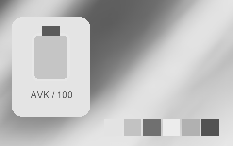

## 227 · 專業拍立得 · Fuji Fp-3000B ++｜黑白 · 提亮中灰 · 中段拉開

`nt-instant-pro-fuji-fp-3000b-curve-plus-2` · `instant-pro` · CC-BY-SA-4.0 · 33³

50% 灰輸出 Y′ 142.5/255（變化 +15.0 碼值）；25%–75% 灰跨度比 1.104。中灰紅減藍 +0.0 碼值。淺/中/深膚色色塊分別輸出 #E2E2E2、#C3C3C3、#676767；紅/綠/藍測試塊分別輸出 #888888、#929292、#AEAEAE。

建議試片：黑白紀實、建筑與輪廓試片

試用強度：1–1; default 1.0.

強度低於 1 會混回原始彩色。僅像素顏色映射，不生成顆粒、光暈、暗角、空間霧或美顏；未做自然畫質驗收。

| Input swatch | Input RGB | Actual output RGB |
|---|---|---|
| `gray_0` | `#000000` | `#373737` |
| `gray_10` | `#1A1A1A` | `#393939` |
| `gray_25` | `#404040` | `#484848` |
| `gray_50` | `#808080` | `#8E8E8E` |
| `gray_75` | `#BFBFBF` | `#D5D5D5` |
| `gray_90` | `#E6E6E6` | `#E6E6E6` |
| `gray_100` | `#FFFFFF` | `#E9E9E9` |
| `skin_light` | `#F5DBC6` | `#E2E2E2` |
| `skin_medium` | `#CF9B7B` | `#C3C3C3` |
| `skin_deep` | `#815438` | `#676767` |
| `red` | `#CC3333` | `#888888` |
| `green` | `#33CC33` | `#929292` |
| `blue` | `#3333CC` | `#AEAEAE` |

Creator: **Pat David** · [Source](https://github.com/NatronGitHub/clut/blob/af7b50d4caf6244fb6895a647f5b6a84efe7931a/instant_pro/fuji_fp-3000b_++.png) · commit `af7b50d4caf6244fb6895a647f5b6a84efe7931a`.

Conversion: `native-depth-Hald-to-33-tetrahedral-v1`; 8,192 sampled RGB points; max error 0.0065222; mean 0.0006917. This is numerical approximation, not a perceptual quality score.

License obligations: Credit the named creator and source; retain the CC-BY-SA-4.0 notice and indicate changes. Redistributed adapted LUT data and thumbnails must use CC-BY-SA-4.0 or a compatible license; no additional restrictions.

[License](../../../product/src/ai_ad_editor/look_data/licenses/CC-BY-SA-4.0.txt) · LUT SHA-256 `abc04e0c7d1a0a001cfa359a231a8168c7ffa3da87139e5430a7bc3da4125720`.

[Actual preview PNG](../../assets/look500-20261024-r1/previews/nt-instant-pro-fuji-fp-3000b-curve-plus-2.png) · [Actual video](../../assets/look500-20261024-r1/videos/nt-instant-pro-fuji-fp-3000b-curve-plus-2.mp4)

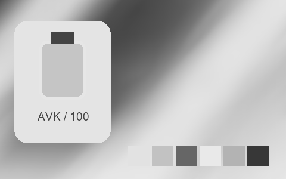

## 228 · 專業拍立得 · Fuji Fp-3000B +｜黑白 · 提亮中灰 · 中段拉開

`nt-instant-pro-fuji-fp-3000b-curve-plus-1` · `instant-pro` · CC-BY-SA-4.0 · 33³

50% 灰輸出 Y′ 145.0/255（變化 +17.5 碼值）；25%–75% 灰跨度比 1.269。中灰紅減藍 +0.0 碼值。淺/中/深膚色色塊分別輸出 #EDEDED、#C5C5C5、#656565；紅/綠/藍測試塊分別輸出 #888888、#969696、#B0B0B0。

建議試片：黑白紀實、建筑與輪廓試片

試用強度：1–1; default 1.0.

強度低於 1 會混回原始彩色。僅像素顏色映射，不生成顆粒、光暈、暗角、空間霧或美顏；未做自然畫質驗收。

| Input swatch | Input RGB | Actual output RGB |
|---|---|---|
| `gray_0` | `#000000` | `#1D1D1D` |
| `gray_10` | `#1A1A1A` | `#1F1F1F` |
| `gray_25` | `#404040` | `#383838` |
| `gray_50` | `#808080` | `#919191` |
| `gray_75` | `#BFBFBF` | `#DADADA` |
| `gray_90` | `#E6E6E6` | `#F1F1F1` |
| `gray_100` | `#FFFFFF` | `#F5F5F5` |
| `skin_light` | `#F5DBC6` | `#EDEDED` |
| `skin_medium` | `#CF9B7B` | `#C5C5C5` |
| `skin_deep` | `#815438` | `#656565` |
| `red` | `#CC3333` | `#888888` |
| `green` | `#33CC33` | `#969696` |
| `blue` | `#3333CC` | `#B0B0B0` |

Creator: **Pat David** · [Source](https://github.com/NatronGitHub/clut/blob/af7b50d4caf6244fb6895a647f5b6a84efe7931a/instant_pro/fuji_fp-3000b_+.png) · commit `af7b50d4caf6244fb6895a647f5b6a84efe7931a`.

Conversion: `native-depth-Hald-to-33-tetrahedral-v1`; 8,192 sampled RGB points; max error 0.0084275; mean 0.0006993. This is numerical approximation, not a perceptual quality score.

License obligations: Credit the named creator and source; retain the CC-BY-SA-4.0 notice and indicate changes. Redistributed adapted LUT data and thumbnails must use CC-BY-SA-4.0 or a compatible license; no additional restrictions.

[License](../../../product/src/ai_ad_editor/look_data/licenses/CC-BY-SA-4.0.txt) · LUT SHA-256 `cce3bcb2b1aa03afd8011a38737c6101411b26d277b9b08c69228ecba36eda1b`.

[Actual preview PNG](../../assets/look500-20261024-r1/previews/nt-instant-pro-fuji-fp-3000b-curve-plus-1.png) · [Actual video](../../assets/look500-20261024-r1/videos/nt-instant-pro-fuji-fp-3000b-curve-plus-1.mp4)

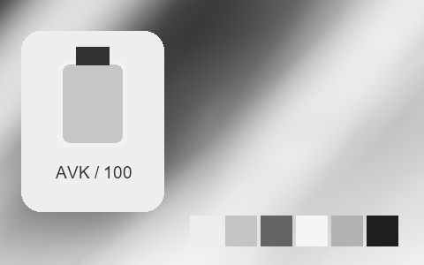

## 229 · 專業拍立得 · Fuji Fp-3000B --｜黑白 · 提亮中灰 · 中段跨度接近原值

`nt-instant-pro-fuji-fp-3000b-curve-minus-2` · `instant-pro` · CC-BY-SA-4.0 · 33³

50% 灰輸出 Y′ 149.0/255（變化 +21.5 碼值）；25%–75% 灰跨度比 1.006。中灰紅減藍 +0.0 碼值。淺/中/深膚色色塊分別輸出 #EAEAEA、#BDBDBD、#737373；紅/綠/藍測試塊分別輸出 #8C8C8C、#959595、#AAAAAA。

建議試片：黑白紀實、建筑與輪廓試片

試用強度：1–1; default 1.0.

強度低於 1 會混回原始彩色。僅像素顏色映射，不生成顆粒、光暈、暗角、空間霧或美顏；未做自然畫質驗收。

| Input swatch | Input RGB | Actual output RGB |
|---|---|---|
| `gray_0` | `#000000` | `#080808` |
| `gray_10` | `#1A1A1A` | `#1F1F1F` |
| `gray_25` | `#404040` | `#505050` |
| `gray_50` | `#808080` | `#959595` |
| `gray_75` | `#BFBFBF` | `#D0D0D0` |
| `gray_90` | `#E6E6E6` | `#F1F1F1` |
| `gray_100` | `#FFFFFF` | `#FEFEFE` |
| `skin_light` | `#F5DBC6` | `#EAEAEA` |
| `skin_medium` | `#CF9B7B` | `#BDBDBD` |
| `skin_deep` | `#815438` | `#737373` |
| `red` | `#CC3333` | `#8C8C8C` |
| `green` | `#33CC33` | `#959595` |
| `blue` | `#3333CC` | `#AAAAAA` |

Creator: **Pat David** · [Source](https://github.com/NatronGitHub/clut/blob/af7b50d4caf6244fb6895a647f5b6a84efe7931a/instant_pro/fuji_fp-3000b_--.png) · commit `af7b50d4caf6244fb6895a647f5b6a84efe7931a`.

Conversion: `native-depth-Hald-to-33-tetrahedral-v1`; 8,192 sampled RGB points; max error 0.0073065; mean 0.0006687. This is numerical approximation, not a perceptual quality score.

License obligations: Credit the named creator and source; retain the CC-BY-SA-4.0 notice and indicate changes. Redistributed adapted LUT data and thumbnails must use CC-BY-SA-4.0 or a compatible license; no additional restrictions.

[License](../../../product/src/ai_ad_editor/look_data/licenses/CC-BY-SA-4.0.txt) · LUT SHA-256 `7992c9c0d58498dde377bf91bb84436b1579830f03119edb1f9ce7b19040d5d5`.

[Actual preview PNG](../../assets/look500-20261024-r1/previews/nt-instant-pro-fuji-fp-3000b-curve-minus-2.png) · [Actual video](../../assets/look500-20261024-r1/videos/nt-instant-pro-fuji-fp-3000b-curve-minus-2.mp4)

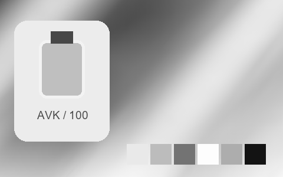

## 230 · 專業拍立得 · Fuji Fp-3000B -｜黑白 · 提亮中灰 · 中段拉開

`nt-instant-pro-fuji-fp-3000b-curve-minus-1` · `instant-pro` · CC-BY-SA-4.0 · 33³

50% 灰輸出 Y′ 143.0/255（變化 +15.5 碼值）；25%–75% 灰跨度比 1.092。中灰紅減藍 +0.0 碼值。淺/中/深膚色色塊分別輸出 #E7E7E7、#BCBCBC、#6A6A6A；紅/綠/藍測試塊分別輸出 #888888、#919191、#A7A7A7。

建議試片：黑白紀實、建筑與輪廓試片

試用強度：1–1; default 1.0.

強度低於 1 會混回原始彩色。僅像素顏色映射，不生成顆粒、光暈、暗角、空間霧或美顏；未做自然畫質驗收。

| Input swatch | Input RGB | Actual output RGB |
|---|---|---|
| `gray_0` | `#000000` | `#070707` |
| `gray_10` | `#1A1A1A` | `#191919` |
| `gray_25` | `#404040` | `#444444` |
| `gray_50` | `#808080` | `#8F8F8F` |
| `gray_75` | `#BFBFBF` | `#CFCFCF` |
| `gray_90` | `#E6E6E6` | `#ECECEC` |
| `gray_100` | `#FFFFFF` | `#F4F4F4` |
| `skin_light` | `#F5DBC6` | `#E7E7E7` |
| `skin_medium` | `#CF9B7B` | `#BCBCBC` |
| `skin_deep` | `#815438` | `#6A6A6A` |
| `red` | `#CC3333` | `#888888` |
| `green` | `#33CC33` | `#919191` |
| `blue` | `#3333CC` | `#A7A7A7` |

Creator: **Pat David** · [Source](https://github.com/NatronGitHub/clut/blob/af7b50d4caf6244fb6895a647f5b6a84efe7931a/instant_pro/fuji_fp-3000b_-.png) · commit `af7b50d4caf6244fb6895a647f5b6a84efe7931a`.

Conversion: `native-depth-Hald-to-33-tetrahedral-v1`; 8,192 sampled RGB points; max error 0.0066298; mean 0.0006646. This is numerical approximation, not a perceptual quality score.

License obligations: Credit the named creator and source; retain the CC-BY-SA-4.0 notice and indicate changes. Redistributed adapted LUT data and thumbnails must use CC-BY-SA-4.0 or a compatible license; no additional restrictions.

[License](../../../product/src/ai_ad_editor/look_data/licenses/CC-BY-SA-4.0.txt) · LUT SHA-256 `4bb56e4284f2eaf890391de87c84f163b6ff4143d2ef017d1fd8bfa4f3a3cae9`.

[Actual preview PNG](../../assets/look500-20261024-r1/previews/nt-instant-pro-fuji-fp-3000b-curve-minus-1.png) · [Actual video](../../assets/look500-20261024-r1/videos/nt-instant-pro-fuji-fp-3000b-curve-minus-1.mp4)

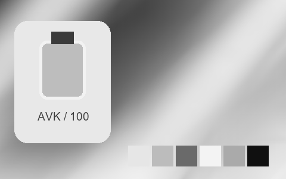

## 231 · 專業拍立得 · Fuji Fp-3000B Hc｜黑白 · 提亮中灰 · 中段拉開

`nt-instant-pro-fuji-fp-3000b-hc` · `instant-pro` · CC-BY-SA-4.0 · 33³

50% 灰輸出 Y′ 146.5/255（變化 +19.0 碼值）；25%–75% 灰跨度比 1.327。中灰紅減藍 +0.0 碼值。淺/中/深膚色色塊分別輸出 #EBEBEB、#C2C2C2、#626262；紅/綠/藍測試塊分別輸出 #878787、#949494、#AEAEAE。

建議試片：黑白紀實、建筑與輪廓試片

試用強度：1–1; default 1.0.

強度低於 1 會混回原始彩色。僅像素顏色映射，不生成顆粒、光暈、暗角、空間霧或美顏；未做自然畫質驗收。

| Input swatch | Input RGB | Actual output RGB |
|---|---|---|
| `gray_0` | `#000000` | `#151515` |
| `gray_10` | `#1A1A1A` | `#161616` |
| `gray_25` | `#404040` | `#2E2E2E` |
| `gray_50` | `#808080` | `#929292` |
| `gray_75` | `#BFBFBF` | `#D7D7D7` |
| `gray_90` | `#E6E6E6` | `#EFEFEF` |
| `gray_100` | `#FFFFFF` | `#F5F5F5` |
| `skin_light` | `#F5DBC6` | `#EBEBEB` |
| `skin_medium` | `#CF9B7B` | `#C2C2C2` |
| `skin_deep` | `#815438` | `#626262` |
| `red` | `#CC3333` | `#878787` |
| `green` | `#33CC33` | `#949494` |
| `blue` | `#3333CC` | `#AEAEAE` |

Creator: **Pat David** · [Source](https://github.com/NatronGitHub/clut/blob/af7b50d4caf6244fb6895a647f5b6a84efe7931a/instant_pro/fuji_fp-3000b_hc.png) · commit `af7b50d4caf6244fb6895a647f5b6a84efe7931a`.

Conversion: `native-depth-Hald-to-33-tetrahedral-v1`; 8,192 sampled RGB points; max error 0.0123460; mean 0.0007272. This is numerical approximation, not a perceptual quality score.

License obligations: Credit the named creator and source; retain the CC-BY-SA-4.0 notice and indicate changes. Redistributed adapted LUT data and thumbnails must use CC-BY-SA-4.0 or a compatible license; no additional restrictions.

[License](../../../product/src/ai_ad_editor/look_data/licenses/CC-BY-SA-4.0.txt) · LUT SHA-256 `8da979de923f6e6d740d184f81e058c2b3de6fb30a40c235af87f957509e96ca`.

[Actual preview PNG](../../assets/look500-20261024-r1/previews/nt-instant-pro-fuji-fp-3000b-hc.png) · [Actual video](../../assets/look500-20261024-r1/videos/nt-instant-pro-fuji-fp-3000b-hc.mp4)

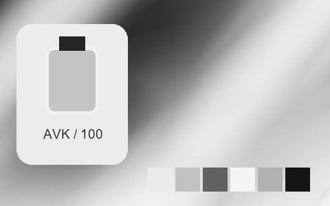

## 232 · 專業拍立得 · Fuji Fp-3000B Negative｜黑白 · 提亮中灰 · 中段拉開

`nt-instant-pro-fuji-fp-3000b-negative` · `instant-pro` · CC-BY-SA-4.0 · 33³

50% 灰輸出 Y′ 147.5/255（變化 +20.0 碼值）；25%–75% 灰跨度比 1.176。中灰紅減藍 +0.0 碼值。淺/中/深膚色色塊分別輸出 #EBEBEB、#C0C0C0、#696969；紅/綠/藍測試塊分別輸出 #8E8E8E、#B0B0B0、#BCBCBC。

建議試片：黑白紀實、建筑與輪廓試片

試用強度：1–1; default 1.0.

強度低於 1 會混回原始彩色。僅像素顏色映射，不生成顆粒、光暈、暗角、空間霧或美顏；未做自然畫質驗收。

| Input swatch | Input RGB | Actual output RGB |
|---|---|---|
| `gray_0` | `#000000` | `#0E0E0E` |
| `gray_10` | `#1A1A1A` | `#181818` |
| `gray_25` | `#404040` | `#404040` |
| `gray_50` | `#808080` | `#939393` |
| `gray_75` | `#BFBFBF` | `#D6D6D6` |
| `gray_90` | `#E6E6E6` | `#F1F1F1` |
| `gray_100` | `#FFFFFF` | `#F7F7F7` |
| `skin_light` | `#F5DBC6` | `#EBEBEB` |
| `skin_medium` | `#CF9B7B` | `#C0C0C0` |
| `skin_deep` | `#815438` | `#696969` |
| `red` | `#CC3333` | `#8E8E8E` |
| `green` | `#33CC33` | `#B0B0B0` |
| `blue` | `#3333CC` | `#BCBCBC` |

Creator: **Pat David** · [Source](https://github.com/NatronGitHub/clut/blob/af7b50d4caf6244fb6895a647f5b6a84efe7931a/instant_pro/fuji_fp-3000b_negative.png) · commit `af7b50d4caf6244fb6895a647f5b6a84efe7931a`.

Conversion: `native-depth-Hald-to-33-tetrahedral-v1`; 8,192 sampled RGB points; max error 0.0175843; mean 0.0006545. This is numerical approximation, not a perceptual quality score.

License obligations: Credit the named creator and source; retain the CC-BY-SA-4.0 notice and indicate changes. Redistributed adapted LUT data and thumbnails must use CC-BY-SA-4.0 or a compatible license; no additional restrictions.

[License](../../../product/src/ai_ad_editor/look_data/licenses/CC-BY-SA-4.0.txt) · LUT SHA-256 `710c14ef7e76d17eab3afdda1938d40fb7ba416418f1185745cb6b97e67b25a8`.

[Actual preview PNG](../../assets/look500-20261024-r1/previews/nt-instant-pro-fuji-fp-3000b-negative.png) · [Actual video](../../assets/look500-20261024-r1/videos/nt-instant-pro-fuji-fp-3000b-negative.mp4)

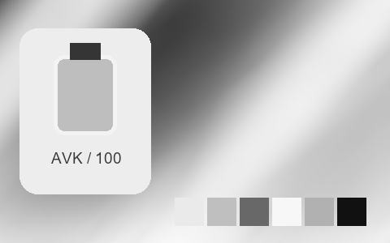

## 233 · 專業拍立得 · Fuji Fp-3000B Negative +++｜黑白 · 提亮中灰 · 中段收窄

`nt-instant-pro-fuji-fp-3000b-negative-curve-plus-3` · `instant-pro` · CC-BY-SA-4.0 · 33³

50% 灰輸出 Y′ 137.0/255（變化 +9.5 碼值）；25%–75% 灰跨度比 0.927。中灰紅減藍 +0.0 碼值。淺/中/深膚色色塊分別輸出 #B6B6B6、#A9A9A9、#616161；紅/綠/藍測試塊分別輸出 #848484、#9F9F9F、#A6A6A6。

建議試片：黑白紀實、建筑與輪廓試片

試用強度：1–1; default 1.0.

強度低於 1 會混回原始彩色。僅像素顏色映射，不生成顆粒、光暈、暗角、空間霧或美顏；未做自然畫質驗收。

| Input swatch | Input RGB | Actual output RGB |
|---|---|---|
| `gray_0` | `#000000` | `#1F1F1F` |
| `gray_10` | `#1A1A1A` | `#262626` |
| `gray_25` | `#404040` | `#3D3D3D` |
| `gray_50` | `#808080` | `#898989` |
| `gray_75` | `#BFBFBF` | `#B3B3B3` |
| `gray_90` | `#E6E6E6` | `#B7B7B7` |
| `gray_100` | `#FFFFFF` | `#B7B7B7` |
| `skin_light` | `#F5DBC6` | `#B6B6B6` |
| `skin_medium` | `#CF9B7B` | `#A9A9A9` |
| `skin_deep` | `#815438` | `#616161` |
| `red` | `#CC3333` | `#848484` |
| `green` | `#33CC33` | `#9F9F9F` |
| `blue` | `#3333CC` | `#A6A6A6` |

Creator: **Pat David** · [Source](https://github.com/NatronGitHub/clut/blob/af7b50d4caf6244fb6895a647f5b6a84efe7931a/instant_pro/fuji_fp-3000b_negative_+++.png) · commit `af7b50d4caf6244fb6895a647f5b6a84efe7931a`.

Conversion: `native-depth-Hald-to-33-tetrahedral-v1`; 8,192 sampled RGB points; max error 0.0048390; mean 0.0006127. This is numerical approximation, not a perceptual quality score.

License obligations: Credit the named creator and source; retain the CC-BY-SA-4.0 notice and indicate changes. Redistributed adapted LUT data and thumbnails must use CC-BY-SA-4.0 or a compatible license; no additional restrictions.

[License](../../../product/src/ai_ad_editor/look_data/licenses/CC-BY-SA-4.0.txt) · LUT SHA-256 `962bcbb497908c85d38c52705a96a0da23a2cbd2afd3199499b40f30112872cd`.

[Actual preview PNG](../../assets/look500-20261024-r1/previews/nt-instant-pro-fuji-fp-3000b-negative-curve-plus-3.png) · [Actual video](../../assets/look500-20261024-r1/videos/nt-instant-pro-fuji-fp-3000b-negative-curve-plus-3.mp4)

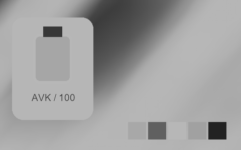

## 234 · 專業拍立得 · Fuji Fp-3000B Negative ++｜黑白 · 提亮中灰 · 中段拉開

`nt-instant-pro-fuji-fp-3000b-negative-curve-plus-2` · `instant-pro` · CC-BY-SA-4.0 · 33³

50% 灰輸出 Y′ 145.5/255（變化 +18.0 碼值）；25%–75% 灰跨度比 1.143。中灰紅減藍 +0.0 碼值。淺/中/深膚色色塊分別輸出 #D8D8D8、#BDBDBD、#606060；紅/綠/藍測試塊分別輸出 #898989、#AFAFAF、#B9B9B9。

建議試片：黑白紀實、建筑與輪廓試片

試用強度：1–1; default 1.0.

強度低於 1 會混回原始彩色。僅像素顏色映射，不生成顆粒、光暈、暗角、空間霧或美顏；未做自然畫質驗收。

| Input swatch | Input RGB | Actual output RGB |
|---|---|---|
| `gray_0` | `#000000` | `#1D1D1D` |
| `gray_10` | `#1A1A1A` | `#242424` |
| `gray_25` | `#404040` | `#3E3E3E` |
| `gray_50` | `#808080` | `#929292` |
| `gray_75` | `#BFBFBF` | `#D0D0D0` |
| `gray_90` | `#E6E6E6` | `#DADADA` |
| `gray_100` | `#FFFFFF` | `#DCDCDC` |
| `skin_light` | `#F5DBC6` | `#D8D8D8` |
| `skin_medium` | `#CF9B7B` | `#BDBDBD` |
| `skin_deep` | `#815438` | `#606060` |
| `red` | `#CC3333` | `#898989` |
| `green` | `#33CC33` | `#AFAFAF` |
| `blue` | `#3333CC` | `#B9B9B9` |

Creator: **Pat David** · [Source](https://github.com/NatronGitHub/clut/blob/af7b50d4caf6244fb6895a647f5b6a84efe7931a/instant_pro/fuji_fp-3000b_negative_++.png) · commit `af7b50d4caf6244fb6895a647f5b6a84efe7931a`.

Conversion: `native-depth-Hald-to-33-tetrahedral-v1`; 8,192 sampled RGB points; max error 0.0050700; mean 0.0006596. This is numerical approximation, not a perceptual quality score.

License obligations: Credit the named creator and source; retain the CC-BY-SA-4.0 notice and indicate changes. Redistributed adapted LUT data and thumbnails must use CC-BY-SA-4.0 or a compatible license; no additional restrictions.

[License](../../../product/src/ai_ad_editor/look_data/licenses/CC-BY-SA-4.0.txt) · LUT SHA-256 `4346440991fae2d5dcb72289c28d8e767f3493e3078c8d1d529e9618934fc4d1`.

[Actual preview PNG](../../assets/look500-20261024-r1/previews/nt-instant-pro-fuji-fp-3000b-negative-curve-plus-2.png) · [Actual video](../../assets/look500-20261024-r1/videos/nt-instant-pro-fuji-fp-3000b-negative-curve-plus-2.mp4)

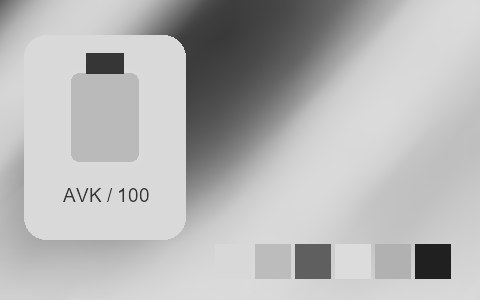

## 235 · 專業拍立得 · Fuji Fp-3000B Negative +｜黑白 · 提亮中灰 · 中段拉開

`nt-instant-pro-fuji-fp-3000b-negative-curve-plus-1` · `instant-pro` · CC-BY-SA-4.0 · 33³

50% 灰輸出 Y′ 153.0/255（變化 +25.5 碼值）；25%–75% 灰跨度比 1.300。中灰紅減藍 +0.0 碼值。淺/中/深膚色色塊分別輸出 #EBEBEB、#BFBFBF、#656565；紅/綠/藍測試塊分別輸出 #949494、#B1B1B1、#BEBEBE。

建議試片：黑白紀實、建筑與輪廓試片

試用強度：1–1; default 1.0.

強度低於 1 會混回原始彩色。僅像素顏色映射，不生成顆粒、光暈、暗角、空間霧或美顏；未做自然畫質驗收。

| Input swatch | Input RGB | Actual output RGB |
|---|---|---|
| `gray_0` | `#000000` | `#0B0B0B` |
| `gray_10` | `#1A1A1A` | `#0F0F0F` |
| `gray_25` | `#404040` | `#313131` |
| `gray_50` | `#808080` | `#999999` |
| `gray_75` | `#BFBFBF` | `#D7D7D7` |
| `gray_90` | `#E6E6E6` | `#F1F1F1` |
| `gray_100` | `#FFFFFF` | `#FEFEFE` |
| `skin_light` | `#F5DBC6` | `#EBEBEB` |
| `skin_medium` | `#CF9B7B` | `#BFBFBF` |
| `skin_deep` | `#815438` | `#656565` |
| `red` | `#CC3333` | `#949494` |
| `green` | `#33CC33` | `#B1B1B1` |
| `blue` | `#3333CC` | `#BEBEBE` |

Creator: **Pat David** · [Source](https://github.com/NatronGitHub/clut/blob/af7b50d4caf6244fb6895a647f5b6a84efe7931a/instant_pro/fuji_fp-3000b_negative_+.png) · commit `af7b50d4caf6244fb6895a647f5b6a84efe7931a`.

Conversion: `native-depth-Hald-to-33-tetrahedral-v1`; 8,192 sampled RGB points; max error 0.0068914; mean 0.0006823. This is numerical approximation, not a perceptual quality score.

License obligations: Credit the named creator and source; retain the CC-BY-SA-4.0 notice and indicate changes. Redistributed adapted LUT data and thumbnails must use CC-BY-SA-4.0 or a compatible license; no additional restrictions.

[License](../../../product/src/ai_ad_editor/look_data/licenses/CC-BY-SA-4.0.txt) · LUT SHA-256 `b9f975fc4f3183ed3a010827f0b71922e43d1f77b58237dc5aeb593328633076`.

[Actual preview PNG](../../assets/look500-20261024-r1/previews/nt-instant-pro-fuji-fp-3000b-negative-curve-plus-1.png) · [Actual video](../../assets/look500-20261024-r1/videos/nt-instant-pro-fuji-fp-3000b-negative-curve-plus-1.mp4)

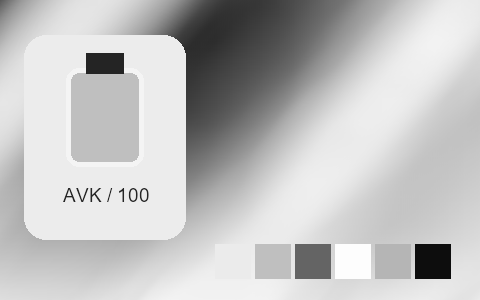

## 236 · 專業拍立得 · Fuji Fp-3000B Negative --｜黑白 · 提亮中灰 · 中段拉開

`nt-instant-pro-fuji-fp-3000b-negative-curve-minus-2` · `instant-pro` · CC-BY-SA-4.0 · 33³

50% 灰輸出 Y′ 151.0/255（變化 +23.5 碼值）；25%–75% 灰跨度比 1.076。中灰紅減藍 +0.0 碼值。淺/中/深膚色色塊分別輸出 #ECECEC、#BDBDBD、#717171；紅/綠/藍測試塊分別輸出 #909090、#B2B2B2、#BABABA。

建議試片：黑白紀實、建筑與輪廓試片

試用強度：1–1; default 1.0.

強度低於 1 會混回原始彩色。僅像素顏色映射，不生成顆粒、光暈、暗角、空間霧或美顏；未做自然畫質驗收。

| Input swatch | Input RGB | Actual output RGB |
|---|---|---|
| `gray_0` | `#000000` | `#090909` |
| `gray_10` | `#1A1A1A` | `#1B1B1B` |
| `gray_25` | `#404040` | `#4C4C4C` |
| `gray_50` | `#808080` | `#979797` |
| `gray_75` | `#BFBFBF` | `#D5D5D5` |
| `gray_90` | `#E6E6E6` | `#F2F2F2` |
| `gray_100` | `#FFFFFF` | `#F6F6F6` |
| `skin_light` | `#F5DBC6` | `#ECECEC` |
| `skin_medium` | `#CF9B7B` | `#BDBDBD` |
| `skin_deep` | `#815438` | `#717171` |
| `red` | `#CC3333` | `#909090` |
| `green` | `#33CC33` | `#B2B2B2` |
| `blue` | `#3333CC` | `#BABABA` |

Creator: **Pat David** · [Source](https://github.com/NatronGitHub/clut/blob/af7b50d4caf6244fb6895a647f5b6a84efe7931a/instant_pro/fuji_fp-3000b_negative_--.png) · commit `af7b50d4caf6244fb6895a647f5b6a84efe7931a`.

Conversion: `native-depth-Hald-to-33-tetrahedral-v1`; 8,192 sampled RGB points; max error 0.0071121; mean 0.0006376. This is numerical approximation, not a perceptual quality score.

License obligations: Credit the named creator and source; retain the CC-BY-SA-4.0 notice and indicate changes. Redistributed adapted LUT data and thumbnails must use CC-BY-SA-4.0 or a compatible license; no additional restrictions.

[License](../../../product/src/ai_ad_editor/look_data/licenses/CC-BY-SA-4.0.txt) · LUT SHA-256 `283aa58f43f5e9da692a9bda7d33582e20b77e607bb66b66dc6917936ce116c3`.

[Actual preview PNG](../../assets/look500-20261024-r1/previews/nt-instant-pro-fuji-fp-3000b-negative-curve-minus-2.png) · [Actual video](../../assets/look500-20261024-r1/videos/nt-instant-pro-fuji-fp-3000b-negative-curve-minus-2.mp4)

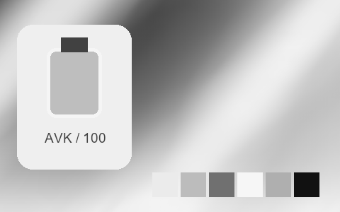

## 237 · 專業拍立得 · Fuji Fp-3000B Negative -｜黑白 · 提亮中灰 · 中段拉開

`nt-instant-pro-fuji-fp-3000b-negative-curve-minus-1` · `instant-pro` · CC-BY-SA-4.0 · 33³

50% 灰輸出 Y′ 150.5/255（變化 +23.0 碼值）；25%–75% 灰跨度比 1.155。中灰紅減藍 +0.0 碼值。淺/中/深膚色色塊分別輸出 #ECECEC、#BFBFBF、#6A6A6A；紅/綠/藍測試塊分別輸出 #8E8E8E、#B1B1B1、#BABABA。

建議試片：黑白紀實、建筑與輪廓試片

試用強度：1–1; default 1.0.

強度低於 1 會混回原始彩色。僅像素顏色映射，不生成顆粒、光暈、暗角、空間霧或美顏；未做自然畫質驗收。

| Input swatch | Input RGB | Actual output RGB |
|---|---|---|
| `gray_0` | `#000000` | `#101010` |
| `gray_10` | `#1A1A1A` | `#161616` |
| `gray_25` | `#404040` | `#444444` |
| `gray_50` | `#808080` | `#969696` |
| `gray_75` | `#BFBFBF` | `#D7D7D7` |
| `gray_90` | `#E6E6E6` | `#F3F3F3` |
| `gray_100` | `#FFFFFF` | `#FCFCFC` |
| `skin_light` | `#F5DBC6` | `#ECECEC` |
| `skin_medium` | `#CF9B7B` | `#BFBFBF` |
| `skin_deep` | `#815438` | `#6A6A6A` |
| `red` | `#CC3333` | `#8E8E8E` |
| `green` | `#33CC33` | `#B1B1B1` |
| `blue` | `#3333CC` | `#BABABA` |

Creator: **Pat David** · [Source](https://github.com/NatronGitHub/clut/blob/af7b50d4caf6244fb6895a647f5b6a84efe7931a/instant_pro/fuji_fp-3000b_negative_-.png) · commit `af7b50d4caf6244fb6895a647f5b6a84efe7931a`.

Conversion: `native-depth-Hald-to-33-tetrahedral-v1`; 8,192 sampled RGB points; max error 0.0074842; mean 0.0006464. This is numerical approximation, not a perceptual quality score.

License obligations: Credit the named creator and source; retain the CC-BY-SA-4.0 notice and indicate changes. Redistributed adapted LUT data and thumbnails must use CC-BY-SA-4.0 or a compatible license; no additional restrictions.

[License](../../../product/src/ai_ad_editor/look_data/licenses/CC-BY-SA-4.0.txt) · LUT SHA-256 `ef68e26d4129724db59021e65b903397aaac86dc5f09d4cb0be31cb57e6f23df`.

[Actual preview PNG](../../assets/look500-20261024-r1/previews/nt-instant-pro-fuji-fp-3000b-negative-curve-minus-1.png) · [Actual video](../../assets/look500-20261024-r1/videos/nt-instant-pro-fuji-fp-3000b-negative-curve-minus-1.mp4)

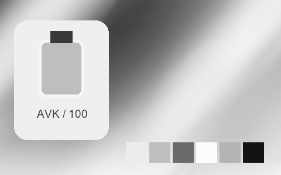

## 238 · 專業拍立得 · Fuji Fp-3000B Negative Early｜黑白 · 提亮中灰 · 中段拉開

`nt-instant-pro-fuji-fp-3000b-negative-early` · `instant-pro` · CC-BY-SA-4.0 · 33³

50% 灰輸出 Y′ 151.5/255（變化 +24.0 碼值）；25%–75% 灰跨度比 1.118。中灰紅減藍 +0.0 碼值。淺/中/深膚色色塊分別輸出 #D3D3D3、#BABABA、#616161；紅/綠/藍測試塊分別輸出 #8D8D8D、#AFAFAF、#B5B5B5。

建議試片：黑白紀實、建筑與輪廓試片

試用強度：1–1; default 1.0.

強度低於 1 會混回原始彩色。僅像素顏色映射，不生成顆粒、光暈、暗角、空間霧或美顏；未做自然畫質驗收。

| Input swatch | Input RGB | Actual output RGB |
|---|---|---|
| `gray_0` | `#000000` | `#2D2D2D` |
| `gray_10` | `#1A1A1A` | `#2D2D2D` |
| `gray_25` | `#404040` | `#3A3A3A` |
| `gray_50` | `#808080` | `#989898` |
| `gray_75` | `#BFBFBF` | `#C8C8C8` |
| `gray_90` | `#E6E6E6` | `#D7D7D7` |
| `gray_100` | `#FFFFFF` | `#DADADA` |
| `skin_light` | `#F5DBC6` | `#D3D3D3` |
| `skin_medium` | `#CF9B7B` | `#BABABA` |
| `skin_deep` | `#815438` | `#616161` |
| `red` | `#CC3333` | `#8D8D8D` |
| `green` | `#33CC33` | `#AFAFAF` |
| `blue` | `#3333CC` | `#B5B5B5` |

Creator: **Pat David** · [Source](https://github.com/NatronGitHub/clut/blob/af7b50d4caf6244fb6895a647f5b6a84efe7931a/instant_pro/fuji_fp-3000b_negative_early.png) · commit `af7b50d4caf6244fb6895a647f5b6a84efe7931a`.

Conversion: `native-depth-Hald-to-33-tetrahedral-v1`; 8,192 sampled RGB points; max error 0.0055034; mean 0.0006529. This is numerical approximation, not a perceptual quality score.

License obligations: Credit the named creator and source; retain the CC-BY-SA-4.0 notice and indicate changes. Redistributed adapted LUT data and thumbnails must use CC-BY-SA-4.0 or a compatible license; no additional restrictions.

[License](../../../product/src/ai_ad_editor/look_data/licenses/CC-BY-SA-4.0.txt) · LUT SHA-256 `f2d574e485e670b1195f07bdfefe0bf5187525e367af3fe17eb2c41b713c15b9`.

[Actual preview PNG](../../assets/look500-20261024-r1/previews/nt-instant-pro-fuji-fp-3000b-negative-early.png) · [Actual video](../../assets/look500-20261024-r1/videos/nt-instant-pro-fuji-fp-3000b-negative-early.mp4)

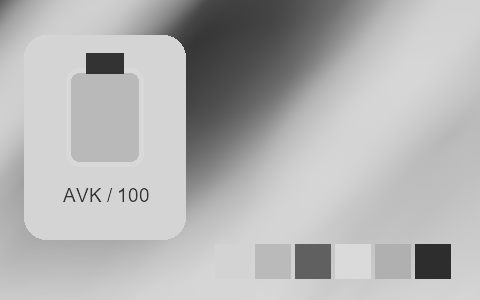

## 239 · 專業拍立得 · Polaroid 665｜黑白 · 中灰近原值 · 中段拉開

`nt-instant-pro-polaroid-665` · `instant-pro` · CC-BY-SA-4.0 · 33³

50% 灰輸出 Y′ 129.5/255（變化 +2.0 碼值）；25%–75% 灰跨度比 1.202。中灰紅減藍 +0.0 碼值。淺/中/深膚色色塊分別輸出 #E6E6E6、#A8A8A8、#4D4D4D；紅/綠/藍測試塊分別輸出 #626262、#9D9D9D、#AFAFAF。

建議試片：黑白紀實、建筑與輪廓試片

試用強度：1–1; default 1.0.

強度低於 1 會混回原始彩色。僅像素顏色映射，不生成顆粒、光暈、暗角、空間霧或美顏；未做自然畫質驗收。

| Input swatch | Input RGB | Actual output RGB |
|---|---|---|
| `gray_0` | `#000000` | `#0D0D0D` |
| `gray_10` | `#1A1A1A` | `#171717` |
| `gray_25` | `#404040` | `#373737` |
| `gray_50` | `#808080` | `#828282` |
| `gray_75` | `#BFBFBF` | `#D0D0D0` |
| `gray_90` | `#E6E6E6` | `#F1F1F1` |
| `gray_100` | `#FFFFFF` | `#FEFEFE` |
| `skin_light` | `#F5DBC6` | `#E6E6E6` |
| `skin_medium` | `#CF9B7B` | `#A8A8A8` |
| `skin_deep` | `#815438` | `#4D4D4D` |
| `red` | `#CC3333` | `#626262` |
| `green` | `#33CC33` | `#9D9D9D` |
| `blue` | `#3333CC` | `#AFAFAF` |

Creator: **Pat David** · [Source](https://github.com/NatronGitHub/clut/blob/af7b50d4caf6244fb6895a647f5b6a84efe7931a/instant_pro/polaroid_665.png) · commit `af7b50d4caf6244fb6895a647f5b6a84efe7931a`.

Conversion: `native-depth-Hald-to-33-tetrahedral-v1`; 8,192 sampled RGB points; max error 0.0135119; mean 0.0007108. This is numerical approximation, not a perceptual quality score.

License obligations: Credit the named creator and source; retain the CC-BY-SA-4.0 notice and indicate changes. Redistributed adapted LUT data and thumbnails must use CC-BY-SA-4.0 or a compatible license; no additional restrictions.

[License](../../../product/src/ai_ad_editor/look_data/licenses/CC-BY-SA-4.0.txt) · LUT SHA-256 `af9b9e33c9d8d53ae4429b53315bd0632ce07057d4a2e5bae728826b876fa207`.

[Actual preview PNG](../../assets/look500-20261024-r1/previews/nt-instant-pro-polaroid-665.png) · [Actual video](../../assets/look500-20261024-r1/videos/nt-instant-pro-polaroid-665.mp4)

## 240 · 專業拍立得 · Polaroid 665 ++｜黑白 · 提亮中灰 · 中段拉開

`nt-instant-pro-polaroid-665-curve-plus-2` · `instant-pro` · CC-BY-SA-4.0 · 33³

50% 灰輸出 Y′ 137.0/255（變化 +9.5 碼值）；25%–75% 灰跨度比 1.298。中灰紅減藍 +0.0 碼值。淺/中/深膚色色塊分別輸出 #F2F2F2、#B6B6B6、#4E4E4E；紅/綠/藍測試塊分別輸出 #656565、#ABABAB、#BEBEBE。

建議試片：黑白紀實、建筑與輪廓試片

試用強度：1–1; default 1.0.

強度低於 1 會混回原始彩色。僅像素顏色映射，不生成顆粒、光暈、暗角、空間霧或美顏；未做自然畫質驗收。

| Input swatch | Input RGB | Actual output RGB |
|---|---|---|
| `gray_0` | `#000000` | `#242424` |
| `gray_10` | `#1A1A1A` | `#272727` |
| `gray_25` | `#404040` | `#3C3C3C` |
| `gray_50` | `#808080` | `#898989` |
| `gray_75` | `#BFBFBF` | `#E2E2E2` |
| `gray_90` | `#E6E6E6` | `#F9F9F9` |
| `gray_100` | `#FFFFFF` | `#FEFEFE` |
| `skin_light` | `#F5DBC6` | `#F2F2F2` |
| `skin_medium` | `#CF9B7B` | `#B6B6B6` |
| `skin_deep` | `#815438` | `#4E4E4E` |
| `red` | `#CC3333` | `#656565` |
| `green` | `#33CC33` | `#ABABAB` |
| `blue` | `#3333CC` | `#BEBEBE` |

Creator: **Pat David** · [Source](https://github.com/NatronGitHub/clut/blob/af7b50d4caf6244fb6895a647f5b6a84efe7931a/instant_pro/polaroid_665_++.png) · commit `af7b50d4caf6244fb6895a647f5b6a84efe7931a`.

Conversion: `native-depth-Hald-to-33-tetrahedral-v1`; 8,192 sampled RGB points; max error 0.0130064; mean 0.0007284. This is numerical approximation, not a perceptual quality score.

License obligations: Credit the named creator and source; retain the CC-BY-SA-4.0 notice and indicate changes. Redistributed adapted LUT data and thumbnails must use CC-BY-SA-4.0 or a compatible license; no additional restrictions.

[License](../../../product/src/ai_ad_editor/look_data/licenses/CC-BY-SA-4.0.txt) · LUT SHA-256 `1fcbb23a4185d0d85fc3c7e5a49c12ec44c7e3d8799c608c67344f15b484d136`.

[Actual preview PNG](../../assets/look500-20261024-r1/previews/nt-instant-pro-polaroid-665-curve-plus-2.png) · [Actual video](../../assets/look500-20261024-r1/videos/nt-instant-pro-polaroid-665-curve-plus-2.mp4)

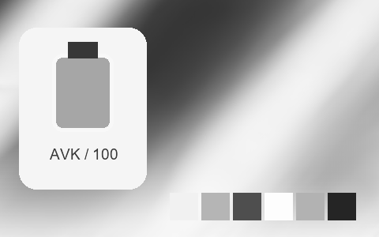

## 241 · 專業拍立得 · Polaroid 665 +｜黑白 · 提亮中灰 · 中段拉開

`nt-instant-pro-polaroid-665-curve-plus-1` · `instant-pro` · CC-BY-SA-4.0 · 33³

50% 灰輸出 Y′ 137.0/255（變化 +9.5 碼值）；25%–75% 灰跨度比 1.316。中灰紅減藍 +0.0 碼值。淺/中/深膚色色塊分別輸出 #F1F1F1、#B5B5B5、#4E4E4E；紅/綠/藍測試塊分別輸出 #666666、#AAAAAA、#BABABA。

建議試片：黑白紀實、建筑與輪廓試片

試用強度：1–1; default 1.0.

強度低於 1 會混回原始彩色。僅像素顏色映射，不生成顆粒、光暈、暗角、空間霧或美顏；未做自然畫質驗收。

| Input swatch | Input RGB | Actual output RGB |
|---|---|---|
| `gray_0` | `#000000` | `#141414` |
| `gray_10` | `#1A1A1A` | `#181818` |
| `gray_25` | `#404040` | `#383838` |
| `gray_50` | `#808080` | `#898989` |
| `gray_75` | `#BFBFBF` | `#E0E0E0` |
| `gray_90` | `#E6E6E6` | `#F7F7F7` |
| `gray_100` | `#FFFFFF` | `#FEFEFE` |
| `skin_light` | `#F5DBC6` | `#F1F1F1` |
| `skin_medium` | `#CF9B7B` | `#B5B5B5` |
| `skin_deep` | `#815438` | `#4E4E4E` |
| `red` | `#CC3333` | `#666666` |
| `green` | `#33CC33` | `#AAAAAA` |
| `blue` | `#3333CC` | `#BABABA` |

Creator: **Pat David** · [Source](https://github.com/NatronGitHub/clut/blob/af7b50d4caf6244fb6895a647f5b6a84efe7931a/instant_pro/polaroid_665_+.png) · commit `af7b50d4caf6244fb6895a647f5b6a84efe7931a`.

Conversion: `native-depth-Hald-to-33-tetrahedral-v1`; 8,192 sampled RGB points; max error 0.0161068; mean 0.0007162. This is numerical approximation, not a perceptual quality score.

License obligations: Credit the named creator and source; retain the CC-BY-SA-4.0 notice and indicate changes. Redistributed adapted LUT data and thumbnails must use CC-BY-SA-4.0 or a compatible license; no additional restrictions.

[License](../../../product/src/ai_ad_editor/look_data/licenses/CC-BY-SA-4.0.txt) · LUT SHA-256 `40152746236f6a96786de630425c9f18bb1bdbad579df3592b1933ae8961d509`.

[Actual preview PNG](../../assets/look500-20261024-r1/previews/nt-instant-pro-polaroid-665-curve-plus-1.png) · [Actual video](../../assets/look500-20261024-r1/videos/nt-instant-pro-polaroid-665-curve-plus-1.mp4)

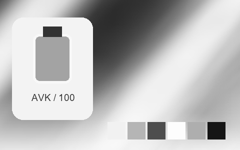

## 242 · 專業拍立得 · Polaroid 665 --｜黑白 · 提亮中灰 · 中段跨度接近原值

`nt-instant-pro-polaroid-665-curve-minus-2` · `instant-pro` · CC-BY-SA-4.0 · 33³

50% 灰輸出 Y′ 139.0/255（變化 +11.5 碼值）；25%–75% 灰跨度比 1.045。中灰紅減藍 +0.0 碼值。淺/中/深膚色色塊分別輸出 #E4E4E4、#A9A9A9、#5D5D5D；紅/綠/藍測試塊分別輸出 #717171、#A3A3A3、#B6B6B6。

建議試片：黑白紀實、建筑與輪廓試片

試用強度：1–1; default 1.0.

強度低於 1 會混回原始彩色。僅像素顏色映射，不生成顆粒、光暈、暗角、空間霧或美顏；未做自然畫質驗收。

| Input swatch | Input RGB | Actual output RGB |
|---|---|---|
| `gray_0` | `#000000` | `#0C0C0C` |
| `gray_10` | `#1A1A1A` | `#1A1A1A` |
| `gray_25` | `#404040` | `#484848` |
| `gray_50` | `#808080` | `#8B8B8B` |
| `gray_75` | `#BFBFBF` | `#CDCDCD` |
| `gray_90` | `#E6E6E6` | `#EDEDED` |
| `gray_100` | `#FFFFFF` | `#F7F7F7` |
| `skin_light` | `#F5DBC6` | `#E4E4E4` |
| `skin_medium` | `#CF9B7B` | `#A9A9A9` |
| `skin_deep` | `#815438` | `#5D5D5D` |
| `red` | `#CC3333` | `#717171` |
| `green` | `#33CC33` | `#A3A3A3` |
| `blue` | `#3333CC` | `#B6B6B6` |

Creator: **Pat David** · [Source](https://github.com/NatronGitHub/clut/blob/af7b50d4caf6244fb6895a647f5b6a84efe7931a/instant_pro/polaroid_665_--.png) · commit `af7b50d4caf6244fb6895a647f5b6a84efe7931a`.

Conversion: `native-depth-Hald-to-33-tetrahedral-v1`; 8,192 sampled RGB points; max error 0.0118331; mean 0.0006670. This is numerical approximation, not a perceptual quality score.

License obligations: Credit the named creator and source; retain the CC-BY-SA-4.0 notice and indicate changes. Redistributed adapted LUT data and thumbnails must use CC-BY-SA-4.0 or a compatible license; no additional restrictions.

[License](../../../product/src/ai_ad_editor/look_data/licenses/CC-BY-SA-4.0.txt) · LUT SHA-256 `fd2123894c3d18264b1aa63c0543f352f03b8779ad48c53e04336e35c6f9ccda`.

[Actual preview PNG](../../assets/look500-20261024-r1/previews/nt-instant-pro-polaroid-665-curve-minus-2.png) · [Actual video](../../assets/look500-20261024-r1/videos/nt-instant-pro-polaroid-665-curve-minus-2.mp4)

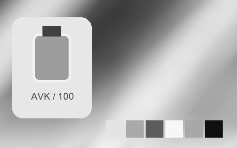

## 243 · 專業拍立得 · Polaroid 665 -｜黑白 · 提亮中灰 · 中段跨度接近原值

`nt-instant-pro-polaroid-665-curve-minus-1` · `instant-pro` · CC-BY-SA-4.0 · 33³

50% 灰輸出 Y′ 134.5/255（變化 +7.0 碼值）；25%–75% 灰跨度比 1.045。中灰紅減藍 +0.0 碼值。淺/中/深膚色色塊分別輸出 #E0E0E0、#A6A6A6、#5B5B5B；紅/綠/藍測試塊分別輸出 #6D6D6D、#A0A0A0、#B1B1B1。

建議試片：黑白紀實、建筑與輪廓試片

試用強度：1–1; default 1.0.

強度低於 1 會混回原始彩色。僅像素顏色映射，不生成顆粒、光暈、暗角、空間霧或美顏；未做自然畫質驗收。

| Input swatch | Input RGB | Actual output RGB |
|---|---|---|
| `gray_0` | `#000000` | `#111111` |
| `gray_10` | `#1A1A1A` | `#1B1B1B` |
| `gray_25` | `#404040` | `#464646` |
| `gray_50` | `#808080` | `#868686` |
| `gray_75` | `#BFBFBF` | `#CBCBCB` |
| `gray_90` | `#E6E6E6` | `#EDEDED` |
| `gray_100` | `#FFFFFF` | `#F9F9F9` |
| `skin_light` | `#F5DBC6` | `#E0E0E0` |
| `skin_medium` | `#CF9B7B` | `#A6A6A6` |
| `skin_deep` | `#815438` | `#5B5B5B` |
| `red` | `#CC3333` | `#6D6D6D` |
| `green` | `#33CC33` | `#A0A0A0` |
| `blue` | `#3333CC` | `#B1B1B1` |

Creator: **Pat David** · [Source](https://github.com/NatronGitHub/clut/blob/af7b50d4caf6244fb6895a647f5b6a84efe7931a/instant_pro/polaroid_665_-.png) · commit `af7b50d4caf6244fb6895a647f5b6a84efe7931a`.

Conversion: `native-depth-Hald-to-33-tetrahedral-v1`; 8,192 sampled RGB points; max error 0.0115333; mean 0.0006959. This is numerical approximation, not a perceptual quality score.

License obligations: Credit the named creator and source; retain the CC-BY-SA-4.0 notice and indicate changes. Redistributed adapted LUT data and thumbnails must use CC-BY-SA-4.0 or a compatible license; no additional restrictions.

[License](../../../product/src/ai_ad_editor/look_data/licenses/CC-BY-SA-4.0.txt) · LUT SHA-256 `70fdfda144a87782821fa886281040c5de7635fe731728031b8d5dc571d3641c`.

[Actual preview PNG](../../assets/look500-20261024-r1/previews/nt-instant-pro-polaroid-665-curve-minus-1.png) · [Actual video](../../assets/look500-20261024-r1/videos/nt-instant-pro-polaroid-665-curve-minus-1.mp4)

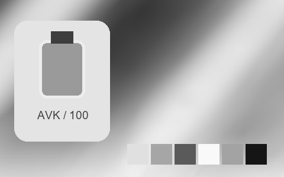

## 244 · 專業拍立得 · Polaroid 665 Negative｜黑白 · 提亮中灰 · 中段拉開

`nt-instant-pro-polaroid-665-negative` · `instant-pro` · CC-BY-SA-4.0 · 33³

50% 灰輸出 Y′ 148.5/255（變化 +21.0 碼值）；25%–75% 灰跨度比 1.104。中灰紅減藍 +0.0 碼值。淺/中/深膚色色塊分別輸出 #E1E1E1、#B3B3B3、#616161；紅/綠/藍測試塊分別輸出 #7A7A7A、#B4B4B4、#BCBCBC。

建議試片：黑白紀實、建筑與輪廓試片

試用強度：1–1; default 1.0.

強度低於 1 會混回原始彩色。僅像素顏色映射，不生成顆粒、光暈、暗角、空間霧或美顏；未做自然畫質驗收。

| Input swatch | Input RGB | Actual output RGB |
|---|---|---|
| `gray_0` | `#000000` | `#131313` |
| `gray_10` | `#1A1A1A` | `#161616` |
| `gray_25` | `#404040` | `#464646` |
| `gray_50` | `#808080` | `#949494` |
| `gray_75` | `#BFBFBF` | `#D2D2D2` |
| `gray_90` | `#E6E6E6` | `#EAEAEA` |
| `gray_100` | `#FFFFFF` | `#F9F9F9` |
| `skin_light` | `#F5DBC6` | `#E1E1E1` |
| `skin_medium` | `#CF9B7B` | `#B3B3B3` |
| `skin_deep` | `#815438` | `#616161` |
| `red` | `#CC3333` | `#7A7A7A` |
| `green` | `#33CC33` | `#B4B4B4` |
| `blue` | `#3333CC` | `#BCBCBC` |

Creator: **Pat David** · [Source](https://github.com/NatronGitHub/clut/blob/af7b50d4caf6244fb6895a647f5b6a84efe7931a/instant_pro/polaroid_665_negative.png) · commit `af7b50d4caf6244fb6895a647f5b6a84efe7931a`.

Conversion: `native-depth-Hald-to-33-tetrahedral-v1`; 8,192 sampled RGB points; max error 0.0102516; mean 0.0006493. This is numerical approximation, not a perceptual quality score.

License obligations: Credit the named creator and source; retain the CC-BY-SA-4.0 notice and indicate changes. Redistributed adapted LUT data and thumbnails must use CC-BY-SA-4.0 or a compatible license; no additional restrictions.

[License](../../../product/src/ai_ad_editor/look_data/licenses/CC-BY-SA-4.0.txt) · LUT SHA-256 `5e776f1a24263b8548d37c63f1e5ecddfe92959cea1623f78fed3c4e74cb79ac`.

[Actual preview PNG](../../assets/look500-20261024-r1/previews/nt-instant-pro-polaroid-665-negative.png) · [Actual video](../../assets/look500-20261024-r1/videos/nt-instant-pro-polaroid-665-negative.mp4)

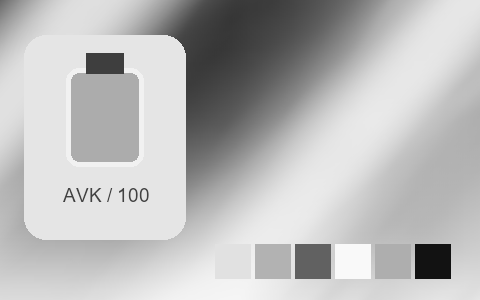

## 245 · 專業拍立得 · Polaroid 665 Negative +｜黑白 · 提亮中灰 · 中段收窄

`nt-instant-pro-polaroid-665-negative-curve-plus-1` · `instant-pro` · CC-BY-SA-4.0 · 33³

50% 灰輸出 Y′ 143.5/255（變化 +16.0 碼值）；25%–75% 灰跨度比 0.837。中灰紅減藍 +0.0 碼值。淺/中/深膚色色塊分別輸出 #D0D0D0、#A9A9A9、#696969；紅/綠/藍測試塊分別輸出 #7D7D7D、#A8A8A8、#AEAEAE。

建議試片：黑白紀實、建筑與輪廓試片

試用強度：1–1; default 1.0.

強度低於 1 會混回原始彩色。僅像素顏色映射，不生成顆粒、光暈、暗角、空間霧或美顏；未做自然畫質驗收。

| Input swatch | Input RGB | Actual output RGB |
|---|---|---|
| `gray_0` | `#000000` | `#343434` |
| `gray_10` | `#1A1A1A` | `#3E3E3E` |
| `gray_25` | `#404040` | `#555555` |
| `gray_50` | `#808080` | `#909090` |
| `gray_75` | `#BFBFBF` | `#C0C0C0` |
| `gray_90` | `#E6E6E6` | `#D5D5D5` |
| `gray_100` | `#FFFFFF` | `#DADADA` |
| `skin_light` | `#F5DBC6` | `#D0D0D0` |
| `skin_medium` | `#CF9B7B` | `#A9A9A9` |
| `skin_deep` | `#815438` | `#696969` |
| `red` | `#CC3333` | `#7D7D7D` |
| `green` | `#33CC33` | `#A8A8A8` |
| `blue` | `#3333CC` | `#AEAEAE` |

Creator: **Pat David** · [Source](https://github.com/NatronGitHub/clut/blob/af7b50d4caf6244fb6895a647f5b6a84efe7931a/instant_pro/polaroid_665_negative_+.png) · commit `af7b50d4caf6244fb6895a647f5b6a84efe7931a`.

Conversion: `native-depth-Hald-to-33-tetrahedral-v1`; 8,192 sampled RGB points; max error 0.0068022; mean 0.0006192. This is numerical approximation, not a perceptual quality score.

License obligations: Credit the named creator and source; retain the CC-BY-SA-4.0 notice and indicate changes. Redistributed adapted LUT data and thumbnails must use CC-BY-SA-4.0 or a compatible license; no additional restrictions.

[License](../../../product/src/ai_ad_editor/look_data/licenses/CC-BY-SA-4.0.txt) · LUT SHA-256 `2a67a8e05cbb8efc792b81fd8be93f611e142a4afe049520c48d67af861c8953`.

[Actual preview PNG](../../assets/look500-20261024-r1/previews/nt-instant-pro-polaroid-665-negative-curve-plus-1.png) · [Actual video](../../assets/look500-20261024-r1/videos/nt-instant-pro-polaroid-665-negative-curve-plus-1.mp4)

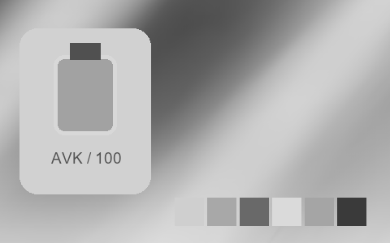

## 246 · 專業拍立得 · Polaroid 665 Negative -｜黑白 · 提亮中灰 · 中段拉開

`nt-instant-pro-polaroid-665-negative-curve-minus-1` · `instant-pro` · CC-BY-SA-4.0 · 33³

50% 灰輸出 Y′ 147.0/255（變化 +19.5 碼值）；25%–75% 灰跨度比 1.061。中灰紅減藍 +0.0 碼值。淺/中/深膚色色塊分別輸出 #E3E3E3、#B1B1B1、#636363；紅/綠/藍測試塊分別輸出 #7E7E7E、#B1B1B1、#BABABA。

建議試片：黑白紀實、建筑與輪廓試片

試用強度：1–1; default 1.0.

強度低於 1 會混回原始彩色。僅像素顏色映射，不生成顆粒、光暈、暗角、空間霧或美顏；未做自然畫質驗收。

| Input swatch | Input RGB | Actual output RGB |
|---|---|---|
| `gray_0` | `#000000` | `#070707` |
| `gray_10` | `#1A1A1A` | `#1B1B1B` |
| `gray_25` | `#404040` | `#494949` |
| `gray_50` | `#808080` | `#939393` |
| `gray_75` | `#BFBFBF` | `#D0D0D0` |
| `gray_90` | `#E6E6E6` | `#EEEEEE` |
| `gray_100` | `#FFFFFF` | `#F9F9F9` |
| `skin_light` | `#F5DBC6` | `#E3E3E3` |
| `skin_medium` | `#CF9B7B` | `#B1B1B1` |
| `skin_deep` | `#815438` | `#636363` |
| `red` | `#CC3333` | `#7E7E7E` |
| `green` | `#33CC33` | `#B1B1B1` |
| `blue` | `#3333CC` | `#BABABA` |

Creator: **Pat David** · [Source](https://github.com/NatronGitHub/clut/blob/af7b50d4caf6244fb6895a647f5b6a84efe7931a/instant_pro/polaroid_665_negative_-.png) · commit `af7b50d4caf6244fb6895a647f5b6a84efe7931a`.

Conversion: `native-depth-Hald-to-33-tetrahedral-v1`; 8,192 sampled RGB points; max error 0.0167232; mean 0.0006495. This is numerical approximation, not a perceptual quality score.

License obligations: Credit the named creator and source; retain the CC-BY-SA-4.0 notice and indicate changes. Redistributed adapted LUT data and thumbnails must use CC-BY-SA-4.0 or a compatible license; no additional restrictions.

[License](../../../product/src/ai_ad_editor/look_data/licenses/CC-BY-SA-4.0.txt) · LUT SHA-256 `254da7080e0d2a0598f28b7edaa7b67d209b213a4b94a40e2c1a271d2fc85bdb`.

[Actual preview PNG](../../assets/look500-20261024-r1/previews/nt-instant-pro-polaroid-665-negative-curve-minus-1.png) · [Actual video](../../assets/look500-20261024-r1/videos/nt-instant-pro-polaroid-665-negative-curve-minus-1.mp4)

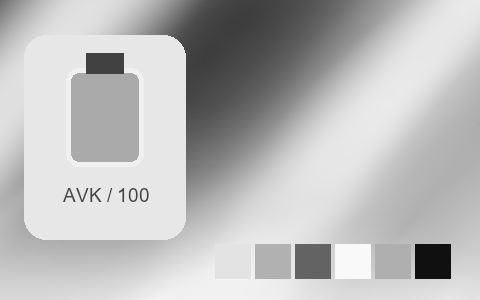

## 247 · 專業拍立得 · Polaroid 665 Negative Hc｜黑白 · 提亮中灰 · 中段拉開

`nt-instant-pro-polaroid-665-negative-hc` · `instant-pro` · CC-BY-SA-4.0 · 33³

50% 灰輸出 Y′ 161.5/255（變化 +34.0 碼值）；25%–75% 灰跨度比 1.204。中灰紅減藍 +0.0 碼值。淺/中/深膚色色塊分別輸出 #ECECEC、#C4C4C4、#646464；紅/綠/藍測試塊分別輸出 #858585、#C1C1C1、#C9C9C9。

建議試片：黑白紀實、建筑與輪廓試片

試用強度：1–1; default 1.0.

強度低於 1 會混回原始彩色。僅像素顏色映射，不生成顆粒、光暈、暗角、空間霧或美顏；未做自然畫質驗收。

| Input swatch | Input RGB | Actual output RGB |
|---|---|---|
| `gray_0` | `#000000` | `#040404` |
| `gray_10` | `#1A1A1A` | `#131313` |
| `gray_25` | `#404040` | `#444444` |
| `gray_50` | `#808080` | `#A2A2A2` |
| `gray_75` | `#BFBFBF` | `#DEDEDE` |
| `gray_90` | `#E6E6E6` | `#F2F2F2` |
| `gray_100` | `#FFFFFF` | `#F3F3F3` |
| `skin_light` | `#F5DBC6` | `#ECECEC` |
| `skin_medium` | `#CF9B7B` | `#C4C4C4` |
| `skin_deep` | `#815438` | `#646464` |
| `red` | `#CC3333` | `#858585` |
| `green` | `#33CC33` | `#C1C1C1` |
| `blue` | `#3333CC` | `#C9C9C9` |

Creator: **Pat David** · [Source](https://github.com/NatronGitHub/clut/blob/af7b50d4caf6244fb6895a647f5b6a84efe7931a/instant_pro/polaroid_665_negative_hc.png) · commit `af7b50d4caf6244fb6895a647f5b6a84efe7931a`.

Conversion: `native-depth-Hald-to-33-tetrahedral-v1`; 8,192 sampled RGB points; max error 0.0148176; mean 0.0006524. This is numerical approximation, not a perceptual quality score.

License obligations: Credit the named creator and source; retain the CC-BY-SA-4.0 notice and indicate changes. Redistributed adapted LUT data and thumbnails must use CC-BY-SA-4.0 or a compatible license; no additional restrictions.

[License](../../../product/src/ai_ad_editor/look_data/licenses/CC-BY-SA-4.0.txt) · LUT SHA-256 `696b8a1b839911c4325ada61afe5b4916878cd3badbfe67f7dbda01fa5f03f3c`.

[Actual preview PNG](../../assets/look500-20261024-r1/previews/nt-instant-pro-polaroid-665-negative-hc.png) · [Actual video](../../assets/look500-20261024-r1/videos/nt-instant-pro-polaroid-665-negative-hc.mp4)

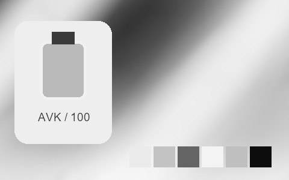

## 248 · 專業拍立得 · Polaroid 669 +++｜冷色 · 提亮中灰 · 中段跨度接近原值

`nt-instant-pro-polaroid-669-curve-plus-3` · `instant-pro` · CC-BY-SA-4.0 · 33³

50% 灰輸出 Y′ 138.0/255（變化 +10.5 碼值）；25%–75% 灰跨度比 0.965。中灰紅減藍 -10.0 碼值。淺/中/深膚色色塊分別輸出 #DBDEC7、#C7A39C、#885A52；紅/綠/藍測試塊分別輸出 #BB4C52、#67A961、#426CCA。

建議試片：冷色城市、夜景與科技試片

試用強度：0.35–0.8; default 1.0.

逐項比較膚色與品牌色，強度過高可能改變產品顏色。僅像素顏色映射，不生成顆粒、光暈、暗角、空間霧或美顏；未做自然畫質驗收。

| Input swatch | Input RGB | Actual output RGB |
|---|---|---|
| `gray_0` | `#000000` | `#523B30` |
| `gray_10` | `#1A1A1A` | `#543E35` |
| `gray_25` | `#404040` | `#604C4C` |
| `gray_50` | `#808080` | `#8F8799` |
| `gray_75` | `#BFBFBF` | `#C2CECA` |
| `gray_90` | `#E6E6E6` | `#DBEBD4` |
| `gray_100` | `#FFFFFF` | `#EDF8DB` |
| `skin_light` | `#F5DBC6` | `#DBDEC7` |
| `skin_medium` | `#CF9B7B` | `#C7A39C` |
| `skin_deep` | `#815438` | `#885A52` |
| `red` | `#CC3333` | `#BB4C52` |
| `green` | `#33CC33` | `#67A961` |
| `blue` | `#3333CC` | `#426CCA` |

Creator: **Pat David** · [Source](https://github.com/NatronGitHub/clut/blob/af7b50d4caf6244fb6895a647f5b6a84efe7931a/instant_pro/polaroid_669_+++.png) · commit `af7b50d4caf6244fb6895a647f5b6a84efe7931a`.

Conversion: `native-depth-Hald-to-33-tetrahedral-v1`; 8,192 sampled RGB points; max error 0.0101427; mean 0.0007205. This is numerical approximation, not a perceptual quality score.

License obligations: Credit the named creator and source; retain the CC-BY-SA-4.0 notice and indicate changes. Redistributed adapted LUT data and thumbnails must use CC-BY-SA-4.0 or a compatible license; no additional restrictions.

[License](../../../product/src/ai_ad_editor/look_data/licenses/CC-BY-SA-4.0.txt) · LUT SHA-256 `2202e86b751bc5568c19ef045b1c36801b25d6a41fe624720fd3d803567ed36e`.

[Actual preview PNG](../../assets/look500-20261024-r1/previews/nt-instant-pro-polaroid-669-curve-plus-3.png) · [Actual video](../../assets/look500-20261024-r1/videos/nt-instant-pro-polaroid-669-curve-plus-3.mp4)

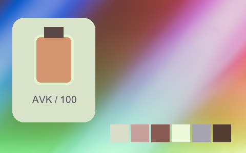

## 249 · 專業拍立得 · Polaroid 669 ++｜冷色 · 提亮中灰 · 中段跨度接近原值

`nt-instant-pro-polaroid-669-curve-plus-2` · `instant-pro` · CC-BY-SA-4.0 · 33³

50% 灰輸出 Y′ 138.2/255（變化 +10.7 碼值）；25%–75% 灰跨度比 0.995。中灰紅減藍 -11.5 碼值。淺/中/深膚色色塊分別輸出 #E3E2D1、#CBA29C、#83574C；紅/綠/藍測試塊分別輸出 #BA4A4C、#64AA5C、#326ACD。

建議試片：冷色城市、夜景與科技試片

試用強度：0.35–0.8; default 1.0.

逐項比較膚色與品牌色，強度過高可能改變產品顏色。僅像素顏色映射，不生成顆粒、光暈、暗角、空間霧或美顏；未做自然畫質驗收。

| Input swatch | Input RGB | Actual output RGB |
|---|---|---|
| `gray_0` | `#000000` | `#3F341B` |
| `gray_10` | `#1A1A1A` | `#463A27` |
| `gray_25` | `#404040` | `#564B46` |
| `gray_50` | `#808080` | `#8E889A` |
| `gray_75` | `#BFBFBF` | `#C5CECE` |
| `gray_90` | `#E6E6E6` | `#E7EFDE` |
| `gray_100` | `#FFFFFF` | `#F3F9E1` |
| `skin_light` | `#F5DBC6` | `#E3E2D1` |
| `skin_medium` | `#CF9B7B` | `#CBA29C` |
| `skin_deep` | `#815438` | `#83574C` |
| `red` | `#CC3333` | `#BA4A4C` |
| `green` | `#33CC33` | `#64AA5C` |
| `blue` | `#3333CC` | `#326ACD` |

Creator: **Pat David** · [Source](https://github.com/NatronGitHub/clut/blob/af7b50d4caf6244fb6895a647f5b6a84efe7931a/instant_pro/polaroid_669_++.png) · commit `af7b50d4caf6244fb6895a647f5b6a84efe7931a`.

Conversion: `native-depth-Hald-to-33-tetrahedral-v1`; 8,192 sampled RGB points; max error 0.0123203; mean 0.0007549. This is numerical approximation, not a perceptual quality score.

License obligations: Credit the named creator and source; retain the CC-BY-SA-4.0 notice and indicate changes. Redistributed adapted LUT data and thumbnails must use CC-BY-SA-4.0 or a compatible license; no additional restrictions.

[License](../../../product/src/ai_ad_editor/look_data/licenses/CC-BY-SA-4.0.txt) · LUT SHA-256 `9ea5f0d051166dc39362e92f59e342750351c9e7b39f62b628c65d15e0a2b7be`.

[Actual preview PNG](../../assets/look500-20261024-r1/previews/nt-instant-pro-polaroid-669-curve-plus-2.png) · [Actual video](../../assets/look500-20261024-r1/videos/nt-instant-pro-polaroid-669-curve-plus-2.mp4)

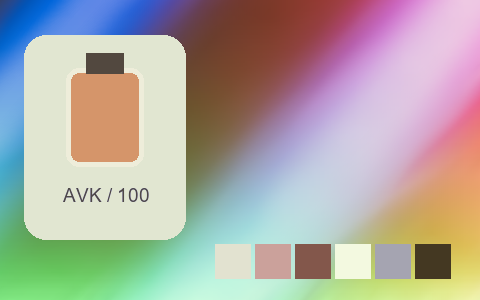

## 250 · 專業拍立得 · Polaroid 669 +｜冷色 · 提亮中灰 · 中段拉開

`nt-instant-pro-polaroid-669-curve-plus-1` · `instant-pro` · CC-BY-SA-4.0 · 33³

50% 灰輸出 Y′ 138.6/255（變化 +11.1 碼值）；25%–75% 灰跨度比 1.126。中灰紅減藍 -26.0 碼值。淺/中/深膚色色塊分別輸出 #DCEADD、#BFA9A5、#705553；紅/綠/藍測試塊分別輸出 #B14754、#56B168、#0369D1。

建議試片：冷色城市、夜景與科技試片

試用強度：0.35–0.8; default 1.0.

逐項比較膚色與品牌色，強度過高可能改變產品顏色。僅像素顏色映射，不生成顆粒、光暈、暗角、空間霧或美顏；未做自然畫質驗收。

| Input swatch | Input RGB | Actual output RGB |
|---|---|---|
| `gray_0` | `#000000` | `#00302D` |
| `gray_10` | `#1A1A1A` | `#023636` |
| `gray_25` | `#404040` | `#28464D` |
| `gray_50` | `#808080` | `#838B9D` |
| `gray_75` | `#BFBFBF` | `#B9D6D8` |
| `gray_90` | `#E6E6E6` | `#DCF1E5` |
| `gray_100` | `#FFFFFF` | `#E3F6E6` |
| `skin_light` | `#F5DBC6` | `#DCEADD` |
| `skin_medium` | `#CF9B7B` | `#BFA9A5` |
| `skin_deep` | `#815438` | `#705553` |
| `red` | `#CC3333` | `#B14754` |
| `green` | `#33CC33` | `#56B168` |
| `blue` | `#3333CC` | `#0369D1` |

Creator: **Pat David** · [Source](https://github.com/NatronGitHub/clut/blob/af7b50d4caf6244fb6895a647f5b6a84efe7931a/instant_pro/polaroid_669_+.png) · commit `af7b50d4caf6244fb6895a647f5b6a84efe7931a`.

Conversion: `native-depth-Hald-to-33-tetrahedral-v1`; 8,192 sampled RGB points; max error 0.0422719; mean 0.0008083. This is numerical approximation, not a perceptual quality score.

License obligations: Credit the named creator and source; retain the CC-BY-SA-4.0 notice and indicate changes. Redistributed adapted LUT data and thumbnails must use CC-BY-SA-4.0 or a compatible license; no additional restrictions.

[License](../../../product/src/ai_ad_editor/look_data/licenses/CC-BY-SA-4.0.txt) · LUT SHA-256 `62be379abcfa9f519f77dfe2fbb1a2c83508698a265e7ccc327359c6ed965e4c`.

[Actual preview PNG](../../assets/look500-20261024-r1/previews/nt-instant-pro-polaroid-669-curve-plus-1.png) · [Actual video](../../assets/look500-20261024-r1/videos/nt-instant-pro-polaroid-669-curve-plus-1.mp4)

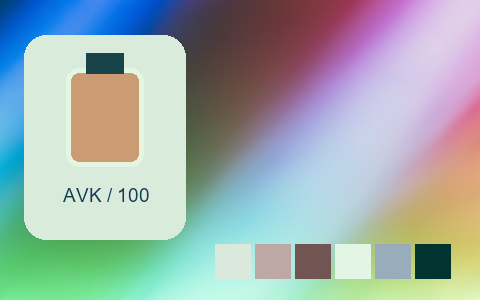

## 251 · 專業拍立得 · Polaroid 669 --｜中性 · 提亮中灰 · 中段拉開

`nt-instant-pro-polaroid-669-curve-minus-2` · `instant-pro` · CC-BY-SA-4.0 · 33³

50% 灰輸出 Y′ 147.2/255（變化 +19.7 碼值）；25%–75% 灰跨度比 1.145。中灰紅減藍 -2.0 碼值。淺/中/深膚色色塊分別輸出 #E7E6CE、#D3A985、#865539；紅/綠/藍測試塊分別輸出 #CD3933、#2FB61B、#0577D8。

建議試片：產品、生活與風景對照試片

試用強度：0.35–0.8; default 1.0.

逐項比較膚色與品牌色，強度過高可能改變產品顏色。僅像素顏色映射，不生成顆粒、光暈、暗角、空間霧或美顏；未做自然畫質驗收。

| Input swatch | Input RGB | Actual output RGB |
|---|---|---|
| `gray_0` | `#000000` | `#000100` |
| `gray_10` | `#1A1A1A` | `#051A15` |
| `gray_25` | `#404040` | `#32423E` |
| `gray_50` | `#808080` | `#909492` |
| `gray_75` | `#BFBFBF` | `#C4D4CE` |
| `gray_90` | `#E6E6E6` | `#E0F1EC` |
| `gray_100` | `#FFFFFF` | `#EBFEFD` |
| `skin_light` | `#F5DBC6` | `#E7E6CE` |
| `skin_medium` | `#CF9B7B` | `#D3A985` |
| `skin_deep` | `#815438` | `#865539` |
| `red` | `#CC3333` | `#CD3933` |
| `green` | `#33CC33` | `#2FB61B` |
| `blue` | `#3333CC` | `#0577D8` |

Creator: **Pat David** · [Source](https://github.com/NatronGitHub/clut/blob/af7b50d4caf6244fb6895a647f5b6a84efe7931a/instant_pro/polaroid_669_--.png) · commit `af7b50d4caf6244fb6895a647f5b6a84efe7931a`.

Conversion: `native-depth-Hald-to-33-tetrahedral-v1`; 8,192 sampled RGB points; max error 0.0261618; mean 0.0009507. This is numerical approximation, not a perceptual quality score.

License obligations: Credit the named creator and source; retain the CC-BY-SA-4.0 notice and indicate changes. Redistributed adapted LUT data and thumbnails must use CC-BY-SA-4.0 or a compatible license; no additional restrictions.

[License](../../../product/src/ai_ad_editor/look_data/licenses/CC-BY-SA-4.0.txt) · LUT SHA-256 `d440693e0a8edd17cc2b485096295120199fe86d01b676242653d4cbd0beb64c`.

[Actual preview PNG](../../assets/look500-20261024-r1/previews/nt-instant-pro-polaroid-669-curve-minus-2.png) · [Actual video](../../assets/look500-20261024-r1/videos/nt-instant-pro-polaroid-669-curve-minus-2.mp4)

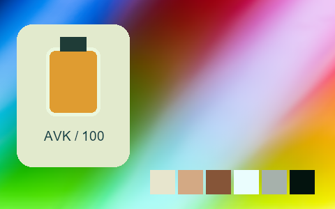

## 252 · 專業拍立得 · Polaroid 669 -｜冷色 · 提亮中灰 · 中段拉開

`nt-instant-pro-polaroid-669-curve-minus-1` · `instant-pro` · CC-BY-SA-4.0 · 33³

50% 灰輸出 Y′ 142.1/255（變化 +14.6 碼值）；25%–75% 灰跨度比 1.210。中灰紅減藍 -5.5 碼值。淺/中/深膚色色塊分別輸出 #E6E8CF、#D0AC81、#74523B；紅/綠/藍測試塊分別輸出 #C33936、#05B621、#0273D2。

建議試片：冷色城市、夜景與科技試片

試用強度：0.35–0.8; default 1.0.

逐項比較膚色與品牌色，強度過高可能改變產品顏色。僅像素顏色映射，不生成顆粒、光暈、暗角、空間霧或美顏；未做自然畫質驗收。

| Input swatch | Input RGB | Actual output RGB |
|---|---|---|
| `gray_0` | `#000000` | `#102224` |
| `gray_10` | `#1A1A1A` | `#162828` |
| `gray_25` | `#404040` | `#2B3F3E` |
| `gray_50` | `#808080` | `#84928A` |
| `gray_75` | `#BFBFBF` | `#C8DACE` |
| `gray_90` | `#E6E6E6` | `#E0F3E4` |
| `gray_100` | `#FFFFFF` | `#EFFFEF` |
| `skin_light` | `#F5DBC6` | `#E6E8CF` |
| `skin_medium` | `#CF9B7B` | `#D0AC81` |
| `skin_deep` | `#815438` | `#74523B` |
| `red` | `#CC3333` | `#C33936` |
| `green` | `#33CC33` | `#05B621` |
| `blue` | `#3333CC` | `#0273D2` |

Creator: **Pat David** · [Source](https://github.com/NatronGitHub/clut/blob/af7b50d4caf6244fb6895a647f5b6a84efe7931a/instant_pro/polaroid_669_-.png) · commit `af7b50d4caf6244fb6895a647f5b6a84efe7931a`.

Conversion: `native-depth-Hald-to-33-tetrahedral-v1`; 8,192 sampled RGB points; max error 0.0424394; mean 0.0009973. This is numerical approximation, not a perceptual quality score.

License obligations: Credit the named creator and source; retain the CC-BY-SA-4.0 notice and indicate changes. Redistributed adapted LUT data and thumbnails must use CC-BY-SA-4.0 or a compatible license; no additional restrictions.

[License](../../../product/src/ai_ad_editor/look_data/licenses/CC-BY-SA-4.0.txt) · LUT SHA-256 `a3bfa07f7b7a7909c9cbba08d53d35f98d9373e272d03767959b785748129ef7`.

[Actual preview PNG](../../assets/look500-20261024-r1/previews/nt-instant-pro-polaroid-669-curve-minus-1.png) · [Actual video](../../assets/look500-20261024-r1/videos/nt-instant-pro-polaroid-669-curve-minus-1.mp4)

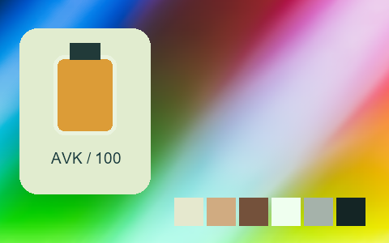

## 253 · 專業拍立得 · Polaroid 669 Cold｜冷色 · 提亮中灰 · 中段拉開

`nt-instant-pro-polaroid-669-cold` · `instant-pro` · CC-BY-SA-4.0 · 33³

50% 灰輸出 Y′ 133.8/255（變化 +6.3 碼值）；25%–75% 灰跨度比 1.214。中灰紅減藍 -29.5 碼值。淺/中/深膚色色塊分別輸出 #D0EDD7、#C1A8A7、#6B4F64；紅/綠/藍測試塊分別輸出 #B03E63、#4BAF72、#0261CF。

建議試片：冷色城市、夜景與科技試片

試用強度：0.35–0.8; default 1.0.

逐項比較膚色與品牌色，強度過高可能改變產品顏色。僅像素顏色映射，不生成顆粒、光暈、暗角、空間霧或美顏；未做自然畫質驗收。

| Input swatch | Input RGB | Actual output RGB |
|---|---|---|
| `gray_0` | `#000000` | `#00323F` |
| `gray_10` | `#1A1A1A` | `#003647` |
| `gray_25` | `#404040` | `#0E445D` |
| `gray_50` | `#808080` | `#8484A2` |
| `gray_75` | `#BFBFBF` | `#B4DFD7` |
| `gray_90` | `#E6E6E6` | `#CFF8E4` |
| `gray_100` | `#FFFFFF` | `#E2FEE7` |
| `skin_light` | `#F5DBC6` | `#D0EDD7` |
| `skin_medium` | `#CF9B7B` | `#C1A8A7` |
| `skin_deep` | `#815438` | `#6B4F64` |
| `red` | `#CC3333` | `#B03E63` |
| `green` | `#33CC33` | `#4BAF72` |
| `blue` | `#3333CC` | `#0261CF` |

Creator: **Pat David** · [Source](https://github.com/NatronGitHub/clut/blob/af7b50d4caf6244fb6895a647f5b6a84efe7931a/instant_pro/polaroid_669_cold.png) · commit `af7b50d4caf6244fb6895a647f5b6a84efe7931a`.

Conversion: `native-depth-Hald-to-33-tetrahedral-v1`; 8,192 sampled RGB points; max error 0.0536856; mean 0.0008434. This is numerical approximation, not a perceptual quality score.

License obligations: Credit the named creator and source; retain the CC-BY-SA-4.0 notice and indicate changes. Redistributed adapted LUT data and thumbnails must use CC-BY-SA-4.0 or a compatible license; no additional restrictions.

[License](../../../product/src/ai_ad_editor/look_data/licenses/CC-BY-SA-4.0.txt) · LUT SHA-256 `e2ca512416be227148c8326426d47a34e747f2405fb010a6f93845e327201a5b`.

[Actual preview PNG](../../assets/look500-20261024-r1/previews/nt-instant-pro-polaroid-669-cold.png) · [Actual video](../../assets/look500-20261024-r1/videos/nt-instant-pro-polaroid-669-cold.mp4)

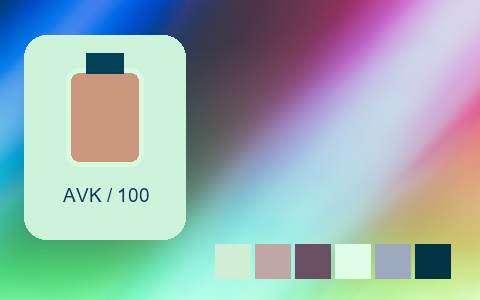

## 254 · 專業拍立得 · Polaroid 669 Cold +｜冷色 · 提亮中灰 · 中段拉開

`nt-instant-pro-polaroid-669-cold-curve-plus-1` · `instant-pro` · CC-BY-SA-4.0 · 33³

50% 灰輸出 Y′ 133.4/255（變化 +5.9 碼值）；25%–75% 灰跨度比 1.147。中灰紅減藍 -28.0 碼值。淺/中/深膚色色塊分別輸出 #CDEDCA、#BEABA1、#695464；紅/綠/藍測試塊分別輸出 #AD4365、#42B171、#0365C4。

建議試片：冷色城市、夜景與科技試片

試用強度：0.35–0.8; default 1.0.

逐項比較膚色與品牌色，強度過高可能改變產品顏色。僅像素顏色映射，不生成顆粒、光暈、暗角、空間霧或美顏；未做自然畫質驗收。

| Input swatch | Input RGB | Actual output RGB |
|---|---|---|
| `gray_0` | `#000000` | `#003E50` |
| `gray_10` | `#1A1A1A` | `#013E50` |
| `gray_25` | `#404040` | `#0F485E` |
| `gray_50` | `#808080` | `#80849C` |
| `gray_75` | `#BFBFBF` | `#B6D9C5` |
| `gray_90` | `#E6E6E6` | `#CCF4D3` |
| `gray_100` | `#FFFFFF` | `#D2F8D7` |
| `skin_light` | `#F5DBC6` | `#CDEDCA` |
| `skin_medium` | `#CF9B7B` | `#BEABA1` |
| `skin_deep` | `#815438` | `#695464` |
| `red` | `#CC3333` | `#AD4365` |
| `green` | `#33CC33` | `#42B171` |
| `blue` | `#3333CC` | `#0365C4` |

Creator: **Pat David** · [Source](https://github.com/NatronGitHub/clut/blob/af7b50d4caf6244fb6895a647f5b6a84efe7931a/instant_pro/polaroid_669_cold_+.png) · commit `af7b50d4caf6244fb6895a647f5b6a84efe7931a`.

Conversion: `native-depth-Hald-to-33-tetrahedral-v1`; 8,192 sampled RGB points; max error 0.0246318; mean 0.0008100. This is numerical approximation, not a perceptual quality score.

License obligations: Credit the named creator and source; retain the CC-BY-SA-4.0 notice and indicate changes. Redistributed adapted LUT data and thumbnails must use CC-BY-SA-4.0 or a compatible license; no additional restrictions.

[License](../../../product/src/ai_ad_editor/look_data/licenses/CC-BY-SA-4.0.txt) · LUT SHA-256 `01282ff2cc9e5799c7fb29820e3ec2e2aa22d55d9e901c82d1f358cc75745fec`.

[Actual preview PNG](../../assets/look500-20261024-r1/previews/nt-instant-pro-polaroid-669-cold-curve-plus-1.png) · [Actual video](../../assets/look500-20261024-r1/videos/nt-instant-pro-polaroid-669-cold-curve-plus-1.mp4)

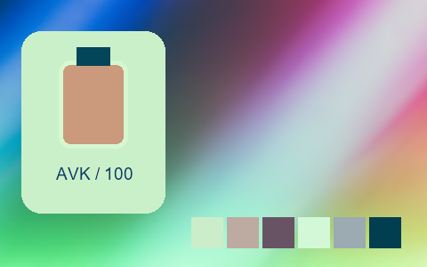

## 255 · 專業拍立得 · Polaroid 669 Cold --｜冷色 · 提亮中灰 · 中段拉開

`nt-instant-pro-polaroid-669-cold-curve-minus-2` · `instant-pro` · CC-BY-SA-4.0 · 33³

50% 灰輸出 Y′ 140.2/255（變化 +12.7 碼值）；25%–75% 灰跨度比 1.149。中灰紅減藍 -30.5 碼值。淺/中/深膚色色塊分別輸出 #DDEDDB、#C1AAAB、#795767；紅/綠/藍測試塊分別輸出 #B44566、#5AB47E、#0266CE。

建議試片：冷色城市、夜景與科技試片

試用強度：0.35–0.8; default 1.0.

逐項比較膚色與品牌色，強度過高可能改變產品顏色。僅像素顏色映射，不生成顆粒、光暈、暗角、空間霧或美顏；未做自然畫質驗收。

| Input swatch | Input RGB | Actual output RGB |
|---|---|---|
| `gray_0` | `#000000` | `#00080F` |
| `gray_10` | `#1A1A1A` | `#001F25` |
| `gray_25` | `#404040` | `#12465D` |
| `gray_50` | `#808080` | `#888BA6` |
| `gray_75` | `#BFBFBF` | `#B7D6D5` |
| `gray_90` | `#E6E6E6` | `#DFF5ED` |
| `gray_100` | `#FFFFFF` | `#F4FDFB` |
| `skin_light` | `#F5DBC6` | `#DDEDDB` |
| `skin_medium` | `#CF9B7B` | `#C1AAAB` |
| `skin_deep` | `#815438` | `#795767` |
| `red` | `#CC3333` | `#B44566` |
| `green` | `#33CC33` | `#5AB47E` |
| `blue` | `#3333CC` | `#0266CE` |

Creator: **Pat David** · [Source](https://github.com/NatronGitHub/clut/blob/af7b50d4caf6244fb6895a647f5b6a84efe7931a/instant_pro/polaroid_669_cold_--.png) · commit `af7b50d4caf6244fb6895a647f5b6a84efe7931a`.

Conversion: `native-depth-Hald-to-33-tetrahedral-v1`; 8,192 sampled RGB points; max error 0.0306777; mean 0.0008128. This is numerical approximation, not a perceptual quality score.

License obligations: Credit the named creator and source; retain the CC-BY-SA-4.0 notice and indicate changes. Redistributed adapted LUT data and thumbnails must use CC-BY-SA-4.0 or a compatible license; no additional restrictions.

[License](../../../product/src/ai_ad_editor/look_data/licenses/CC-BY-SA-4.0.txt) · LUT SHA-256 `9ebd4cac7043e6a8b473d92c7fc8ad43b447cd439ddb633e4c66bfc78bb4ec3e`.

[Actual preview PNG](../../assets/look500-20261024-r1/previews/nt-instant-pro-polaroid-669-cold-curve-minus-2.png) · [Actual video](../../assets/look500-20261024-r1/videos/nt-instant-pro-polaroid-669-cold-curve-minus-2.mp4)

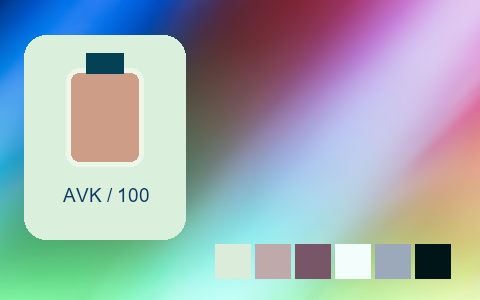

## 256 · 專業拍立得 · Polaroid 669 Cold -｜冷色 · 提亮中灰 · 中段拉開

`nt-instant-pro-polaroid-669-cold-curve-minus-1` · `instant-pro` · CC-BY-SA-4.0 · 33³

50% 灰輸出 Y′ 140.5/255（變化 +13.0 碼值）；25%–75% 灰跨度比 1.189。中灰紅減藍 -30.0 碼值。淺/中/深膚色色塊分別輸出 #D3ECDA、#C1ACAD、#755565；紅/綠/藍測試塊分別輸出 #B74264、#55B47B、#0367CE。

建議試片：冷色城市、夜景與科技試片

試用強度：0.35–0.8; default 1.0.

逐項比較膚色與品牌色，強度過高可能改變產品顏色。僅像素顏色映射，不生成顆粒、光暈、暗角、空間霧或美顏；未做自然畫質驗收。

| Input swatch | Input RGB | Actual output RGB |
|---|---|---|
| `gray_0` | `#000000` | `#001A1F` |
| `gray_10` | `#1A1A1A` | `#002A32` |
| `gray_25` | `#404040` | `#06445A` |
| `gray_50` | `#808080` | `#888CA5` |
| `gray_75` | `#BFBFBF` | `#B8D7D4` |
| `gray_90` | `#E6E6E6` | `#D2F5E6` |
| `gray_100` | `#FFFFFF` | `#DEFDEF` |
| `skin_light` | `#F5DBC6` | `#D3ECDA` |
| `skin_medium` | `#CF9B7B` | `#C1ACAD` |
| `skin_deep` | `#815438` | `#755565` |
| `red` | `#CC3333` | `#B74264` |
| `green` | `#33CC33` | `#55B47B` |
| `blue` | `#3333CC` | `#0367CE` |

Creator: **Pat David** · [Source](https://github.com/NatronGitHub/clut/blob/af7b50d4caf6244fb6895a647f5b6a84efe7931a/instant_pro/polaroid_669_cold_-.png) · commit `af7b50d4caf6244fb6895a647f5b6a84efe7931a`.

Conversion: `native-depth-Hald-to-33-tetrahedral-v1`; 8,192 sampled RGB points; max error 0.0458659; mean 0.0008291. This is numerical approximation, not a perceptual quality score.

License obligations: Credit the named creator and source; retain the CC-BY-SA-4.0 notice and indicate changes. Redistributed adapted LUT data and thumbnails must use CC-BY-SA-4.0 or a compatible license; no additional restrictions.

[License](../../../product/src/ai_ad_editor/look_data/licenses/CC-BY-SA-4.0.txt) · LUT SHA-256 `df89ed68cc34f6a8d66dd38ceb417aa25c0fe99209c31f0aca8bc74aecaf6784`.

[Actual preview PNG](../../assets/look500-20261024-r1/previews/nt-instant-pro-polaroid-669-cold-curve-minus-1.png) · [Actual video](../../assets/look500-20261024-r1/videos/nt-instant-pro-polaroid-669-cold-curve-minus-1.mp4)

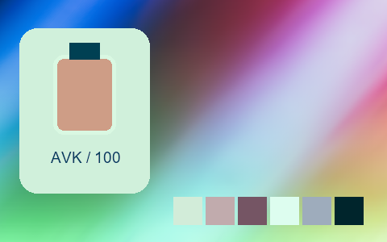

## 257 · 專業拍立得 · Polaroid 690 ++｜暖色 · 提亮中灰 · 中段收窄

`nt-instant-pro-polaroid-690-curve-plus-2` · `instant-pro` · CC-BY-SA-4.0 · 33³

50% 灰輸出 Y′ 151.9/255（變化 +24.4 碼值）；25%–75% 灰跨度比 0.936。中灰紅減藍 +11.0 碼值。淺/中/深膚色色塊分別輸出 #F7DEDD、#F0B09A、#A0664A；紅/綠/藍測試塊分別輸出 #DA3B41、#79C342、#6C54DE。

建議試片：暖色生活、餐飲與懷舊試片

試用強度：0.35–0.8; default 1.0.

逐項比較膚色與品牌色，強度過高可能改變產品顏色。僅像素顏色映射，不生成顆粒、光暈、暗角、空間霧或美顏；未做自然畫質驗收。

| Input swatch | Input RGB | Actual output RGB |
|---|---|---|
| `gray_0` | `#000000` | `#524439` |
| `gray_10` | `#1A1A1A` | `#57483E` |
| `gray_25` | `#404040` | `#675650` |
| `gray_50` | `#808080` | `#A4949A` |
| `gray_75` | `#BFBFBF` | `#E0CBDA` |
| `gray_90` | `#E6E6E6` | `#F0E2E8` |
| `gray_100` | `#FFFFFF` | `#EFF7EB` |
| `skin_light` | `#F5DBC6` | `#F7DEDD` |
| `skin_medium` | `#CF9B7B` | `#F0B09A` |
| `skin_deep` | `#815438` | `#A0664A` |
| `red` | `#CC3333` | `#DA3B41` |
| `green` | `#33CC33` | `#79C342` |
| `blue` | `#3333CC` | `#6C54DE` |

Creator: **Pat David** · [Source](https://github.com/NatronGitHub/clut/blob/af7b50d4caf6244fb6895a647f5b6a84efe7931a/instant_pro/polaroid_690_++.png) · commit `af7b50d4caf6244fb6895a647f5b6a84efe7931a`.

Conversion: `native-depth-Hald-to-33-tetrahedral-v1`; 8,192 sampled RGB points; max error 0.0166931; mean 0.0007643. This is numerical approximation, not a perceptual quality score.

License obligations: Credit the named creator and source; retain the CC-BY-SA-4.0 notice and indicate changes. Redistributed adapted LUT data and thumbnails must use CC-BY-SA-4.0 or a compatible license; no additional restrictions.

[License](../../../product/src/ai_ad_editor/look_data/licenses/CC-BY-SA-4.0.txt) · LUT SHA-256 `70f62b9db23def6eab7dda37d5c4a32c681f5454652926f88ed67812cad2081b`.

[Actual preview PNG](../../assets/look500-20261024-r1/previews/nt-instant-pro-polaroid-690-curve-plus-2.png) · [Actual video](../../assets/look500-20261024-r1/videos/nt-instant-pro-polaroid-690-curve-plus-2.mp4)

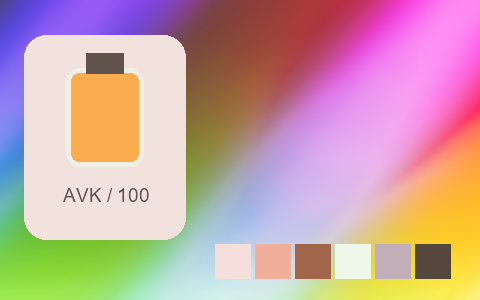

## 258 · 專業拍立得 · Polaroid 690 +｜中性 · 提亮中灰 · 中段拉開

`nt-instant-pro-polaroid-690-curve-plus-1` · `instant-pro` · CC-BY-SA-4.0 · 33³

50% 灰輸出 Y′ 151.2/255（變化 +23.7 碼值）；25%–75% 灰跨度比 1.152。中灰紅減藍 -1.5 碼值。淺/中/深膚色色塊分別輸出 #ECE1E6、#E4B29D、#9B522F；紅/綠/藍測試塊分別輸出 #D90220、#52C712、#323AE5。

建議試片：產品、生活與風景對照試片

試用強度：0.35–0.8; default 1.0.

逐項比較膚色與品牌色，強度過高可能改變產品顏色。僅像素顏色映射，不生成顆粒、光暈、暗角、空間霧或美顏；未做自然畫質驗收。

| Input swatch | Input RGB | Actual output RGB |
|---|---|---|
| `gray_0` | `#000000` | `#0F150C` |
| `gray_10` | `#1A1A1A` | `#1C1F17` |
| `gray_25` | `#404040` | `#3C3A37` |
| `gray_50` | `#808080` | `#9C959E` |
| `gray_75` | `#BFBFBF` | `#D2CADF` |
| `gray_90` | `#E6E6E6` | `#E4E9F4` |
| `gray_100` | `#FFFFFF` | `#EEFEFB` |
| `skin_light` | `#F5DBC6` | `#ECE1E6` |
| `skin_medium` | `#CF9B7B` | `#E4B29D` |
| `skin_deep` | `#815438` | `#9B522F` |
| `red` | `#CC3333` | `#D90220` |
| `green` | `#33CC33` | `#52C712` |
| `blue` | `#3333CC` | `#323AE5` |

Creator: **Pat David** · [Source](https://github.com/NatronGitHub/clut/blob/af7b50d4caf6244fb6895a647f5b6a84efe7931a/instant_pro/polaroid_690_+.png) · commit `af7b50d4caf6244fb6895a647f5b6a84efe7931a`.

Conversion: `native-depth-Hald-to-33-tetrahedral-v1`; 8,192 sampled RGB points; max error 0.0170099; mean 0.0009247. This is numerical approximation, not a perceptual quality score.

License obligations: Credit the named creator and source; retain the CC-BY-SA-4.0 notice and indicate changes. Redistributed adapted LUT data and thumbnails must use CC-BY-SA-4.0 or a compatible license; no additional restrictions.

[License](../../../product/src/ai_ad_editor/look_data/licenses/CC-BY-SA-4.0.txt) · LUT SHA-256 `94640a3c2df8396ab01ee2fdf72ad8cf8d0dc7840daa2923f8a9313718da9fa8`.

[Actual preview PNG](../../assets/look500-20261024-r1/previews/nt-instant-pro-polaroid-690-curve-plus-1.png) · [Actual video](../../assets/look500-20261024-r1/videos/nt-instant-pro-polaroid-690-curve-plus-1.mp4)

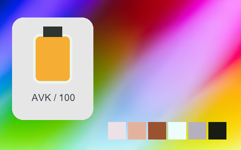

## 259 · 專業拍立得 · Polaroid 690 --｜中性 · 提亮中灰 · 中段拉開

`nt-instant-pro-polaroid-690-curve-minus-2` · `instant-pro` · CC-BY-SA-4.0 · 33³

50% 灰輸出 Y′ 151.7/255（變化 +24.2 碼值）；25%–75% 灰跨度比 1.187。中灰紅減藍 -2.0 碼值。淺/中/深膚色色塊分別輸出 #F8E0DA、#E9B195、#9C5529；紅/綠/藍測試塊分別輸出 #DD040E、#3CCB07、#393CE0。

建議試片：產品、生活與風景對照試片

試用強度：0.35–0.8; default 1.0.

逐項比較膚色與品牌色，強度過高可能改變產品顏色。僅像素顏色映射，不生成顆粒、光暈、暗角、空間霧或美顏；未做自然畫質驗收。

| Input swatch | Input RGB | Actual output RGB |
|---|---|---|
| `gray_0` | `#000000` | `#010001` |
| `gray_10` | `#1A1A1A` | `#0B0D0D` |
| `gray_25` | `#404040` | `#383A3A` |
| `gray_50` | `#808080` | `#99979B` |
| `gray_75` | `#BFBFBF` | `#D8CED8` |
| `gray_90` | `#E6E6E6` | `#EEE7EC` |
| `gray_100` | `#FFFFFF` | `#FEFDFA` |
| `skin_light` | `#F5DBC6` | `#F8E0DA` |
| `skin_medium` | `#CF9B7B` | `#E9B195` |
| `skin_deep` | `#815438` | `#9C5529` |
| `red` | `#CC3333` | `#DD040E` |
| `green` | `#33CC33` | `#3CCB07` |
| `blue` | `#3333CC` | `#393CE0` |

Creator: **Pat David** · [Source](https://github.com/NatronGitHub/clut/blob/af7b50d4caf6244fb6895a647f5b6a84efe7931a/instant_pro/polaroid_690_--.png) · commit `af7b50d4caf6244fb6895a647f5b6a84efe7931a`.

Conversion: `native-depth-Hald-to-33-tetrahedral-v1`; 8,192 sampled RGB points; max error 0.0273089; mean 0.0009643. This is numerical approximation, not a perceptual quality score.

License obligations: Credit the named creator and source; retain the CC-BY-SA-4.0 notice and indicate changes. Redistributed adapted LUT data and thumbnails must use CC-BY-SA-4.0 or a compatible license; no additional restrictions.

[License](../../../product/src/ai_ad_editor/look_data/licenses/CC-BY-SA-4.0.txt) · LUT SHA-256 `b9d053c05ddb67620ebc0f802f871387e4421545fdf24794db04b79fd0f4b774`.

[Actual preview PNG](../../assets/look500-20261024-r1/previews/nt-instant-pro-polaroid-690-curve-minus-2.png) · [Actual video](../../assets/look500-20261024-r1/videos/nt-instant-pro-polaroid-690-curve-minus-2.mp4)

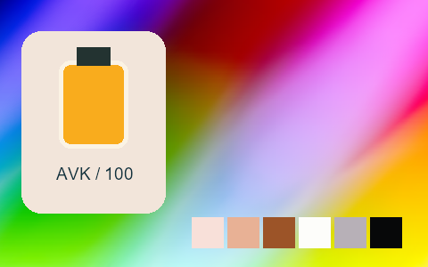

## 260 · 專業拍立得 · Polaroid 690 -｜中性 · 提亮中灰 · 中段拉開

`nt-instant-pro-polaroid-690-curve-minus-1` · `instant-pro` · CC-BY-SA-4.0 · 33³

50% 灰輸出 Y′ 147.1/255（變化 +19.6 碼值）；25%–75% 灰跨度比 1.231。中灰紅減藍 -1.0 碼值。淺/中/深膚色色塊分別輸出 #EEE4DE、#E4B094、#964C2A；紅/綠/藍測試塊分別輸出 #D90219、#41CA0A、#2D33DD。

建議試片：產品、生活與風景對照試片

試用強度：0.35–0.8; default 1.0.

逐項比較膚色與品牌色，強度過高可能改變產品顏色。僅像素顏色映射，不生成顆粒、光暈、暗角、空間霧或美顏；未做自然畫質驗收。

| Input swatch | Input RGB | Actual output RGB |
|---|---|---|
| `gray_0` | `#000000` | `#060705` |
| `gray_10` | `#1A1A1A` | `#111311` |
| `gray_25` | `#404040` | `#343338` |
| `gray_50` | `#808080` | `#979298` |
| `gray_75` | `#BFBFBF` | `#D2CFD9` |
| `gray_90` | `#E6E6E6` | `#E5EBEE` |
| `gray_100` | `#FFFFFF` | `#EFF7F9` |
| `skin_light` | `#F5DBC6` | `#EEE4DE` |
| `skin_medium` | `#CF9B7B` | `#E4B094` |
| `skin_deep` | `#815438` | `#964C2A` |
| `red` | `#CC3333` | `#D90219` |
| `green` | `#33CC33` | `#41CA0A` |
| `blue` | `#3333CC` | `#2D33DD` |

Creator: **Pat David** · [Source](https://github.com/NatronGitHub/clut/blob/af7b50d4caf6244fb6895a647f5b6a84efe7931a/instant_pro/polaroid_690_-.png) · commit `af7b50d4caf6244fb6895a647f5b6a84efe7931a`.

Conversion: `native-depth-Hald-to-33-tetrahedral-v1`; 8,192 sampled RGB points; max error 0.0304557; mean 0.0009525. This is numerical approximation, not a perceptual quality score.

License obligations: Credit the named creator and source; retain the CC-BY-SA-4.0 notice and indicate changes. Redistributed adapted LUT data and thumbnails must use CC-BY-SA-4.0 or a compatible license; no additional restrictions.

[License](../../../product/src/ai_ad_editor/look_data/licenses/CC-BY-SA-4.0.txt) · LUT SHA-256 `a29bc718e48413567cef726b0db65f73f94a56736df87be756f7260893677ba9`.

[Actual preview PNG](../../assets/look500-20261024-r1/previews/nt-instant-pro-polaroid-690-curve-minus-1.png) · [Actual video](../../assets/look500-20261024-r1/videos/nt-instant-pro-polaroid-690-curve-minus-1.mp4)

## 261 · 專業拍立得 · Polaroid 690 Cold｜冷色 · 提亮中灰 · 中段拉開

`nt-instant-pro-polaroid-690-cold` · `instant-pro` · CC-BY-SA-4.0 · 33³

50% 灰輸出 Y′ 150.8/255（變化 +23.3 碼值）；25%–75% 灰跨度比 1.158。中灰紅減藍 -19.0 碼值。淺/中/深膚色色塊分別輸出 #EEDEE4、#E3B3A0、#93543E；紅/綠/藍測試塊分別輸出 #D70230、#2DC927、#173CE9。

建議試片：冷色城市、夜景與科技試片

試用強度：0.35–0.8; default 1.0.

逐項比較膚色與品牌色，強度過高可能改變產品顏色。僅像素顏色映射，不生成顆粒、光暈、暗角、空間霧或美顏；未做自然畫質驗收。

| Input swatch | Input RGB | Actual output RGB |
|---|---|---|
| `gray_0` | `#000000` | `#00221F` |
| `gray_10` | `#1A1A1A` | `#05282B` |
| `gray_25` | `#404040` | `#263E46` |
| `gray_50` | `#808080` | `#9297A4` |
| `gray_75` | `#BFBFBF` | `#D0CAE0` |
| `gray_90` | `#E6E6E6` | `#E6E8F3` |
| `gray_100` | `#FFFFFF` | `#ECFBF4` |
| `skin_light` | `#F5DBC6` | `#EEDEE4` |
| `skin_medium` | `#CF9B7B` | `#E3B3A0` |
| `skin_deep` | `#815438` | `#93543E` |
| `red` | `#CC3333` | `#D70230` |
| `green` | `#33CC33` | `#2DC927` |
| `blue` | `#3333CC` | `#173CE9` |

Creator: **Pat David** · [Source](https://github.com/NatronGitHub/clut/blob/af7b50d4caf6244fb6895a647f5b6a84efe7931a/instant_pro/polaroid_690_cold.png) · commit `af7b50d4caf6244fb6895a647f5b6a84efe7931a`.

Conversion: `native-depth-Hald-to-33-tetrahedral-v1`; 8,192 sampled RGB points; max error 0.0326982; mean 0.0009617. This is numerical approximation, not a perceptual quality score.

License obligations: Credit the named creator and source; retain the CC-BY-SA-4.0 notice and indicate changes. Redistributed adapted LUT data and thumbnails must use CC-BY-SA-4.0 or a compatible license; no additional restrictions.

[License](../../../product/src/ai_ad_editor/look_data/licenses/CC-BY-SA-4.0.txt) · LUT SHA-256 `fcef2e2cec94645aa2af44f36e211126b23d7614899d2e2ace242ecc449bc9f5`.

[Actual preview PNG](../../assets/look500-20261024-r1/previews/nt-instant-pro-polaroid-690-cold.png) · [Actual video](../../assets/look500-20261024-r1/videos/nt-instant-pro-polaroid-690-cold.mp4)

## 262 · 專業拍立得 · Polaroid 690 Cold ++｜冷色 · 提亮中灰 · 中段收窄

`nt-instant-pro-polaroid-690-cold-curve-plus-2` · `instant-pro` · CC-BY-SA-4.0 · 33³

50% 灰輸出 Y′ 144.9/255（變化 +17.4 碼值）；25%–75% 灰跨度比 0.939。中灰紅減藍 -27.5 碼值。淺/中/深膚色色塊分別輸出 #EADFE4、#DDB19F、#856665；紅/綠/藍測試塊分別輸出 #C34760、#49C560、#4459E3。

建議試片：冷色城市、夜景與科技試片

試用強度：0.35–0.8; default 1.0.

逐項比較膚色與品牌色，強度過高可能改變產品顏色。僅像素顏色映射，不生成顆粒、光暈、暗角、空間霧或美顏；未做自然畫質驗收。

| Input swatch | Input RGB | Actual output RGB |
|---|---|---|
| `gray_0` | `#000000` | `#354F5C` |
| `gray_10` | `#1A1A1A` | `#36515F` |
| `gray_25` | `#404040` | `#465A68` |
| `gray_50` | `#808080` | `#8692A2` |
| `gray_75` | `#BFBFBF` | `#CDCDDE` |
| `gray_90` | `#E6E6E6` | `#E3E6F1` |
| `gray_100` | `#FFFFFF` | `#E4F1F2` |
| `skin_light` | `#F5DBC6` | `#EADFE4` |
| `skin_medium` | `#CF9B7B` | `#DDB19F` |
| `skin_deep` | `#815438` | `#856665` |
| `red` | `#CC3333` | `#C34760` |
| `green` | `#33CC33` | `#49C560` |
| `blue` | `#3333CC` | `#4459E3` |

Creator: **Pat David** · [Source](https://github.com/NatronGitHub/clut/blob/af7b50d4caf6244fb6895a647f5b6a84efe7931a/instant_pro/polaroid_690_cold_++.png) · commit `af7b50d4caf6244fb6895a647f5b6a84efe7931a`.

Conversion: `native-depth-Hald-to-33-tetrahedral-v1`; 8,192 sampled RGB points; max error 0.0347343; mean 0.0008029. This is numerical approximation, not a perceptual quality score.

License obligations: Credit the named creator and source; retain the CC-BY-SA-4.0 notice and indicate changes. Redistributed adapted LUT data and thumbnails must use CC-BY-SA-4.0 or a compatible license; no additional restrictions.

[License](../../../product/src/ai_ad_editor/look_data/licenses/CC-BY-SA-4.0.txt) · LUT SHA-256 `220daa30b838c811b81171033f959e3c6b544a31f4e380641451a25178606923`.

[Actual preview PNG](../../assets/look500-20261024-r1/previews/nt-instant-pro-polaroid-690-cold-curve-plus-2.png) · [Actual video](../../assets/look500-20261024-r1/videos/nt-instant-pro-polaroid-690-cold-curve-plus-2.mp4)

## 263 · 專業拍立得 · Polaroid 690 Cold +｜冷色 · 提亮中灰 · 中段拉開

`nt-instant-pro-polaroid-690-cold-curve-plus-1` · `instant-pro` · CC-BY-SA-4.0 · 33³

50% 灰輸出 Y′ 149.4/255（變化 +21.9 碼值）；25%–75% 灰跨度比 1.159。中灰紅減藍 -26.5 碼值。淺/中/深膚色色塊分別輸出 #E9D8E0、#DEB2A1、#8A5744；紅/綠/藍測試塊分別輸出 #D00738、#1AC83C、#0843E5。

建議試片：冷色城市、夜景與科技試片

試用強度：0.35–0.8; default 1.0.

逐項比較膚色與品牌色，強度過高可能改變產品顏色。僅像素顏色映射，不生成顆粒、光暈、暗角、空間霧或美顏；未做自然畫質驗收。

| Input swatch | Input RGB | Actual output RGB |
|---|---|---|
| `gray_0` | `#000000` | `#013636` |
| `gray_10` | `#1A1A1A` | `#013637` |
| `gray_25` | `#404040` | `#19434A` |
| `gray_50` | `#808080` | `#8B97A5` |
| `gray_75` | `#BFBFBF` | `#CFCDE1` |
| `gray_90` | `#E6E6E6` | `#E3E5F0` |
| `gray_100` | `#FFFFFF` | `#E4F2F2` |
| `skin_light` | `#F5DBC6` | `#E9D8E0` |
| `skin_medium` | `#CF9B7B` | `#DEB2A1` |
| `skin_deep` | `#815438` | `#8A5744` |
| `red` | `#CC3333` | `#D00738` |
| `green` | `#33CC33` | `#1AC83C` |
| `blue` | `#3333CC` | `#0843E5` |

Creator: **Pat David** · [Source](https://github.com/NatronGitHub/clut/blob/af7b50d4caf6244fb6895a647f5b6a84efe7931a/instant_pro/polaroid_690_cold_+.png) · commit `af7b50d4caf6244fb6895a647f5b6a84efe7931a`.

Conversion: `native-depth-Hald-to-33-tetrahedral-v1`; 8,192 sampled RGB points; max error 0.0398838; mean 0.0009613. This is numerical approximation, not a perceptual quality score.

License obligations: Credit the named creator and source; retain the CC-BY-SA-4.0 notice and indicate changes. Redistributed adapted LUT data and thumbnails must use CC-BY-SA-4.0 or a compatible license; no additional restrictions.

[License](../../../product/src/ai_ad_editor/look_data/licenses/CC-BY-SA-4.0.txt) · LUT SHA-256 `b99b89c131e30389ee7fc790d2de8aa2301a0dfab4d7720a0ddc1519b28ff08f`.

[Actual preview PNG](../../assets/look500-20261024-r1/previews/nt-instant-pro-polaroid-690-cold-curve-plus-1.png) · [Actual video](../../assets/look500-20261024-r1/videos/nt-instant-pro-polaroid-690-cold-curve-plus-1.mp4)

## 264 · 專業拍立得 · Polaroid 690 Cold --｜冷色 · 提亮中灰 · 中段跨度接近原值

`nt-instant-pro-polaroid-690-cold-curve-minus-2` · `instant-pro` · CC-BY-SA-4.0 · 33³

50% 灰輸出 Y′ 151.0/255（變化 +23.5 碼值）；25%–75% 灰跨度比 1.043。中灰紅減藍 -23.0 碼值。淺/中/深膚色色塊分別輸出 #F5DFE5、#DEB29E、#995C49；紅/綠/藍測試塊分別輸出 #D5062E、#45C944、#404DE8。

建議試片：冷色城市、夜景與科技試片

試用強度：0.35–0.8; default 1.0.

逐項比較膚色與品牌色，強度過高可能改變產品顏色。僅像素顏色映射，不生成顆粒、光暈、暗角、空間霧或美顏；未做自然畫質驗收。

| Input swatch | Input RGB | Actual output RGB |
|---|---|---|
| `gray_0` | `#000000` | `#000201` |
| `gray_10` | `#1A1A1A` | `#021C18` |
| `gray_25` | `#404040` | `#3E4C54` |
| `gray_50` | `#808080` | `#8E98A5` |
| `gray_75` | `#BFBFBF` | `#CDCCE2` |
| `gray_90` | `#E6E6E6` | `#ECE8F5` |
| `gray_100` | `#FFFFFF` | `#FCFCFC` |
| `skin_light` | `#F5DBC6` | `#F5DFE5` |
| `skin_medium` | `#CF9B7B` | `#DEB29E` |
| `skin_deep` | `#815438` | `#995C49` |
| `red` | `#CC3333` | `#D5062E` |
| `green` | `#33CC33` | `#45C944` |
| `blue` | `#3333CC` | `#404DE8` |

Creator: **Pat David** · [Source](https://github.com/NatronGitHub/clut/blob/af7b50d4caf6244fb6895a647f5b6a84efe7931a/instant_pro/polaroid_690_cold_--.png) · commit `af7b50d4caf6244fb6895a647f5b6a84efe7931a`.

Conversion: `native-depth-Hald-to-33-tetrahedral-v1`; 8,192 sampled RGB points; max error 0.0486439; mean 0.0008948. This is numerical approximation, not a perceptual quality score.

License obligations: Credit the named creator and source; retain the CC-BY-SA-4.0 notice and indicate changes. Redistributed adapted LUT data and thumbnails must use CC-BY-SA-4.0 or a compatible license; no additional restrictions.

[License](../../../product/src/ai_ad_editor/look_data/licenses/CC-BY-SA-4.0.txt) · LUT SHA-256 `b811ae82c58601f75043e70fc6e55c1c5d8623b82f308389b6bbeee98f651947`.

[Actual preview PNG](../../assets/look500-20261024-r1/previews/nt-instant-pro-polaroid-690-cold-curve-minus-2.png) · [Actual video](../../assets/look500-20261024-r1/videos/nt-instant-pro-polaroid-690-cold-curve-minus-2.mp4)

## 265 · 專業拍立得 · Polaroid 690 Cold -｜冷色 · 提亮中灰 · 中段拉開

`nt-instant-pro-polaroid-690-cold-curve-minus-1` · `instant-pro` · CC-BY-SA-4.0 · 33³

50% 灰輸出 Y′ 146.7/255（變化 +19.2 碼值）；25%–75% 灰跨度比 1.097。中灰紅減藍 -20.0 碼值。淺/中/深膚色色塊分別輸出 #F2DDE3、#DCB09D、#945948；紅/綠/藍測試塊分別輸出 #D30232、#3DC53F、#2D46E6。

建議試片：冷色城市、夜景與科技試片

試用強度：0.35–0.8; default 1.0.

逐項比較膚色與品牌色，強度過高可能改變產品顏色。僅像素顏色映射，不生成顆粒、光暈、暗角、空間霧或美顏；未做自然畫質驗收。

| Input swatch | Input RGB | Actual output RGB |
|---|---|---|
| `gray_0` | `#000000` | `#001412` |
| `gray_10` | `#1A1A1A` | `#02231F` |
| `gray_25` | `#404040` | `#33454D` |
| `gray_50` | `#808080` | `#8E92A2` |
| `gray_75` | `#BFBFBF` | `#CECBE0` |
| `gray_90` | `#E6E6E6` | `#E9E7F3` |
| `gray_100` | `#FFFFFF` | `#FBFEFB` |
| `skin_light` | `#F5DBC6` | `#F2DDE3` |
| `skin_medium` | `#CF9B7B` | `#DCB09D` |
| `skin_deep` | `#815438` | `#945948` |
| `red` | `#CC3333` | `#D30232` |
| `green` | `#33CC33` | `#3DC53F` |
| `blue` | `#3333CC` | `#2D46E6` |

Creator: **Pat David** · [Source](https://github.com/NatronGitHub/clut/blob/af7b50d4caf6244fb6895a647f5b6a84efe7931a/instant_pro/polaroid_690_cold_-.png) · commit `af7b50d4caf6244fb6895a647f5b6a84efe7931a`.

Conversion: `native-depth-Hald-to-33-tetrahedral-v1`; 8,192 sampled RGB points; max error 0.0362839; mean 0.0008827. This is numerical approximation, not a perceptual quality score.

License obligations: Credit the named creator and source; retain the CC-BY-SA-4.0 notice and indicate changes. Redistributed adapted LUT data and thumbnails must use CC-BY-SA-4.0 or a compatible license; no additional restrictions.

[License](../../../product/src/ai_ad_editor/look_data/licenses/CC-BY-SA-4.0.txt) · LUT SHA-256 `5772001ced0f8cd6434bb5d30e61bef178678f58394ea434405841c4811bd56d`.

[Actual preview PNG](../../assets/look500-20261024-r1/previews/nt-instant-pro-polaroid-690-cold-curve-minus-1.png) · [Actual video](../../assets/look500-20261024-r1/videos/nt-instant-pro-polaroid-690-cold-curve-minus-1.mp4)

## 266 · 專業拍立得 · Polaroid 690 Warm｜暖色 · 提亮中灰 · 中段拉開

`nt-instant-pro-polaroid-690-warm` · `instant-pro` · CC-BY-SA-4.0 · 33³

50% 灰輸出 Y′ 149.5/255（變化 +22.0 碼值）；25%–75% 灰跨度比 1.214。中灰紅減藍 +10.5 碼值。淺/中/深膚色色塊分別輸出 #FAE4DC、#F0B291、#9D532A；紅/綠/藍測試塊分別輸出 #DF011A、#52CA00、#503AE1。

建議試片：暖色生活、餐飲與懷舊試片

試用強度：0.35–0.8; default 1.0.

逐項比較膚色與品牌色，強度過高可能改變產品顏色。僅像素顏色映射，不生成顆粒、光暈、暗角、空間霧或美顏；未做自然畫質驗收。

| Input swatch | Input RGB | Actual output RGB |
|---|---|---|
| `gray_0` | `#000000` | `#26110D` |
| `gray_10` | `#1A1A1A` | `#2A1C17` |
| `gray_25` | `#404040` | `#493835` |
| `gray_50` | `#808080` | `#9E9394` |
| `gray_75` | `#BFBFBF` | `#DFD4DA` |
| `gray_90` | `#E6E6E6` | `#F5EAEE` |
| `gray_100` | `#FFFFFF` | `#FFF5F9` |
| `skin_light` | `#F5DBC6` | `#FAE4DC` |
| `skin_medium` | `#CF9B7B` | `#F0B291` |
| `skin_deep` | `#815438` | `#9D532A` |
| `red` | `#CC3333` | `#DF011A` |
| `green` | `#33CC33` | `#52CA00` |
| `blue` | `#3333CC` | `#503AE1` |

Creator: **Pat David** · [Source](https://github.com/NatronGitHub/clut/blob/af7b50d4caf6244fb6895a647f5b6a84efe7931a/instant_pro/polaroid_690_warm.png) · commit `af7b50d4caf6244fb6895a647f5b6a84efe7931a`.

Conversion: `native-depth-Hald-to-33-tetrahedral-v1`; 8,192 sampled RGB points; max error 0.0443709; mean 0.0009120. This is numerical approximation, not a perceptual quality score.

License obligations: Credit the named creator and source; retain the CC-BY-SA-4.0 notice and indicate changes. Redistributed adapted LUT data and thumbnails must use CC-BY-SA-4.0 or a compatible license; no additional restrictions.

[License](../../../product/src/ai_ad_editor/look_data/licenses/CC-BY-SA-4.0.txt) · LUT SHA-256 `f9189553af8711d71f1a46233bf7f6be3fe8b323f062417d2987e74f6f6562cc`.

[Actual preview PNG](../../assets/look500-20261024-r1/previews/nt-instant-pro-polaroid-690-warm.png) · [Actual video](../../assets/look500-20261024-r1/videos/nt-instant-pro-polaroid-690-warm.mp4)

## 267 · 專業拍立得 · Polaroid 690 Warm ++｜暖色 · 提亮中灰 · 中段跨度接近原值

`nt-instant-pro-polaroid-690-warm-curve-plus-2` · `instant-pro` · CC-BY-SA-4.0 · 33³

50% 灰輸出 Y′ 148.6/255（變化 +21.1 碼值）；25%–75% 灰跨度比 1.004。中灰紅減藍 +28.0 碼值。淺/中/深膚色色塊分別輸出 #FCE6DA、#F5B28D、#A06144；紅/綠/藍測試塊分別輸出 #D93C3D、#78C831、#7450D9。

建議試片：暖色生活、餐飲與懷舊試片

試用強度：0.35–0.8; default 1.0.

逐項比較膚色與品牌色，強度過高可能改變產品顏色。僅像素顏色映射，不生成顆粒、光暈、暗角、空間霧或美顏；未做自然畫質驗收。

| Input swatch | Input RGB | Actual output RGB |
|---|---|---|
| `gray_0` | `#000000` | `#61493C` |
| `gray_10` | `#1A1A1A` | `#634B3D` |
| `gray_25` | `#404040` | `#6E544A` |
| `gray_50` | `#808080` | `#A8908C` |
| `gray_75` | `#BFBFBF` | `#E3D6D5` |
| `gray_90` | `#E6E6E6` | `#F7EBEB` |
| `gray_100` | `#FFFFFF` | `#FEF3F6` |
| `skin_light` | `#F5DBC6` | `#FCE6DA` |
| `skin_medium` | `#CF9B7B` | `#F5B28D` |
| `skin_deep` | `#815438` | `#A06144` |
| `red` | `#CC3333` | `#D93C3D` |
| `green` | `#33CC33` | `#78C831` |
| `blue` | `#3333CC` | `#7450D9` |

Creator: **Pat David** · [Source](https://github.com/NatronGitHub/clut/blob/af7b50d4caf6244fb6895a647f5b6a84efe7931a/instant_pro/polaroid_690_warm_++.png) · commit `af7b50d4caf6244fb6895a647f5b6a84efe7931a`.

Conversion: `native-depth-Hald-to-33-tetrahedral-v1`; 8,192 sampled RGB points; max error 0.0154211; mean 0.0008006. This is numerical approximation, not a perceptual quality score.

License obligations: Credit the named creator and source; retain the CC-BY-SA-4.0 notice and indicate changes. Redistributed adapted LUT data and thumbnails must use CC-BY-SA-4.0 or a compatible license; no additional restrictions.

[License](../../../product/src/ai_ad_editor/look_data/licenses/CC-BY-SA-4.0.txt) · LUT SHA-256 `e19eca4e8fbff88a0d3d939576211602b6742f09c38d3293d669115f2a4ec2c8`.

[Actual preview PNG](../../assets/look500-20261024-r1/previews/nt-instant-pro-polaroid-690-warm-curve-plus-2.png) · [Actual video](../../assets/look500-20261024-r1/videos/nt-instant-pro-polaroid-690-warm-curve-plus-2.mp4)

## 268 · 專業拍立得 · Polaroid 690 Warm +｜暖色 · 提亮中灰 · 中段拉開

`nt-instant-pro-polaroid-690-warm-curve-plus-1` · `instant-pro` · CC-BY-SA-4.0 · 33³

50% 灰輸出 Y′ 148.5/255（變化 +21.0 碼值）；25%–75% 灰跨度比 1.197。中灰紅減藍 +17.0 碼值。淺/中/深膚色色塊分別輸出 #FBE5DB、#F0B395、#9E4F29；紅/綠/藍測試塊分別輸出 #DF001D、#5ECB04、#5736DB。

建議試片：暖色生活、餐飲與懷舊試片

試用強度：0.35–0.8; default 1.0.

逐項比較膚色與品牌色，強度過高可能改變產品顏色。僅像素顏色映射，不生成顆粒、光暈、暗角、空間霧或美顏；未做自然畫質驗收。

| Input swatch | Input RGB | Actual output RGB |
|---|---|---|
| `gray_0` | `#000000` | `#38261D` |
| `gray_10` | `#1A1A1A` | `#3A281F` |
| `gray_25` | `#404040` | `#4F3932` |
| `gray_50` | `#808080` | `#A49093` |
| `gray_75` | `#BFBFBF` | `#E0D3D5` |
| `gray_90` | `#E6E6E6` | `#F7EBEB` |
| `gray_100` | `#FFFFFF` | `#FCF3F6` |
| `skin_light` | `#F5DBC6` | `#FBE5DB` |
| `skin_medium` | `#CF9B7B` | `#F0B395` |
| `skin_deep` | `#815438` | `#9E4F29` |
| `red` | `#CC3333` | `#DF001D` |
| `green` | `#33CC33` | `#5ECB04` |
| `blue` | `#3333CC` | `#5736DB` |

Creator: **Pat David** · [Source](https://github.com/NatronGitHub/clut/blob/af7b50d4caf6244fb6895a647f5b6a84efe7931a/instant_pro/polaroid_690_warm_+.png) · commit `af7b50d4caf6244fb6895a647f5b6a84efe7931a`.

Conversion: `native-depth-Hald-to-33-tetrahedral-v1`; 8,192 sampled RGB points; max error 0.0302781; mean 0.0009120. This is numerical approximation, not a perceptual quality score.

License obligations: Credit the named creator and source; retain the CC-BY-SA-4.0 notice and indicate changes. Redistributed adapted LUT data and thumbnails must use CC-BY-SA-4.0 or a compatible license; no additional restrictions.

[License](../../../product/src/ai_ad_editor/look_data/licenses/CC-BY-SA-4.0.txt) · LUT SHA-256 `fc670b58c38dd36118d148df9a27d550a38612d4c912da52ce8abb5073942a82`.

[Actual preview PNG](../../assets/look500-20261024-r1/previews/nt-instant-pro-polaroid-690-warm-curve-plus-1.png) · [Actual video](../../assets/look500-20261024-r1/videos/nt-instant-pro-polaroid-690-warm-curve-plus-1.mp4)

## 269 · 專業拍立得 · Polaroid 690 Warm --｜暖色 · 提亮中灰 · 中段跨度接近原值

`nt-instant-pro-polaroid-690-warm-curve-minus-2` · `instant-pro` · CC-BY-SA-4.0 · 33³

50% 灰輸出 Y′ 151.1/255（變化 +23.6 碼值）；25%–75% 灰跨度比 1.043。中灰紅減藍 +14.0 碼值。淺/中/深膚色色塊分別輸出 #FBE3D9、#EAA78B、#AB5D34；紅/綠/藍測試塊分別輸出 #E10117、#5AC612、#5D48DD。

建議試片：暖色生活、餐飲與懷舊試片

試用強度：0.35–0.8; default 1.0.

逐項比較膚色與品牌色，強度過高可能改變產品顏色。僅像素顏色映射，不生成顆粒、光暈、暗角、空間霧或美顏；未做自然畫質驗收。

| Input swatch | Input RGB | Actual output RGB |
|---|---|---|
| `gray_0` | `#000000` | `#000000` |
| `gray_10` | `#1A1A1A` | `#1A130E` |
| `gray_25` | `#404040` | `#564546` |
| `gray_50` | `#808080` | `#A59397` |
| `gray_75` | `#BFBFBF` | `#DACAD3` |
| `gray_90` | `#E6E6E6` | `#F2E9EE` |
| `gray_100` | `#FFFFFF` | `#FEFDFD` |
| `skin_light` | `#F5DBC6` | `#FBE3D9` |
| `skin_medium` | `#CF9B7B` | `#EAA78B` |
| `skin_deep` | `#815438` | `#AB5D34` |
| `red` | `#CC3333` | `#E10117` |
| `green` | `#33CC33` | `#5AC612` |
| `blue` | `#3333CC` | `#5D48DD` |

Creator: **Pat David** · [Source](https://github.com/NatronGitHub/clut/blob/af7b50d4caf6244fb6895a647f5b6a84efe7931a/instant_pro/polaroid_690_warm_--.png) · commit `af7b50d4caf6244fb6895a647f5b6a84efe7931a`.

Conversion: `native-depth-Hald-to-33-tetrahedral-v1`; 8,192 sampled RGB points; max error 0.0195439; mean 0.0008716. This is numerical approximation, not a perceptual quality score.

License obligations: Credit the named creator and source; retain the CC-BY-SA-4.0 notice and indicate changes. Redistributed adapted LUT data and thumbnails must use CC-BY-SA-4.0 or a compatible license; no additional restrictions.

[License](../../../product/src/ai_ad_editor/look_data/licenses/CC-BY-SA-4.0.txt) · LUT SHA-256 `69fee33c6ce84dca1e06c194b42863513c753824c94baf1546ed075618a73517`.

[Actual preview PNG](../../assets/look500-20261024-r1/previews/nt-instant-pro-polaroid-690-warm-curve-minus-2.png) · [Actual video](../../assets/look500-20261024-r1/videos/nt-instant-pro-polaroid-690-warm-curve-minus-2.mp4)

## 270 · 專業拍立得 · Polaroid 690 Warm -｜暖色 · 提亮中灰 · 中段拉開

`nt-instant-pro-polaroid-690-warm-curve-minus-1` · `instant-pro` · CC-BY-SA-4.0 · 33³

50% 灰輸出 Y′ 145.8/255（變化 +18.3 碼值）；25%–75% 灰跨度比 1.185。中灰紅減藍 +11.5 碼值。淺/中/深膚色色塊分別輸出 #FBE5DE、#EFB091、#9E562D；紅/綠/藍測試塊分別輸出 #DB0119、#5AC809、#503DDC。

建議試片：暖色生活、餐飲與懷舊試片

試用強度：0.35–0.8; default 1.0.

逐項比較膚色與品牌色，強度過高可能改變產品顏色。僅像素顏色映射，不生成顆粒、光暈、暗角、空間霧或美顏；未做自然畫質驗收。

| Input swatch | Input RGB | Actual output RGB |
|---|---|---|
| `gray_0` | `#000000` | `#0F0603` |
| `gray_10` | `#1A1A1A` | `#23150F` |
| `gray_25` | `#404040` | `#4C3B36` |
| `gray_50` | `#808080` | `#9D8E92` |
| `gray_75` | `#BFBFBF` | `#DED2D9` |
| `gray_90` | `#E6E6E6` | `#F5EAED` |
| `gray_100` | `#FFFFFF` | `#FEF5F8` |
| `skin_light` | `#F5DBC6` | `#FBE5DE` |
| `skin_medium` | `#CF9B7B` | `#EFB091` |
| `skin_deep` | `#815438` | `#9E562D` |
| `red` | `#CC3333` | `#DB0119` |
| `green` | `#33CC33` | `#5AC809` |
| `blue` | `#3333CC` | `#503DDC` |

Creator: **Pat David** · [Source](https://github.com/NatronGitHub/clut/blob/af7b50d4caf6244fb6895a647f5b6a84efe7931a/instant_pro/polaroid_690_warm_-.png) · commit `af7b50d4caf6244fb6895a647f5b6a84efe7931a`.

Conversion: `native-depth-Hald-to-33-tetrahedral-v1`; 8,192 sampled RGB points; max error 0.0245897; mean 0.0008737. This is numerical approximation, not a perceptual quality score.

License obligations: Credit the named creator and source; retain the CC-BY-SA-4.0 notice and indicate changes. Redistributed adapted LUT data and thumbnails must use CC-BY-SA-4.0 or a compatible license; no additional restrictions.

[License](../../../product/src/ai_ad_editor/look_data/licenses/CC-BY-SA-4.0.txt) · LUT SHA-256 `5407d5348591fecc4b0cd95a0d63dc87a8254bdcfc25e88b624df3c29b0d1b4c`.

[Actual preview PNG](../../assets/look500-20261024-r1/previews/nt-instant-pro-polaroid-690-warm-curve-minus-1.png) · [Actual video](../../assets/look500-20261024-r1/videos/nt-instant-pro-polaroid-690-warm-curve-minus-1.mp4)

## 271 · 彩色負片 · Agfa Ultra Color 100｜中性 · 壓暗中灰 · 中段拉開

`nt-negative-color-agfa-ultra-color-100` · `film-negative` · CC-BY-SA-4.0 · 33³

50% 灰輸出 Y′ 113.4/255（變化 -14.1 碼值）；25%–75% 灰跨度比 1.191。中灰紅減藍 +0.0 碼值。淺/中/深膚色色塊分別輸出 #F3D2C9、#D58777、#6F2E22；紅/綠/藍測試塊分別輸出 #B40012、#7BEE18、#0206AB。

建議試片：產品、生活與風景對照試片

試用強度：0.35–0.8; default 1.0.

逐項比較膚色與品牌色，強度過高可能改變產品顏色。僅像素顏色映射，不生成顆粒、光暈、暗角、空間霧或美顏；未做自然畫質驗收。

| Input swatch | Input RGB | Actual output RGB |
|---|---|---|
| `gray_0` | `#000000` | `#000000` |
| `gray_10` | `#1A1A1A` | `#100F0F` |
| `gray_25` | `#404040` | `#282727` |
| `gray_50` | `#808080` | `#727172` |
| `gray_75` | `#BFBFBF` | `#C0BFBF` |
| `gray_90` | `#E6E6E6` | `#E3E0E2` |
| `gray_100` | `#FFFFFF` | `#FAFAEE` |
| `skin_light` | `#F5DBC6` | `#F3D2C9` |
| `skin_medium` | `#CF9B7B` | `#D58777` |
| `skin_deep` | `#815438` | `#6F2E22` |
| `red` | `#CC3333` | `#B40012` |
| `green` | `#33CC33` | `#7BEE18` |
| `blue` | `#3333CC` | `#0206AB` |

Creator: **Pat David** · [Source](https://github.com/NatronGitHub/clut/blob/af7b50d4caf6244fb6895a647f5b6a84efe7931a/negative_color/agfa_ultra_color_100.png) · commit `af7b50d4caf6244fb6895a647f5b6a84efe7931a`.

Conversion: `native-depth-Hald-to-33-tetrahedral-v1`; 8,192 sampled RGB points; max error 0.0212431; mean 0.0007783. This is numerical approximation, not a perceptual quality score.

License obligations: Credit the named creator and source; retain the CC-BY-SA-4.0 notice and indicate changes. Redistributed adapted LUT data and thumbnails must use CC-BY-SA-4.0 or a compatible license; no additional restrictions.

[License](../../../product/src/ai_ad_editor/look_data/licenses/CC-BY-SA-4.0.txt) · LUT SHA-256 `a69d4ce23c2343240dacc5cab4bb4dd1fa10f8e249f556596f907276d827ab74`.

[Actual preview PNG](../../assets/look500-20261024-r1/previews/nt-negative-color-agfa-ultra-color-100.png) · [Actual video](../../assets/look500-20261024-r1/videos/nt-negative-color-agfa-ultra-color-100.mp4)

## 272 · 彩色負片 · Agfa Vista 200｜中性 · 中灰近原值 · 中段拉開

`nt-negative-color-agfa-vista-200` · `film-negative` · CC-BY-SA-4.0 · 33³

50% 灰輸出 Y′ 128.1/255（變化 +0.6 碼值）；25%–75% 灰跨度比 1.219。中灰紅減藍 +1.0 碼值。淺/中/深膚色色塊分別輸出 #F6DCCF、#DCA081、#884021；紅/綠/藍測試塊分別輸出 #D20704、#72DB59、#0104AC。

建議試片：產品、生活與風景對照試片

試用強度：0.35–0.8; default 1.0.

逐項比較膚色與品牌色，強度過高可能改變產品顏色。僅像素顏色映射，不生成顆粒、光暈、暗角、空間霧或美顏；未做自然畫質驗收。

| Input swatch | Input RGB | Actual output RGB |
|---|---|---|
| `gray_0` | `#000000` | `#080101` |
| `gray_10` | `#1A1A1A` | `#0E0C0C` |
| `gray_25` | `#404040` | `#282A2A` |
| `gray_50` | `#808080` | `#837F82` |
| `gray_75` | `#BFBFBF` | `#C8C4C6` |
| `gray_90` | `#E6E6E6` | `#E8E6E7` |
| `gray_100` | `#FFFFFF` | `#FCFDFC` |
| `skin_light` | `#F5DBC6` | `#F6DCCF` |
| `skin_medium` | `#CF9B7B` | `#DCA081` |
| `skin_deep` | `#815438` | `#884021` |
| `red` | `#CC3333` | `#D20704` |
| `green` | `#33CC33` | `#72DB59` |
| `blue` | `#3333CC` | `#0104AC` |

Creator: **Pat David** · [Source](https://github.com/NatronGitHub/clut/blob/af7b50d4caf6244fb6895a647f5b6a84efe7931a/negative_color/agfa_vista_200.png) · commit `af7b50d4caf6244fb6895a647f5b6a84efe7931a`.

Conversion: `native-depth-Hald-to-33-tetrahedral-v1`; 8,192 sampled RGB points; max error 0.0241557; mean 0.0007545. This is numerical approximation, not a perceptual quality score.

License obligations: Credit the named creator and source; retain the CC-BY-SA-4.0 notice and indicate changes. Redistributed adapted LUT data and thumbnails must use CC-BY-SA-4.0 or a compatible license; no additional restrictions.

[License](../../../product/src/ai_ad_editor/look_data/licenses/CC-BY-SA-4.0.txt) · LUT SHA-256 `32bd5d0a0f512fc4e4f1edd18cc4045d6db33f53aaf4864d6971c5abcc6fc478`.

[Actual preview PNG](../../assets/look500-20261024-r1/previews/nt-negative-color-agfa-vista-200.png) · [Actual video](../../assets/look500-20261024-r1/videos/nt-negative-color-agfa-vista-200.mp4)

## 273 · 彩色負片 · Fuji Superia 200｜中性 · 提亮中灰 · 中段跨度接近原值

`nt-negative-color-fuji-superia-200` · `film-negative` · CC-BY-SA-4.0 · 33³

50% 灰輸出 Y′ 144.8/255（變化 +17.3 碼值）；25%–75% 灰跨度比 1.038。中灰紅減藍 +2.5 碼值。淺/中/深膚色色塊分別輸出 #ECD3C6、#D2A087、#8E4A29；紅/綠/藍測試塊分別輸出 #B50506、#98DE2C、#3721B3。

建議試片：產品、生活與風景對照試片

試用強度：0.35–0.8; default 1.0.

逐項比較膚色與品牌色，強度過高可能改變產品顏色。僅像素顏色映射，不生成顆粒、光暈、暗角、空間霧或美顏；未做自然畫質驗收。

| Input swatch | Input RGB | Actual output RGB |
|---|---|---|
| `gray_0` | `#000000` | `#040206` |
| `gray_10` | `#1A1A1A` | `#171515` |
| `gray_25` | `#404040` | `#424141` |
| `gray_50` | `#808080` | `#939091` |
| `gray_75` | `#BFBFBF` | `#C7C5C6` |
| `gray_90` | `#E6E6E6` | `#E1E2DF` |
| `gray_100` | `#FFFFFF` | `#FBFAFA` |
| `skin_light` | `#F5DBC6` | `#ECD3C6` |
| `skin_medium` | `#CF9B7B` | `#D2A087` |
| `skin_deep` | `#815438` | `#8E4A29` |
| `red` | `#CC3333` | `#B50506` |
| `green` | `#33CC33` | `#98DE2C` |
| `blue` | `#3333CC` | `#3721B3` |

Creator: **Pat David** · [Source](https://github.com/NatronGitHub/clut/blob/af7b50d4caf6244fb6895a647f5b6a84efe7931a/negative_color/fuji_superia_200.png) · commit `af7b50d4caf6244fb6895a647f5b6a84efe7931a`.

Conversion: `native-depth-Hald-to-33-tetrahedral-v1`; 8,192 sampled RGB points; max error 0.0230500; mean 0.0007673. This is numerical approximation, not a perceptual quality score.

License obligations: Credit the named creator and source; retain the CC-BY-SA-4.0 notice and indicate changes. Redistributed adapted LUT data and thumbnails must use CC-BY-SA-4.0 or a compatible license; no additional restrictions.

[License](../../../product/src/ai_ad_editor/look_data/licenses/CC-BY-SA-4.0.txt) · LUT SHA-256 `a4800290098514b17129a029e48fe97cd4f3e95bb90ecd1fade7351d29c68d3b`.

[Actual preview PNG](../../assets/look500-20261024-r1/previews/nt-negative-color-fuji-superia-200.png) · [Actual video](../../assets/look500-20261024-r1/videos/nt-negative-color-fuji-superia-200.mp4)

## 274 · 彩色負片 · Fuji Superia Hg 1600｜中性 · 中灰近原值 · 中段收窄

`nt-negative-color-fuji-superia-hg-1600` · `film-negative` · CC-BY-SA-4.0 · 33³

50% 灰輸出 Y′ 127.1/255（變化 -0.4 碼值）；25%–75% 灰跨度比 0.903。中灰紅減藍 +1.5 碼值。淺/中/深膚色色塊分別輸出 #E5D1C4、#C69286、#835649；紅/綠/藍測試塊分別輸出 #B11737、#77BD77、#1C4696。

建議試片：產品、生活與風景對照試片

試用強度：0.35–0.8; default 1.0.

逐項比較膚色與品牌色，強度過高可能改變產品顏色。僅像素顏色映射，不生成顆粒、光暈、暗角、空間霧或美顏；未做自然畫質驗收。

| Input swatch | Input RGB | Actual output RGB |
|---|---|---|
| `gray_0` | `#000000` | `#070713` |
| `gray_10` | `#1A1A1A` | `#292425` |
| `gray_25` | `#404040` | `#454445` |
| `gray_50` | `#808080` | `#817E80` |
| `gray_75` | `#BFBFBF` | `#B7B8B9` |
| `gray_90` | `#E6E6E6` | `#DBDCD9` |
| `gray_100` | `#FFFFFF` | `#F9F6EB` |
| `skin_light` | `#F5DBC6` | `#E5D1C4` |
| `skin_medium` | `#CF9B7B` | `#C69286` |
| `skin_deep` | `#815438` | `#835649` |
| `red` | `#CC3333` | `#B11737` |
| `green` | `#33CC33` | `#77BD77` |
| `blue` | `#3333CC` | `#1C4696` |

Creator: **Pat David** · [Source](https://github.com/NatronGitHub/clut/blob/af7b50d4caf6244fb6895a647f5b6a84efe7931a/negative_color/fuji_superia_hg_1600.png) · commit `af7b50d4caf6244fb6895a647f5b6a84efe7931a`.

Conversion: `native-depth-Hald-to-33-tetrahedral-v1`; 8,192 sampled RGB points; max error 0.0134843; mean 0.0006514. This is numerical approximation, not a perceptual quality score.

License obligations: Credit the named creator and source; retain the CC-BY-SA-4.0 notice and indicate changes. Redistributed adapted LUT data and thumbnails must use CC-BY-SA-4.0 or a compatible license; no additional restrictions.

[License](../../../product/src/ai_ad_editor/look_data/licenses/CC-BY-SA-4.0.txt) · LUT SHA-256 `5b7ab5c1d2a1fe94ea70fa6736c9b6e465291f8ae194d63d5927c3e41a361f42`.

[Actual preview PNG](../../assets/look500-20261024-r1/previews/nt-negative-color-fuji-superia-hg-1600.png) · [Actual video](../../assets/look500-20261024-r1/videos/nt-negative-color-fuji-superia-hg-1600.mp4)

## 275 · 彩色負片 · Fuji Superia Reala 100｜中性 · 提亮中灰 · 中段跨度接近原值

`nt-negative-color-fuji-superia-reala-100` · `film-negative` · CC-BY-SA-4.0 · 33³

50% 灰輸出 Y′ 135.3/255（變化 +7.8 碼值）；25%–75% 灰跨度比 0.957。中灰紅減藍 +0.0 碼值。淺/中/深膚色色塊分別輸出 #EFD1C5、#D59985、#8F5441；紅/綠/藍測試塊分別輸出 #D11230、#79CD0E、#4F33A2。

建議試片：產品、生活與風景對照試片

試用強度：0.35–0.8; default 1.0.

逐項比較膚色與品牌色，強度過高可能改變產品顏色。僅像素顏色映射，不生成顆粒、光暈、暗角、空間霧或美顏；未做自然畫質驗收。

| Input swatch | Input RGB | Actual output RGB |
|---|---|---|
| `gray_0` | `#000000` | `#07050D` |
| `gray_10` | `#1A1A1A` | `#211E20` |
| `gray_25` | `#404040` | `#464546` |
| `gray_50` | `#808080` | `#888788` |
| `gray_75` | `#BFBFBF` | `#C0BFBF` |
| `gray_90` | `#E6E6E6` | `#DFDCDA` |
| `gray_100` | `#FFFFFF` | `#F3F9F9` |
| `skin_light` | `#F5DBC6` | `#EFD1C5` |
| `skin_medium` | `#CF9B7B` | `#D59985` |
| `skin_deep` | `#815438` | `#8F5441` |
| `red` | `#CC3333` | `#D11230` |
| `green` | `#33CC33` | `#79CD0E` |
| `blue` | `#3333CC` | `#4F33A2` |

Creator: **Pat David** · [Source](https://github.com/NatronGitHub/clut/blob/af7b50d4caf6244fb6895a647f5b6a84efe7931a/negative_color/fuji_superia_reala_100.png) · commit `af7b50d4caf6244fb6895a647f5b6a84efe7931a`.

Conversion: `native-depth-Hald-to-33-tetrahedral-v1`; 8,192 sampled RGB points; max error 0.0297674; mean 0.0007665. This is numerical approximation, not a perceptual quality score.

License obligations: Credit the named creator and source; retain the CC-BY-SA-4.0 notice and indicate changes. Redistributed adapted LUT data and thumbnails must use CC-BY-SA-4.0 or a compatible license; no additional restrictions.

[License](../../../product/src/ai_ad_editor/look_data/licenses/CC-BY-SA-4.0.txt) · LUT SHA-256 `9a202024b39691cb9acb503117385ce3d4d3890a8e019e3988b9c6c275a4f83e`.

[Actual preview PNG](../../assets/look500-20261024-r1/previews/nt-negative-color-fuji-superia-reala-100.png) · [Actual video](../../assets/look500-20261024-r1/videos/nt-negative-color-fuji-superia-reala-100.mp4)

## 276 · 彩色負片 · Fuji Superia X-Tra 800｜中性 · 壓暗中灰 · 中段收窄

`nt-negative-color-fuji-superia-x-tra-800` · `film-negative` · CC-BY-SA-4.0 · 33³

50% 灰輸出 Y′ 124.4/255（變化 -3.1 碼值）；25%–75% 灰跨度比 0.905。中灰紅減藍 +0.0 碼值。淺/中/深膚色色塊分別輸出 #E7C8BA、#C58D7E、#7F4C3F；紅/綠/藍測試塊分別輸出 #BB0D28、#7BC11B、#393E94。

建議試片：產品、生活與風景對照試片

試用強度：0.35–0.8; default 1.0.

逐項比較膚色與品牌色，強度過高可能改變產品顏色。僅像素顏色映射，不生成顆粒、光暈、暗角、空間霧或美顏；未做自然畫質驗收。

| Input swatch | Input RGB | Actual output RGB |
|---|---|---|
| `gray_0` | `#000000` | `#0E0711` |
| `gray_10` | `#1A1A1A` | `#201E1C` |
| `gray_25` | `#404040` | `#413F3F` |
| `gray_50` | `#808080` | `#7C7D7C` |
| `gray_75` | `#BFBFBF` | `#B3B3B3` |
| `gray_90` | `#E6E6E6` | `#D7D7D3` |
| `gray_100` | `#FFFFFF` | `#E8F7F5` |
| `skin_light` | `#F5DBC6` | `#E7C8BA` |
| `skin_medium` | `#CF9B7B` | `#C58D7E` |
| `skin_deep` | `#815438` | `#7F4C3F` |
| `red` | `#CC3333` | `#BB0D28` |
| `green` | `#33CC33` | `#7BC11B` |
| `blue` | `#3333CC` | `#393E94` |

Creator: **Pat David** · [Source](https://github.com/NatronGitHub/clut/blob/af7b50d4caf6244fb6895a647f5b6a84efe7931a/negative_color/fuji_superia_x-tra_800.png) · commit `af7b50d4caf6244fb6895a647f5b6a84efe7931a`.

Conversion: `native-depth-Hald-to-33-tetrahedral-v1`; 8,192 sampled RGB points; max error 0.0324943; mean 0.0008165. This is numerical approximation, not a perceptual quality score.

License obligations: Credit the named creator and source; retain the CC-BY-SA-4.0 notice and indicate changes. Redistributed adapted LUT data and thumbnails must use CC-BY-SA-4.0 or a compatible license; no additional restrictions.

[License](../../../product/src/ai_ad_editor/look_data/licenses/CC-BY-SA-4.0.txt) · LUT SHA-256 `766d7e037d8c0c371b600d05a7ad013be81db43309a923fbcc503862df16dacc`.

[Actual preview PNG](../../assets/look500-20261024-r1/previews/nt-negative-color-fuji-superia-x-tra-800.png) · [Actual video](../../assets/look500-20261024-r1/videos/nt-negative-color-fuji-superia-x-tra-800.mp4)

## 277 · 彩色負片 · Kodak Elite 100 Xpro｜暖色 · 中灰近原值 · 中段拉開

`nt-negative-color-kodak-elite-100-xpro` · `film-negative` · CC-BY-SA-4.0 · 33³

50% 灰輸出 Y′ 129.5/255（變化 +2.0 碼值）；25%–75% 灰跨度比 1.341。中灰紅減藍 +17.5 碼值。淺/中/深膚色色塊分別輸出 #EBEFD8、#DDB356、#6F4A0D；紅/綠/藍測試塊分別輸出 #D23B10、#5EC50B、#0340B2。

建議試片：暖色生活、餐飲與懷舊試片

試用強度：0.35–0.8; default 1.0.

逐項比較膚色與品牌色，強度過高可能改變產品顏色。僅像素顏色映射，不生成顆粒、光暈、暗角、空間霧或美顏；未做自然畫質驗收。

| Input swatch | Input RGB | Actual output RGB |
|---|---|---|
| `gray_0` | `#000000` | `#000000` |
| `gray_10` | `#1A1A1A` | `#110B03` |
| `gray_25` | `#404040` | `#282C0E` |
| `gray_50` | `#808080` | `#698D58` |
| `gray_75` | `#BFBFBF` | `#BFDBD1` |
| `gray_90` | `#E6E6E6` | `#E1F5F1` |
| `gray_100` | `#FFFFFF` | `#F9FFFE` |
| `skin_light` | `#F5DBC6` | `#EBEFD8` |
| `skin_medium` | `#CF9B7B` | `#DDB356` |
| `skin_deep` | `#815438` | `#6F4A0D` |
| `red` | `#CC3333` | `#D23B10` |
| `green` | `#33CC33` | `#5EC50B` |
| `blue` | `#3333CC` | `#0340B2` |

Creator: **Pat David** · [Source](https://github.com/NatronGitHub/clut/blob/af7b50d4caf6244fb6895a647f5b6a84efe7931a/negative_color/kodak_elite_100_xpro.png) · commit `af7b50d4caf6244fb6895a647f5b6a84efe7931a`.

Conversion: `native-depth-Hald-to-33-tetrahedral-v1`; 8,192 sampled RGB points; max error 0.0447343; mean 0.0008407. This is numerical approximation, not a perceptual quality score.

License obligations: Credit the named creator and source; retain the CC-BY-SA-4.0 notice and indicate changes. Redistributed adapted LUT data and thumbnails must use CC-BY-SA-4.0 or a compatible license; no additional restrictions.

[License](../../../product/src/ai_ad_editor/look_data/licenses/CC-BY-SA-4.0.txt) · LUT SHA-256 `a895f157f9d60aee40ca6da44c8c2e2e079d1519265243aed53139008faff350`.

[Actual preview PNG](../../assets/look500-20261024-r1/previews/nt-negative-color-kodak-elite-100-xpro.png) · [Actual video](../../assets/look500-20261024-r1/videos/nt-negative-color-kodak-elite-100-xpro.mp4)

## 278 · 彩色負片 · Kodak Elite Color 200｜中性 · 壓暗中灰 · 中段拉開

`nt-negative-color-kodak-elite-color-200` · `film-negative` · CC-BY-SA-4.0 · 33³

50% 灰輸出 Y′ 115.7/255（變化 -11.8 碼值）；25%–75% 灰跨度比 1.148。中灰紅減藍 +1.5 碼值。淺/中/深膚色色塊分別輸出 #F2DAC9、#CF9576、#6D402D；紅/綠/藍測試塊分別輸出 #C03534、#5A9A06、#2F41B4。

建議試片：產品、生活與風景對照試片

試用強度：0.35–0.8; default 1.0.

逐項比較膚色與品牌色，強度過高可能改變產品顏色。僅像素顏色映射，不生成顆粒、光暈、暗角、空間霧或美顏；未做自然畫質驗收。

| Input swatch | Input RGB | Actual output RGB |
|---|---|---|
| `gray_0` | `#000000` | `#0D0204` |
| `gray_10` | `#1A1A1A` | `#141212` |
| `gray_25` | `#404040` | `#30302F` |
| `gray_50` | `#808080` | `#757373` |
| `gray_75` | `#BFBFBF` | `#C4C2C1` |
| `gray_90` | `#E6E6E6` | `#E8E5E3` |
| `gray_100` | `#FFFFFF` | `#F7FBFB` |
| `skin_light` | `#F5DBC6` | `#F2DAC9` |
| `skin_medium` | `#CF9B7B` | `#CF9576` |
| `skin_deep` | `#815438` | `#6D402D` |
| `red` | `#CC3333` | `#C03534` |
| `green` | `#33CC33` | `#5A9A06` |
| `blue` | `#3333CC` | `#2F41B4` |

Creator: **Pat David** · [Source](https://github.com/NatronGitHub/clut/blob/af7b50d4caf6244fb6895a647f5b6a84efe7931a/negative_color/kodak_elite_color_200.png) · commit `af7b50d4caf6244fb6895a647f5b6a84efe7931a`.

Conversion: `native-depth-Hald-to-33-tetrahedral-v1`; 8,192 sampled RGB points; max error 0.0257045; mean 0.0007129. This is numerical approximation, not a perceptual quality score.

License obligations: Credit the named creator and source; retain the CC-BY-SA-4.0 notice and indicate changes. Redistributed adapted LUT data and thumbnails must use CC-BY-SA-4.0 or a compatible license; no additional restrictions.

[License](../../../product/src/ai_ad_editor/look_data/licenses/CC-BY-SA-4.0.txt) · LUT SHA-256 `522d18f29c48b31a12a6b0607fad62b3abb96523526210d75ff4896fab13fb52`.

[Actual preview PNG](../../assets/look500-20261024-r1/previews/nt-negative-color-kodak-elite-color-200.png) · [Actual video](../../assets/look500-20261024-r1/videos/nt-negative-color-kodak-elite-color-200.mp4)

## 279 · 彩色負片 · Kodak Elite Color 400｜中性 · 壓暗中灰 · 中段拉開

`nt-negative-color-kodak-elite-color-400` · `film-negative` · CC-BY-SA-4.0 · 33³

50% 灰輸出 Y′ 114.3/255（變化 -13.2 碼值）；25%–75% 灰跨度比 1.073。中灰紅減藍 -1.0 碼值。淺/中/深膚色色塊分別輸出 #F3CAC2、#CD7C70、#70352D；紅/綠/藍測試塊分別輸出 #BB0221、#80C237、#0348A0。

建議試片：產品、生活與風景對照試片

試用強度：0.35–0.8; default 1.0.

逐項比較膚色與品牌色，強度過高可能改變產品顏色。僅像素顏色映射，不生成顆粒、光暈、暗角、空間霧或美顏；未做自然畫質驗收。

| Input swatch | Input RGB | Actual output RGB |
|---|---|---|
| `gray_0` | `#000000` | `#020206` |
| `gray_10` | `#1A1A1A` | `#161112` |
| `gray_25` | `#404040` | `#30302F` |
| `gray_50` | `#808080` | `#727272` |
| `gray_75` | `#BFBFBF` | `#B9B9B9` |
| `gray_90` | `#E6E6E6` | `#DEE0DF` |
| `gray_100` | `#FFFFFF` | `#FDFDFD` |
| `skin_light` | `#F5DBC6` | `#F3CAC2` |
| `skin_medium` | `#CF9B7B` | `#CD7C70` |
| `skin_deep` | `#815438` | `#70352D` |
| `red` | `#CC3333` | `#BB0221` |
| `green` | `#33CC33` | `#80C237` |
| `blue` | `#3333CC` | `#0348A0` |

Creator: **Pat David** · [Source](https://github.com/NatronGitHub/clut/blob/af7b50d4caf6244fb6895a647f5b6a84efe7931a/negative_color/kodak_elite_color_400.png) · commit `af7b50d4caf6244fb6895a647f5b6a84efe7931a`.

Conversion: `native-depth-Hald-to-33-tetrahedral-v1`; 8,192 sampled RGB points; max error 0.0229613; mean 0.0007211. This is numerical approximation, not a perceptual quality score.

License obligations: Credit the named creator and source; retain the CC-BY-SA-4.0 notice and indicate changes. Redistributed adapted LUT data and thumbnails must use CC-BY-SA-4.0 or a compatible license; no additional restrictions.

[License](../../../product/src/ai_ad_editor/look_data/licenses/CC-BY-SA-4.0.txt) · LUT SHA-256 `10dc2296ba4ed59921e07820583c79794078a17fa327e10f02449308599dc635`.

[Actual preview PNG](../../assets/look500-20261024-r1/previews/nt-negative-color-kodak-elite-color-400.png) · [Actual video](../../assets/look500-20261024-r1/videos/nt-negative-color-kodak-elite-color-400.mp4)

## 280 · 彩色負片 · Kodak Portra 160 Nc｜中性 · 壓暗中灰 · 中段跨度接近原值

`nt-negative-color-kodak-portra-160-nc` · `film-negative` · CC-BY-SA-4.0 · 33³

50% 灰輸出 Y′ 120.6/255（變化 -6.9 碼值）；25%–75% 灰跨度比 0.989。中灰紅減藍 -2.0 碼值。淺/中/深膚色色塊分別輸出 #F4D8C8、#D19075、#7A4E3D；紅/綠/藍測試塊分別輸出 #C3232A、#77D052、#1339A6。

建議試片：產品、生活與風景對照試片

試用強度：0.35–0.8; default 1.0.

逐項比較膚色與品牌色，強度過高可能改變產品顏色。僅像素顏色映射，不生成顆粒、光暈、暗角、空間霧或美顏；未做自然畫質驗收。

| Input swatch | Input RGB | Actual output RGB |
|---|---|---|
| `gray_0` | `#000000` | `#030409` |
| `gray_10` | `#1A1A1A` | `#24211C` |
| `gray_25` | `#404040` | `#424041` |
| `gray_50` | `#808080` | `#777979` |
| `gray_75` | `#BFBFBF` | `#BFBFBD` |
| `gray_90` | `#E6E6E6` | `#E7E4E4` |
| `gray_100` | `#FFFFFF` | `#F5F5FA` |
| `skin_light` | `#F5DBC6` | `#F4D8C8` |
| `skin_medium` | `#CF9B7B` | `#D19075` |
| `skin_deep` | `#815438` | `#7A4E3D` |
| `red` | `#CC3333` | `#C3232A` |
| `green` | `#33CC33` | `#77D052` |
| `blue` | `#3333CC` | `#1339A6` |

Creator: **Pat David** · [Source](https://github.com/NatronGitHub/clut/blob/af7b50d4caf6244fb6895a647f5b6a84efe7931a/negative_color/kodak_portra_160_nc.png) · commit `af7b50d4caf6244fb6895a647f5b6a84efe7931a`.

Conversion: `native-depth-Hald-to-33-tetrahedral-v1`; 8,192 sampled RGB points; max error 0.0143859; mean 0.0006903. This is numerical approximation, not a perceptual quality score.

License obligations: Credit the named creator and source; retain the CC-BY-SA-4.0 notice and indicate changes. Redistributed adapted LUT data and thumbnails must use CC-BY-SA-4.0 or a compatible license; no additional restrictions.

[License](../../../product/src/ai_ad_editor/look_data/licenses/CC-BY-SA-4.0.txt) · LUT SHA-256 `8c1757cc1b44db45db6e10c390f3873afbc8077e5c85974e21890734eb0ec4ae`.

[Actual preview PNG](../../assets/look500-20261024-r1/previews/nt-negative-color-kodak-portra-160-nc.png) · [Actual video](../../assets/look500-20261024-r1/videos/nt-negative-color-kodak-portra-160-nc.mp4)

## 281 · 彩色負片 · Kodak Portra 160 Vc｜中性 · 壓暗中灰 · 中段跨度接近原值

`nt-negative-color-kodak-portra-160-vc` · `film-negative` · CC-BY-SA-4.0 · 33³

50% 灰輸出 Y′ 121.8/255（變化 -5.7 碼值）；25%–75% 灰跨度比 0.987。中灰紅減藍 -0.5 碼值。淺/中/深膚色色塊分別輸出 #F6D7C5、#D69074、#804D39；紅/綠/藍測試塊分別輸出 #CA1316、#56C65D、#0D46A4。

建議試片：產品、生活與風景對照試片

試用強度：0.35–0.8; default 1.0.

逐項比較膚色與品牌色，強度過高可能改變產品顏色。僅像素顏色映射，不生成顆粒、光暈、暗角、空間霧或美顏；未做自然畫質驗收。

| Input swatch | Input RGB | Actual output RGB |
|---|---|---|
| `gray_0` | `#000000` | `#000000` |
| `gray_10` | `#1A1A1A` | `#211A1A` |
| `gray_25` | `#404040` | `#413E3E` |
| `gray_50` | `#808080` | `#787A78` |
| `gray_75` | `#BFBFBF` | `#BFBCBD` |
| `gray_90` | `#E6E6E6` | `#E5E4E5` |
| `gray_100` | `#FFFFFF` | `#FBF7FB` |
| `skin_light` | `#F5DBC6` | `#F6D7C5` |
| `skin_medium` | `#CF9B7B` | `#D69074` |
| `skin_deep` | `#815438` | `#804D39` |
| `red` | `#CC3333` | `#CA1316` |
| `green` | `#33CC33` | `#56C65D` |
| `blue` | `#3333CC` | `#0D46A4` |

Creator: **Pat David** · [Source](https://github.com/NatronGitHub/clut/blob/af7b50d4caf6244fb6895a647f5b6a84efe7931a/negative_color/kodak_portra_160_vc.png) · commit `af7b50d4caf6244fb6895a647f5b6a84efe7931a`.

Conversion: `native-depth-Hald-to-33-tetrahedral-v1`; 8,192 sampled RGB points; max error 0.0143106; mean 0.0006851. This is numerical approximation, not a perceptual quality score.

License obligations: Credit the named creator and source; retain the CC-BY-SA-4.0 notice and indicate changes. Redistributed adapted LUT data and thumbnails must use CC-BY-SA-4.0 or a compatible license; no additional restrictions.

[License](../../../product/src/ai_ad_editor/look_data/licenses/CC-BY-SA-4.0.txt) · LUT SHA-256 `97be653194861e89878a95ac1a223e8d7066e4d9398e384078cf9ebdf7a72654`.

[Actual preview PNG](../../assets/look500-20261024-r1/previews/nt-negative-color-kodak-portra-160-vc.png) · [Actual video](../../assets/look500-20261024-r1/videos/nt-negative-color-kodak-portra-160-vc.mp4)

## 282 · 彩色負片 · Lomography Redscale 100｜暖色 · 壓暗中灰 · 中段拉開

`nt-negative-color-lomography-redscale-100` · `film-negative` · CC-BY-SA-4.0 · 33³

50% 灰輸出 Y′ 101.3/255（變化 -26.2 碼值）；25%–75% 灰跨度比 1.166。中灰紅減藍 +26.0 碼值。淺/中/深膚色色塊分別輸出 #F2D589、#C38852、#603223；紅/綠/藍測試塊分別輸出 #A92B41、#009221、#564581。

建議試片：暖色生活、餐飲與懷舊試片

試用強度：0.35–0.8; default 1.0.

逐項比較膚色與品牌色，強度過高可能改變產品顏色。僅像素顏色映射，不生成顆粒、光暈、暗角、空間霧或美顏；未做自然畫質驗收。

| Input swatch | Input RGB | Actual output RGB |
|---|---|---|
| `gray_0` | `#000000` | `#030203` |
| `gray_10` | `#1A1A1A` | `#0F0908` |
| `gray_25` | `#404040` | `#291F1A` |
| `gray_50` | `#808080` | `#6D6552` |
| `gray_75` | `#BFBFBF` | `#BDB6A1` |
| `gray_90` | `#E6E6E6` | `#E4E3CD` |
| `gray_100` | `#FFFFFF` | `#F4F3F2` |
| `skin_light` | `#F5DBC6` | `#F2D589` |
| `skin_medium` | `#CF9B7B` | `#C38852` |
| `skin_deep` | `#815438` | `#603223` |
| `red` | `#CC3333` | `#A92B41` |
| `green` | `#33CC33` | `#009221` |
| `blue` | `#3333CC` | `#564581` |

Creator: **Pat David** · [Source](https://github.com/NatronGitHub/clut/blob/af7b50d4caf6244fb6895a647f5b6a84efe7931a/negative_color/lomography_redscale_100.png) · commit `af7b50d4caf6244fb6895a647f5b6a84efe7931a`.

Conversion: `native-depth-Hald-to-33-tetrahedral-v1`; 8,192 sampled RGB points; max error 0.0735455; mean 0.0008588. This is numerical approximation, not a perceptual quality score.

License obligations: Credit the named creator and source; retain the CC-BY-SA-4.0 notice and indicate changes. Redistributed adapted LUT data and thumbnails must use CC-BY-SA-4.0 or a compatible license; no additional restrictions.

[License](../../../product/src/ai_ad_editor/look_data/licenses/CC-BY-SA-4.0.txt) · LUT SHA-256 `0f5aa77c581885f8bf0321736cc2ab4ad984345aea747110634ab96ccf3aa113`.

[Actual preview PNG](../../assets/look500-20261024-r1/previews/nt-negative-color-lomography-redscale-100.png) · [Actual video](../../assets/look500-20261024-r1/videos/nt-negative-color-lomography-redscale-100.mp4)

## 283 · 彩色負片 · Fuji 160C｜暖色 · 提亮中灰 · 中段拉開

`nt-negative-new-fuji-160c` · `film-negative` · CC-BY-SA-4.0 · 33³

50% 灰輸出 Y′ 149.2/255（變化 +21.7 碼值）；25%–75% 灰跨度比 1.071。中灰紅減藍 +10.5 碼值。淺/中/深膚色色塊分別輸出 #EFDECD、#D8AA85、#975A2B；紅/綠/藍測試塊分別輸出 #E5432D、#19CA39、#804BD0。

建議試片：暖色生活、餐飲與懷舊試片

試用強度：0.35–0.8; default 1.0.

逐項比較膚色與品牌色，強度過高可能改變產品顏色。僅像素顏色映射，不生成顆粒、光暈、暗角、空間霧或美顏；未做自然畫質驗收。

| Input swatch | Input RGB | Actual output RGB |
|---|---|---|
| `gray_0` | `#000000` | `#08060D` |
| `gray_10` | `#1A1A1A` | `#161912` |
| `gray_25` | `#404040` | `#46423B` |
| `gray_50` | `#808080` | `#9B9490` |
| `gray_75` | `#BFBFBF` | `#CCCBCC` |
| `gray_90` | `#E6E6E6` | `#E6E6E5` |
| `gray_100` | `#FFFFFF` | `#F3F5ED` |
| `skin_light` | `#F5DBC6` | `#EFDECD` |
| `skin_medium` | `#CF9B7B` | `#D8AA85` |
| `skin_deep` | `#815438` | `#975A2B` |
| `red` | `#CC3333` | `#E5432D` |
| `green` | `#33CC33` | `#19CA39` |
| `blue` | `#3333CC` | `#804BD0` |

Creator: **Pat David** · [Source](https://github.com/NatronGitHub/clut/blob/af7b50d4caf6244fb6895a647f5b6a84efe7931a/negative_new/fuji_160c.png) · commit `af7b50d4caf6244fb6895a647f5b6a84efe7931a`.

Conversion: `native-depth-Hald-to-33-tetrahedral-v1`; 8,192 sampled RGB points; max error 0.0153695; mean 0.0007953. This is numerical approximation, not a perceptual quality score.

License obligations: Credit the named creator and source; retain the CC-BY-SA-4.0 notice and indicate changes. Redistributed adapted LUT data and thumbnails must use CC-BY-SA-4.0 or a compatible license; no additional restrictions.

[License](../../../product/src/ai_ad_editor/look_data/licenses/CC-BY-SA-4.0.txt) · LUT SHA-256 `392d45945d7203eaa0c278604ce4d87fb99011b4698f678a21d714b40536e8c6`.

[Actual preview PNG](../../assets/look500-20261024-r1/previews/nt-negative-new-fuji-160c.png) · [Actual video](../../assets/look500-20261024-r1/videos/nt-negative-new-fuji-160c.mp4)

## 284 · 彩色負片 · Fuji 160C ++｜暖色 · 提亮中灰 · 中段跨度接近原值

`nt-negative-new-fuji-160c-curve-plus-2` · `film-negative` · CC-BY-SA-4.0 · 33³

50% 灰輸出 Y′ 141.5/255（變化 +14.0 碼值）；25%–75% 灰跨度比 1.014。中灰紅減藍 +11.5 碼值。淺/中/深膚色色塊分別輸出 #E7D5C6、#CEA27D、#8C592C；紅/綠/藍測試塊分別輸出 #D7462D、#24C23F、#744DC2。

建議試片：暖色生活、餐飲與懷舊試片

試用強度：0.35–0.8; default 1.0.

逐項比較膚色與品牌色，強度過高可能改變產品顏色。僅像素顏色映射，不生成顆粒、光暈、暗角、空間霧或美顏；未做自然畫質驗收。

| Input swatch | Input RGB | Actual output RGB |
|---|---|---|
| `gray_0` | `#000000` | `#10120E` |
| `gray_10` | `#1A1A1A` | `#1B2017` |
| `gray_25` | `#404040` | `#3F4438` |
| `gray_50` | `#808080` | `#928D86` |
| `gray_75` | `#BFBFBF` | `#C5C3C4` |
| `gray_90` | `#E6E6E6` | `#E0E1E2` |
| `gray_100` | `#FFFFFF` | `#F5E7F4` |
| `skin_light` | `#F5DBC6` | `#E7D5C6` |
| `skin_medium` | `#CF9B7B` | `#CEA27D` |
| `skin_deep` | `#815438` | `#8C592C` |
| `red` | `#CC3333` | `#D7462D` |
| `green` | `#33CC33` | `#24C23F` |
| `blue` | `#3333CC` | `#744DC2` |

Creator: **Pat David** · [Source](https://github.com/NatronGitHub/clut/blob/af7b50d4caf6244fb6895a647f5b6a84efe7931a/negative_new/fuji_160c_++.png) · commit `af7b50d4caf6244fb6895a647f5b6a84efe7931a`.

Conversion: `native-depth-Hald-to-33-tetrahedral-v1`; 8,192 sampled RGB points; max error 0.0375059; mean 0.0007544. This is numerical approximation, not a perceptual quality score.

License obligations: Credit the named creator and source; retain the CC-BY-SA-4.0 notice and indicate changes. Redistributed adapted LUT data and thumbnails must use CC-BY-SA-4.0 or a compatible license; no additional restrictions.

[License](../../../product/src/ai_ad_editor/look_data/licenses/CC-BY-SA-4.0.txt) · LUT SHA-256 `c154d727f7a6ccf47ca6e2665c3346e68e0cb5a5ace27da4a929a6ac2a09d164`.

[Actual preview PNG](../../assets/look500-20261024-r1/previews/nt-negative-new-fuji-160c-curve-plus-2.png) · [Actual video](../../assets/look500-20261024-r1/videos/nt-negative-new-fuji-160c-curve-plus-2.mp4)

## 285 · 彩色負片 · Fuji 160C +｜暖色 · 提亮中灰 · 中段跨度接近原值

`nt-negative-new-fuji-160c-curve-plus-1` · `film-negative` · CC-BY-SA-4.0 · 33³

50% 灰輸出 Y′ 152.7/255（變化 +25.2 碼值）；25%–75% 灰跨度比 1.042。中灰紅減藍 +15.5 碼值。淺/中/深膚色色塊分別輸出 #EEE0D2、#D9AD89、#9C622C；紅/綠/藍測試塊分別輸出 #E64F2F、#46CC4C、#8553CD。

建議試片：暖色生活、餐飲與懷舊試片

試用強度：0.35–0.8; default 1.0.

逐項比較膚色與品牌色，強度過高可能改變產品顏色。僅像素顏色映射，不生成顆粒、光暈、暗角、空間霧或美顏；未做自然畫質驗收。

| Input swatch | Input RGB | Actual output RGB |
|---|---|---|
| `gray_0` | `#000000` | `#030402` |
| `gray_10` | `#1A1A1A` | `#131911` |
| `gray_25` | `#404040` | `#4A483B` |
| `gray_50` | `#808080` | `#A19792` |
| `gray_75` | `#BFBFBF` | `#CCCCCB` |
| `gray_90` | `#E6E6E6` | `#E7E7E7` |
| `gray_100` | `#FFFFFF` | `#F8F8F9` |
| `skin_light` | `#F5DBC6` | `#EEE0D2` |
| `skin_medium` | `#CF9B7B` | `#D9AD89` |
| `skin_deep` | `#815438` | `#9C622C` |
| `red` | `#CC3333` | `#E64F2F` |
| `green` | `#33CC33` | `#46CC4C` |
| `blue` | `#3333CC` | `#8553CD` |

Creator: **Pat David** · [Source](https://github.com/NatronGitHub/clut/blob/af7b50d4caf6244fb6895a647f5b6a84efe7931a/negative_new/fuji_160c_+.png) · commit `af7b50d4caf6244fb6895a647f5b6a84efe7931a`.

Conversion: `native-depth-Hald-to-33-tetrahedral-v1`; 8,192 sampled RGB points; max error 0.0208509; mean 0.0007675. This is numerical approximation, not a perceptual quality score.

License obligations: Credit the named creator and source; retain the CC-BY-SA-4.0 notice and indicate changes. Redistributed adapted LUT data and thumbnails must use CC-BY-SA-4.0 or a compatible license; no additional restrictions.

[License](../../../product/src/ai_ad_editor/look_data/licenses/CC-BY-SA-4.0.txt) · LUT SHA-256 `ecf1318d351773a5817d0b7aa9e9ee5683d31c94bd439886764318ea7940f45f`.

[Actual preview PNG](../../assets/look500-20261024-r1/previews/nt-negative-new-fuji-160c-curve-plus-1.png) · [Actual video](../../assets/look500-20261024-r1/videos/nt-negative-new-fuji-160c-curve-plus-1.mp4)

## 286 · 彩色負片 · Fuji 160C -｜暖色 · 提亮中灰 · 中段跨度接近原值

`nt-negative-new-fuji-160c-curve-minus-1` · `film-negative` · CC-BY-SA-4.0 · 33³

50% 灰輸出 Y′ 146.4/255（變化 +18.9 碼值）；25%–75% 灰跨度比 0.947。中灰紅減藍 +11.0 碼值。淺/中/深膚色色塊分別輸出 #F1DCC8、#D3A684、#9A5F3D；紅/綠/藍測試塊分別輸出 #DE4B3C、#2FC548、#8455CA。

建議試片：暖色生活、餐飲與懷舊試片

試用強度：0.35–0.8; default 1.0.

逐項比較膚色與品牌色，強度過高可能改變產品顏色。僅像素顏色映射，不生成顆粒、光暈、暗角、空間霧或美顏；未做自然畫質驗收。

| Input swatch | Input RGB | Actual output RGB |
|---|---|---|
| `gray_0` | `#000000` | `#000000` |
| `gray_10` | `#1A1A1A` | `#1B1A16` |
| `gray_25` | `#404040` | `#544E48` |
| `gray_50` | `#808080` | `#98928C` |
| `gray_75` | `#BFBFBF` | `#C9C8C6` |
| `gray_90` | `#E6E6E6` | `#E7E8E7` |
| `gray_100` | `#FFFFFF` | `#FDFDFD` |
| `skin_light` | `#F5DBC6` | `#F1DCC8` |
| `skin_medium` | `#CF9B7B` | `#D3A684` |
| `skin_deep` | `#815438` | `#9A5F3D` |
| `red` | `#CC3333` | `#DE4B3C` |
| `green` | `#33CC33` | `#2FC548` |
| `blue` | `#3333CC` | `#8455CA` |

Creator: **Pat David** · [Source](https://github.com/NatronGitHub/clut/blob/af7b50d4caf6244fb6895a647f5b6a84efe7931a/negative_new/fuji_160c_-.png) · commit `af7b50d4caf6244fb6895a647f5b6a84efe7931a`.

Conversion: `native-depth-Hald-to-33-tetrahedral-v1`; 8,192 sampled RGB points; max error 0.0140165; mean 0.0007581. This is numerical approximation, not a perceptual quality score.

License obligations: Credit the named creator and source; retain the CC-BY-SA-4.0 notice and indicate changes. Redistributed adapted LUT data and thumbnails must use CC-BY-SA-4.0 or a compatible license; no additional restrictions.

[License](../../../product/src/ai_ad_editor/look_data/licenses/CC-BY-SA-4.0.txt) · LUT SHA-256 `f9c844fcf0cf3ab047d92ed2c1063a35eaff8ff2d146d9604b701361d8a399b5`.

[Actual preview PNG](../../assets/look500-20261024-r1/previews/nt-negative-new-fuji-160c-curve-minus-1.png) · [Actual video](../../assets/look500-20261024-r1/videos/nt-negative-new-fuji-160c-curve-minus-1.mp4)

## 287 · 彩色負片 · Fuji 400H｜暖色 · 提亮中灰 · 中段拉開

`nt-negative-new-fuji-400h` · `film-negative` · CC-BY-SA-4.0 · 33³

50% 灰輸出 Y′ 150.3/255（變化 +22.8 碼值）；25%–75% 灰跨度比 1.066。中灰紅減藍 +9.0 碼值。淺/中/深膚色色塊分別輸出 #F3DCC9、#DBA986、#9D5D2B；紅/綠/藍測試塊分別輸出 #E84327、#41C854、#824CCD。

建議試片：暖色生活、餐飲與懷舊試片

試用強度：0.35–0.8; default 1.0.

逐項比較膚色與品牌色，強度過高可能改變產品顏色。僅像素顏色映射，不生成顆粒、光暈、暗角、空間霧或美顏；未做自然畫質驗收。

| Input swatch | Input RGB | Actual output RGB |
|---|---|---|
| `gray_0` | `#000000` | `#040503` |
| `gray_10` | `#1A1A1A` | `#141812` |
| `gray_25` | `#404040` | `#40443F` |
| `gray_50` | `#808080` | `#9C9593` |
| `gray_75` | `#BFBFBF` | `#CECAC8` |
| `gray_90` | `#E6E6E6` | `#E9E5E3` |
| `gray_100` | `#FFFFFF` | `#FFF9F7` |
| `skin_light` | `#F5DBC6` | `#F3DCC9` |
| `skin_medium` | `#CF9B7B` | `#DBA986` |
| `skin_deep` | `#815438` | `#9D5D2B` |
| `red` | `#CC3333` | `#E84327` |
| `green` | `#33CC33` | `#41C854` |
| `blue` | `#3333CC` | `#824CCD` |

Creator: **Pat David** · [Source](https://github.com/NatronGitHub/clut/blob/af7b50d4caf6244fb6895a647f5b6a84efe7931a/negative_new/fuji_400h.png) · commit `af7b50d4caf6244fb6895a647f5b6a84efe7931a`.

Conversion: `native-depth-Hald-to-33-tetrahedral-v1`; 8,192 sampled RGB points; max error 0.0234303; mean 0.0008047. This is numerical approximation, not a perceptual quality score.

License obligations: Credit the named creator and source; retain the CC-BY-SA-4.0 notice and indicate changes. Redistributed adapted LUT data and thumbnails must use CC-BY-SA-4.0 or a compatible license; no additional restrictions.

[License](../../../product/src/ai_ad_editor/look_data/licenses/CC-BY-SA-4.0.txt) · LUT SHA-256 `a0a7109b1238aedc12860cddc0ab87a2bf86644b7b0cb33ab5fa465bed1da8d1`.

[Actual preview PNG](../../assets/look500-20261024-r1/previews/nt-negative-new-fuji-400h.png) · [Actual video](../../assets/look500-20261024-r1/videos/nt-negative-new-fuji-400h.mp4)

## 288 · 彩色負片 · Fuji 400H ++｜暖色 · 提亮中灰 · 中段跨度接近原值

`nt-negative-new-fuji-400h-curve-plus-2` · `film-negative` · CC-BY-SA-4.0 · 33³

50% 灰輸出 Y′ 146.0/255（變化 +18.5 碼值）；25%–75% 灰跨度比 1.031。中灰紅減藍 +14.5 碼值。淺/中/深膚色色塊分別輸出 #F0DDCB、#D7A77F、#9B5C26；紅/綠/藍測試塊分別輸出 #E54323、#42C748、#814BCD。

建議試片：暖色生活、餐飲與懷舊試片

試用強度：0.35–0.8; default 1.0.

逐項比較膚色與品牌色，強度過高可能改變產品顏色。僅像素顏色映射，不生成顆粒、光暈、暗角、空間霧或美顏；未做自然畫質驗收。

| Input swatch | Input RGB | Actual output RGB |
|---|---|---|
| `gray_0` | `#000000` | `#0E1707` |
| `gray_10` | `#1A1A1A` | `#1B2514` |
| `gray_25` | `#404040` | `#454839` |
| `gray_50` | `#808080` | `#9C908E` |
| `gray_75` | `#BFBFBF` | `#CACAC7` |
| `gray_90` | `#E6E6E6` | `#E8E6E3` |
| `gray_100` | `#FFFFFF` | `#FDF8F0` |
| `skin_light` | `#F5DBC6` | `#F0DDCB` |
| `skin_medium` | `#CF9B7B` | `#D7A77F` |
| `skin_deep` | `#815438` | `#9B5C26` |
| `red` | `#CC3333` | `#E54323` |
| `green` | `#33CC33` | `#42C748` |
| `blue` | `#3333CC` | `#814BCD` |

Creator: **Pat David** · [Source](https://github.com/NatronGitHub/clut/blob/af7b50d4caf6244fb6895a647f5b6a84efe7931a/negative_new/fuji_400h_++.png) · commit `af7b50d4caf6244fb6895a647f5b6a84efe7931a`.

Conversion: `native-depth-Hald-to-33-tetrahedral-v1`; 8,192 sampled RGB points; max error 0.0194704; mean 0.0007957. This is numerical approximation, not a perceptual quality score.

License obligations: Credit the named creator and source; retain the CC-BY-SA-4.0 notice and indicate changes. Redistributed adapted LUT data and thumbnails must use CC-BY-SA-4.0 or a compatible license; no additional restrictions.

[License](../../../product/src/ai_ad_editor/look_data/licenses/CC-BY-SA-4.0.txt) · LUT SHA-256 `68ed3152e45984274a9f78bf1aa22172c6de156d4f76ad1ac6959cc6a8ffaf6f`.

[Actual preview PNG](../../assets/look500-20261024-r1/previews/nt-negative-new-fuji-400h-curve-plus-2.png) · [Actual video](../../assets/look500-20261024-r1/videos/nt-negative-new-fuji-400h-curve-plus-2.mp4)

## 289 · 彩色負片 · Fuji 400H +｜暖色 · 提亮中灰 · 中段跨度接近原值

`nt-negative-new-fuji-400h-curve-plus-1` · `film-negative` · CC-BY-SA-4.0 · 33³

50% 灰輸出 Y′ 149.9/255（變化 +22.4 碼值）；25%–75% 灰跨度比 1.051。中灰紅減藍 +6.0 碼值。淺/中/深膚色色塊分別輸出 #F1DECA、#D7A784、#9C5D2A；紅/綠/藍測試塊分別輸出 #E5442A、#3EC851、#824CCD。

建議試片：暖色生活、餐飲與懷舊試片

試用強度：0.35–0.8; default 1.0.

逐項比較膚色與品牌色，強度過高可能改變產品顏色。僅像素顏色映射，不生成顆粒、光暈、暗角、空間霧或美顏；未做自然畫質驗收。

| Input swatch | Input RGB | Actual output RGB |
|---|---|---|
| `gray_0` | `#000000` | `#141307` |
| `gray_10` | `#1A1A1A` | `#242417` |
| `gray_25` | `#404040` | `#4D453C` |
| `gray_50` | `#808080` | `#9B9495` |
| `gray_75` | `#BFBFBF` | `#CCCCCA` |
| `gray_90` | `#E6E6E6` | `#E9E7E2` |
| `gray_100` | `#FFFFFF` | `#FDF9F0` |
| `skin_light` | `#F5DBC6` | `#F1DECA` |
| `skin_medium` | `#CF9B7B` | `#D7A784` |
| `skin_deep` | `#815438` | `#9C5D2A` |
| `red` | `#CC3333` | `#E5442A` |
| `green` | `#33CC33` | `#3EC851` |
| `blue` | `#3333CC` | `#824CCD` |

Creator: **Pat David** · [Source](https://github.com/NatronGitHub/clut/blob/af7b50d4caf6244fb6895a647f5b6a84efe7931a/negative_new/fuji_400h_+.png) · commit `af7b50d4caf6244fb6895a647f5b6a84efe7931a`.

Conversion: `native-depth-Hald-to-33-tetrahedral-v1`; 8,192 sampled RGB points; max error 0.0223987; mean 0.0007831. This is numerical approximation, not a perceptual quality score.

License obligations: Credit the named creator and source; retain the CC-BY-SA-4.0 notice and indicate changes. Redistributed adapted LUT data and thumbnails must use CC-BY-SA-4.0 or a compatible license; no additional restrictions.

[License](../../../product/src/ai_ad_editor/look_data/licenses/CC-BY-SA-4.0.txt) · LUT SHA-256 `5b6861815cbdae67cf5a1cc9a199c5ca03b5162701e2e7a2405486d97547ec5c`.

[Actual preview PNG](../../assets/look500-20261024-r1/previews/nt-negative-new-fuji-400h-curve-plus-1.png) · [Actual video](../../assets/look500-20261024-r1/videos/nt-negative-new-fuji-400h-curve-plus-1.mp4)

## 290 · 彩色負片 · Fuji 400H -｜暖色 · 提亮中灰 · 中段跨度接近原值

`nt-negative-new-fuji-400h-curve-minus-1` · `film-negative` · CC-BY-SA-4.0 · 33³

50% 灰輸出 Y′ 143.8/255（變化 +16.3 碼值）；25%–75% 灰跨度比 0.955。中灰紅減藍 +8.0 碼值。淺/中/深膚色色塊分別輸出 #ECD4C3、#CFA285、#985F3A；紅/綠/藍測試塊分別輸出 #DC4939、#4BBE5F、#7D55C7。

建議試片：暖色生活、餐飲與懷舊試片

試用強度：0.35–0.8; default 1.0.

逐項比較膚色與品牌色，強度過高可能改變產品顏色。僅像素顏色映射，不生成顆粒、光暈、暗角、空間霧或美顏；未做自然畫質驗收。

| Input swatch | Input RGB | Actual output RGB |
|---|---|---|
| `gray_0` | `#000000` | `#010102` |
| `gray_10` | `#1A1A1A` | `#0E1A18` |
| `gray_25` | `#404040` | `#424A48` |
| `gray_50` | `#808080` | `#988E90` |
| `gray_75` | `#BFBFBF` | `#C4C1C2` |
| `gray_90` | `#E6E6E6` | `#E2E0DF` |
| `gray_100` | `#FFFFFF` | `#EEF6F5` |
| `skin_light` | `#F5DBC6` | `#ECD4C3` |
| `skin_medium` | `#CF9B7B` | `#CFA285` |
| `skin_deep` | `#815438` | `#985F3A` |
| `red` | `#CC3333` | `#DC4939` |
| `green` | `#33CC33` | `#4BBE5F` |
| `blue` | `#3333CC` | `#7D55C7` |

Creator: **Pat David** · [Source](https://github.com/NatronGitHub/clut/blob/af7b50d4caf6244fb6895a647f5b6a84efe7931a/negative_new/fuji_400h_-.png) · commit `af7b50d4caf6244fb6895a647f5b6a84efe7931a`.

Conversion: `native-depth-Hald-to-33-tetrahedral-v1`; 8,192 sampled RGB points; max error 0.0295725; mean 0.0007611. This is numerical approximation, not a perceptual quality score.

License obligations: Credit the named creator and source; retain the CC-BY-SA-4.0 notice and indicate changes. Redistributed adapted LUT data and thumbnails must use CC-BY-SA-4.0 or a compatible license; no additional restrictions.

[License](../../../product/src/ai_ad_editor/look_data/licenses/CC-BY-SA-4.0.txt) · LUT SHA-256 `f2d674de2fea218b7ee5b03bee2a795d20fb1d2881235ab4dca39f074b42cc53`.

[Actual preview PNG](../../assets/look500-20261024-r1/previews/nt-negative-new-fuji-400h-curve-minus-1.png) · [Actual video](../../assets/look500-20261024-r1/videos/nt-negative-new-fuji-400h-curve-minus-1.mp4)

## 291 · 彩色負片 · Fuji 800Z｜暖色 · 提亮中灰 · 中段拉開

`nt-negative-new-fuji-800z` · `film-negative` · CC-BY-SA-4.0 · 33³

50% 灰輸出 Y′ 149.2/255（變化 +21.7 碼值）；25%–75% 灰跨度比 1.086。中灰紅減藍 +13.5 碼值。淺/中/深膚色色塊分別輸出 #EEDFD0、#DAAD8A、#965F2F；紅/綠/藍測試塊分別輸出 #E93428、#5CB556、#764CCB。

建議試片：暖色生活、餐飲與懷舊試片

試用強度：0.35–0.8; default 1.0.

逐項比較膚色與品牌色，強度過高可能改變產品顏色。僅像素顏色映射，不生成顆粒、光暈、暗角、空間霧或美顏；未做自然畫質驗收。

| Input swatch | Input RGB | Actual output RGB |
|---|---|---|
| `gray_0` | `#000000` | `#0A0B08` |
| `gray_10` | `#1A1A1A` | `#1C1C17` |
| `gray_25` | `#404040` | `#45423C` |
| `gray_50` | `#808080` | `#9D9390` |
| `gray_75` | `#BFBFBF` | `#D0CCC9` |
| `gray_90` | `#E6E6E6` | `#E6E5E2` |
| `gray_100` | `#FFFFFF` | `#F6EFEB` |
| `skin_light` | `#F5DBC6` | `#EEDFD0` |
| `skin_medium` | `#CF9B7B` | `#DAAD8A` |
| `skin_deep` | `#815438` | `#965F2F` |
| `red` | `#CC3333` | `#E93428` |
| `green` | `#33CC33` | `#5CB556` |
| `blue` | `#3333CC` | `#764CCB` |

Creator: **Pat David** · [Source](https://github.com/NatronGitHub/clut/blob/af7b50d4caf6244fb6895a647f5b6a84efe7931a/negative_new/fuji_800z.png) · commit `af7b50d4caf6244fb6895a647f5b6a84efe7931a`.

Conversion: `native-depth-Hald-to-33-tetrahedral-v1`; 8,192 sampled RGB points; max error 0.0162763; mean 0.0007865. This is numerical approximation, not a perceptual quality score.

License obligations: Credit the named creator and source; retain the CC-BY-SA-4.0 notice and indicate changes. Redistributed adapted LUT data and thumbnails must use CC-BY-SA-4.0 or a compatible license; no additional restrictions.

[License](../../../product/src/ai_ad_editor/look_data/licenses/CC-BY-SA-4.0.txt) · LUT SHA-256 `641797fa10d2819704713a1276da730407381a91ae0ff873be964634e3080aa3`.

[Actual preview PNG](../../assets/look500-20261024-r1/previews/nt-negative-new-fuji-800z.png) · [Actual video](../../assets/look500-20261024-r1/videos/nt-negative-new-fuji-800z.mp4)

## 292 · 彩色負片 · Fuji 800Z ++｜暖色 · 提亮中灰 · 中段跨度接近原值

`nt-negative-new-fuji-800z-curve-plus-2` · `film-negative` · CC-BY-SA-4.0 · 33³

50% 灰輸出 Y′ 146.9/255（變化 +19.4 碼值）；25%–75% 灰跨度比 1.029。中灰紅減藍 +18.5 碼值。淺/中/深膚色色塊分別輸出 #F5DBCC、#E1A77D、#8F5E30；紅/綠/藍測試塊分別輸出 #EB2F2A、#55B24C、#724BC7。

建議試片：暖色生活、餐飲與懷舊試片

試用強度：0.35–0.8; default 1.0.

逐項比較膚色與品牌色，強度過高可能改變產品顏色。僅像素顏色映射，不生成顆粒、光暈、暗角、空間霧或美顏；未做自然畫質驗收。

| Input swatch | Input RGB | Actual output RGB |
|---|---|---|
| `gray_0` | `#000000` | `#1F2218` |
| `gray_10` | `#1A1A1A` | `#212920` |
| `gray_25` | `#404040` | `#44483B` |
| `gray_50` | `#808080` | `#9B9288` |
| `gray_75` | `#BFBFBF` | `#D6C6C6` |
| `gray_90` | `#E6E6E6` | `#EEE2E3` |
| `gray_100` | `#FFFFFF` | `#F5F5F1` |
| `skin_light` | `#F5DBC6` | `#F5DBCC` |
| `skin_medium` | `#CF9B7B` | `#E1A77D` |
| `skin_deep` | `#815438` | `#8F5E30` |
| `red` | `#CC3333` | `#EB2F2A` |
| `green` | `#33CC33` | `#55B24C` |
| `blue` | `#3333CC` | `#724BC7` |

Creator: **Pat David** · [Source](https://github.com/NatronGitHub/clut/blob/af7b50d4caf6244fb6895a647f5b6a84efe7931a/negative_new/fuji_800z_++.png) · commit `af7b50d4caf6244fb6895a647f5b6a84efe7931a`.

Conversion: `native-depth-Hald-to-33-tetrahedral-v1`; 8,192 sampled RGB points; max error 0.0127478; mean 0.0007916. This is numerical approximation, not a perceptual quality score.

License obligations: Credit the named creator and source; retain the CC-BY-SA-4.0 notice and indicate changes. Redistributed adapted LUT data and thumbnails must use CC-BY-SA-4.0 or a compatible license; no additional restrictions.

[License](../../../product/src/ai_ad_editor/look_data/licenses/CC-BY-SA-4.0.txt) · LUT SHA-256 `379a0b97c144d1ccc3853ff30af1ae6d3242f584abed090c1fa68fa66a809f55`.

[Actual preview PNG](../../assets/look500-20261024-r1/previews/nt-negative-new-fuji-800z-curve-plus-2.png) · [Actual video](../../assets/look500-20261024-r1/videos/nt-negative-new-fuji-800z-curve-plus-2.mp4)

## 293 · 彩色負片 · Fuji 800Z +｜暖色 · 提亮中灰 · 中段跨度接近原值

`nt-negative-new-fuji-800z-curve-plus-1` · `film-negative` · CC-BY-SA-4.0 · 33³

50% 灰輸出 Y′ 144.7/255（變化 +17.2 碼值）；25%–75% 灰跨度比 1.049。中灰紅減藍 +10.5 碼值。淺/中/深膚色色塊分別輸出 #EEDECC、#D9A97F、#8F5C30；紅/綠/藍測試塊分別輸出 #E43529、#4EB24C、#6F4BC9。

建議試片：暖色生活、餐飲與懷舊試片

試用強度：0.35–0.8; default 1.0.

逐項比較膚色與品牌色，強度過高可能改變產品顏色。僅像素顏色映射，不生成顆粒、光暈、暗角、空間霧或美顏；未做自然畫質驗收。

| Input swatch | Input RGB | Actual output RGB |
|---|---|---|
| `gray_0` | `#000000` | `#211A15` |
| `gray_10` | `#1A1A1A` | `#2D2421` |
| `gray_25` | `#404040` | `#47423C` |
| `gray_50` | `#808080` | `#94908A` |
| `gray_75` | `#BFBFBF` | `#CBC8C5` |
| `gray_90` | `#E6E6E6` | `#E8E6E2` |
| `gray_100` | `#FFFFFF` | `#F9F8F4` |
| `skin_light` | `#F5DBC6` | `#EEDECC` |
| `skin_medium` | `#CF9B7B` | `#D9A97F` |
| `skin_deep` | `#815438` | `#8F5C30` |
| `red` | `#CC3333` | `#E43529` |
| `green` | `#33CC33` | `#4EB24C` |
| `blue` | `#3333CC` | `#6F4BC9` |

Creator: **Pat David** · [Source](https://github.com/NatronGitHub/clut/blob/af7b50d4caf6244fb6895a647f5b6a84efe7931a/negative_new/fuji_800z_+.png) · commit `af7b50d4caf6244fb6895a647f5b6a84efe7931a`.

Conversion: `native-depth-Hald-to-33-tetrahedral-v1`; 8,192 sampled RGB points; max error 0.0142938; mean 0.0007880. This is numerical approximation, not a perceptual quality score.

License obligations: Credit the named creator and source; retain the CC-BY-SA-4.0 notice and indicate changes. Redistributed adapted LUT data and thumbnails must use CC-BY-SA-4.0 or a compatible license; no additional restrictions.

[License](../../../product/src/ai_ad_editor/look_data/licenses/CC-BY-SA-4.0.txt) · LUT SHA-256 `c214fdbc93d9f4df7e8c3f5fbc18a1de46518af6a40db55c6f2833a848d29abb`.

[Actual preview PNG](../../assets/look500-20261024-r1/previews/nt-negative-new-fuji-800z-curve-plus-1.png) · [Actual video](../../assets/look500-20261024-r1/videos/nt-negative-new-fuji-800z-curve-plus-1.mp4)

## 294 · 彩色負片 · Fuji 800Z -｜暖色 · 提亮中灰 · 中段跨度接近原值

`nt-negative-new-fuji-800z-curve-minus-1` · `film-negative` · CC-BY-SA-4.0 · 33³

50% 灰輸出 Y′ 136.1/255（變化 +8.6 碼值）；25%–75% 灰跨度比 0.955。中灰紅減藍 +10.0 碼值。淺/中/深膚色色塊分別輸出 #EBD8C2、#CC9D79、#8E592E；紅/綠/藍測試塊分別輸出 #D93028、#54A751、#6D4CBE。

建議試片：暖色生活、餐飲與懷舊試片

試用強度：0.35–0.8; default 1.0.

逐項比較膚色與品牌色，強度過高可能改變產品顏色。僅像素顏色映射，不生成顆粒、光暈、暗角、空間霧或美顏；未做自然畫質驗收。

| Input swatch | Input RGB | Actual output RGB |
|---|---|---|
| `gray_0` | `#000000` | `#020101` |
| `gray_10` | `#1A1A1A` | `#141411` |
| `gray_25` | `#404040` | `#444338` |
| `gray_50` | `#808080` | `#8B8881` |
| `gray_75` | `#BFBFBF` | `#C0BBBB` |
| `gray_90` | `#E6E6E6` | `#DFDEDD` |
| `gray_100` | `#FFFFFF` | `#F6EAEE` |
| `skin_light` | `#F5DBC6` | `#EBD8C2` |
| `skin_medium` | `#CF9B7B` | `#CC9D79` |
| `skin_deep` | `#815438` | `#8E592E` |
| `red` | `#CC3333` | `#D93028` |
| `green` | `#33CC33` | `#54A751` |
| `blue` | `#3333CC` | `#6D4CBE` |

Creator: **Pat David** · [Source](https://github.com/NatronGitHub/clut/blob/af7b50d4caf6244fb6895a647f5b6a84efe7931a/negative_new/fuji_800z_-.png) · commit `af7b50d4caf6244fb6895a647f5b6a84efe7931a`.

Conversion: `native-depth-Hald-to-33-tetrahedral-v1`; 8,192 sampled RGB points; max error 0.0273196; mean 0.0007631. This is numerical approximation, not a perceptual quality score.

License obligations: Credit the named creator and source; retain the CC-BY-SA-4.0 notice and indicate changes. Redistributed adapted LUT data and thumbnails must use CC-BY-SA-4.0 or a compatible license; no additional restrictions.

[License](../../../product/src/ai_ad_editor/look_data/licenses/CC-BY-SA-4.0.txt) · LUT SHA-256 `a384efc1ecd9a55cb44892ad1145045c13b7387dc403cb47ed19a5d6d9fc1607`.

[Actual preview PNG](../../assets/look500-20261024-r1/previews/nt-negative-new-fuji-800z-curve-minus-1.png) · [Actual video](../../assets/look500-20261024-r1/videos/nt-negative-new-fuji-800z-curve-minus-1.mp4)

## 295 · 黑白負片 · Fuji Ilford Hp5｜黑白 · 提亮中灰 · 中段拉開

`nt-negative-new-fuji-ilford-hp5` · `film-negative` · CC-BY-SA-4.0 · 33³

50% 灰輸出 Y′ 147.5/255（變化 +20.0 碼值）；25%–75% 灰跨度比 1.192。中灰紅減藍 +0.0 碼值。淺/中/深膚色色塊分別輸出 #EFEFEF、#C1C1C1、#6B6B6B；紅/綠/藍測試塊分別輸出 #808080、#B2B2B2、#A8A8A8。

建議試片：黑白紀實、建筑與輪廓試片

試用強度：1–1; default 1.0.

強度低於 1 會混回原始彩色。僅像素顏色映射，不生成顆粒、光暈、暗角、空間霧或美顏；未做自然畫質驗收。

| Input swatch | Input RGB | Actual output RGB |
|---|---|---|
| `gray_0` | `#000000` | `#101010` |
| `gray_10` | `#1A1A1A` | `#1A1A1A` |
| `gray_25` | `#404040` | `#434343` |
| `gray_50` | `#808080` | `#939393` |
| `gray_75` | `#BFBFBF` | `#DBDBDB` |
| `gray_90` | `#E6E6E6` | `#F4F4F4` |
| `gray_100` | `#FFFFFF` | `#FCFCFC` |
| `skin_light` | `#F5DBC6` | `#EFEFEF` |
| `skin_medium` | `#CF9B7B` | `#C1C1C1` |
| `skin_deep` | `#815438` | `#6B6B6B` |
| `red` | `#CC3333` | `#808080` |
| `green` | `#33CC33` | `#B2B2B2` |
| `blue` | `#3333CC` | `#A8A8A8` |

Creator: **Pat David** · [Source](https://github.com/NatronGitHub/clut/blob/af7b50d4caf6244fb6895a647f5b6a84efe7931a/negative_new/fuji_ilford_hp5.png) · commit `af7b50d4caf6244fb6895a647f5b6a84efe7931a`.

Conversion: `native-depth-Hald-to-33-tetrahedral-v1`; 8,192 sampled RGB points; max error 0.0071666; mean 0.0006761. This is numerical approximation, not a perceptual quality score.

License obligations: Credit the named creator and source; retain the CC-BY-SA-4.0 notice and indicate changes. Redistributed adapted LUT data and thumbnails must use CC-BY-SA-4.0 or a compatible license; no additional restrictions.

[License](../../../product/src/ai_ad_editor/look_data/licenses/CC-BY-SA-4.0.txt) · LUT SHA-256 `4bdab3bc254c78c1621d15351098197f63a2987151f69e65327f54dd9b66a7f1`.

[Actual preview PNG](../../assets/look500-20261024-r1/previews/nt-negative-new-fuji-ilford-hp5.png) · [Actual video](../../assets/look500-20261024-r1/videos/nt-negative-new-fuji-ilford-hp5.mp4)

## 296 · 黑白負片 · Fuji Ilford Hp5 ++｜黑白 · 提亮中灰 · 中段拉開

`nt-negative-new-fuji-ilford-hp5-curve-plus-2` · `film-negative` · CC-BY-SA-4.0 · 33³

50% 灰輸出 Y′ 155.5/255（變化 +28.0 碼值）；25%–75% 灰跨度比 1.118。中灰紅減藍 +0.0 碼值。淺/中/深膚色色塊分別輸出 #EFEFEF、#CACACA、#6F6F6F；紅/綠/藍測試塊分別輸出 #858585、#BABABA、#ACACAC。

建議試片：黑白紀實、建筑與輪廓試片

試用強度：1–1; default 1.0.

強度低於 1 會混回原始彩色。僅像素顏色映射，不生成顆粒、光暈、暗角、空間霧或美顏；未做自然畫質驗收。

| Input swatch | Input RGB | Actual output RGB |
|---|---|---|
| `gray_0` | `#000000` | `#313131` |
| `gray_10` | `#1A1A1A` | `#393939` |
| `gray_25` | `#404040` | `#4F4F4F` |
| `gray_50` | `#808080` | `#9C9C9C` |
| `gray_75` | `#BFBFBF` | `#DEDEDE` |
| `gray_90` | `#E6E6E6` | `#F3F3F3` |
| `gray_100` | `#FFFFFF` | `#F5F5F5` |
| `skin_light` | `#F5DBC6` | `#EFEFEF` |
| `skin_medium` | `#CF9B7B` | `#CACACA` |
| `skin_deep` | `#815438` | `#6F6F6F` |
| `red` | `#CC3333` | `#858585` |
| `green` | `#33CC33` | `#BABABA` |
| `blue` | `#3333CC` | `#ACACAC` |

Creator: **Pat David** · [Source](https://github.com/NatronGitHub/clut/blob/af7b50d4caf6244fb6895a647f5b6a84efe7931a/negative_new/fuji_ilford_hp5_++.png) · commit `af7b50d4caf6244fb6895a647f5b6a84efe7931a`.

Conversion: `native-depth-Hald-to-33-tetrahedral-v1`; 8,192 sampled RGB points; max error 0.0159153; mean 0.0006690. This is numerical approximation, not a perceptual quality score.

License obligations: Credit the named creator and source; retain the CC-BY-SA-4.0 notice and indicate changes. Redistributed adapted LUT data and thumbnails must use CC-BY-SA-4.0 or a compatible license; no additional restrictions.

[License](../../../product/src/ai_ad_editor/look_data/licenses/CC-BY-SA-4.0.txt) · LUT SHA-256 `a58c99987d16f6f957a6c08c1107b7f553e0e68e14539a81ab09432043c7fb74`.

[Actual preview PNG](../../assets/look500-20261024-r1/previews/nt-negative-new-fuji-ilford-hp5-curve-plus-2.png) · [Actual video](../../assets/look500-20261024-r1/videos/nt-negative-new-fuji-ilford-hp5-curve-plus-2.mp4)

## 297 · 黑白負片 · Fuji Ilford Hp5 +｜黑白 · 提亮中灰 · 中段拉開

`nt-negative-new-fuji-ilford-hp5-curve-plus-1` · `film-negative` · CC-BY-SA-4.0 · 33³

50% 灰輸出 Y′ 152.5/255（變化 +25.0 碼值）；25%–75% 灰跨度比 1.073。中灰紅減藍 +0.0 碼值。淺/中/深膚色色塊分別輸出 #EEEEEE、#C5C5C5、#717171；紅/綠/藍測試塊分別輸出 #868686、#B5B5B5、#A9A9A9。

建議試片：黑白紀實、建筑與輪廓試片

試用強度：1–1; default 1.0.

強度低於 1 會混回原始彩色。僅像素顏色映射，不生成顆粒、光暈、暗角、空間霧或美顏；未做自然畫質驗收。

| Input swatch | Input RGB | Actual output RGB |
|---|---|---|
| `gray_0` | `#000000` | `#272727` |
| `gray_10` | `#1A1A1A` | `#2F2F2F` |
| `gray_25` | `#404040` | `#515151` |
| `gray_50` | `#808080` | `#989898` |
| `gray_75` | `#BFBFBF` | `#DADADA` |
| `gray_90` | `#E6E6E6` | `#F2F2F2` |
| `gray_100` | `#FFFFFF` | `#F5F5F5` |
| `skin_light` | `#F5DBC6` | `#EEEEEE` |
| `skin_medium` | `#CF9B7B` | `#C5C5C5` |
| `skin_deep` | `#815438` | `#717171` |
| `red` | `#CC3333` | `#868686` |
| `green` | `#33CC33` | `#B5B5B5` |
| `blue` | `#3333CC` | `#A9A9A9` |

Creator: **Pat David** · [Source](https://github.com/NatronGitHub/clut/blob/af7b50d4caf6244fb6895a647f5b6a84efe7931a/negative_new/fuji_ilford_hp5_+.png) · commit `af7b50d4caf6244fb6895a647f5b6a84efe7931a`.

Conversion: `native-depth-Hald-to-33-tetrahedral-v1`; 8,192 sampled RGB points; max error 0.0066506; mean 0.0006368. This is numerical approximation, not a perceptual quality score.

License obligations: Credit the named creator and source; retain the CC-BY-SA-4.0 notice and indicate changes. Redistributed adapted LUT data and thumbnails must use CC-BY-SA-4.0 or a compatible license; no additional restrictions.

[License](../../../product/src/ai_ad_editor/look_data/licenses/CC-BY-SA-4.0.txt) · LUT SHA-256 `8f11e2cd971636d461cc7ccf1da90159f9d807b5554380eaec94f282ae1569dc`.

[Actual preview PNG](../../assets/look500-20261024-r1/previews/nt-negative-new-fuji-ilford-hp5-curve-plus-1.png) · [Actual video](../../assets/look500-20261024-r1/videos/nt-negative-new-fuji-ilford-hp5-curve-plus-1.mp4)

## 298 · 黑白負片 · Fuji Ilford Hp5 -｜黑白 · 提亮中灰 · 中段拉開

`nt-negative-new-fuji-ilford-hp5-curve-minus-1` · `film-negative` · CC-BY-SA-4.0 · 33³

50% 灰輸出 Y′ 143.0/255（變化 +15.5 碼值）；25%–75% 灰跨度比 1.100。中灰紅減藍 +0.0 碼值。淺/中/深膚色色塊分別輸出 #ECECEC、#BABABA、#696969；紅/綠/藍測試塊分別輸出 #7A7A7A、#A7A7A7、#9E9E9E。

建議試片：黑白紀實、建筑與輪廓試片

試用強度：1–1; default 1.0.

強度低於 1 會混回原始彩色。僅像素顏色映射，不生成顆粒、光暈、暗角、空間霧或美顏；未做自然畫質驗收。

| Input swatch | Input RGB | Actual output RGB |
|---|---|---|
| `gray_0` | `#000000` | `#080808` |
| `gray_10` | `#1A1A1A` | `#131313` |
| `gray_25` | `#404040` | `#444444` |
| `gray_50` | `#808080` | `#8F8F8F` |
| `gray_75` | `#BFBFBF` | `#D0D0D0` |
| `gray_90` | `#E6E6E6` | `#F4F4F4` |
| `gray_100` | `#FFFFFF` | `#F8F8F8` |
| `skin_light` | `#F5DBC6` | `#ECECEC` |
| `skin_medium` | `#CF9B7B` | `#BABABA` |
| `skin_deep` | `#815438` | `#696969` |
| `red` | `#CC3333` | `#7A7A7A` |
| `green` | `#33CC33` | `#A7A7A7` |
| `blue` | `#3333CC` | `#9E9E9E` |

Creator: **Pat David** · [Source](https://github.com/NatronGitHub/clut/blob/af7b50d4caf6244fb6895a647f5b6a84efe7931a/negative_new/fuji_ilford_hp5_-.png) · commit `af7b50d4caf6244fb6895a647f5b6a84efe7931a`.

Conversion: `native-depth-Hald-to-33-tetrahedral-v1`; 8,192 sampled RGB points; max error 0.0058127; mean 0.0006718. This is numerical approximation, not a perceptual quality score.

License obligations: Credit the named creator and source; retain the CC-BY-SA-4.0 notice and indicate changes. Redistributed adapted LUT data and thumbnails must use CC-BY-SA-4.0 or a compatible license; no additional restrictions.

[License](../../../product/src/ai_ad_editor/look_data/licenses/CC-BY-SA-4.0.txt) · LUT SHA-256 `253375d1a6539555f66f7a3183b3ebc79f6cdcee88d00560356a69da5b3f9a4c`.

[Actual preview PNG](../../assets/look500-20261024-r1/previews/nt-negative-new-fuji-ilford-hp5-curve-minus-1.png) · [Actual video](../../assets/look500-20261024-r1/videos/nt-negative-new-fuji-ilford-hp5-curve-minus-1.mp4)

## 299 · 彩色負片 · Kodak Portra 160｜暖色 · 提亮中灰 · 中段拉開

`nt-negative-new-kodak-portra-160` · `film-negative` · CC-BY-SA-4.0 · 33³

50% 灰輸出 Y′ 150.7/255（變化 +23.2 碼值）；25%–75% 灰跨度比 1.061。中灰紅減藍 +4.0 碼值。淺/中/深膚色色塊分別輸出 #F5DCCA、#DAAC8A、#9E6222；紅/綠/藍測試塊分別輸出 #E0341D、#60BE42、#7065D6。

建議試片：暖色生活、餐飲與懷舊試片

試用強度：0.35–0.8; default 1.0.

逐項比較膚色與品牌色，強度過高可能改變產品顏色。僅像素顏色映射，不生成顆粒、光暈、暗角、空間霧或美顏；未做自然畫質驗收。

| Input swatch | Input RGB | Actual output RGB |
|---|---|---|
| `gray_0` | `#000000` | `#060403` |
| `gray_10` | `#1A1A1A` | `#0D1210` |
| `gray_25` | `#404040` | `#3E4340` |
| `gray_50` | `#808080` | `#979793` |
| `gray_75` | `#BFBFBF` | `#CBC8C5` |
| `gray_90` | `#E6E6E6` | `#EBE8E5` |
| `gray_100` | `#FFFFFF` | `#FDF9FB` |
| `skin_light` | `#F5DBC6` | `#F5DCCA` |
| `skin_medium` | `#CF9B7B` | `#DAAC8A` |
| `skin_deep` | `#815438` | `#9E6222` |
| `red` | `#CC3333` | `#E0341D` |
| `green` | `#33CC33` | `#60BE42` |
| `blue` | `#3333CC` | `#7065D6` |

Creator: **Pat David** · [Source](https://github.com/NatronGitHub/clut/blob/af7b50d4caf6244fb6895a647f5b6a84efe7931a/negative_new/kodak_portra_160.png) · commit `af7b50d4caf6244fb6895a647f5b6a84efe7931a`.

Conversion: `native-depth-Hald-to-33-tetrahedral-v1`; 8,192 sampled RGB points; max error 0.0197326; mean 0.0008013. This is numerical approximation, not a perceptual quality score.

License obligations: Credit the named creator and source; retain the CC-BY-SA-4.0 notice and indicate changes. Redistributed adapted LUT data and thumbnails must use CC-BY-SA-4.0 or a compatible license; no additional restrictions.

[License](../../../product/src/ai_ad_editor/look_data/licenses/CC-BY-SA-4.0.txt) · LUT SHA-256 `ef13b8d653099d70fba5c3a7f0cb5e65b6bb45fd2599b7936f77accc92127719`.

[Actual preview PNG](../../assets/look500-20261024-r1/previews/nt-negative-new-kodak-portra-160.png) · [Actual video](../../assets/look500-20261024-r1/videos/nt-negative-new-kodak-portra-160.mp4)

## 300 · 彩色負片 · Kodak Portra 160 ++｜中性 · 提亮中灰 · 中段拉開

`nt-negative-new-kodak-portra-160-curve-plus-2` · `film-negative` · CC-BY-SA-4.0 · 33³

50% 灰輸出 Y′ 153.0/255（變化 +25.5 碼值）；25%–75% 灰跨度比 1.082。中灰紅減藍 -0.5 碼值。淺/中/深膚色色塊分別輸出 #F5E0CF、#DCAC88、#9C622C；紅/綠/藍測試塊分別輸出 #E23D27、#65C54A、#736DDE。

建議試片：產品、生活與風景對照試片

試用強度：0.35–0.8; default 1.0.

逐項比較膚色與品牌色，強度過高可能改變產品顏色。僅像素顏色映射，不生成顆粒、光暈、暗角、空間霧或美顏；未做自然畫質驗收。

| Input swatch | Input RGB | Actual output RGB |
|---|---|---|
| `gray_0` | `#000000` | `#271C15` |
| `gray_10` | `#1A1A1A` | `#2A221E` |
| `gray_25` | `#404040` | `#484845` |
| `gray_50` | `#808080` | `#99999A` |
| `gray_75` | `#BFBFBF` | `#D1D2CF` |
| `gray_90` | `#E6E6E6` | `#EEEDEB` |
| `gray_100` | `#FFFFFF` | `#FCF5FB` |
| `skin_light` | `#F5DBC6` | `#F5E0CF` |
| `skin_medium` | `#CF9B7B` | `#DCAC88` |
| `skin_deep` | `#815438` | `#9C622C` |
| `red` | `#CC3333` | `#E23D27` |
| `green` | `#33CC33` | `#65C54A` |
| `blue` | `#3333CC` | `#736DDE` |

Creator: **Pat David** · [Source](https://github.com/NatronGitHub/clut/blob/af7b50d4caf6244fb6895a647f5b6a84efe7931a/negative_new/kodak_portra_160_++.png) · commit `af7b50d4caf6244fb6895a647f5b6a84efe7931a`.

Conversion: `native-depth-Hald-to-33-tetrahedral-v1`; 8,192 sampled RGB points; max error 0.0161774; mean 0.0007566. This is numerical approximation, not a perceptual quality score.

License obligations: Credit the named creator and source; retain the CC-BY-SA-4.0 notice and indicate changes. Redistributed adapted LUT data and thumbnails must use CC-BY-SA-4.0 or a compatible license; no additional restrictions.

[License](../../../product/src/ai_ad_editor/look_data/licenses/CC-BY-SA-4.0.txt) · LUT SHA-256 `aea2227e5c893ea4dee56020175a71323fda9fffec13aac68268c8d9893ae8d7`.

[Actual preview PNG](../../assets/look500-20261024-r1/previews/nt-negative-new-kodak-portra-160-curve-plus-2.png) · [Actual video](../../assets/look500-20261024-r1/videos/nt-negative-new-kodak-portra-160-curve-plus-2.mp4)

