# 301–400 actual look profiles

[500-look index](../LOOK_PRESETS.en.md) · [Functional guide](../FILTERS.en.md)

## 301 · Kodak Portra 160 +

`nt-negative-new-kodak-portra-160-curve-plus-1` · `film-negative` · CC-BY-SA-4.0 · 33³

50% gray Y′ 150.8/255 (+23.3 code values); 25–75% gray span ratio 1.065; mid-gray red minus blue +4.5 code values. Light/medium/deep skin swatches: #F7E0CA, #DDA981, #9A5D28. Red/green/blue swatches: #E33020, #5EC242, #7267D8.

Suggested use: Compare on your own SDR product, portrait and landscape footage before selecting.

Trial strength: 0.35–0.8; default 1.0.

Pixel color mapping only; no grain, glow, vignette, spatial haze or beauty effects. Natural footage quality is unaccepted. Check skin/product colors and clipped output.

| Input swatch | Input RGB | Actual output RGB |
|---|---|---|
| `gray_0` | `#000000` | `#070E0B` |
| `gray_10` | `#1A1A1A` | `#141815` |
| `gray_25` | `#404040` | `#3E4640` |
| `gray_50` | `#808080` | `#989793` |
| `gray_75` | `#BFBFBF` | `#CFCCC7` |
| `gray_90` | `#E6E6E6` | `#F0E8E6` |
| `gray_100` | `#FFFFFF` | `#FCFCF9` |
| `skin_light` | `#F5DBC6` | `#F7E0CA` |
| `skin_medium` | `#CF9B7B` | `#DDA981` |
| `skin_deep` | `#815438` | `#9A5D28` |
| `red` | `#CC3333` | `#E33020` |
| `green` | `#33CC33` | `#5EC242` |
| `blue` | `#3333CC` | `#7267D8` |

Creator: **Pat David** · [Source](https://github.com/NatronGitHub/clut/blob/af7b50d4caf6244fb6895a647f5b6a84efe7931a/negative_new/kodak_portra_160_+.png) · commit `af7b50d4caf6244fb6895a647f5b6a84efe7931a`.

Conversion: `native-depth-Hald-to-33-tetrahedral-v1`; 8,192 sampled RGB points; max error 0.0185118; mean 0.0007902. This is numerical approximation, not a perceptual quality score.

License obligations: Credit the named creator and source; retain the CC-BY-SA-4.0 notice and indicate changes. Redistributed adapted LUT data and thumbnails must use CC-BY-SA-4.0 or a compatible license; no additional restrictions.

[License](../../../product/src/ai_ad_editor/look_data/licenses/CC-BY-SA-4.0.txt) · LUT SHA-256 `a9a36ecd476cd45b4f32ce204e329c1ad552938d617758bbb679850f6da7f670`.

[Actual preview PNG](../../assets/look500-20261024-r1/previews/nt-negative-new-kodak-portra-160-curve-plus-1.png) · [Actual video](../../assets/look500-20261024-r1/videos/nt-negative-new-kodak-portra-160-curve-plus-1.mp4)

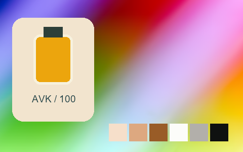

## 302 · Kodak Portra 160 -

`nt-negative-new-kodak-portra-160-curve-minus-1` · `film-negative` · CC-BY-SA-4.0 · 33³

50% gray Y′ 148.8/255 (+21.3 code values); 25–75% gray span ratio 0.946; mid-gray red minus blue +3.0 code values. Light/medium/deep skin swatches: #F1D7C5, #CFA687, #9D652F. Red/green/blue swatches: #D94024, #65B851, #746DD1.

Suggested use: Compare on your own SDR product, portrait and landscape footage before selecting.

Trial strength: 0.35–0.8; default 1.0.

Pixel color mapping only; no grain, glow, vignette, spatial haze or beauty effects. Natural footage quality is unaccepted. Check skin/product colors and clipped output.

| Input swatch | Input RGB | Actual output RGB |
|---|---|---|
| `gray_0` | `#000000` | `#040A02` |
| `gray_10` | `#1A1A1A` | `#141611` |
| `gray_25` | `#404040` | `#484C45` |
| `gray_50` | `#808080` | `#959592` |
| `gray_75` | `#BFBFBF` | `#C2C4C0` |
| `gray_90` | `#E6E6E6` | `#E6E4E3` |
| `gray_100` | `#FFFFFF` | `#ECF9F8` |
| `skin_light` | `#F5DBC6` | `#F1D7C5` |
| `skin_medium` | `#CF9B7B` | `#CFA687` |
| `skin_deep` | `#815438` | `#9D652F` |
| `red` | `#CC3333` | `#D94024` |
| `green` | `#33CC33` | `#65B851` |
| `blue` | `#3333CC` | `#746DD1` |

Creator: **Pat David** · [Source](https://github.com/NatronGitHub/clut/blob/af7b50d4caf6244fb6895a647f5b6a84efe7931a/negative_new/kodak_portra_160_-.png) · commit `af7b50d4caf6244fb6895a647f5b6a84efe7931a`.

Conversion: `native-depth-Hald-to-33-tetrahedral-v1`; 8,192 sampled RGB points; max error 0.0272690; mean 0.0007548. This is numerical approximation, not a perceptual quality score.

License obligations: Credit the named creator and source; retain the CC-BY-SA-4.0 notice and indicate changes. Redistributed adapted LUT data and thumbnails must use CC-BY-SA-4.0 or a compatible license; no additional restrictions.

[License](../../../product/src/ai_ad_editor/look_data/licenses/CC-BY-SA-4.0.txt) · LUT SHA-256 `2198f8afe8a80e6ec85c19a27239fb0fa98cfaaec7b27fb4b46c12fbf160bed8`.

[Actual preview PNG](../../assets/look500-20261024-r1/previews/nt-negative-new-kodak-portra-160-curve-minus-1.png) · [Actual video](../../assets/look500-20261024-r1/videos/nt-negative-new-kodak-portra-160-curve-minus-1.mp4)

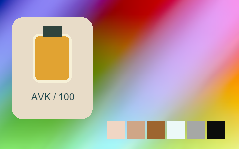

## 303 · Kodak Portra 400

`nt-negative-new-kodak-portra-400` · `film-negative` · CC-BY-SA-4.0 · 33³

50% gray Y′ 157.0/255 (+29.5 code values); 25–75% gray span ratio 1.147; mid-gray red minus blue -1.5 code values. Light/medium/deep skin swatches: #F3E3D4, #E2B08A, #9E612B. Red/green/blue swatches: #F43D19, #2FC269, #6A4EDA.

Suggested use: Compare on your own SDR product, portrait and landscape footage before selecting.

Trial strength: 0.35–0.8; default 1.0.

Pixel color mapping only; no grain, glow, vignette, spatial haze or beauty effects. Natural footage quality is unaccepted. Check skin/product colors and clipped output.

| Input swatch | Input RGB | Actual output RGB |
|---|---|---|
| `gray_0` | `#000000` | `#060505` |
| `gray_10` | `#1A1A1A` | `#0F1213` |
| `gray_25` | `#404040` | `#3F4244` |
| `gray_50` | `#808080` | `#9E9CA0` |
| `gray_75` | `#BFBFBF` | `#D6D3D4` |
| `gray_90` | `#E6E6E6` | `#EFEDED` |
| `gray_100` | `#FFFFFF` | `#FCFAFD` |
| `skin_light` | `#F5DBC6` | `#F3E3D4` |
| `skin_medium` | `#CF9B7B` | `#E2B08A` |
| `skin_deep` | `#815438` | `#9E612B` |
| `red` | `#CC3333` | `#F43D19` |
| `green` | `#33CC33` | `#2FC269` |
| `blue` | `#3333CC` | `#6A4EDA` |

Creator: **Pat David** · [Source](https://github.com/NatronGitHub/clut/blob/af7b50d4caf6244fb6895a647f5b6a84efe7931a/negative_new/kodak_portra_400.png) · commit `af7b50d4caf6244fb6895a647f5b6a84efe7931a`.

Conversion: `native-depth-Hald-to-33-tetrahedral-v1`; 8,192 sampled RGB points; max error 0.0242602; mean 0.0009142. This is numerical approximation, not a perceptual quality score.

License obligations: Credit the named creator and source; retain the CC-BY-SA-4.0 notice and indicate changes. Redistributed adapted LUT data and thumbnails must use CC-BY-SA-4.0 or a compatible license; no additional restrictions.

[License](../../../product/src/ai_ad_editor/look_data/licenses/CC-BY-SA-4.0.txt) · LUT SHA-256 `1fb1917c83043a325d4e9e6e1e5dc4d84bc177344a4b1d672f19625071d83035`.

[Actual preview PNG](../../assets/look500-20261024-r1/previews/nt-negative-new-kodak-portra-400.png) · [Actual video](../../assets/look500-20261024-r1/videos/nt-negative-new-kodak-portra-400.mp4)

## 304 · Kodak Portra 400 ++

`nt-negative-new-kodak-portra-400-curve-plus-2` · `film-negative` · CC-BY-SA-4.0 · 33³

50% gray Y′ 158.3/255 (+30.8 code values); 25–75% gray span ratio 1.084; mid-gray red minus blue +2.0 code values. Light/medium/deep skin swatches: #F1E0D4, #DEAE8B, #A1612B. Red/green/blue swatches: #F1451C, #38C066, #6E4ED8.

Suggested use: Compare on your own SDR product, portrait and landscape footage before selecting.

Trial strength: 0.35–0.8; default 1.0.

Pixel color mapping only; no grain, glow, vignette, spatial haze or beauty effects. Natural footage quality is unaccepted. Check skin/product colors and clipped output.

| Input swatch | Input RGB | Actual output RGB |
|---|---|---|
| `gray_0` | `#000000` | `#131813` |
| `gray_10` | `#1A1A1A` | `#1A1F1B` |
| `gray_25` | `#404040` | `#404743` |
| `gray_50` | `#808080` | `#A09E9E` |
| `gray_75` | `#BFBFBF` | `#D1CFD0` |
| `gray_90` | `#E6E6E6` | `#EBEAEB` |
| `gray_100` | `#FFFFFF` | `#FBFBFB` |
| `skin_light` | `#F5DBC6` | `#F1E0D4` |
| `skin_medium` | `#CF9B7B` | `#DEAE8B` |
| `skin_deep` | `#815438` | `#A1612B` |
| `red` | `#CC3333` | `#F1451C` |
| `green` | `#33CC33` | `#38C066` |
| `blue` | `#3333CC` | `#6E4ED8` |

Creator: **Pat David** · [Source](https://github.com/NatronGitHub/clut/blob/af7b50d4caf6244fb6895a647f5b6a84efe7931a/negative_new/kodak_portra_400_++.png) · commit `af7b50d4caf6244fb6895a647f5b6a84efe7931a`.

Conversion: `native-depth-Hald-to-33-tetrahedral-v1`; 8,192 sampled RGB points; max error 0.0229570; mean 0.0008980. This is numerical approximation, not a perceptual quality score.

License obligations: Credit the named creator and source; retain the CC-BY-SA-4.0 notice and indicate changes. Redistributed adapted LUT data and thumbnails must use CC-BY-SA-4.0 or a compatible license; no additional restrictions.

[License](../../../product/src/ai_ad_editor/look_data/licenses/CC-BY-SA-4.0.txt) · LUT SHA-256 `0aff268eac7d76ea0e2a412a887a3954f3a2816f61ae8cbc0c4bc81a68c24846`.

[Actual preview PNG](../../assets/look500-20261024-r1/previews/nt-negative-new-kodak-portra-400-curve-plus-2.png) · [Actual video](../../assets/look500-20261024-r1/videos/nt-negative-new-kodak-portra-400-curve-plus-2.mp4)

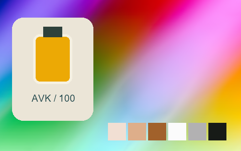

## 305 · Kodak Portra 400 +

`nt-negative-new-kodak-portra-400-curve-plus-1` · `film-negative` · CC-BY-SA-4.0 · 33³

50% gray Y′ 157.0/255 (+29.5 code values); 25–75% gray span ratio 1.059; mid-gray red minus blue +3.0 code values. Light/medium/deep skin swatches: #F3DFD2, #DFAE89, #A3632B. Red/green/blue swatches: #F14420, #45C16A, #7052D8.

Suggested use: Compare on your own SDR product, portrait and landscape footage before selecting.

Trial strength: 0.35–0.8; default 1.0.

Pixel color mapping only; no grain, glow, vignette, spatial haze or beauty effects. Natural footage quality is unaccepted. Check skin/product colors and clipped output.

| Input swatch | Input RGB | Actual output RGB |
|---|---|---|
| `gray_0` | `#000000` | `#100E0B` |
| `gray_10` | `#1A1A1A` | `#1E1A1A` |
| `gray_25` | `#404040` | `#4A4847` |
| `gray_50` | `#808080` | `#A29C9E` |
| `gray_75` | `#BFBFBF` | `#D0CED0` |
| `gray_90` | `#E6E6E6` | `#EDECED` |
| `gray_100` | `#FFFFFF` | `#FBFBFB` |
| `skin_light` | `#F5DBC6` | `#F3DFD2` |
| `skin_medium` | `#CF9B7B` | `#DFAE89` |
| `skin_deep` | `#815438` | `#A3632B` |
| `red` | `#CC3333` | `#F14420` |
| `green` | `#33CC33` | `#45C16A` |
| `blue` | `#3333CC` | `#7052D8` |

Creator: **Pat David** · [Source](https://github.com/NatronGitHub/clut/blob/af7b50d4caf6244fb6895a647f5b6a84efe7931a/negative_new/kodak_portra_400_+.png) · commit `af7b50d4caf6244fb6895a647f5b6a84efe7931a`.

Conversion: `native-depth-Hald-to-33-tetrahedral-v1`; 8,192 sampled RGB points; max error 0.0255672; mean 0.0008802. This is numerical approximation, not a perceptual quality score.

License obligations: Credit the named creator and source; retain the CC-BY-SA-4.0 notice and indicate changes. Redistributed adapted LUT data and thumbnails must use CC-BY-SA-4.0 or a compatible license; no additional restrictions.

[License](../../../product/src/ai_ad_editor/look_data/licenses/CC-BY-SA-4.0.txt) · LUT SHA-256 `216c8c327d5212ca4e235e96aed399139aa508906dc827ae9f538d510a705ed2`.

[Actual preview PNG](../../assets/look500-20261024-r1/previews/nt-negative-new-kodak-portra-400-curve-plus-1.png) · [Actual video](../../assets/look500-20261024-r1/videos/nt-negative-new-kodak-portra-400-curve-plus-1.mp4)

## 306 · Kodak Portra 400 -

`nt-negative-new-kodak-portra-400-curve-minus-1` · `film-negative` · CC-BY-SA-4.0 · 33³

50% gray Y′ 154.2/255 (+26.7 code values); 25–75% gray span ratio 1.027; mid-gray red minus blue -2.0 code values. Light/medium/deep skin swatches: #F3DBCA, #D6A88A, #9E6132. Red/green/blue swatches: #E93D21, #3FBA6B, #6854D1.

Suggested use: Compare on your own SDR product, portrait and landscape footage before selecting.

Trial strength: 0.35–0.8; default 1.0.

Pixel color mapping only; no grain, glow, vignette, spatial haze or beauty effects. Natural footage quality is unaccepted. Check skin/product colors and clipped output.

| Input swatch | Input RGB | Actual output RGB |
|---|---|---|
| `gray_0` | `#000000` | `#000000` |
| `gray_10` | `#1A1A1A` | `#0F1112` |
| `gray_25` | `#404040` | `#45484A` |
| `gray_50` | `#808080` | `#999B9B` |
| `gray_75` | `#BFBFBF` | `#CBCACB` |
| `gray_90` | `#E6E6E6` | `#E8E8E9` |
| `gray_100` | `#FFFFFF` | `#FAF0F9` |
| `skin_light` | `#F5DBC6` | `#F3DBCA` |
| `skin_medium` | `#CF9B7B` | `#D6A88A` |
| `skin_deep` | `#815438` | `#9E6132` |
| `red` | `#CC3333` | `#E93D21` |
| `green` | `#33CC33` | `#3FBA6B` |
| `blue` | `#3333CC` | `#6854D1` |

Creator: **Pat David** · [Source](https://github.com/NatronGitHub/clut/blob/af7b50d4caf6244fb6895a647f5b6a84efe7931a/negative_new/kodak_portra_400_-.png) · commit `af7b50d4caf6244fb6895a647f5b6a84efe7931a`.

Conversion: `native-depth-Hald-to-33-tetrahedral-v1`; 8,192 sampled RGB points; max error 0.0436326; mean 0.0008788. This is numerical approximation, not a perceptual quality score.

License obligations: Credit the named creator and source; retain the CC-BY-SA-4.0 notice and indicate changes. Redistributed adapted LUT data and thumbnails must use CC-BY-SA-4.0 or a compatible license; no additional restrictions.

[License](../../../product/src/ai_ad_editor/look_data/licenses/CC-BY-SA-4.0.txt) · LUT SHA-256 `5b6673c193451210780af7ec85ed470ce506951f5c116607d2414e1e9c740072`.

[Actual preview PNG](../../assets/look500-20261024-r1/previews/nt-negative-new-kodak-portra-400-curve-minus-1.png) · [Actual video](../../assets/look500-20261024-r1/videos/nt-negative-new-kodak-portra-400-curve-minus-1.mp4)

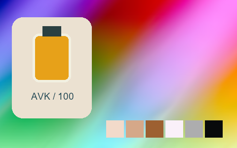

## 307 · Kodak Portra 800

`nt-negative-new-kodak-portra-800` · `film-negative` · CC-BY-SA-4.0 · 33³

50% gray Y′ 146.0/255 (+18.5 code values); 25–75% gray span ratio 1.174; mid-gray red minus blue +2.0 code values. Light/medium/deep skin swatches: #F4E9D8, #E4B687, #9B5C28. Red/green/blue swatches: #F93217, #02C83F, #5A2FE4.

Suggested use: Compare on your own SDR product, portrait and landscape footage before selecting.

Trial strength: 0.35–0.8; default 1.0.

Pixel color mapping only; no grain, glow, vignette, spatial haze or beauty effects. Natural footage quality is unaccepted. Check skin/product colors and clipped output.

| Input swatch | Input RGB | Actual output RGB |
|---|---|---|
| `gray_0` | `#000000` | `#10090F` |
| `gray_10` | `#1A1A1A` | `#111718` |
| `gray_25` | `#404040` | `#383C3C` |
| `gray_50` | `#808080` | `#929290` |
| `gray_75` | `#BFBFBF` | `#CDD2D0` |
| `gray_90` | `#E6E6E6` | `#EBEDED` |
| `gray_100` | `#FFFFFF` | `#F7FBFA` |
| `skin_light` | `#F5DBC6` | `#F4E9D8` |
| `skin_medium` | `#CF9B7B` | `#E4B687` |
| `skin_deep` | `#815438` | `#9B5C28` |
| `red` | `#CC3333` | `#F93217` |
| `green` | `#33CC33` | `#02C83F` |
| `blue` | `#3333CC` | `#5A2FE4` |

Creator: **Pat David** · [Source](https://github.com/NatronGitHub/clut/blob/af7b50d4caf6244fb6895a647f5b6a84efe7931a/negative_new/kodak_portra_800.png) · commit `af7b50d4caf6244fb6895a647f5b6a84efe7931a`.

Conversion: `native-depth-Hald-to-33-tetrahedral-v1`; 8,192 sampled RGB points; max error 0.0424682; mean 0.0009457. This is numerical approximation, not a perceptual quality score.

License obligations: Credit the named creator and source; retain the CC-BY-SA-4.0 notice and indicate changes. Redistributed adapted LUT data and thumbnails must use CC-BY-SA-4.0 or a compatible license; no additional restrictions.

[License](../../../product/src/ai_ad_editor/look_data/licenses/CC-BY-SA-4.0.txt) · LUT SHA-256 `ad40d3809c67b3dc0522c496945505bff6bd1de4742d88a99cca916a8d02c3c3`.

[Actual preview PNG](../../assets/look500-20261024-r1/previews/nt-negative-new-kodak-portra-800.png) · [Actual video](../../assets/look500-20261024-r1/videos/nt-negative-new-kodak-portra-800.mp4)

## 308 · Kodak Portra 800 ++

`nt-negative-new-kodak-portra-800-curve-plus-2` · `film-negative` · CC-BY-SA-4.0 · 33³

50% gray Y′ 147.3/255 (+19.8 code values); 25–75% gray span ratio 1.141; mid-gray red minus blue -2.5 code values. Light/medium/deep skin swatches: #F7E9D7, #E8B281, #946141. Red/green/blue swatches: #F64B3A, #02C954, #543CE6.

Suggested use: Compare on your own SDR product, portrait and landscape footage before selecting.

Trial strength: 0.35–0.8; default 1.0.

Pixel color mapping only; no grain, glow, vignette, spatial haze or beauty effects. Natural footage quality is unaccepted. Check skin/product colors and clipped output.

| Input swatch | Input RGB | Actual output RGB |
|---|---|---|
| `gray_0` | `#000000` | `#0C212C` |
| `gray_10` | `#1A1A1A` | `#1A2B37` |
| `gray_25` | `#404040` | `#3A454E` |
| `gray_50` | `#808080` | `#919493` |
| `gray_75` | `#BFBFBF` | `#D6D5D3` |
| `gray_90` | `#E6E6E6` | `#EEEEEE` |
| `gray_100` | `#FFFFFF` | `#FAFBFA` |
| `skin_light` | `#F5DBC6` | `#F7E9D7` |
| `skin_medium` | `#CF9B7B` | `#E8B281` |
| `skin_deep` | `#815438` | `#946141` |
| `red` | `#CC3333` | `#F64B3A` |
| `green` | `#33CC33` | `#02C954` |
| `blue` | `#3333CC` | `#543CE6` |

Creator: **Pat David** · [Source](https://github.com/NatronGitHub/clut/blob/af7b50d4caf6244fb6895a647f5b6a84efe7931a/negative_new/kodak_portra_800_++.png) · commit `af7b50d4caf6244fb6895a647f5b6a84efe7931a`.

Conversion: `native-depth-Hald-to-33-tetrahedral-v1`; 8,192 sampled RGB points; max error 0.0322296; mean 0.0009462. This is numerical approximation, not a perceptual quality score.

License obligations: Credit the named creator and source; retain the CC-BY-SA-4.0 notice and indicate changes. Redistributed adapted LUT data and thumbnails must use CC-BY-SA-4.0 or a compatible license; no additional restrictions.

[License](../../../product/src/ai_ad_editor/look_data/licenses/CC-BY-SA-4.0.txt) · LUT SHA-256 `9aabd116d30043548726978ee004246fec2a6319a301d2c723dca187b78c4aba`.

[Actual preview PNG](../../assets/look500-20261024-r1/previews/nt-negative-new-kodak-portra-800-curve-plus-2.png) · [Actual video](../../assets/look500-20261024-r1/videos/nt-negative-new-kodak-portra-800-curve-plus-2.mp4)

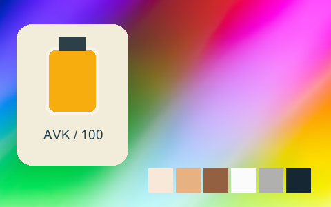

## 309 · Kodak Portra 800 +

`nt-negative-new-kodak-portra-800-curve-plus-1` · `film-negative` · CC-BY-SA-4.0 · 33³

50% gray Y′ 144.2/255 (+16.7 code values); 25–75% gray span ratio 1.152; mid-gray red minus blue +3.5 code values. Light/medium/deep skin swatches: #F4E7D7, #E4AF7F, #9A5A2F. Red/green/blue swatches: #F8341D, #03C946, #5C36E5.

Suggested use: Compare on your own SDR product, portrait and landscape footage before selecting.

Trial strength: 0.35–0.8; default 1.0.

Pixel color mapping only; no grain, glow, vignette, spatial haze or beauty effects. Natural footage quality is unaccepted. Check skin/product colors and clipped output.

| Input swatch | Input RGB | Actual output RGB |
|---|---|---|
| `gray_0` | `#000000` | `#11150C` |
| `gray_10` | `#1A1A1A` | `#1D221C` |
| `gray_25` | `#404040` | `#3F4040` |
| `gray_50` | `#808080` | `#939090` |
| `gray_75` | `#BFBFBF` | `#D2D3D2` |
| `gray_90` | `#E6E6E6` | `#E9EEED` |
| `gray_100` | `#FFFFFF` | `#F7F5F2` |
| `skin_light` | `#F5DBC6` | `#F4E7D7` |
| `skin_medium` | `#CF9B7B` | `#E4AF7F` |
| `skin_deep` | `#815438` | `#9A5A2F` |
| `red` | `#CC3333` | `#F8341D` |
| `green` | `#33CC33` | `#03C946` |
| `blue` | `#3333CC` | `#5C36E5` |

Creator: **Pat David** · [Source](https://github.com/NatronGitHub/clut/blob/af7b50d4caf6244fb6895a647f5b6a84efe7931a/negative_new/kodak_portra_800_+.png) · commit `af7b50d4caf6244fb6895a647f5b6a84efe7931a`.

Conversion: `native-depth-Hald-to-33-tetrahedral-v1`; 8,192 sampled RGB points; max error 0.0254539; mean 0.0009126. This is numerical approximation, not a perceptual quality score.

License obligations: Credit the named creator and source; retain the CC-BY-SA-4.0 notice and indicate changes. Redistributed adapted LUT data and thumbnails must use CC-BY-SA-4.0 or a compatible license; no additional restrictions.

[License](../../../product/src/ai_ad_editor/look_data/licenses/CC-BY-SA-4.0.txt) · LUT SHA-256 `e087878f2b7a4da48a67ffb64f7a721a428036eb0ead6de75b1b0dc60960ca9b`.

[Actual preview PNG](../../assets/look500-20261024-r1/previews/nt-negative-new-kodak-portra-800-curve-plus-1.png) · [Actual video](../../assets/look500-20261024-r1/videos/nt-negative-new-kodak-portra-800-curve-plus-1.mp4)

## 310 · Kodak Portra 800 -

`nt-negative-new-kodak-portra-800-curve-minus-1` · `film-negative` · CC-BY-SA-4.0 · 33³

50% gray Y′ 140.8/255 (+13.3 code values); 25–75% gray span ratio 1.088; mid-gray red minus blue +6.5 code values. Light/medium/deep skin swatches: #F6E4D3, #E2AE82, #995D2D. Red/green/blue swatches: #F53620, #04C048, #6037DF.

Suggested use: Compare on your own SDR product, portrait and landscape footage before selecting.

Trial strength: 0.35–0.8; default 1.0.

Pixel color mapping only; no grain, glow, vignette, spatial haze or beauty effects. Natural footage quality is unaccepted. Check skin/product colors and clipped output.

| Input swatch | Input RGB | Actual output RGB |
|---|---|---|
| `gray_0` | `#000000` | `#050D0A` |
| `gray_10` | `#1A1A1A` | `#131616` |
| `gray_25` | `#404040` | `#41403F` |
| `gray_50` | `#808080` | `#908C8A` |
| `gray_75` | `#BFBFBF` | `#CCCACA` |
| `gray_90` | `#E6E6E6` | `#EFEAEB` |
| `gray_100` | `#FFFFFF` | `#FCF2FC` |
| `skin_light` | `#F5DBC6` | `#F6E4D3` |
| `skin_medium` | `#CF9B7B` | `#E2AE82` |
| `skin_deep` | `#815438` | `#995D2D` |
| `red` | `#CC3333` | `#F53620` |
| `green` | `#33CC33` | `#04C048` |
| `blue` | `#3333CC` | `#6037DF` |

Creator: **Pat David** · [Source](https://github.com/NatronGitHub/clut/blob/af7b50d4caf6244fb6895a647f5b6a84efe7931a/negative_new/kodak_portra_800_-.png) · commit `af7b50d4caf6244fb6895a647f5b6a84efe7931a`.

Conversion: `native-depth-Hald-to-33-tetrahedral-v1`; 8,192 sampled RGB points; max error 0.0242419; mean 0.0008655. This is numerical approximation, not a perceptual quality score.

License obligations: Credit the named creator and source; retain the CC-BY-SA-4.0 notice and indicate changes. Redistributed adapted LUT data and thumbnails must use CC-BY-SA-4.0 or a compatible license; no additional restrictions.

[License](../../../product/src/ai_ad_editor/look_data/licenses/CC-BY-SA-4.0.txt) · LUT SHA-256 `9fb6f3a2bea6307d7853c4f093f71d395c9db59ff24f12299b0fb6c6712f480d`.

[Actual preview PNG](../../assets/look500-20261024-r1/previews/nt-negative-new-kodak-portra-800-curve-minus-1.png) · [Actual video](../../assets/look500-20261024-r1/videos/nt-negative-new-kodak-portra-800-curve-minus-1.mp4)

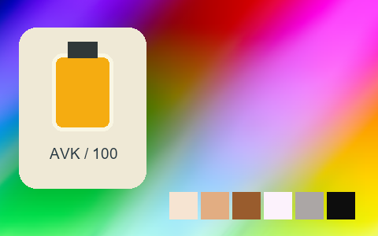

## 311 · Kodak Tmax 3200

`nt-negative-new-kodak-tmax-3200` · `film-negative` · CC-BY-SA-4.0 · 33³

50% gray Y′ 141.5/255 (+14.0 code values); 25–75% gray span ratio 1.214; mid-gray red minus blue +0.0 code values. Light/medium/deep skin swatches: #F0F0F0, #BFBFBF, #5E5E5E. Red/green/blue swatches: #575757, #BBBBBB, #4E4E4E.

Suggested use: Compare on your own SDR product, portrait and landscape footage before selecting.

Trial strength: 1–1; default 1.0.

Pixel color mapping only; no grain, glow, vignette, spatial haze or beauty effects. Natural footage quality is unaccepted. Check skin/product colors and clipped output.

| Input swatch | Input RGB | Actual output RGB |
|---|---|---|
| `gray_0` | `#000000` | `#1E1E1E` |
| `gray_10` | `#1A1A1A` | `#232323` |
| `gray_25` | `#404040` | `#3E3E3E` |
| `gray_50` | `#808080` | `#8E8E8E` |
| `gray_75` | `#BFBFBF` | `#D9D9D9` |
| `gray_90` | `#E6E6E6` | `#F2F2F2` |
| `gray_100` | `#FFFFFF` | `#F9F9F9` |
| `skin_light` | `#F5DBC6` | `#F0F0F0` |
| `skin_medium` | `#CF9B7B` | `#BFBFBF` |
| `skin_deep` | `#815438` | `#5E5E5E` |
| `red` | `#CC3333` | `#575757` |
| `green` | `#33CC33` | `#BBBBBB` |
| `blue` | `#3333CC` | `#4E4E4E` |

Creator: **Pat David** · [Source](https://github.com/NatronGitHub/clut/blob/af7b50d4caf6244fb6895a647f5b6a84efe7931a/negative_new/kodak_tmax_3200.png) · commit `af7b50d4caf6244fb6895a647f5b6a84efe7931a`.

Conversion: `native-depth-Hald-to-33-tetrahedral-v1`; 8,192 sampled RGB points; max error 0.0067051; mean 0.0006841. This is numerical approximation, not a perceptual quality score.

License obligations: Credit the named creator and source; retain the CC-BY-SA-4.0 notice and indicate changes. Redistributed adapted LUT data and thumbnails must use CC-BY-SA-4.0 or a compatible license; no additional restrictions.

[License](../../../product/src/ai_ad_editor/look_data/licenses/CC-BY-SA-4.0.txt) · LUT SHA-256 `e526ea208dc54d5ba0fbc92db5ef98b40bad34ea1b7727afee3d9d0f80d5025e`.

[Actual preview PNG](../../assets/look500-20261024-r1/previews/nt-negative-new-kodak-tmax-3200.png) · [Actual video](../../assets/look500-20261024-r1/videos/nt-negative-new-kodak-tmax-3200.mp4)

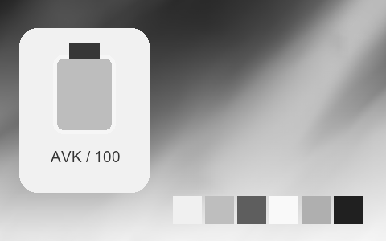

## 312 · Kodak Tmax 3200 ++

`nt-negative-new-kodak-tmax-3200-curve-plus-2` · `film-negative` · CC-BY-SA-4.0 · 33³

50% gray Y′ 139.5/255 (+12.0 code values); 25–75% gray span ratio 0.982; mid-gray red minus blue +0.0 code values. Light/medium/deep skin swatches: #EAEAEA, #BABABA, #646464. Red/green/blue swatches: #626262, #B7B7B7, #5D5D5D.

Suggested use: Compare on your own SDR product, portrait and landscape footage before selecting.

Trial strength: 1–1; default 1.0.

Pixel color mapping only; no grain, glow, vignette, spatial haze or beauty effects. Natural footage quality is unaccepted. Check skin/product colors and clipped output.

| Input swatch | Input RGB | Actual output RGB |
|---|---|---|
| `gray_0` | `#000000` | `#4B4B4B` |
| `gray_10` | `#1A1A1A` | `#4D4D4D` |
| `gray_25` | `#404040` | `#585858` |
| `gray_50` | `#808080` | `#8C8C8C` |
| `gray_75` | `#BFBFBF` | `#D5D5D5` |
| `gray_90` | `#E6E6E6` | `#EFEFEF` |
| `gray_100` | `#FFFFFF` | `#F8F8F8` |
| `skin_light` | `#F5DBC6` | `#EAEAEA` |
| `skin_medium` | `#CF9B7B` | `#BABABA` |
| `skin_deep` | `#815438` | `#646464` |
| `red` | `#CC3333` | `#626262` |
| `green` | `#33CC33` | `#B7B7B7` |
| `blue` | `#3333CC` | `#5D5D5D` |

Creator: **Pat David** · [Source](https://github.com/NatronGitHub/clut/blob/af7b50d4caf6244fb6895a647f5b6a84efe7931a/negative_new/kodak_tmax_3200_++.png) · commit `af7b50d4caf6244fb6895a647f5b6a84efe7931a`.

Conversion: `native-depth-Hald-to-33-tetrahedral-v1`; 8,192 sampled RGB points; max error 0.0162070; mean 0.0006894. This is numerical approximation, not a perceptual quality score.

License obligations: Credit the named creator and source; retain the CC-BY-SA-4.0 notice and indicate changes. Redistributed adapted LUT data and thumbnails must use CC-BY-SA-4.0 or a compatible license; no additional restrictions.

[License](../../../product/src/ai_ad_editor/look_data/licenses/CC-BY-SA-4.0.txt) · LUT SHA-256 `ca4365534fc654994d923681298139a4a4ffee68608801285e32ce67494732d9`.

[Actual preview PNG](../../assets/look500-20261024-r1/previews/nt-negative-new-kodak-tmax-3200-curve-plus-2.png) · [Actual video](../../assets/look500-20261024-r1/videos/nt-negative-new-kodak-tmax-3200-curve-plus-2.mp4)

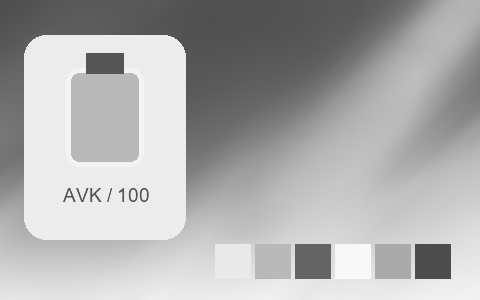

## 313 · Kodak Tmax 3200 +

`nt-negative-new-kodak-tmax-3200-curve-plus-1` · `film-negative` · CC-BY-SA-4.0 · 33³

50% gray Y′ 138.5/255 (+11.0 code values); 25–75% gray span ratio 1.104; mid-gray red minus blue +0.0 code values. Light/medium/deep skin swatches: #EDEDED, #BCBCBC, #5E5E5E. Red/green/blue swatches: #595959, #BABABA, #515151.

Suggested use: Compare on your own SDR product, portrait and landscape footage before selecting.

Trial strength: 1–1; default 1.0.

Pixel color mapping only; no grain, glow, vignette, spatial haze or beauty effects. Natural footage quality is unaccepted. Check skin/product colors and clipped output.

| Input swatch | Input RGB | Actual output RGB |
|---|---|---|
| `gray_0` | `#000000` | `#393939` |
| `gray_10` | `#1A1A1A` | `#3B3B3B` |
| `gray_25` | `#404040` | `#484848` |
| `gray_50` | `#808080` | `#8B8B8B` |
| `gray_75` | `#BFBFBF` | `#D5D5D5` |
| `gray_90` | `#E6E6E6` | `#EFEFEF` |
| `gray_100` | `#FFFFFF` | `#F1F1F1` |
| `skin_light` | `#F5DBC6` | `#EDEDED` |
| `skin_medium` | `#CF9B7B` | `#BCBCBC` |
| `skin_deep` | `#815438` | `#5E5E5E` |
| `red` | `#CC3333` | `#595959` |
| `green` | `#33CC33` | `#BABABA` |
| `blue` | `#3333CC` | `#515151` |

Creator: **Pat David** · [Source](https://github.com/NatronGitHub/clut/blob/af7b50d4caf6244fb6895a647f5b6a84efe7931a/negative_new/kodak_tmax_3200_+.png) · commit `af7b50d4caf6244fb6895a647f5b6a84efe7931a`.

Conversion: `native-depth-Hald-to-33-tetrahedral-v1`; 8,192 sampled RGB points; max error 0.0104868; mean 0.0007021. This is numerical approximation, not a perceptual quality score.

License obligations: Credit the named creator and source; retain the CC-BY-SA-4.0 notice and indicate changes. Redistributed adapted LUT data and thumbnails must use CC-BY-SA-4.0 or a compatible license; no additional restrictions.

[License](../../../product/src/ai_ad_editor/look_data/licenses/CC-BY-SA-4.0.txt) · LUT SHA-256 `d7aa6b352e0d7790b43890d157cfbf47cfd53fd2cc42246731ecb1bd98c14651`.

[Actual preview PNG](../../assets/look500-20261024-r1/previews/nt-negative-new-kodak-tmax-3200-curve-plus-1.png) · [Actual video](../../assets/look500-20261024-r1/videos/nt-negative-new-kodak-tmax-3200-curve-plus-1.mp4)

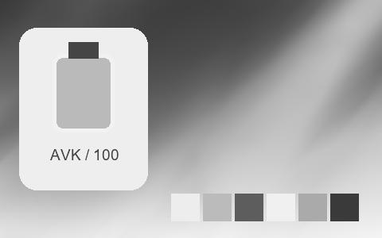

## 314 · Kodak Tmax 3200 -

`nt-negative-new-kodak-tmax-3200-curve-minus-1` · `film-negative` · CC-BY-SA-4.0 · 33³

50% gray Y′ 128.0/255 (+0.5 code values); 25–75% gray span ratio 1.127; mid-gray red minus blue +0.0 code values. Light/medium/deep skin swatches: #EAEAEA, #ADADAD, #5A5A5A. Red/green/blue swatches: #555555, #ACACAC, #4B4B4B.

Suggested use: Compare on your own SDR product, portrait and landscape footage before selecting.

Trial strength: 1–1; default 1.0.

Pixel color mapping only; no grain, glow, vignette, spatial haze or beauty effects. Natural footage quality is unaccepted. Check skin/product colors and clipped output.

| Input swatch | Input RGB | Actual output RGB |
|---|---|---|
| `gray_0` | `#000000` | `#020202` |
| `gray_10` | `#1A1A1A` | `#0E0E0E` |
| `gray_25` | `#404040` | `#3B3B3B` |
| `gray_50` | `#808080` | `#808080` |
| `gray_75` | `#BFBFBF` | `#CBCBCB` |
| `gray_90` | `#E6E6E6` | `#EFEFEF` |
| `gray_100` | `#FFFFFF` | `#F4F4F4` |
| `skin_light` | `#F5DBC6` | `#EAEAEA` |
| `skin_medium` | `#CF9B7B` | `#ADADAD` |
| `skin_deep` | `#815438` | `#5A5A5A` |
| `red` | `#CC3333` | `#555555` |
| `green` | `#33CC33` | `#ACACAC` |
| `blue` | `#3333CC` | `#4B4B4B` |

Creator: **Pat David** · [Source](https://github.com/NatronGitHub/clut/blob/af7b50d4caf6244fb6895a647f5b6a84efe7931a/negative_new/kodak_tmax_3200_-.png) · commit `af7b50d4caf6244fb6895a647f5b6a84efe7931a`.

Conversion: `native-depth-Hald-to-33-tetrahedral-v1`; 8,192 sampled RGB points; max error 0.0116458; mean 0.0006865. This is numerical approximation, not a perceptual quality score.

License obligations: Credit the named creator and source; retain the CC-BY-SA-4.0 notice and indicate changes. Redistributed adapted LUT data and thumbnails must use CC-BY-SA-4.0 or a compatible license; no additional restrictions.

[License](../../../product/src/ai_ad_editor/look_data/licenses/CC-BY-SA-4.0.txt) · LUT SHA-256 `c966ac26a4e259d7bfaa54beb476dd5086ae1a37e029c1b6ff3b3d4efb9837f4`.

[Actual preview PNG](../../assets/look500-20261024-r1/previews/nt-negative-new-kodak-tmax-3200-curve-minus-1.png) · [Actual video](../../assets/look500-20261024-r1/videos/nt-negative-new-kodak-tmax-3200-curve-minus-1.mp4)

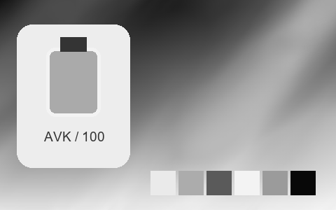

## 315 · Kodak Tri-X 400 ++

`nt-negative-new-kodak-tri-x-400-curve-plus-2` · `film-negative` · CC-BY-SA-4.0 · 33³

50% gray Y′ 131.0/255 (+3.5 code values); 25–75% gray span ratio 1.253; mid-gray red minus blue +0.0 code values. Light/medium/deep skin swatches: #F3F3F3, #BBBBBB, #535353. Red/green/blue swatches: #585858, #B0B0B0, #8B8B8B.

Suggested use: Compare on your own SDR product, portrait and landscape footage before selecting.

Trial strength: 1–1; default 1.0.

Pixel color mapping only; no grain, glow, vignette, spatial haze or beauty effects. Natural footage quality is unaccepted. Check skin/product colors and clipped output.

| Input swatch | Input RGB | Actual output RGB |
|---|---|---|
| `gray_0` | `#000000` | `#252525` |
| `gray_10` | `#1A1A1A` | `#252525` |
| `gray_25` | `#404040` | `#373737` |
| `gray_50` | `#808080` | `#838383` |
| `gray_75` | `#BFBFBF` | `#D7D7D7` |
| `gray_90` | `#E6E6E6` | `#F6F6F6` |
| `gray_100` | `#FFFFFF` | `#FAFAFA` |
| `skin_light` | `#F5DBC6` | `#F3F3F3` |
| `skin_medium` | `#CF9B7B` | `#BBBBBB` |
| `skin_deep` | `#815438` | `#535353` |
| `red` | `#CC3333` | `#585858` |
| `green` | `#33CC33` | `#B0B0B0` |
| `blue` | `#3333CC` | `#8B8B8B` |

Creator: **Pat David** · [Source](https://github.com/NatronGitHub/clut/blob/af7b50d4caf6244fb6895a647f5b6a84efe7931a/negative_new/kodak_tri-x_400_++.png) · commit `af7b50d4caf6244fb6895a647f5b6a84efe7931a`.

Conversion: `native-depth-Hald-to-33-tetrahedral-v1`; 8,192 sampled RGB points; max error 0.0080963; mean 0.0008097. This is numerical approximation, not a perceptual quality score.

License obligations: Credit the named creator and source; retain the CC-BY-SA-4.0 notice and indicate changes. Redistributed adapted LUT data and thumbnails must use CC-BY-SA-4.0 or a compatible license; no additional restrictions.

[License](../../../product/src/ai_ad_editor/look_data/licenses/CC-BY-SA-4.0.txt) · LUT SHA-256 `d4e4b9e97ba28caba0f4987058d3e0216c58648f1ef024e5326d073b3a37658c`.

[Actual preview PNG](../../assets/look500-20261024-r1/previews/nt-negative-new-kodak-tri-x-400-curve-plus-2.png) · [Actual video](../../assets/look500-20261024-r1/videos/nt-negative-new-kodak-tri-x-400-curve-plus-2.mp4)

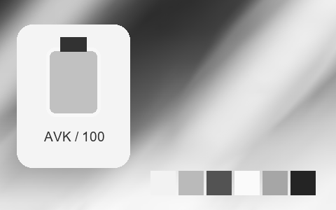

## 316 · Kodak Tri-X 400 +

`nt-negative-new-kodak-tri-x-400-curve-plus-1` · `film-negative` · CC-BY-SA-4.0 · 33³

50% gray Y′ 133.0/255 (+5.5 code values); 25–75% gray span ratio 1.324; mid-gray red minus blue +0.0 code values. Light/medium/deep skin swatches: #F3F3F3, #BCBCBC, #535353. Red/green/blue swatches: #575757, #B3B3B3, #8C8C8C.

Suggested use: Compare on your own SDR product, portrait and landscape footage before selecting.

Trial strength: 1–1; default 1.0.

Pixel color mapping only; no grain, glow, vignette, spatial haze or beauty effects. Natural footage quality is unaccepted. Check skin/product colors and clipped output.

| Input swatch | Input RGB | Actual output RGB |
|---|---|---|
| `gray_0` | `#000000` | `#101010` |
| `gray_10` | `#1A1A1A` | `#141414` |
| `gray_25` | `#404040` | `#2F2F2F` |
| `gray_50` | `#808080` | `#858585` |
| `gray_75` | `#BFBFBF` | `#D8D8D8` |
| `gray_90` | `#E6E6E6` | `#F5F5F5` |
| `gray_100` | `#FFFFFF` | `#FAFAFA` |
| `skin_light` | `#F5DBC6` | `#F3F3F3` |
| `skin_medium` | `#CF9B7B` | `#BCBCBC` |
| `skin_deep` | `#815438` | `#535353` |
| `red` | `#CC3333` | `#575757` |
| `green` | `#33CC33` | `#B3B3B3` |
| `blue` | `#3333CC` | `#8C8C8C` |

Creator: **Pat David** · [Source](https://github.com/NatronGitHub/clut/blob/af7b50d4caf6244fb6895a647f5b6a84efe7931a/negative_new/kodak_tri-x_400_+.png) · commit `af7b50d4caf6244fb6895a647f5b6a84efe7931a`.

Conversion: `native-depth-Hald-to-33-tetrahedral-v1`; 8,192 sampled RGB points; max error 0.0102437; mean 0.0007907. This is numerical approximation, not a perceptual quality score.

License obligations: Credit the named creator and source; retain the CC-BY-SA-4.0 notice and indicate changes. Redistributed adapted LUT data and thumbnails must use CC-BY-SA-4.0 or a compatible license; no additional restrictions.

[License](../../../product/src/ai_ad_editor/look_data/licenses/CC-BY-SA-4.0.txt) · LUT SHA-256 `46183370ecf588df041b0db264fb7111ee865261fad6872fc698aa0cf721a138`.

[Actual preview PNG](../../assets/look500-20261024-r1/previews/nt-negative-new-kodak-tri-x-400-curve-plus-1.png) · [Actual video](../../assets/look500-20261024-r1/videos/nt-negative-new-kodak-tri-x-400-curve-plus-1.mp4)

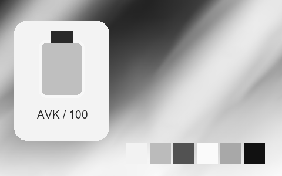

## 317 · Kodak Tri-X 400 -

`nt-negative-new-kodak-tri-x-400-curve-minus-1` · `film-negative` · CC-BY-SA-4.0 · 33³

50% gray Y′ 144.5/255 (+17.0 code values); 25–75% gray span ratio 1.151; mid-gray red minus blue +0.0 code values. Light/medium/deep skin swatches: #F3F3F3, #BDBDBD, #636363. Red/green/blue swatches: #6C6C6C, #B5B5B5, #959595.

Suggested use: Compare on your own SDR product, portrait and landscape footage before selecting.

Trial strength: 1–1; default 1.0.

Pixel color mapping only; no grain, glow, vignette, spatial haze or beauty effects. Natural footage quality is unaccepted. Check skin/product colors and clipped output.

| Input swatch | Input RGB | Actual output RGB |
|---|---|---|
| `gray_0` | `#000000` | `#090909` |
| `gray_10` | `#1A1A1A` | `#161616` |
| `gray_25` | `#404040` | `#424242` |
| `gray_50` | `#808080` | `#909090` |
| `gray_75` | `#BFBFBF` | `#D5D5D5` |
| `gray_90` | `#E6E6E6` | `#F8F8F8` |
| `gray_100` | `#FFFFFF` | `#FBFBFB` |
| `skin_light` | `#F5DBC6` | `#F3F3F3` |
| `skin_medium` | `#CF9B7B` | `#BDBDBD` |
| `skin_deep` | `#815438` | `#636363` |
| `red` | `#CC3333` | `#6C6C6C` |
| `green` | `#33CC33` | `#B5B5B5` |
| `blue` | `#3333CC` | `#959595` |

Creator: **Pat David** · [Source](https://github.com/NatronGitHub/clut/blob/af7b50d4caf6244fb6895a647f5b6a84efe7931a/negative_new/kodak_tri-x_400_-.png) · commit `af7b50d4caf6244fb6895a647f5b6a84efe7931a`.

Conversion: `native-depth-Hald-to-33-tetrahedral-v1`; 8,192 sampled RGB points; max error 0.0095226; mean 0.0007362. This is numerical approximation, not a perceptual quality score.

License obligations: Credit the named creator and source; retain the CC-BY-SA-4.0 notice and indicate changes. Redistributed adapted LUT data and thumbnails must use CC-BY-SA-4.0 or a compatible license; no additional restrictions.

[License](../../../product/src/ai_ad_editor/look_data/licenses/CC-BY-SA-4.0.txt) · LUT SHA-256 `38dde291156ef1e74c231687a2dd30cf417d86a8b4ee1e20e6c447d0608e6fb1`.

[Actual preview PNG](../../assets/look500-20261024-r1/previews/nt-negative-new-kodak-tri-x-400-curve-minus-1.png) · [Actual video](../../assets/look500-20261024-r1/videos/nt-negative-new-kodak-tri-x-400-curve-minus-1.mp4)

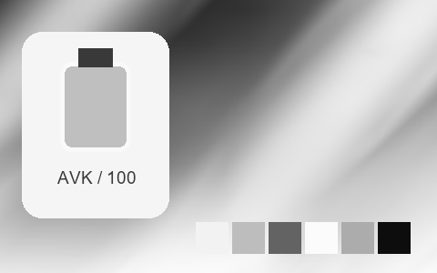

## 318 · Fuji Ilford Delta 3200

`nt-negative-old-fuji-ilford-delta-3200` · `film-negative` · CC-BY-SA-4.0 · 33³

50% gray Y′ 133.5/255 (+6.0 code values); 25–75% gray span ratio 1.247; mid-gray red minus blue +0.0 code values. Light/medium/deep skin swatches: #EFEFEF, #B4B4B4, #545454. Red/green/blue swatches: #777777, #A4A4A4, #8A8A8A.

Suggested use: Compare on your own SDR product, portrait and landscape footage before selecting.

Trial strength: 1–1; default 1.0.

Pixel color mapping only; no grain, glow, vignette, spatial haze or beauty effects. Natural footage quality is unaccepted. Check skin/product colors and clipped output.

| Input swatch | Input RGB | Actual output RGB |
|---|---|---|
| `gray_0` | `#000000` | `#131313` |
| `gray_10` | `#1A1A1A` | `#151515` |
| `gray_25` | `#404040` | `#333333` |
| `gray_50` | `#808080` | `#858585` |
| `gray_75` | `#BFBFBF` | `#D2D2D2` |
| `gray_90` | `#E6E6E6` | `#F6F6F6` |
| `gray_100` | `#FFFFFF` | `#FEFEFE` |
| `skin_light` | `#F5DBC6` | `#EFEFEF` |
| `skin_medium` | `#CF9B7B` | `#B4B4B4` |
| `skin_deep` | `#815438` | `#545454` |
| `red` | `#CC3333` | `#777777` |
| `green` | `#33CC33` | `#A4A4A4` |
| `blue` | `#3333CC` | `#8A8A8A` |

Creator: **Pat David** · [Source](https://github.com/NatronGitHub/clut/blob/af7b50d4caf6244fb6895a647f5b6a84efe7931a/negative_old/fuji_ilford_delta_3200.png) · commit `af7b50d4caf6244fb6895a647f5b6a84efe7931a`.

Conversion: `native-depth-Hald-to-33-tetrahedral-v1`; 8,192 sampled RGB points; max error 0.0073646; mean 0.0007121. This is numerical approximation, not a perceptual quality score.

License obligations: Credit the named creator and source; retain the CC-BY-SA-4.0 notice and indicate changes. Redistributed adapted LUT data and thumbnails must use CC-BY-SA-4.0 or a compatible license; no additional restrictions.

[License](../../../product/src/ai_ad_editor/look_data/licenses/CC-BY-SA-4.0.txt) · LUT SHA-256 `d9caac4ec2b9f4ccdbd3117b6bd07f872b390b8b56ec228bbadffc49f462657d`.

[Actual preview PNG](../../assets/look500-20261024-r1/previews/nt-negative-old-fuji-ilford-delta-3200.png) · [Actual video](../../assets/look500-20261024-r1/videos/nt-negative-old-fuji-ilford-delta-3200.mp4)

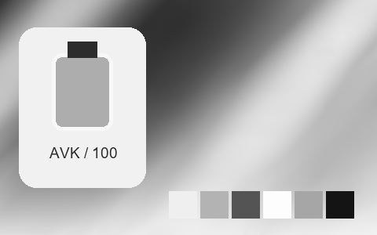

## 319 · Fuji Ilford Delta 3200 ++

`nt-negative-old-fuji-ilford-delta-3200-curve-plus-2` · `film-negative` · CC-BY-SA-4.0 · 33³

50% gray Y′ 126.0/255 (-1.5 code values); 25–75% gray span ratio 1.096; mid-gray red minus blue +0.0 code values. Light/medium/deep skin swatches: #E2E2E2, #A7A7A7, #515151. Red/green/blue swatches: #5D5D5D, #9B9B9B, #787878.

Suggested use: Compare on your own SDR product, portrait and landscape footage before selecting.

Trial strength: 1–1; default 1.0.

Pixel color mapping only; no grain, glow, vignette, spatial haze or beauty effects. Natural footage quality is unaccepted. Check skin/product colors and clipped output.

| Input swatch | Input RGB | Actual output RGB |
|---|---|---|
| `gray_0` | `#000000` | `#282828` |
| `gray_10` | `#1A1A1A` | `#282828` |
| `gray_25` | `#404040` | `#383838` |
| `gray_50` | `#808080` | `#7E7E7E` |
| `gray_75` | `#BFBFBF` | `#C4C4C4` |
| `gray_90` | `#E6E6E6` | `#E6E6E6` |
| `gray_100` | `#FFFFFF` | `#F0F0F0` |
| `skin_light` | `#F5DBC6` | `#E2E2E2` |
| `skin_medium` | `#CF9B7B` | `#A7A7A7` |
| `skin_deep` | `#815438` | `#515151` |
| `red` | `#CC3333` | `#5D5D5D` |
| `green` | `#33CC33` | `#9B9B9B` |
| `blue` | `#3333CC` | `#787878` |

Creator: **Pat David** · [Source](https://github.com/NatronGitHub/clut/blob/af7b50d4caf6244fb6895a647f5b6a84efe7931a/negative_old/fuji_ilford_delta_3200_++.png) · commit `af7b50d4caf6244fb6895a647f5b6a84efe7931a`.

Conversion: `native-depth-Hald-to-33-tetrahedral-v1`; 8,192 sampled RGB points; max error 0.0110555; mean 0.0006941. This is numerical approximation, not a perceptual quality score.

License obligations: Credit the named creator and source; retain the CC-BY-SA-4.0 notice and indicate changes. Redistributed adapted LUT data and thumbnails must use CC-BY-SA-4.0 or a compatible license; no additional restrictions.

[License](../../../product/src/ai_ad_editor/look_data/licenses/CC-BY-SA-4.0.txt) · LUT SHA-256 `88620740db8dac22d6c38e4644e062590d282b80567aaf697e845fcdee64b3a1`.

[Actual preview PNG](../../assets/look500-20261024-r1/previews/nt-negative-old-fuji-ilford-delta-3200-curve-plus-2.png) · [Actual video](../../assets/look500-20261024-r1/videos/nt-negative-old-fuji-ilford-delta-3200-curve-plus-2.mp4)

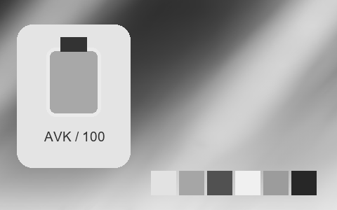

## 320 · Fuji Ilford Delta 3200 +

`nt-negative-old-fuji-ilford-delta-3200-curve-plus-1` · `film-negative` · CC-BY-SA-4.0 · 33³

50% gray Y′ 134.0/255 (+6.5 code values); 25–75% gray span ratio 1.263; mid-gray red minus blue +0.0 code values. Light/medium/deep skin swatches: #EBEBEB, #B6B6B6, #525252. Red/green/blue swatches: #747474, #A3A3A3, #878787.

Suggested use: Compare on your own SDR product, portrait and landscape footage before selecting.

Trial strength: 1–1; default 1.0.

Pixel color mapping only; no grain, glow, vignette, spatial haze or beauty effects. Natural footage quality is unaccepted. Check skin/product colors and clipped output.

| Input swatch | Input RGB | Actual output RGB |
|---|---|---|
| `gray_0` | `#000000` | `#1C1C1C` |
| `gray_10` | `#1A1A1A` | `#1D1D1D` |
| `gray_25` | `#404040` | `#333333` |
| `gray_50` | `#808080` | `#868686` |
| `gray_75` | `#BFBFBF` | `#D4D4D4` |
| `gray_90` | `#E6E6E6` | `#EFEFEF` |
| `gray_100` | `#FFFFFF` | `#F4F4F4` |
| `skin_light` | `#F5DBC6` | `#EBEBEB` |
| `skin_medium` | `#CF9B7B` | `#B6B6B6` |
| `skin_deep` | `#815438` | `#525252` |
| `red` | `#CC3333` | `#747474` |
| `green` | `#33CC33` | `#A3A3A3` |
| `blue` | `#3333CC` | `#878787` |

Creator: **Pat David** · [Source](https://github.com/NatronGitHub/clut/blob/af7b50d4caf6244fb6895a647f5b6a84efe7931a/negative_old/fuji_ilford_delta_3200_+.png) · commit `af7b50d4caf6244fb6895a647f5b6a84efe7931a`.

Conversion: `native-depth-Hald-to-33-tetrahedral-v1`; 8,192 sampled RGB points; max error 0.0062084; mean 0.0007363. This is numerical approximation, not a perceptual quality score.

License obligations: Credit the named creator and source; retain the CC-BY-SA-4.0 notice and indicate changes. Redistributed adapted LUT data and thumbnails must use CC-BY-SA-4.0 or a compatible license; no additional restrictions.

[License](../../../product/src/ai_ad_editor/look_data/licenses/CC-BY-SA-4.0.txt) · LUT SHA-256 `5b7328b375c77f8ebb4a5f4927b9210a64c678de6141e754c3235effef008967`.

[Actual preview PNG](../../assets/look500-20261024-r1/previews/nt-negative-old-fuji-ilford-delta-3200-curve-plus-1.png) · [Actual video](../../assets/look500-20261024-r1/videos/nt-negative-old-fuji-ilford-delta-3200-curve-plus-1.mp4)

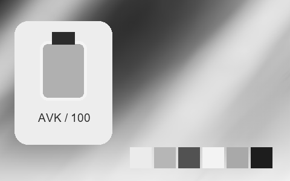

## 321 · Fuji Ilford Delta 3200 -

`nt-negative-old-fuji-ilford-delta-3200-curve-minus-1` · `film-negative` · CC-BY-SA-4.0 · 33³

50% gray Y′ 132.5/255 (+5.0 code values); 25–75% gray span ratio 1.196; mid-gray red minus blue +0.0 code values. Light/medium/deep skin swatches: #EFEFEF, #B1B1B1, #5B5B5B. Red/green/blue swatches: #787878, #A1A1A1, #878787.

Suggested use: Compare on your own SDR product, portrait and landscape footage before selecting.

Trial strength: 1–1; default 1.0.

Pixel color mapping only; no grain, glow, vignette, spatial haze or beauty effects. Natural footage quality is unaccepted. Check skin/product colors and clipped output.

| Input swatch | Input RGB | Actual output RGB |
|---|---|---|
| `gray_0` | `#000000` | `#101010` |
| `gray_10` | `#1A1A1A` | `#131313` |
| `gray_25` | `#404040` | `#383838` |
| `gray_50` | `#808080` | `#848484` |
| `gray_75` | `#BFBFBF` | `#D0D0D0` |
| `gray_90` | `#E6E6E6` | `#F5F5F5` |
| `gray_100` | `#FFFFFF` | `#FEFEFE` |
| `skin_light` | `#F5DBC6` | `#EFEFEF` |
| `skin_medium` | `#CF9B7B` | `#B1B1B1` |
| `skin_deep` | `#815438` | `#5B5B5B` |
| `red` | `#CC3333` | `#787878` |
| `green` | `#33CC33` | `#A1A1A1` |
| `blue` | `#3333CC` | `#878787` |

Creator: **Pat David** · [Source](https://github.com/NatronGitHub/clut/blob/af7b50d4caf6244fb6895a647f5b6a84efe7931a/negative_old/fuji_ilford_delta_3200_-.png) · commit `af7b50d4caf6244fb6895a647f5b6a84efe7931a`.

Conversion: `native-depth-Hald-to-33-tetrahedral-v1`; 8,192 sampled RGB points; max error 0.0105271; mean 0.0007151. This is numerical approximation, not a perceptual quality score.

License obligations: Credit the named creator and source; retain the CC-BY-SA-4.0 notice and indicate changes. Redistributed adapted LUT data and thumbnails must use CC-BY-SA-4.0 or a compatible license; no additional restrictions.

[License](../../../product/src/ai_ad_editor/look_data/licenses/CC-BY-SA-4.0.txt) · LUT SHA-256 `4067316465311d5931eb32c90b8812b0522dd178126d1de64045ebcf346a35f1`.

[Actual preview PNG](../../assets/look500-20261024-r1/previews/nt-negative-old-fuji-ilford-delta-3200-curve-minus-1.png) · [Actual video](../../assets/look500-20261024-r1/videos/nt-negative-old-fuji-ilford-delta-3200-curve-minus-1.mp4)

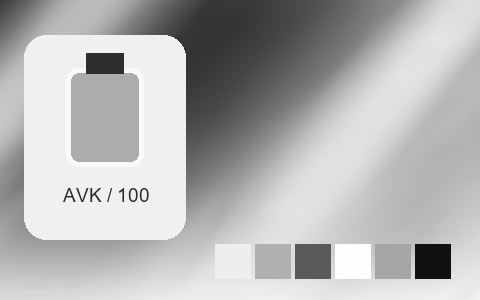

## 322 · Fuji Neopan 1600 ++

`nt-negative-old-fuji-neopan-1600-curve-plus-2` · `film-negative` · CC-BY-SA-4.0 · 33³

50% gray Y′ 139.5/255 (+12.0 code values); 25–75% gray span ratio 1.310; mid-gray red minus blue +0.0 code values. Light/medium/deep skin swatches: #F7F7F7, #C1C1C1, #525252. Red/green/blue swatches: #5F5F5F, #AFAFAF, #858585.

Suggested use: Compare on your own SDR product, portrait and landscape footage before selecting.

Trial strength: 1–1; default 1.0.

Pixel color mapping only; no grain, glow, vignette, spatial haze or beauty effects. Natural footage quality is unaccepted. Check skin/product colors and clipped output.

| Input swatch | Input RGB | Actual output RGB |
|---|---|---|
| `gray_0` | `#000000` | `#272727` |
| `gray_10` | `#1A1A1A` | `#292929` |
| `gray_25` | `#404040` | `#373737` |
| `gray_50` | `#808080` | `#8C8C8C` |
| `gray_75` | `#BFBFBF` | `#DEDEDE` |
| `gray_90` | `#E6E6E6` | `#FAFAFA` |
| `gray_100` | `#FFFFFF` | `#FCFCFC` |
| `skin_light` | `#F5DBC6` | `#F7F7F7` |
| `skin_medium` | `#CF9B7B` | `#C1C1C1` |
| `skin_deep` | `#815438` | `#525252` |
| `red` | `#CC3333` | `#5F5F5F` |
| `green` | `#33CC33` | `#AFAFAF` |
| `blue` | `#3333CC` | `#858585` |

Creator: **Pat David** · [Source](https://github.com/NatronGitHub/clut/blob/af7b50d4caf6244fb6895a647f5b6a84efe7931a/negative_old/fuji_neopan_1600_++.png) · commit `af7b50d4caf6244fb6895a647f5b6a84efe7931a`.

Conversion: `native-depth-Hald-to-33-tetrahedral-v1`; 8,192 sampled RGB points; max error 0.0264507; mean 0.0007883. This is numerical approximation, not a perceptual quality score.

License obligations: Credit the named creator and source; retain the CC-BY-SA-4.0 notice and indicate changes. Redistributed adapted LUT data and thumbnails must use CC-BY-SA-4.0 or a compatible license; no additional restrictions.

[License](../../../product/src/ai_ad_editor/look_data/licenses/CC-BY-SA-4.0.txt) · LUT SHA-256 `0d0c938914b4418782a6520bf7c005050ff2b14adec447935e34301381f583ff`.

[Actual preview PNG](../../assets/look500-20261024-r1/previews/nt-negative-old-fuji-neopan-1600-curve-plus-2.png) · [Actual video](../../assets/look500-20261024-r1/videos/nt-negative-old-fuji-neopan-1600-curve-plus-2.mp4)

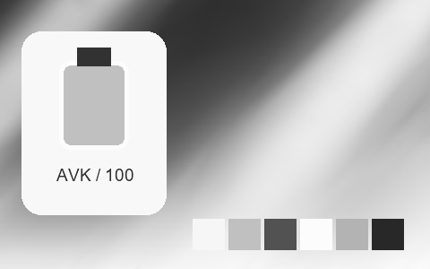

## 323 · Fuji Neopan 1600 +

`nt-negative-old-fuji-neopan-1600-curve-plus-1` · `film-negative` · CC-BY-SA-4.0 · 33³

50% gray Y′ 136.0/255 (+8.5 code values); 25–75% gray span ratio 1.357; mid-gray red minus blue +0.0 code values. Light/medium/deep skin swatches: #F7F7F7, #BEBEBE, #525252. Red/green/blue swatches: #606060, #ACACAC, #838383.

Suggested use: Compare on your own SDR product, portrait and landscape footage before selecting.

Trial strength: 1–1; default 1.0.

Pixel color mapping only; no grain, glow, vignette, spatial haze or beauty effects. Natural footage quality is unaccepted. Check skin/product colors and clipped output.

| Input swatch | Input RGB | Actual output RGB |
|---|---|---|
| `gray_0` | `#000000` | `#181818` |
| `gray_10` | `#1A1A1A` | `#1B1B1B` |
| `gray_25` | `#404040` | `#313131` |
| `gray_50` | `#808080` | `#888888` |
| `gray_75` | `#BFBFBF` | `#DEDEDE` |
| `gray_90` | `#E6E6E6` | `#FAFAFA` |
| `gray_100` | `#FFFFFF` | `#FEFEFE` |
| `skin_light` | `#F5DBC6` | `#F7F7F7` |
| `skin_medium` | `#CF9B7B` | `#BEBEBE` |
| `skin_deep` | `#815438` | `#525252` |
| `red` | `#CC3333` | `#606060` |
| `green` | `#33CC33` | `#ACACAC` |
| `blue` | `#3333CC` | `#838383` |

Creator: **Pat David** · [Source](https://github.com/NatronGitHub/clut/blob/af7b50d4caf6244fb6895a647f5b6a84efe7931a/negative_old/fuji_neopan_1600_+.png) · commit `af7b50d4caf6244fb6895a647f5b6a84efe7931a`.

Conversion: `native-depth-Hald-to-33-tetrahedral-v1`; 8,192 sampled RGB points; max error 0.0122951; mean 0.0007645. This is numerical approximation, not a perceptual quality score.

License obligations: Credit the named creator and source; retain the CC-BY-SA-4.0 notice and indicate changes. Redistributed adapted LUT data and thumbnails must use CC-BY-SA-4.0 or a compatible license; no additional restrictions.

[License](../../../product/src/ai_ad_editor/look_data/licenses/CC-BY-SA-4.0.txt) · LUT SHA-256 `8377a9d170d50ea314904347f845c238458965d4daef0e078a02ad8df000f4ec`.

[Actual preview PNG](../../assets/look500-20261024-r1/previews/nt-negative-old-fuji-neopan-1600-curve-plus-1.png) · [Actual video](../../assets/look500-20261024-r1/videos/nt-negative-old-fuji-neopan-1600-curve-plus-1.mp4)

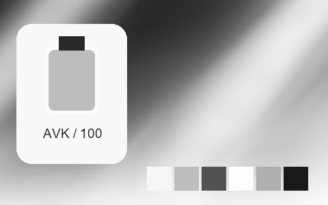

## 324 · Fuji Neopan 1600 -

`nt-negative-old-fuji-neopan-1600-curve-minus-1` · `film-negative` · CC-BY-SA-4.0 · 33³

50% gray Y′ 140.5/255 (+13.0 code values); 25–75% gray span ratio 1.324; mid-gray red minus blue +0.0 code values. Light/medium/deep skin swatches: #F7F7F7, #BABABA, #5C5C5C. Red/green/blue swatches: #676767, #AAAAAA, #848484.

Suggested use: Compare on your own SDR product, portrait and landscape footage before selecting.

Trial strength: 1–1; default 1.0.

Pixel color mapping only; no grain, glow, vignette, spatial haze or beauty effects. Natural footage quality is unaccepted. Check skin/product colors and clipped output.

| Input swatch | Input RGB | Actual output RGB |
|---|---|---|
| `gray_0` | `#000000` | `#0C0C0C` |
| `gray_10` | `#1A1A1A` | `#0F0F0F` |
| `gray_25` | `#404040` | `#313131` |
| `gray_50` | `#808080` | `#8C8C8C` |
| `gray_75` | `#BFBFBF` | `#DADADA` |
| `gray_90` | `#E6E6E6` | `#FAFAFA` |
| `gray_100` | `#FFFFFF` | `#FFFFFF` |
| `skin_light` | `#F5DBC6` | `#F7F7F7` |
| `skin_medium` | `#CF9B7B` | `#BABABA` |
| `skin_deep` | `#815438` | `#5C5C5C` |
| `red` | `#CC3333` | `#676767` |
| `green` | `#33CC33` | `#AAAAAA` |
| `blue` | `#3333CC` | `#848484` |

Creator: **Pat David** · [Source](https://github.com/NatronGitHub/clut/blob/af7b50d4caf6244fb6895a647f5b6a84efe7931a/negative_old/fuji_neopan_1600_-.png) · commit `af7b50d4caf6244fb6895a647f5b6a84efe7931a`.

Conversion: `native-depth-Hald-to-33-tetrahedral-v1`; 8,192 sampled RGB points; max error 0.0132146; mean 0.0007368. This is numerical approximation, not a perceptual quality score.

License obligations: Credit the named creator and source; retain the CC-BY-SA-4.0 notice and indicate changes. Redistributed adapted LUT data and thumbnails must use CC-BY-SA-4.0 or a compatible license; no additional restrictions.

[License](../../../product/src/ai_ad_editor/look_data/licenses/CC-BY-SA-4.0.txt) · LUT SHA-256 `da50f6ab72092d82dbdc5a7f507e368a106888d9ce1e0839b7e494b11cf59f0f`.

[Actual preview PNG](../../assets/look500-20261024-r1/previews/nt-negative-old-fuji-neopan-1600-curve-minus-1.png) · [Actual video](../../assets/look500-20261024-r1/videos/nt-negative-old-fuji-neopan-1600-curve-minus-1.mp4)

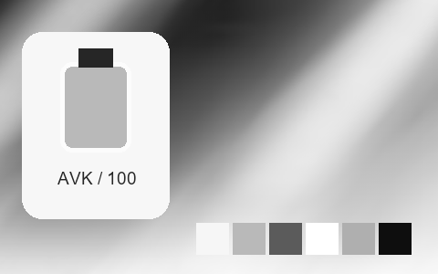

## 325 · Fuji Superia 100

`nt-negative-old-fuji-superia-100` · `film-negative` · CC-BY-SA-4.0 · 33³

50% gray Y′ 149.5/255 (+22.0 code values); 25–75% gray span ratio 1.138; mid-gray red minus blue -1.5 code values. Light/medium/deep skin swatches: #F4E9D9, #DBAF8C, #956234. Red/green/blue swatches: #D63C1F, #5DE394, #3B36E4.

Suggested use: Compare on your own SDR product, portrait and landscape footage before selecting.

Trial strength: 0.35–0.8; default 1.0.

Pixel color mapping only; no grain, glow, vignette, spatial haze or beauty effects. Natural footage quality is unaccepted. Check skin/product colors and clipped output.

| Input swatch | Input RGB | Actual output RGB |
|---|---|---|
| `gray_0` | `#000000` | `#030605` |
| `gray_10` | `#1A1A1A` | `#081917` |
| `gray_25` | `#404040` | `#3E4342` |
| `gray_50` | `#808080` | `#969598` |
| `gray_75` | `#BFBFBF` | `#D3D3D2` |
| `gray_90` | `#E6E6E6` | `#F2EFF0` |
| `gray_100` | `#FFFFFF` | `#FEFEFE` |
| `skin_light` | `#F5DBC6` | `#F4E9D9` |
| `skin_medium` | `#CF9B7B` | `#DBAF8C` |
| `skin_deep` | `#815438` | `#956234` |
| `red` | `#CC3333` | `#D63C1F` |
| `green` | `#33CC33` | `#5DE394` |
| `blue` | `#3333CC` | `#3B36E4` |

Creator: **Pat David** · [Source](https://github.com/NatronGitHub/clut/blob/af7b50d4caf6244fb6895a647f5b6a84efe7931a/negative_old/fuji_superia_100.png) · commit `af7b50d4caf6244fb6895a647f5b6a84efe7931a`.

Conversion: `native-depth-Hald-to-33-tetrahedral-v1`; 8,192 sampled RGB points; max error 0.0278079; mean 0.0008131. This is numerical approximation, not a perceptual quality score.

License obligations: Credit the named creator and source; retain the CC-BY-SA-4.0 notice and indicate changes. Redistributed adapted LUT data and thumbnails must use CC-BY-SA-4.0 or a compatible license; no additional restrictions.

[License](../../../product/src/ai_ad_editor/look_data/licenses/CC-BY-SA-4.0.txt) · LUT SHA-256 `76d3670f9db0fa366c739dbbf678df14abbd393e8b4828f17123977a5a05e63a`.

[Actual preview PNG](../../assets/look500-20261024-r1/previews/nt-negative-old-fuji-superia-100.png) · [Actual video](../../assets/look500-20261024-r1/videos/nt-negative-old-fuji-superia-100.mp4)

## 326 · Fuji Superia 100 ++

`nt-negative-old-fuji-superia-100-curve-plus-2` · `film-negative` · CC-BY-SA-4.0 · 33³

50% gray Y′ 149.7/255 (+22.2 code values); 25–75% gray span ratio 1.168; mid-gray red minus blue -1.5 code values. Light/medium/deep skin swatches: #F4E7DB, #E5AC8A, #97602E. Red/green/blue swatches: #DE3819, #55E393, #302CE9.

Suggested use: Compare on your own SDR product, portrait and landscape footage before selecting.

Trial strength: 0.35–0.8; default 1.0.

Pixel color mapping only; no grain, glow, vignette, spatial haze or beauty effects. Natural footage quality is unaccepted. Check skin/product colors and clipped output.

| Input swatch | Input RGB | Actual output RGB |
|---|---|---|
| `gray_0` | `#000000` | `#0D1819` |
| `gray_10` | `#1A1A1A` | `#101E1E` |
| `gray_25` | `#404040` | `#324140` |
| `gray_50` | `#808080` | `#98949A` |
| `gray_75` | `#BFBFBF` | `#DAD0D7` |
| `gray_90` | `#E6E6E6` | `#F2EEF1` |
| `gray_100` | `#FFFFFF` | `#FEFEFE` |
| `skin_light` | `#F5DBC6` | `#F4E7DB` |
| `skin_medium` | `#CF9B7B` | `#E5AC8A` |
| `skin_deep` | `#815438` | `#97602E` |
| `red` | `#CC3333` | `#DE3819` |
| `green` | `#33CC33` | `#55E393` |
| `blue` | `#3333CC` | `#302CE9` |

Creator: **Pat David** · [Source](https://github.com/NatronGitHub/clut/blob/af7b50d4caf6244fb6895a647f5b6a84efe7931a/negative_old/fuji_superia_100_++.png) · commit `af7b50d4caf6244fb6895a647f5b6a84efe7931a`.

Conversion: `native-depth-Hald-to-33-tetrahedral-v1`; 8,192 sampled RGB points; max error 0.0497461; mean 0.0008870. This is numerical approximation, not a perceptual quality score.

License obligations: Credit the named creator and source; retain the CC-BY-SA-4.0 notice and indicate changes. Redistributed adapted LUT data and thumbnails must use CC-BY-SA-4.0 or a compatible license; no additional restrictions.

[License](../../../product/src/ai_ad_editor/look_data/licenses/CC-BY-SA-4.0.txt) · LUT SHA-256 `91b4f528b5d99a390e425f0cb2a41cd6b357e3d14ee5e15e185ab26f154756d6`.

[Actual preview PNG](../../assets/look500-20261024-r1/previews/nt-negative-old-fuji-superia-100-curve-plus-2.png) · [Actual video](../../assets/look500-20261024-r1/videos/nt-negative-old-fuji-superia-100-curve-plus-2.mp4)

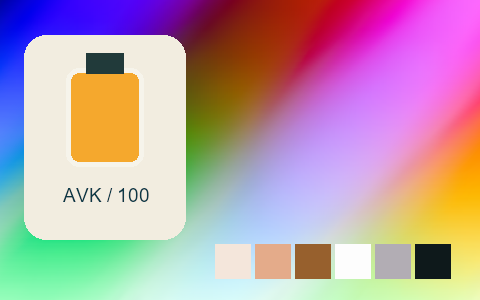

## 327 · Fuji Superia 100 +

`nt-negative-old-fuji-superia-100-curve-plus-1` · `film-negative` · CC-BY-SA-4.0 · 33³

50% gray Y′ 149.6/255 (+22.1 code values); 25–75% gray span ratio 1.167; mid-gray red minus blue +7.0 code values. Light/medium/deep skin swatches: #F8E0D8, #E1A988, #995E30. Red/green/blue swatches: #DD301A, #5CE18E, #3829E6.

Suggested use: Compare on your own SDR product, portrait and landscape footage before selecting.

Trial strength: 0.35–0.8; default 1.0.

Pixel color mapping only; no grain, glow, vignette, spatial haze or beauty effects. Natural footage quality is unaccepted. Check skin/product colors and clipped output.

| Input swatch | Input RGB | Actual output RGB |
|---|---|---|
| `gray_0` | `#000000` | `#010D11` |
| `gray_10` | `#1A1A1A` | `#041317` |
| `gray_25` | `#404040` | `#303E44` |
| `gray_50` | `#808080` | `#9C9395` |
| `gray_75` | `#BFBFBF` | `#D7CED2` |
| `gray_90` | `#E6E6E6` | `#F2ECF3` |
| `gray_100` | `#FFFFFF` | `#FDF8FD` |
| `skin_light` | `#F5DBC6` | `#F8E0D8` |
| `skin_medium` | `#CF9B7B` | `#E1A988` |
| `skin_deep` | `#815438` | `#995E30` |
| `red` | `#CC3333` | `#DD301A` |
| `green` | `#33CC33` | `#5CE18E` |
| `blue` | `#3333CC` | `#3829E6` |

Creator: **Pat David** · [Source](https://github.com/NatronGitHub/clut/blob/af7b50d4caf6244fb6895a647f5b6a84efe7931a/negative_old/fuji_superia_100_+.png) · commit `af7b50d4caf6244fb6895a647f5b6a84efe7931a`.

Conversion: `native-depth-Hald-to-33-tetrahedral-v1`; 8,192 sampled RGB points; max error 0.0335104; mean 0.0008746. This is numerical approximation, not a perceptual quality score.

License obligations: Credit the named creator and source; retain the CC-BY-SA-4.0 notice and indicate changes. Redistributed adapted LUT data and thumbnails must use CC-BY-SA-4.0 or a compatible license; no additional restrictions.

[License](../../../product/src/ai_ad_editor/look_data/licenses/CC-BY-SA-4.0.txt) · LUT SHA-256 `933cfcfaf4c261dee05dd8b1f797bc815300798338de9b04a4cedab8caa6427b`.

[Actual preview PNG](../../assets/look500-20261024-r1/previews/nt-negative-old-fuji-superia-100-curve-plus-1.png) · [Actual video](../../assets/look500-20261024-r1/videos/nt-negative-old-fuji-superia-100-curve-plus-1.mp4)

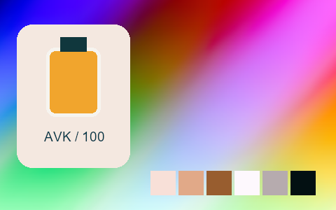

## 328 · Fuji Superia 100 -

`nt-negative-old-fuji-superia-100-curve-minus-1` · `film-negative` · CC-BY-SA-4.0 · 33³

50% gray Y′ 144.7/255 (+17.2 code values); 25–75% gray span ratio 1.089; mid-gray red minus blue -2.5 code values. Light/medium/deep skin swatches: #F3E6D6, #D7AB88, #91613B. Red/green/blue swatches: #D13E24, #56E190, #3F3AE1.

Suggested use: Compare on your own SDR product, portrait and landscape footage before selecting.

Trial strength: 0.35–0.8; default 1.0.

Pixel color mapping only; no grain, glow, vignette, spatial haze or beauty effects. Natural footage quality is unaccepted. Check skin/product colors and clipped output.

| Input swatch | Input RGB | Actual output RGB |
|---|---|---|
| `gray_0` | `#000000` | `#010100` |
| `gray_10` | `#1A1A1A` | `#0C1114` |
| `gray_25` | `#404040` | `#404646` |
| `gray_50` | `#808080` | `#909093` |
| `gray_75` | `#BFBFBF` | `#CFD0D0` |
| `gray_90` | `#E6E6E6` | `#F0EDEE` |
| `gray_100` | `#FFFFFF` | `#FEFEFD` |
| `skin_light` | `#F5DBC6` | `#F3E6D6` |
| `skin_medium` | `#CF9B7B` | `#D7AB88` |
| `skin_deep` | `#815438` | `#91613B` |
| `red` | `#CC3333` | `#D13E24` |
| `green` | `#33CC33` | `#56E190` |
| `blue` | `#3333CC` | `#3F3AE1` |

Creator: **Pat David** · [Source](https://github.com/NatronGitHub/clut/blob/af7b50d4caf6244fb6895a647f5b6a84efe7931a/negative_old/fuji_superia_100_-.png) · commit `af7b50d4caf6244fb6895a647f5b6a84efe7931a`.

Conversion: `native-depth-Hald-to-33-tetrahedral-v1`; 8,192 sampled RGB points; max error 0.0245603; mean 0.0007828. This is numerical approximation, not a perceptual quality score.

License obligations: Credit the named creator and source; retain the CC-BY-SA-4.0 notice and indicate changes. Redistributed adapted LUT data and thumbnails must use CC-BY-SA-4.0 or a compatible license; no additional restrictions.

[License](../../../product/src/ai_ad_editor/look_data/licenses/CC-BY-SA-4.0.txt) · LUT SHA-256 `7c7f39943810ea11218f8b4cef4dba314b397e34f9dee21635f155dd14deef7c`.

[Actual preview PNG](../../assets/look500-20261024-r1/previews/nt-negative-old-fuji-superia-100-curve-minus-1.png) · [Actual video](../../assets/look500-20261024-r1/videos/nt-negative-old-fuji-superia-100-curve-minus-1.mp4)

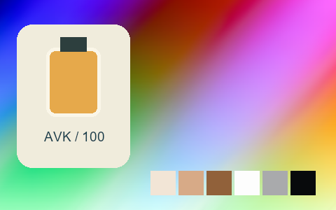

## 329 · Fuji Superia 1600

`nt-negative-old-fuji-superia-1600` · `film-negative` · CC-BY-SA-4.0 · 33³

50% gray Y′ 146.2/255 (+18.7 code values); 25–75% gray span ratio 1.126; mid-gray red minus blue +8.5 code values. Light/medium/deep skin swatches: #F1E3D8, #DCB18D, #936033. Red/green/blue swatches: #D84227, #65D07F, #5A3FCD.

Suggested use: Compare on your own SDR product, portrait and landscape footage before selecting.

Trial strength: 0.35–0.8; default 1.0.

Pixel color mapping only; no grain, glow, vignette, spatial haze or beauty effects. Natural footage quality is unaccepted. Check skin/product colors and clipped output.

| Input swatch | Input RGB | Actual output RGB |
|---|---|---|
| `gray_0` | `#000000` | `#0F1819` |
| `gray_10` | `#1A1A1A` | `#131F1F` |
| `gray_25` | `#404040` | `#33423C` |
| `gray_50` | `#808080` | `#98918F` |
| `gray_75` | `#BFBFBF` | `#D1CDCE` |
| `gray_90` | `#E6E6E6` | `#ECE9EB` |
| `gray_100` | `#FFFFFF` | `#F5F4EF` |
| `skin_light` | `#F5DBC6` | `#F1E3D8` |
| `skin_medium` | `#CF9B7B` | `#DCB18D` |
| `skin_deep` | `#815438` | `#936033` |
| `red` | `#CC3333` | `#D84227` |
| `green` | `#33CC33` | `#65D07F` |
| `blue` | `#3333CC` | `#5A3FCD` |

Creator: **Pat David** · [Source](https://github.com/NatronGitHub/clut/blob/af7b50d4caf6244fb6895a647f5b6a84efe7931a/negative_old/fuji_superia_1600.png) · commit `af7b50d4caf6244fb6895a647f5b6a84efe7931a`.

Conversion: `native-depth-Hald-to-33-tetrahedral-v1`; 8,192 sampled RGB points; max error 0.0484379; mean 0.0008483. This is numerical approximation, not a perceptual quality score.

License obligations: Credit the named creator and source; retain the CC-BY-SA-4.0 notice and indicate changes. Redistributed adapted LUT data and thumbnails must use CC-BY-SA-4.0 or a compatible license; no additional restrictions.

[License](../../../product/src/ai_ad_editor/look_data/licenses/CC-BY-SA-4.0.txt) · LUT SHA-256 `d69e47631001ac951cfff5d4252beacf4aca396f1468b800e6777729105851be`.

[Actual preview PNG](../../assets/look500-20261024-r1/previews/nt-negative-old-fuji-superia-1600.png) · [Actual video](../../assets/look500-20261024-r1/videos/nt-negative-old-fuji-superia-1600.mp4)

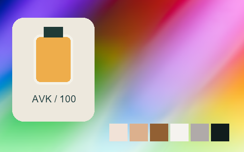

## 330 · Fuji Superia 1600 ++

`nt-negative-old-fuji-superia-1600-curve-plus-2` · `film-negative` · CC-BY-SA-4.0 · 33³

50% gray Y′ 138.1/255 (+10.6 code values); 25–75% gray span ratio 0.980; mid-gray red minus blue +7.0 code values. Light/medium/deep skin swatches: #F3DAC9, #D6A385, #896442. Red/green/blue swatches: #CC4E3B, #6AC178, #5B48BC.

Suggested use: Compare on your own SDR product, portrait and landscape footage before selecting.

Trial strength: 0.35–0.8; default 1.0.

Pixel color mapping only; no grain, glow, vignette, spatial haze or beauty effects. Natural footage quality is unaccepted. Check skin/product colors and clipped output.

| Input swatch | Input RGB | Actual output RGB |
|---|---|---|
| `gray_0` | `#000000` | `#273631` |
| `gray_10` | `#1A1A1A` | `#293934` |
| `gray_25` | `#404040` | `#3D4A45` |
| `gray_50` | `#808080` | `#8E8A86` |
| `gray_75` | `#BFBFBF` | `#D0C1BE` |
| `gray_90` | `#E6E6E6` | `#E9DFE0` |
| `gray_100` | `#FFFFFF` | `#F3F4F1` |
| `skin_light` | `#F5DBC6` | `#F3DAC9` |
| `skin_medium` | `#CF9B7B` | `#D6A385` |
| `skin_deep` | `#815438` | `#896442` |
| `red` | `#CC3333` | `#CC4E3B` |
| `green` | `#33CC33` | `#6AC178` |
| `blue` | `#3333CC` | `#5B48BC` |

Creator: **Pat David** · [Source](https://github.com/NatronGitHub/clut/blob/af7b50d4caf6244fb6895a647f5b6a84efe7931a/negative_old/fuji_superia_1600_++.png) · commit `af7b50d4caf6244fb6895a647f5b6a84efe7931a`.

Conversion: `native-depth-Hald-to-33-tetrahedral-v1`; 8,192 sampled RGB points; max error 0.0349012; mean 0.0007646. This is numerical approximation, not a perceptual quality score.

License obligations: Credit the named creator and source; retain the CC-BY-SA-4.0 notice and indicate changes. Redistributed adapted LUT data and thumbnails must use CC-BY-SA-4.0 or a compatible license; no additional restrictions.

[License](../../../product/src/ai_ad_editor/look_data/licenses/CC-BY-SA-4.0.txt) · LUT SHA-256 `df9fe47ca639ffe8dfa7d44f133ec22ccf319f81d90e1f38c6fbd4b8cca2859b`.

[Actual preview PNG](../../assets/look500-20261024-r1/previews/nt-negative-old-fuji-superia-1600-curve-plus-2.png) · [Actual video](../../assets/look500-20261024-r1/videos/nt-negative-old-fuji-superia-1600-curve-plus-2.mp4)

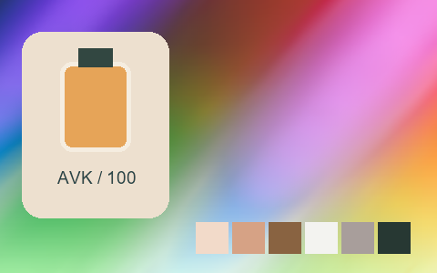

## 331 · Fuji Superia 1600 +

`nt-negative-old-fuji-superia-1600-curve-plus-1` · `film-negative` · CC-BY-SA-4.0 · 33³

50% gray Y′ 144.9/255 (+17.4 code values); 25–75% gray span ratio 1.038; mid-gray red minus blue +11.5 code values. Light/medium/deep skin swatches: #F7DED0, #DFA98B, #92643D. Red/green/blue swatches: #D74732, #71CB7D, #6147C5.

Suggested use: Compare on your own SDR product, portrait and landscape footage before selecting.

Trial strength: 0.35–0.8; default 1.0.

Pixel color mapping only; no grain, glow, vignette, spatial haze or beauty effects. Natural footage quality is unaccepted. Check skin/product colors and clipped output.

| Input swatch | Input RGB | Actual output RGB |
|---|---|---|
| `gray_0` | `#000000` | `#152722` |
| `gray_10` | `#1A1A1A` | `#1D2A29` |
| `gray_25` | `#404040` | `#3A4743` |
| `gray_50` | `#808080` | `#988F8D` |
| `gray_75` | `#BFBFBF` | `#D5C5C4` |
| `gray_90` | `#E6E6E6` | `#EEE5E4` |
| `gray_100` | `#FFFFFF` | `#EFF1F4` |
| `skin_light` | `#F5DBC6` | `#F7DED0` |
| `skin_medium` | `#CF9B7B` | `#DFA98B` |
| `skin_deep` | `#815438` | `#92643D` |
| `red` | `#CC3333` | `#D74732` |
| `green` | `#33CC33` | `#71CB7D` |
| `blue` | `#3333CC` | `#6147C5` |

Creator: **Pat David** · [Source](https://github.com/NatronGitHub/clut/blob/af7b50d4caf6244fb6895a647f5b6a84efe7931a/negative_old/fuji_superia_1600_+.png) · commit `af7b50d4caf6244fb6895a647f5b6a84efe7931a`.

Conversion: `native-depth-Hald-to-33-tetrahedral-v1`; 8,192 sampled RGB points; max error 0.0240619; mean 0.0007815. This is numerical approximation, not a perceptual quality score.

License obligations: Credit the named creator and source; retain the CC-BY-SA-4.0 notice and indicate changes. Redistributed adapted LUT data and thumbnails must use CC-BY-SA-4.0 or a compatible license; no additional restrictions.

[License](../../../product/src/ai_ad_editor/look_data/licenses/CC-BY-SA-4.0.txt) · LUT SHA-256 `d2dfaa360c82dddbc71370023efd50872728db5036aa5b92bc69045571629220`.

[Actual preview PNG](../../assets/look500-20261024-r1/previews/nt-negative-old-fuji-superia-1600-curve-plus-1.png) · [Actual video](../../assets/look500-20261024-r1/videos/nt-negative-old-fuji-superia-1600-curve-plus-1.mp4)

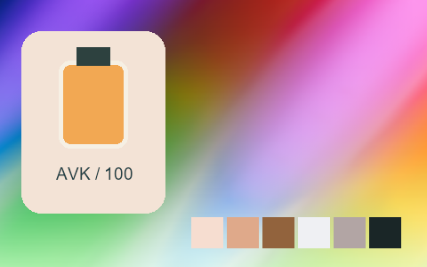

## 332 · Fuji Superia 1600 -

`nt-negative-old-fuji-superia-1600-curve-minus-1` · `film-negative` · CC-BY-SA-4.0 · 33³

50% gray Y′ 144.8/255 (+17.3 code values); 25–75% gray span ratio 1.117; mid-gray red minus blue +6.5 code values. Light/medium/deep skin swatches: #F2E6D9, #DCAE8D, #955F35. Red/green/blue swatches: #D64026, #67D07D, #5B42CB.

Suggested use: Compare on your own SDR product, portrait and landscape footage before selecting.

Trial strength: 0.35–0.8; default 1.0.

Pixel color mapping only; no grain, glow, vignette, spatial haze or beauty effects. Natural footage quality is unaccepted. Check skin/product colors and clipped output.

| Input swatch | Input RGB | Actual output RGB |
|---|---|---|
| `gray_0` | `#000000` | `#050A0E` |
| `gray_10` | `#1A1A1A` | `#0A1315` |
| `gray_25` | `#404040` | `#30423B` |
| `gray_50` | `#808080` | `#94908E` |
| `gray_75` | `#BFBFBF` | `#CECCCD` |
| `gray_90` | `#E6E6E6` | `#ECEDEC` |
| `gray_100` | `#FFFFFF` | `#FCFCFB` |
| `skin_light` | `#F5DBC6` | `#F2E6D9` |
| `skin_medium` | `#CF9B7B` | `#DCAE8D` |
| `skin_deep` | `#815438` | `#955F35` |
| `red` | `#CC3333` | `#D64026` |
| `green` | `#33CC33` | `#67D07D` |
| `blue` | `#3333CC` | `#5B42CB` |

Creator: **Pat David** · [Source](https://github.com/NatronGitHub/clut/blob/af7b50d4caf6244fb6895a647f5b6a84efe7931a/negative_old/fuji_superia_1600_-.png) · commit `af7b50d4caf6244fb6895a647f5b6a84efe7931a`.

Conversion: `native-depth-Hald-to-33-tetrahedral-v1`; 8,192 sampled RGB points; max error 0.0343080; mean 0.0008398. This is numerical approximation, not a perceptual quality score.

License obligations: Credit the named creator and source; retain the CC-BY-SA-4.0 notice and indicate changes. Redistributed adapted LUT data and thumbnails must use CC-BY-SA-4.0 or a compatible license; no additional restrictions.

[License](../../../product/src/ai_ad_editor/look_data/licenses/CC-BY-SA-4.0.txt) · LUT SHA-256 `044132e128c860436eb56118ded08f697c858a86bf9c855b2bae89ee35784059`.

[Actual preview PNG](../../assets/look500-20261024-r1/previews/nt-negative-old-fuji-superia-1600-curve-minus-1.png) · [Actual video](../../assets/look500-20261024-r1/videos/nt-negative-old-fuji-superia-1600-curve-minus-1.mp4)

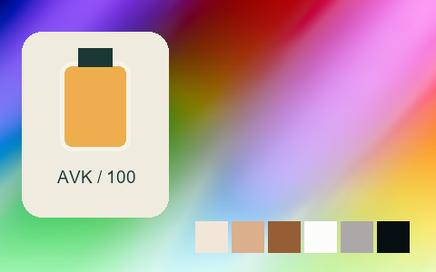

## 333 · Fuji Superia 400

`nt-negative-old-fuji-superia-400` · `film-negative` · CC-BY-SA-4.0 · 33³

50% gray Y′ 154.8/255 (+27.3 code values); 25–75% gray span ratio 1.200; mid-gray red minus blue +3.5 code values. Light/medium/deep skin swatches: #F5E6DA, #E5AE86, #9C6129. Red/green/blue swatches: #EA3B1C, #74CA85, #6644D7.

Suggested use: Compare on your own SDR product, portrait and landscape footage before selecting.

Trial strength: 0.35–0.8; default 1.0.

Pixel color mapping only; no grain, glow, vignette, spatial haze or beauty effects. Natural footage quality is unaccepted. Check skin/product colors and clipped output.

| Input swatch | Input RGB | Actual output RGB |
|---|---|---|
| `gray_0` | `#000000` | `#000A09` |
| `gray_10` | `#1A1A1A` | `#0C1816` |
| `gray_25` | `#404040` | `#373E38` |
| `gray_50` | `#808080` | `#9C9B99` |
| `gray_75` | `#BFBFBF` | `#D8D4D3` |
| `gray_90` | `#E6E6E6` | `#EDE9EA` |
| `gray_100` | `#FFFFFF` | `#F9F8F8` |
| `skin_light` | `#F5DBC6` | `#F5E6DA` |
| `skin_medium` | `#CF9B7B` | `#E5AE86` |
| `skin_deep` | `#815438` | `#9C6129` |
| `red` | `#CC3333` | `#EA3B1C` |
| `green` | `#33CC33` | `#74CA85` |
| `blue` | `#3333CC` | `#6644D7` |

Creator: **Pat David** · [Source](https://github.com/NatronGitHub/clut/blob/af7b50d4caf6244fb6895a647f5b6a84efe7931a/negative_old/fuji_superia_400.png) · commit `af7b50d4caf6244fb6895a647f5b6a84efe7931a`.

Conversion: `native-depth-Hald-to-33-tetrahedral-v1`; 8,192 sampled RGB points; max error 0.0293904; mean 0.0008741. This is numerical approximation, not a perceptual quality score.

License obligations: Credit the named creator and source; retain the CC-BY-SA-4.0 notice and indicate changes. Redistributed adapted LUT data and thumbnails must use CC-BY-SA-4.0 or a compatible license; no additional restrictions.

[License](../../../product/src/ai_ad_editor/look_data/licenses/CC-BY-SA-4.0.txt) · LUT SHA-256 `844aee20ad4eae65486e34b7d78c1d1a0381da7c0a9bc7c793086bf0d19752ff`.

[Actual preview PNG](../../assets/look500-20261024-r1/previews/nt-negative-old-fuji-superia-400.png) · [Actual video](../../assets/look500-20261024-r1/videos/nt-negative-old-fuji-superia-400.mp4)

## 334 · Fuji Superia 400 ++

`nt-negative-old-fuji-superia-400-curve-plus-2` · `film-negative` · CC-BY-SA-4.0 · 33³

50% gray Y′ 156.8/255 (+29.3 code values); 25–75% gray span ratio 1.196; mid-gray red minus blue +5.0 code values. Light/medium/deep skin swatches: #F6ECDE, #EEB78C, #9E5F2A. Red/green/blue swatches: #F23B21, #79D189, #6548DD.

Suggested use: Compare on your own SDR product, portrait and landscape footage before selecting.

Trial strength: 0.35–0.8; default 1.0.

Pixel color mapping only; no grain, glow, vignette, spatial haze or beauty effects. Natural footage quality is unaccepted. Check skin/product colors and clipped output.

| Input swatch | Input RGB | Actual output RGB |
|---|---|---|
| `gray_0` | `#000000` | `#041210` |
| `gray_10` | `#1A1A1A` | `#121E1B` |
| `gray_25` | `#404040` | `#3A443F` |
| `gray_50` | `#808080` | `#A29C9C` |
| `gray_75` | `#BFBFBF` | `#DEDAD8` |
| `gray_90` | `#E6E6E6` | `#F0EFEE` |
| `gray_100` | `#FFFFFF` | `#F6F2F5` |
| `skin_light` | `#F5DBC6` | `#F6ECDE` |
| `skin_medium` | `#CF9B7B` | `#EEB78C` |
| `skin_deep` | `#815438` | `#9E5F2A` |
| `red` | `#CC3333` | `#F23B21` |
| `green` | `#33CC33` | `#79D189` |
| `blue` | `#3333CC` | `#6548DD` |

Creator: **Pat David** · [Source](https://github.com/NatronGitHub/clut/blob/af7b50d4caf6244fb6895a647f5b6a84efe7931a/negative_old/fuji_superia_400_++.png) · commit `af7b50d4caf6244fb6895a647f5b6a84efe7931a`.

Conversion: `native-depth-Hald-to-33-tetrahedral-v1`; 8,192 sampled RGB points; max error 0.0339955; mean 0.0008825. This is numerical approximation, not a perceptual quality score.

License obligations: Credit the named creator and source; retain the CC-BY-SA-4.0 notice and indicate changes. Redistributed adapted LUT data and thumbnails must use CC-BY-SA-4.0 or a compatible license; no additional restrictions.

[License](../../../product/src/ai_ad_editor/look_data/licenses/CC-BY-SA-4.0.txt) · LUT SHA-256 `4cb3d232abc32c086e4a8a7d0b3d29c24085665fdfb9e607631111994db64432`.

[Actual preview PNG](../../assets/look500-20261024-r1/previews/nt-negative-old-fuji-superia-400-curve-plus-2.png) · [Actual video](../../assets/look500-20261024-r1/videos/nt-negative-old-fuji-superia-400-curve-plus-2.mp4)

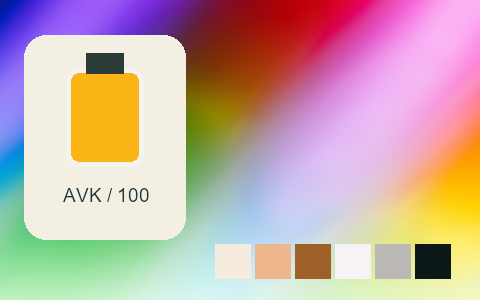

## 335 · Fuji Superia 400 +

`nt-negative-old-fuji-superia-400-curve-plus-1` · `film-negative` · CC-BY-SA-4.0 · 33³

50% gray Y′ 152.3/255 (+24.8 code values); 25–75% gray span ratio 1.174; mid-gray red minus blue +1.0 code values. Light/medium/deep skin swatches: #F5E6DD, #E6AC88, #9C5E26. Red/green/blue swatches: #EA3D1C, #7AC787, #6545D8.

Suggested use: Compare on your own SDR product, portrait and landscape footage before selecting.

Trial strength: 0.35–0.8; default 1.0.

Pixel color mapping only; no grain, glow, vignette, spatial haze or beauty effects. Natural footage quality is unaccepted. Check skin/product colors and clipped output.

| Input swatch | Input RGB | Actual output RGB |
|---|---|---|
| `gray_0` | `#000000` | `#041011` |
| `gray_10` | `#1A1A1A` | `#101A19` |
| `gray_25` | `#404040` | `#343F3A` |
| `gray_50` | `#808080` | `#9B989A` |
| `gray_75` | `#BFBFBF` | `#D8D0D4` |
| `gray_90` | `#E6E6E6` | `#EFE9EA` |
| `gray_100` | `#FFFFFF` | `#F9F8F8` |
| `skin_light` | `#F5DBC6` | `#F5E6DD` |
| `skin_medium` | `#CF9B7B` | `#E6AC88` |
| `skin_deep` | `#815438` | `#9C5E26` |
| `red` | `#CC3333` | `#EA3D1C` |
| `green` | `#33CC33` | `#7AC787` |
| `blue` | `#3333CC` | `#6545D8` |

Creator: **Pat David** · [Source](https://github.com/NatronGitHub/clut/blob/af7b50d4caf6244fb6895a647f5b6a84efe7931a/negative_old/fuji_superia_400_+.png) · commit `af7b50d4caf6244fb6895a647f5b6a84efe7931a`.

Conversion: `native-depth-Hald-to-33-tetrahedral-v1`; 8,192 sampled RGB points; max error 0.0268018; mean 0.0008770. This is numerical approximation, not a perceptual quality score.

License obligations: Credit the named creator and source; retain the CC-BY-SA-4.0 notice and indicate changes. Redistributed adapted LUT data and thumbnails must use CC-BY-SA-4.0 or a compatible license; no additional restrictions.

[License](../../../product/src/ai_ad_editor/look_data/licenses/CC-BY-SA-4.0.txt) · LUT SHA-256 `2170649ccd348afa54a0d8d9d4549fa436a7d5b1a6dff4b8b6ce5465f91a608b`.

[Actual preview PNG](../../assets/look500-20261024-r1/previews/nt-negative-old-fuji-superia-400-curve-plus-1.png) · [Actual video](../../assets/look500-20261024-r1/videos/nt-negative-old-fuji-superia-400-curve-plus-1.mp4)

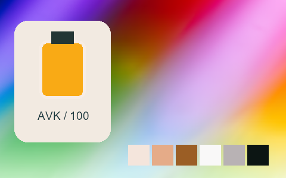

## 336 · Fuji Superia 400 -

`nt-negative-old-fuji-superia-400-curve-minus-1` · `film-negative` · CC-BY-SA-4.0 · 33³

50% gray Y′ 152.4/255 (+24.9 code values); 25–75% gray span ratio 1.152; mid-gray red minus blue +3.0 code values. Light/medium/deep skin swatches: #F8E9DD, #E5B38D, #9D622F. Red/green/blue swatches: #EA4324, #78CA87, #6D4CD9.

Suggested use: Compare on your own SDR product, portrait and landscape footage before selecting.

Trial strength: 0.35–0.8; default 1.0.

Pixel color mapping only; no grain, glow, vignette, spatial haze or beauty effects. Natural footage quality is unaccepted. Check skin/product colors and clipped output.

| Input swatch | Input RGB | Actual output RGB |
|---|---|---|
| `gray_0` | `#000000` | `#000505` |
| `gray_10` | `#1A1A1A` | `#071613` |
| `gray_25` | `#404040` | `#3E4541` |
| `gray_50` | `#808080` | `#9A9897` |
| `gray_75` | `#BFBFBF` | `#D9D5D5` |
| `gray_90` | `#E6E6E6` | `#F1EDEE` |
| `gray_100` | `#FFFFFF` | `#FAF2F8` |
| `skin_light` | `#F5DBC6` | `#F8E9DD` |
| `skin_medium` | `#CF9B7B` | `#E5B38D` |
| `skin_deep` | `#815438` | `#9D622F` |
| `red` | `#CC3333` | `#EA4324` |
| `green` | `#33CC33` | `#78CA87` |
| `blue` | `#3333CC` | `#6D4CD9` |

Creator: **Pat David** · [Source](https://github.com/NatronGitHub/clut/blob/af7b50d4caf6244fb6895a647f5b6a84efe7931a/negative_old/fuji_superia_400_-.png) · commit `af7b50d4caf6244fb6895a647f5b6a84efe7931a`.

Conversion: `native-depth-Hald-to-33-tetrahedral-v1`; 8,192 sampled RGB points; max error 0.0227888; mean 0.0008432. This is numerical approximation, not a perceptual quality score.

License obligations: Credit the named creator and source; retain the CC-BY-SA-4.0 notice and indicate changes. Redistributed adapted LUT data and thumbnails must use CC-BY-SA-4.0 or a compatible license; no additional restrictions.

[License](../../../product/src/ai_ad_editor/look_data/licenses/CC-BY-SA-4.0.txt) · LUT SHA-256 `c6df3878b2b08bfc7fe1a7d0a58511573e41587ce20cab09da27bf188ff1e840`.

[Actual preview PNG](../../assets/look500-20261024-r1/previews/nt-negative-old-fuji-superia-400-curve-minus-1.png) · [Actual video](../../assets/look500-20261024-r1/videos/nt-negative-old-fuji-superia-400-curve-minus-1.mp4)

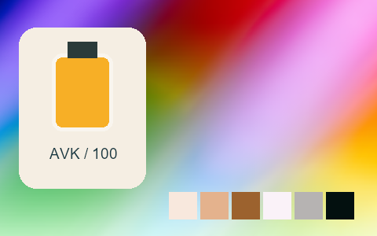

## 337 · Fuji Superia 800

`nt-negative-old-fuji-superia-800` · `film-negative` · CC-BY-SA-4.0 · 33³

50% gray Y′ 145.9/255 (+18.4 code values); 25–75% gray span ratio 1.198; mid-gray red minus blue +6.0 code values. Light/medium/deep skin swatches: #F2E4D5, #E1B086, #8F5C33. Red/green/blue swatches: #D83C28, #87E392, #5539C7.

Suggested use: Compare on your own SDR product, portrait and landscape footage before selecting.

Trial strength: 0.35–0.8; default 1.0.

Pixel color mapping only; no grain, glow, vignette, spatial haze or beauty effects. Natural footage quality is unaccepted. Check skin/product colors and clipped output.

| Input swatch | Input RGB | Actual output RGB |
|---|---|---|
| `gray_0` | `#000000` | `#011213` |
| `gray_10` | `#1A1A1A` | `#041B1A` |
| `gray_25` | `#404040` | `#2C3D3D` |
| `gray_50` | `#808080` | `#94928E` |
| `gray_75` | `#BFBFBF` | `#D4D2CE` |
| `gray_90` | `#E6E6E6` | `#EBE8E7` |
| `gray_100` | `#FFFFFF` | `#F7EFF4` |
| `skin_light` | `#F5DBC6` | `#F2E4D5` |
| `skin_medium` | `#CF9B7B` | `#E1B086` |
| `skin_deep` | `#815438` | `#8F5C33` |
| `red` | `#CC3333` | `#D83C28` |
| `green` | `#33CC33` | `#87E392` |
| `blue` | `#3333CC` | `#5539C7` |

Creator: **Pat David** · [Source](https://github.com/NatronGitHub/clut/blob/af7b50d4caf6244fb6895a647f5b6a84efe7931a/negative_old/fuji_superia_800.png) · commit `af7b50d4caf6244fb6895a647f5b6a84efe7931a`.

Conversion: `native-depth-Hald-to-33-tetrahedral-v1`; 8,192 sampled RGB points; max error 0.0260795; mean 0.0008555. This is numerical approximation, not a perceptual quality score.

License obligations: Credit the named creator and source; retain the CC-BY-SA-4.0 notice and indicate changes. Redistributed adapted LUT data and thumbnails must use CC-BY-SA-4.0 or a compatible license; no additional restrictions.

[License](../../../product/src/ai_ad_editor/look_data/licenses/CC-BY-SA-4.0.txt) · LUT SHA-256 `04d6c892d763b7d4fe9927e140cf1b61f8120e9f94c7ff47069ee969d574c73e`.

[Actual preview PNG](../../assets/look500-20261024-r1/previews/nt-negative-old-fuji-superia-800.png) · [Actual video](../../assets/look500-20261024-r1/videos/nt-negative-old-fuji-superia-800.mp4)

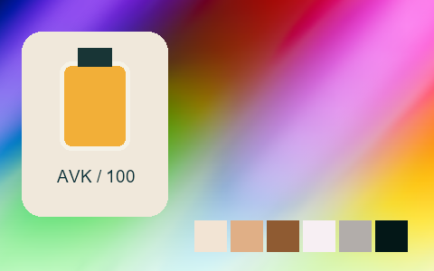

## 338 · Fuji Superia 800 ++

`nt-negative-old-fuji-superia-800-curve-plus-2` · `film-negative` · CC-BY-SA-4.0 · 33³

50% gray Y′ 145.8/255 (+18.3 code values); 25–75% gray span ratio 1.025; mid-gray red minus blue +6.0 code values. Light/medium/deep skin swatches: #F2DDCE, #E0AC8B, #916443. Red/green/blue swatches: #D94135, #96D996, #543AC3.

Suggested use: Compare on your own SDR product, portrait and landscape footage before selecting.

Trial strength: 0.35–0.8; default 1.0.

Pixel color mapping only; no grain, glow, vignette, spatial haze or beauty effects. Natural footage quality is unaccepted. Check skin/product colors and clipped output.

| Input swatch | Input RGB | Actual output RGB |
|---|---|---|
| `gray_0` | `#000000` | `#133031` |
| `gray_10` | `#1A1A1A` | `#183333` |
| `gray_25` | `#404040` | `#344A4C` |
| `gray_50` | `#808080` | `#969190` |
| `gray_75` | `#BFBFBF` | `#D2C6C3` |
| `gray_90` | `#E6E6E6` | `#EBE2DF` |
| `gray_100` | `#FFFFFF` | `#F5F1EC` |
| `skin_light` | `#F5DBC6` | `#F2DDCE` |
| `skin_medium` | `#CF9B7B` | `#E0AC8B` |
| `skin_deep` | `#815438` | `#916443` |
| `red` | `#CC3333` | `#D94135` |
| `green` | `#33CC33` | `#96D996` |
| `blue` | `#3333CC` | `#543AC3` |

Creator: **Pat David** · [Source](https://github.com/NatronGitHub/clut/blob/af7b50d4caf6244fb6895a647f5b6a84efe7931a/negative_old/fuji_superia_800_++.png) · commit `af7b50d4caf6244fb6895a647f5b6a84efe7931a`.

Conversion: `native-depth-Hald-to-33-tetrahedral-v1`; 8,192 sampled RGB points; max error 0.0242967; mean 0.0008285. This is numerical approximation, not a perceptual quality score.

License obligations: Credit the named creator and source; retain the CC-BY-SA-4.0 notice and indicate changes. Redistributed adapted LUT data and thumbnails must use CC-BY-SA-4.0 or a compatible license; no additional restrictions.

[License](../../../product/src/ai_ad_editor/look_data/licenses/CC-BY-SA-4.0.txt) · LUT SHA-256 `4d12e3bfb101734d5856bad67dc070c4125a56b03843c38951dbd69ddfb9ce1d`.

[Actual preview PNG](../../assets/look500-20261024-r1/previews/nt-negative-old-fuji-superia-800-curve-plus-2.png) · [Actual video](../../assets/look500-20261024-r1/videos/nt-negative-old-fuji-superia-800-curve-plus-2.mp4)

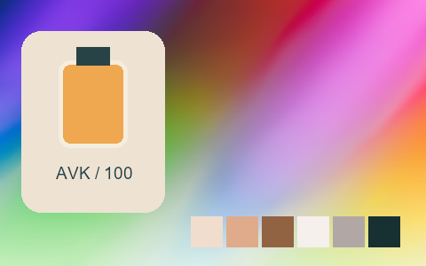

## 339 · Fuji Superia 800 +

`nt-negative-old-fuji-superia-800-curve-plus-1` · `film-negative` · CC-BY-SA-4.0 · 33³

50% gray Y′ 142.7/255 (+15.2 code values); 25–75% gray span ratio 1.155; mid-gray red minus blue +10.5 code values. Light/medium/deep skin swatches: #F7E2D4, #E5AA83, #8C5A31. Red/green/blue swatches: #DE301F, #8ADF8D, #4732C8.

Suggested use: Compare on your own SDR product, portrait and landscape footage before selecting.

Trial strength: 0.35–0.8; default 1.0.

Pixel color mapping only; no grain, glow, vignette, spatial haze or beauty effects. Natural footage quality is unaccepted. Check skin/product colors and clipped output.

| Input swatch | Input RGB | Actual output RGB |
|---|---|---|
| `gray_0` | `#000000` | `#011B19` |
| `gray_10` | `#1A1A1A` | `#071F1F` |
| `gray_25` | `#404040` | `#27403D` |
| `gray_50` | `#808080` | `#928E88` |
| `gray_75` | `#BFBFBF` | `#D7CBCC` |
| `gray_90` | `#E6E6E6` | `#F0E6E7` |
| `gray_100` | `#FFFFFF` | `#F4F4F6` |
| `skin_light` | `#F5DBC6` | `#F7E2D4` |
| `skin_medium` | `#CF9B7B` | `#E5AA83` |
| `skin_deep` | `#815438` | `#8C5A31` |
| `red` | `#CC3333` | `#DE301F` |
| `green` | `#33CC33` | `#8ADF8D` |
| `blue` | `#3333CC` | `#4732C8` |

Creator: **Pat David** · [Source](https://github.com/NatronGitHub/clut/blob/af7b50d4caf6244fb6895a647f5b6a84efe7931a/negative_old/fuji_superia_800_+.png) · commit `af7b50d4caf6244fb6895a647f5b6a84efe7931a`.

Conversion: `native-depth-Hald-to-33-tetrahedral-v1`; 8,192 sampled RGB points; max error 0.0399400; mean 0.0008992. This is numerical approximation, not a perceptual quality score.

License obligations: Credit the named creator and source; retain the CC-BY-SA-4.0 notice and indicate changes. Redistributed adapted LUT data and thumbnails must use CC-BY-SA-4.0 or a compatible license; no additional restrictions.

[License](../../../product/src/ai_ad_editor/look_data/licenses/CC-BY-SA-4.0.txt) · LUT SHA-256 `de7964b40d19db6bd10d37f112f9ab8c615fb5f630ca4f824fd5443c7cdd36ce`.

[Actual preview PNG](../../assets/look500-20261024-r1/previews/nt-negative-old-fuji-superia-800-curve-plus-1.png) · [Actual video](../../assets/look500-20261024-r1/videos/nt-negative-old-fuji-superia-800-curve-plus-1.mp4)

## 340 · Fuji Superia 800 -

`nt-negative-old-fuji-superia-800-curve-minus-1` · `film-negative` · CC-BY-SA-4.0 · 33³

50% gray Y′ 134.8/255 (+7.3 code values); 25–75% gray span ratio 1.192; mid-gray red minus blue +2.5 code values. Light/medium/deep skin swatches: #F6E6D3, #DFAA7C, #854F2E. Red/green/blue swatches: #D21C16, #74E384, #4828C5.

Suggested use: Compare on your own SDR product, portrait and landscape footage before selecting.

Trial strength: 0.35–0.8; default 1.0.

Pixel color mapping only; no grain, glow, vignette, spatial haze or beauty effects. Natural footage quality is unaccepted. Check skin/product colors and clipped output.

| Input swatch | Input RGB | Actual output RGB |
|---|---|---|
| `gray_0` | `#000000` | `#000305` |
| `gray_10` | `#1A1A1A` | `#070F0F` |
| `gray_25` | `#404040` | `#323638` |
| `gray_50` | `#808080` | `#878784` |
| `gray_75` | `#BFBFBF` | `#D1CCCB` |
| `gray_90` | `#E6E6E6` | `#EDE9E8` |
| `gray_100` | `#FFFFFF` | `#F5F9F9` |
| `skin_light` | `#F5DBC6` | `#F6E6D3` |
| `skin_medium` | `#CF9B7B` | `#DFAA7C` |
| `skin_deep` | `#815438` | `#854F2E` |
| `red` | `#CC3333` | `#D21C16` |
| `green` | `#33CC33` | `#74E384` |
| `blue` | `#3333CC` | `#4828C5` |

Creator: **Pat David** · [Source](https://github.com/NatronGitHub/clut/blob/af7b50d4caf6244fb6895a647f5b6a84efe7931a/negative_old/fuji_superia_800_-.png) · commit `af7b50d4caf6244fb6895a647f5b6a84efe7931a`.

Conversion: `native-depth-Hald-to-33-tetrahedral-v1`; 8,192 sampled RGB points; max error 0.0361013; mean 0.0008933. This is numerical approximation, not a perceptual quality score.

License obligations: Credit the named creator and source; retain the CC-BY-SA-4.0 notice and indicate changes. Redistributed adapted LUT data and thumbnails must use CC-BY-SA-4.0 or a compatible license; no additional restrictions.

[License](../../../product/src/ai_ad_editor/look_data/licenses/CC-BY-SA-4.0.txt) · LUT SHA-256 `2f41aed48b3e925a14e677dc90b6824b25f6bff2549dff4315cf157822a503a8`.

[Actual preview PNG](../../assets/look500-20261024-r1/previews/nt-negative-old-fuji-superia-800-curve-minus-1.png) · [Actual video](../../assets/look500-20261024-r1/videos/nt-negative-old-fuji-superia-800-curve-minus-1.mp4)

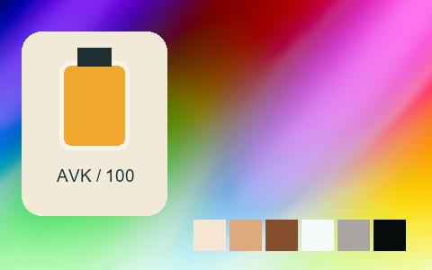

## 341 · Kodak Portra 160 Nc ++

`nt-negative-old-kodak-portra-160-nc-curve-plus-2` · `film-negative` · CC-BY-SA-4.0 · 33³

50% gray Y′ 147.2/255 (+19.7 code values); 25–75% gray span ratio 1.041; mid-gray red minus blue +0.5 code values. Light/medium/deep skin swatches: #EEDBD0, #D7A988, #935D33. Red/green/blue swatches: #D4442D, #50C17D, #6860D1.

Suggested use: Compare on your own SDR product, portrait and landscape footage before selecting.

Trial strength: 0.35–0.8; default 1.0.

Pixel color mapping only; no grain, glow, vignette, spatial haze or beauty effects. Natural footage quality is unaccepted. Check skin/product colors and clipped output.

| Input swatch | Input RGB | Actual output RGB |
|---|---|---|
| `gray_0` | `#000000` | `#0E110D` |
| `gray_10` | `#1A1A1A` | `#1D1B18` |
| `gray_25` | `#404040` | `#494243` |
| `gray_50` | `#808080` | `#959294` |
| `gray_75` | `#BFBFBF` | `#CAC8CC` |
| `gray_90` | `#E6E6E6` | `#E5E5E6` |
| `gray_100` | `#FFFFFF` | `#F2E9F2` |
| `skin_light` | `#F5DBC6` | `#EEDBD0` |
| `skin_medium` | `#CF9B7B` | `#D7A988` |
| `skin_deep` | `#815438` | `#935D33` |
| `red` | `#CC3333` | `#D4442D` |
| `green` | `#33CC33` | `#50C17D` |
| `blue` | `#3333CC` | `#6860D1` |

Creator: **Pat David** · [Source](https://github.com/NatronGitHub/clut/blob/af7b50d4caf6244fb6895a647f5b6a84efe7931a/negative_old/kodak_portra_160_nc_++.png) · commit `af7b50d4caf6244fb6895a647f5b6a84efe7931a`.

Conversion: `native-depth-Hald-to-33-tetrahedral-v1`; 8,192 sampled RGB points; max error 0.0144974; mean 0.0007584. This is numerical approximation, not a perceptual quality score.

License obligations: Credit the named creator and source; retain the CC-BY-SA-4.0 notice and indicate changes. Redistributed adapted LUT data and thumbnails must use CC-BY-SA-4.0 or a compatible license; no additional restrictions.

[License](../../../product/src/ai_ad_editor/look_data/licenses/CC-BY-SA-4.0.txt) · LUT SHA-256 `bff35094a74f870a567e5be436132995a23eeaf5eef028cd9b8c4dbd8a23892f`.

[Actual preview PNG](../../assets/look500-20261024-r1/previews/nt-negative-old-kodak-portra-160-nc-curve-plus-2.png) · [Actual video](../../assets/look500-20261024-r1/videos/nt-negative-old-kodak-portra-160-nc-curve-plus-2.mp4)

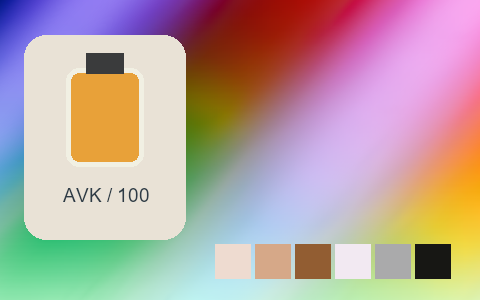

## 342 · Kodak Portra 160 Nc +

`nt-negative-old-kodak-portra-160-nc-curve-plus-1` · `film-negative` · CC-BY-SA-4.0 · 33³

50% gray Y′ 155.3/255 (+27.8 code values); 25–75% gray span ratio 1.122; mid-gray red minus blue +6.0 code values. Light/medium/deep skin swatches: #F1DBD1, #D9AB8D, #A25E2E. Red/green/blue swatches: #DB3827, #84C689, #4F53D2.

Suggested use: Compare on your own SDR product, portrait and landscape footage before selecting.

Trial strength: 0.35–0.8; default 1.0.

Pixel color mapping only; no grain, glow, vignette, spatial haze or beauty effects. Natural footage quality is unaccepted. Check skin/product colors and clipped output.

| Input swatch | Input RGB | Actual output RGB |
|---|---|---|
| `gray_0` | `#000000` | `#101315` |
| `gray_10` | `#1A1A1A` | `#141A1B` |
| `gray_25` | `#404040` | `#343E43` |
| `gray_50` | `#808080` | `#A09A9A` |
| `gray_75` | `#BFBFBF` | `#CFCACC` |
| `gray_90` | `#E6E6E6` | `#EAE5E7` |
| `gray_100` | `#FFFFFF` | `#F8F7F8` |
| `skin_light` | `#F5DBC6` | `#F1DBD1` |
| `skin_medium` | `#CF9B7B` | `#D9AB8D` |
| `skin_deep` | `#815438` | `#A25E2E` |
| `red` | `#CC3333` | `#DB3827` |
| `green` | `#33CC33` | `#84C689` |
| `blue` | `#3333CC` | `#4F53D2` |

Creator: **Pat David** · [Source](https://github.com/NatronGitHub/clut/blob/af7b50d4caf6244fb6895a647f5b6a84efe7931a/negative_old/kodak_portra_160_nc_+.png) · commit `af7b50d4caf6244fb6895a647f5b6a84efe7931a`.

Conversion: `native-depth-Hald-to-33-tetrahedral-v1`; 8,192 sampled RGB points; max error 0.0264664; mean 0.0008423. This is numerical approximation, not a perceptual quality score.

License obligations: Credit the named creator and source; retain the CC-BY-SA-4.0 notice and indicate changes. Redistributed adapted LUT data and thumbnails must use CC-BY-SA-4.0 or a compatible license; no additional restrictions.

[License](../../../product/src/ai_ad_editor/look_data/licenses/CC-BY-SA-4.0.txt) · LUT SHA-256 `6692c317b3a22e290622656bd854025c03a21b07d450431a3ce398bafdf82635`.

[Actual preview PNG](../../assets/look500-20261024-r1/previews/nt-negative-old-kodak-portra-160-nc-curve-plus-1.png) · [Actual video](../../assets/look500-20261024-r1/videos/nt-negative-old-kodak-portra-160-nc-curve-plus-1.mp4)

## 343 · Kodak Portra 160 Nc -

`nt-negative-old-kodak-portra-160-nc-curve-minus-1` · `film-negative` · CC-BY-SA-4.0 · 33³

50% gray Y′ 145.3/255 (+17.8 code values); 25–75% gray span ratio 1.077; mid-gray red minus blue -2.5 code values. Light/medium/deep skin swatches: #F2DFD2, #D8A88A, #915D37. Red/green/blue swatches: #D2472F, #54C380, #6662D4.

Suggested use: Compare on your own SDR product, portrait and landscape footage before selecting.

Trial strength: 0.35–0.8; default 1.0.

Pixel color mapping only; no grain, glow, vignette, spatial haze or beauty effects. Natural footage quality is unaccepted. Check skin/product colors and clipped output.

| Input swatch | Input RGB | Actual output RGB |
|---|---|---|
| `gray_0` | `#000000` | `#010001` |
| `gray_10` | `#1A1A1A` | `#0B120F` |
| `gray_25` | `#404040` | `#3C4442` |
| `gray_50` | `#808080` | `#929194` |
| `gray_75` | `#BFBFBF` | `#CECACE` |
| `gray_90` | `#E6E6E6` | `#ECE9EA` |
| `gray_100` | `#FFFFFF` | `#FDFDFD` |
| `skin_light` | `#F5DBC6` | `#F2DFD2` |
| `skin_medium` | `#CF9B7B` | `#D8A88A` |
| `skin_deep` | `#815438` | `#915D37` |
| `red` | `#CC3333` | `#D2472F` |
| `green` | `#33CC33` | `#54C380` |
| `blue` | `#3333CC` | `#6662D4` |

Creator: **Pat David** · [Source](https://github.com/NatronGitHub/clut/blob/af7b50d4caf6244fb6895a647f5b6a84efe7931a/negative_old/kodak_portra_160_nc_-.png) · commit `af7b50d4caf6244fb6895a647f5b6a84efe7931a`.

Conversion: `native-depth-Hald-to-33-tetrahedral-v1`; 8,192 sampled RGB points; max error 0.0143205; mean 0.0007565. This is numerical approximation, not a perceptual quality score.

License obligations: Credit the named creator and source; retain the CC-BY-SA-4.0 notice and indicate changes. Redistributed adapted LUT data and thumbnails must use CC-BY-SA-4.0 or a compatible license; no additional restrictions.

[License](../../../product/src/ai_ad_editor/look_data/licenses/CC-BY-SA-4.0.txt) · LUT SHA-256 `8fe5f0422b85ac15793dd4ccb672545190f37d7a8bbc885186a3d28c165185a8`.

[Actual preview PNG](../../assets/look500-20261024-r1/previews/nt-negative-old-kodak-portra-160-nc-curve-minus-1.png) · [Actual video](../../assets/look500-20261024-r1/videos/nt-negative-old-kodak-portra-160-nc-curve-minus-1.mp4)

## 344 · Kodak Portra 160 Vc ++

`nt-negative-old-kodak-portra-160-vc-curve-plus-2` · `film-negative` · CC-BY-SA-4.0 · 33³

50% gray Y′ 148.2/255 (+20.7 code values); 25–75% gray span ratio 1.086; mid-gray red minus blue +7.5 code values. Light/medium/deep skin swatches: #F2DACE, #DFA785, #9A5B24. Red/green/blue swatches: #EB4118, #71C883, #7379DC.

Suggested use: Compare on your own SDR product, portrait and landscape footage before selecting.

Trial strength: 0.35–0.8; default 1.0.

Pixel color mapping only; no grain, glow, vignette, spatial haze or beauty effects. Natural footage quality is unaccepted. Check skin/product colors and clipped output.

| Input swatch | Input RGB | Actual output RGB |
|---|---|---|
| `gray_0` | `#000000` | `#20180E` |
| `gray_10` | `#1A1A1A` | `#272015` |
| `gray_25` | `#404040` | `#46433C` |
| `gray_50` | `#808080` | `#9C9294` |
| `gray_75` | `#BFBFBF` | `#D6CBCB` |
| `gray_90` | `#E6E6E6` | `#E9E5E6` |
| `gray_100` | `#FFFFFF` | `#F9F8F8` |
| `skin_light` | `#F5DBC6` | `#F2DACE` |
| `skin_medium` | `#CF9B7B` | `#DFA785` |
| `skin_deep` | `#815438` | `#9A5B24` |
| `red` | `#CC3333` | `#EB4118` |
| `green` | `#33CC33` | `#71C883` |
| `blue` | `#3333CC` | `#7379DC` |

Creator: **Pat David** · [Source](https://github.com/NatronGitHub/clut/blob/af7b50d4caf6244fb6895a647f5b6a84efe7931a/negative_old/kodak_portra_160_vc_++.png) · commit `af7b50d4caf6244fb6895a647f5b6a84efe7931a`.

Conversion: `native-depth-Hald-to-33-tetrahedral-v1`; 8,192 sampled RGB points; max error 0.0164548; mean 0.0007978. This is numerical approximation, not a perceptual quality score.

License obligations: Credit the named creator and source; retain the CC-BY-SA-4.0 notice and indicate changes. Redistributed adapted LUT data and thumbnails must use CC-BY-SA-4.0 or a compatible license; no additional restrictions.

[License](../../../product/src/ai_ad_editor/look_data/licenses/CC-BY-SA-4.0.txt) · LUT SHA-256 `7d1e047060b38f47c815b0a9d6d5574bb62772e4a94cb6a445a028fb6b9490ce`.

[Actual preview PNG](../../assets/look500-20261024-r1/previews/nt-negative-old-kodak-portra-160-vc-curve-plus-2.png) · [Actual video](../../assets/look500-20261024-r1/videos/nt-negative-old-kodak-portra-160-vc-curve-plus-2.mp4)

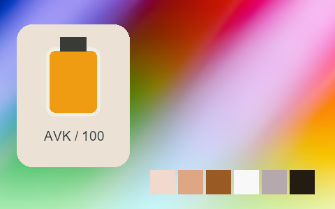

## 345 · Kodak Portra 160 Vc +

`nt-negative-old-kodak-portra-160-vc-curve-plus-1` · `film-negative` · CC-BY-SA-4.0 · 33³

50% gray Y′ 150.7/255 (+23.2 code values); 25–75% gray span ratio 1.100; mid-gray red minus blue +10.5 code values. Light/medium/deep skin swatches: #F5DBD0, #E1A37F, #9B5D36. Red/green/blue swatches: #EB412D, #78C983, #797ADC.

Suggested use: Compare on your own SDR product, portrait and landscape footage before selecting.

Trial strength: 0.35–0.8; default 1.0.

Pixel color mapping only; no grain, glow, vignette, spatial haze or beauty effects. Natural footage quality is unaccepted. Check skin/product colors and clipped output.

| Input swatch | Input RGB | Actual output RGB |
|---|---|---|
| `gray_0` | `#000000` | `#01121D` |
| `gray_10` | `#1A1A1A` | `#08191E` |
| `gray_25` | `#404040` | `#364444` |
| `gray_50` | `#808080` | `#9F9494` |
| `gray_75` | `#BFBFBF` | `#D3CBCE` |
| `gray_90` | `#E6E6E6` | `#ECE7E8` |
| `gray_100` | `#FFFFFF` | `#F9F7F6` |
| `skin_light` | `#F5DBC6` | `#F5DBD0` |
| `skin_medium` | `#CF9B7B` | `#E1A37F` |
| `skin_deep` | `#815438` | `#9B5D36` |
| `red` | `#CC3333` | `#EB412D` |
| `green` | `#33CC33` | `#78C983` |
| `blue` | `#3333CC` | `#797ADC` |

Creator: **Pat David** · [Source](https://github.com/NatronGitHub/clut/blob/af7b50d4caf6244fb6895a647f5b6a84efe7931a/negative_old/kodak_portra_160_vc_+.png) · commit `af7b50d4caf6244fb6895a647f5b6a84efe7931a`.

Conversion: `native-depth-Hald-to-33-tetrahedral-v1`; 8,192 sampled RGB points; max error 0.0203852; mean 0.0007936. This is numerical approximation, not a perceptual quality score.

License obligations: Credit the named creator and source; retain the CC-BY-SA-4.0 notice and indicate changes. Redistributed adapted LUT data and thumbnails must use CC-BY-SA-4.0 or a compatible license; no additional restrictions.

[License](../../../product/src/ai_ad_editor/look_data/licenses/CC-BY-SA-4.0.txt) · LUT SHA-256 `eae8aa8bef3f57b80470cb001b767407dacf03c9573505aebf8c4e41d7c1c441`.

[Actual preview PNG](../../assets/look500-20261024-r1/previews/nt-negative-old-kodak-portra-160-vc-curve-plus-1.png) · [Actual video](../../assets/look500-20261024-r1/videos/nt-negative-old-kodak-portra-160-vc-curve-plus-1.mp4)

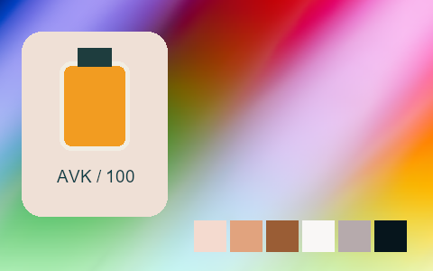

## 346 · Kodak Portra 160 Vc -

`nt-negative-old-kodak-portra-160-vc-curve-minus-1` · `film-negative` · CC-BY-SA-4.0 · 33³

50% gray Y′ 146.9/255 (+19.4 code values); 25–75% gray span ratio 1.087; mid-gray red minus blue +0.5 code values. Light/medium/deep skin swatches: #F4E1D4, #DDA380, #945B33. Red/green/blue swatches: #E5452C, #6ACA82, #6F78DD.

Suggested use: Compare on your own SDR product, portrait and landscape footage before selecting.

Trial strength: 0.35–0.8; default 1.0.

Pixel color mapping only; no grain, glow, vignette, spatial haze or beauty effects. Natural footage quality is unaccepted. Check skin/product colors and clipped output.

| Input swatch | Input RGB | Actual output RGB |
|---|---|---|
| `gray_0` | `#000000` | `#010502` |
| `gray_10` | `#1A1A1A` | `#0E1013` |
| `gray_25` | `#404040` | `#3A4546` |
| `gray_50` | `#808080` | `#949293` |
| `gray_75` | `#BFBFBF` | `#D1CCCD` |
| `gray_90` | `#E6E6E6` | `#EFEBEB` |
| `gray_100` | `#FFFFFF` | `#F7FAF2` |
| `skin_light` | `#F5DBC6` | `#F4E1D4` |
| `skin_medium` | `#CF9B7B` | `#DDA380` |
| `skin_deep` | `#815438` | `#945B33` |
| `red` | `#CC3333` | `#E5452C` |
| `green` | `#33CC33` | `#6ACA82` |
| `blue` | `#3333CC` | `#6F78DD` |

Creator: **Pat David** · [Source](https://github.com/NatronGitHub/clut/blob/af7b50d4caf6244fb6895a647f5b6a84efe7931a/negative_old/kodak_portra_160_vc_-.png) · commit `af7b50d4caf6244fb6895a647f5b6a84efe7931a`.

Conversion: `native-depth-Hald-to-33-tetrahedral-v1`; 8,192 sampled RGB points; max error 0.0227408; mean 0.0008052. This is numerical approximation, not a perceptual quality score.

License obligations: Credit the named creator and source; retain the CC-BY-SA-4.0 notice and indicate changes. Redistributed adapted LUT data and thumbnails must use CC-BY-SA-4.0 or a compatible license; no additional restrictions.

[License](../../../product/src/ai_ad_editor/look_data/licenses/CC-BY-SA-4.0.txt) · LUT SHA-256 `ff8aebc465137b305bfa0a5e304d5be4d1058ba308d72329907451c21e74ddc1`.

[Actual preview PNG](../../assets/look500-20261024-r1/previews/nt-negative-old-kodak-portra-160-vc-curve-minus-1.png) · [Actual video](../../assets/look500-20261024-r1/videos/nt-negative-old-kodak-portra-160-vc-curve-minus-1.mp4)

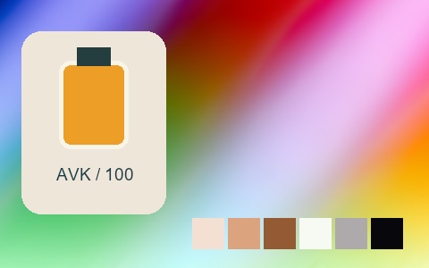

## 347 · Kodak Portra 400 Nc

`nt-negative-old-kodak-portra-400-nc` · `film-negative` · CC-BY-SA-4.0 · 33³

50% gray Y′ 151.7/255 (+24.2 code values); 25–75% gray span ratio 1.076; mid-gray red minus blue +2.5 code values. Light/medium/deep skin swatches: #EFDACF, #D7AB8C, #A05E2E. Red/green/blue swatches: #D73A2A, #81C587, #5454D0.

Suggested use: Compare on your own SDR product, portrait and landscape footage before selecting.

Trial strength: 0.35–0.8; default 1.0.

Pixel color mapping only; no grain, glow, vignette, spatial haze or beauty effects. Natural footage quality is unaccepted. Check skin/product colors and clipped output.

| Input swatch | Input RGB | Actual output RGB |
|---|---|---|
| `gray_0` | `#000000` | `#090C0D` |
| `gray_10` | `#1A1A1A` | `#111717` |
| `gray_25` | `#404040` | `#3D4242` |
| `gray_50` | `#808080` | `#9C9699` |
| `gray_75` | `#BFBFBF` | `#CCCACB` |
| `gray_90` | `#E6E6E6` | `#E6E4E5` |
| `gray_100` | `#FFFFFF` | `#F8F7F8` |
| `skin_light` | `#F5DBC6` | `#EFDACF` |
| `skin_medium` | `#CF9B7B` | `#D7AB8C` |
| `skin_deep` | `#815438` | `#A05E2E` |
| `red` | `#CC3333` | `#D73A2A` |
| `green` | `#33CC33` | `#81C587` |
| `blue` | `#3333CC` | `#5454D0` |

Creator: **Pat David** · [Source](https://github.com/NatronGitHub/clut/blob/af7b50d4caf6244fb6895a647f5b6a84efe7931a/negative_old/kodak_portra_400_nc.png) · commit `af7b50d4caf6244fb6895a647f5b6a84efe7931a`.

Conversion: `native-depth-Hald-to-33-tetrahedral-v1`; 8,192 sampled RGB points; max error 0.0162557; mean 0.0008083. This is numerical approximation, not a perceptual quality score.

License obligations: Credit the named creator and source; retain the CC-BY-SA-4.0 notice and indicate changes. Redistributed adapted LUT data and thumbnails must use CC-BY-SA-4.0 or a compatible license; no additional restrictions.

[License](../../../product/src/ai_ad_editor/look_data/licenses/CC-BY-SA-4.0.txt) · LUT SHA-256 `78d190d90224c0d6483217374b8335aa82ff30e04623f55343f43064f437b87f`.

[Actual preview PNG](../../assets/look500-20261024-r1/previews/nt-negative-old-kodak-portra-400-nc.png) · [Actual video](../../assets/look500-20261024-r1/videos/nt-negative-old-kodak-portra-400-nc.mp4)

## 348 · Kodak Portra 400 Nc ++

`nt-negative-old-kodak-portra-400-nc-curve-plus-2` · `film-negative` · CC-BY-SA-4.0 · 33³

50% gray Y′ 158.5/255 (+31.0 code values); 25–75% gray span ratio 1.193; mid-gray red minus blue +5.5 code values. Light/medium/deep skin swatches: #F0DFD4, #E0AE90, #A35D28. Red/green/blue swatches: #E52C18, #84CB89, #474ED7.

Suggested use: Compare on your own SDR product, portrait and landscape footage before selecting.

Trial strength: 0.35–0.8; default 1.0.

Pixel color mapping only; no grain, glow, vignette, spatial haze or beauty effects. Natural footage quality is unaccepted. Check skin/product colors and clipped output.

| Input swatch | Input RGB | Actual output RGB |
|---|---|---|
| `gray_0` | `#000000` | `#261D1D` |
| `gray_10` | `#1A1A1A` | `#261B1F` |
| `gray_25` | `#404040` | `#36383E` |
| `gray_50` | `#808080` | `#A39D9E` |
| `gray_75` | `#BFBFBF` | `#D4CED2` |
| `gray_90` | `#E6E6E6` | `#E9E7E9` |
| `gray_100` | `#FFFFFF` | `#F8F7F8` |
| `skin_light` | `#F5DBC6` | `#F0DFD4` |
| `skin_medium` | `#CF9B7B` | `#E0AE90` |
| `skin_deep` | `#815438` | `#A35D28` |
| `red` | `#CC3333` | `#E52C18` |
| `green` | `#33CC33` | `#84CB89` |
| `blue` | `#3333CC` | `#474ED7` |

Creator: **Pat David** · [Source](https://github.com/NatronGitHub/clut/blob/af7b50d4caf6244fb6895a647f5b6a84efe7931a/negative_old/kodak_portra_400_nc_++.png) · commit `af7b50d4caf6244fb6895a647f5b6a84efe7931a`.

Conversion: `native-depth-Hald-to-33-tetrahedral-v1`; 8,192 sampled RGB points; max error 0.0402158; mean 0.0008973. This is numerical approximation, not a perceptual quality score.

License obligations: Credit the named creator and source; retain the CC-BY-SA-4.0 notice and indicate changes. Redistributed adapted LUT data and thumbnails must use CC-BY-SA-4.0 or a compatible license; no additional restrictions.

[License](../../../product/src/ai_ad_editor/look_data/licenses/CC-BY-SA-4.0.txt) · LUT SHA-256 `a9ec603f180021009de303a05acaeb5b36895d4cd68b88e32e7ecc47a4269f50`.

[Actual preview PNG](../../assets/look500-20261024-r1/previews/nt-negative-old-kodak-portra-400-nc-curve-plus-2.png) · [Actual video](../../assets/look500-20261024-r1/videos/nt-negative-old-kodak-portra-400-nc-curve-plus-2.mp4)

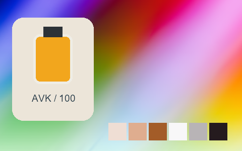

## 349 · Kodak Portra 400 Nc +

`nt-negative-old-kodak-portra-400-nc-curve-plus-1` · `film-negative` · CC-BY-SA-4.0 · 33³

50% gray Y′ 155.2/255 (+27.7 code values); 25–75% gray span ratio 1.110; mid-gray red minus blue +6.5 code values. Light/medium/deep skin swatches: #F0DBD1, #DCAA8C, #9F5E2D. Red/green/blue swatches: #DC3928, #84C689, #5152D1.

Suggested use: Compare on your own SDR product, portrait and landscape footage before selecting.

Trial strength: 0.35–0.8; default 1.0.

Pixel color mapping only; no grain, glow, vignette, spatial haze or beauty effects. Natural footage quality is unaccepted. Check skin/product colors and clipped output.

| Input swatch | Input RGB | Actual output RGB |
|---|---|---|
| `gray_0` | `#000000` | `#101415` |
| `gray_10` | `#1A1A1A` | `#141A1B` |
| `gray_25` | `#404040` | `#384040` |
| `gray_50` | `#808080` | `#A09A9A` |
| `gray_75` | `#BFBFBF` | `#D0CACB` |
| `gray_90` | `#E6E6E6` | `#E9E6E7` |
| `gray_100` | `#FFFFFF` | `#F8F7F8` |
| `skin_light` | `#F5DBC6` | `#F0DBD1` |
| `skin_medium` | `#CF9B7B` | `#DCAA8C` |
| `skin_deep` | `#815438` | `#9F5E2D` |
| `red` | `#CC3333` | `#DC3928` |
| `green` | `#33CC33` | `#84C689` |
| `blue` | `#3333CC` | `#5152D1` |

Creator: **Pat David** · [Source](https://github.com/NatronGitHub/clut/blob/af7b50d4caf6244fb6895a647f5b6a84efe7931a/negative_old/kodak_portra_400_nc_+.png) · commit `af7b50d4caf6244fb6895a647f5b6a84efe7931a`.

Conversion: `native-depth-Hald-to-33-tetrahedral-v1`; 8,192 sampled RGB points; max error 0.0254700; mean 0.0008453. This is numerical approximation, not a perceptual quality score.

License obligations: Credit the named creator and source; retain the CC-BY-SA-4.0 notice and indicate changes. Redistributed adapted LUT data and thumbnails must use CC-BY-SA-4.0 or a compatible license; no additional restrictions.

[License](../../../product/src/ai_ad_editor/look_data/licenses/CC-BY-SA-4.0.txt) · LUT SHA-256 `e581e0f8c9dbd7953b3fedc9f3e8caa1a9cd30e803865ddebaf2c63c1fae45e1`.

[Actual preview PNG](../../assets/look500-20261024-r1/previews/nt-negative-old-kodak-portra-400-nc-curve-plus-1.png) · [Actual video](../../assets/look500-20261024-r1/videos/nt-negative-old-kodak-portra-400-nc-curve-plus-1.mp4)

## 350 · Kodak Portra 400 Nc -

`nt-negative-old-kodak-portra-400-nc-curve-minus-1` · `film-negative` · CC-BY-SA-4.0 · 33³

50% gray Y′ 158.3/255 (+30.8 code values); 25–75% gray span ratio 1.087; mid-gray red minus blue +5.5 code values. Light/medium/deep skin swatches: #F3E0D4, #DCAF8E, #A46431. Red/green/blue swatches: #E13820, #86C98C, #5E5BD4.

Suggested use: Compare on your own SDR product, portrait and landscape footage before selecting.

Trial strength: 0.35–0.8; default 1.0.

Pixel color mapping only; no grain, glow, vignette, spatial haze or beauty effects. Natural footage quality is unaccepted. Check skin/product colors and clipped output.

| Input swatch | Input RGB | Actual output RGB |
|---|---|---|
| `gray_0` | `#000000` | `#020603` |
| `gray_10` | `#1A1A1A` | `#0C0E0D` |
| `gray_25` | `#404040` | `#464447` |
| `gray_50` | `#808080` | `#A39D9E` |
| `gray_75` | `#BFBFBF` | `#D2CED0` |
| `gray_90` | `#E6E6E6` | `#EDEAEC` |
| `gray_100` | `#FFFFFF` | `#FCFBFC` |
| `skin_light` | `#F5DBC6` | `#F3E0D4` |
| `skin_medium` | `#CF9B7B` | `#DCAF8E` |
| `skin_deep` | `#815438` | `#A46431` |
| `red` | `#CC3333` | `#E13820` |
| `green` | `#33CC33` | `#86C98C` |
| `blue` | `#3333CC` | `#5E5BD4` |

Creator: **Pat David** · [Source](https://github.com/NatronGitHub/clut/blob/af7b50d4caf6244fb6895a647f5b6a84efe7931a/negative_old/kodak_portra_400_nc_-.png) · commit `af7b50d4caf6244fb6895a647f5b6a84efe7931a`.

Conversion: `native-depth-Hald-to-33-tetrahedral-v1`; 8,192 sampled RGB points; max error 0.0235989; mean 0.0008151. This is numerical approximation, not a perceptual quality score.

License obligations: Credit the named creator and source; retain the CC-BY-SA-4.0 notice and indicate changes. Redistributed adapted LUT data and thumbnails must use CC-BY-SA-4.0 or a compatible license; no additional restrictions.

[License](../../../product/src/ai_ad_editor/look_data/licenses/CC-BY-SA-4.0.txt) · LUT SHA-256 `f9d9f86bd5d494a345780bf66c59662872039fcf3144ee572e5535377a756253`.

[Actual preview PNG](../../assets/look500-20261024-r1/previews/nt-negative-old-kodak-portra-400-nc-curve-minus-1.png) · [Actual video](../../assets/look500-20261024-r1/videos/nt-negative-old-kodak-portra-400-nc-curve-minus-1.mp4)

## 351 · Kodak Portra 400 Uc

`nt-negative-old-kodak-portra-400-uc` · `film-negative` · CC-BY-SA-4.0 · 33³

50% gray Y′ 155.2/255 (+27.7 code values); 25–75% gray span ratio 1.112; mid-gray red minus blue +7.5 code values. Light/medium/deep skin swatches: #EFE1D4, #E3AD86, #A25E28. Red/green/blue swatches: #EF381A, #1BCC6D, #2049D2.

Suggested use: Compare on your own SDR product, portrait and landscape footage before selecting.

Trial strength: 0.35–0.8; default 1.0.

Pixel color mapping only; no grain, glow, vignette, spatial haze or beauty effects. Natural footage quality is unaccepted. Check skin/product colors and clipped output.

| Input swatch | Input RGB | Actual output RGB |
|---|---|---|
| `gray_0` | `#000000` | `#080E0D` |
| `gray_10` | `#1A1A1A` | `#0F1516` |
| `gray_25` | `#404040` | `#364340` |
| `gray_50` | `#808080` | `#A09A98` |
| `gray_75` | `#BFBFBF` | `#CFCECE` |
| `gray_90` | `#E6E6E6` | `#E8E7E5` |
| `gray_100` | `#FFFFFF` | `#FAF9F6` |
| `skin_light` | `#F5DBC6` | `#EFE1D4` |
| `skin_medium` | `#CF9B7B` | `#E3AD86` |
| `skin_deep` | `#815438` | `#A25E28` |
| `red` | `#CC3333` | `#EF381A` |
| `green` | `#33CC33` | `#1BCC6D` |
| `blue` | `#3333CC` | `#2049D2` |

Creator: **Pat David** · [Source](https://github.com/NatronGitHub/clut/blob/af7b50d4caf6244fb6895a647f5b6a84efe7931a/negative_old/kodak_portra_400_uc.png) · commit `af7b50d4caf6244fb6895a647f5b6a84efe7931a`.

Conversion: `native-depth-Hald-to-33-tetrahedral-v1`; 8,192 sampled RGB points; max error 0.0310748; mean 0.0009695. This is numerical approximation, not a perceptual quality score.

License obligations: Credit the named creator and source; retain the CC-BY-SA-4.0 notice and indicate changes. Redistributed adapted LUT data and thumbnails must use CC-BY-SA-4.0 or a compatible license; no additional restrictions.

[License](../../../product/src/ai_ad_editor/look_data/licenses/CC-BY-SA-4.0.txt) · LUT SHA-256 `8d137ca3ee93a5222ecf1b302bb93b504bcc6b36d1c9c120824af1c780c407f3`.

[Actual preview PNG](../../assets/look500-20261024-r1/previews/nt-negative-old-kodak-portra-400-uc.png) · [Actual video](../../assets/look500-20261024-r1/videos/nt-negative-old-kodak-portra-400-uc.mp4)

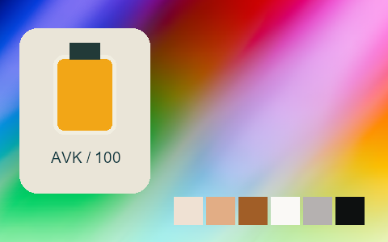

## 352 · Kodak Portra 400 Uc ++

`nt-negative-old-kodak-portra-400-uc-curve-plus-2` · `film-negative` · CC-BY-SA-4.0 · 33³

50% gray Y′ 157.4/255 (+29.9 code values); 25–75% gray span ratio 1.116; mid-gray red minus blue +9.5 code values. Light/medium/deep skin swatches: #F2DFCC, #E2B088, #A5601E. Red/green/blue swatches: #EE400F, #20CC6F, #274CCB.

Suggested use: Compare on your own SDR product, portrait and landscape footage before selecting.

Trial strength: 0.35–0.8; default 1.0.

Pixel color mapping only; no grain, glow, vignette, spatial haze or beauty effects. Natural footage quality is unaccepted. Check skin/product colors and clipped output.

| Input swatch | Input RGB | Actual output RGB |
|---|---|---|
| `gray_0` | `#000000` | `#181C11` |
| `gray_10` | `#1A1A1A` | `#1F2118` |
| `gray_25` | `#404040` | `#3A423A` |
| `gray_50` | `#808080` | `#A29C98` |
| `gray_75` | `#BFBFBF` | `#D3CEC6` |
| `gray_90` | `#E6E6E6` | `#EAE6E0` |
| `gray_100` | `#FFFFFF` | `#FBF9F1` |
| `skin_light` | `#F5DBC6` | `#F2DFCC` |
| `skin_medium` | `#CF9B7B` | `#E2B088` |
| `skin_deep` | `#815438` | `#A5601E` |
| `red` | `#CC3333` | `#EE400F` |
| `green` | `#33CC33` | `#20CC6F` |
| `blue` | `#3333CC` | `#274CCB` |

Creator: **Pat David** · [Source](https://github.com/NatronGitHub/clut/blob/af7b50d4caf6244fb6895a647f5b6a84efe7931a/negative_old/kodak_portra_400_uc_++.png) · commit `af7b50d4caf6244fb6895a647f5b6a84efe7931a`.

Conversion: `native-depth-Hald-to-33-tetrahedral-v1`; 8,192 sampled RGB points; max error 0.0574356; mean 0.0009687. This is numerical approximation, not a perceptual quality score.

License obligations: Credit the named creator and source; retain the CC-BY-SA-4.0 notice and indicate changes. Redistributed adapted LUT data and thumbnails must use CC-BY-SA-4.0 or a compatible license; no additional restrictions.

[License](../../../product/src/ai_ad_editor/look_data/licenses/CC-BY-SA-4.0.txt) · LUT SHA-256 `d7aff0b8bd43a0ed50b5436d89c9095402b74fb6ecebd5b973c5ed4b8bcb7981`.

[Actual preview PNG](../../assets/look500-20261024-r1/previews/nt-negative-old-kodak-portra-400-uc-curve-plus-2.png) · [Actual video](../../assets/look500-20261024-r1/videos/nt-negative-old-kodak-portra-400-uc-curve-plus-2.mp4)

## 353 · Kodak Portra 400 Uc +

`nt-negative-old-kodak-portra-400-uc-curve-plus-1` · `film-negative` · CC-BY-SA-4.0 · 33³

50% gray Y′ 150.2/255 (+22.7 code values); 25–75% gray span ratio 1.051; mid-gray red minus blue +3.0 code values. Light/medium/deep skin swatches: #F0D9CB, #DEA886, #9A602A. Red/green/blue swatches: #E6431D, #24C66F, #2D4FCC.

Suggested use: Compare on your own SDR product, portrait and landscape footage before selecting.

Trial strength: 0.35–0.8; default 1.0.

Pixel color mapping only; no grain, glow, vignette, spatial haze or beauty effects. Natural footage quality is unaccepted. Check skin/product colors and clipped output.

| Input swatch | Input RGB | Actual output RGB |
|---|---|---|
| `gray_0` | `#000000` | `#0F160F` |
| `gray_10` | `#1A1A1A` | `#191C18` |
| `gray_25` | `#404040` | `#3E4640` |
| `gray_50` | `#808080` | `#989694` |
| `gray_75` | `#BFBFBF` | `#D0C9C8` |
| `gray_90` | `#E6E6E6` | `#E5E3E1` |
| `gray_100` | `#FFFFFF` | `#FAF8F4` |
| `skin_light` | `#F5DBC6` | `#F0D9CB` |
| `skin_medium` | `#CF9B7B` | `#DEA886` |
| `skin_deep` | `#815438` | `#9A602A` |
| `red` | `#CC3333` | `#E6431D` |
| `green` | `#33CC33` | `#24C66F` |
| `blue` | `#3333CC` | `#2D4FCC` |

Creator: **Pat David** · [Source](https://github.com/NatronGitHub/clut/blob/af7b50d4caf6244fb6895a647f5b6a84efe7931a/negative_old/kodak_portra_400_uc_+.png) · commit `af7b50d4caf6244fb6895a647f5b6a84efe7931a`.

Conversion: `native-depth-Hald-to-33-tetrahedral-v1`; 8,192 sampled RGB points; max error 0.0451914; mean 0.0009241. This is numerical approximation, not a perceptual quality score.

License obligations: Credit the named creator and source; retain the CC-BY-SA-4.0 notice and indicate changes. Redistributed adapted LUT data and thumbnails must use CC-BY-SA-4.0 or a compatible license; no additional restrictions.

[License](../../../product/src/ai_ad_editor/look_data/licenses/CC-BY-SA-4.0.txt) · LUT SHA-256 `c59ceb2866e3391764d748c06bac924f0c6e1f3d738e820cfbde9385c3483a2c`.

[Actual preview PNG](../../assets/look500-20261024-r1/previews/nt-negative-old-kodak-portra-400-uc-curve-plus-1.png) · [Actual video](../../assets/look500-20261024-r1/videos/nt-negative-old-kodak-portra-400-uc-curve-plus-1.mp4)

## 354 · Kodak Portra 400 Uc -

`nt-negative-old-kodak-portra-400-uc-curve-minus-1` · `film-negative` · CC-BY-SA-4.0 · 33³

50% gray Y′ 153.2/255 (+25.7 code values); 25–75% gray span ratio 1.081; mid-gray red minus blue +7.5 code values. Light/medium/deep skin swatches: #F0E1D4, #E2AD85, #A16233. Red/green/blue swatches: #EC3C20, #22CB6E, #334FD3.

Suggested use: Compare on your own SDR product, portrait and landscape footage before selecting.

Trial strength: 0.35–0.8; default 1.0.

Pixel color mapping only; no grain, glow, vignette, spatial haze or beauty effects. Natural footage quality is unaccepted. Check skin/product colors and clipped output.

| Input swatch | Input RGB | Actual output RGB |
|---|---|---|
| `gray_0` | `#000000` | `#020404` |
| `gray_10` | `#1A1A1A` | `#0A1011` |
| `gray_25` | `#404040` | `#404544` |
| `gray_50` | `#808080` | `#9E9896` |
| `gray_75` | `#BFBFBF` | `#CECECF` |
| `gray_90` | `#E6E6E6` | `#E8E9EA` |
| `gray_100` | `#FFFFFF` | `#FBF8FB` |
| `skin_light` | `#F5DBC6` | `#F0E1D4` |
| `skin_medium` | `#CF9B7B` | `#E2AD85` |
| `skin_deep` | `#815438` | `#A16233` |
| `red` | `#CC3333` | `#EC3C20` |
| `green` | `#33CC33` | `#22CB6E` |
| `blue` | `#3333CC` | `#334FD3` |

Creator: **Pat David** · [Source](https://github.com/NatronGitHub/clut/blob/af7b50d4caf6244fb6895a647f5b6a84efe7931a/negative_old/kodak_portra_400_uc_-.png) · commit `af7b50d4caf6244fb6895a647f5b6a84efe7931a`.

Conversion: `native-depth-Hald-to-33-tetrahedral-v1`; 8,192 sampled RGB points; max error 0.0429907; mean 0.0009282. This is numerical approximation, not a perceptual quality score.

License obligations: Credit the named creator and source; retain the CC-BY-SA-4.0 notice and indicate changes. Redistributed adapted LUT data and thumbnails must use CC-BY-SA-4.0 or a compatible license; no additional restrictions.

[License](../../../product/src/ai_ad_editor/look_data/licenses/CC-BY-SA-4.0.txt) · LUT SHA-256 `6a810120e27f3c0542c4e4df1e23fbb332a516ef87a8d6ba9442abf0f197eef7`.

[Actual preview PNG](../../assets/look500-20261024-r1/previews/nt-negative-old-kodak-portra-400-uc-curve-minus-1.png) · [Actual video](../../assets/look500-20261024-r1/videos/nt-negative-old-kodak-portra-400-uc-curve-minus-1.mp4)

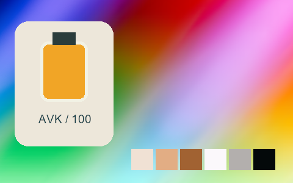

## 355 · Kodak Portra 400 Vc

`nt-negative-old-kodak-portra-400-vc` · `film-negative` · CC-BY-SA-4.0 · 33³

50% gray Y′ 151.7/255 (+24.2 code values); 25–75% gray span ratio 1.073; mid-gray red minus blue +3.5 code values. Light/medium/deep skin swatches: #EDDAD0, #DCA888, #9E6035. Red/green/blue swatches: #DF3A18, #65C67E, #3B5BD2.

Suggested use: Compare on your own SDR product, portrait and landscape footage before selecting.

Trial strength: 0.35–0.8; default 1.0.

Pixel color mapping only; no grain, glow, vignette, spatial haze or beauty effects. Natural footage quality is unaccepted. Check skin/product colors and clipped output.

| Input swatch | Input RGB | Actual output RGB |
|---|---|---|
| `gray_0` | `#000000` | `#060A0B` |
| `gray_10` | `#1A1A1A` | `#0E171A` |
| `gray_25` | `#404040` | `#364547` |
| `gray_50` | `#808080` | `#9C9698` |
| `gray_75` | `#BFBFBF` | `#D0CACC` |
| `gray_90` | `#E6E6E6` | `#E6E1E4` |
| `gray_100` | `#FFFFFF` | `#F5E9F3` |
| `skin_light` | `#F5DBC6` | `#EDDAD0` |
| `skin_medium` | `#CF9B7B` | `#DCA888` |
| `skin_deep` | `#815438` | `#9E6035` |
| `red` | `#CC3333` | `#DF3A18` |
| `green` | `#33CC33` | `#65C67E` |
| `blue` | `#3333CC` | `#3B5BD2` |

Creator: **Pat David** · [Source](https://github.com/NatronGitHub/clut/blob/af7b50d4caf6244fb6895a647f5b6a84efe7931a/negative_old/kodak_portra_400_vc.png) · commit `af7b50d4caf6244fb6895a647f5b6a84efe7931a`.

Conversion: `native-depth-Hald-to-33-tetrahedral-v1`; 8,192 sampled RGB points; max error 0.0363952; mean 0.0008659. This is numerical approximation, not a perceptual quality score.

License obligations: Credit the named creator and source; retain the CC-BY-SA-4.0 notice and indicate changes. Redistributed adapted LUT data and thumbnails must use CC-BY-SA-4.0 or a compatible license; no additional restrictions.

[License](../../../product/src/ai_ad_editor/look_data/licenses/CC-BY-SA-4.0.txt) · LUT SHA-256 `d6b4a4ce20a72138112d3031914189fc3e988c5c6c95fe36805becc8d5fa1539`.

[Actual preview PNG](../../assets/look500-20261024-r1/previews/nt-negative-old-kodak-portra-400-vc.png) · [Actual video](../../assets/look500-20261024-r1/videos/nt-negative-old-kodak-portra-400-vc.mp4)

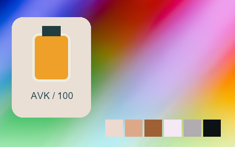

## 356 · Kodak Portra 400 Vc ++

`nt-negative-old-kodak-portra-400-vc-curve-plus-2` · `film-negative` · CC-BY-SA-4.0 · 33³

50% gray Y′ 153.9/255 (+26.4 code values); 25–75% gray span ratio 1.052; mid-gray red minus blue +7.5 code values. Light/medium/deep skin swatches: #EDD3C9, #DBA58C, #A6611D. Red/green/blue swatches: #E42F09, #72C083, #3E5ACD.

Suggested use: Compare on your own SDR product, portrait and landscape footage before selecting.

Trial strength: 0.35–0.8; default 1.0.

Pixel color mapping only; no grain, glow, vignette, spatial haze or beauty effects. Natural footage quality is unaccepted. Check skin/product colors and clipped output.

| Input swatch | Input RGB | Actual output RGB |
|---|---|---|
| `gray_0` | `#000000` | `#141B14` |
| `gray_10` | `#1A1A1A` | `#1A1C19` |
| `gray_25` | `#404040` | `#403F3B` |
| `gray_50` | `#808080` | `#A2989B` |
| `gray_75` | `#BFBFBF` | `#D0C2C6` |
| `gray_90` | `#E6E6E6` | `#E3DADE` |
| `gray_100` | `#FFFFFF` | `#F1ECE7` |
| `skin_light` | `#F5DBC6` | `#EDD3C9` |
| `skin_medium` | `#CF9B7B` | `#DBA58C` |
| `skin_deep` | `#815438` | `#A6611D` |
| `red` | `#CC3333` | `#E42F09` |
| `green` | `#33CC33` | `#72C083` |
| `blue` | `#3333CC` | `#3E5ACD` |

Creator: **Pat David** · [Source](https://github.com/NatronGitHub/clut/blob/af7b50d4caf6244fb6895a647f5b6a84efe7931a/negative_old/kodak_portra_400_vc_++.png) · commit `af7b50d4caf6244fb6895a647f5b6a84efe7931a`.

Conversion: `native-depth-Hald-to-33-tetrahedral-v1`; 8,192 sampled RGB points; max error 0.0325103; mean 0.0008865. This is numerical approximation, not a perceptual quality score.

License obligations: Credit the named creator and source; retain the CC-BY-SA-4.0 notice and indicate changes. Redistributed adapted LUT data and thumbnails must use CC-BY-SA-4.0 or a compatible license; no additional restrictions.

[License](../../../product/src/ai_ad_editor/look_data/licenses/CC-BY-SA-4.0.txt) · LUT SHA-256 `0b96fed06fb395a6c0653395ecd6ef4f35e6ab880bddf5bd0fb94fdf3413cead`.

[Actual preview PNG](../../assets/look500-20261024-r1/previews/nt-negative-old-kodak-portra-400-vc-curve-plus-2.png) · [Actual video](../../assets/look500-20261024-r1/videos/nt-negative-old-kodak-portra-400-vc-curve-plus-2.mp4)

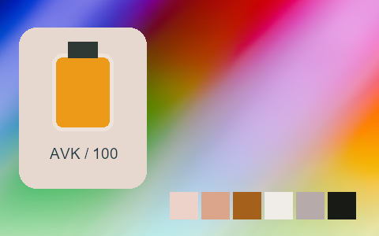

## 357 · Kodak Portra 400 Vc +

`nt-negative-old-kodak-portra-400-vc-curve-plus-1` · `film-negative` · CC-BY-SA-4.0 · 33³

50% gray Y′ 147.6/255 (+20.1 code values); 25–75% gray span ratio 1.009; mid-gray red minus blue +6.0 code values. Light/medium/deep skin swatches: #EED0C7, #D9A285, #9B5E36. Red/green/blue swatches: #DA3C24, #65BE7A, #405BCB.

Suggested use: Compare on your own SDR product, portrait and landscape footage before selecting.

Trial strength: 0.35–0.8; default 1.0.

Pixel color mapping only; no grain, glow, vignette, spatial haze or beauty effects. Natural footage quality is unaccepted. Check skin/product colors and clipped output.

| Input swatch | Input RGB | Actual output RGB |
|---|---|---|
| `gray_0` | `#000000` | `#16171A` |
| `gray_10` | `#1A1A1A` | `#1A2023` |
| `gray_25` | `#404040` | `#3D4547` |
| `gray_50` | `#808080` | `#999293` |
| `gray_75` | `#BFBFBF` | `#CEC0C6` |
| `gray_90` | `#E6E6E6` | `#E2DADD` |
| `gray_100` | `#FFFFFF` | `#F0ECE4` |
| `skin_light` | `#F5DBC6` | `#EED0C7` |
| `skin_medium` | `#CF9B7B` | `#D9A285` |
| `skin_deep` | `#815438` | `#9B5E36` |
| `red` | `#CC3333` | `#DA3C24` |
| `green` | `#33CC33` | `#65BE7A` |
| `blue` | `#3333CC` | `#405BCB` |

Creator: **Pat David** · [Source](https://github.com/NatronGitHub/clut/blob/af7b50d4caf6244fb6895a647f5b6a84efe7931a/negative_old/kodak_portra_400_vc_+.png) · commit `af7b50d4caf6244fb6895a647f5b6a84efe7931a`.

Conversion: `native-depth-Hald-to-33-tetrahedral-v1`; 8,192 sampled RGB points; max error 0.0168499; mean 0.0008113. This is numerical approximation, not a perceptual quality score.

License obligations: Credit the named creator and source; retain the CC-BY-SA-4.0 notice and indicate changes. Redistributed adapted LUT data and thumbnails must use CC-BY-SA-4.0 or a compatible license; no additional restrictions.

[License](../../../product/src/ai_ad_editor/look_data/licenses/CC-BY-SA-4.0.txt) · LUT SHA-256 `c13d3889d003732f904e939dfe8fec613902ffd99f730d5f3e288ad767d8771f`.

[Actual preview PNG](../../assets/look500-20261024-r1/previews/nt-negative-old-kodak-portra-400-vc-curve-plus-1.png) · [Actual video](../../assets/look500-20261024-r1/videos/nt-negative-old-kodak-portra-400-vc-curve-plus-1.mp4)

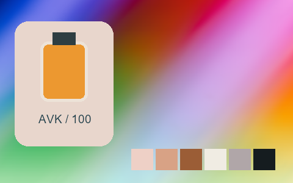

## 358 · Kodak Portra 400 Vc -

`nt-negative-old-kodak-portra-400-vc-curve-minus-1` · `film-negative` · CC-BY-SA-4.0 · 33³

50% gray Y′ 148.4/255 (+20.9 code values); 25–75% gray span ratio 1.039; mid-gray red minus blue +3.5 code values. Light/medium/deep skin swatches: #F1DBCF, #DAA584, #9A5D34. Red/green/blue swatches: #D93918, #5BC176, #355BD0.

Suggested use: Compare on your own SDR product, portrait and landscape footage before selecting.

Trial strength: 0.35–0.8; default 1.0.

Pixel color mapping only; no grain, glow, vignette, spatial haze or beauty effects. Natural footage quality is unaccepted. Check skin/product colors and clipped output.

| Input swatch | Input RGB | Actual output RGB |
|---|---|---|
| `gray_0` | `#000000` | `#010502` |
| `gray_10` | `#1A1A1A` | `#0A1314` |
| `gray_25` | `#404040` | `#394646` |
| `gray_50` | `#808080` | `#989394` |
| `gray_75` | `#BFBFBF` | `#CCC6C9` |
| `gray_90` | `#E6E6E6` | `#EAE5E5` |
| `gray_100` | `#FFFFFF` | `#F2F2EF` |
| `skin_light` | `#F5DBC6` | `#F1DBCF` |
| `skin_medium` | `#CF9B7B` | `#DAA584` |
| `skin_deep` | `#815438` | `#9A5D34` |
| `red` | `#CC3333` | `#D93918` |
| `green` | `#33CC33` | `#5BC176` |
| `blue` | `#3333CC` | `#355BD0` |

Creator: **Pat David** · [Source](https://github.com/NatronGitHub/clut/blob/af7b50d4caf6244fb6895a647f5b6a84efe7931a/negative_old/kodak_portra_400_vc_-.png) · commit `af7b50d4caf6244fb6895a647f5b6a84efe7931a`.

Conversion: `native-depth-Hald-to-33-tetrahedral-v1`; 8,192 sampled RGB points; max error 0.0181970; mean 0.0008174. This is numerical approximation, not a perceptual quality score.

License obligations: Credit the named creator and source; retain the CC-BY-SA-4.0 notice and indicate changes. Redistributed adapted LUT data and thumbnails must use CC-BY-SA-4.0 or a compatible license; no additional restrictions.

[License](../../../product/src/ai_ad_editor/look_data/licenses/CC-BY-SA-4.0.txt) · LUT SHA-256 `692acf1eaf8f1c451e0a2f24653fa1725372ae6618a7922cc6173951fcbdb79c`.

[Actual preview PNG](../../assets/look500-20261024-r1/previews/nt-negative-old-kodak-portra-400-vc-curve-minus-1.png) · [Actual video](../../assets/look500-20261024-r1/videos/nt-negative-old-kodak-portra-400-vc-curve-minus-1.mp4)

## 359 · Analogfx Anno 1870 Color

`nt-picturefx-analogfx-anno-1870-color` · `creative` · CC-BY-SA-4.0 · 33³

50% gray Y′ 106.3/255 (-21.2 code values); 25–75% gray span ratio 1.485; mid-gray red minus blue +40.5 code values. Light/medium/deep skin swatches: #FAD5C7, #C0957D, #412D24. Red/green/blue swatches: #664038, #C2B28C, #381E32.

Suggested use: Compare on your own SDR product, portrait and landscape footage before selecting.

Trial strength: 0.35–0.8; default 1.0.

Pixel color mapping only; no grain, glow, vignette, spatial haze or beauty effects. Natural footage quality is unaccepted. Check skin/product colors and clipped output.

| Input swatch | Input RGB | Actual output RGB |
|---|---|---|
| `gray_0` | `#000000` | `#020201` |
| `gray_10` | `#1A1A1A` | `#070304` |
| `gray_25` | `#404040` | `#1F1718` |
| `gray_50` | `#808080` | `#8A6261` |
| `gray_75` | `#BFBFBF` | `#FACCCE` |
| `gray_90` | `#E6E6E6` | `#FEE5E5` |
| `gray_100` | `#FFFFFF` | `#FFF9FA` |
| `skin_light` | `#F5DBC6` | `#FAD5C7` |
| `skin_medium` | `#CF9B7B` | `#C0957D` |
| `skin_deep` | `#815438` | `#412D24` |
| `red` | `#CC3333` | `#664038` |
| `green` | `#33CC33` | `#C2B28C` |
| `blue` | `#3333CC` | `#381E32` |

Creator: **Marc Roovers** · [Source](https://github.com/NatronGitHub/clut/blob/af7b50d4caf6244fb6895a647f5b6a84efe7931a/picturefx/analogfx_anno_1870_color.png) · commit `af7b50d4caf6244fb6895a647f5b6a84efe7931a`.

Conversion: `native-depth-Hald-to-33-tetrahedral-v1`; 8,192 sampled RGB points; max error 0.0411279; mean 0.0012279. This is numerical approximation, not a perceptual quality score.

License obligations: Credit the named creator and source; retain the CC-BY-SA-4.0 notice and indicate changes. Redistributed adapted LUT data and thumbnails must use CC-BY-SA-4.0 or a compatible license; no additional restrictions.

[License](../../../product/src/ai_ad_editor/look_data/licenses/CC-BY-SA-4.0.txt) · LUT SHA-256 `441a60d866d5c5ed018a614072682545d842517dfdb06bccdb4dcb12ec87a11b`.

[Actual preview PNG](../../assets/look500-20261024-r1/previews/nt-picturefx-analogfx-anno-1870-color.png) · [Actual video](../../assets/look500-20261024-r1/videos/nt-picturefx-analogfx-anno-1870-color.mp4)

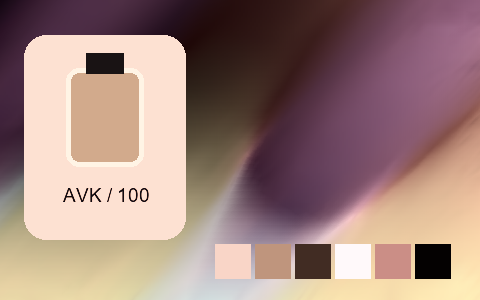

## 360 · Analogfx Sepia Color

`nt-picturefx-analogfx-sepia-color` · `creative` · CC-BY-SA-4.0 · 33³

50% gray Y′ 95.6/255 (-31.9 code values); 25–75% gray span ratio 1.196; mid-gray red minus blue +125.0 code values. Light/medium/deep skin swatches: #FFC49B, #ED7E07, #642E00. Red/green/blue swatches: #A85E00, #FD4900, #F98600.

Suggested use: Compare on your own SDR product, portrait and landscape footage before selecting.

Trial strength: 0.35–0.8; default 1.0.

Pixel color mapping only; no grain, glow, vignette, spatial haze or beauty effects. Natural footage quality is unaccepted. Check skin/product colors and clipped output.

| Input swatch | Input RGB | Actual output RGB |
|---|---|---|
| `gray_0` | `#000000` | `#030100` |
| `gray_10` | `#1A1A1A` | `#1C0A00` |
| `gray_25` | `#404040` | `#3F1C00` |
| `gray_50` | `#808080` | `#9C5420` |
| `gray_75` | `#BFBFBF` | `#FEAC7D` |
| `gray_90` | `#E6E6E6` | `#FED7C6` |
| `gray_100` | `#FFFFFF` | `#FBE5DD` |
| `skin_light` | `#F5DBC6` | `#FFC49B` |
| `skin_medium` | `#CF9B7B` | `#ED7E07` |
| `skin_deep` | `#815438` | `#642E00` |
| `red` | `#CC3333` | `#A85E00` |
| `green` | `#33CC33` | `#FD4900` |
| `blue` | `#3333CC` | `#F98600` |

Creator: **Marc Roovers** · [Source](https://github.com/NatronGitHub/clut/blob/af7b50d4caf6244fb6895a647f5b6a84efe7931a/picturefx/analogfx_sepia_color.png) · commit `af7b50d4caf6244fb6895a647f5b6a84efe7931a`.

Conversion: `native-depth-Hald-to-33-tetrahedral-v1`; 8,192 sampled RGB points; max error 0.0721332; mean 0.0008344. This is numerical approximation, not a perceptual quality score.

License obligations: Credit the named creator and source; retain the CC-BY-SA-4.0 notice and indicate changes. Redistributed adapted LUT data and thumbnails must use CC-BY-SA-4.0 or a compatible license; no additional restrictions.

[License](../../../product/src/ai_ad_editor/look_data/licenses/CC-BY-SA-4.0.txt) · LUT SHA-256 `10a69253f7cf48d9aff0d35cead34afc5fed0b238bb78d6e6cef41721788983e`.

[Actual preview PNG](../../assets/look500-20261024-r1/previews/nt-picturefx-analogfx-sepia-color.png) · [Actual video](../../assets/look500-20261024-r1/videos/nt-picturefx-analogfx-sepia-color.mp4)

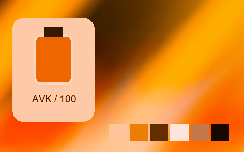

## 361 · Goldfx Bright Spring Breeze

`nt-picturefx-goldfx-bright-spring-breeze` · `creative` · CC-BY-SA-4.0 · 33³

50% gray Y′ 161.2/255 (+33.7 code values); 25–75% gray span ratio 1.237; mid-gray red minus blue -5.0 code values. Light/medium/deep skin swatches: #FBF1CD, #E7B083, #8E5A3B. Red/green/blue swatches: #CC342F, #46CA30, #2073D9.

Suggested use: Compare on your own SDR product, portrait and landscape footage before selecting.

Trial strength: 0.35–0.8; default 1.0.

Pixel color mapping only; no grain, glow, vignette, spatial haze or beauty effects. Natural footage quality is unaccepted. Check skin/product colors and clipped output.

| Input swatch | Input RGB | Actual output RGB |
|---|---|---|
| `gray_0` | `#000000` | `#020303` |
| `gray_10` | `#1A1A1A` | `#0D1E19` |
| `gray_25` | `#404040` | `#374A44` |
| `gray_50` | `#808080` | `#9CA2A2` |
| `gray_75` | `#BFBFBF` | `#D7E8E0` |
| `gray_90` | `#E6E6E6` | `#F3FDF8` |
| `gray_100` | `#FFFFFF` | `#FEFCFC` |
| `skin_light` | `#F5DBC6` | `#FBF1CD` |
| `skin_medium` | `#CF9B7B` | `#E7B083` |
| `skin_deep` | `#815438` | `#8E5A3B` |
| `red` | `#CC3333` | `#CC342F` |
| `green` | `#33CC33` | `#46CA30` |
| `blue` | `#3333CC` | `#2073D9` |

Creator: **Marc Roovers** · [Source](https://github.com/NatronGitHub/clut/blob/af7b50d4caf6244fb6895a647f5b6a84efe7931a/picturefx/goldfx_bright_spring_breeze.png) · commit `af7b50d4caf6244fb6895a647f5b6a84efe7931a`.

Conversion: `native-depth-Hald-to-33-tetrahedral-v1`; 8,192 sampled RGB points; max error 0.0521470; mean 0.0013894. This is numerical approximation, not a perceptual quality score.

License obligations: Credit the named creator and source; retain the CC-BY-SA-4.0 notice and indicate changes. Redistributed adapted LUT data and thumbnails must use CC-BY-SA-4.0 or a compatible license; no additional restrictions.

[License](../../../product/src/ai_ad_editor/look_data/licenses/CC-BY-SA-4.0.txt) · LUT SHA-256 `4784e71080b1b7bde1e5c38ef1656d016d6d66c32ec522e8562ab8f31dbe82b1`.

[Actual preview PNG](../../assets/look500-20261024-r1/previews/nt-picturefx-goldfx-bright-spring-breeze.png) · [Actual video](../../assets/look500-20261024-r1/videos/nt-picturefx-goldfx-bright-spring-breeze.mp4)

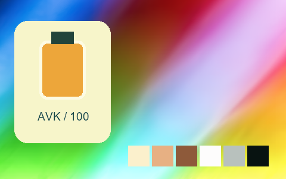

## 362 · Goldfx Bright Summer Heat

`nt-picturefx-goldfx-bright-summer-heat` · `creative` · CC-BY-SA-4.0 · 33³

50% gray Y′ 170.5/255 (+43.0 code values); 25–75% gray span ratio 1.304; mid-gray red minus blue +66.5 code values. Light/medium/deep skin swatches: #FFF3BE, #F8C570, #A95B2D. Red/green/blue swatches: #F16D30, #A2F06D, #A17BA9.

Suggested use: Compare on your own SDR product, portrait and landscape footage before selecting.

Trial strength: 0.35–0.8; default 1.0.

Pixel color mapping only; no grain, glow, vignette, spatial haze or beauty effects. Natural footage quality is unaccepted. Check skin/product colors and clipped output.

| Input swatch | Input RGB | Actual output RGB |
|---|---|---|
| `gray_0` | `#000000` | `#010101` |
| `gray_10` | `#1A1A1A` | `#0E1218` |
| `gray_25` | `#404040` | `#373B39` |
| `gray_50` | `#808080` | `#BCAA7A` |
| `gray_75` | `#BFBFBF` | `#ECE1B2` |
| `gray_90` | `#E6E6E6` | `#FAF6DE` |
| `gray_100` | `#FFFFFF` | `#FFFBFF` |
| `skin_light` | `#F5DBC6` | `#FFF3BE` |
| `skin_medium` | `#CF9B7B` | `#F8C570` |
| `skin_deep` | `#815438` | `#A95B2D` |
| `red` | `#CC3333` | `#F16D30` |
| `green` | `#33CC33` | `#A2F06D` |
| `blue` | `#3333CC` | `#A17BA9` |

Creator: **Marc Roovers** · [Source](https://github.com/NatronGitHub/clut/blob/af7b50d4caf6244fb6895a647f5b6a84efe7931a/picturefx/goldfx_bright_summer_heat.png) · commit `af7b50d4caf6244fb6895a647f5b6a84efe7931a`.

Conversion: `native-depth-Hald-to-33-tetrahedral-v1`; 8,192 sampled RGB points; max error 0.0441054; mean 0.0011859. This is numerical approximation, not a perceptual quality score.

License obligations: Credit the named creator and source; retain the CC-BY-SA-4.0 notice and indicate changes. Redistributed adapted LUT data and thumbnails must use CC-BY-SA-4.0 or a compatible license; no additional restrictions.

[License](../../../product/src/ai_ad_editor/look_data/licenses/CC-BY-SA-4.0.txt) · LUT SHA-256 `57d00689dac14bfb955938860b41f545aed22369cd1e7e22ca942031dd0f8a9e`.

[Actual preview PNG](../../assets/look500-20261024-r1/previews/nt-picturefx-goldfx-bright-summer-heat.png) · [Actual video](../../assets/look500-20261024-r1/videos/nt-picturefx-goldfx-bright-summer-heat.mp4)

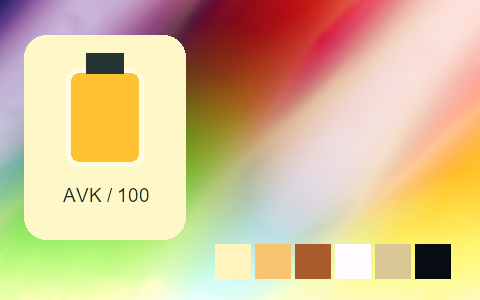

## 363 · Goldfx Hot Summer Heat

`nt-picturefx-goldfx-hot-summer-heat` · `creative` · CC-BY-SA-4.0 · 33³

50% gray Y′ 157.8/255 (+30.3 code values); 25–75% gray span ratio 1.322; mid-gray red minus blue +66.5 code values. Light/medium/deep skin swatches: #FCE09F, #F2B24B, #A45117. Red/green/blue swatches: #F56520, #7ED84D, #9A73AA.

Suggested use: Compare on your own SDR product, portrait and landscape footage before selecting.

Trial strength: 0.35–0.8; default 1.0.

Pixel color mapping only; no grain, glow, vignette, spatial haze or beauty effects. Natural footage quality is unaccepted. Check skin/product colors and clipped output.

| Input swatch | Input RGB | Actual output RGB |
|---|---|---|
| `gray_0` | `#000000` | `#000101` |
| `gray_10` | `#1A1A1A` | `#071013` |
| `gray_25` | `#404040` | `#28302C` |
| `gray_50` | `#808080` | `#B09E6D` |
| `gray_75` | `#BFBFBF` | `#E3D8A9` |
| `gray_90` | `#E6E6E6` | `#F4EFD6` |
| `gray_100` | `#FFFFFF` | `#FCF6E9` |
| `skin_light` | `#F5DBC6` | `#FCE09F` |
| `skin_medium` | `#CF9B7B` | `#F2B24B` |
| `skin_deep` | `#815438` | `#A45117` |
| `red` | `#CC3333` | `#F56520` |
| `green` | `#33CC33` | `#7ED84D` |
| `blue` | `#3333CC` | `#9A73AA` |

Creator: **Marc Roovers** · [Source](https://github.com/NatronGitHub/clut/blob/af7b50d4caf6244fb6895a647f5b6a84efe7931a/picturefx/goldfx_hot_summer_heat.png) · commit `af7b50d4caf6244fb6895a647f5b6a84efe7931a`.

Conversion: `native-depth-Hald-to-33-tetrahedral-v1`; 8,192 sampled RGB points; max error 0.0413424; mean 0.0010193. This is numerical approximation, not a perceptual quality score.

License obligations: Credit the named creator and source; retain the CC-BY-SA-4.0 notice and indicate changes. Redistributed adapted LUT data and thumbnails must use CC-BY-SA-4.0 or a compatible license; no additional restrictions.

[License](../../../product/src/ai_ad_editor/look_data/licenses/CC-BY-SA-4.0.txt) · LUT SHA-256 `d12df2420815d78560730580ec530232c217776cdf13da303430bbf933ae59f3`.

[Actual preview PNG](../../assets/look500-20261024-r1/previews/nt-picturefx-goldfx-hot-summer-heat.png) · [Actual video](../../assets/look500-20261024-r1/videos/nt-picturefx-goldfx-hot-summer-heat.mp4)

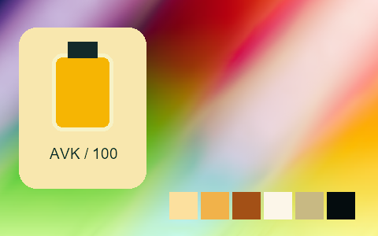

## 364 · Goldfx Spring Breeze

`nt-picturefx-goldfx-spring-breeze` · `creative` · CC-BY-SA-4.0 · 33³

50% gray Y′ 145.2/255 (+17.7 code values); 25–75% gray span ratio 1.143; mid-gray red minus blue -3.0 code values. Light/medium/deep skin swatches: #EBDDBD, #D49D6E, #85512E. Red/green/blue swatches: #CD2B2A, #14B205, #0372D7.

Suggested use: Compare on your own SDR product, portrait and landscape footage before selecting.

Trial strength: 0.35–0.8; default 1.0.

Pixel color mapping only; no grain, glow, vignette, spatial haze or beauty effects. Natural footage quality is unaccepted. Check skin/product colors and clipped output.

| Input swatch | Input RGB | Actual output RGB |
|---|---|---|
| `gray_0` | `#000000` | `#010201` |
| `gray_10` | `#1A1A1A` | `#081A15` |
| `gray_25` | `#404040` | `#34423F` |
| `gray_50` | `#808080` | `#8E9292` |
| `gray_75` | `#BFBFBF` | `#C5D4CF` |
| `gray_90` | `#E6E6E6` | `#DEEFE9` |
| `gray_100` | `#FFFFFF` | `#EAFEFC` |
| `skin_light` | `#F5DBC6` | `#EBDDBD` |
| `skin_medium` | `#CF9B7B` | `#D49D6E` |
| `skin_deep` | `#815438` | `#85512E` |
| `red` | `#CC3333` | `#CD2B2A` |
| `green` | `#33CC33` | `#14B205` |
| `blue` | `#3333CC` | `#0372D7` |

Creator: **Marc Roovers** · [Source](https://github.com/NatronGitHub/clut/blob/af7b50d4caf6244fb6895a647f5b6a84efe7931a/picturefx/goldfx_spring_breeze.png) · commit `af7b50d4caf6244fb6895a647f5b6a84efe7931a`.

Conversion: `native-depth-Hald-to-33-tetrahedral-v1`; 8,192 sampled RGB points; max error 0.0549419; mean 0.0013120. This is numerical approximation, not a perceptual quality score.

License obligations: Credit the named creator and source; retain the CC-BY-SA-4.0 notice and indicate changes. Redistributed adapted LUT data and thumbnails must use CC-BY-SA-4.0 or a compatible license; no additional restrictions.

[License](../../../product/src/ai_ad_editor/look_data/licenses/CC-BY-SA-4.0.txt) · LUT SHA-256 `7796cc16485641252ee70eab37add0d78f5eed1e4d6608a230533249c73abd83`.

[Actual preview PNG](../../assets/look500-20261024-r1/previews/nt-picturefx-goldfx-spring-breeze.png) · [Actual video](../../assets/look500-20261024-r1/videos/nt-picturefx-goldfx-spring-breeze.mp4)

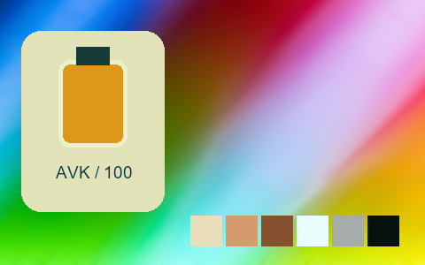

## 365 · Goldfx Summer Heat

`nt-picturefx-goldfx-summer-heat` · `creative` · CC-BY-SA-4.0 · 33³

50% gray Y′ 157.5/255 (+30.0 code values); 25–75% gray span ratio 1.264; mid-gray red minus blue +62.5 code values. Light/medium/deep skin swatches: #FBE5AD, #EDB75F, #9F5122. Red/green/blue swatches: #F16C28, #85D750, #A07BAA.

Suggested use: Compare on your own SDR product, portrait and landscape footage before selecting.

Trial strength: 0.35–0.8; default 1.0.

Pixel color mapping only; no grain, glow, vignette, spatial haze or beauty effects. Natural footage quality is unaccepted. Check skin/product colors and clipped output.

| Input swatch | Input RGB | Actual output RGB |
|---|---|---|
| `gray_0` | `#000000` | `#01070F` |
| `gray_10` | `#1A1A1A` | `#0A0F14` |
| `gray_25` | `#404040` | `#333431` |
| `gray_50` | `#808080` | `#AE9D70` |
| `gray_75` | `#BFBFBF` | `#E2D6A7` |
| `gray_90` | `#E6E6E6` | `#F4EDD4` |
| `gray_100` | `#FFFFFF` | `#F8FBF0` |
| `skin_light` | `#F5DBC6` | `#FBE5AD` |
| `skin_medium` | `#CF9B7B` | `#EDB75F` |
| `skin_deep` | `#815438` | `#9F5122` |
| `red` | `#CC3333` | `#F16C28` |
| `green` | `#33CC33` | `#85D750` |
| `blue` | `#3333CC` | `#A07BAA` |

Creator: **Marc Roovers** · [Source](https://github.com/NatronGitHub/clut/blob/af7b50d4caf6244fb6895a647f5b6a84efe7931a/picturefx/goldfx_summer_heat.png) · commit `af7b50d4caf6244fb6895a647f5b6a84efe7931a`.

Conversion: `native-depth-Hald-to-33-tetrahedral-v1`; 8,192 sampled RGB points; max error 0.0346795; mean 0.0009414. This is numerical approximation, not a perceptual quality score.

License obligations: Credit the named creator and source; retain the CC-BY-SA-4.0 notice and indicate changes. Redistributed adapted LUT data and thumbnails must use CC-BY-SA-4.0 or a compatible license; no additional restrictions.

[License](../../../product/src/ai_ad_editor/look_data/licenses/CC-BY-SA-4.0.txt) · LUT SHA-256 `31e810b0bce34bdb43c7c985dc7ba061e5465d07591cccebbd6876891ef30e1e`.

[Actual preview PNG](../../assets/look500-20261024-r1/previews/nt-picturefx-goldfx-summer-heat.png) · [Actual video](../../assets/look500-20261024-r1/videos/nt-picturefx-goldfx-summer-heat.mp4)

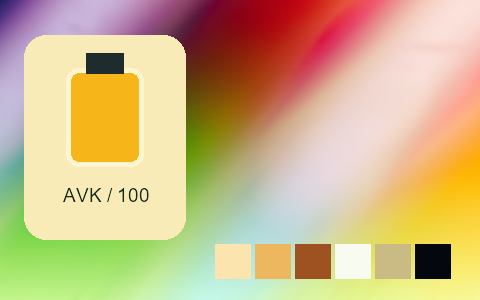

## 366 · Zilverfx Infrared

`nt-picturefx-zilverfx-infrared` · `creative` · CC-BY-SA-4.0 · 33³

50% gray Y′ 153.0/255 (+25.5 code values); 25–75% gray span ratio 1.614; mid-gray red minus blue +0.0 code values. Light/medium/deep skin swatches: #F4F2F4, #F4F3F4, #8B8A8B. Red/green/blue swatches: #5C5C5C, #F7F7F7, #0E0E0E.

Suggested use: Compare on your own SDR product, portrait and landscape footage before selecting.

Trial strength: 0.35–0.8; default 1.0.

Pixel color mapping only; no grain, glow, vignette, spatial haze or beauty effects. Natural footage quality is unaccepted. Check skin/product colors and clipped output.

| Input swatch | Input RGB | Actual output RGB |
|---|---|---|
| `gray_0` | `#000000` | `#0F0F0F` |
| `gray_10` | `#1A1A1A` | `#0B0B0B` |
| `gray_25` | `#404040` | `#1F1F1F` |
| `gray_50` | `#808080` | `#999999` |
| `gray_75` | `#BFBFBF` | `#EDEDED` |
| `gray_90` | `#E6E6E6` | `#F9F8F9` |
| `gray_100` | `#FFFFFF` | `#FBFBFB` |
| `skin_light` | `#F5DBC6` | `#F4F2F4` |
| `skin_medium` | `#CF9B7B` | `#F4F3F4` |
| `skin_deep` | `#815438` | `#8B8A8B` |
| `red` | `#CC3333` | `#5C5C5C` |
| `green` | `#33CC33` | `#F7F7F7` |
| `blue` | `#3333CC` | `#0E0E0E` |

Creator: **Marc Roovers** · [Source](https://github.com/NatronGitHub/clut/blob/af7b50d4caf6244fb6895a647f5b6a84efe7931a/picturefx/zilverfx_infrared.png) · commit `af7b50d4caf6244fb6895a647f5b6a84efe7931a`.

Conversion: `native-depth-Hald-to-33-tetrahedral-v1`; 8,192 sampled RGB points; max error 0.0604404; mean 0.0026132. This is numerical approximation, not a perceptual quality score.

License obligations: Credit the named creator and source; retain the CC-BY-SA-4.0 notice and indicate changes. Redistributed adapted LUT data and thumbnails must use CC-BY-SA-4.0 or a compatible license; no additional restrictions.

[License](../../../product/src/ai_ad_editor/look_data/licenses/CC-BY-SA-4.0.txt) · LUT SHA-256 `274b4c55fbc22cee1e45ad12ca2f340b9c91812df899422ba1dc5381adec23cc`.

[Actual preview PNG](../../assets/look500-20261024-r1/previews/nt-picturefx-zilverfx-infrared.png) · [Actual video](../../assets/look500-20261024-r1/videos/nt-picturefx-zilverfx-infrared.mp4)

## 367 · Zilverfx Vintage B W

`nt-picturefx-zilverfx-vintage-b-w` · `creative` · CC-BY-SA-4.0 · 33³

50% gray Y′ 143.0/255 (+15.5 code values); 25–75% gray span ratio 1.473; mid-gray red minus blue +20.0 code values. Light/medium/deep skin swatches: #FDFCFD, #C4BEB8, #625D58. Red/green/blue swatches: #827971, #C3BCB6, #736C65.

Suggested use: Compare on your own SDR product, portrait and landscape footage before selecting.

Trial strength: 0.35–0.8; default 1.0.

Pixel color mapping only; no grain, glow, vignette, spatial haze or beauty effects. Natural footage quality is unaccepted. Check skin/product colors and clipped output.

| Input swatch | Input RGB | Actual output RGB |
|---|---|---|
| `gray_0` | `#000000` | `#030303` |
| `gray_10` | `#1A1A1A` | `#121111` |
| `gray_25` | `#404040` | `#3A3735` |
| `gray_50` | `#808080` | `#988E84` |
| `gray_75` | `#BFBFBF` | `#F5F2F3` |
| `gray_90` | `#E6E6E6` | `#FCFAFC` |
| `gray_100` | `#FFFFFF` | `#FFFCFF` |
| `skin_light` | `#F5DBC6` | `#FDFCFD` |
| `skin_medium` | `#CF9B7B` | `#C4BEB8` |
| `skin_deep` | `#815438` | `#625D58` |
| `red` | `#CC3333` | `#827971` |
| `green` | `#33CC33` | `#C3BCB6` |
| `blue` | `#3333CC` | `#736C65` |

Creator: **Marc Roovers** · [Source](https://github.com/NatronGitHub/clut/blob/af7b50d4caf6244fb6895a647f5b6a84efe7931a/picturefx/zilverfx_vintage_b_w.png) · commit `af7b50d4caf6244fb6895a647f5b6a84efe7931a`.

Conversion: `native-depth-Hald-to-33-tetrahedral-v1`; 8,192 sampled RGB points; max error 0.0078924; mean 0.0007248. This is numerical approximation, not a perceptual quality score.

License obligations: Credit the named creator and source; retain the CC-BY-SA-4.0 notice and indicate changes. Redistributed adapted LUT data and thumbnails must use CC-BY-SA-4.0 or a compatible license; no additional restrictions.

[License](../../../product/src/ai_ad_editor/look_data/licenses/CC-BY-SA-4.0.txt) · LUT SHA-256 `ed8f130418eff38396c19cf5d4943d8b2a33ae60ccc6b1c5ce87798af848b4ff`.

[Actual preview PNG](../../assets/look500-20261024-r1/previews/nt-picturefx-zilverfx-vintage-b-w.png) · [Actual video](../../assets/look500-20261024-r1/videos/nt-picturefx-zilverfx-vintage-b-w.mp4)

## 368 · Action - Magenta 01

`fl-0000001-action-magenta-01` · `creative` · CC0-1.0 · 33³

50% gray Y′ 127.4/255 (-0.1 code values); 25–75% gray span ratio 1.001; mid-gray red minus blue +15.2 code values. Light/medium/deep skin swatches: #F8D8DF, #C79B8E, #7E543D. Red/green/blue swatches: #A03F3D, #6CB757, #453589.

Suggested use: Compare on your own SDR product, portrait and landscape footage before selecting.

Trial strength: 0.35–0.8; default 1.0.

Pixel color mapping only; no grain, glow, vignette, spatial haze or beauty effects. Natural footage quality is unaccepted. Check skin/product colors and clipped output.

| Input swatch | Input RGB | Actual output RGB |
|---|---|---|
| `gray_0` | `#000000` | `#000000` |
| `gray_10` | `#1A1A1A` | `#201817` |
| `gray_25` | `#404040` | `#4D3C3A` |
| `gray_50` | `#808080` | `#8E7B7F` |
| `gray_75` | `#BFBFBF` | `#CDBAC9` |
| `gray_90` | `#E6E6E6` | `#F3E0F7` |
| `gray_100` | `#FFFFFF` | `#FFF9FF` |
| `skin_light` | `#F5DBC6` | `#F8D8DF` |
| `skin_medium` | `#CF9B7B` | `#C79B8E` |
| `skin_deep` | `#815438` | `#7E543D` |
| `red` | `#CC3333` | `#A03F3D` |
| `green` | `#33CC33` | `#6CB757` |
| `blue` | `#3333CC` | `#453589` |

Creator: **Alex Jordan** · [Source](https://freshluts.com/luts/1) · commit `32fe087a3269fde38f3177563c1e0a77d9ec1a9e`.

Conversion: `native-CUBE-grid-retained-v1`; 8,192 sampled RGB points; max error 0.0000000; mean 0.0000000. This is numerical approximation, not a perceptual quality score.

License obligations: CC0: no attribution condition; source and creator retained for provenance.

[License](../../../product/src/ai_ad_editor/look_data/licenses/CC0-1.0.txt) · LUT SHA-256 `e43bc25238dc8ae1816fb7701d848a3c206b97ec5a5109eec7c14bb64d4ec979`.

[Actual preview PNG](../../assets/look500-20261024-r1/previews/fl-0000001-action-magenta-01.png) · [Actual video](../../assets/look500-20261024-r1/videos/fl-0000001-action-magenta-01.mp4)

## 369 · Action Red 01

`fl-0000002-action-red-01` · `creative` · CC0-1.0 · 33³

50% gray Y′ 94.4/255 (-33.1 code values); 25–75% gray span ratio 1.050; mid-gray red minus blue -18.9 code values. Light/medium/deep skin swatches: #FACBA5, #CC775A, #5C3231. Red/green/blue swatches: #B60F23, #7F848A, #1D2131.

Suggested use: Compare on your own SDR product, portrait and landscape footage before selecting.

Trial strength: 0.35–0.8; default 1.0.

Pixel color mapping only; no grain, glow, vignette, spatial haze or beauty effects. Natural footage quality is unaccepted. Check skin/product colors and clipped output.

| Input swatch | Input RGB | Actual output RGB |
|---|---|---|
| `gray_0` | `#000000` | `#00000A` |
| `gray_10` | `#1A1A1A` | `#070915` |
| `gray_25` | `#404040` | `#1E2332` |
| `gray_50` | `#808080` | `#595F6C` |
| `gray_75` | `#BFBFBF` | `#A6AAA9` |
| `gray_90` | `#E6E6E6` | `#DBDCD2` |
| `gray_100` | `#FFFFFF` | `#FFFFF0` |
| `skin_light` | `#F5DBC6` | `#FACBA5` |
| `skin_medium` | `#CF9B7B` | `#CC775A` |
| `skin_deep` | `#815438` | `#5C3231` |
| `red` | `#CC3333` | `#B60F23` |
| `green` | `#33CC33` | `#7F848A` |
| `blue` | `#3333CC` | `#1D2131` |

Creator: **Alex Jordan** · [Source](https://freshluts.com/luts/2) · commit `32fe087a3269fde38f3177563c1e0a77d9ec1a9e`.

Conversion: `native-CUBE-grid-retained-v1`; 8,192 sampled RGB points; max error 0.0000000; mean 0.0000000. This is numerical approximation, not a perceptual quality score.

License obligations: CC0: no attribution condition; source and creator retained for provenance.

[License](../../../product/src/ai_ad_editor/look_data/licenses/CC0-1.0.txt) · LUT SHA-256 `e0e2767aac31c6c866639ca5dfa9b5371316c4fe93ecd31d1d6d3d28271f2a40`.

[Actual preview PNG](../../assets/look500-20261024-r1/previews/fl-0000002-action-red-01.png) · [Actual video](../../assets/look500-20261024-r1/videos/fl-0000002-action-red-01.mp4)

## 370 · Adventure 1453

`fl-0000003-adventure-1453` · `creative` · CC0-1.0 · 33³

50% gray Y′ 120.4/255 (-7.1 code values); 25–75% gray span ratio 1.056; mid-gray red minus blue -20.5 code values. Light/medium/deep skin swatches: #FFCCD3, #E78C84, #7C483F. Red/green/blue swatches: #E02031, #21C93C, #1E28E5.

Suggested use: Compare on your own SDR product, portrait and landscape footage before selecting.

Trial strength: 0.35–0.8; default 1.0.

Pixel color mapping only; no grain, glow, vignette, spatial haze or beauty effects. Natural footage quality is unaccepted. Check skin/product colors and clipped output.

| Input swatch | Input RGB | Actual output RGB |
|---|---|---|
| `gray_0` | `#000000` | `#000000` |
| `gray_10` | `#1A1A1A` | `#050E18` |
| `gray_25` | `#404040` | `#2D3648` |
| `gray_50` | `#808080` | `#7B7590` |
| `gray_75` | `#BFBFBF` | `#D0B3D2` |
| `gray_90` | `#E6E6E6` | `#FED8F8` |
| `gray_100` | `#FFFFFF` | `#FFF1FF` |
| `skin_light` | `#F5DBC6` | `#FFCCD3` |
| `skin_medium` | `#CF9B7B` | `#E78C84` |
| `skin_deep` | `#815438` | `#7C483F` |
| `red` | `#CC3333` | `#E02031` |
| `green` | `#33CC33` | `#21C93C` |
| `blue` | `#3333CC` | `#1E28E5` |

Creator: **Alex Jordan** · [Source](https://freshluts.com/luts/3) · commit `32fe087a3269fde38f3177563c1e0a77d9ec1a9e`.

Conversion: `native-CUBE-grid-retained-v1`; 8,192 sampled RGB points; max error 0.0000000; mean 0.0000000. This is numerical approximation, not a perceptual quality score.

License obligations: CC0: no attribution condition; source and creator retained for provenance.

[License](../../../product/src/ai_ad_editor/look_data/licenses/CC0-1.0.txt) · LUT SHA-256 `319cb112a2412e281ea1fe307d66bcf3be72ebbd80df9903357e5e94b5f28d15`.

[Actual preview PNG](../../assets/look500-20261024-r1/previews/fl-0000003-adventure-1453.png) · [Actual video](../../assets/look500-20261024-r1/videos/fl-0000003-adventure-1453.mp4)

## 371 · Aggressive Highlighted recovery

`fl-0000004-aggressive-highlighted-recovery` · `creative` · CC0-1.0 · 33³

50% gray Y′ 75.1/255 (-52.4 code values); 25–75% gray span ratio 0.639; mid-gray red minus blue -0.8 code values. Light/medium/deep skin swatches: #B47C55, #A85236, #6D2B20. Red/green/blue swatches: #8D1F1F, #2DEC2D, #0504FD.

Suggested use: Compare on your own SDR product, portrait and landscape footage before selecting.

Trial strength: 0.35–0.8; default 1.0.

Pixel color mapping only; no grain, glow, vignette, spatial haze or beauty effects. Natural footage quality is unaccepted. Check skin/product colors and clipped output.

| Input swatch | Input RGB | Actual output RGB |
|---|---|---|
| `gray_0` | `#000000` | `#000000` |
| `gray_10` | `#1A1A1A` | `#060606` |
| `gray_25` | `#404040` | `#222023` |
| `gray_50` | `#808080` | `#504950` |
| `gray_75` | `#BFBFBF` | `#787079` |
| `gray_90` | `#E6E6E6` | `#8E858F` |
| `gray_100` | `#FFFFFF` | `#988F9A` |
| `skin_light` | `#F5DBC6` | `#B47C55` |
| `skin_medium` | `#CF9B7B` | `#A85236` |
| `skin_deep` | `#815438` | `#6D2B20` |
| `red` | `#CC3333` | `#8D1F1F` |
| `green` | `#33CC33` | `#2DEC2D` |
| `blue` | `#3333CC` | `#0504FD` |

Creator: **Alex Jordan** · [Source](https://freshluts.com/luts/4) · commit `32fe087a3269fde38f3177563c1e0a77d9ec1a9e`.

Conversion: `native-CUBE-grid-retained-v1`; 8,192 sampled RGB points; max error 0.0000000; mean 0.0000000. This is numerical approximation, not a perceptual quality score.

License obligations: CC0: no attribution condition; source and creator retained for provenance.

[License](../../../product/src/ai_ad_editor/look_data/licenses/CC0-1.0.txt) · LUT SHA-256 `3bf67f2da87699e45a799bcadb20aa35efbb974dae72ec2ea9d1ab2341fe5320`.

[Actual preview PNG](../../assets/look500-20261024-r1/previews/fl-0000004-aggressive-highlighted-recovery.png) · [Actual video](../../assets/look500-20261024-r1/videos/fl-0000004-aggressive-highlighted-recovery.mp4)

## 372 · Bleach Bypass Green 01

`fl-0000005-bleach-bypass-green-01` · `creative` · CC0-1.0 · 33³

50% gray Y′ 127.5/255 (-0.0 code values); 25–75% gray span ratio 1.500; mid-gray red minus blue +5.7 code values. Light/medium/deep skin swatches: #FCF6EF, #DBB895, #593E20. Red/green/blue swatches: #B7231A, #3CDA37, #181BAC.

Suggested use: Compare on your own SDR product, portrait and landscape footage before selecting.

Trial strength: 0.35–0.8; default 1.0.

Pixel color mapping only; no grain, glow, vignette, spatial haze or beauty effects. Natural footage quality is unaccepted. Check skin/product colors and clipped output.

| Input swatch | Input RGB | Actual output RGB |
|---|---|---|
| `gray_0` | `#000000` | `#000000` |
| `gray_10` | `#1A1A1A` | `#040603` |
| `gray_25` | `#404040` | `#1D2119` |
| `gray_50` | `#808080` | `#7C8276` |
| `gray_75` | `#BFBFBF` | `#DEE0DC` |
| `gray_90` | `#E6E6E6` | `#FAFAF9` |
| `gray_100` | `#FFFFFF` | `#FFFFFF` |
| `skin_light` | `#F5DBC6` | `#FCF6EF` |
| `skin_medium` | `#CF9B7B` | `#DBB895` |
| `skin_deep` | `#815438` | `#593E20` |
| `red` | `#CC3333` | `#B7231A` |
| `green` | `#33CC33` | `#3CDA37` |
| `blue` | `#3333CC` | `#181BAC` |

Creator: **Alex Jordan** · [Source](https://freshluts.com/luts/5) · commit `32fe087a3269fde38f3177563c1e0a77d9ec1a9e`.

Conversion: `native-CUBE-grid-retained-v1`; 8,192 sampled RGB points; max error 0.0000000; mean 0.0000000. This is numerical approximation, not a perceptual quality score.

License obligations: CC0: no attribution condition; source and creator retained for provenance.

[License](../../../product/src/ai_ad_editor/look_data/licenses/CC0-1.0.txt) · LUT SHA-256 `9dbbfceba3c3e0c44f3a9dc28ec8563a9eaf180d4cf41996feafd7695b0d5cd9`.

[Actual preview PNG](../../assets/look500-20261024-r1/previews/fl-0000005-bleach-bypass-green-01.png) · [Actual video](../../assets/look500-20261024-r1/videos/fl-0000005-bleach-bypass-green-01.mp4)

## 373 · Bleach Bypass Yellow 01

`fl-0000006-bleach-bypass-yellow-01` · `creative` · CC0-1.0 · 33³

50% gray Y′ 127.5/255 (-0.0 code values); 25–75% gray span ratio 1.500; mid-gray red minus blue +7.6 code values. Light/medium/deep skin swatches: #FDF7E3, #DDB795, #5D3C26. Red/green/blue swatches: #BA2220, #40D83C, #1B1BA9.

Suggested use: Compare on your own SDR product, portrait and landscape footage before selecting.

Trial strength: 0.35–0.8; default 1.0.

Pixel color mapping only; no grain, glow, vignette, spatial haze or beauty effects. Natural footage quality is unaccepted. Check skin/product colors and clipped output.

| Input swatch | Input RGB | Actual output RGB |
|---|---|---|
| `gray_0` | `#000000` | `#000000` |
| `gray_10` | `#1A1A1A` | `#050505` |
| `gray_25` | `#404040` | `#20201E` |
| `gray_50` | `#808080` | `#808078` |
| `gray_75` | `#BFBFBF` | `#E0E0D3` |
| `gray_90` | `#E6E6E6` | `#FBFBEC` |
| `gray_100` | `#FFFFFF` | `#FFFFF1` |
| `skin_light` | `#F5DBC6` | `#FDF7E3` |
| `skin_medium` | `#CF9B7B` | `#DDB795` |
| `skin_deep` | `#815438` | `#5D3C26` |
| `red` | `#CC3333` | `#BA2220` |
| `green` | `#33CC33` | `#40D83C` |
| `blue` | `#3333CC` | `#1B1BA9` |

Creator: **Alex Jordan** · [Source](https://freshluts.com/luts/6) · commit `32fe087a3269fde38f3177563c1e0a77d9ec1a9e`.

Conversion: `native-CUBE-grid-retained-v1`; 8,192 sampled RGB points; max error 0.0000000; mean 0.0000000. This is numerical approximation, not a perceptual quality score.

License obligations: CC0: no attribution condition; source and creator retained for provenance.

[License](../../../product/src/ai_ad_editor/look_data/licenses/CC0-1.0.txt) · LUT SHA-256 `c0732b71681b644c0acef95d9e3f8d6820038ac93a8be0132d81160fa0510b40`.

[Actual preview PNG](../../assets/look500-20261024-r1/previews/fl-0000006-bleach-bypass-yellow-01.png) · [Actual video](../../assets/look500-20261024-r1/videos/fl-0000006-bleach-bypass-yellow-01.mp4)

## 374 · Blue Dark

`fl-0000007-blue-dark` · `creative` · CC0-1.0 · 33³

50% gray Y′ 58.1/255 (-69.4 code values); 25–75% gray span ratio 0.735; mid-gray red minus blue -26.3 code values. Light/medium/deep skin swatches: #8391AC, #565662, #242124. Red/green/blue swatches: #34161E, #2E5F49, #0D1045.

Suggested use: Compare on your own SDR product, portrait and landscape footage before selecting.

Trial strength: 0.35–0.8; default 1.0.

Pixel color mapping only; no grain, glow, vignette, spatial haze or beauty effects. Natural footage quality is unaccepted. Check skin/product colors and clipped output.

| Input swatch | Input RGB | Actual output RGB |
|---|---|---|
| `gray_0` | `#000000` | `#000000` |
| `gray_10` | `#1A1A1A` | `#030406` |
| `gray_25` | `#404040` | `#0F1319` |
| `gray_50` | `#808080` | `#313B4B` |
| `gray_75` | `#BFBFBF` | `#61728F` |
| `gray_90` | `#E6E6E6` | `#839ABE` |
| `gray_100` | `#FFFFFF` | `#9CB6E1` |
| `skin_light` | `#F5DBC6` | `#8391AC` |
| `skin_medium` | `#CF9B7B` | `#565662` |
| `skin_deep` | `#815438` | `#242124` |
| `red` | `#CC3333` | `#34161E` |
| `green` | `#33CC33` | `#2E5F49` |
| `blue` | `#3333CC` | `#0D1045` |

Creator: **Alex Jordan** · [Source](https://freshluts.com/luts/7) · commit `32fe087a3269fde38f3177563c1e0a77d9ec1a9e`.

Conversion: `native-CUBE-grid-retained-v1`; 8,192 sampled RGB points; max error 0.0000000; mean 0.0000000. This is numerical approximation, not a perceptual quality score.

License obligations: CC0: no attribution condition; source and creator retained for provenance.

[License](../../../product/src/ai_ad_editor/look_data/licenses/CC0-1.0.txt) · LUT SHA-256 `d92e4b730a572a322e0ba8c2b90bdfd3b8c17297b7a9cc352e6d99c8d02d8f6c`.

[Actual preview PNG](../../assets/look500-20261024-r1/previews/fl-0000007-blue-dark.png) · [Actual video](../../assets/look500-20261024-r1/videos/fl-0000007-blue-dark.mp4)

## 375 · Bright Green 01

`fl-0000009-bright-green-01` · `creative` · CC0-1.0 · 33³

50% gray Y′ 107.4/255 (-20.1 code values); 25–75% gray span ratio 0.841; mid-gray red minus blue +48.0 code values. Light/medium/deep skin swatches: #D2B592, #B68256, #764528. Red/green/blue swatches: #7D2921, #48A548, #322C40.

Suggested use: Compare on your own SDR product, portrait and landscape footage before selecting.

Trial strength: 0.35–0.8; default 1.0.

Pixel color mapping only; no grain, glow, vignette, spatial haze or beauty effects. Natural footage quality is unaccepted. Check skin/product colors and clipped output.

| Input swatch | Input RGB | Actual output RGB |
|---|---|---|
| `gray_0` | `#000000` | `#000000` |
| `gray_10` | `#1A1A1A` | `#141311` |
| `gray_25` | `#404040` | `#3E3427` |
| `gray_50` | `#808080` | `#7D694D` |
| `gray_75` | `#BFBFBF` | `#B49E7E` |
| `gray_90` | `#E6E6E6` | `#D2BEA1` |
| `gray_100` | `#FFFFFF` | `#E4D3BB` |
| `skin_light` | `#F5DBC6` | `#D2B592` |
| `skin_medium` | `#CF9B7B` | `#B68256` |
| `skin_deep` | `#815438` | `#764528` |
| `red` | `#CC3333` | `#7D2921` |
| `green` | `#33CC33` | `#48A548` |
| `blue` | `#3333CC` | `#322C40` |

Creator: **Alex Jordan** · [Source](https://freshluts.com/luts/9) · commit `32fe087a3269fde38f3177563c1e0a77d9ec1a9e`.

Conversion: `native-CUBE-grid-retained-v1`; 8,192 sampled RGB points; max error 0.0000000; mean 0.0000000. This is numerical approximation, not a perceptual quality score.

License obligations: CC0: no attribution condition; source and creator retained for provenance.

[License](../../../product/src/ai_ad_editor/look_data/licenses/CC0-1.0.txt) · LUT SHA-256 `a4249ec7b2850d856f85a1284d9dbbe868621c1bce0f70ee939f2d78fb815e21`.

[Actual preview PNG](../../assets/look500-20261024-r1/previews/fl-0000009-bright-green-01.png) · [Actual video](../../assets/look500-20261024-r1/videos/fl-0000009-bright-green-01.mp4)

## 376 · Brownish

`fl-0000010-brownish` · `cinema` · CC0-1.0 · 33³

50% gray Y′ 93.0/255 (-34.5 code values); 25–75% gray span ratio 1.156; mid-gray red minus blue +19.3 code values. Light/medium/deep skin swatches: #E5CBD3, #AC8474, #512C20. Red/green/blue swatches: #681C1B, #60974B, #1E1648.

Suggested use: Compare on your own SDR product, portrait and landscape footage before selecting.

Trial strength: 0.35–0.8; default 1.0.

Pixel color mapping only; no grain, glow, vignette, spatial haze or beauty effects. Natural footage quality is unaccepted. Check skin/product colors and clipped output.

| Input swatch | Input RGB | Actual output RGB |
|---|---|---|
| `gray_0` | `#000000` | `#000000` |
| `gray_10` | `#1A1A1A` | `#010101` |
| `gray_25` | `#404040` | `#221A19` |
| `gray_50` | `#808080` | `#6B5958` |
| `gray_75` | `#BFBFBF` | `#BCAAB6` |
| `gray_90` | `#E6E6E6` | `#E4D2E5` |
| `gray_100` | `#FFFFFF` | `#F8E6FE` |
| `skin_light` | `#F5DBC6` | `#E5CBD3` |
| `skin_medium` | `#CF9B7B` | `#AC8474` |
| `skin_deep` | `#815438` | `#512C20` |
| `red` | `#CC3333` | `#681C1B` |
| `green` | `#33CC33` | `#60974B` |
| `blue` | `#3333CC` | `#1E1648` |

Creator: **Alex Jordan** · [Source](https://freshluts.com/luts/10) · commit `32fe087a3269fde38f3177563c1e0a77d9ec1a9e`.

Conversion: `native-CUBE-grid-retained-v1`; 8,192 sampled RGB points; max error 0.0000000; mean 0.0000000. This is numerical approximation, not a perceptual quality score.

License obligations: CC0: no attribution condition; source and creator retained for provenance.

[License](../../../product/src/ai_ad_editor/look_data/licenses/CC0-1.0.txt) · LUT SHA-256 `54061f8f1511db2e126f7471510ab2f703def6c91f610ea0683ed6a763349019`.

[Actual preview PNG](../../assets/look500-20261024-r1/previews/fl-0000010-brownish.png) · [Actual video](../../assets/look500-20261024-r1/videos/fl-0000010-brownish.mp4)

## 377 · Colorful 0209

`fl-0000011-colorful-0209` · `creative` · CC0-1.0 · 33³

50% gray Y′ 127.5/255 (-0.0 code values); 25–75% gray span ratio 1.000; mid-gray red minus blue +0.0 code values. Light/medium/deep skin swatches: #FFD7A9, #EE965F, #A14E1B. Red/green/blue swatches: #C13636, #3FCA3F, #3131BC.

Suggested use: Compare on your own SDR product, portrait and landscape footage before selecting.

Trial strength: 0.35–0.8; default 1.0.

Pixel color mapping only; no grain, glow, vignette, spatial haze or beauty effects. Natural footage quality is unaccepted. Check skin/product colors and clipped output.

| Input swatch | Input RGB | Actual output RGB |
|---|---|---|
| `gray_0` | `#000000` | `#000000` |
| `gray_10` | `#1A1A1A` | `#191919` |
| `gray_25` | `#404040` | `#404040` |
| `gray_50` | `#808080` | `#7F7F7F` |
| `gray_75` | `#BFBFBF` | `#BFBFBF` |
| `gray_90` | `#E6E6E6` | `#E5E5E5` |
| `gray_100` | `#FFFFFF` | `#FFFFFF` |
| `skin_light` | `#F5DBC6` | `#FFD7A9` |
| `skin_medium` | `#CF9B7B` | `#EE965F` |
| `skin_deep` | `#815438` | `#A14E1B` |
| `red` | `#CC3333` | `#C13636` |
| `green` | `#33CC33` | `#3FCA3F` |
| `blue` | `#3333CC` | `#3131BC` |

Creator: **Alex Jordan** · [Source](https://freshluts.com/luts/11) · commit `32fe087a3269fde38f3177563c1e0a77d9ec1a9e`.

Conversion: `native-CUBE-grid-retained-v1`; 8,192 sampled RGB points; max error 0.0000000; mean 0.0000000. This is numerical approximation, not a perceptual quality score.

License obligations: CC0: no attribution condition; source and creator retained for provenance.

[License](../../../product/src/ai_ad_editor/look_data/licenses/CC0-1.0.txt) · LUT SHA-256 `94cec1c0e9be45c4eb6a96e4c00d42bc7051ebc8fd04a331c8e39a558a037ae5`.

[Actual preview PNG](../../assets/look500-20261024-r1/previews/fl-0000011-colorful-0209.png) · [Actual video](../../assets/look500-20261024-r1/videos/fl-0000011-colorful-0209.mp4)

## 378 · Conflict 01

`fl-0000012-conflict-01` · `creative` · CC0-1.0 · 33³

50% gray Y′ 105.8/255 (-21.7 code values); 25–75% gray span ratio 1.050; mid-gray red minus blue -14.9 code values. Light/medium/deep skin swatches: #EBC7C1, #C08478, #6C3A35. Red/green/blue swatches: #B91830, #1EB635, #1A19C1.

Suggested use: Compare on your own SDR product, portrait and landscape footage before selecting.

Trial strength: 0.35–0.8; default 1.0.

Pixel color mapping only; no grain, glow, vignette, spatial haze or beauty effects. Natural footage quality is unaccepted. Check skin/product colors and clipped output.

| Input swatch | Input RGB | Actual output RGB |
|---|---|---|
| `gray_0` | `#000000` | `#000000` |
| `gray_10` | `#1A1A1A` | `#010116` |
| `gray_25` | `#404040` | `#27253C` |
| `gray_50` | `#808080` | `#6C677B` |
| `gray_75` | `#BFBFBF` | `#B1AABA` |
| `gray_90` | `#E6E6E6` | `#DBD2DF` |
| `gray_100` | `#FFFFFF` | `#F7EDF8` |
| `skin_light` | `#F5DBC6` | `#EBC7C1` |
| `skin_medium` | `#CF9B7B` | `#C08478` |
| `skin_deep` | `#815438` | `#6C3A35` |
| `red` | `#CC3333` | `#B91830` |
| `green` | `#33CC33` | `#1EB635` |
| `blue` | `#3333CC` | `#1A19C1` |

Creator: **Alex Jordan** · [Source](https://freshluts.com/luts/12) · commit `32fe087a3269fde38f3177563c1e0a77d9ec1a9e`.

Conversion: `native-CUBE-grid-retained-v1`; 8,192 sampled RGB points; max error 0.0000000; mean 0.0000000. This is numerical approximation, not a perceptual quality score.

License obligations: CC0: no attribution condition; source and creator retained for provenance.

[License](../../../product/src/ai_ad_editor/look_data/licenses/CC0-1.0.txt) · LUT SHA-256 `d5b9ce6af347d36f3f72e6df347cf829a972f51c7883544c8bbfe640c36158af`.

[Actual preview PNG](../../assets/look500-20261024-r1/previews/fl-0000012-conflict-01.png) · [Actual video](../../assets/look500-20261024-r1/videos/fl-0000012-conflict-01.mp4)

## 379 · Contrast with highlights protection

`fl-0000013-contrast-with-highlights-protection` · `creative` · CC0-1.0 · 33³

50% gray Y′ 127.1/255 (-0.4 code values); 25–75% gray span ratio 1.097; mid-gray red minus blue +0.0 code values. Light/medium/deep skin swatches: #E8CAB1, #D59D7A, #794726. Red/green/blue swatches: #A72A2A, #45CA45, #212175.

Suggested use: Compare on your own SDR product, portrait and landscape footage before selecting.

Trial strength: 0.35–0.8; default 1.0.

Pixel color mapping only; no grain, glow, vignette, spatial haze or beauty effects. Natural footage quality is unaccepted. Check skin/product colors and clipped output.

| Input swatch | Input RGB | Actual output RGB |
|---|---|---|
| `gray_0` | `#000000` | `#000000` |
| `gray_10` | `#1A1A1A` | `#000000` |
| `gray_25` | `#404040` | `#292929` |
| `gray_50` | `#808080` | `#7F7F7F` |
| `gray_75` | `#BFBFBF` | `#B5B5B5` |
| `gray_90` | `#E6E6E6` | `#D6D6D6` |
| `gray_100` | `#FFFFFF` | `#F7F7F7` |
| `skin_light` | `#F5DBC6` | `#E8CAB1` |
| `skin_medium` | `#CF9B7B` | `#D59D7A` |
| `skin_deep` | `#815438` | `#794726` |
| `red` | `#CC3333` | `#A72A2A` |
| `green` | `#33CC33` | `#45CA45` |
| `blue` | `#3333CC` | `#212175` |

Creator: **Alex Jordan** · [Source](https://freshluts.com/luts/13) · commit `32fe087a3269fde38f3177563c1e0a77d9ec1a9e`.

Conversion: `native-CUBE-grid-retained-v1`; 8,192 sampled RGB points; max error 0.0000000; mean 0.0000000. This is numerical approximation, not a perceptual quality score.

License obligations: CC0: no attribution condition; source and creator retained for provenance.

[License](../../../product/src/ai_ad_editor/look_data/licenses/CC0-1.0.txt) · LUT SHA-256 `48739bfdd0d9d27e3f3ecc6e83ab366edcb0bc86999cc1132bec1869b5b246e1`.

[Actual preview PNG](../../assets/look500-20261024-r1/previews/fl-0000013-contrast-with-highlights-protection.png) · [Actual video](../../assets/look500-20261024-r1/videos/fl-0000013-contrast-with-highlights-protection.mp4)

## 380 · Contrasty afternoon

`fl-0000014-contrasty-afternoon` · `creative` · CC0-1.0 · 33³

50% gray Y′ 95.9/255 (-31.6 code values); 25–75% gray span ratio 1.205; mid-gray red minus blue -11.2 code values. Light/medium/deep skin swatches: #EBCCD0, #BD7F73, #5E2B1D. Red/green/blue swatches: #A80815, #1AB22A, #0405B3.

Suggested use: Compare on your own SDR product, portrait and landscape footage before selecting.

Trial strength: 0.35–0.8; default 1.0.

Pixel color mapping only; no grain, glow, vignette, spatial haze or beauty effects. Natural footage quality is unaccepted. Check skin/product colors and clipped output.

| Input swatch | Input RGB | Actual output RGB |
|---|---|---|
| `gray_0` | `#000000` | `#000000` |
| `gray_10` | `#1A1A1A` | `#000000` |
| `gray_25` | `#404040` | `#121220` |
| `gray_50` | `#808080` | `#645D70` |
| `gray_75` | `#BFBFBF` | `#B3A9C0` |
| `gray_90` | `#E6E6E6` | `#E1D7F2` |
| `gray_100` | `#FFFFFF` | `#F9F7FF` |
| `skin_light` | `#F5DBC6` | `#EBCCD0` |
| `skin_medium` | `#CF9B7B` | `#BD7F73` |
| `skin_deep` | `#815438` | `#5E2B1D` |
| `red` | `#CC3333` | `#A80815` |
| `green` | `#33CC33` | `#1AB22A` |
| `blue` | `#3333CC` | `#0405B3` |

Creator: **Alex Jordan** · [Source](https://freshluts.com/luts/14) · commit `32fe087a3269fde38f3177563c1e0a77d9ec1a9e`.

Conversion: `native-CUBE-grid-retained-v1`; 8,192 sampled RGB points; max error 0.0000000; mean 0.0000000. This is numerical approximation, not a perceptual quality score.

License obligations: CC0: no attribution condition; source and creator retained for provenance.

[License](../../../product/src/ai_ad_editor/look_data/licenses/CC0-1.0.txt) · LUT SHA-256 `73ac8a920699ebfd5b9a455fc0b8676049b58550f116329477641163d028a9ed`.

[Actual preview PNG](../../assets/look500-20261024-r1/previews/fl-0000014-contrasty-afternoon.png) · [Actual video](../../assets/look500-20261024-r1/videos/fl-0000014-contrasty-afternoon.mp4)

## 381 · Contrasty Green

`fl-0000015-contrasty-green` · `cinema` · CC0-1.0 · 33³

50% gray Y′ 172.1/255 (+44.6 code values); 25–75% gray span ratio 1.750; mid-gray red minus blue +183.2 code values. Light/medium/deep skin swatches: #FFFFAE, #FFD027, #C93301. Red/green/blue swatches: #FF0000, #30FF14, #150F54.

Suggested use: Compare on your own SDR product, portrait and landscape footage before selecting.

Trial strength: 0.35–0.8; default 1.0.

Pixel color mapping only; no grain, glow, vignette, spatial haze or beauty effects. Natural footage quality is unaccepted. Check skin/product colors and clipped output.

| Input swatch | Input RGB | Actual output RGB |
|---|---|---|
| `gray_0` | `#000000` | `#000000` |
| `gray_10` | `#1A1A1A` | `#000000` |
| `gray_25` | `#404040` | `#1F1605` |
| `gray_50` | `#808080` | `#ECA535` |
| `gray_75` | `#BFBFBF` | `#FFFF85` |
| `gray_90` | `#E6E6E6` | `#FFFFDD` |
| `gray_100` | `#FFFFFF` | `#FFFFFF` |
| `skin_light` | `#F5DBC6` | `#FFFFAE` |
| `skin_medium` | `#CF9B7B` | `#FFD027` |
| `skin_deep` | `#815438` | `#C93301` |
| `red` | `#CC3333` | `#FF0000` |
| `green` | `#33CC33` | `#30FF14` |
| `blue` | `#3333CC` | `#150F54` |

Creator: **Alex Jordan** · [Source](https://freshluts.com/luts/15) · commit `32fe087a3269fde38f3177563c1e0a77d9ec1a9e`.

Conversion: `native-CUBE-grid-retained-v1`; 8,192 sampled RGB points; max error 0.0000000; mean 0.0000000. This is numerical approximation, not a perceptual quality score.

License obligations: CC0: no attribution condition; source and creator retained for provenance.

[License](../../../product/src/ai_ad_editor/look_data/licenses/CC0-1.0.txt) · LUT SHA-256 `da6b0e91b902ed87688377dd4ab2c0bc545d39f01a0e38a1da32f0e42d02e27d`.

[Actual preview PNG](../../assets/look500-20261024-r1/previews/fl-0000015-contrasty-green.png) · [Actual video](../../assets/look500-20261024-r1/videos/fl-0000015-contrasty-green.mp4)

## 382 · Cross Process CP15

`fl-0000016-cross-process-cp15` · `creative` · CC0-1.0 · 33³

50% gray Y′ 59.2/255 (-68.3 code values); 25–75% gray span ratio 1.071; mid-gray red minus blue +15.6 code values. Light/medium/deep skin swatches: #FFB062, #E44C1A, #3A1505. Red/green/blue swatches: #C70000, #009200, #000574.

Suggested use: Compare on your own SDR product, portrait and landscape footage before selecting.

Trial strength: 0.35–0.8; default 1.0.

Pixel color mapping only; no grain, glow, vignette, spatial haze or beauty effects. Natural footage quality is unaccepted. Check skin/product colors and clipped output.

| Input swatch | Input RGB | Actual output RGB |
|---|---|---|
| `gray_0` | `#000000` | `#000101` |
| `gray_10` | `#1A1A1A` | `#000202` |
| `gray_25` | `#404040` | `#050F0B` |
| `gray_50` | `#808080` | `#3C3C2D` |
| `gray_75` | `#BFBFBF` | `#C18C66` |
| `gray_90` | `#E6E6E6` | `#FFCE95` |
| `gray_100` | `#FFFFFF` | `#FFFFBA` |
| `skin_light` | `#F5DBC6` | `#FFB062` |
| `skin_medium` | `#CF9B7B` | `#E44C1A` |
| `skin_deep` | `#815438` | `#3A1505` |
| `red` | `#CC3333` | `#C70000` |
| `green` | `#33CC33` | `#009200` |
| `blue` | `#3333CC` | `#000574` |

Creator: **Alex Jordan** · [Source](https://freshluts.com/luts/16) · commit `32fe087a3269fde38f3177563c1e0a77d9ec1a9e`.

Conversion: `native-CUBE-grid-retained-v1`; 8,192 sampled RGB points; max error 0.0000000; mean 0.0000000. This is numerical approximation, not a perceptual quality score.

License obligations: CC0: no attribution condition; source and creator retained for provenance.

[License](../../../product/src/ai_ad_editor/look_data/licenses/CC0-1.0.txt) · LUT SHA-256 `85ca989f0305189e004c824b8c8a6fd1e4ba7f0e95492d003b47c875243fb85c`.

[Actual preview PNG](../../assets/look500-20261024-r1/previews/fl-0000016-cross-process-cp15.png) · [Actual video](../../assets/look500-20261024-r1/videos/fl-0000016-cross-process-cp15.mp4)

## 383 · Cross process CP3

`fl-0000017-cross-process-cp3` · `creative` · CC0-1.0 · 33³

50% gray Y′ 138.9/255 (+11.4 code values); 25–75% gray span ratio 1.149; mid-gray red minus blue -7.1 code values. Light/medium/deep skin swatches: #FFE5B0, #ECA880, #7C5650. Red/green/blue swatches: #D03047, #1BE652, #25378D.

Suggested use: Compare on your own SDR product, portrait and landscape footage before selecting.

Trial strength: 0.35–0.8; default 1.0.

Pixel color mapping only; no grain, glow, vignette, spatial haze or beauty effects. Natural footage quality is unaccepted. Check skin/product colors and clipped output.

| Input swatch | Input RGB | Actual output RGB |
|---|---|---|
| `gray_0` | `#000000` | `#000001` |
| `gray_10` | `#1A1A1A` | `#10131A` |
| `gray_25` | `#404040` | `#2A3E4D` |
| `gray_50` | `#808080` | `#818E89` |
| `gray_75` | `#BFBFBF` | `#D7CEAF` |
| `gray_90` | `#E6E6E6` | `#F4EEC4` |
| `gray_100` | `#FFFFFF` | `#FFFFD3` |
| `skin_light` | `#F5DBC6` | `#FFE5B0` |
| `skin_medium` | `#CF9B7B` | `#ECA880` |
| `skin_deep` | `#815438` | `#7C5650` |
| `red` | `#CC3333` | `#D03047` |
| `green` | `#33CC33` | `#1BE652` |
| `blue` | `#3333CC` | `#25378D` |

Creator: **Alex Jordan** · [Source](https://freshluts.com/luts/17) · commit `32fe087a3269fde38f3177563c1e0a77d9ec1a9e`.

Conversion: `native-CUBE-grid-retained-v1`; 8,192 sampled RGB points; max error 0.0000000; mean 0.0000000. This is numerical approximation, not a perceptual quality score.

License obligations: CC0: no attribution condition; source and creator retained for provenance.

[License](../../../product/src/ai_ad_editor/look_data/licenses/CC0-1.0.txt) · LUT SHA-256 `c491ffb76eddc9fa626f398aea14e73ddd2a90332dbebd3fa90f465833ce3ec2`.

[Actual preview PNG](../../assets/look500-20261024-r1/previews/fl-0000017-cross-process-cp3.png) · [Actual video](../../assets/look500-20261024-r1/videos/fl-0000017-cross-process-cp3.mp4)

## 384 · Cross Process CP4

`fl-0000018-cross-process-cp4` · `creative` · CC0-1.0 · 33³

50% gray Y′ 138.9/255 (+11.4 code values); 25–75% gray span ratio 1.150; mid-gray red minus blue -7.1 code values. Light/medium/deep skin swatches: #FFE5B0, #ECA880, #7A574D. Red/green/blue swatches: #CA3241, #1BE652, #243B68.

Suggested use: Compare on your own SDR product, portrait and landscape footage before selecting.

Trial strength: 0.35–0.8; default 1.0.

Pixel color mapping only; no grain, glow, vignette, spatial haze or beauty effects. Natural footage quality is unaccepted. Check skin/product colors and clipped output.

| Input swatch | Input RGB | Actual output RGB |
|---|---|---|
| `gray_0` | `#000000` | `#000000` |
| `gray_10` | `#1A1A1A` | `#131313` |
| `gray_25` | `#404040` | `#29403D` |
| `gray_50` | `#808080` | `#818E89` |
| `gray_75` | `#BFBFBF` | `#D7CEAF` |
| `gray_90` | `#E6E6E6` | `#F4EEC4` |
| `gray_100` | `#FFFFFF` | `#FFFFD3` |
| `skin_light` | `#F5DBC6` | `#FFE5B0` |
| `skin_medium` | `#CF9B7B` | `#ECA880` |
| `skin_deep` | `#815438` | `#7A574D` |
| `red` | `#CC3333` | `#CA3241` |
| `green` | `#33CC33` | `#1BE652` |
| `blue` | `#3333CC` | `#243B68` |

Creator: **Alex Jordan** · [Source](https://freshluts.com/luts/18) · commit `32fe087a3269fde38f3177563c1e0a77d9ec1a9e`.

Conversion: `native-CUBE-grid-retained-v1`; 8,192 sampled RGB points; max error 0.0000000; mean 0.0000000. This is numerical approximation, not a perceptual quality score.

License obligations: CC0: no attribution condition; source and creator retained for provenance.

[License](../../../product/src/ai_ad_editor/look_data/licenses/CC0-1.0.txt) · LUT SHA-256 `6cf77477d80da1acfba74383e2372eea7085091d23a1e5b9b53253f6a7fabb96`.

[Actual preview PNG](../../assets/look500-20261024-r1/previews/fl-0000018-cross-process-cp4.png) · [Actual video](../../assets/look500-20261024-r1/videos/fl-0000018-cross-process-cp4.mp4)

## 385 · Cross Process CP6

`fl-0000019-cross-process-cp6` · `creative` · CC0-1.0 · 33³

50% gray Y′ 110.5/255 (-17.0 code values); 25–75% gray span ratio 1.146; mid-gray red minus blue -3.8 code values. Light/medium/deep skin swatches: #F5E6C9, #CEA993, #5E4A4A. Red/green/blue swatches: #8B384A, #57C776, #333675.

Suggested use: Compare on your own SDR product, portrait and landscape footage before selecting.

Trial strength: 0.35–0.8; default 1.0.

Pixel color mapping only; no grain, glow, vignette, spatial haze or beauty effects. Natural footage quality is unaccepted. Check skin/product colors and clipped output.

| Input swatch | Input RGB | Actual output RGB |
|---|---|---|
| `gray_0` | `#000000` | `#000000` |
| `gray_10` | `#1A1A1A` | `#14111E` |
| `gray_25` | `#404040` | `#363B52` |
| `gray_50` | `#808080` | `#6A706D` |
| `gray_75` | `#BFBFBF` | `#D3CEBD` |
| `gray_90` | `#E6E6E6` | `#F0EDD6` |
| `gray_100` | `#FFFFFF` | `#FFFFE7` |
| `skin_light` | `#F5DBC6` | `#F5E6C9` |
| `skin_medium` | `#CF9B7B` | `#CEA993` |
| `skin_deep` | `#815438` | `#5E4A4A` |
| `red` | `#CC3333` | `#8B384A` |
| `green` | `#33CC33` | `#57C776` |
| `blue` | `#3333CC` | `#333675` |

Creator: **Alex Jordan** · [Source](https://freshluts.com/luts/19) · commit `32fe087a3269fde38f3177563c1e0a77d9ec1a9e`.

Conversion: `native-CUBE-grid-retained-v1`; 8,192 sampled RGB points; max error 0.0000000; mean 0.0000000. This is numerical approximation, not a perceptual quality score.

License obligations: CC0: no attribution condition; source and creator retained for provenance.

[License](../../../product/src/ai_ad_editor/look_data/licenses/CC0-1.0.txt) · LUT SHA-256 `93ff13fa0fe54b7a7b053d2427cda817949d41f8fc1f3732e1b325d7072c8796`.

[Actual preview PNG](../../assets/look500-20261024-r1/previews/fl-0000019-cross-process-cp6.png) · [Actual video](../../assets/look500-20261024-r1/videos/fl-0000019-cross-process-cp6.mp4)

## 386 · Cross Process CP14

`fl-0000020-cross-process-cp14` · `creative` · CC0-1.0 · 33³

50% gray Y′ 91.4/255 (-36.1 code values); 25–75% gray span ratio 1.050; mid-gray red minus blue +17.0 code values. Light/medium/deep skin swatches: #FFBE83, #DD7140, #5B3117. Red/green/blue swatches: #CB0803, #06B015, #071B8F.

Suggested use: Compare on your own SDR product, portrait and landscape footage before selecting.

Trial strength: 0.35–0.8; default 1.0.

Pixel color mapping only; no grain, glow, vignette, spatial haze or beauty effects. Natural footage quality is unaccepted. Check skin/product colors and clipped output.

| Input swatch | Input RGB | Actual output RGB |
|---|---|---|
| `gray_0` | `#000000` | `#000505` |
| `gray_10` | `#1A1A1A` | `#000C0A` |
| `gray_25` | `#404040` | `#12251F` |
| `gray_50` | `#808080` | `#5D5D4C` |
| `gray_75` | `#BFBFBF` | `#C6A182` |
| `gray_90` | `#E6E6E6` | `#FFD0A7` |
| `gray_100` | `#FFFFFF` | `#FFF0C1` |
| `skin_light` | `#F5DBC6` | `#FFBE83` |
| `skin_medium` | `#CF9B7B` | `#DD7140` |
| `skin_deep` | `#815438` | `#5B3117` |
| `red` | `#CC3333` | `#CB0803` |
| `green` | `#33CC33` | `#06B015` |
| `blue` | `#3333CC` | `#071B8F` |

Creator: **Alex Jordan** · [Source](https://freshluts.com/luts/20) · commit `32fe087a3269fde38f3177563c1e0a77d9ec1a9e`.

Conversion: `native-CUBE-grid-retained-v1`; 8,192 sampled RGB points; max error 0.0000000; mean 0.0000000. This is numerical approximation, not a perceptual quality score.

License obligations: CC0: no attribution condition; source and creator retained for provenance.

[License](../../../product/src/ai_ad_editor/look_data/licenses/CC0-1.0.txt) · LUT SHA-256 `4b5315d62861d886d133563a0e54ac15ce9428694e2568b040f5ed7e07d9a083`.

[Actual preview PNG](../../assets/look500-20261024-r1/previews/fl-0000020-cross-process-cp14.png) · [Actual video](../../assets/look500-20261024-r1/videos/fl-0000020-cross-process-cp14.mp4)

## 387 · Cross Process CP16

`fl-0000021-cross-process-cp16` · `creative` · CC0-1.0 · 33³

50% gray Y′ 107.1/255 (-20.4 code values); 25–75% gray span ratio 1.043; mid-gray red minus blue +25.8 code values. Light/medium/deep skin swatches: #DBAC65, #CD895C, #5E3A35. Red/green/blue swatches: #842230, #2AB83B, #1E1D3D.

Suggested use: Compare on your own SDR product, portrait and landscape footage before selecting.

Trial strength: 0.35–0.8; default 1.0.

Pixel color mapping only; no grain, glow, vignette, spatial haze or beauty effects. Natural footage quality is unaccepted. Check skin/product colors and clipped output.

| Input swatch | Input RGB | Actual output RGB |
|---|---|---|
| `gray_0` | `#000000` | `#000000` |
| `gray_10` | `#1A1A1A` | `#000000` |
| `gray_25` | `#404040` | `#222127` |
| `gray_50` | `#808080` | `#746A5A` |
| `gray_75` | `#BFBFBF` | `#B8A676` |
| `gray_90` | `#E6E6E6` | `#C8B26F` |
| `gray_100` | `#FFFFFF` | `#DDC67C` |
| `skin_light` | `#F5DBC6` | `#DBAC65` |
| `skin_medium` | `#CF9B7B` | `#CD895C` |
| `skin_deep` | `#815438` | `#5E3A35` |
| `red` | `#CC3333` | `#842230` |
| `green` | `#33CC33` | `#2AB83B` |
| `blue` | `#3333CC` | `#1E1D3D` |

Creator: **Alex Jordan** · [Source](https://freshluts.com/luts/21) · commit `32fe087a3269fde38f3177563c1e0a77d9ec1a9e`.

Conversion: `native-CUBE-grid-retained-v1`; 8,192 sampled RGB points; max error 0.0000000; mean 0.0000000. This is numerical approximation, not a perceptual quality score.

License obligations: CC0: no attribution condition; source and creator retained for provenance.

[License](../../../product/src/ai_ad_editor/look_data/licenses/CC0-1.0.txt) · LUT SHA-256 `fdf68e2f249a04d68e2da45a86caa5c2b3d7392b7c6861f5d6fa108520ce17a6`.

[Actual preview PNG](../../assets/look500-20261024-r1/previews/fl-0000021-cross-process-cp16.png) · [Actual video](../../assets/look500-20261024-r1/videos/fl-0000021-cross-process-cp16.mp4)

## 388 · Cross Process CP18

`fl-0000022-cross-process-cp18` · `creative` · CC0-1.0 · 33³

50% gray Y′ 127.5/255 (-0.0 code values); 25–75% gray span ratio 1.000; mid-gray red minus blue +9.5 code values. Light/medium/deep skin swatches: #EDDDCB, #C09E85, #735645. Red/green/blue swatches: #9D403F, #61B95B, #38398C.

Suggested use: Compare on your own SDR product, portrait and landscape footage before selecting.

Trial strength: 0.35–0.8; default 1.0.

Pixel color mapping only; no grain, glow, vignette, spatial haze or beauty effects. Natural footage quality is unaccepted. Check skin/product colors and clipped output.

| Input swatch | Input RGB | Actual output RGB |
|---|---|---|
| `gray_0` | `#000000` | `#000312` |
| `gray_10` | `#1A1A1A` | `#131A22` |
| `gray_25` | `#404040` | `#3F403F` |
| `gray_50` | `#808080` | `#827F79` |
| `gray_75` | `#BFBFBF` | `#C2BFB9` |
| `gray_90` | `#E6E6E6` | `#E7E5E3` |
| `gray_100` | `#FFFFFF` | `#FFFFFF` |
| `skin_light` | `#F5DBC6` | `#EDDDCB` |
| `skin_medium` | `#CF9B7B` | `#C09E85` |
| `skin_deep` | `#815438` | `#735645` |
| `red` | `#CC3333` | `#9D403F` |
| `green` | `#33CC33` | `#61B95B` |
| `blue` | `#3333CC` | `#38398C` |

Creator: **Alex Jordan** · [Source](https://freshluts.com/luts/22) · commit `32fe087a3269fde38f3177563c1e0a77d9ec1a9e`.

Conversion: `native-CUBE-grid-retained-v1`; 8,192 sampled RGB points; max error 0.0000000; mean 0.0000000. This is numerical approximation, not a perceptual quality score.

License obligations: CC0: no attribution condition; source and creator retained for provenance.

[License](../../../product/src/ai_ad_editor/look_data/licenses/CC0-1.0.txt) · LUT SHA-256 `8342020034b6d92526d2cd4860fadd2c26aeaa2e5d8143e258e27c2e06b8beed`.

[Actual preview PNG](../../assets/look500-20261024-r1/previews/fl-0000022-cross-process-cp18.png) · [Actual video](../../assets/look500-20261024-r1/videos/fl-0000022-cross-process-cp18.mp4)

## 389 · Cross Process CP130

`fl-0000023-cross-process-cp130` · `creative` · CC0-1.0 · 33³

50% gray Y′ 88.8/255 (-38.7 code values); 25–75% gray span ratio 1.028; mid-gray red minus blue +45.1 code values. Light/medium/deep skin swatches: #C5C960, #BE743B, #712612. Red/green/blue swatches: #BE050F, #0BAB00, #2B0A76.

Suggested use: Compare on your own SDR product, portrait and landscape footage before selecting.

Trial strength: 0.35–0.8; default 1.0.

Pixel color mapping only; no grain, glow, vignette, spatial haze or beauty effects. Natural footage quality is unaccepted. Check skin/product colors and clipped output.

| Input swatch | Input RGB | Actual output RGB |
|---|---|---|
| `gray_0` | `#000000` | `#000000` |
| `gray_10` | `#1A1A1A` | `#010000` |
| `gray_25` | `#404040` | `#341318` |
| `gray_50` | `#808080` | `#6D5540` |
| `gray_75` | `#BFBFBF` | `#9DA364` |
| `gray_90` | `#E6E6E6` | `#C0D279` |
| `gray_100` | `#FFFFFF` | `#D5EE9F` |
| `skin_light` | `#F5DBC6` | `#C5C960` |
| `skin_medium` | `#CF9B7B` | `#BE743B` |
| `skin_deep` | `#815438` | `#712612` |
| `red` | `#CC3333` | `#BE050F` |
| `green` | `#33CC33` | `#0BAB00` |
| `blue` | `#3333CC` | `#2B0A76` |

Creator: **Alex Jordan** · [Source](https://freshluts.com/luts/23) · commit `32fe087a3269fde38f3177563c1e0a77d9ec1a9e`.

Conversion: `native-CUBE-grid-retained-v1`; 8,192 sampled RGB points; max error 0.0000000; mean 0.0000000. This is numerical approximation, not a perceptual quality score.

License obligations: CC0: no attribution condition; source and creator retained for provenance.

[License](../../../product/src/ai_ad_editor/look_data/licenses/CC0-1.0.txt) · LUT SHA-256 `8df31f9eba7fa3dd68d8c00e32786aa15501e0757d4303c7c95f5cdd1224df12`.

[Actual preview PNG](../../assets/look500-20261024-r1/previews/fl-0000023-cross-process-cp130.png) · [Actual video](../../assets/look500-20261024-r1/videos/fl-0000023-cross-process-cp130.mp4)

## 390 · Dark Green

`fl-0000024-dark-green` · `creative` · CC0-1.0 · 33³

50% gray Y′ 55.0/255 (-72.5 code values); 25–75% gray span ratio 0.538; mid-gray red minus blue -9.9 code values. Light/medium/deep skin swatches: #6A716D, #504B42, #2A231B. Red/green/blue swatches: #3E1819, #215826, #10144A.

Suggested use: Compare on your own SDR product, portrait and landscape footage before selecting.

Trial strength: 0.35–0.8; default 1.0.

Pixel color mapping only; no grain, glow, vignette, spatial haze or beauty effects. Natural footage quality is unaccepted. Check skin/product colors and clipped output.

| Input swatch | Input RGB | Actual output RGB |
|---|---|---|
| `gray_0` | `#000000` | `#000001` |
| `gray_10` | `#1A1A1A` | `#060809` |
| `gray_25` | `#404040` | `#131819` |
| `gray_50` | `#808080` | `#30393A` |
| `gray_75` | `#BFBFBF` | `#525E61` |
| `gray_90` | `#E6E6E6` | `#67767B` |
| `gray_100` | `#FFFFFF` | `#76878C` |
| `skin_light` | `#F5DBC6` | `#6A716D` |
| `skin_medium` | `#CF9B7B` | `#504B42` |
| `skin_deep` | `#815438` | `#2A231B` |
| `red` | `#CC3333` | `#3E1819` |
| `green` | `#33CC33` | `#215826` |
| `blue` | `#3333CC` | `#10144A` |

Creator: **Alex Jordan** · [Source](https://freshluts.com/luts/24) · commit `32fe087a3269fde38f3177563c1e0a77d9ec1a9e`.

Conversion: `native-CUBE-grid-retained-v1`; 8,192 sampled RGB points; max error 0.0000000; mean 0.0000000. This is numerical approximation, not a perceptual quality score.

License obligations: CC0: no attribution condition; source and creator retained for provenance.

[License](../../../product/src/ai_ad_editor/look_data/licenses/CC0-1.0.txt) · LUT SHA-256 `5bdf37e44b014504bcb342512ebd8d85f6b851dff8954313938c19de4ff8baa5`.

[Actual preview PNG](../../assets/look500-20261024-r1/previews/fl-0000024-dark-green.png) · [Actual video](../../assets/look500-20261024-r1/videos/fl-0000024-dark-green.mp4)

## 391 · Dark Green 02

`fl-0000025-dark-green-02` · `creative` · CC0-1.0 · 33³

50% gray Y′ 77.2/255 (-50.3 code values); 25–75% gray span ratio 1.473; mid-gray red minus blue -4.3 code values. Light/medium/deep skin swatches: #FDFBBB, #A78554, #331704. Red/green/blue swatches: #790000, #0DB00F, #000074.

Suggested use: Compare on your own SDR product, portrait and landscape footage before selecting.

Trial strength: 0.35–0.8; default 1.0.

Pixel color mapping only; no grain, glow, vignette, spatial haze or beauty effects. Natural footage quality is unaccepted. Check skin/product colors and clipped output.

| Input swatch | Input RGB | Actual output RGB |
|---|---|---|
| `gray_0` | `#000000` | `#000000` |
| `gray_10` | `#1A1A1A` | `#000000` |
| `gray_25` | `#404040` | `#000000` |
| `gray_50` | `#808080` | `#415245` |
| `gray_75` | `#BFBFBF` | `#A8C4A1` |
| `gray_90` | `#E6E6E6` | `#F4FFE1` |
| `gray_100` | `#FFFFFF` | `#FFFFFF` |
| `skin_light` | `#F5DBC6` | `#FDFBBB` |
| `skin_medium` | `#CF9B7B` | `#A78554` |
| `skin_deep` | `#815438` | `#331704` |
| `red` | `#CC3333` | `#790000` |
| `green` | `#33CC33` | `#0DB00F` |
| `blue` | `#3333CC` | `#000074` |

Creator: **Alex Jordan** · [Source](https://freshluts.com/luts/25) · commit `32fe087a3269fde38f3177563c1e0a77d9ec1a9e`.

Conversion: `native-CUBE-grid-retained-v1`; 8,192 sampled RGB points; max error 0.0000000; mean 0.0000000. This is numerical approximation, not a perceptual quality score.

License obligations: CC0: no attribution condition; source and creator retained for provenance.

[License](../../../product/src/ai_ad_editor/look_data/licenses/CC0-1.0.txt) · LUT SHA-256 `3f7219ea693874f99daffa66e1ff9eff074eb45b32691f46f771f53afaa1b831`.

[Actual preview PNG](../../assets/look500-20261024-r1/previews/fl-0000025-dark-green-02.png) · [Actual video](../../assets/look500-20261024-r1/videos/fl-0000025-dark-green-02.mp4)

## 392 · Dream 1

`fl-0000027-dream-1` · `creative` · CC0-1.0 · 33³

50% gray Y′ 127.5/255 (-0.0 code values); 25–75% gray span ratio 1.000; mid-gray red minus blue +5.1 code values. Light/medium/deep skin swatches: #F6DCB9, #D19D62, #825525. Red/green/blue swatches: #D73E00, #1DB6FF, #3E3E39.

Suggested use: Compare on your own SDR product, portrait and landscape footage before selecting.

Trial strength: 0.35–0.8; default 1.0.

Pixel color mapping only; no grain, glow, vignette, spatial haze or beauty effects. Natural footage quality is unaccepted. Check skin/product colors and clipped output.

| Input swatch | Input RGB | Actual output RGB |
|---|---|---|
| `gray_0` | `#000000` | `#000000` |
| `gray_10` | `#1A1A1A` | `#1A1A19` |
| `gray_25` | `#404040` | `#40403D` |
| `gray_50` | `#808080` | `#80807B` |
| `gray_75` | `#BFBFBF` | `#C0C0B8` |
| `gray_90` | `#E6E6E6` | `#E6E6DD` |
| `gray_100` | `#FFFFFF` | `#FFFFF6` |
| `skin_light` | `#F5DBC6` | `#F6DCB9` |
| `skin_medium` | `#CF9B7B` | `#D19D62` |
| `skin_deep` | `#815438` | `#825525` |
| `red` | `#CC3333` | `#D73E00` |
| `green` | `#33CC33` | `#1DB6FF` |
| `blue` | `#3333CC` | `#3E3E39` |

Creator: **Alex Jordan** · [Source](https://freshluts.com/luts/27) · commit `32fe087a3269fde38f3177563c1e0a77d9ec1a9e`.

Conversion: `native-CUBE-grid-retained-v1`; 8,192 sampled RGB points; max error 0.0000000; mean 0.0000000. This is numerical approximation, not a perceptual quality score.

License obligations: CC0: no attribution condition; source and creator retained for provenance.

[License](../../../product/src/ai_ad_editor/look_data/licenses/CC0-1.0.txt) · LUT SHA-256 `beaf0cd0b47c943edfab1c44381f38fc5d26f06f899912bd8c5fbaccc472d4ab`.

[Actual preview PNG](../../assets/look500-20261024-r1/previews/fl-0000027-dream-1.png) · [Actual video](../../assets/look500-20261024-r1/videos/fl-0000027-dream-1.mp4)

## 393 · Dream 85

`fl-0000028-dream-85` · `cinema` · CC0-1.0 · 33³

50% gray Y′ 118.6/255 (-8.9 code values); 25–75% gray span ratio 1.040; mid-gray red minus blue +10.0 code values. Light/medium/deep skin swatches: #FFD2AD, #D09076, #694B42. Red/green/blue swatches: #91353B, #45B74B, #2F3175.

Suggested use: Compare on your own SDR product, portrait and landscape footage before selecting.

Trial strength: 0.35–0.8; default 1.0.

Pixel color mapping only; no grain, glow, vignette, spatial haze or beauty effects. Natural footage quality is unaccepted. Check skin/product colors and clipped output.

| Input swatch | Input RGB | Actual output RGB |
|---|---|---|
| `gray_0` | `#000000` | `#030508` |
| `gray_10` | `#1A1A1A` | `#0E1117` |
| `gray_25` | `#404040` | `#34353C` |
| `gray_50` | `#808080` | `#7D7573` |
| `gray_75` | `#BFBFBF` | `#CEB6A7` |
| `gray_90` | `#E6E6E6` | `#FEDEC5` |
| `gray_100` | `#FFFFFF` | `#FFF9D9` |
| `skin_light` | `#F5DBC6` | `#FFD2AD` |
| `skin_medium` | `#CF9B7B` | `#D09076` |
| `skin_deep` | `#815438` | `#694B42` |
| `red` | `#CC3333` | `#91353B` |
| `green` | `#33CC33` | `#45B74B` |
| `blue` | `#3333CC` | `#2F3175` |

Creator: **Alex Jordan** · [Source](https://freshluts.com/luts/28) · commit `32fe087a3269fde38f3177563c1e0a77d9ec1a9e`.

Conversion: `native-CUBE-grid-retained-v1`; 8,192 sampled RGB points; max error 0.0000000; mean 0.0000000. This is numerical approximation, not a perceptual quality score.

License obligations: CC0: no attribution condition; source and creator retained for provenance.

[License](../../../product/src/ai_ad_editor/look_data/licenses/CC0-1.0.txt) · LUT SHA-256 `131d115cb579459b12087224cc9b5565e2081a854da7c6e8cdcf361223e6bd53`.

[Actual preview PNG](../../assets/look500-20261024-r1/previews/fl-0000028-dream-85.png) · [Actual video](../../assets/look500-20261024-r1/videos/fl-0000028-dream-85.mp4)

## 394 · Faded Retro 01

`fl-0000029-faded-retro-01` · `creative` · CC0-1.0 · 33³

50% gray Y′ 135.4/255 (+7.9 code values); 25–75% gray span ratio 0.989; mid-gray red minus blue +6.3 code values. Light/medium/deep skin swatches: #C6C4AF, #C4A780, #88513D. Red/green/blue swatches: #C1333C, #42D049, #3232AF.

Suggested use: Compare on your own SDR product, portrait and landscape footage before selecting.

Trial strength: 0.35–0.8; default 1.0.

Pixel color mapping only; no grain, glow, vignette, spatial haze or beauty effects. Natural footage quality is unaccepted. Check skin/product colors and clipped output.

| Input swatch | Input RGB | Actual output RGB |
|---|---|---|
| `gray_0` | `#000000` | `#1E1E2B` |
| `gray_10` | `#1A1A1A` | `#252531` |
| `gray_25` | `#404040` | `#3C3C44` |
| `gray_50` | `#808080` | `#888882` |
| `gray_75` | `#BFBFBF` | `#BCBCAC` |
| `gray_90` | `#E6E6E6` | `#C5C5B3` |
| `gray_100` | `#FFFFFF` | `#C7C7B5` |
| `skin_light` | `#F5DBC6` | `#C6C4AF` |
| `skin_medium` | `#CF9B7B` | `#C4A780` |
| `skin_deep` | `#815438` | `#88513D` |
| `red` | `#CC3333` | `#C1333C` |
| `green` | `#33CC33` | `#42D049` |
| `blue` | `#3333CC` | `#3232AF` |

Creator: **Alex Jordan** · [Source](https://freshluts.com/luts/29) · commit `32fe087a3269fde38f3177563c1e0a77d9ec1a9e`.

Conversion: `native-CUBE-grid-retained-v1`; 8,192 sampled RGB points; max error 0.0000000; mean 0.0000000. This is numerical approximation, not a perceptual quality score.

License obligations: CC0: no attribution condition; source and creator retained for provenance.

[License](../../../product/src/ai_ad_editor/look_data/licenses/CC0-1.0.txt) · LUT SHA-256 `a4c602c99d2b1ce87440ff3d1909eea168e1dc45d4f5ed8ae536ab8241e04570`.

[Actual preview PNG](../../assets/look500-20261024-r1/previews/fl-0000029-faded-retro-01.png) · [Actual video](../../assets/look500-20261024-r1/videos/fl-0000029-faded-retro-01.mp4)

## 395 · Faded Retro 02

`fl-0000030-faded-retro-02` · `creative` · CC0-1.0 · 33³

50% gray Y′ 135.5/255 (+8.0 code values); 25–75% gray span ratio 0.989; mid-gray red minus blue -6.2 code values. Light/medium/deep skin swatches: #BEC3CD, #BCA984, #855520. Red/green/blue swatches: #C03620, #3FD331, #2D30D1.

Suggested use: Compare on your own SDR product, portrait and landscape footage before selecting.

Trial strength: 0.35–0.8; default 1.0.

Pixel color mapping only; no grain, glow, vignette, spatial haze or beauty effects. Natural footage quality is unaccepted. Check skin/product colors and clipped output.

| Input swatch | Input RGB | Actual output RGB |
|---|---|---|
| `gray_0` | `#000000` | `#1F2207` |
| `gray_10` | `#1A1A1A` | `#25280F` |
| `gray_25` | `#404040` | `#3A3F2B` |
| `gray_50` | `#808080` | `#808A87` |
| `gray_75` | `#BFBFBF` | `#B3BCC8` |
| `gray_90` | `#E6E6E6` | `#BCC4D4` |
| `gray_100` | `#FFFFFF` | `#BEC6D7` |
| `skin_light` | `#F5DBC6` | `#BEC3CD` |
| `skin_medium` | `#CF9B7B` | `#BCA984` |
| `skin_deep` | `#815438` | `#855520` |
| `red` | `#CC3333` | `#C03620` |
| `green` | `#33CC33` | `#3FD331` |
| `blue` | `#3333CC` | `#2D30D1` |

Creator: **Alex Jordan** · [Source](https://freshluts.com/luts/30) · commit `32fe087a3269fde38f3177563c1e0a77d9ec1a9e`.

Conversion: `native-CUBE-grid-retained-v1`; 8,192 sampled RGB points; max error 0.0000000; mean 0.0000000. This is numerical approximation, not a perceptual quality score.

License obligations: CC0: no attribution condition; source and creator retained for provenance.

[License](../../../product/src/ai_ad_editor/look_data/licenses/CC0-1.0.txt) · LUT SHA-256 `32547b31031fe12b22a35e114308837ba9b5dee70dc2fca40ae2560fd5943a84`.

[Actual preview PNG](../../assets/look500-20261024-r1/previews/fl-0000030-faded-retro-02.png) · [Actual video](../../assets/look500-20261024-r1/videos/fl-0000030-faded-retro-02.mp4)

## 396 · Film 0987

`fl-0000031-film-0987` · `cinema` · CC0-1.0 · 33³

50% gray Y′ 111.9/255 (-15.6 code values); 25–75% gray span ratio 1.149; mid-gray red minus blue -4.2 code values. Light/medium/deep skin swatches: #FFE5C3, #D3957E, #724228. Red/green/blue swatches: #C42122, #38C52D, #3226B2.

Suggested use: Compare on your own SDR product, portrait and landscape footage before selecting.

Trial strength: 0.35–0.8; default 1.0.

Pixel color mapping only; no grain, glow, vignette, spatial haze or beauty effects. Natural footage quality is unaccepted. Check skin/product colors and clipped output.

| Input swatch | Input RGB | Actual output RGB |
|---|---|---|
| `gray_0` | `#000000` | `#000000` |
| `gray_10` | `#1A1A1A` | `#1B1313` |
| `gray_25` | `#404040` | `#3D3134` |
| `gray_50` | `#808080` | `#716F75` |
| `gray_75` | `#BFBFBF` | `#CFC6B8` |
| `gray_90` | `#E6E6E6` | `#F5EEDF` |
| `gray_100` | `#FFFFFF` | `#FFFFF0` |
| `skin_light` | `#F5DBC6` | `#FFE5C3` |
| `skin_medium` | `#CF9B7B` | `#D3957E` |
| `skin_deep` | `#815438` | `#724228` |
| `red` | `#CC3333` | `#C42122` |
| `green` | `#33CC33` | `#38C52D` |
| `blue` | `#3333CC` | `#3226B2` |

Creator: **Alex Jordan** · [Source](https://freshluts.com/luts/31) · commit `32fe087a3269fde38f3177563c1e0a77d9ec1a9e`.

Conversion: `native-CUBE-grid-retained-v1`; 8,192 sampled RGB points; max error 0.0000000; mean 0.0000000. This is numerical approximation, not a perceptual quality score.

License obligations: CC0: no attribution condition; source and creator retained for provenance.

[License](../../../product/src/ai_ad_editor/look_data/licenses/CC0-1.0.txt) · LUT SHA-256 `27af0518386f36a2d1ac3940b8d8c5fa901481e9fa4e1ddc7b78b57751f35915`.

[Actual preview PNG](../../assets/look500-20261024-r1/previews/fl-0000031-film-0987.png) · [Actual video](../../assets/look500-20261024-r1/videos/fl-0000031-film-0987.mp4)

## 397 · Film 9879

`fl-0000032-film-9879` · `cinema` · CC0-1.0 · 33³

50% gray Y′ 112.1/255 (-15.4 code values); 25–75% gray span ratio 1.148; mid-gray red minus blue -1.9 code values. Light/medium/deep skin swatches: #FEE3E1, #B89B91, #644442. Red/green/blue swatches: #833238, #76AA71, #382D73.

Suggested use: Compare on your own SDR product, portrait and landscape footage before selecting.

Trial strength: 0.35–0.8; default 1.0.

Pixel color mapping only; no grain, glow, vignette, spatial haze or beauty effects. Natural footage quality is unaccepted. Check skin/product colors and clipped output.

| Input swatch | Input RGB | Actual output RGB |
|---|---|---|
| `gray_0` | `#000000` | `#000000` |
| `gray_10` | `#1A1A1A` | `#1A1316` |
| `gray_25` | `#404040` | `#3E313A` |
| `gray_50` | `#808080` | `#766D78` |
| `gray_75` | `#BFBFBF` | `#D0C4C6` |
| `gray_90` | `#E6E6E6` | `#FAEBF0` |
| `gray_100` | `#FFFFFF` | `#FFFFFB` |
| `skin_light` | `#F5DBC6` | `#FEE3E1` |
| `skin_medium` | `#CF9B7B` | `#B89B91` |
| `skin_deep` | `#815438` | `#644442` |
| `red` | `#CC3333` | `#833238` |
| `green` | `#33CC33` | `#76AA71` |
| `blue` | `#3333CC` | `#382D73` |

Creator: **Alex Jordan** · [Source](https://freshluts.com/luts/32) · commit `32fe087a3269fde38f3177563c1e0a77d9ec1a9e`.

Conversion: `native-CUBE-grid-retained-v1`; 8,192 sampled RGB points; max error 0.0000000; mean 0.0000000. This is numerical approximation, not a perceptual quality score.

License obligations: CC0: no attribution condition; source and creator retained for provenance.

[License](../../../product/src/ai_ad_editor/look_data/licenses/CC0-1.0.txt) · LUT SHA-256 `97c4a24a20355b45baa75e5b55855f480463af6c4c29069e670c94d429cdb288`.

[Actual preview PNG](../../assets/look500-20261024-r1/previews/fl-0000032-film-9879.png) · [Actual video](../../assets/look500-20261024-r1/videos/fl-0000032-film-9879.mp4)

## 398 · Film High Contrast

`fl-0000033-film-high-contrast` · `cinema` · CC0-1.0 · 33³

50% gray Y′ 103.2/255 (-24.3 code values); 25–75% gray span ratio 1.439; mid-gray red minus blue -4.9 code values. Light/medium/deep skin swatches: #F5E7D9, #C0A498, #3C2422. Red/green/blue swatches: #610F1C, #68BA75, #0E0E5C.

Suggested use: Compare on your own SDR product, portrait and landscape footage before selecting.

Trial strength: 0.35–0.8; default 1.0.

Pixel color mapping only; no grain, glow, vignette, spatial haze or beauty effects. Natural footage quality is unaccepted. Check skin/product colors and clipped output.

| Input swatch | Input RGB | Actual output RGB |
|---|---|---|
| `gray_0` | `#000000` | `#000012` |
| `gray_10` | `#1A1A1A` | `#040414` |
| `gray_25` | `#404040` | `#13131E` |
| `gray_50` | `#808080` | `#67676C` |
| `gray_75` | `#BFBFBF` | `#CBCBC9` |
| `gray_90` | `#E6E6E6` | `#EFEFE8` |
| `gray_100` | `#FFFFFF` | `#FFFFF9` |
| `skin_light` | `#F5DBC6` | `#F5E7D9` |
| `skin_medium` | `#CF9B7B` | `#C0A498` |
| `skin_deep` | `#815438` | `#3C2422` |
| `red` | `#CC3333` | `#610F1C` |
| `green` | `#33CC33` | `#68BA75` |
| `blue` | `#3333CC` | `#0E0E5C` |

Creator: **Alex Jordan** · [Source](https://freshluts.com/luts/33) · commit `32fe087a3269fde38f3177563c1e0a77d9ec1a9e`.

Conversion: `native-CUBE-grid-retained-v1`; 8,192 sampled RGB points; max error 0.0000000; mean 0.0000000. This is numerical approximation, not a perceptual quality score.

License obligations: CC0: no attribution condition; source and creator retained for provenance.

[License](../../../product/src/ai_ad_editor/look_data/licenses/CC0-1.0.txt) · LUT SHA-256 `dacd1129cdf0e2b2c065959d672d3b2e17cd1c3193da7da01a5477c4751fd0a7`.

[Actual preview PNG](../../assets/look500-20261024-r1/previews/fl-0000033-film-high-contrast.png) · [Actual video](../../assets/look500-20261024-r1/videos/fl-0000033-film-high-contrast.mp4)

## 399 · Flat 30

`fl-0000034-flat-30` · `creative` · CC0-1.0 · 33³

50% gray Y′ 127.5/255 (-0.0 code values); 25–75% gray span ratio 0.853; mid-gray red minus blue +5.2 code values. Light/medium/deep skin swatches: #D6D1BF, #B89A80, #7E5B45. Red/green/blue swatches: #AC4443, #55B847, #4A3EA9.

Suggested use: Compare on your own SDR product, portrait and landscape footage before selecting.

Trial strength: 0.35–0.8; default 1.0.

Pixel color mapping only; no grain, glow, vignette, spatial haze or beauty effects. Natural footage quality is unaccepted. Check skin/product colors and clipped output.

| Input swatch | Input RGB | Actual output RGB |
|---|---|---|
| `gray_0` | `#000000` | `#1A1111` |
| `gray_10` | `#1A1A1A` | `#332625` |
| `gray_25` | `#404040` | `#524745` |
| `gray_50` | `#808080` | `#817F7C` |
| `gray_75` | `#BFBFBF` | `#B1B7B3` |
| `gray_90` | `#E6E6E6` | `#CFD9D4` |
| `gray_100` | `#FFFFFF` | `#E6EEEB` |
| `skin_light` | `#F5DBC6` | `#D6D1BF` |
| `skin_medium` | `#CF9B7B` | `#B89A80` |
| `skin_deep` | `#815438` | `#7E5B45` |
| `red` | `#CC3333` | `#AC4443` |
| `green` | `#33CC33` | `#55B847` |
| `blue` | `#3333CC` | `#4A3EA9` |

Creator: **Alex Jordan** · [Source](https://freshluts.com/luts/34) · commit `32fe087a3269fde38f3177563c1e0a77d9ec1a9e`.

Conversion: `native-CUBE-grid-retained-v1`; 8,192 sampled RGB points; max error 0.0000000; mean 0.0000000. This is numerical approximation, not a perceptual quality score.

License obligations: CC0: no attribution condition; source and creator retained for provenance.

[License](../../../product/src/ai_ad_editor/look_data/licenses/CC0-1.0.txt) · LUT SHA-256 `3c43df44b99ce27df1772be727e1a102081e47777c9d6b248f3dee64645e3500`.

[Actual preview PNG](../../assets/look500-20261024-r1/previews/fl-0000034-flat-30.png) · [Actual video](../../assets/look500-20261024-r1/videos/fl-0000034-flat-30.mp4)

## 400 · Green 2025

`fl-0000035-green-2025` · `creative` · CC0-1.0 · 33³

50% gray Y′ 104.6/255 (-22.9 code values); 25–75% gray span ratio 0.921; mid-gray red minus blue +19.0 code values. Light/medium/deep skin swatches: #FACD9B, #C38353, #614633. Red/green/blue swatches: #8A322B, #2EAF22, #312F75.

Suggested use: Compare on your own SDR product, portrait and landscape footage before selecting.

Trial strength: 0.35–0.8; default 1.0.

Pixel color mapping only; no grain, glow, vignette, spatial haze or beauty effects. Natural footage quality is unaccepted. Check skin/product colors and clipped output.

| Input swatch | Input RGB | Actual output RGB |
|---|---|---|
| `gray_0` | `#000000` | `#000000` |
| `gray_10` | `#1A1A1A` | `#0B0B0A` |
| `gray_25` | `#404040` | `#38362F` |
| `gray_50` | `#808080` | `#6D695A` |
| `gray_75` | `#BFBFBF` | `#B0AC9B` |
| `gray_90` | `#E6E6E6` | `#DEDCD2` |
| `gray_100` | `#FFFFFF` | `#FFFFFF` |
| `skin_light` | `#F5DBC6` | `#FACD9B` |
| `skin_medium` | `#CF9B7B` | `#C38353` |
| `skin_deep` | `#815438` | `#614633` |
| `red` | `#CC3333` | `#8A322B` |
| `green` | `#33CC33` | `#2EAF22` |
| `blue` | `#3333CC` | `#312F75` |

Creator: **Alex Jordan** · [Source](https://freshluts.com/luts/35) · commit `32fe087a3269fde38f3177563c1e0a77d9ec1a9e`.

Conversion: `native-CUBE-grid-retained-v1`; 8,192 sampled RGB points; max error 0.0000000; mean 0.0000000. This is numerical approximation, not a perceptual quality score.

License obligations: CC0: no attribution condition; source and creator retained for provenance.

[License](../../../product/src/ai_ad_editor/look_data/licenses/CC0-1.0.txt) · LUT SHA-256 `67fc8c1d5114b49ca77e27ca92656fa7dcaa38715bafccc589b508acefaf58a4`.

[Actual preview PNG](../../assets/look500-20261024-r1/previews/fl-0000035-green-2025.png) · [Actual video](../../assets/look500-20261024-r1/videos/fl-0000035-green-2025.mp4)

