# 401–500 actual look profiles

[500-look index](../LOOK_PRESETS.en.md) · [Functional guide](../FILTERS.en.md)

## 401 · Green Action

`fl-0000036-green-action` · `creative` · CC0-1.0 · 33³

50% gray Y′ 101.3/255 (-26.2 code values); 25–75% gray span ratio 0.937; mid-gray red minus blue +3.7 code values. Light/medium/deep skin swatches: #C7B78B, #B37F52, #643E24. Red/green/blue swatches: #982324, #00B400, #1F1F5E.

Suggested use: Compare on your own SDR product, portrait and landscape footage before selecting.

Trial strength: 0.35–0.8; default 1.0.

Pixel color mapping only; no grain, glow, vignette, spatial haze or beauty effects. Natural footage quality is unaccepted. Check skin/product colors and clipped output.

**Supplied N002 still: actual output at strength 1.0.**

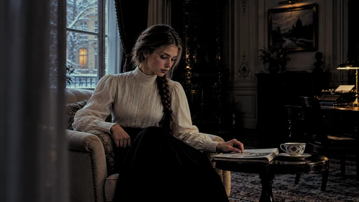

[Full-size lossless 1672×940](../../assets/looks-n002-20261024-r1/full/401-fl-0000036-green-action.webp) · [Original source](../../assets/looks-n002-20261024-r1/source.png) · [All 500 supplied-image samples](../FILTER_GALLERY.en.md)

| Input swatch | Input RGB | Actual output RGB |
|---|---|---|
| `gray_0` | `#000000` | `#000000` |
| `gray_10` | `#1A1A1A` | `#000000` |
| `gray_25` | `#404040` | `#262626` |
| `gray_50` | `#808080` | `#63675F` |
| `gray_75` | `#BFBFBF` | `#98A18F` |
| `gray_90` | `#E6E6E6` | `#B5C2A9` |
| `gray_100` | `#FFFFFF` | `#D1E1C3` |
| `skin_light` | `#F5DBC6` | `#C7B78B` |
| `skin_medium` | `#CF9B7B` | `#B37F52` |
| `skin_deep` | `#815438` | `#643E24` |
| `red` | `#CC3333` | `#982324` |
| `green` | `#33CC33` | `#00B400` |
| `blue` | `#3333CC` | `#1F1F5E` |

Creator: **Alex Jordan** · [Source](https://freshluts.com/luts/36) · commit `32fe087a3269fde38f3177563c1e0a77d9ec1a9e`.

Conversion: `native-CUBE-grid-retained-v1`; 8,192 sampled RGB points; max error 0.0000000; mean 0.0000000. This is numerical approximation, not a perceptual quality score.

License obligations: CC0: no attribution condition; source and creator retained for provenance.

[License](../../../product/src/ai_ad_editor/look_data/licenses/CC0-1.0.txt) · LUT SHA-256 `b0cef8a38c4e4d3be0667a98e5140ce3c0dc86b440505cdc348f9d06c48b4be3`.

[Actual preview PNG](../../assets/look500-20261024-r1/previews/fl-0000036-green-action.png) · [Actual video](../../assets/look500-20261024-r1/videos/fl-0000036-green-action.mp4)

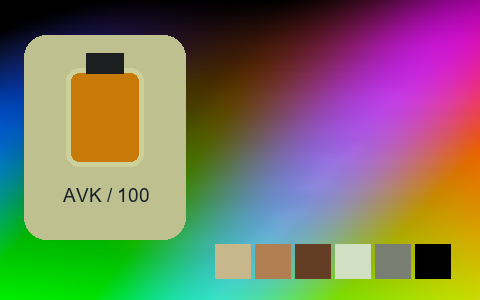

## 402 · Green Afternoon

`fl-0000037-green-afternoon` · `creative` · CC0-1.0 · 33³

50% gray Y′ 89.6/255 (-37.9 code values); 25–75% gray span ratio 1.090; mid-gray red minus blue +10.4 code values. Light/medium/deep skin swatches: #F5D6A9, #B57951, #5F2D13. Red/green/blue swatches: #A60E0E, #0FAC0D, #171571.

Suggested use: Compare on your own SDR product, portrait and landscape footage before selecting.

Trial strength: 0.35–0.8; default 1.0.

Pixel color mapping only; no grain, glow, vignette, spatial haze or beauty effects. Natural footage quality is unaccepted. Check skin/product colors and clipped output.

**Supplied N002 still: actual output at strength 1.0.**

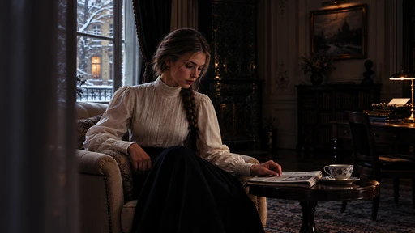

[Full-size lossless 1672×940](../../assets/looks-n002-20261024-r1/full/402-fl-0000037-green-afternoon.webp) · [Original source](../../assets/looks-n002-20261024-r1/source.png) · [All 500 supplied-image samples](../FILTER_GALLERY.en.md)

| Input swatch | Input RGB | Actual output RGB |
|---|---|---|
| `gray_0` | `#000000` | `#000000` |
| `gray_10` | `#1A1A1A` | `#090909` |
| `gray_25` | `#404040` | `#1F1D1C` |
| `gray_50` | `#808080` | `#5E5954` |
| `gray_75` | `#BFBFBF` | `#AFA893` |
| `gray_90` | `#E6E6E6` | `#E1E2D5` |
| `gray_100` | `#FFFFFF` | `#FFFFFD` |
| `skin_light` | `#F5DBC6` | `#F5D6A9` |
| `skin_medium` | `#CF9B7B` | `#B57951` |
| `skin_deep` | `#815438` | `#5F2D13` |
| `red` | `#CC3333` | `#A60E0E` |
| `green` | `#33CC33` | `#0FAC0D` |
| `blue` | `#3333CC` | `#171571` |

Creator: **Alex Jordan** · [Source](https://freshluts.com/luts/37) · commit `32fe087a3269fde38f3177563c1e0a77d9ec1a9e`.

Conversion: `native-CUBE-grid-retained-v1`; 8,192 sampled RGB points; max error 0.0000000; mean 0.0000000. This is numerical approximation, not a perceptual quality score.

License obligations: CC0: no attribution condition; source and creator retained for provenance.

[License](../../../product/src/ai_ad_editor/look_data/licenses/CC0-1.0.txt) · LUT SHA-256 `d93cc9bdcff5592f64066b7af86bfc05b29d30152727cf30133b40fd7b0a3ebe`.

[Actual preview PNG](../../assets/look500-20261024-r1/previews/fl-0000037-green-afternoon.png) · [Actual video](../../assets/look500-20261024-r1/videos/fl-0000037-green-afternoon.mp4)

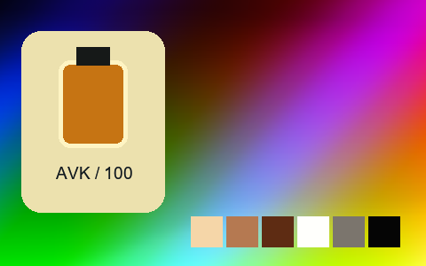

## 403 · Green Conflict

`fl-0000038-green-conflict` · `creative` · CC0-1.0 · 33³

50% gray Y′ 95.7/255 (-31.8 code values); 25–75% gray span ratio 1.291; mid-gray red minus blue +6.7 code values. Light/medium/deep skin swatches: #FFF3DD, #C48359, #533A18. Red/green/blue swatches: #862213, #0DB81B, #13235B.

Suggested use: Compare on your own SDR product, portrait and landscape footage before selecting.

Trial strength: 0.35–0.8; default 1.0.

Pixel color mapping only; no grain, glow, vignette, spatial haze or beauty effects. Natural footage quality is unaccepted. Check skin/product colors and clipped output.

**Supplied N002 still: actual output at strength 1.0.**

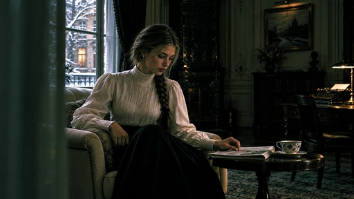

[Full-size lossless 1672×940](../../assets/looks-n002-20261024-r1/full/403-fl-0000038-green-conflict.webp) · [Original source](../../assets/looks-n002-20261024-r1/source.png) · [All 500 supplied-image samples](../FILTER_GALLERY.en.md)

| Input swatch | Input RGB | Actual output RGB |
|---|---|---|
| `gray_0` | `#000000` | `#000000` |
| `gray_10` | `#1A1A1A` | `#040705` |
| `gray_25` | `#404040` | `#1A291F` |
| `gray_50` | `#808080` | `#5C6255` |
| `gray_75` | `#BFBFBF` | `#D8C6C1` |
| `gray_90` | `#E6E6E6` | `#FFF9F9` |
| `gray_100` | `#FFFFFF` | `#FFFFFF` |
| `skin_light` | `#F5DBC6` | `#FFF3DD` |
| `skin_medium` | `#CF9B7B` | `#C48359` |
| `skin_deep` | `#815438` | `#533A18` |
| `red` | `#CC3333` | `#862213` |
| `green` | `#33CC33` | `#0DB81B` |
| `blue` | `#3333CC` | `#13235B` |

Creator: **Alex Jordan** · [Source](https://freshluts.com/luts/38) · commit `32fe087a3269fde38f3177563c1e0a77d9ec1a9e`.

Conversion: `native-CUBE-grid-retained-v1`; 8,192 sampled RGB points; max error 0.0000000; mean 0.0000000. This is numerical approximation, not a perceptual quality score.

License obligations: CC0: no attribution condition; source and creator retained for provenance.

[License](../../../product/src/ai_ad_editor/look_data/licenses/CC0-1.0.txt) · LUT SHA-256 `d9e426ce0ed3965fe0281a33ddbba69eabe3a45b701f26bdd875246449588353`.

[Actual preview PNG](../../assets/look500-20261024-r1/previews/fl-0000038-green-conflict.png) · [Actual video](../../assets/look500-20261024-r1/videos/fl-0000038-green-conflict.mp4)

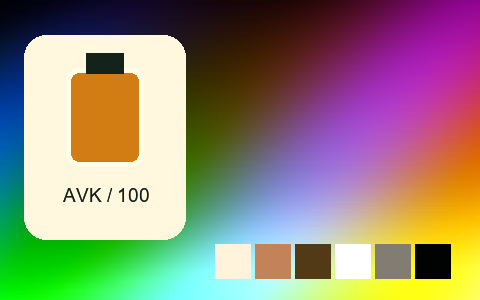

## 404 · Green Day 01

`fl-0000039-green-day-01` · `cinema` · CC0-1.0 · 33³

50% gray Y′ 97.3/255 (-30.2 code values); 25–75% gray span ratio 1.000; mid-gray red minus blue +17.6 code values. Light/medium/deep skin swatches: #D7BE98, #AD7F53, #5F3714. Red/green/blue swatches: #9F1A0E, #24A81A, #171986.

Suggested use: Compare on your own SDR product, portrait and landscape footage before selecting.

Trial strength: 0.35–0.8; default 1.0.

Pixel color mapping only; no grain, glow, vignette, spatial haze or beauty effects. Natural footage quality is unaccepted. Check skin/product colors and clipped output.

**Supplied N002 still: actual output at strength 1.0.**

[Full-size lossless 1672×940](../../assets/looks-n002-20261024-r1/full/404-fl-0000039-green-day-01.webp) · [Original source](../../assets/looks-n002-20261024-r1/source.png) · [All 500 supplied-image samples](../FILTER_GALLERY.en.md)

| Input swatch | Input RGB | Actual output RGB |
|---|---|---|
| `gray_0` | `#000000` | `#000000` |
| `gray_10` | `#1A1A1A` | `#000100` |
| `gray_25` | `#404040` | `#222316` |
| `gray_50` | `#808080` | `#646252` |
| `gray_75` | `#BFBFBF` | `#A4A28E` |
| `gray_90` | `#E6E6E6` | `#CAC8B2` |
| `gray_100` | `#FFFFFF` | `#E4E2CA` |
| `skin_light` | `#F5DBC6` | `#D7BE98` |
| `skin_medium` | `#CF9B7B` | `#AD7F53` |
| `skin_deep` | `#815438` | `#5F3714` |
| `red` | `#CC3333` | `#9F1A0E` |
| `green` | `#33CC33` | `#24A81A` |
| `blue` | `#3333CC` | `#171986` |

Creator: **Alex Jordan** · [Source](https://freshluts.com/luts/39) · commit `32fe087a3269fde38f3177563c1e0a77d9ec1a9e`.

Conversion: `native-CUBE-grid-retained-v1`; 8,192 sampled RGB points; max error 0.0000000; mean 0.0000000. This is numerical approximation, not a perceptual quality score.

License obligations: CC0: no attribution condition; source and creator retained for provenance.

[License](../../../product/src/ai_ad_editor/look_data/licenses/CC0-1.0.txt) · LUT SHA-256 `59fbcdcf76a4b6cf8ecb1565bdb7e3a9438f79aa12fe6f2495e7d56ab94d9c0a`.

[Actual preview PNG](../../assets/look500-20261024-r1/previews/fl-0000039-green-day-01.png) · [Actual video](../../assets/look500-20261024-r1/videos/fl-0000039-green-day-01.mp4)

## 405 · Green Day 02

`fl-0000040-green-day-02` · `cinema` · CC0-1.0 · 33³

50% gray Y′ 77.2/255 (-50.3 code values); 25–75% gray span ratio 1.473; mid-gray red minus blue +4.9 code values. Light/medium/deep skin swatches: #FDFCBC, #AA8453, #2F180B. Red/green/blue swatches: #400607, #15AE0D, #010104.

Suggested use: Compare on your own SDR product, portrait and landscape footage before selecting.

Trial strength: 0.35–0.8; default 1.0.

Pixel color mapping only; no grain, glow, vignette, spatial haze or beauty effects. Natural footage quality is unaccepted. Check skin/product colors and clipped output.

**Supplied N002 still: actual output at strength 1.0.**

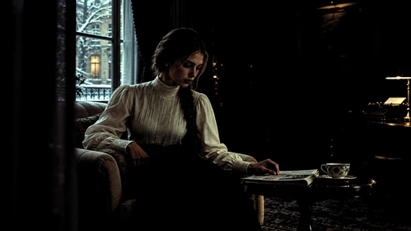

[Full-size lossless 1672×940](../../assets/looks-n002-20261024-r1/full/405-fl-0000040-green-day-02.webp) · [Original source](../../assets/looks-n002-20261024-r1/source.png) · [All 500 supplied-image samples](../FILTER_GALLERY.en.md)

| Input swatch | Input RGB | Actual output RGB |
|---|---|---|
| `gray_0` | `#000000` | `#000000` |
| `gray_10` | `#1A1A1A` | `#000000` |
| `gray_25` | `#404040` | `#000000` |
| `gray_50` | `#808080` | `#485043` |
| `gray_75` | `#BFBFBF` | `#ABC4A1` |
| `gray_90` | `#E6E6E6` | `#F3FFE1` |
| `gray_100` | `#FFFFFF` | `#FFFFFF` |
| `skin_light` | `#F5DBC6` | `#FDFCBC` |
| `skin_medium` | `#CF9B7B` | `#AA8453` |
| `skin_deep` | `#815438` | `#2F180B` |
| `red` | `#CC3333` | `#400607` |
| `green` | `#33CC33` | `#15AE0D` |
| `blue` | `#3333CC` | `#010104` |

Creator: **Alex Jordan** · [Source](https://freshluts.com/luts/40) · commit `32fe087a3269fde38f3177563c1e0a77d9ec1a9e`.

Conversion: `native-CUBE-grid-retained-v1`; 8,192 sampled RGB points; max error 0.0000000; mean 0.0000000. This is numerical approximation, not a perceptual quality score.

License obligations: CC0: no attribution condition; source and creator retained for provenance.

[License](../../../product/src/ai_ad_editor/look_data/licenses/CC0-1.0.txt) · LUT SHA-256 `e12af30dda3c341ee0f486ecdbd5049f9070511eb276f88e3fd687f7943101f6`.

[Actual preview PNG](../../assets/look500-20261024-r1/previews/fl-0000040-green-day-02.png) · [Actual video](../../assets/look500-20261024-r1/videos/fl-0000040-green-day-02.mp4)

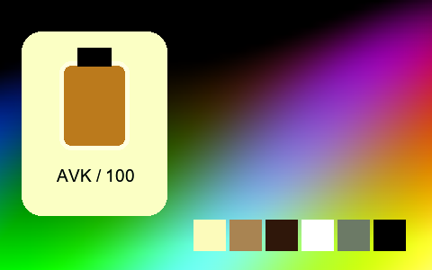

## 406 · Green G09

`fl-0000041-green-g09` · `creative` · CC0-1.0 · 33³

50% gray Y′ 127.7/255 (+0.2 code values); 25–75% gray span ratio 1.108; mid-gray red minus blue -29.7 code values. Light/medium/deep skin swatches: #EEDCD3, #BC9D9C, #5A5853. Red/green/blue swatches: #803C68, #67BA47, #003F74.

Suggested use: Compare on your own SDR product, portrait and landscape footage before selecting.

Trial strength: 0.35–0.8; default 1.0.

Pixel color mapping only; no grain, glow, vignette, spatial haze or beauty effects. Natural footage quality is unaccepted. Check skin/product colors and clipped output.

**Supplied N002 still: actual output at strength 1.0.**

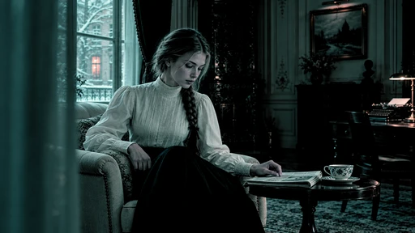

[Full-size lossless 1672×940](../../assets/looks-n002-20261024-r1/full/406-fl-0000041-green-g09.webp) · [Original source](../../assets/looks-n002-20261024-r1/source.png) · [All 500 supplied-image samples](../FILTER_GALLERY.en.md)

| Input swatch | Input RGB | Actual output RGB |
|---|---|---|
| `gray_0` | `#000000` | `#000000` |
| `gray_10` | `#1A1A1A` | `#000101` |
| `gray_25` | `#404040` | `#193936` |
| `gray_50` | `#808080` | `#648882` |
| `gray_75` | `#BFBFBF` | `#ADC5C0` |
| `gray_90` | `#E6E6E6` | `#D9EAE4` |
| `gray_100` | `#FFFFFF` | `#F7FFFD` |
| `skin_light` | `#F5DBC6` | `#EEDCD3` |
| `skin_medium` | `#CF9B7B` | `#BC9D9C` |
| `skin_deep` | `#815438` | `#5A5853` |
| `red` | `#CC3333` | `#803C68` |
| `green` | `#33CC33` | `#67BA47` |
| `blue` | `#3333CC` | `#003F74` |

Creator: **Alex Jordan** · [Source](https://freshluts.com/luts/41) · commit `32fe087a3269fde38f3177563c1e0a77d9ec1a9e`.

Conversion: `native-CUBE-grid-retained-v1`; 8,192 sampled RGB points; max error 0.0000000; mean 0.0000000. This is numerical approximation, not a perceptual quality score.

License obligations: CC0: no attribution condition; source and creator retained for provenance.

[License](../../../product/src/ai_ad_editor/look_data/licenses/CC0-1.0.txt) · LUT SHA-256 `9b24e033c31277ca47dd29c72862f72ef80ef3c9600d92e400707df3e5d148d2`.

[Actual preview PNG](../../assets/look500-20261024-r1/previews/fl-0000041-green-g09.png) · [Actual video](../../assets/look500-20261024-r1/videos/fl-0000041-green-g09.mp4)

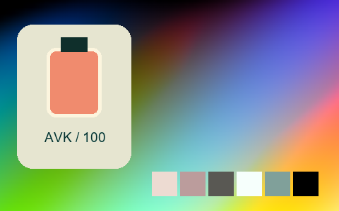

## 407 · Green Indoor

`fl-0000042-green-indoor` · `creative` · CC0-1.0 · 33³

50% gray Y′ 119.1/255 (-8.4 code values); 25–75% gray span ratio 1.219; mid-gray red minus blue +6.2 code values. Light/medium/deep skin swatches: #FEFDFB, #C2A187, #604B38. Red/green/blue swatches: #703B37, #42C73E, #292C8E.

Suggested use: Compare on your own SDR product, portrait and landscape footage before selecting.

Trial strength: 0.35–0.8; default 1.0.

Pixel color mapping only; no grain, glow, vignette, spatial haze or beauty effects. Natural footage quality is unaccepted. Check skin/product colors and clipped output.

**Supplied N002 still: actual output at strength 1.0.**

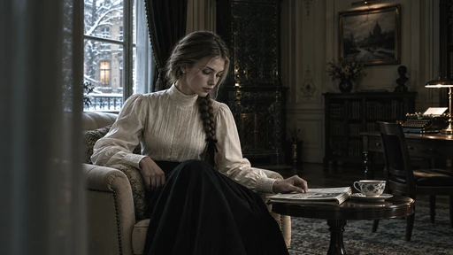

[Full-size lossless 1672×940](../../assets/looks-n002-20261024-r1/full/407-fl-0000042-green-indoor.webp) · [Original source](../../assets/looks-n002-20261024-r1/source.png) · [All 500 supplied-image samples](../FILTER_GALLERY.en.md)

| Input swatch | Input RGB | Actual output RGB |
|---|---|---|
| `gray_0` | `#000000` | `#070807` |
| `gray_10` | `#1A1A1A` | `#141614` |
| `gray_25` | `#404040` | `#31342E` |
| `gray_50` | `#808080` | `#75786F` |
| `gray_75` | `#BFBFBF` | `#CED0C5` |
| `gray_90` | `#E6E6E6` | `#FFFFFF` |
| `gray_100` | `#FFFFFF` | `#FFFFFF` |
| `skin_light` | `#F5DBC6` | `#FEFDFB` |
| `skin_medium` | `#CF9B7B` | `#C2A187` |
| `skin_deep` | `#815438` | `#604B38` |
| `red` | `#CC3333` | `#703B37` |
| `green` | `#33CC33` | `#42C73E` |
| `blue` | `#3333CC` | `#292C8E` |

Creator: **Alex Jordan** · [Source](https://freshluts.com/luts/42) · commit `32fe087a3269fde38f3177563c1e0a77d9ec1a9e`.

Conversion: `native-CUBE-grid-retained-v1`; 8,192 sampled RGB points; max error 0.0000000; mean 0.0000000. This is numerical approximation, not a perceptual quality score.

License obligations: CC0: no attribution condition; source and creator retained for provenance.

[License](../../../product/src/ai_ad_editor/look_data/licenses/CC0-1.0.txt) · LUT SHA-256 `23f00e67682bd2032610b64270e135ecfcc77296561df989ea1bf57b3a799265`.

[Actual preview PNG](../../assets/look500-20261024-r1/previews/fl-0000042-green-indoor.png) · [Actual video](../../assets/look500-20261024-r1/videos/fl-0000042-green-indoor.mp4)

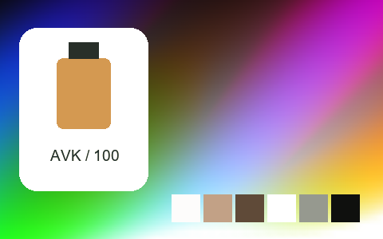

## 408 · Harsh Day

`fl-0000044-harsh-day` · `creative` · CC0-1.0 · 33³

50% gray Y′ 63.7/255 (-63.8 code values); 25–75% gray span ratio 1.000; mid-gray red minus blue +24.6 code values. Light/medium/deep skin swatches: #F2BB81, #95603A, #341D0E. Red/green/blue swatches: #4A0F0B, #257E19, #0F0E28.

Suggested use: Compare on your own SDR product, portrait and landscape footage before selecting.

Trial strength: 0.35–0.8; default 1.0.

Pixel color mapping only; no grain, glow, vignette, spatial haze or beauty effects. Natural footage quality is unaccepted. Check skin/product colors and clipped output.

**Supplied N002 still: actual output at strength 1.0.**

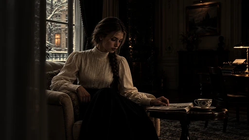

[Full-size lossless 1672×940](../../assets/looks-n002-20261024-r1/full/408-fl-0000044-harsh-day.webp) · [Original source](../../assets/looks-n002-20261024-r1/source.png) · [All 500 supplied-image samples](../FILTER_GALLERY.en.md)

| Input swatch | Input RGB | Actual output RGB |
|---|---|---|
| `gray_0` | `#000000` | `#000000` |
| `gray_10` | `#1A1A1A` | `#030302` |
| `gray_25` | `#404040` | `#12100C` |
| `gray_50` | `#808080` | `#483F30` |
| `gray_75` | `#BFBFBF` | `#A38D6C` |
| `gray_90` | `#E6E6E6` | `#EBCB9B` |
| `gray_100` | `#FFFFFF` | `#FFFBBF` |
| `skin_light` | `#F5DBC6` | `#F2BB81` |
| `skin_medium` | `#CF9B7B` | `#95603A` |
| `skin_deep` | `#815438` | `#341D0E` |
| `red` | `#CC3333` | `#4A0F0B` |
| `green` | `#33CC33` | `#257E19` |
| `blue` | `#3333CC` | `#0F0E28` |

Creator: **Alex Jordan** · [Source](https://freshluts.com/luts/44) · commit `32fe087a3269fde38f3177563c1e0a77d9ec1a9e`.

Conversion: `native-CUBE-grid-retained-v1`; 8,192 sampled RGB points; max error 0.0000000; mean 0.0000000. This is numerical approximation, not a perceptual quality score.

License obligations: CC0: no attribution condition; source and creator retained for provenance.

[License](../../../product/src/ai_ad_editor/look_data/licenses/CC0-1.0.txt) · LUT SHA-256 `21d8136dbee9454e4b58e4536872ce8e4525df7bb1b21423303b408052726450`.

[Actual preview PNG](../../assets/look500-20261024-r1/previews/fl-0000044-harsh-day.png) · [Actual video](../../assets/look500-20261024-r1/videos/fl-0000044-harsh-day.mp4)

## 409 · Harsh Sunset

`fl-0000045-harsh-sunset` · `creative` · CC0-1.0 · 33³

50% gray Y′ 72.8/255 (-54.7 code values); 25–75% gray span ratio 1.010; mid-gray red minus blue +69.5 code values. Light/medium/deep skin swatches: #FF9D51, #FE4F1C, #511C13. Red/green/blue swatches: #810608, #10920B, #110F21.

Suggested use: Compare on your own SDR product, portrait and landscape footage before selecting.

Trial strength: 0.35–0.8; default 1.0.

Pixel color mapping only; no grain, glow, vignette, spatial haze or beauty effects. Natural footage quality is unaccepted. Check skin/product colors and clipped output.

**Supplied N002 still: actual output at strength 1.0.**

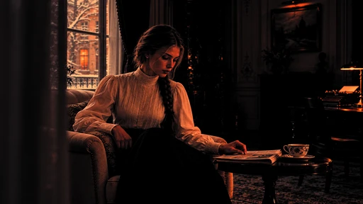

[Full-size lossless 1672×940](../../assets/looks-n002-20261024-r1/full/409-fl-0000045-harsh-sunset.webp) · [Original source](../../assets/looks-n002-20261024-r1/source.png) · [All 500 supplied-image samples](../FILTER_GALLERY.en.md)

| Input swatch | Input RGB | Actual output RGB |
|---|---|---|
| `gray_0` | `#000000` | `#000000` |
| `gray_10` | `#1A1A1A` | `#000000` |
| `gray_25` | `#404040` | `#141111` |
| `gray_50` | `#808080` | `#71402B` |
| `gray_75` | `#BFBFBF` | `#E7804B` |
| `gray_90` | `#E6E6E6` | `#FFAF6A` |
| `gray_100` | `#FFFFFF` | `#FFD183` |
| `skin_light` | `#F5DBC6` | `#FF9D51` |
| `skin_medium` | `#CF9B7B` | `#FE4F1C` |
| `skin_deep` | `#815438` | `#511C13` |
| `red` | `#CC3333` | `#810608` |
| `green` | `#33CC33` | `#10920B` |
| `blue` | `#3333CC` | `#110F21` |

Creator: **Alex Jordan** · [Source](https://freshluts.com/luts/45) · commit `32fe087a3269fde38f3177563c1e0a77d9ec1a9e`.

Conversion: `native-CUBE-grid-retained-v1`; 8,192 sampled RGB points; max error 0.0000000; mean 0.0000000. This is numerical approximation, not a perceptual quality score.

License obligations: CC0: no attribution condition; source and creator retained for provenance.

[License](../../../product/src/ai_ad_editor/look_data/licenses/CC0-1.0.txt) · LUT SHA-256 `cd6172092f2376349c0f5f97e157febd5531cea09d3146bb93a6d9f95a954689`.

[Actual preview PNG](../../assets/look500-20261024-r1/previews/fl-0000045-harsh-sunset.png) · [Actual video](../../assets/look500-20261024-r1/videos/fl-0000045-harsh-sunset.mp4)

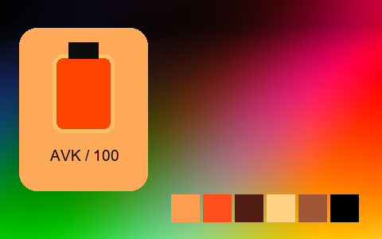

## 410 · Highlights Protection

`fl-0000046-highlights-protection` · `creative` · CC0-1.0 · 33³

50% gray Y′ 99.3/255 (-28.2 code values); 25–75% gray span ratio 1.377; mid-gray red minus blue +0.0 code values. Light/medium/deep skin swatches: #E7C4A8, #CF8F67, #4C2408. Red/green/blue swatches: #540F0F, #30BC30, #010103.

Suggested use: Compare on your own SDR product, portrait and landscape footage before selecting.

Trial strength: 0.35–0.8; default 1.0.

Pixel color mapping only; no grain, glow, vignette, spatial haze or beauty effects. Natural footage quality is unaccepted. Check skin/product colors and clipped output.

**Supplied N002 still: actual output at strength 1.0.**

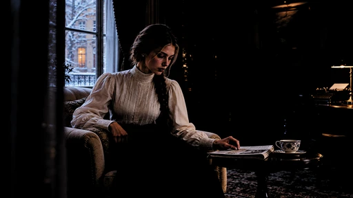

[Full-size lossless 1672×940](../../assets/looks-n002-20261024-r1/full/410-fl-0000046-highlights-protection.webp) · [Original source](../../assets/looks-n002-20261024-r1/source.png) · [All 500 supplied-image samples](../FILTER_GALLERY.en.md)

| Input swatch | Input RGB | Actual output RGB |
|---|---|---|
| `gray_0` | `#000000` | `#000000` |
| `gray_10` | `#1A1A1A` | `#000000` |
| `gray_25` | `#404040` | `#000000` |
| `gray_50` | `#808080` | `#636363` |
| `gray_75` | `#BFBFBF` | `#B0B0B0` |
| `gray_90` | `#E6E6E6` | `#D1D1D1` |
| `gray_100` | `#FFFFFF` | `#F7F7F7` |
| `skin_light` | `#F5DBC6` | `#E7C4A8` |
| `skin_medium` | `#CF9B7B` | `#CF8F67` |
| `skin_deep` | `#815438` | `#4C2408` |
| `red` | `#CC3333` | `#540F0F` |
| `green` | `#33CC33` | `#30BC30` |
| `blue` | `#3333CC` | `#010103` |

Creator: **Alex Jordan** · [Source](https://freshluts.com/luts/46) · commit `32fe087a3269fde38f3177563c1e0a77d9ec1a9e`.

Conversion: `native-CUBE-grid-retained-v1`; 8,192 sampled RGB points; max error 0.0000000; mean 0.0000000. This is numerical approximation, not a perceptual quality score.

License obligations: CC0: no attribution condition; source and creator retained for provenance.

[License](../../../product/src/ai_ad_editor/look_data/licenses/CC0-1.0.txt) · LUT SHA-256 `f7409d6020a811889ae767e0e624a4a40edebb29b43c70950693b2f10de841ee`.

[Actual preview PNG](../../assets/look500-20261024-r1/previews/fl-0000046-highlights-protection.png) · [Actual video](../../assets/look500-20261024-r1/videos/fl-0000046-highlights-protection.mp4)

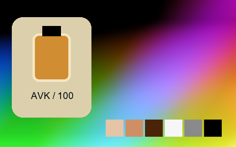

## 411 · Low contrast blue

`fl-0000048-low-contrast-blue` · `creative` · CC0-1.0 · 33³

50% gray Y′ 140.5/255 (+13.0 code values); 25–75% gray span ratio 0.899; mid-gray red minus blue -27.8 code values. Light/medium/deep skin swatches: #DCE4DF, #B1ACA6, #6E6B69. Red/green/blue swatches: #8E5964, #68C081, #4350A0.

Suggested use: Compare on your own SDR product, portrait and landscape footage before selecting.

Trial strength: 0.35–0.8; default 1.0.

Pixel color mapping only; no grain, glow, vignette, spatial haze or beauty effects. Natural footage quality is unaccepted. Check skin/product colors and clipped output.

**Supplied N002 still: actual output at strength 1.0.**

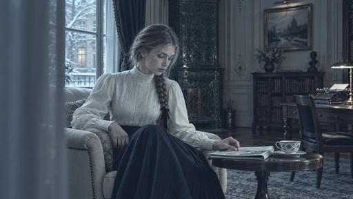

[Full-size lossless 1672×940](../../assets/looks-n002-20261024-r1/full/411-fl-0000048-low-contrast-blue.webp) · [Original source](../../assets/looks-n002-20261024-r1/source.png) · [All 500 supplied-image samples](../FILTER_GALLERY.en.md)

| Input swatch | Input RGB | Actual output RGB |
|---|---|---|
| `gray_0` | `#000000` | `#141A27` |
| `gray_10` | `#1A1A1A` | `#28323E` |
| `gray_25` | `#404040` | `#475561` |
| `gray_50` | `#808080` | `#7D9099` |
| `gray_75` | `#BFBFBF` | `#B5CAD0` |
| `gray_90` | `#E6E6E6` | `#D7ECF0` |
| `gray_100` | `#FFFFFF` | `#EEFFFF` |
| `skin_light` | `#F5DBC6` | `#DCE4DF` |
| `skin_medium` | `#CF9B7B` | `#B1ACA6` |
| `skin_deep` | `#815438` | `#6E6B69` |
| `red` | `#CC3333` | `#8E5964` |
| `green` | `#33CC33` | `#68C081` |
| `blue` | `#3333CC` | `#4350A0` |

Creator: **Alex Jordan** · [Source](https://freshluts.com/luts/48) · commit `32fe087a3269fde38f3177563c1e0a77d9ec1a9e`.

Conversion: `native-CUBE-grid-retained-v1`; 8,192 sampled RGB points; max error 0.0000000; mean 0.0000000. This is numerical approximation, not a perceptual quality score.

License obligations: CC0: no attribution condition; source and creator retained for provenance.

[License](../../../product/src/ai_ad_editor/look_data/licenses/CC0-1.0.txt) · LUT SHA-256 `a7ad4fb3c707cd89d6caceaeea651ebb35e9285e87fc9340b02fed6ccb1d98e1`.

[Actual preview PNG](../../assets/look500-20261024-r1/previews/fl-0000048-low-contrast-blue.png) · [Actual video](../../assets/look500-20261024-r1/videos/fl-0000048-low-contrast-blue.mp4)

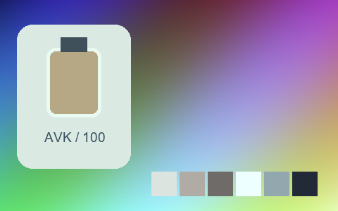

## 412 · Magenta Day

`fl-0000049-magenta-day` · `creative` · CC0-1.0 · 33³

50% gray Y′ 86.6/255 (-40.9 code values); 25–75% gray span ratio 1.005; mid-gray red minus blue +12.2 code values. Light/medium/deep skin swatches: #CEC3A4, #99785C, #4A2F20. Red/green/blue swatches: #6F1B19, #3D9137, #19175E.

Suggested use: Compare on your own SDR product, portrait and landscape footage before selecting.

Trial strength: 0.35–0.8; default 1.0.

Pixel color mapping only; no grain, glow, vignette, spatial haze or beauty effects. Natural footage quality is unaccepted. Check skin/product colors and clipped output.

**Supplied N002 still: actual output at strength 1.0.**

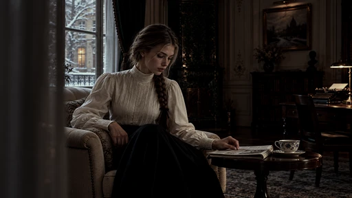

[Full-size lossless 1672×940](../../assets/looks-n002-20261024-r1/full/412-fl-0000049-magenta-day.webp) · [Original source](../../assets/looks-n002-20261024-r1/source.png) · [All 500 supplied-image samples](../FILTER_GALLERY.en.md)

| Input swatch | Input RGB | Actual output RGB |
|---|---|---|
| `gray_0` | `#000000` | `#000000` |
| `gray_10` | `#1A1A1A` | `#050403` |
| `gray_25` | `#404040` | `#1F1D19` |
| `gray_50` | `#808080` | `#5A574E` |
| `gray_75` | `#BFBFBF` | `#9D9E90` |
| `gray_90` | `#E6E6E6` | `#C7CEBE` |
| `gray_100` | `#FFFFFF` | `#E3F0DF` |
| `skin_light` | `#F5DBC6` | `#CEC3A4` |
| `skin_medium` | `#CF9B7B` | `#99785C` |
| `skin_deep` | `#815438` | `#4A2F20` |
| `red` | `#CC3333` | `#6F1B19` |
| `green` | `#33CC33` | `#3D9137` |
| `blue` | `#3333CC` | `#19175E` |

Creator: **Alex Jordan** · [Source](https://freshluts.com/luts/49) · commit `32fe087a3269fde38f3177563c1e0a77d9ec1a9e`.

Conversion: `native-CUBE-grid-retained-v1`; 8,192 sampled RGB points; max error 0.0000000; mean 0.0000000. This is numerical approximation, not a perceptual quality score.

License obligations: CC0: no attribution condition; source and creator retained for provenance.

[License](../../../product/src/ai_ad_editor/look_data/licenses/CC0-1.0.txt) · LUT SHA-256 `ab6bacafcaebc2fc31109f06e7a7ad05ae552a04befad4d8ff6a7cce7eedffce`.

[Actual preview PNG](../../assets/look500-20261024-r1/previews/fl-0000049-magenta-day.png) · [Actual video](../../assets/look500-20261024-r1/videos/fl-0000049-magenta-day.mp4)

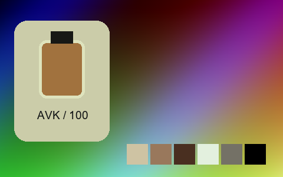

## 413 · Magenta Day 01

`fl-0000050-magenta-day-01` · `creative` · CC0-1.0 · 33³

50% gray Y′ 84.9/255 (-42.6 code values); 25–75% gray span ratio 0.993; mid-gray red minus blue -2.6 code values. Light/medium/deep skin swatches: #D8B7BF, #A2706E, #502A2A. Red/green/blue swatches: #731722, #418C3F, #1D1459.

Suggested use: Compare on your own SDR product, portrait and landscape footage before selecting.

Trial strength: 0.35–0.8; default 1.0.

Pixel color mapping only; no grain, glow, vignette, spatial haze or beauty effects. Natural footage quality is unaccepted. Check skin/product colors and clipped output.

**Supplied N002 still: actual output at strength 1.0.**

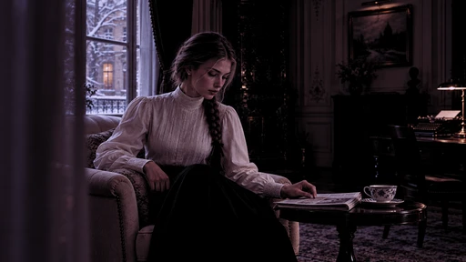

[Full-size lossless 1672×940](../../assets/looks-n002-20261024-r1/full/413-fl-0000050-magenta-day-01.webp) · [Original source](../../assets/looks-n002-20261024-r1/source.png) · [All 500 supplied-image samples](../FILTER_GALLERY.en.md)

| Input swatch | Input RGB | Actual output RGB |
|---|---|---|
| `gray_0` | `#000000` | `#000000` |
| `gray_10` | `#1A1A1A` | `#010101` |
| `gray_25` | `#404040` | `#221821` |
| `gray_50` | `#808080` | `#5F5162` |
| `gray_75` | `#BFBFBF` | `#A495AB` |
| `gray_90` | `#E6E6E6` | `#D0C2DB` |
| `gray_100` | `#FFFFFF` | `#F0E1FC` |
| `skin_light` | `#F5DBC6` | `#D8B7BF` |
| `skin_medium` | `#CF9B7B` | `#A2706E` |
| `skin_deep` | `#815438` | `#502A2A` |
| `red` | `#CC3333` | `#731722` |
| `green` | `#33CC33` | `#418C3F` |
| `blue` | `#3333CC` | `#1D1459` |

Creator: **Alex Jordan** · [Source](https://freshluts.com/luts/50) · commit `32fe087a3269fde38f3177563c1e0a77d9ec1a9e`.

Conversion: `native-CUBE-grid-retained-v1`; 8,192 sampled RGB points; max error 0.0000000; mean 0.0000000. This is numerical approximation, not a perceptual quality score.

License obligations: CC0: no attribution condition; source and creator retained for provenance.

[License](../../../product/src/ai_ad_editor/look_data/licenses/CC0-1.0.txt) · LUT SHA-256 `2246752c00907f4eca88f1fc3d0879d2e7834002286589d5290d4ac30ef99029`.

[Actual preview PNG](../../assets/look500-20261024-r1/previews/fl-0000050-magenta-day-01.png) · [Actual video](../../assets/look500-20261024-r1/videos/fl-0000050-magenta-day-01.mp4)

## 414 · Memories

`fl-0000052-memories` · `creative` · CC0-1.0 · 33³

50% gray Y′ 145.5/255 (+18.0 code values); 25–75% gray span ratio 0.857; mid-gray red minus blue +30.1 code values. Light/medium/deep skin swatches: #FFDEAA, #E5A67D, #886E66. Red/green/blue swatches: #A75B61, #5FCC6C, #545A6C.

Suggested use: Compare on your own SDR product, portrait and landscape footage before selecting.

Trial strength: 0.35–0.8; default 1.0.

Pixel color mapping only; no grain, glow, vignette, spatial haze or beauty effects. Natural footage quality is unaccepted. Check skin/product colors and clipped output.

**Supplied N002 still: actual output at strength 1.0.**

[Full-size lossless 1672×940](../../assets/looks-n002-20261024-r1/full/414-fl-0000052-memories.webp) · [Original source](../../assets/looks-n002-20261024-r1/source.png) · [All 500 supplied-image samples](../FILTER_GALLERY.en.md)

| Input swatch | Input RGB | Actual output RGB |
|---|---|---|
| `gray_0` | `#000000` | `#19272F` |
| `gray_10` | `#1A1A1A` | `#313C40` |
| `gray_25` | `#404040` | `#575C5D` |
| `gray_50` | `#808080` | `#9B917D` |
| `gray_75` | `#BFBFBF` | `#DFC697` |
| `gray_90` | `#E6E6E6` | `#FFE7B8` |
| `gray_100` | `#FFFFFF` | `#FFFDE2` |
| `skin_light` | `#F5DBC6` | `#FFDEAA` |
| `skin_medium` | `#CF9B7B` | `#E5A67D` |
| `skin_deep` | `#815438` | `#886E66` |
| `red` | `#CC3333` | `#A75B61` |
| `green` | `#33CC33` | `#5FCC6C` |
| `blue` | `#3333CC` | `#545A6C` |

Creator: **Alex Jordan** · [Source](https://freshluts.com/luts/52) · commit `32fe087a3269fde38f3177563c1e0a77d9ec1a9e`.

Conversion: `native-CUBE-grid-retained-v1`; 8,192 sampled RGB points; max error 0.0000000; mean 0.0000000. This is numerical approximation, not a perceptual quality score.

License obligations: CC0: no attribution condition; source and creator retained for provenance.

[License](../../../product/src/ai_ad_editor/look_data/licenses/CC0-1.0.txt) · LUT SHA-256 `ce6c5edcac1f307dd3b0dc2f64139a998e7b21153fb2648baac457bd09797e89`.

[Actual preview PNG](../../assets/look500-20261024-r1/previews/fl-0000052-memories.png) · [Actual video](../../assets/look500-20261024-r1/videos/fl-0000052-memories.mp4)

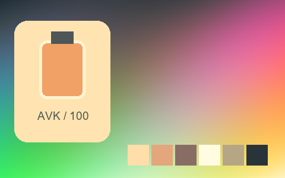

## 415 · Moonlight 01

`fl-0000053-moonlight-01` · `creative` · CC0-1.0 · 33³

50% gray Y′ 45.5/255 (-82.0 code values); 25–75% gray span ratio 0.902; mid-gray red minus blue -33.1 code values. Light/medium/deep skin swatches: #A9B6BF, #645241, #191409. Red/green/blue swatches: #4B0101, #007201, #00009B.

Suggested use: Compare on your own SDR product, portrait and landscape footage before selecting.

Trial strength: 0.35–0.8; default 1.0.

Pixel color mapping only; no grain, glow, vignette, spatial haze or beauty effects. Natural footage quality is unaccepted. Check skin/product colors and clipped output.

**Supplied N002 still: actual output at strength 1.0.**

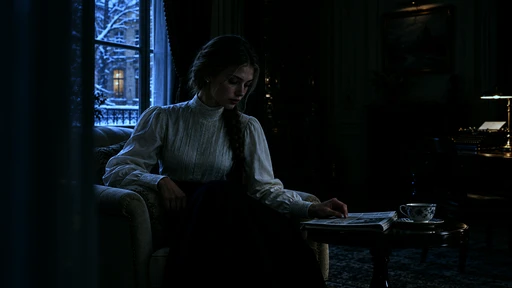

[Full-size lossless 1672×940](../../assets/looks-n002-20261024-r1/full/415-fl-0000053-moonlight-01.webp) · [Original source](../../assets/looks-n002-20261024-r1/source.png) · [All 500 supplied-image samples](../FILTER_GALLERY.en.md)

| Input swatch | Input RGB | Actual output RGB |
|---|---|---|
| `gray_0` | `#000000` | `#000100` |
| `gray_10` | `#1A1A1A` | `#000201` |
| `gray_25` | `#404040` | `#010A0B` |
| `gray_50` | `#808080` | `#1C313D` |
| `gray_75` | `#BFBFBF` | `#5B81A4` |
| `gray_90` | `#E6E6E6` | `#96C8FC` |
| `gray_100` | `#FFFFFF` | `#C8FFFF` |
| `skin_light` | `#F5DBC6` | `#A9B6BF` |
| `skin_medium` | `#CF9B7B` | `#645241` |
| `skin_deep` | `#815438` | `#191409` |
| `red` | `#CC3333` | `#4B0101` |
| `green` | `#33CC33` | `#007201` |
| `blue` | `#3333CC` | `#00009B` |

Creator: **Alex Jordan** · [Source](https://freshluts.com/luts/53) · commit `32fe087a3269fde38f3177563c1e0a77d9ec1a9e`.

Conversion: `native-CUBE-grid-retained-v1`; 8,192 sampled RGB points; max error 0.0000000; mean 0.0000000. This is numerical approximation, not a perceptual quality score.

License obligations: CC0: no attribution condition; source and creator retained for provenance.

[License](../../../product/src/ai_ad_editor/look_data/licenses/CC0-1.0.txt) · LUT SHA-256 `459c304b61a1c27a64547f5d0afd3e228aae8c823dad058f42b98f7186930b1a`.

[Actual preview PNG](../../assets/look500-20261024-r1/previews/fl-0000053-moonlight-01.png) · [Actual video](../../assets/look500-20261024-r1/videos/fl-0000053-moonlight-01.mp4)

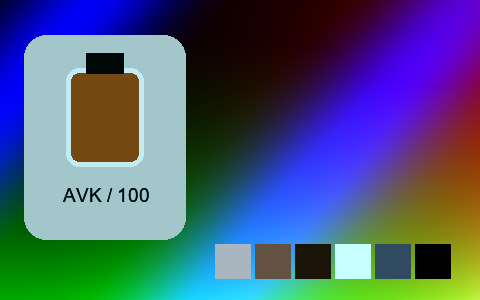

## 416 · Mostly Blue

`fl-0000054-mostly-blue` · `creative` · CC0-1.0 · 33³

50% gray Y′ 127.5/255 (-0.0 code values); 25–75% gray span ratio 1.000; mid-gray red minus blue +0.0 code values. Light/medium/deep skin swatches: #E7DED6, #B4A094, #6A594E. Red/green/blue swatches: #824747, #9BA29B, #2C2CFF.

Suggested use: Compare on your own SDR product, portrait and landscape footage before selecting.

Trial strength: 0.35–0.8; default 1.0.

Pixel color mapping only; no grain, glow, vignette, spatial haze or beauty effects. Natural footage quality is unaccepted. Check skin/product colors and clipped output.

**Supplied N002 still: actual output at strength 1.0.**

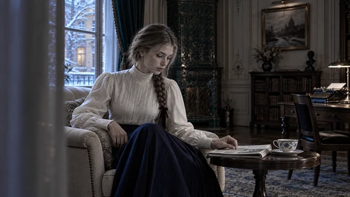

[Full-size lossless 1672×940](../../assets/looks-n002-20261024-r1/full/416-fl-0000054-mostly-blue.webp) · [Original source](../../assets/looks-n002-20261024-r1/source.png) · [All 500 supplied-image samples](../FILTER_GALLERY.en.md)

| Input swatch | Input RGB | Actual output RGB |
|---|---|---|
| `gray_0` | `#000000` | `#000000` |
| `gray_10` | `#1A1A1A` | `#191919` |
| `gray_25` | `#404040` | `#404040` |
| `gray_50` | `#808080` | `#7F7F7F` |
| `gray_75` | `#BFBFBF` | `#BFBFBF` |
| `gray_90` | `#E6E6E6` | `#E5E5E5` |
| `gray_100` | `#FFFFFF` | `#FFFFFF` |
| `skin_light` | `#F5DBC6` | `#E7DED6` |
| `skin_medium` | `#CF9B7B` | `#B4A094` |
| `skin_deep` | `#815438` | `#6A594E` |
| `red` | `#CC3333` | `#824747` |
| `green` | `#33CC33` | `#9BA29B` |
| `blue` | `#3333CC` | `#2C2CFF` |

Creator: **Alex Jordan** · [Source](https://freshluts.com/luts/54) · commit `32fe087a3269fde38f3177563c1e0a77d9ec1a9e`.

Conversion: `native-CUBE-grid-retained-v1`; 8,192 sampled RGB points; max error 0.0000000; mean 0.0000000. This is numerical approximation, not a perceptual quality score.

License obligations: CC0: no attribution condition; source and creator retained for provenance.

[License](../../../product/src/ai_ad_editor/look_data/licenses/CC0-1.0.txt) · LUT SHA-256 `9730d4b907e743c14269312b25c2b650507118164bc4a20e2b053b8f0be72934`.

[Actual preview PNG](../../assets/look500-20261024-r1/previews/fl-0000054-mostly-blue.png) · [Actual video](../../assets/look500-20261024-r1/videos/fl-0000054-mostly-blue.mp4)

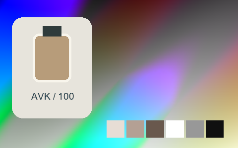

## 417 · Muted 01

`fl-0000055-muted-01` · `creative` · CC0-1.0 · 33³

50% gray Y′ 134.6/255 (+7.1 code values); 25–75% gray span ratio 0.867; mid-gray red minus blue +8.7 code values. Light/medium/deep skin swatches: #D3C2A8, #B59F83, #6C6255. Red/green/blue swatches: #764C4A, #70A36B, #384564.

Suggested use: Compare on your own SDR product, portrait and landscape footage before selecting.

Trial strength: 0.35–0.8; default 1.0.

Pixel color mapping only; no grain, glow, vignette, spatial haze or beauty effects. Natural footage quality is unaccepted. Check skin/product colors and clipped output.

**Supplied N002 still: actual output at strength 1.0.**

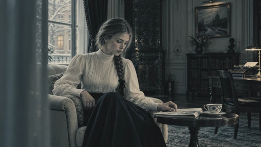

[Full-size lossless 1672×940](../../assets/looks-n002-20261024-r1/full/417-fl-0000055-muted-01.webp) · [Original source](../../assets/looks-n002-20261024-r1/source.png) · [All 500 supplied-image samples](../FILTER_GALLERY.en.md)

| Input swatch | Input RGB | Actual output RGB |
|---|---|---|
| `gray_0` | `#000000` | `#131516` |
| `gray_10` | `#1A1A1A` | `#1F2527` |
| `gray_25` | `#404040` | `#3D484A` |
| `gray_50` | `#808080` | `#86887D` |
| `gray_75` | `#BFBFBF` | `#BCB4A2` |
| `gray_90` | `#E6E6E6` | `#D2C6B3` |
| `gray_100` | `#FFFFFF` | `#DECFBC` |
| `skin_light` | `#F5DBC6` | `#D3C2A8` |
| `skin_medium` | `#CF9B7B` | `#B59F83` |
| `skin_deep` | `#815438` | `#6C6255` |
| `red` | `#CC3333` | `#764C4A` |
| `green` | `#33CC33` | `#70A36B` |
| `blue` | `#3333CC` | `#384564` |

Creator: **Alex Jordan** · [Source](https://freshluts.com/luts/55) · commit `32fe087a3269fde38f3177563c1e0a77d9ec1a9e`.

Conversion: `native-CUBE-grid-retained-v1`; 8,192 sampled RGB points; max error 0.0000000; mean 0.0000000. This is numerical approximation, not a perceptual quality score.

License obligations: CC0: no attribution condition; source and creator retained for provenance.

[License](../../../product/src/ai_ad_editor/look_data/licenses/CC0-1.0.txt) · LUT SHA-256 `fc90b256d5058b757ba7f4110ad267b58dc8b52a12758e1a86af3b16e593a7a0`.

[Actual preview PNG](../../assets/look500-20261024-r1/previews/fl-0000055-muted-01.png) · [Actual video](../../assets/look500-20261024-r1/videos/fl-0000055-muted-01.mp4)

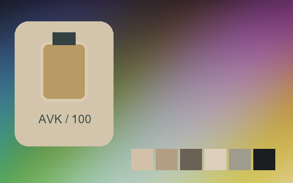

## 418 · Only Red

`fl-0000057-only-red` · `creative` · CC0-1.0 · 33³

50% gray Y′ 127.5/255 (-0.0 code values); 25–75% gray span ratio 1.000; mid-gray red minus blue +0.0 code values. Light/medium/deep skin swatches: #F2DCCA, #CB9C7E, #7E553B. Red/green/blue swatches: #BF3636, #96A596, #3D3D50.

Suggested use: Compare on your own SDR product, portrait and landscape footage before selecting.

Trial strength: 0.35–0.8; default 1.0.

Pixel color mapping only; no grain, glow, vignette, spatial haze or beauty effects. Natural footage quality is unaccepted. Check skin/product colors and clipped output.

**Supplied N002 still: actual output at strength 1.0.**

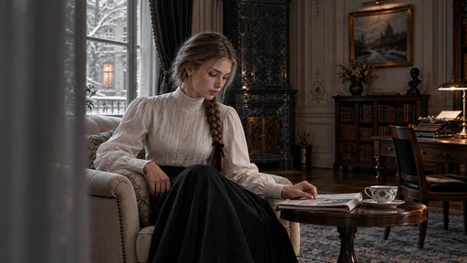

[Full-size lossless 1672×940](../../assets/looks-n002-20261024-r1/full/418-fl-0000057-only-red.webp) · [Original source](../../assets/looks-n002-20261024-r1/source.png) · [All 500 supplied-image samples](../FILTER_GALLERY.en.md)

| Input swatch | Input RGB | Actual output RGB |
|---|---|---|
| `gray_0` | `#000000` | `#000000` |
| `gray_10` | `#1A1A1A` | `#191919` |
| `gray_25` | `#404040` | `#404040` |
| `gray_50` | `#808080` | `#7F7F7F` |
| `gray_75` | `#BFBFBF` | `#BFBFBF` |
| `gray_90` | `#E6E6E6` | `#E5E5E5` |
| `gray_100` | `#FFFFFF` | `#FFFFFF` |
| `skin_light` | `#F5DBC6` | `#F2DCCA` |
| `skin_medium` | `#CF9B7B` | `#CB9C7E` |
| `skin_deep` | `#815438` | `#7E553B` |
| `red` | `#CC3333` | `#BF3636` |
| `green` | `#33CC33` | `#96A596` |
| `blue` | `#3333CC` | `#3D3D50` |

Creator: **Alex Jordan** · [Source](https://freshluts.com/luts/57) · commit `32fe087a3269fde38f3177563c1e0a77d9ec1a9e`.

Conversion: `native-CUBE-grid-retained-v1`; 8,192 sampled RGB points; max error 0.0000000; mean 0.0000000. This is numerical approximation, not a perceptual quality score.

License obligations: CC0: no attribution condition; source and creator retained for provenance.

[License](../../../product/src/ai_ad_editor/look_data/licenses/CC0-1.0.txt) · LUT SHA-256 `f108a34577256b94a863b2be7ea3049cfa2734a017789ccc07de759db094ff0d`.

[Actual preview PNG](../../assets/look500-20261024-r1/previews/fl-0000057-only-red.png) · [Actual video](../../assets/look500-20261024-r1/videos/fl-0000057-only-red.mp4)

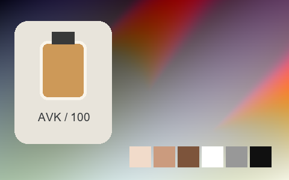

## 419 · Only Red and Blue

`fl-0000058-only-red-and-blue` · `creative` · CC0-1.0 · 33³

50% gray Y′ 127.5/255 (-0.0 code values); 25–75% gray span ratio 1.000; mid-gray red minus blue +0.0 code values. Light/medium/deep skin swatches: #F5DBC6, #CF9B7B, #815438. Red/green/blue swatches: #CC3333, #A0A1A0, #3333CF.

Suggested use: Compare on your own SDR product, portrait and landscape footage before selecting.

Trial strength: 0.35–0.8; default 1.0.

Pixel color mapping only; no grain, glow, vignette, spatial haze or beauty effects. Natural footage quality is unaccepted. Check skin/product colors and clipped output.

**Supplied N002 still: actual output at strength 1.0.**

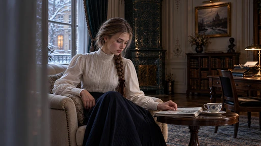

[Full-size lossless 1672×940](../../assets/looks-n002-20261024-r1/full/419-fl-0000058-only-red-and-blue.webp) · [Original source](../../assets/looks-n002-20261024-r1/source.png) · [All 500 supplied-image samples](../FILTER_GALLERY.en.md)

| Input swatch | Input RGB | Actual output RGB |
|---|---|---|
| `gray_0` | `#000000` | `#000000` |
| `gray_10` | `#1A1A1A` | `#191919` |
| `gray_25` | `#404040` | `#404040` |
| `gray_50` | `#808080` | `#7F7F7F` |
| `gray_75` | `#BFBFBF` | `#BFBFBF` |
| `gray_90` | `#E6E6E6` | `#E5E5E5` |
| `gray_100` | `#FFFFFF` | `#FFFFFF` |
| `skin_light` | `#F5DBC6` | `#F5DBC6` |
| `skin_medium` | `#CF9B7B` | `#CF9B7B` |
| `skin_deep` | `#815438` | `#815438` |
| `red` | `#CC3333` | `#CC3333` |
| `green` | `#33CC33` | `#A0A1A0` |
| `blue` | `#3333CC` | `#3333CF` |

Creator: **Alex Jordan** · [Source](https://freshluts.com/luts/58) · commit `32fe087a3269fde38f3177563c1e0a77d9ec1a9e`.

Conversion: `native-CUBE-grid-retained-v1`; 8,192 sampled RGB points; max error 0.0000000; mean 0.0000000. This is numerical approximation, not a perceptual quality score.

License obligations: CC0: no attribution condition; source and creator retained for provenance.

[License](../../../product/src/ai_ad_editor/look_data/licenses/CC0-1.0.txt) · LUT SHA-256 `c47adda7400a821ac79c45971972eb52cfacdd4df74b735d51e4c96540bd9f86`.

[Actual preview PNG](../../assets/look500-20261024-r1/previews/fl-0000058-only-red-and-blue.png) · [Actual video](../../assets/look500-20261024-r1/videos/fl-0000058-only-red-and-blue.mp4)

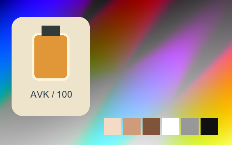

## 420 · Operation Yellow

`fl-0000059-operation-yellow` · `cinema` · CC0-1.0 · 33³

50% gray Y′ 127.4/255 (-0.1 code values); 25–75% gray span ratio 1.001; mid-gray red minus blue +87.6 code values. Light/medium/deep skin swatches: #FFD28E, #ED9653, #97501B. Red/green/blue swatches: #CD351A, #6FBA2E, #4A3767.

Suggested use: Compare on your own SDR product, portrait and landscape footage before selecting.

Trial strength: 0.35–0.8; default 1.0.

Pixel color mapping only; no grain, glow, vignette, spatial haze or beauty effects. Natural footage quality is unaccepted. Check skin/product colors and clipped output.

**Supplied N002 still: actual output at strength 1.0.**

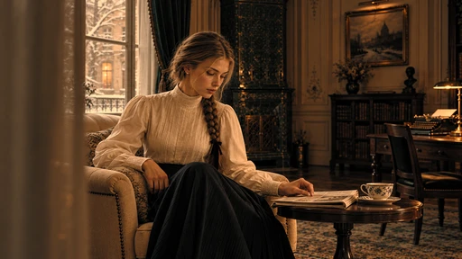

[Full-size lossless 1672×940](../../assets/looks-n002-20261024-r1/full/420-fl-0000059-operation-yellow.webp) · [Original source](../../assets/looks-n002-20261024-r1/source.png) · [All 500 supplied-image samples](../FILTER_GALLERY.en.md)

| Input swatch | Input RGB | Actual output RGB |
|---|---|---|
| `gray_0` | `#000000` | `#000000` |
| `gray_10` | `#1A1A1A` | `#1C1914` |
| `gray_25` | `#404040` | `#523D24` |
| `gray_50` | `#808080` | `#A47A4D` |
| `gray_75` | `#BFBFBF` | `#F1B780` |
| `gray_90` | `#E6E6E6` | `#FFDCA0` |
| `gray_100` | `#FFFFFF` | `#FFF4B5` |
| `skin_light` | `#F5DBC6` | `#FFD28E` |
| `skin_medium` | `#CF9B7B` | `#ED9653` |
| `skin_deep` | `#815438` | `#97501B` |
| `red` | `#CC3333` | `#CD351A` |
| `green` | `#33CC33` | `#6FBA2E` |
| `blue` | `#3333CC` | `#4A3767` |

Creator: **Alex Jordan** · [Source](https://freshluts.com/luts/59) · commit `32fe087a3269fde38f3177563c1e0a77d9ec1a9e`.

Conversion: `native-CUBE-grid-retained-v1`; 8,192 sampled RGB points; max error 0.0000000; mean 0.0000000. This is numerical approximation, not a perceptual quality score.

License obligations: CC0: no attribution condition; source and creator retained for provenance.

[License](../../../product/src/ai_ad_editor/look_data/licenses/CC0-1.0.txt) · LUT SHA-256 `24a217e023129b7afa954981793eb8d6fd9fbb6f6e7779d0034b39f6dbcc3166`.

[Actual preview PNG](../../assets/look500-20261024-r1/previews/fl-0000059-operation-yellow.png) · [Actual video](../../assets/look500-20261024-r1/videos/fl-0000059-operation-yellow.mp4)

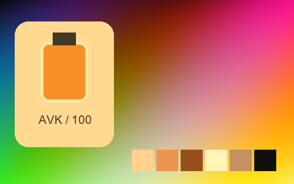

## 421 · Orange Dark 4

`fl-0000060-orange-dark-4` · `creative` · CC0-1.0 · 33³

50% gray Y′ 92.4/255 (-35.1 code values); 25–75% gray span ratio 1.020; mid-gray red minus blue +91.1 code values. Light/medium/deep skin swatches: #FFB96B, #DC722B, #712D0E. Red/green/blue swatches: #9C160D, #35A110, #241D3B.

Suggested use: Compare on your own SDR product, portrait and landscape footage before selecting.

Trial strength: 0.35–0.8; default 1.0.

Pixel color mapping only; no grain, glow, vignette, spatial haze or beauty effects. Natural footage quality is unaccepted. Check skin/product colors and clipped output.

**Supplied N002 still: actual output at strength 1.0.**

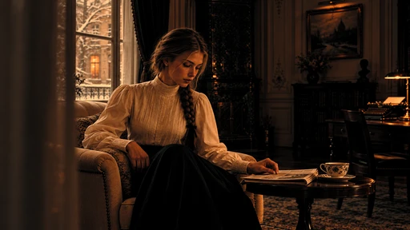

[Full-size lossless 1672×940](../../assets/looks-n002-20261024-r1/full/421-fl-0000060-orange-dark-4.webp) · [Original source](../../assets/looks-n002-20261024-r1/source.png) · [All 500 supplied-image samples](../FILTER_GALLERY.en.md)

| Input swatch | Input RGB | Actual output RGB |
|---|---|---|
| `gray_0` | `#000000` | `#000000` |
| `gray_10` | `#1A1A1A` | `#070706` |
| `gray_25` | `#404040` | `#2B2016` |
| `gray_50` | `#808080` | `#85552A` |
| `gray_75` | `#BFBFBF` | `#DE995D` |
| `gray_90` | `#E6E6E6` | `#FFC581` |
| `gray_100` | `#FFFFFF` | `#FFE49A` |
| `skin_light` | `#F5DBC6` | `#FFB96B` |
| `skin_medium` | `#CF9B7B` | `#DC722B` |
| `skin_deep` | `#815438` | `#712D0E` |
| `red` | `#CC3333` | `#9C160D` |
| `green` | `#33CC33` | `#35A110` |
| `blue` | `#3333CC` | `#241D3B` |

Creator: **Alex Jordan** · [Source](https://freshluts.com/luts/60) · commit `32fe087a3269fde38f3177563c1e0a77d9ec1a9e`.

Conversion: `native-CUBE-grid-retained-v1`; 8,192 sampled RGB points; max error 0.0000000; mean 0.0000000. This is numerical approximation, not a perceptual quality score.

License obligations: CC0: no attribution condition; source and creator retained for provenance.

[License](../../../product/src/ai_ad_editor/look_data/licenses/CC0-1.0.txt) · LUT SHA-256 `4675458759b08eb720bd2ecbd0e0aa2bc25217e0e97ca8a66d3d361909411c44`.

[Actual preview PNG](../../assets/look500-20261024-r1/previews/fl-0000060-orange-dark-4.png) · [Actual video](../../assets/look500-20261024-r1/videos/fl-0000060-orange-dark-4.mp4)

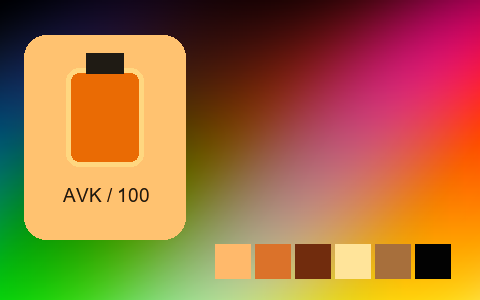

## 422 · Orange Dark 7

`fl-0000061-orange-dark-7` · `cinema` · CC0-1.0 · 33³

50% gray Y′ 124.6/255 (-2.9 code values); 25–75% gray span ratio 1.743; mid-gray red minus blue +47.3 code values. Light/medium/deep skin swatches: #EFFFEF, #D9BC85, #72301E. Red/green/blue swatches: #561614, #6FE55A, #1B1744.

Suggested use: Compare on your own SDR product, portrait and landscape footage before selecting.

Trial strength: 0.35–0.8; default 1.0.

Pixel color mapping only; no grain, glow, vignette, spatial haze or beauty effects. Natural footage quality is unaccepted. Check skin/product colors and clipped output.

**Supplied N002 still: actual output at strength 1.0.**

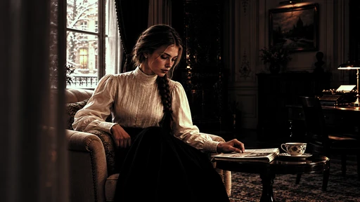

[Full-size lossless 1672×940](../../assets/looks-n002-20261024-r1/full/422-fl-0000061-orange-dark-7.webp) · [Original source](../../assets/looks-n002-20261024-r1/source.png) · [All 500 supplied-image samples](../FILTER_GALLERY.en.md)

| Input swatch | Input RGB | Actual output RGB |
|---|---|---|
| `gray_0` | `#000000` | `#000000` |
| `gray_10` | `#1A1A1A` | `#030303` |
| `gray_25` | `#404040` | `#201A17` |
| `gray_50` | `#808080` | `#907A61` |
| `gray_75` | `#BFBFBF` | `#EFFFE4` |
| `gray_90` | `#E6E6E6` | `#EFFFEF` |
| `gray_100` | `#FFFFFF` | `#EFFFEF` |
| `skin_light` | `#F5DBC6` | `#EFFFEF` |
| `skin_medium` | `#CF9B7B` | `#D9BC85` |
| `skin_deep` | `#815438` | `#72301E` |
| `red` | `#CC3333` | `#561614` |
| `green` | `#33CC33` | `#6FE55A` |
| `blue` | `#3333CC` | `#1B1744` |

Creator: **Alex Jordan** · [Source](https://freshluts.com/luts/61) · commit `32fe087a3269fde38f3177563c1e0a77d9ec1a9e`.

Conversion: `native-CUBE-grid-retained-v1`; 8,192 sampled RGB points; max error 0.0000000; mean 0.0000000. This is numerical approximation, not a perceptual quality score.

License obligations: CC0: no attribution condition; source and creator retained for provenance.

[License](../../../product/src/ai_ad_editor/look_data/licenses/CC0-1.0.txt) · LUT SHA-256 `31419a711dbdc3992e945ad05cf8f9d30da274c43dc54ea20ad2245e44972e92`.

[Actual preview PNG](../../assets/look500-20261024-r1/previews/fl-0000061-orange-dark-7.png) · [Actual video](../../assets/look500-20261024-r1/videos/fl-0000061-orange-dark-7.mp4)

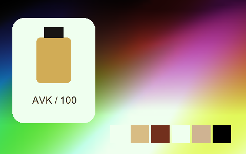

## 423 · Orange Dark look

`fl-0000062-orange-dark-look` · `cinema` · CC0-1.0 · 33³

50% gray Y′ 129.5/255 (+2.0 code values); 25–75% gray span ratio 1.408; mid-gray red minus blue +26.2 code values. Light/medium/deep skin swatches: #F7E9CF, #D2A988, #713F21. Red/green/blue swatches: #9A2014, #5ECC49, #161260.

Suggested use: Compare on your own SDR product, portrait and landscape footage before selecting.

Trial strength: 0.35–0.8; default 1.0.

Pixel color mapping only; no grain, glow, vignette, spatial haze or beauty effects. Natural footage quality is unaccepted. Check skin/product colors and clipped output.

**Supplied N002 still: actual output at strength 1.0.**

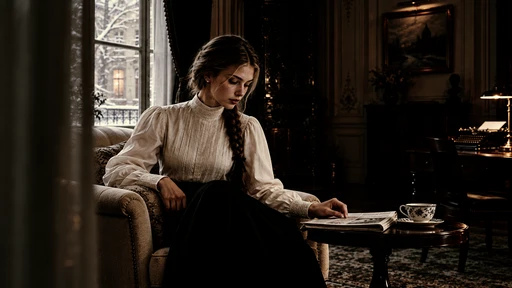

[Full-size lossless 1672×940](../../assets/looks-n002-20261024-r1/full/423-fl-0000062-orange-dark-look.webp) · [Original source](../../assets/looks-n002-20261024-r1/source.png) · [All 500 supplied-image samples](../FILTER_GALLERY.en.md)

| Input swatch | Input RGB | Actual output RGB |
|---|---|---|
| `gray_0` | `#000000` | `#000000` |
| `gray_10` | `#1A1A1A` | `#020200` |
| `gray_25` | `#404040` | `#1E190F` |
| `gray_50` | `#808080` | `#8B8071` |
| `gray_75` | `#BFBFBF` | `#D5CDB8` |
| `gray_90` | `#E6E6E6` | `#F5F0D7` |
| `gray_100` | `#FFFFFF` | `#FFFFEA` |
| `skin_light` | `#F5DBC6` | `#F7E9CF` |
| `skin_medium` | `#CF9B7B` | `#D2A988` |
| `skin_deep` | `#815438` | `#713F21` |
| `red` | `#CC3333` | `#9A2014` |
| `green` | `#33CC33` | `#5ECC49` |
| `blue` | `#3333CC` | `#161260` |

Creator: **Alex Jordan** · [Source](https://freshluts.com/luts/62) · commit `32fe087a3269fde38f3177563c1e0a77d9ec1a9e`.

Conversion: `native-CUBE-grid-retained-v1`; 8,192 sampled RGB points; max error 0.0000000; mean 0.0000000. This is numerical approximation, not a perceptual quality score.

License obligations: CC0: no attribution condition; source and creator retained for provenance.

[License](../../../product/src/ai_ad_editor/look_data/licenses/CC0-1.0.txt) · LUT SHA-256 `2dff5bd8f4508bbbc6f37bf0470c66c85ed284e729337183389172183e53975f`.

[Actual preview PNG](../../assets/look500-20261024-r1/previews/fl-0000062-orange-dark-look.png) · [Actual video](../../assets/look500-20261024-r1/videos/fl-0000062-orange-dark-look.mp4)

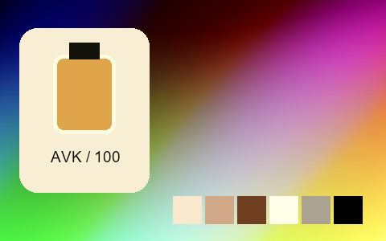

## 424 · Protect Highlights 01

`fl-0000064-protect-highlights-01` · `creative` · CC0-1.0 · 33³

50% gray Y′ 130.6/255 (+3.1 code values); 25–75% gray span ratio 0.648; mid-gray red minus blue +0.0 code values. Light/medium/deep skin swatches: #C7AD98, #BE8A6A, #885B3F. Red/green/blue swatches: #D33A3A, #24BD24, #3838D1.

Suggested use: Compare on your own SDR product, portrait and landscape footage before selecting.

Trial strength: 0.35–0.8; default 1.0.

Pixel color mapping only; no grain, glow, vignette, spatial haze or beauty effects. Natural footage quality is unaccepted. Check skin/product colors and clipped output.

**Supplied N002 still: actual output at strength 1.0.**

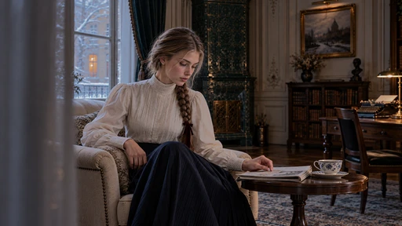

[Full-size lossless 1672×940](../../assets/looks-n002-20261024-r1/full/424-fl-0000064-protect-highlights-01.webp) · [Original source](../../assets/looks-n002-20261024-r1/source.png) · [All 500 supplied-image samples](../FILTER_GALLERY.en.md)

| Input swatch | Input RGB | Actual output RGB |
|---|---|---|
| `gray_0` | `#000000` | `#000000` |
| `gray_10` | `#1A1A1A` | `#1B1B1B` |
| `gray_25` | `#404040` | `#454545` |
| `gray_50` | `#808080` | `#838383` |
| `gray_75` | `#BFBFBF` | `#989898` |
| `gray_90` | `#E6E6E6` | `#BBBBBB` |
| `gray_100` | `#FFFFFF` | `#EFEFEF` |
| `skin_light` | `#F5DBC6` | `#C7AD98` |
| `skin_medium` | `#CF9B7B` | `#BE8A6A` |
| `skin_deep` | `#815438` | `#885B3F` |
| `red` | `#CC3333` | `#D33A3A` |
| `green` | `#33CC33` | `#24BD24` |
| `blue` | `#3333CC` | `#3838D1` |

Creator: **Alex Jordan** · [Source](https://freshluts.com/luts/64) · commit `32fe087a3269fde38f3177563c1e0a77d9ec1a9e`.

Conversion: `native-CUBE-grid-retained-v1`; 8,192 sampled RGB points; max error 0.0000000; mean 0.0000000. This is numerical approximation, not a perceptual quality score.

License obligations: CC0: no attribution condition; source and creator retained for provenance.

[License](../../../product/src/ai_ad_editor/look_data/licenses/CC0-1.0.txt) · LUT SHA-256 `8bb26b47f6c5ece86c91c1662c8d21fede8b1ab350d0dd9caf2c12b5343e1ca5`.

[Actual preview PNG](../../assets/look500-20261024-r1/previews/fl-0000064-protect-highlights-01.png) · [Actual video](../../assets/look500-20261024-r1/videos/fl-0000064-protect-highlights-01.mp4)

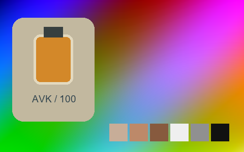

## 425 · Red Afternoon 01

`fl-0000065-red-afternoon-01` · `creative` · CC0-1.0 · 33³

50% gray Y′ 62.5/255 (-65.0 code values); 25–75% gray span ratio 0.992; mid-gray red minus blue +25.3 code values. Light/medium/deep skin swatches: #C6A185, #8E5C3C, #2D180A. Red/green/blue swatches: #390B07, #297817, #03040C.

Suggested use: Compare on your own SDR product, portrait and landscape footage before selecting.

Trial strength: 0.35–0.8; default 1.0.

Pixel color mapping only; no grain, glow, vignette, spatial haze or beauty effects. Natural footage quality is unaccepted. Check skin/product colors and clipped output.

**Supplied N002 still: actual output at strength 1.0.**

[Full-size lossless 1672×940](../../assets/looks-n002-20261024-r1/full/425-fl-0000065-red-afternoon-01.webp) · [Original source](../../assets/looks-n002-20261024-r1/source.png) · [All 500 supplied-image samples](../FILTER_GALLERY.en.md)

| Input swatch | Input RGB | Actual output RGB |
|---|---|---|
| `gray_0` | `#000000` | `#000000` |
| `gray_10` | `#1A1A1A` | `#000000` |
| `gray_25` | `#404040` | `#040504` |
| `gray_50` | `#808080` | `#4A3D30` |
| `gray_75` | `#BFBFBF` | `#938071` |
| `gray_90` | `#E6E6E6` | `#C0AC9C` |
| `gray_100` | `#FFFFFF` | `#DECABA` |
| `skin_light` | `#F5DBC6` | `#C6A185` |
| `skin_medium` | `#CF9B7B` | `#8E5C3C` |
| `skin_deep` | `#815438` | `#2D180A` |
| `red` | `#CC3333` | `#390B07` |
| `green` | `#33CC33` | `#297817` |
| `blue` | `#3333CC` | `#03040C` |

Creator: **Alex Jordan** · [Source](https://freshluts.com/luts/65) · commit `32fe087a3269fde38f3177563c1e0a77d9ec1a9e`.

Conversion: `native-CUBE-grid-retained-v1`; 8,192 sampled RGB points; max error 0.0000000; mean 0.0000000. This is numerical approximation, not a perceptual quality score.

License obligations: CC0: no attribution condition; source and creator retained for provenance.

[License](../../../product/src/ai_ad_editor/look_data/licenses/CC0-1.0.txt) · LUT SHA-256 `3c7daef7179c53de983c0fc294fd6af4c403b79e57992e109da91edf835185aa`.

[Actual preview PNG](../../assets/look500-20261024-r1/previews/fl-0000065-red-afternoon-01.png) · [Actual video](../../assets/look500-20261024-r1/videos/fl-0000065-red-afternoon-01.mp4)

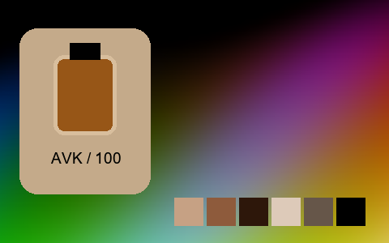

## 426 · Red Day 01

`fl-0000066-red-day-01` · `creative` · CC0-1.0 · 33³

50% gray Y′ 118.1/255 (-9.4 code values); 25–75% gray span ratio 1.041; mid-gray red minus blue +39.9 code values. Light/medium/deep skin swatches: #F6D6A6, #D5915B, #874523. Red/green/blue swatches: #D12420, #37C21E, #3825A3.

Suggested use: Compare on your own SDR product, portrait and landscape footage before selecting.

Trial strength: 0.35–0.8; default 1.0.

Pixel color mapping only; no grain, glow, vignette, spatial haze or beauty effects. Natural footage quality is unaccepted. Check skin/product colors and clipped output.

**Supplied N002 still: actual output at strength 1.0.**

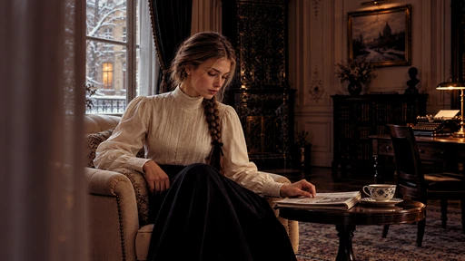

[Full-size lossless 1672×940](../../assets/looks-n002-20261024-r1/full/426-fl-0000066-red-day-01.webp) · [Original source](../../assets/looks-n002-20261024-r1/source.png) · [All 500 supplied-image samples](../FILTER_GALLERY.en.md)

| Input swatch | Input RGB | Actual output RGB |
|---|---|---|
| `gray_0` | `#000000` | `#000000` |
| `gray_10` | `#1A1A1A` | `#110B0B` |
| `gray_25` | `#404040` | `#443029` |
| `gray_50` | `#808080` | `#86745E` |
| `gray_75` | `#BFBFBF` | `#C6B79D` |
| `gray_90` | `#E6E6E6` | `#E9E0C7` |
| `gray_100` | `#FFFFFF` | `#FEFCE8` |
| `skin_light` | `#F5DBC6` | `#F6D6A6` |
| `skin_medium` | `#CF9B7B` | `#D5915B` |
| `skin_deep` | `#815438` | `#874523` |
| `red` | `#CC3333` | `#D12420` |
| `green` | `#33CC33` | `#37C21E` |
| `blue` | `#3333CC` | `#3825A3` |

Creator: **Alex Jordan** · [Source](https://freshluts.com/luts/66) · commit `32fe087a3269fde38f3177563c1e0a77d9ec1a9e`.

Conversion: `native-CUBE-grid-retained-v1`; 8,192 sampled RGB points; max error 0.0000000; mean 0.0000000. This is numerical approximation, not a perceptual quality score.

License obligations: CC0: no attribution condition; source and creator retained for provenance.

[License](../../../product/src/ai_ad_editor/look_data/licenses/CC0-1.0.txt) · LUT SHA-256 `e419c80ab8b8a2c990e24038a21784724b13577ac47e0834716dfc7f96abaacf`.

[Actual preview PNG](../../assets/look500-20261024-r1/previews/fl-0000066-red-day-01.png) · [Actual video](../../assets/look500-20261024-r1/videos/fl-0000066-red-day-01.mp4)

## 427 · Red Dream 01

`fl-0000067-red-dream-01` · `creative` · CC0-1.0 · 33³

50% gray Y′ 67.7/255 (-59.8 code values); 25–75% gray span ratio 1.262; mid-gray red minus blue +26.9 code values. Light/medium/deep skin swatches: #FECCA5, #AE7455, #3D1204. Red/green/blue swatches: #490604, #1CA002, #09040F.

Suggested use: Compare on your own SDR product, portrait and landscape footage before selecting.

Trial strength: 0.35–0.8; default 1.0.

Pixel color mapping only; no grain, glow, vignette, spatial haze or beauty effects. Natural footage quality is unaccepted. Check skin/product colors and clipped output.

**Supplied N002 still: actual output at strength 1.0.**

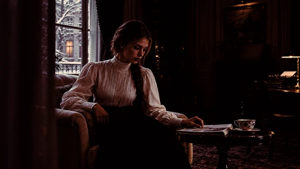

[Full-size lossless 1672×940](../../assets/looks-n002-20261024-r1/full/427-fl-0000067-red-dream-01.webp) · [Original source](../../assets/looks-n002-20261024-r1/source.png) · [All 500 supplied-image samples](../FILTER_GALLERY.en.md)

| Input swatch | Input RGB | Actual output RGB |
|---|---|---|
| `gray_0` | `#000000` | `#030000` |
| `gray_10` | `#1A1A1A` | `#030000` |
| `gray_25` | `#404040` | `#110504` |
| `gray_50` | `#808080` | `#5A3E3F` |
| `gray_75` | `#BFBFBF` | `#ABA9A1` |
| `gray_90` | `#E6E6E6` | `#FDDABD` |
| `gray_100` | `#FFFFFF` | `#FFF1D5` |
| `skin_light` | `#F5DBC6` | `#FECCA5` |
| `skin_medium` | `#CF9B7B` | `#AE7455` |
| `skin_deep` | `#815438` | `#3D1204` |
| `red` | `#CC3333` | `#490604` |
| `green` | `#33CC33` | `#1CA002` |
| `blue` | `#3333CC` | `#09040F` |

Creator: **Alex Jordan** · [Source](https://freshluts.com/luts/67) · commit `32fe087a3269fde38f3177563c1e0a77d9ec1a9e`.

Conversion: `native-CUBE-grid-retained-v1`; 8,192 sampled RGB points; max error 0.0000000; mean 0.0000000. This is numerical approximation, not a perceptual quality score.

License obligations: CC0: no attribution condition; source and creator retained for provenance.

[License](../../../product/src/ai_ad_editor/look_data/licenses/CC0-1.0.txt) · LUT SHA-256 `3e1ecb7c909a8132fe5906dea6b31289efaa0f70a5b7ff2f0052de322b95d1f7`.

[Actual preview PNG](../../assets/look500-20261024-r1/previews/fl-0000067-red-dream-01.png) · [Actual video](../../assets/look500-20261024-r1/videos/fl-0000067-red-dream-01.mp4)

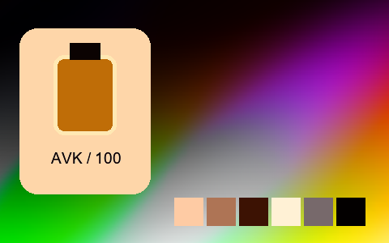

## 428 · Retro Brown 01

`fl-0000068-retro-brown-01` · `creative` · CC0-1.0 · 33³

50% gray Y′ 132.3/255 (+4.8 code values); 25–75% gray span ratio 1.036; mid-gray red minus blue +31.5 code values. Light/medium/deep skin swatches: #F0DBBC, #BBA188, #735F4F. Red/green/blue swatches: #775146, #9BA67C, #443941.

Suggested use: Compare on your own SDR product, portrait and landscape footage before selecting.

Trial strength: 0.35–0.8; default 1.0.

Pixel color mapping only; no grain, glow, vignette, spatial haze or beauty effects. Natural footage quality is unaccepted. Check skin/product colors and clipped output.

**Supplied N002 still: actual output at strength 1.0.**

[Full-size lossless 1672×940](../../assets/looks-n002-20261024-r1/full/428-fl-0000068-retro-brown-01.webp) · [Original source](../../assets/looks-n002-20261024-r1/source.png) · [All 500 supplied-image samples](../FILTER_GALLERY.en.md)

| Input swatch | Input RGB | Actual output RGB |
|---|---|---|
| `gray_0` | `#000000` | `#000000` |
| `gray_10` | `#1A1A1A` | `#050101` |
| `gray_25` | `#404040` | `#453A30` |
| `gray_50` | `#808080` | `#918272` |
| `gray_75` | `#BFBFBF` | `#CFBEA5` |
| `gray_90` | `#E6E6E6` | `#F3E3C6` |
| `gray_100` | `#FFFFFF` | `#FCFADA` |
| `skin_light` | `#F5DBC6` | `#F0DBBC` |
| `skin_medium` | `#CF9B7B` | `#BBA188` |
| `skin_deep` | `#815438` | `#735F4F` |
| `red` | `#CC3333` | `#775146` |
| `green` | `#33CC33` | `#9BA67C` |
| `blue` | `#3333CC` | `#443941` |

Creator: **Alex Jordan** · [Source](https://freshluts.com/luts/68) · commit `32fe087a3269fde38f3177563c1e0a77d9ec1a9e`.

Conversion: `native-CUBE-grid-retained-v1`; 8,192 sampled RGB points; max error 0.0000000; mean 0.0000000. This is numerical approximation, not a perceptual quality score.

License obligations: CC0: no attribution condition; source and creator retained for provenance.

[License](../../../product/src/ai_ad_editor/look_data/licenses/CC0-1.0.txt) · LUT SHA-256 `b794df2f305115af64d1fdf04377166ff2427726cc7068b9dc8dc06ab04ab24d`.

[Actual preview PNG](../../assets/look500-20261024-r1/previews/fl-0000068-retro-brown-01.png) · [Actual video](../../assets/look500-20261024-r1/videos/fl-0000068-retro-brown-01.mp4)

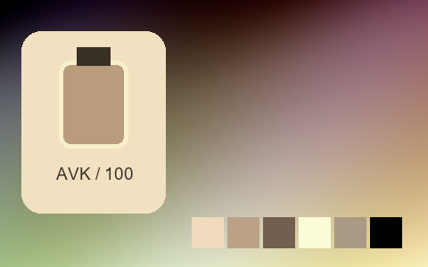

## 429 · Saturated Blue

`fl-0000071-saturated-blue` · `cinema` · CC0-1.0 · 33³

50% gray Y′ 148.7/255 (+21.2 code values); 25–75% gray span ratio 0.801; mid-gray red minus blue +18.6 code values. Light/medium/deep skin swatches: #FFDFE4, #EC9FAC, #B86869. Red/green/blue swatches: #EA506A, #67C96B, #6650E1.

Suggested use: Compare on your own SDR product, portrait and landscape footage before selecting.

Trial strength: 0.35–0.8; default 1.0.

Pixel color mapping only; no grain, glow, vignette, spatial haze or beauty effects. Natural footage quality is unaccepted. Check skin/product colors and clipped output.

**Supplied N002 still: actual output at strength 1.0.**

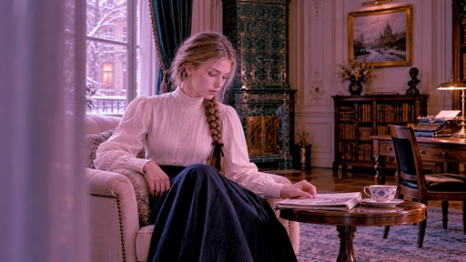

[Full-size lossless 1672×940](../../assets/looks-n002-20261024-r1/full/429-fl-0000071-saturated-blue.webp) · [Original source](../../assets/looks-n002-20261024-r1/source.png) · [All 500 supplied-image samples](../FILTER_GALLERY.en.md)

| Input swatch | Input RGB | Actual output RGB |
|---|---|---|
| `gray_0` | `#000000` | `#000000` |
| `gray_10` | `#1A1A1A` | `#39303A` |
| `gray_25` | `#404040` | `#745977` |
| `gray_50` | `#808080` | `#BB87A8` |
| `gray_75` | `#BFBFBF` | `#E6BCD9` |
| `gray_90` | `#E6E6E6` | `#FBEAF8` |
| `gray_100` | `#FFFFFF` | `#FFFFFF` |
| `skin_light` | `#F5DBC6` | `#FFDFE4` |
| `skin_medium` | `#CF9B7B` | `#EC9FAC` |
| `skin_deep` | `#815438` | `#B86869` |
| `red` | `#CC3333` | `#EA506A` |
| `green` | `#33CC33` | `#67C96B` |
| `blue` | `#3333CC` | `#6650E1` |

Creator: **Alex Jordan** · [Source](https://freshluts.com/luts/71) · commit `32fe087a3269fde38f3177563c1e0a77d9ec1a9e`.

Conversion: `native-CUBE-grid-retained-v1`; 8,192 sampled RGB points; max error 0.0000000; mean 0.0000000. This is numerical approximation, not a perceptual quality score.

License obligations: CC0: no attribution condition; source and creator retained for provenance.

[License](../../../product/src/ai_ad_editor/look_data/licenses/CC0-1.0.txt) · LUT SHA-256 `e10f2436e83730ade23a91531dda284eae79f917f458f0f063ca377b225df2bf`.

[Actual preview PNG](../../assets/look500-20261024-r1/previews/fl-0000071-saturated-blue.png) · [Actual video](../../assets/look500-20261024-r1/videos/fl-0000071-saturated-blue.mp4)

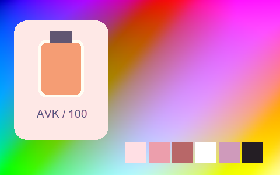

## 430 · Smart Contrast

`fl-0000072-smart-contrast` · `creative` · CC0-1.0 · 33³

50% gray Y′ 125.5/255 (-2.0 code values); 25–75% gray span ratio 1.462; mid-gray red minus blue +0.0 code values. Light/medium/deep skin swatches: #F6EFE8, #D7B798, #61382A. Red/green/blue swatches: #8F1D1D, #64D664, #1A1A8C.

Suggested use: Compare on your own SDR product, portrait and landscape footage before selecting.

Trial strength: 0.35–0.8; default 1.0.

Pixel color mapping only; no grain, glow, vignette, spatial haze or beauty effects. Natural footage quality is unaccepted. Check skin/product colors and clipped output.

**Supplied N002 still: actual output at strength 1.0.**

[Full-size lossless 1672×940](../../assets/looks-n002-20261024-r1/full/430-fl-0000072-smart-contrast.webp) · [Original source](../../assets/looks-n002-20261024-r1/source.png) · [All 500 supplied-image samples](../FILTER_GALLERY.en.md)

| Input swatch | Input RGB | Actual output RGB |
|---|---|---|
| `gray_0` | `#000000` | `#000000` |
| `gray_10` | `#1A1A1A` | `#0C0C0C` |
| `gray_25` | `#404040` | `#222222` |
| `gray_50` | `#808080` | `#7E7E7E` |
| `gray_75` | `#BFBFBF` | `#DCDCDC` |
| `gray_90` | `#E6E6E6` | `#F3F3F3` |
| `gray_100` | `#FFFFFF` | `#FFFFFF` |
| `skin_light` | `#F5DBC6` | `#F6EFE8` |
| `skin_medium` | `#CF9B7B` | `#D7B798` |
| `skin_deep` | `#815438` | `#61382A` |
| `red` | `#CC3333` | `#8F1D1D` |
| `green` | `#33CC33` | `#64D664` |
| `blue` | `#3333CC` | `#1A1A8C` |

Creator: **Alex Jordan** · [Source](https://freshluts.com/luts/72) · commit `32fe087a3269fde38f3177563c1e0a77d9ec1a9e`.

Conversion: `native-CUBE-grid-retained-v1`; 8,192 sampled RGB points; max error 0.0000000; mean 0.0000000. This is numerical approximation, not a perceptual quality score.

License obligations: CC0: no attribution condition; source and creator retained for provenance.

[License](../../../product/src/ai_ad_editor/look_data/licenses/CC0-1.0.txt) · LUT SHA-256 `ce781639e879929adc935866734104694a8867a785fff2f5c6c60bd370a0106a`.

[Actual preview PNG](../../assets/look500-20261024-r1/previews/fl-0000072-smart-contrast.png) · [Actual video](../../assets/look500-20261024-r1/videos/fl-0000072-smart-contrast.mp4)

## 431 · Subtle green

`fl-0000073-subtle-green` · `creative` · CC0-1.0 · 33³

50% gray Y′ 80.1/255 (-47.4 code values); 25–75% gray span ratio 1.131; mid-gray red minus blue -0.6 code values. Light/medium/deep skin swatches: #F7E3D5, #A7765D, #3F2A1F. Red/green/blue swatches: #591A1A, #03AA03, #12127A.

Suggested use: Compare on your own SDR product, portrait and landscape footage before selecting.

Trial strength: 0.35–0.8; default 1.0.

Pixel color mapping only; no grain, glow, vignette, spatial haze or beauty effects. Natural footage quality is unaccepted. Check skin/product colors and clipped output.

**Supplied N002 still: actual output at strength 1.0.**

[Full-size lossless 1672×940](../../assets/looks-n002-20261024-r1/full/431-fl-0000073-subtle-green.webp) · [Original source](../../assets/looks-n002-20261024-r1/source.png) · [All 500 supplied-image samples](../FILTER_GALLERY.en.md)

| Input swatch | Input RGB | Actual output RGB |
|---|---|---|
| `gray_0` | `#000000` | `#050505` |
| `gray_10` | `#1A1A1A` | `#0A0A0A` |
| `gray_25` | `#404040` | `#1A1A1A` |
| `gray_50` | `#808080` | `#505050` |
| `gray_75` | `#BFBFBF` | `#AAABAB` |
| `gray_90` | `#E6E6E6` | `#F4F4F4` |
| `gray_100` | `#FFFFFF` | `#FFFFFF` |
| `skin_light` | `#F5DBC6` | `#F7E3D5` |
| `skin_medium` | `#CF9B7B` | `#A7765D` |
| `skin_deep` | `#815438` | `#3F2A1F` |
| `red` | `#CC3333` | `#591A1A` |
| `green` | `#33CC33` | `#03AA03` |
| `blue` | `#3333CC` | `#12127A` |

Creator: **Alex Jordan** · [Source](https://freshluts.com/luts/73) · commit `32fe087a3269fde38f3177563c1e0a77d9ec1a9e`.

Conversion: `native-CUBE-grid-retained-v1`; 8,192 sampled RGB points; max error 0.0000000; mean 0.0000000. This is numerical approximation, not a perceptual quality score.

License obligations: CC0: no attribution condition; source and creator retained for provenance.

[License](../../../product/src/ai_ad_editor/look_data/licenses/CC0-1.0.txt) · LUT SHA-256 `6a1f53dd2d00bea0449dc61428e82fb29ab4e93abde5978b83c134cc38f973be`.

[Actual preview PNG](../../assets/look500-20261024-r1/previews/fl-0000073-subtle-green.png) · [Actual video](../../assets/look500-20261024-r1/videos/fl-0000073-subtle-green.mp4)

## 432 · Subtle Blue

`fl-0000074-subtle-blue` · `creative` · CC0-1.0 · 33³

50% gray Y′ 122.0/255 (-5.5 code values); 25–75% gray span ratio 1.001; mid-gray red minus blue -8.2 code values. Light/medium/deep skin swatches: #EBD4D7, #C2958C, #744F44. Red/green/blue swatches: #A9343E, #4AB956, #2F30AF.

Suggested use: Compare on your own SDR product, portrait and landscape footage before selecting.

Trial strength: 0.35–0.8; default 1.0.

Pixel color mapping only; no grain, glow, vignette, spatial haze or beauty effects. Natural footage quality is unaccepted. Check skin/product colors and clipped output.

**Supplied N002 still: actual output at strength 1.0.**

[Full-size lossless 1672×940](../../assets/looks-n002-20261024-r1/full/432-fl-0000074-subtle-blue.webp) · [Original source](../../assets/looks-n002-20261024-r1/source.png) · [All 500 supplied-image samples](../FILTER_GALLERY.en.md)

| Input swatch | Input RGB | Actual output RGB |
|---|---|---|
| `gray_0` | `#000000` | `#000004` |
| `gray_10` | `#1A1A1A` | `#0E151D` |
| `gray_25` | `#404040` | `#393944` |
| `gray_50` | `#808080` | `#7D7885` |
| `gray_75` | `#BFBFBF` | `#BFB7C8` |
| `gray_90` | `#E6E6E6` | `#E4DDF1` |
| `gray_100` | `#FFFFFF` | `#FAF7FF` |
| `skin_light` | `#F5DBC6` | `#EBD4D7` |
| `skin_medium` | `#CF9B7B` | `#C2958C` |
| `skin_deep` | `#815438` | `#744F44` |
| `red` | `#CC3333` | `#A9343E` |
| `green` | `#33CC33` | `#4AB956` |
| `blue` | `#3333CC` | `#2F30AF` |

Creator: **Alex Jordan** · [Source](https://freshluts.com/luts/74) · commit `32fe087a3269fde38f3177563c1e0a77d9ec1a9e`.

Conversion: `native-CUBE-grid-retained-v1`; 8,192 sampled RGB points; max error 0.0000000; mean 0.0000000. This is numerical approximation, not a perceptual quality score.

License obligations: CC0: no attribution condition; source and creator retained for provenance.

[License](../../../product/src/ai_ad_editor/look_data/licenses/CC0-1.0.txt) · LUT SHA-256 `7b184e97be4f8468dec55c058f4e1d4e015a1d1728442d29cea2bda155baf225`.

[Actual preview PNG](../../assets/look500-20261024-r1/previews/fl-0000074-subtle-blue.png) · [Actual video](../../assets/look500-20261024-r1/videos/fl-0000074-subtle-blue.mp4)

## 433 · Low key 01

`fl-0000075-low-key-01` · `creative` · CC0-1.0 · 33³

50% gray Y′ 84.4/255 (-43.1 code values); 25–75% gray span ratio 0.771; mid-gray red minus blue +12.6 code values. Light/medium/deep skin swatches: #B09D8B, #8E6B54, #503422. Red/green/blue swatches: #712224, #35852A, #20204C.

Suggested use: Compare on your own SDR product, portrait and landscape footage before selecting.

Trial strength: 0.35–0.8; default 1.0.

Pixel color mapping only; no grain, glow, vignette, spatial haze or beauty effects. Natural footage quality is unaccepted. Check skin/product colors and clipped output.

**Supplied N002 still: actual output at strength 1.0.**

[Full-size lossless 1672×940](../../assets/looks-n002-20261024-r1/full/433-fl-0000075-low-key-01.webp) · [Original source](../../assets/looks-n002-20261024-r1/source.png) · [All 500 supplied-image samples](../FILTER_GALLERY.en.md)

| Input swatch | Input RGB | Actual output RGB |
|---|---|---|
| `gray_0` | `#000000` | `#000000` |
| `gray_10` | `#1A1A1A` | `#090906` |
| `gray_25` | `#404040` | `#25251D` |
| `gray_50` | `#808080` | `#57544B` |
| `gray_75` | `#BFBFBF` | `#8A867D` |
| `gray_90` | `#E6E6E6` | `#A8A59C` |
| `gray_100` | `#FFFFFF` | `#BCB9B2` |
| `skin_light` | `#F5DBC6` | `#B09D8B` |
| `skin_medium` | `#CF9B7B` | `#8E6B54` |
| `skin_deep` | `#815438` | `#503422` |
| `red` | `#CC3333` | `#712224` |
| `green` | `#33CC33` | `#35852A` |
| `blue` | `#3333CC` | `#20204C` |

Creator: **Alex Jordan** · [Source](https://freshluts.com/luts/75) · commit `32fe087a3269fde38f3177563c1e0a77d9ec1a9e`.

Conversion: `native-CUBE-grid-retained-v1`; 8,192 sampled RGB points; max error 0.0000000; mean 0.0000000. This is numerical approximation, not a perceptual quality score.

License obligations: CC0: no attribution condition; source and creator retained for provenance.

[License](../../../product/src/ai_ad_editor/look_data/licenses/CC0-1.0.txt) · LUT SHA-256 `9c75e735f3aaf1d8431f667885c27afc33d536742d64322b5c1ed2875c34ce99`.

[Actual preview PNG](../../assets/look500-20261024-r1/previews/fl-0000075-low-key-01.png) · [Actual video](../../assets/look500-20261024-r1/videos/fl-0000075-low-key-01.mp4)

## 434 · Yellow 55B

`fl-0000076-yellow-55b` · `cinema` · CC0-1.0 · 33³

50% gray Y′ 86.4/255 (-41.1 code values); 25–75% gray span ratio 1.045; mid-gray red minus blue +9.6 code values. Light/medium/deep skin swatches: #EECB99, #AB7758, #4D2D24. Red/green/blue swatches: #871419, #2C9A32, #181765.

Suggested use: Compare on your own SDR product, portrait and landscape footage before selecting.

Trial strength: 0.35–0.8; default 1.0.

Pixel color mapping only; no grain, glow, vignette, spatial haze or beauty effects. Natural footage quality is unaccepted. Check skin/product colors and clipped output.

**Supplied N002 still: actual output at strength 1.0.**

[Full-size lossless 1672×940](../../assets/looks-n002-20261024-r1/full/434-fl-0000076-yellow-55b.webp) · [Original source](../../assets/looks-n002-20261024-r1/source.png) · [All 500 supplied-image samples](../FILTER_GALLERY.en.md)

| Input swatch | Input RGB | Actual output RGB |
|---|---|---|
| `gray_0` | `#000000` | `#000004` |
| `gray_10` | `#1A1A1A` | `#07070D` |
| `gray_25` | `#404040` | `#1D1D21` |
| `gray_50` | `#808080` | `#58574F` |
| `gray_75` | `#BFBFBF` | `#A8A488` |
| `gray_90` | `#E6E6E6` | `#E1D9B0` |
| `gray_100` | `#FFFFFF` | `#FFFFCC` |
| `skin_light` | `#F5DBC6` | `#EECB99` |
| `skin_medium` | `#CF9B7B` | `#AB7758` |
| `skin_deep` | `#815438` | `#4D2D24` |
| `red` | `#CC3333` | `#871419` |
| `green` | `#33CC33` | `#2C9A32` |
| `blue` | `#3333CC` | `#181765` |

Creator: **Alex Jordan** · [Source](https://freshluts.com/luts/76) · commit `32fe087a3269fde38f3177563c1e0a77d9ec1a9e`.

Conversion: `native-CUBE-grid-retained-v1`; 8,192 sampled RGB points; max error 0.0000000; mean 0.0000000. This is numerical approximation, not a perceptual quality score.

License obligations: CC0: no attribution condition; source and creator retained for provenance.

[License](../../../product/src/ai_ad_editor/look_data/licenses/CC0-1.0.txt) · LUT SHA-256 `b5b83244f11c7e0dc1495a168ae854704077a891d0cd28daa0ad80c35742bc65`.

[Actual preview PNG](../../assets/look500-20261024-r1/previews/fl-0000076-yellow-55b.png) · [Actual video](../../assets/look500-20261024-r1/videos/fl-0000076-yellow-55b.mp4)

## 435 · Yellow Film 01

`fl-0000077-yellow-film-01` · `cinema` · CC0-1.0 · 33³

50% gray Y′ 112.3/255 (-15.2 code values); 25–75% gray span ratio 1.192; mid-gray red minus blue +0.0 code values. Light/medium/deep skin swatches: #FCF7F3, #C4977E, #614333. Red/green/blue swatches: #812F2F, #18CE18, #2121C5.

Suggested use: Compare on your own SDR product, portrait and landscape footage before selecting.

Trial strength: 0.35–0.8; default 1.0.

Pixel color mapping only; no grain, glow, vignette, spatial haze or beauty effects. Natural footage quality is unaccepted. Check skin/product colors and clipped output.

**Supplied N002 still: actual output at strength 1.0.**

[Full-size lossless 1672×940](../../assets/looks-n002-20261024-r1/full/435-fl-0000077-yellow-film-01.webp) · [Original source](../../assets/looks-n002-20261024-r1/source.png) · [All 500 supplied-image samples](../FILTER_GALLERY.en.md)

| Input swatch | Input RGB | Actual output RGB |
|---|---|---|
| `gray_0` | `#000000` | `#050505` |
| `gray_10` | `#1A1A1A` | `#121212` |
| `gray_25` | `#404040` | `#2E2E2E` |
| `gray_50` | `#808080` | `#707070` |
| `gray_75` | `#BFBFBF` | `#C6C6C6` |
| `gray_90` | `#E6E6E6` | `#FEFEFE` |
| `gray_100` | `#FFFFFF` | `#FFFFFF` |
| `skin_light` | `#F5DBC6` | `#FCF7F3` |
| `skin_medium` | `#CF9B7B` | `#C4977E` |
| `skin_deep` | `#815438` | `#614333` |
| `red` | `#CC3333` | `#812F2F` |
| `green` | `#33CC33` | `#18CE18` |
| `blue` | `#3333CC` | `#2121C5` |

Creator: **Alex Jordan** · [Source](https://freshluts.com/luts/77) · commit `32fe087a3269fde38f3177563c1e0a77d9ec1a9e`.

Conversion: `native-CUBE-grid-retained-v1`; 8,192 sampled RGB points; max error 0.0000000; mean 0.0000000. This is numerical approximation, not a perceptual quality score.

License obligations: CC0: no attribution condition; source and creator retained for provenance.

[License](../../../product/src/ai_ad_editor/look_data/licenses/CC0-1.0.txt) · LUT SHA-256 `5a83d0725ce8a203f4df89a5b8ba1d422738371523b1a6fac83ef9ca93798872`.

[Actual preview PNG](../../assets/look500-20261024-r1/previews/fl-0000077-yellow-film-01.png) · [Actual video](../../assets/look500-20261024-r1/videos/fl-0000077-yellow-film-01.mp4)

## 436 · Bozen

`fl-0000106-bozen` · `creative` · CC0-1.0 · 32³

50% gray Y′ 145.6/255 (+18.1 code values); 25–75% gray span ratio 1.261; mid-gray red minus blue -18.4 code values. Light/medium/deep skin swatches: #ECE9E7, #DACDC4, #916657. Red/green/blue swatches: #D18F8B, #66956D, #3A3D6D.

Suggested use: Compare on your own SDR product, portrait and landscape footage before selecting.

Trial strength: 0.35–0.8; default 1.0.

Pixel color mapping only; no grain, glow, vignette, spatial haze or beauty effects. Natural footage quality is unaccepted. Check skin/product colors and clipped output.

**Supplied N002 still: actual output at strength 1.0.**

[Full-size lossless 1672×940](../../assets/looks-n002-20261024-r1/full/436-fl-0000106-bozen.webp) · [Original source](../../assets/looks-n002-20261024-r1/source.png) · [All 500 supplied-image samples](../FILTER_GALLERY.en.md)

| Input swatch | Input RGB | Actual output RGB |
|---|---|---|
| `gray_0` | `#000000` | `#171A20` |
| `gray_10` | `#1A1A1A` | `#1E2228` |
| `gray_25` | `#404040` | `#33363F` |
| `gray_50` | `#808080` | `#8D929F` |
| `gray_75` | `#BFBFBF` | `#D5D7DA` |
| `gray_90` | `#E6E6E6` | `#E9E8E8` |
| `gray_100` | `#FFFFFF` | `#F2F2F0` |
| `skin_light` | `#F5DBC6` | `#ECE9E7` |
| `skin_medium` | `#CF9B7B` | `#DACDC4` |
| `skin_deep` | `#815438` | `#916657` |
| `red` | `#CC3333` | `#D18F8B` |
| `green` | `#33CC33` | `#66956D` |
| `blue` | `#3333CC` | `#3A3D6D` |

Creator: **Mattias Horvath** · [Source](https://freshluts.com/luts/106) · commit `32fe087a3269fde38f3177563c1e0a77d9ec1a9e`.

Conversion: `native-CUBE-grid-retained-v1`; 8,192 sampled RGB points; max error 0.0000000; mean 0.0000000. This is numerical approximation, not a perceptual quality score.

License obligations: CC0: no attribution condition; source and creator retained for provenance.

[License](../../../product/src/ai_ad_editor/look_data/licenses/CC0-1.0.txt) · LUT SHA-256 `65685286d592efc29ba8b5ddce33321753fe216fd165ed1cec44f2dcc187b9fa`.

[Actual preview PNG](../../assets/look500-20261024-r1/previews/fl-0000106-bozen.png) · [Actual video](../../assets/look500-20261024-r1/videos/fl-0000106-bozen.mp4)

## 437 · powerful cold

`fl-0000107-powerful-cold` · `creative` · CC0-1.0 · 33³

50% gray Y′ 87.2/255 (-40.3 code values); 25–75% gray span ratio 1.203; mid-gray red minus blue +6.7 code values. Light/medium/deep skin swatches: #F0D2BE, #BF7A54, #5B2305. Red/green/blue swatches: #AE0200, #0DB003, #0604B1.

Suggested use: Compare on your own SDR product, portrait and landscape footage before selecting.

Trial strength: 0.35–0.8; default 1.0.

Pixel color mapping only; no grain, glow, vignette, spatial haze or beauty effects. Natural footage quality is unaccepted. Check skin/product colors and clipped output.

**Supplied N002 still: actual output at strength 1.0.**

[Full-size lossless 1672×940](../../assets/looks-n002-20261024-r1/full/437-fl-0000107-powerful-cold.webp) · [Original source](../../assets/looks-n002-20261024-r1/source.png) · [All 500 supplied-image samples](../FILTER_GALLERY.en.md)

| Input swatch | Input RGB | Actual output RGB |
|---|---|---|
| `gray_0` | `#000000` | `#000000` |
| `gray_10` | `#1A1A1A` | `#000000` |
| `gray_25` | `#404040` | `#15110B` |
| `gray_50` | `#808080` | `#5D5656` |
| `gray_75` | `#BFBFBF` | `#AEAAAD` |
| `gray_90` | `#E6E6E6` | `#E2E0E2` |
| `gray_100` | `#FFFFFF` | `#FFFFFF` |
| `skin_light` | `#F5DBC6` | `#F0D2BE` |
| `skin_medium` | `#CF9B7B` | `#BF7A54` |
| `skin_deep` | `#815438` | `#5B2305` |
| `red` | `#CC3333` | `#AE0200` |
| `green` | `#33CC33` | `#0DB003` |
| `blue` | `#3333CC` | `#0604B1` |

Creator: **sagi hershkovich** · [Source](https://freshluts.com/luts/107) · commit `32fe087a3269fde38f3177563c1e0a77d9ec1a9e`.

Conversion: `native-CUBE-grid-retained-v1`; 8,192 sampled RGB points; max error 0.0000000; mean 0.0000000. This is numerical approximation, not a perceptual quality score.

License obligations: CC0: no attribution condition; source and creator retained for provenance.

[License](../../../product/src/ai_ad_editor/look_data/licenses/CC0-1.0.txt) · LUT SHA-256 `5310afbe5b5841ee0ed19fa9cd4f2f3e483aeba54e8333abd5fa45de5ee45dbc`.

[Actual preview PNG](../../assets/look500-20261024-r1/previews/fl-0000107-powerful-cold.png) · [Actual video](../../assets/look500-20261024-r1/videos/fl-0000107-powerful-cold.mp4)

## 438 · Our Home_Green Sequence

`fl-0000130-our-home-green-sequence` · `creative` · CC0-1.0 · 33³

50% gray Y′ 155.0/255 (+27.5 code values); 25–75% gray span ratio 1.565; mid-gray red minus blue -63.9 code values. Light/medium/deep skin swatches: #F9FBFF, #FFD08A, #DB3F09. Red/green/blue swatches: #FF0043, #00FF00, #0000FF.

Suggested use: Compare on your own SDR product, portrait and landscape footage before selecting.

Trial strength: 0.35–0.8; default 1.0.

Pixel color mapping only; no grain, glow, vignette, spatial haze or beauty effects. Natural footage quality is unaccepted. Check skin/product colors and clipped output.

**Supplied N002 still: actual output at strength 1.0.**

[Full-size lossless 1672×940](../../assets/looks-n002-20261024-r1/full/438-fl-0000130-our-home-green-sequence.webp) · [Original source](../../assets/looks-n002-20261024-r1/source.png) · [All 500 supplied-image samples](../FILTER_GALLERY.en.md)

| Input swatch | Input RGB | Actual output RGB |
|---|---|---|
| `gray_0` | `#000000` | `#000000` |
| `gray_10` | `#1A1A1A` | `#080A1A` |
| `gray_25` | `#404040` | `#21294A` |
| `gray_50` | `#808080` | `#8E9ACD` |
| `gray_75` | `#BFBFBF` | `#E8F2FF` |
| `gray_90` | `#E6E6E6` | `#F1FBFF` |
| `gray_100` | `#FFFFFF` | `#F3FEFF` |
| `skin_light` | `#F5DBC6` | `#F9FBFF` |
| `skin_medium` | `#CF9B7B` | `#FFD08A` |
| `skin_deep` | `#815438` | `#DB3F09` |
| `red` | `#CC3333` | `#FF0043` |
| `green` | `#33CC33` | `#00FF00` |
| `blue` | `#3333CC` | `#0000FF` |

Creator: **Isaiah J. White** · [Source](https://freshluts.com/luts/130) · commit `32fe087a3269fde38f3177563c1e0a77d9ec1a9e`.

Conversion: `native-CUBE-grid-retained-v1`; 8,192 sampled RGB points; max error 0.0000000; mean 0.0000000. This is numerical approximation, not a perceptual quality score.

License obligations: CC0: no attribution condition; source and creator retained for provenance.

[License](../../../product/src/ai_ad_editor/look_data/licenses/CC0-1.0.txt) · LUT SHA-256 `44b376ef72706350070445df32684ecb34800d889147871b5a30977ad00a17f8`.

[Actual preview PNG](../../assets/look500-20261024-r1/previews/fl-0000130-our-home-green-sequence.png) · [Actual video](../../assets/look500-20261024-r1/videos/fl-0000130-our-home-green-sequence.mp4)

## 439 · SONY LOW LIGHT URBAN

`fl-0000148-sony-low-light-urban` · `creative` · CC0-1.0 · 33³

50% gray Y′ 18.4/255 (-109.1 code values); 25–75% gray span ratio 0.488; mid-gray red minus blue -22.1 code values. Light/medium/deep skin swatches: #336181, #342122, #0E0502. Red/green/blue swatches: #330D00, #003A23, #231E5B.

Suggested use: Compare on your own SDR product, portrait and landscape footage before selecting.

Trial strength: 0.35–0.8; default 1.0.

Pixel color mapping only; no grain, glow, vignette, spatial haze or beauty effects. Natural footage quality is unaccepted. Check skin/product colors and clipped output.

**Supplied N002 still: actual output at strength 1.0.**

[Full-size lossless 1672×940](../../assets/looks-n002-20261024-r1/full/439-fl-0000148-sony-low-light-urban.webp) · [Original source](../../assets/looks-n002-20261024-r1/source.png) · [All 500 supplied-image samples](../FILTER_GALLERY.en.md)

| Input swatch | Input RGB | Actual output RGB |
|---|---|---|
| `gray_0` | `#000000` | `#000000` |
| `gray_10` | `#1A1A1A` | `#000000` |
| `gray_25` | `#404040` | `#050102` |
| `gray_50` | `#808080` | `#0A1420` |
| `gray_75` | `#BFBFBF` | `#14496A` |
| `gray_90` | `#E6E6E6` | `#2E73A8` |
| `gray_100` | `#FFFFFF` | `#3B87B8` |
| `skin_light` | `#F5DBC6` | `#336181` |
| `skin_medium` | `#CF9B7B` | `#342122` |
| `skin_deep` | `#815438` | `#0E0502` |
| `red` | `#CC3333` | `#330D00` |
| `green` | `#33CC33` | `#003A23` |
| `blue` | `#3333CC` | `#231E5B` |

Creator: **Shamoon Abbasi** · [Source](https://freshluts.com/luts/148) · commit `32fe087a3269fde38f3177563c1e0a77d9ec1a9e`.

Conversion: `native-CUBE-grid-retained-v1`; 8,192 sampled RGB points; max error 0.0000000; mean 0.0000000. This is numerical approximation, not a perceptual quality score.

License obligations: CC0: no attribution condition; source and creator retained for provenance.

[License](../../../product/src/ai_ad_editor/look_data/licenses/CC0-1.0.txt) · LUT SHA-256 `176ed0d6f01ce0948e866b1766cb1f2275cb804cd7213d16b12acbdc3747b4c1`.

[Actual preview PNG](../../assets/look500-20261024-r1/previews/fl-0000148-sony-low-light-urban.png) · [Actual video](../../assets/look500-20261024-r1/videos/fl-0000148-sony-low-light-urban.mp4)

## 440 · GOLDEN FEVE3R

`fl-0000149-golden-feve3r` · `creative` · CC0-1.0 · 33³

50% gray Y′ 60.1/255 (-67.4 code values); 25–75% gray span ratio 1.077; mid-gray red minus blue +20.3 code values. Light/medium/deep skin swatches: #EDCF77, #976638, #24221B. Red/green/blue swatches: #441314, #31662B, #0D1827.

Suggested use: Compare on your own SDR product, portrait and landscape footage before selecting.

Trial strength: 0.35–0.8; default 1.0.

Pixel color mapping only; no grain, glow, vignette, spatial haze or beauty effects. Natural footage quality is unaccepted. Check skin/product colors and clipped output.

**Supplied N002 still: actual output at strength 1.0.**

[Full-size lossless 1672×940](../../assets/looks-n002-20261024-r1/full/440-fl-0000149-golden-feve3r.webp) · [Original source](../../assets/looks-n002-20261024-r1/source.png) · [All 500 supplied-image samples](../FILTER_GALLERY.en.md)

| Input swatch | Input RGB | Actual output RGB |
|---|---|---|
| `gray_0` | `#000000` | `#050A0B` |
| `gray_10` | `#1A1A1A` | `#090E0F` |
| `gray_25` | `#404040` | `#131715` |
| `gray_50` | `#808080` | `#3F3D2B` |
| `gray_75` | `#BFBFBF` | `#C09E52` |
| `gray_90` | `#E6E6E6` | `#F3D780` |
| `gray_100` | `#FFFFFF` | `#FDF0A3` |
| `skin_light` | `#F5DBC6` | `#EDCF77` |
| `skin_medium` | `#CF9B7B` | `#976638` |
| `skin_deep` | `#815438` | `#24221B` |
| `red` | `#CC3333` | `#441314` |
| `green` | `#33CC33` | `#31662B` |
| `blue` | `#3333CC` | `#0D1827` |

Creator: **Shamoon Abbasi** · [Source](https://freshluts.com/luts/149) · commit `32fe087a3269fde38f3177563c1e0a77d9ec1a9e`.

Conversion: `native-CUBE-grid-retained-v1`; 8,192 sampled RGB points; max error 0.0000000; mean 0.0000000. This is numerical approximation, not a perceptual quality score.

License obligations: CC0: no attribution condition; source and creator retained for provenance.

[License](../../../product/src/ai_ad_editor/look_data/licenses/CC0-1.0.txt) · LUT SHA-256 `50b55b1adb285e426af505309419ed337893b369834a4a19100745fccfb5a87f`.

[Actual preview PNG](../../assets/look500-20261024-r1/previews/fl-0000149-golden-feve3r.png) · [Actual video](../../assets/look500-20261024-r1/videos/fl-0000149-golden-feve3r.mp4)

## 441 · REST SONY A7S2

`fl-0000152-rest-sony-a7s2` · `creative` · CC0-1.0 · 33³

50% gray Y′ 163.6/255 (+36.1 code values); 25–75% gray span ratio 1.180; mid-gray red minus blue +44.2 code values. Light/medium/deep skin swatches: #F7F2DA, #DAC9A6, #7F7156. Red/green/blue swatches: #BF473E, #B0C988, #32466F.

Suggested use: Compare on your own SDR product, portrait and landscape footage before selecting.

Trial strength: 0.35–0.8; default 1.0.

Pixel color mapping only; no grain, glow, vignette, spatial haze or beauty effects. Natural footage quality is unaccepted. Check skin/product colors and clipped output.

**Supplied N002 still: actual output at strength 1.0.**

[Full-size lossless 1672×940](../../assets/looks-n002-20261024-r1/full/441-fl-0000152-rest-sony-a7s2.webp) · [Original source](../../assets/looks-n002-20261024-r1/source.png) · [All 500 supplied-image samples](../FILTER_GALLERY.en.md)

| Input swatch | Input RGB | Actual output RGB |
|---|---|---|
| `gray_0` | `#000000` | `#0B1011` |
| `gray_10` | `#1A1A1A` | `#191F1D` |
| `gray_25` | `#404040` | `#454A3D` |
| `gray_50` | `#808080` | `#AFA483` |
| `gray_75` | `#BFBFBF` | `#E6DFC3` |
| `gray_90` | `#E6E6E6` | `#F7F2DE` |
| `gray_100` | `#FFFFFF` | `#F5F3EA` |
| `skin_light` | `#F5DBC6` | `#F7F2DA` |
| `skin_medium` | `#CF9B7B` | `#DAC9A6` |
| `skin_deep` | `#815438` | `#7F7156` |
| `red` | `#CC3333` | `#BF473E` |
| `green` | `#33CC33` | `#B0C988` |
| `blue` | `#3333CC` | `#32466F` |

Creator: **Shamoon Abbasi** · [Source](https://freshluts.com/luts/152) · commit `32fe087a3269fde38f3177563c1e0a77d9ec1a9e`.

Conversion: `native-CUBE-grid-retained-v1`; 8,192 sampled RGB points; max error 0.0000000; mean 0.0000000. This is numerical approximation, not a perceptual quality score.

License obligations: CC0: no attribution condition; source and creator retained for provenance.

[License](../../../product/src/ai_ad_editor/look_data/licenses/CC0-1.0.txt) · LUT SHA-256 `fd4f234022f30b345398d34d950a38c8a4bfa15347dfe85cd82d9416027f54da`.

[Actual preview PNG](../../assets/look500-20261024-r1/previews/fl-0000152-rest-sony-a7s2.png) · [Actual video](../../assets/look500-20261024-r1/videos/fl-0000152-rest-sony-a7s2.mp4)

## 442 · GREEN VINTAGE

`fl-0000153-green-vintage` · `creative` · CC0-1.0 · 33³

50% gray Y′ 87.0/255 (-40.5 code values); 25–75% gray span ratio 0.974; mid-gray red minus blue +17.4 code values. Light/medium/deep skin swatches: #E7CDB6, #E38D48, #714913. Red/green/blue swatches: #E04D0D, #019352, #574D9E.

Suggested use: Compare on your own SDR product, portrait and landscape footage before selecting.

Trial strength: 0.35–0.8; default 1.0.

Pixel color mapping only; no grain, glow, vignette, spatial haze or beauty effects. Natural footage quality is unaccepted. Check skin/product colors and clipped output.

**Supplied N002 still: actual output at strength 1.0.**

[Full-size lossless 1672×940](../../assets/looks-n002-20261024-r1/full/442-fl-0000153-green-vintage.webp) · [Original source](../../assets/looks-n002-20261024-r1/source.png) · [All 500 supplied-image samples](../FILTER_GALLERY.en.md)

| Input swatch | Input RGB | Actual output RGB |
|---|---|---|
| `gray_0` | `#000000` | `#121E1E` |
| `gray_10` | `#1A1A1A` | `#121E1E` |
| `gray_25` | `#404040` | `#222926` |
| `gray_50` | `#808080` | `#5B5749` |
| `gray_75` | `#BFBFBF` | `#A2A49B` |
| `gray_90` | `#E6E6E6` | `#BCBEB7` |
| `gray_100` | `#FFFFFF` | `#CAD0CE` |
| `skin_light` | `#F5DBC6` | `#E7CDB6` |
| `skin_medium` | `#CF9B7B` | `#E38D48` |
| `skin_deep` | `#815438` | `#714913` |
| `red` | `#CC3333` | `#E04D0D` |
| `green` | `#33CC33` | `#019352` |
| `blue` | `#3333CC` | `#574D9E` |

Creator: **Shamoon Abbasi** · [Source](https://freshluts.com/luts/153) · commit `32fe087a3269fde38f3177563c1e0a77d9ec1a9e`.

Conversion: `native-CUBE-grid-retained-v1`; 8,192 sampled RGB points; max error 0.0000000; mean 0.0000000. This is numerical approximation, not a perceptual quality score.

License obligations: CC0: no attribution condition; source and creator retained for provenance.

[License](../../../product/src/ai_ad_editor/look_data/licenses/CC0-1.0.txt) · LUT SHA-256 `59a12b94a353f5f4312ba11b0eb84435d0b5c6336d11e31553db841353c444db`.

[Actual preview PNG](../../assets/look500-20261024-r1/previews/fl-0000153-green-vintage.png) · [Actual video](../../assets/look500-20261024-r1/videos/fl-0000153-green-vintage.mp4)

## 443 · MORNING CONTRAST

`fl-0000154-morning-contrast` · `creative` · CC0-1.0 · 33³

50% gray Y′ 149.2/255 (+21.7 code values); 25–75% gray span ratio 1.411; mid-gray red minus blue +0.0 code values. Light/medium/deep skin swatches: #FAEEE3, #EDC292, #974A22. Red/green/blue swatches: #E81F1F, #34FC34, #1A1AE4.

Suggested use: Compare on your own SDR product, portrait and landscape footage before selecting.

Trial strength: 0.35–0.8; default 1.0.

Pixel color mapping only; no grain, glow, vignette, spatial haze or beauty effects. Natural footage quality is unaccepted. Check skin/product colors and clipped output.

**Supplied N002 still: actual output at strength 1.0.**

[Full-size lossless 1672×940](../../assets/looks-n002-20261024-r1/full/443-fl-0000154-morning-contrast.webp) · [Original source](../../assets/looks-n002-20261024-r1/source.png) · [All 500 supplied-image samples](../FILTER_GALLERY.en.md)

| Input swatch | Input RGB | Actual output RGB |
|---|---|---|
| `gray_0` | `#000000` | `#000000` |
| `gray_10` | `#1A1A1A` | `#090909` |
| `gray_25` | `#404040` | `#2B2B2B` |
| `gray_50` | `#808080` | `#959595` |
| `gray_75` | `#BFBFBF` | `#DFDFDF` |
| `gray_90` | `#E6E6E6` | `#F3F3F3` |
| `gray_100` | `#FFFFFF` | `#FFFFFF` |
| `skin_light` | `#F5DBC6` | `#FAEEE3` |
| `skin_medium` | `#CF9B7B` | `#EDC292` |
| `skin_deep` | `#815438` | `#974A22` |
| `red` | `#CC3333` | `#E81F1F` |
| `green` | `#33CC33` | `#34FC34` |
| `blue` | `#3333CC` | `#1A1AE4` |

Creator: **Shamoon Abbasi** · [Source](https://freshluts.com/luts/154) · commit `32fe087a3269fde38f3177563c1e0a77d9ec1a9e`.

Conversion: `native-CUBE-grid-retained-v1`; 8,192 sampled RGB points; max error 0.0000000; mean 0.0000000. This is numerical approximation, not a perceptual quality score.

License obligations: CC0: no attribution condition; source and creator retained for provenance.

[License](../../../product/src/ai_ad_editor/look_data/licenses/CC0-1.0.txt) · LUT SHA-256 `907de84566e5a0af4fe9d7bf38d8afba06d1af52fcdc755a7908c9646e532dc5`.

[Actual preview PNG](../../assets/look500-20261024-r1/previews/fl-0000154-morning-contrast.png) · [Actual video](../../assets/look500-20261024-r1/videos/fl-0000154-morning-contrast.mp4)

## 444 · DROP GREEN ON IT

`fl-0000155-drop-green-on-it` · `creative` · CC0-1.0 · 33³

50% gray Y′ 82.9/255 (-44.6 code values); 25–75% gray span ratio 1.164; mid-gray red minus blue -9.3 code values. Light/medium/deep skin swatches: #F5BA7C, #BB5C1A, #5E1C02. Red/green/blue swatches: #940302, #029E08, #120C93.

Suggested use: Compare on your own SDR product, portrait and landscape footage before selecting.

Trial strength: 0.35–0.8; default 1.0.

Pixel color mapping only; no grain, glow, vignette, spatial haze or beauty effects. Natural footage quality is unaccepted. Check skin/product colors and clipped output.

**Supplied N002 still: actual output at strength 1.0.**

[Full-size lossless 1672×940](../../assets/looks-n002-20261024-r1/full/444-fl-0000155-drop-green-on-it.webp) · [Original source](../../assets/looks-n002-20261024-r1/source.png) · [All 500 supplied-image samples](../FILTER_GALLERY.en.md)

| Input swatch | Input RGB | Actual output RGB |
|---|---|---|
| `gray_0` | `#000000` | `#020302` |
| `gray_10` | `#1A1A1A` | `#030302` |
| `gray_25` | `#404040` | `#11110D` |
| `gray_50` | `#808080` | `#495652` |
| `gray_75` | `#BFBFBF` | `#95AB9F` |
| `gray_90` | `#E6E6E6` | `#D2DCDA` |
| `gray_100` | `#FFFFFF` | `#F8FCEF` |
| `skin_light` | `#F5DBC6` | `#F5BA7C` |
| `skin_medium` | `#CF9B7B` | `#BB5C1A` |
| `skin_deep` | `#815438` | `#5E1C02` |
| `red` | `#CC3333` | `#940302` |
| `green` | `#33CC33` | `#029E08` |
| `blue` | `#3333CC` | `#120C93` |

Creator: **Shamoon Abbasi** · [Source](https://freshluts.com/luts/155) · commit `32fe087a3269fde38f3177563c1e0a77d9ec1a9e`.

Conversion: `native-CUBE-grid-retained-v1`; 8,192 sampled RGB points; max error 0.0000000; mean 0.0000000. This is numerical approximation, not a perceptual quality score.

License obligations: CC0: no attribution condition; source and creator retained for provenance.

[License](../../../product/src/ai_ad_editor/look_data/licenses/CC0-1.0.txt) · LUT SHA-256 `e5ed1d1f1224610fb047a2cc52598f1b1a81ca7437f3b7a7175fd0a140d35b4d`.

[Actual preview PNG](../../assets/look500-20261024-r1/previews/fl-0000155-drop-green-on-it.png) · [Actual video](../../assets/look500-20261024-r1/videos/fl-0000155-drop-green-on-it.mp4)

## 445 · MORROCO

`fl-0000156-morroco` · `creative` · CC0-1.0 · 33³

50% gray Y′ 72.2/255 (-55.3 code values); 25–75% gray span ratio 0.941; mid-gray red minus blue +0.0 code values. Light/medium/deep skin swatches: #E4B899, #A46242, #492513. Red/green/blue swatches: #980707, #029302, #0D0D9E.

Suggested use: Compare on your own SDR product, portrait and landscape footage before selecting.

Trial strength: 0.35–0.8; default 1.0.

Pixel color mapping only; no grain, glow, vignette, spatial haze or beauty effects. Natural footage quality is unaccepted. Check skin/product colors and clipped output.

**Supplied N002 still: actual output at strength 1.0.**

[Full-size lossless 1672×940](../../assets/looks-n002-20261024-r1/full/445-fl-0000156-morroco.webp) · [Original source](../../assets/looks-n002-20261024-r1/source.png) · [All 500 supplied-image samples](../FILTER_GALLERY.en.md)

| Input swatch | Input RGB | Actual output RGB |
|---|---|---|
| `gray_0` | `#000000` | `#000000` |
| `gray_10` | `#1A1A1A` | `#040404` |
| `gray_25` | `#404040` | `#181818` |
| `gray_50` | `#808080` | `#484848` |
| `gray_75` | `#BFBFBF` | `#909090` |
| `gray_90` | `#E6E6E6` | `#CACACA` |
| `gray_100` | `#FFFFFF` | `#F7F7F7` |
| `skin_light` | `#F5DBC6` | `#E4B899` |
| `skin_medium` | `#CF9B7B` | `#A46242` |
| `skin_deep` | `#815438` | `#492513` |
| `red` | `#CC3333` | `#980707` |
| `green` | `#33CC33` | `#029302` |
| `blue` | `#3333CC` | `#0D0D9E` |

Creator: **Shamoon Abbasi** · [Source](https://freshluts.com/luts/156) · commit `32fe087a3269fde38f3177563c1e0a77d9ec1a9e`.

Conversion: `native-CUBE-grid-retained-v1`; 8,192 sampled RGB points; max error 0.0000000; mean 0.0000000. This is numerical approximation, not a perceptual quality score.

License obligations: CC0: no attribution condition; source and creator retained for provenance.

[License](../../../product/src/ai_ad_editor/look_data/licenses/CC0-1.0.txt) · LUT SHA-256 `24b5b124bcd23a6d548919fe5d9761657d99c2637e55617f2435c7d740514f09`.

[Actual preview PNG](../../assets/look500-20261024-r1/previews/fl-0000156-morroco.png) · [Actual video](../../assets/look500-20261024-r1/videos/fl-0000156-morroco.mp4)

## 446 · WOODEN GOLD

`fl-0000157-wooden-gold` · `creative` · CC0-1.0 · 33³

50% gray Y′ 160.6/255 (+33.1 code values); 25–75% gray span ratio 1.606; mid-gray red minus blue +35.9 code values. Light/medium/deep skin swatches: #FFFBEE, #FFC480, #9F4314. Red/green/blue swatches: #DF1B03, #00B634, #023C91.

Suggested use: Compare on your own SDR product, portrait and landscape footage before selecting.

Trial strength: 0.35–0.8; default 1.0.

Pixel color mapping only; no grain, glow, vignette, spatial haze or beauty effects. Natural footage quality is unaccepted. Check skin/product colors and clipped output.

**Supplied N002 still: actual output at strength 1.0.**

[Full-size lossless 1672×940](../../assets/looks-n002-20261024-r1/full/446-fl-0000157-wooden-gold.webp) · [Original source](../../assets/looks-n002-20261024-r1/source.png) · [All 500 supplied-image samples](../FILTER_GALLERY.en.md)

| Input swatch | Input RGB | Actual output RGB |
|---|---|---|
| `gray_0` | `#000000` | `#030605` |
| `gray_10` | `#1A1A1A` | `#050D0B` |
| `gray_25` | `#404040` | `#212520` |
| `gray_50` | `#808080` | `#B39D8F` |
| `gray_75` | `#BFBFBF` | `#F7F0E2` |
| `gray_90` | `#E6E6E6` | `#FDFEFA` |
| `gray_100` | `#FFFFFF` | `#FDFFFF` |
| `skin_light` | `#F5DBC6` | `#FFFBEE` |
| `skin_medium` | `#CF9B7B` | `#FFC480` |
| `skin_deep` | `#815438` | `#9F4314` |
| `red` | `#CC3333` | `#DF1B03` |
| `green` | `#33CC33` | `#00B634` |
| `blue` | `#3333CC` | `#023C91` |

Creator: **Shamoon Abbasi** · [Source](https://freshluts.com/luts/157) · commit `32fe087a3269fde38f3177563c1e0a77d9ec1a9e`.

Conversion: `native-CUBE-grid-retained-v1`; 8,192 sampled RGB points; max error 0.0000000; mean 0.0000000. This is numerical approximation, not a perceptual quality score.

License obligations: CC0: no attribution condition; source and creator retained for provenance.

[License](../../../product/src/ai_ad_editor/look_data/licenses/CC0-1.0.txt) · LUT SHA-256 `9bfd6eb6578458bfa8db67b4fa0e30e7d24514bb26daa584d8616bb150ea37f6`.

[Actual preview PNG](../../assets/look500-20261024-r1/previews/fl-0000157-wooden-gold.png) · [Actual video](../../assets/look500-20261024-r1/videos/fl-0000157-wooden-gold.mp4)

## 447 · DESERT GOLD

`fl-0000158-desert-gold` · `creative` · CC0-1.0 · 33³

50% gray Y′ 60.8/255 (-66.7 code values); 25–75% gray span ratio 1.027; mid-gray red minus blue +12.9 code values. Light/medium/deep skin swatches: #F7BD70, #AF5D27, #3A1308. Red/green/blue swatches: #890000, #009200, #050582.

Suggested use: Compare on your own SDR product, portrait and landscape footage before selecting.

Trial strength: 0.35–0.8; default 1.0.

Pixel color mapping only; no grain, glow, vignette, spatial haze or beauty effects. Natural footage quality is unaccepted. Check skin/product colors and clipped output.

**Supplied N002 still: actual output at strength 1.0.**

[Full-size lossless 1672×940](../../assets/looks-n002-20261024-r1/full/447-fl-0000158-desert-gold.webp) · [Original source](../../assets/looks-n002-20261024-r1/source.png) · [All 500 supplied-image samples](../FILTER_GALLERY.en.md)

| Input swatch | Input RGB | Actual output RGB |
|---|---|---|
| `gray_0` | `#000000` | `#000000` |
| `gray_10` | `#1A1A1A` | `#040403` |
| `gray_25` | `#404040` | `#0F0F0D` |
| `gray_50` | `#808080` | `#3E3E31` |
| `gray_75` | `#BFBFBF` | `#959373` |
| `gray_90` | `#E6E6E6` | `#D3D1A5` |
| `gray_100` | `#FFFFFF` | `#FDFCCE` |
| `skin_light` | `#F5DBC6` | `#F7BD70` |
| `skin_medium` | `#CF9B7B` | `#AF5D27` |
| `skin_deep` | `#815438` | `#3A1308` |
| `red` | `#CC3333` | `#890000` |
| `green` | `#33CC33` | `#009200` |
| `blue` | `#3333CC` | `#050582` |

Creator: **Shamoon Abbasi** · [Source](https://freshluts.com/luts/158) · commit `32fe087a3269fde38f3177563c1e0a77d9ec1a9e`.

Conversion: `native-CUBE-grid-retained-v1`; 8,192 sampled RGB points; max error 0.0000000; mean 0.0000000. This is numerical approximation, not a perceptual quality score.

License obligations: CC0: no attribution condition; source and creator retained for provenance.

[License](../../../product/src/ai_ad_editor/look_data/licenses/CC0-1.0.txt) · LUT SHA-256 `429c395699026c95234aaf1767379949446b71714b4ca08d76c370a4864b301d`.

[Actual preview PNG](../../assets/look500-20261024-r1/previews/fl-0000158-desert-gold.png) · [Actual video](../../assets/look500-20261024-r1/videos/fl-0000158-desert-gold.mp4)

## 448 · ELEGANCE SONY ALPHA SERIES

`fl-0000159-elegance-sony-alpha-series` · `cinema` · CC0-1.0 · 33³

50% gray Y′ 111.6/255 (-15.9 code values); 25–75% gray span ratio 1.033; mid-gray red minus blue +23.6 code values. Light/medium/deep skin swatches: #F7D698, #C98E56, #724421. Red/green/blue swatches: #C2221A, #24C119, #2625A0.

Suggested use: Compare on your own SDR product, portrait and landscape footage before selecting.

Trial strength: 0.35–0.8; default 1.0.

Pixel color mapping only; no grain, glow, vignette, spatial haze or beauty effects. Natural footage quality is unaccepted. Check skin/product colors and clipped output.

**Supplied N002 still: actual output at strength 1.0.**

[Full-size lossless 1672×940](../../assets/looks-n002-20261024-r1/full/448-fl-0000159-elegance-sony-alpha-series.webp) · [Original source](../../assets/looks-n002-20261024-r1/source.png) · [All 500 supplied-image samples](../FILTER_GALLERY.en.md)

| Input swatch | Input RGB | Actual output RGB |
|---|---|---|
| `gray_0` | `#000000` | `#000000` |
| `gray_10` | `#1A1A1A` | `#10100D` |
| `gray_25` | `#404040` | `#323127` |
| `gray_50` | `#808080` | `#72715B` |
| `gray_75` | `#BFBFBF` | `#B9B793` |
| `gray_90` | `#E6E6E6` | `#E5E3B6` |
| `gray_100` | `#FFFFFF` | `#FFFFCE` |
| `skin_light` | `#F5DBC6` | `#F7D698` |
| `skin_medium` | `#CF9B7B` | `#C98E56` |
| `skin_deep` | `#815438` | `#724421` |
| `red` | `#CC3333` | `#C2221A` |
| `green` | `#33CC33` | `#24C119` |
| `blue` | `#3333CC` | `#2625A0` |

Creator: **Shamoon Abbasi** · [Source](https://freshluts.com/luts/159) · commit `32fe087a3269fde38f3177563c1e0a77d9ec1a9e`.

Conversion: `native-CUBE-grid-retained-v1`; 8,192 sampled RGB points; max error 0.0000000; mean 0.0000000. This is numerical approximation, not a perceptual quality score.

License obligations: CC0: no attribution condition; source and creator retained for provenance.

[License](../../../product/src/ai_ad_editor/look_data/licenses/CC0-1.0.txt) · LUT SHA-256 `e65e36362dcd516c4b0d4b94be377d86f24a54d3b38821c5489593b6ddff159f`.

[Actual preview PNG](../../assets/look500-20261024-r1/previews/fl-0000159-elegance-sony-alpha-series.png) · [Actual video](../../assets/look500-20261024-r1/videos/fl-0000159-elegance-sony-alpha-series.mp4)

## 449 · DENOISER SIMPLE

`fl-0000160-denoiser-simple` · `creative` · CC0-1.0 · 33³

50% gray Y′ 132.3/255 (+4.8 code values); 25–75% gray span ratio 1.009; mid-gray red minus blue +0.0 code values. Light/medium/deep skin swatches: #F6DDC9, #D2A080, #86583A. Red/green/blue swatches: #D13636, #36D136, #3535D0.

Suggested use: Compare on your own SDR product, portrait and landscape footage before selecting.

Trial strength: 0.35–0.8; default 1.0.

Pixel color mapping only; no grain, glow, vignette, spatial haze or beauty effects. Natural footage quality is unaccepted. Check skin/product colors and clipped output.

**Supplied N002 still: actual output at strength 1.0.**

[Full-size lossless 1672×940](../../assets/looks-n002-20261024-r1/full/449-fl-0000160-denoiser-simple.webp) · [Original source](../../assets/looks-n002-20261024-r1/source.png) · [All 500 supplied-image samples](../FILTER_GALLERY.en.md)

| Input swatch | Input RGB | Actual output RGB |
|---|---|---|
| `gray_0` | `#000000` | `#000000` |
| `gray_10` | `#1A1A1A` | `#161616` |
| `gray_25` | `#404040` | `#424242` |
| `gray_50` | `#808080` | `#848484` |
| `gray_75` | `#BFBFBF` | `#C3C3C3` |
| `gray_90` | `#E6E6E6` | `#E7E7E7` |
| `gray_100` | `#FFFFFF` | `#FFFFFF` |
| `skin_light` | `#F5DBC6` | `#F6DDC9` |
| `skin_medium` | `#CF9B7B` | `#D2A080` |
| `skin_deep` | `#815438` | `#86583A` |
| `red` | `#CC3333` | `#D13636` |
| `green` | `#33CC33` | `#36D136` |
| `blue` | `#3333CC` | `#3535D0` |

Creator: **Shamoon Abbasi** · [Source](https://freshluts.com/luts/160) · commit `32fe087a3269fde38f3177563c1e0a77d9ec1a9e`.

Conversion: `native-CUBE-grid-retained-v1`; 8,192 sampled RGB points; max error 0.0000000; mean 0.0000000. This is numerical approximation, not a perceptual quality score.

License obligations: CC0: no attribution condition; source and creator retained for provenance.

[License](../../../product/src/ai_ad_editor/look_data/licenses/CC0-1.0.txt) · LUT SHA-256 `f4c6773aba7df4bf832aec9866f9c6d8ea39e8ea1323d63e546e1d4757701f78`.

[Actual preview PNG](../../assets/look500-20261024-r1/previews/fl-0000160-denoiser-simple.png) · [Actual video](../../assets/look500-20261024-r1/videos/fl-0000160-denoiser-simple.mp4)

## 450 · SHADOW KING

`fl-0000163-shadow-king` · `cinema` · CC0-1.0 · 33³

50% gray Y′ 83.5/255 (-44.0 code values); 25–75% gray span ratio 1.042; mid-gray red minus blue -10.5 code values. Light/medium/deep skin swatches: #BFC6CF, #867E7E, #332F2F. Red/green/blue swatches: #611E20, #399642, #17185E.

Suggested use: Compare on your own SDR product, portrait and landscape footage before selecting.

Trial strength: 0.35–0.8; default 1.0.

Pixel color mapping only; no grain, glow, vignette, spatial haze or beauty effects. Natural footage quality is unaccepted. Check skin/product colors and clipped output.

**Supplied N002 still: actual output at strength 1.0.**

[Full-size lossless 1672×940](../../assets/looks-n002-20261024-r1/full/450-fl-0000163-shadow-king.webp) · [Original source](../../assets/looks-n002-20261024-r1/source.png) · [All 500 supplied-image samples](../FILTER_GALLERY.en.md)

| Input swatch | Input RGB | Actual output RGB |
|---|---|---|
| `gray_0` | `#000000` | `#050505` |
| `gray_10` | `#1A1A1A` | `#0B0C0C` |
| `gray_25` | `#404040` | `#1B1D1E` |
| `gray_50` | `#808080` | `#50545B` |
| `gray_75` | `#BFBFBF` | `#9CA2AC` |
| `gray_90` | `#E6E6E6` | `#C6CCD6` |
| `gray_100` | `#FFFFFF` | `#DDE3EC` |
| `skin_light` | `#F5DBC6` | `#BFC6CF` |
| `skin_medium` | `#CF9B7B` | `#867E7E` |
| `skin_deep` | `#815438` | `#332F2F` |
| `red` | `#CC3333` | `#611E20` |
| `green` | `#33CC33` | `#399642` |
| `blue` | `#3333CC` | `#17185E` |

Creator: **Shamoon Abbasi** · [Source](https://freshluts.com/luts/163) · commit `32fe087a3269fde38f3177563c1e0a77d9ec1a9e`.

Conversion: `native-CUBE-grid-retained-v1`; 8,192 sampled RGB points; max error 0.0000000; mean 0.0000000. This is numerical approximation, not a perceptual quality score.

License obligations: CC0: no attribution condition; source and creator retained for provenance.

[License](../../../product/src/ai_ad_editor/look_data/licenses/CC0-1.0.txt) · LUT SHA-256 `2447c30c411ec568a0d5a50a883c1e21de9d3fcdc7645a47af00aed5c41dc4cb`.

[Actual preview PNG](../../assets/look500-20261024-r1/previews/fl-0000163-shadow-king.png) · [Actual video](../../assets/look500-20261024-r1/videos/fl-0000163-shadow-king.mp4)

## 451 · SPY IN THE NIGHT

`fl-0000165-spy-in-the-night` · `creative` · CC0-1.0 · 33³

50% gray Y′ 120.5/255 (-7.0 code values); 25–75% gray span ratio 1.158; mid-gray red minus blue -8.2 code values. Light/medium/deep skin swatches: #CBDED5, #A8A79E, #414D4A. Red/green/blue swatches: #782F31, #74AC67, #062F64.

Suggested use: Compare on your own SDR product, portrait and landscape footage before selecting.

Trial strength: 0.35–0.8; default 1.0.

Pixel color mapping only; no grain, glow, vignette, spatial haze or beauty effects. Natural footage quality is unaccepted. Check skin/product colors and clipped output.

**Supplied N002 still: actual output at strength 1.0.**

[Full-size lossless 1672×940](../../assets/looks-n002-20261024-r1/full/451-fl-0000165-spy-in-the-night.webp) · [Original source](../../assets/looks-n002-20261024-r1/source.png) · [All 500 supplied-image samples](../FILTER_GALLERY.en.md)

| Input swatch | Input RGB | Actual output RGB |
|---|---|---|
| `gray_0` | `#000000` | `#080C0D` |
| `gray_10` | `#1A1A1A` | `#0E1516` |
| `gray_25` | `#404040` | `#202E32` |
| `gray_50` | `#808080` | `#6D7C75` |
| `gray_75` | `#BFBFBF` | `#B3C3B9` |
| `gray_90` | `#E6E6E6` | `#D0E3DA` |
| `gray_100` | `#FFFFFF` | `#E6F2F1` |
| `skin_light` | `#F5DBC6` | `#CBDED5` |
| `skin_medium` | `#CF9B7B` | `#A8A79E` |
| `skin_deep` | `#815438` | `#414D4A` |
| `red` | `#CC3333` | `#782F31` |
| `green` | `#33CC33` | `#74AC67` |
| `blue` | `#3333CC` | `#062F64` |

Creator: **Shamoon Abbasi** · [Source](https://freshluts.com/luts/165) · commit `32fe087a3269fde38f3177563c1e0a77d9ec1a9e`.

Conversion: `native-CUBE-grid-retained-v1`; 8,192 sampled RGB points; max error 0.0000000; mean 0.0000000. This is numerical approximation, not a perceptual quality score.

License obligations: CC0: no attribution condition; source and creator retained for provenance.

[License](../../../product/src/ai_ad_editor/look_data/licenses/CC0-1.0.txt) · LUT SHA-256 `48cf343a7434561f9e8a6a9cdc684a9797d6914f830f72f3557da0c26ccb3494`.

[Actual preview PNG](../../assets/look500-20261024-r1/previews/fl-0000165-spy-in-the-night.png) · [Actual video](../../assets/look500-20261024-r1/videos/fl-0000165-spy-in-the-night.mp4)

## 452 · DIRECTIONS

`fl-0000166-directions` · `creative` · CC0-1.0 · 33³

50% gray Y′ 103.7/255 (-23.8 code values); 25–75% gray span ratio 1.269; mid-gray red minus blue +12.2 code values. Light/medium/deep skin swatches: #E2DDC0, #B2A078, #343A30. Red/green/blue swatches: #6A1B1F, #6DA053, #042048.

Suggested use: Compare on your own SDR product, portrait and landscape footage before selecting.

Trial strength: 0.35–0.8; default 1.0.

Pixel color mapping only; no grain, glow, vignette, spatial haze or beauty effects. Natural footage quality is unaccepted. Check skin/product colors and clipped output.

**Supplied N002 still: actual output at strength 1.0.**

[Full-size lossless 1672×940](../../assets/looks-n002-20261024-r1/full/452-fl-0000166-directions.webp) · [Original source](../../assets/looks-n002-20261024-r1/source.png) · [All 500 supplied-image samples](../FILTER_GALLERY.en.md)

| Input swatch | Input RGB | Actual output RGB |
|---|---|---|
| `gray_0` | `#000000` | `#050506` |
| `gray_10` | `#1A1A1A` | `#060D0F` |
| `gray_25` | `#404040` | `#141F20` |
| `gray_50` | `#808080` | `#646A58` |
| `gray_75` | `#BFBFBF` | `#C5BFA3` |
| `gray_90` | `#E6E6E6` | `#E7E2C6` |
| `gray_100` | `#FFFFFF` | `#F7F2DA` |
| `skin_light` | `#F5DBC6` | `#E2DDC0` |
| `skin_medium` | `#CF9B7B` | `#B2A078` |
| `skin_deep` | `#815438` | `#343A30` |
| `red` | `#CC3333` | `#6A1B1F` |
| `green` | `#33CC33` | `#6DA053` |
| `blue` | `#3333CC` | `#042048` |

Creator: **Shamoon Abbasi** · [Source](https://freshluts.com/luts/166) · commit `32fe087a3269fde38f3177563c1e0a77d9ec1a9e`.

Conversion: `native-CUBE-grid-retained-v1`; 8,192 sampled RGB points; max error 0.0000000; mean 0.0000000. This is numerical approximation, not a perceptual quality score.

License obligations: CC0: no attribution condition; source and creator retained for provenance.

[License](../../../product/src/ai_ad_editor/look_data/licenses/CC0-1.0.txt) · LUT SHA-256 `fa6f77b4f2ff136c7156adc4fb22cd7bf80c4da7efd8d0d3798b47063509b82b`.

[Actual preview PNG](../../assets/look500-20261024-r1/previews/fl-0000166-directions.png) · [Actual video](../../assets/look500-20261024-r1/videos/fl-0000166-directions.mp4)

## 453 · COFFEE

`fl-0000168-coffee` · `creative` · CC0-1.0 · 33³

50% gray Y′ 113.9/255 (-13.6 code values); 25–75% gray span ratio 1.161; mid-gray red minus blue +16.9 code values. Light/medium/deep skin swatches: #E7CBB5, #D87F56, #8D4119. Red/green/blue swatches: #DD0901, #55D920, #0B03BC.

Suggested use: Compare on your own SDR product, portrait and landscape footage before selecting.

Trial strength: 0.35–0.8; default 1.0.

Pixel color mapping only; no grain, glow, vignette, spatial haze or beauty effects. Natural footage quality is unaccepted. Check skin/product colors and clipped output.

**Supplied N002 still: actual output at strength 1.0.**

[Full-size lossless 1672×940](../../assets/looks-n002-20261024-r1/full/453-fl-0000168-coffee.webp) · [Original source](../../assets/looks-n002-20261024-r1/source.png) · [All 500 supplied-image samples](../FILTER_GALLERY.en.md)

| Input swatch | Input RGB | Actual output RGB |
|---|---|---|
| `gray_0` | `#000000` | `#030200` |
| `gray_10` | `#1A1A1A` | `#0D0C09` |
| `gray_25` | `#404040` | `#2C251D` |
| `gray_50` | `#808080` | `#7C706B` |
| `gray_75` | `#BFBFBF` | `#C6B7B8` |
| `gray_90` | `#E6E6E6` | `#E1DCDA` |
| `gray_100` | `#FFFFFF` | `#E5E5E5` |
| `skin_light` | `#F5DBC6` | `#E7CBB5` |
| `skin_medium` | `#CF9B7B` | `#D87F56` |
| `skin_deep` | `#815438` | `#8D4119` |
| `red` | `#CC3333` | `#DD0901` |
| `green` | `#33CC33` | `#55D920` |
| `blue` | `#3333CC` | `#0B03BC` |

Creator: **Shamoon Abbasi** · [Source](https://freshluts.com/luts/168) · commit `32fe087a3269fde38f3177563c1e0a77d9ec1a9e`.

Conversion: `native-CUBE-grid-retained-v1`; 8,192 sampled RGB points; max error 0.0000000; mean 0.0000000. This is numerical approximation, not a perceptual quality score.

License obligations: CC0: no attribution condition; source and creator retained for provenance.

[License](../../../product/src/ai_ad_editor/look_data/licenses/CC0-1.0.txt) · LUT SHA-256 `bec8e8e04c73b9e218613f9cb2ac6447b8748614beae0a6302b333f0b4031396`.

[Actual preview PNG](../../assets/look500-20261024-r1/previews/fl-0000168-coffee.png) · [Actual video](../../assets/look500-20261024-r1/videos/fl-0000168-coffee.mp4)

## 454 · FIRST DATE

`fl-0000169-first-date` · `cinema` · CC0-1.0 · 33³

50% gray Y′ 135.0/255 (+7.5 code values); 25–75% gray span ratio 1.247; mid-gray red minus blue +38.5 code values. Light/medium/deep skin swatches: #F1D3A9, #E0A457, #8F3C29. Red/green/blue swatches: #BC3B35, #389A12, #1C5499.

Suggested use: Compare on your own SDR product, portrait and landscape footage before selecting.

Trial strength: 0.35–0.8; default 1.0.

Pixel color mapping only; no grain, glow, vignette, spatial haze or beauty effects. Natural footage quality is unaccepted. Check skin/product colors and clipped output.

**Supplied N002 still: actual output at strength 1.0.**

[Full-size lossless 1672×940](../../assets/looks-n002-20261024-r1/full/454-fl-0000169-first-date.webp) · [Original source](../../assets/looks-n002-20261024-r1/source.png) · [All 500 supplied-image samples](../FILTER_GALLERY.en.md)

| Input swatch | Input RGB | Actual output RGB |
|---|---|---|
| `gray_0` | `#000000` | `#040405` |
| `gray_10` | `#1A1A1A` | `#090C0D` |
| `gray_25` | `#404040` | `#2A2722` |
| `gray_50` | `#808080` | `#95856E` |
| `gray_75` | `#BFBFBF` | `#D3C6A8` |
| `gray_90` | `#E6E6E6` | `#EEDDBA` |
| `gray_100` | `#FFFFFF` | `#F2F3C2` |
| `skin_light` | `#F5DBC6` | `#F1D3A9` |
| `skin_medium` | `#CF9B7B` | `#E0A457` |
| `skin_deep` | `#815438` | `#8F3C29` |
| `red` | `#CC3333` | `#BC3B35` |
| `green` | `#33CC33` | `#389A12` |
| `blue` | `#3333CC` | `#1C5499` |

Creator: **Shamoon Abbasi** · [Source](https://freshluts.com/luts/169) · commit `32fe087a3269fde38f3177563c1e0a77d9ec1a9e`.

Conversion: `native-CUBE-grid-retained-v1`; 8,192 sampled RGB points; max error 0.0000000; mean 0.0000000. This is numerical approximation, not a perceptual quality score.

License obligations: CC0: no attribution condition; source and creator retained for provenance.

[License](../../../product/src/ai_ad_editor/look_data/licenses/CC0-1.0.txt) · LUT SHA-256 `68a9560132db1f55e9bd54aa1aacbb799b58aeb4726e801ccecf0fec76fb91c6`.

[Actual preview PNG](../../assets/look500-20261024-r1/previews/fl-0000169-first-date.png) · [Actual video](../../assets/look500-20261024-r1/videos/fl-0000169-first-date.mp4)

## 455 · City Trees

`fl-0000179-city-trees` · `creative` · CC0-1.0 · 33³

50% gray Y′ 122.5/255 (-5.0 code values); 25–75% gray span ratio 0.749; mid-gray red minus blue +1.0 code values. Light/medium/deep skin swatches: #C6C2BF, #AE8C76, #78503A. Red/green/blue swatches: #AA2223, #2C9E2C, #302FC1.

Suggested use: Compare on your own SDR product, portrait and landscape footage before selecting.

Trial strength: 0.35–0.8; default 1.0.

Pixel color mapping only; no grain, glow, vignette, spatial haze or beauty effects. Natural footage quality is unaccepted. Check skin/product colors and clipped output.

**Supplied N002 still: actual output at strength 1.0.**

[Full-size lossless 1672×940](../../assets/looks-n002-20261024-r1/full/455-fl-0000179-city-trees.webp) · [Original source](../../assets/looks-n002-20261024-r1/source.png) · [All 500 supplied-image samples](../FILTER_GALLERY.en.md)

| Input swatch | Input RGB | Actual output RGB |
|---|---|---|
| `gray_0` | `#000000` | `#060605` |
| `gray_10` | `#1A1A1A` | `#292828` |
| `gray_25` | `#404040` | `#525152` |
| `gray_50` | `#808080` | `#7C7A7B` |
| `gray_75` | `#BFBFBF` | `#B2B1B2` |
| `gray_90` | `#E6E6E6` | `#C6C6C6` |
| `gray_100` | `#FFFFFF` | `#CDCDCD` |
| `skin_light` | `#F5DBC6` | `#C6C2BF` |
| `skin_medium` | `#CF9B7B` | `#AE8C76` |
| `skin_deep` | `#815438` | `#78503A` |
| `red` | `#CC3333` | `#AA2223` |
| `green` | `#33CC33` | `#2C9E2C` |
| `blue` | `#3333CC` | `#302FC1` |

Creator: **Max** · [Source](https://freshluts.com/luts/179) · commit `32fe087a3269fde38f3177563c1e0a77d9ec1a9e`.

Conversion: `native-CUBE-grid-retained-v1`; 8,192 sampled RGB points; max error 0.0000000; mean 0.0000000. This is numerical approximation, not a perceptual quality score.

License obligations: CC0: no attribution condition; source and creator retained for provenance.

[License](../../../product/src/ai_ad_editor/look_data/licenses/CC0-1.0.txt) · LUT SHA-256 `3379837d7445b7be450ee22eabaddd25390fedcdb2f2b52486b27d07f266b043`.

[Actual preview PNG](../../assets/look500-20261024-r1/previews/fl-0000179-city-trees.png) · [Actual video](../../assets/look500-20261024-r1/videos/fl-0000179-city-trees.mp4)

## 456 · gLUT002

`fl-0000184-glut002` · `creative` · CC0-1.0 · 33³

50% gray Y′ 136.0/255 (+8.5 code values); 25–75% gray span ratio 1.110; mid-gray red minus blue -4.8 code values. Light/medium/deep skin swatches: #FFE1B6, #FFA32D, #B64E00. Red/green/blue swatches: #FF0000, #00FF00, #6D00FF.

Suggested use: Compare on your own SDR product, portrait and landscape footage before selecting.

Trial strength: 0.35–0.8; default 1.0.

Pixel color mapping only; no grain, glow, vignette, spatial haze or beauty effects. Natural footage quality is unaccepted. Check skin/product colors and clipped output.

**Supplied N002 still: actual output at strength 1.0.**

[Full-size lossless 1672×940](../../assets/looks-n002-20261024-r1/full/456-fl-0000184-glut002.webp) · [Original source](../../assets/looks-n002-20261024-r1/source.png) · [All 500 supplied-image samples](../FILTER_GALLERY.en.md)

| Input swatch | Input RGB | Actual output RGB |
|---|---|---|
| `gray_0` | `#000000` | `#0B0002` |
| `gray_10` | `#1A1A1A` | `#111300` |
| `gray_25` | `#404040` | `#363F2D` |
| `gray_50` | `#808080` | `#7C8C81` |
| `gray_75` | `#BFBFBF` | `#C1CCC9` |
| `gray_90` | `#E6E6E6` | `#E7EAE8` |
| `gray_100` | `#FFFFFF` | `#FFFDFA` |
| `skin_light` | `#F5DBC6` | `#FFE1B6` |
| `skin_medium` | `#CF9B7B` | `#FFA32D` |
| `skin_deep` | `#815438` | `#B64E00` |
| `red` | `#CC3333` | `#FF0000` |
| `green` | `#33CC33` | `#00FF00` |
| `blue` | `#3333CC` | `#6D00FF` |

Creator: **directorgodfrey_M** · [Source](https://freshluts.com/luts/184) · commit `32fe087a3269fde38f3177563c1e0a77d9ec1a9e`.

Conversion: `native-CUBE-grid-retained-v1`; 8,192 sampled RGB points; max error 0.0000000; mean 0.0000000. This is numerical approximation, not a perceptual quality score.

License obligations: CC0: no attribution condition; source and creator retained for provenance.

[License](../../../product/src/ai_ad_editor/look_data/licenses/CC0-1.0.txt) · LUT SHA-256 `99db36526b6c94beb029c38558294e6f19cdf65268b89da743634d13e21c66af`.

[Actual preview PNG](../../assets/look500-20261024-r1/previews/fl-0000184-glut002.png) · [Actual video](../../assets/look500-20261024-r1/videos/fl-0000184-glut002.mp4)

## 457 · gLUT003

`fl-0000186-glut003` · `creative` · CC0-1.0 · 33³

50% gray Y′ 108.9/255 (-18.6 code values); 25–75% gray span ratio 1.220; mid-gray red minus blue +32.2 code values. Light/medium/deep skin swatches: #FFE28D, #F09735, #834508. Red/green/blue swatches: #E84214, #A4EC4E, #7C3AC9.

Suggested use: Compare on your own SDR product, portrait and landscape footage before selecting.

Trial strength: 0.35–0.8; default 1.0.

Pixel color mapping only; no grain, glow, vignette, spatial haze or beauty effects. Natural footage quality is unaccepted. Check skin/product colors and clipped output.

**Supplied N002 still: actual output at strength 1.0.**

[Full-size lossless 1672×940](../../assets/looks-n002-20261024-r1/full/457-fl-0000186-glut003.webp) · [Original source](../../assets/looks-n002-20261024-r1/source.png) · [All 500 supplied-image samples](../FILTER_GALLERY.en.md)

| Input swatch | Input RGB | Actual output RGB |
|---|---|---|
| `gray_0` | `#000000` | `#000001` |
| `gray_10` | `#1A1A1A` | `#000001` |
| `gray_25` | `#404040` | `#213125` |
| `gray_50` | `#808080` | `#6E704E` |
| `gray_75` | `#BFBFBF` | `#D8C997` |
| `gray_90` | `#E6E6E6` | `#FFEEC1` |
| `gray_100` | `#FFFFFF` | `#FFEFC1` |
| `skin_light` | `#F5DBC6` | `#FFE28D` |
| `skin_medium` | `#CF9B7B` | `#F09735` |
| `skin_deep` | `#815438` | `#834508` |
| `red` | `#CC3333` | `#E84214` |
| `green` | `#33CC33` | `#A4EC4E` |
| `blue` | `#3333CC` | `#7C3AC9` |

Creator: **directorgodfrey_M** · [Source](https://freshluts.com/luts/186) · commit `32fe087a3269fde38f3177563c1e0a77d9ec1a9e`.

Conversion: `native-CUBE-grid-retained-v1`; 8,192 sampled RGB points; max error 0.0000000; mean 0.0000000. This is numerical approximation, not a perceptual quality score.

License obligations: CC0: no attribution condition; source and creator retained for provenance.

[License](../../../product/src/ai_ad_editor/look_data/licenses/CC0-1.0.txt) · LUT SHA-256 `4df97d3d3651cf15a38b393ddd02c952e90ff18160f097d5b1eca3381c5fd178`.

[Actual preview PNG](../../assets/look500-20261024-r1/previews/fl-0000186-glut003.png) · [Actual video](../../assets/look500-20261024-r1/videos/fl-0000186-glut003.mp4)

## 458 · gLUT004

`fl-0000188-glut004` · `creative` · CC0-1.0 · 33³

50% gray Y′ 161.9/255 (+34.4 code values); 25–75% gray span ratio 1.342; mid-gray red minus blue +38.8 code values. Light/medium/deep skin swatches: #F7EAE3, #E7AD85, #7F4304. Red/green/blue swatches: #6B0011, #A8CEA5, #A4577D.

Suggested use: Compare on your own SDR product, portrait and landscape footage before selecting.

Trial strength: 0.35–0.8; default 1.0.

Pixel color mapping only; no grain, glow, vignette, spatial haze or beauty effects. Natural footage quality is unaccepted. Check skin/product colors and clipped output.

**Supplied N002 still: actual output at strength 1.0.**

[Full-size lossless 1672×940](../../assets/looks-n002-20261024-r1/full/458-fl-0000188-glut004.webp) · [Original source](../../assets/looks-n002-20261024-r1/source.png) · [All 500 supplied-image samples](../FILTER_GALLERY.en.md)

| Input swatch | Input RGB | Actual output RGB |
|---|---|---|
| `gray_0` | `#000000` | `#131615` |
| `gray_10` | `#1A1A1A` | `#181D19` |
| `gray_25` | `#404040` | `#3A3E32` |
| `gray_50` | `#808080` | `#ACA285` |
| `gray_75` | `#BFBFBF` | `#F4E5DD` |
| `gray_90` | `#E6E6E6` | `#F8EEEA` |
| `gray_100` | `#FFFFFF` | `#F8EEEA` |
| `skin_light` | `#F5DBC6` | `#F7EAE3` |
| `skin_medium` | `#CF9B7B` | `#E7AD85` |
| `skin_deep` | `#815438` | `#7F4304` |
| `red` | `#CC3333` | `#6B0011` |
| `green` | `#33CC33` | `#A8CEA5` |
| `blue` | `#3333CC` | `#A4577D` |

Creator: **directorgodfrey_M** · [Source](https://freshluts.com/luts/188) · commit `32fe087a3269fde38f3177563c1e0a77d9ec1a9e`.

Conversion: `native-CUBE-grid-retained-v1`; 8,192 sampled RGB points; max error 0.0000000; mean 0.0000000. This is numerical approximation, not a perceptual quality score.

License obligations: CC0: no attribution condition; source and creator retained for provenance.

[License](../../../product/src/ai_ad_editor/look_data/licenses/CC0-1.0.txt) · LUT SHA-256 `b302ffefa93d54d81b62d62f4fdf307d0307b29ab00f68aec6c33be250ee0f70`.

[Actual preview PNG](../../assets/look500-20261024-r1/previews/fl-0000188-glut004.png) · [Actual video](../../assets/look500-20261024-r1/videos/fl-0000188-glut004.mp4)

## 459 · BLADE RUNNER

`fl-0000210-blade-runner` · `cinema` · CC0-1.0 · 16³

50% gray Y′ 132.0/255 (+4.5 code values); 25–75% gray span ratio 1.068; mid-gray red minus blue +119.1 code values. Light/medium/deep skin swatches: #FEE185, #FE9625, #BE4400. Red/green/blue swatches: #FD0000, #00D91C, #5C0C94.

Suggested use: Compare on your own SDR product, portrait and landscape footage before selecting.

Trial strength: 0.35–0.8; default 1.0.

Pixel color mapping only; no grain, glow, vignette, spatial haze or beauty effects. Natural footage quality is unaccepted. Check skin/product colors and clipped output.

**Supplied N002 still: actual output at strength 1.0.**

[Full-size lossless 1672×940](../../assets/looks-n002-20261024-r1/full/459-fl-0000210-blade-runner.webp) · [Original source](../../assets/looks-n002-20261024-r1/source.png) · [All 500 supplied-image samples](../FILTER_GALLERY.en.md)

| Input swatch | Input RGB | Actual output RGB |
|---|---|---|
| `gray_0` | `#000000` | `#170F08` |
| `gray_10` | `#1A1A1A` | `#261710` |
| `gray_25` | `#404040` | `#6A3810` |
| `gray_50` | `#808080` | `#B87B41` |
| `gray_75` | `#BFBFBF` | `#F6C17E` |
| `gray_90` | `#E6E6E6` | `#FEE9BB` |
| `gray_100` | `#FFFFFF` | `#FCFBE8` |
| `skin_light` | `#F5DBC6` | `#FEE185` |
| `skin_medium` | `#CF9B7B` | `#FE9625` |
| `skin_deep` | `#815438` | `#BE4400` |
| `red` | `#CC3333` | `#FD0000` |
| `green` | `#33CC33` | `#00D91C` |
| `blue` | `#3333CC` | `#5C0C94` |

Creator: **Andy** · [Source](https://freshluts.com/luts/210) · commit `32fe087a3269fde38f3177563c1e0a77d9ec1a9e`.

Conversion: `native-CUBE-grid-retained-v1`; 8,192 sampled RGB points; max error 0.0000000; mean 0.0000000. This is numerical approximation, not a perceptual quality score.

License obligations: CC0: no attribution condition; source and creator retained for provenance.

[License](../../../product/src/ai_ad_editor/look_data/licenses/CC0-1.0.txt) · LUT SHA-256 `29ea75d3cbacac3cb3898a4fb64d6384d90012befeab413d36855f3810965b4b`.

[Actual preview PNG](../../assets/look500-20261024-r1/previews/fl-0000210-blade-runner.png) · [Actual video](../../assets/look500-20261024-r1/videos/fl-0000210-blade-runner.mp4)

## 460 · MONOCHROME 1

`fl-0000211-monochrome-1` · `cinema` · CC0-1.0 · 16³

50% gray Y′ 101.8/255 (-25.7 code values); 25–75% gray span ratio 1.262; mid-gray red minus blue +0.0 code values. Light/medium/deep skin swatches: #D9D9D9, #9F9F9F, #414141. Red/green/blue swatches: #484848, #5A5A5A, #333333.

Suggested use: Compare on your own SDR product, portrait and landscape footage before selecting.

Trial strength: 1–1; default 1.0.

Pixel color mapping only; no grain, glow, vignette, spatial haze or beauty effects. Natural footage quality is unaccepted. Check skin/product colors and clipped output.

**Supplied N002 still: actual output at strength 1.0.**

[Full-size lossless 1672×940](../../assets/looks-n002-20261024-r1/full/460-fl-0000211-monochrome-1.webp) · [Original source](../../assets/looks-n002-20261024-r1/source.png) · [All 500 supplied-image samples](../FILTER_GALLERY.en.md)

| Input swatch | Input RGB | Actual output RGB |
|---|---|---|
| `gray_0` | `#000000` | `#020202` |
| `gray_10` | `#1A1A1A` | `#0D0D0D` |
| `gray_25` | `#404040` | `#1C1C1C` |
| `gray_50` | `#808080` | `#666666` |
| `gray_75` | `#BFBFBF` | `#BDBDBD` |
| `gray_90` | `#E6E6E6` | `#DFDFDF` |
| `gray_100` | `#FFFFFF` | `#F0F0F0` |
| `skin_light` | `#F5DBC6` | `#D9D9D9` |
| `skin_medium` | `#CF9B7B` | `#9F9F9F` |
| `skin_deep` | `#815438` | `#414141` |
| `red` | `#CC3333` | `#484848` |
| `green` | `#33CC33` | `#5A5A5A` |
| `blue` | `#3333CC` | `#333333` |

Creator: **Andy** · [Source](https://freshluts.com/luts/211) · commit `32fe087a3269fde38f3177563c1e0a77d9ec1a9e`.

Conversion: `native-CUBE-grid-retained-v1`; 8,192 sampled RGB points; max error 0.0000000; mean 0.0000000. This is numerical approximation, not a perceptual quality score.

License obligations: CC0: no attribution condition; source and creator retained for provenance.

[License](../../../product/src/ai_ad_editor/look_data/licenses/CC0-1.0.txt) · LUT SHA-256 `545ab84e9fb2b390dd57535d99dc4c41bfea68aaa2c1c601812d8cf8122ecf90`.

[Actual preview PNG](../../assets/look500-20261024-r1/previews/fl-0000211-monochrome-1.png) · [Actual video](../../assets/look500-20261024-r1/videos/fl-0000211-monochrome-1.mp4)

## 461 · TEAL-ORANGE for Flog

`fl-0000212-teal-orange-for-flog` · `cinema` · CC0-1.0 · 16³

50% gray Y′ 92.4/255 (-35.1 code values); 25–75% gray span ratio 1.197; mid-gray red minus blue -17.5 code values. Light/medium/deep skin swatches: #FFCFA4, #F57F3E, #703201. Red/green/blue swatches: #C73025, #347A04, #004A5F.

Suggested use: Compare on your own SDR product, portrait and landscape footage before selecting.

Trial strength: 0.35–0.8; default 1.0.

Pixel color mapping only; no grain, glow, vignette, spatial haze or beauty effects. Natural footage quality is unaccepted. Check skin/product colors and clipped output.

**Supplied N002 still: actual output at strength 1.0.**

[Full-size lossless 1672×940](../../assets/looks-n002-20261024-r1/full/461-fl-0000212-teal-orange-for-flog.webp) · [Original source](../../assets/looks-n002-20261024-r1/source.png) · [All 500 supplied-image samples](../FILTER_GALLERY.en.md)

| Input swatch | Input RGB | Actual output RGB |
|---|---|---|
| `gray_0` | `#000000` | `#000000` |
| `gray_10` | `#1A1A1A` | `#000A0C` |
| `gray_25` | `#404040` | `#102124` |
| `gray_50` | `#808080` | `#515F62` |
| `gray_75` | `#BFBFBF` | `#BDB4B2` |
| `gray_90` | `#E6E6E6` | `#E5DCD5` |
| `gray_100` | `#FFFFFF` | `#F7F2E8` |
| `skin_light` | `#F5DBC6` | `#FFCFA4` |
| `skin_medium` | `#CF9B7B` | `#F57F3E` |
| `skin_deep` | `#815438` | `#703201` |
| `red` | `#CC3333` | `#C73025` |
| `green` | `#33CC33` | `#347A04` |
| `blue` | `#3333CC` | `#004A5F` |

Creator: **Andy** · [Source](https://freshluts.com/luts/212) · commit `32fe087a3269fde38f3177563c1e0a77d9ec1a9e`.

Conversion: `native-CUBE-grid-retained-v1`; 8,192 sampled RGB points; max error 0.0000000; mean 0.0000000. This is numerical approximation, not a perceptual quality score.

License obligations: CC0: no attribution condition; source and creator retained for provenance.

[License](../../../product/src/ai_ad_editor/look_data/licenses/CC0-1.0.txt) · LUT SHA-256 `0f22804f8f841affae41605f20b9ffebb124b97c48ad8906c764dcda1f80523f`.

[Actual preview PNG](../../assets/look500-20261024-r1/previews/fl-0000212-teal-orange-for-flog.png) · [Actual video](../../assets/look500-20261024-r1/videos/fl-0000212-teal-orange-for-flog.mp4)

## 462 · CINEMA

`fl-0000213-cinema` · `creative` · CC0-1.0 · 16³

50% gray Y′ 118.3/255 (-9.2 code values); 25–75% gray span ratio 1.295; mid-gray red minus blue -44.5 code values. Light/medium/deep skin swatches: #FCEACF, #E1B488, #844C2D. Red/green/blue swatches: #DB4E1E, #1F9A38, #0E529F.

Suggested use: Compare on your own SDR product, portrait and landscape footage before selecting.

Trial strength: 0.35–0.8; default 1.0.

Pixel color mapping only; no grain, glow, vignette, spatial haze or beauty effects. Natural footage quality is unaccepted. Check skin/product colors and clipped output.

**Supplied N002 still: actual output at strength 1.0.**

[Full-size lossless 1672×940](../../assets/looks-n002-20261024-r1/full/462-fl-0000213-cinema.webp) · [Original source](../../assets/looks-n002-20261024-r1/source.png) · [All 500 supplied-image samples](../FILTER_GALLERY.en.md)

| Input swatch | Input RGB | Actual output RGB |
|---|---|---|
| `gray_0` | `#000000` | `#000000` |
| `gray_10` | `#1A1A1A` | `#041014` |
| `gray_25` | `#404040` | `#193339` |
| `gray_50` | `#808080` | `#597E85` |
| `gray_75` | `#BFBFBF` | `#D3D4CB` |
| `gray_90` | `#E6E6E6` | `#F1F1E5` |
| `gray_100` | `#FFFFFF` | `#FFFFF0` |
| `skin_light` | `#F5DBC6` | `#FCEACF` |
| `skin_medium` | `#CF9B7B` | `#E1B488` |
| `skin_deep` | `#815438` | `#844C2D` |
| `red` | `#CC3333` | `#DB4E1E` |
| `green` | `#33CC33` | `#1F9A38` |
| `blue` | `#3333CC` | `#0E529F` |

Creator: **Andy** · [Source](https://freshluts.com/luts/213) · commit `32fe087a3269fde38f3177563c1e0a77d9ec1a9e`.

Conversion: `native-CUBE-grid-retained-v1`; 8,192 sampled RGB points; max error 0.0000000; mean 0.0000000. This is numerical approximation, not a perceptual quality score.

License obligations: CC0: no attribution condition; source and creator retained for provenance.

[License](../../../product/src/ai_ad_editor/look_data/licenses/CC0-1.0.txt) · LUT SHA-256 `160aae9981d480ff09c76171932117c5f024b0a236efe99acdf2b4a2a3ace37c`.

[Actual preview PNG](../../assets/look500-20261024-r1/previews/fl-0000213-cinema.png) · [Actual video](../../assets/look500-20261024-r1/videos/fl-0000213-cinema.mp4)

## 463 · GOLDEN GATE

`fl-0000216-golden-gate` · `creative` · CC0-1.0 · 16³

50% gray Y′ 102.6/255 (-24.9 code values); 25–75% gray span ratio 1.161; mid-gray red minus blue -2.4 code values. Light/medium/deep skin swatches: #F7EBC7, #CB8932, #703A0E. Red/green/blue swatches: #A31B00, #42780B, #102DCA.

Suggested use: Compare on your own SDR product, portrait and landscape footage before selecting.

Trial strength: 0.35–0.8; default 1.0.

Pixel color mapping only; no grain, glow, vignette, spatial haze or beauty effects. Natural footage quality is unaccepted. Check skin/product colors and clipped output.

**Supplied N002 still: actual output at strength 1.0.**

[Full-size lossless 1672×940](../../assets/looks-n002-20261024-r1/full/463-fl-0000216-golden-gate.webp) · [Original source](../../assets/looks-n002-20261024-r1/source.png) · [All 500 supplied-image samples](../FILTER_GALLERY.en.md)

| Input swatch | Input RGB | Actual output RGB |
|---|---|---|
| `gray_0` | `#000000` | `#060809` |
| `gray_10` | `#1A1A1A` | `#111414` |
| `gray_25` | `#404040` | `#2B2D2F` |
| `gray_50` | `#808080` | `#68666A` |
| `gray_75` | `#BFBFBF` | `#C5C0BC` |
| `gray_90` | `#E6E6E6` | `#F2F2F1` |
| `gray_100` | `#FFFFFF` | `#FFFFFF` |
| `skin_light` | `#F5DBC6` | `#F7EBC7` |
| `skin_medium` | `#CF9B7B` | `#CB8932` |
| `skin_deep` | `#815438` | `#703A0E` |
| `red` | `#CC3333` | `#A31B00` |
| `green` | `#33CC33` | `#42780B` |
| `blue` | `#3333CC` | `#102DCA` |

Creator: **Andy** · [Source](https://freshluts.com/luts/216) · commit `32fe087a3269fde38f3177563c1e0a77d9ec1a9e`.

Conversion: `native-CUBE-grid-retained-v1`; 8,192 sampled RGB points; max error 0.0000000; mean 0.0000000. This is numerical approximation, not a perceptual quality score.

License obligations: CC0: no attribution condition; source and creator retained for provenance.

[License](../../../product/src/ai_ad_editor/look_data/licenses/CC0-1.0.txt) · LUT SHA-256 `53031225fd1d0605870d6ef370fe347dd0e6a6171d5ee5a9fc30a6ec582bbbb5`.

[Actual preview PNG](../../assets/look500-20261024-r1/previews/fl-0000216-golden-gate.png) · [Actual video](../../assets/look500-20261024-r1/videos/fl-0000216-golden-gate.mp4)

## 464 · CARIBE

`fl-0000217-caribe` · `creative` · CC0-1.0 · 16³

50% gray Y′ 111.2/255 (-16.3 code values); 25–75% gray span ratio 1.130; mid-gray red minus blue +14.0 code values. Light/medium/deep skin swatches: #F0CEAD, #DD7B38, #863610. Red/green/blue swatches: #570C0B, #E5B027, #090937.

Suggested use: Compare on your own SDR product, portrait and landscape footage before selecting.

Trial strength: 0.35–0.8; default 1.0.

Pixel color mapping only; no grain, glow, vignette, spatial haze or beauty effects. Natural footage quality is unaccepted. Check skin/product colors and clipped output.

**Supplied N002 still: actual output at strength 1.0.**

[Full-size lossless 1672×940](../../assets/looks-n002-20261024-r1/full/464-fl-0000217-caribe.webp) · [Original source](../../assets/looks-n002-20261024-r1/source.png) · [All 500 supplied-image samples](../FILTER_GALLERY.en.md)

| Input swatch | Input RGB | Actual output RGB |
|---|---|---|
| `gray_0` | `#000000` | `#080909` |
| `gray_10` | `#1A1A1A` | `#0C0F0F` |
| `gray_25` | `#404040` | `#2A2728` |
| `gray_50` | `#808080` | `#756E67` |
| `gray_75` | `#BFBFBF` | `#BEB7B1` |
| `gray_90` | `#E6E6E6` | `#DDD5D1` |
| `gray_100` | `#FFFFFF` | `#EAE1DE` |
| `skin_light` | `#F5DBC6` | `#F0CEAD` |
| `skin_medium` | `#CF9B7B` | `#DD7B38` |
| `skin_deep` | `#815438` | `#863610` |
| `red` | `#CC3333` | `#570C0B` |
| `green` | `#33CC33` | `#E5B027` |
| `blue` | `#3333CC` | `#090937` |

Creator: **Andy** · [Source](https://freshluts.com/luts/217) · commit `32fe087a3269fde38f3177563c1e0a77d9ec1a9e`.

Conversion: `native-CUBE-grid-retained-v1`; 8,192 sampled RGB points; max error 0.0000000; mean 0.0000000. This is numerical approximation, not a perceptual quality score.

License obligations: CC0: no attribution condition; source and creator retained for provenance.

[License](../../../product/src/ai_ad_editor/look_data/licenses/CC0-1.0.txt) · LUT SHA-256 `7f97426d6e776bedc9c073655b0ef892b743c740619540943c2540c370c82cf3`.

[Actual preview PNG](../../assets/look500-20261024-r1/previews/fl-0000217-caribe.png) · [Actual video](../../assets/look500-20261024-r1/videos/fl-0000217-caribe.mp4)

## 465 · CINEMA 2

`fl-0000218-cinema-2` · `cinema` · CC0-1.0 · 16³

50% gray Y′ 112.1/255 (-15.4 code values); 25–75% gray span ratio 1.200; mid-gray red minus blue -10.5 code values. Light/medium/deep skin swatches: #F3DDAF, #CC986E, #764930. Red/green/blue swatches: #C53B39, #30B937, #215DBF.

Suggested use: Compare on your own SDR product, portrait and landscape footage before selecting.

Trial strength: 0.35–0.8; default 1.0.

Pixel color mapping only; no grain, glow, vignette, spatial haze or beauty effects. Natural footage quality is unaccepted. Check skin/product colors and clipped output.

**Supplied N002 still: actual output at strength 1.0.**

[Full-size lossless 1672×940](../../assets/looks-n002-20261024-r1/full/465-fl-0000218-cinema-2.webp) · [Original source](../../assets/looks-n002-20261024-r1/source.png) · [All 500 supplied-image samples](../FILTER_GALLERY.en.md)

| Input swatch | Input RGB | Actual output RGB |
|---|---|---|
| `gray_0` | `#000000` | `#010000` |
| `gray_10` | `#1A1A1A` | `#120604` |
| `gray_25` | `#404040` | `#2F241C` |
| `gray_50` | `#808080` | `#667371` |
| `gray_75` | `#BFBFBF` | `#B9C2AF` |
| `gray_90` | `#E6E6E6` | `#E4E9DA` |
| `gray_100` | `#FFFFFF` | `#FAFBF8` |
| `skin_light` | `#F5DBC6` | `#F3DDAF` |
| `skin_medium` | `#CF9B7B` | `#CC986E` |
| `skin_deep` | `#815438` | `#764930` |
| `red` | `#CC3333` | `#C53B39` |
| `green` | `#33CC33` | `#30B937` |
| `blue` | `#3333CC` | `#215DBF` |

Creator: **Andy** · [Source](https://freshluts.com/luts/218) · commit `32fe087a3269fde38f3177563c1e0a77d9ec1a9e`.

Conversion: `native-CUBE-grid-retained-v1`; 8,192 sampled RGB points; max error 0.0000000; mean 0.0000000. This is numerical approximation, not a perceptual quality score.

License obligations: CC0: no attribution condition; source and creator retained for provenance.

[License](../../../product/src/ai_ad_editor/look_data/licenses/CC0-1.0.txt) · LUT SHA-256 `2d2ba4e83df0d761756e1abf454b1155f29928e942730ca99b1fba049b002fb4`.

[Actual preview PNG](../../assets/look500-20261024-r1/previews/fl-0000218-cinema-2.png) · [Actual video](../../assets/look500-20261024-r1/videos/fl-0000218-cinema-2.mp4)

## 466 · CINEMA 3

`fl-0000219-cinema-3` · `cinema` · CC0-1.0 · 16³

50% gray Y′ 92.1/255 (-35.4 code values); 25–75% gray span ratio 1.328; mid-gray red minus blue -12.1 code values. Light/medium/deep skin swatches: #E9D2A3, #CE8239, #6E3716. Red/green/blue swatches: #98401C, #166B24, #19547B.

Suggested use: Compare on your own SDR product, portrait and landscape footage before selecting.

Trial strength: 0.35–0.8; default 1.0.

Pixel color mapping only; no grain, glow, vignette, spatial haze or beauty effects. Natural footage quality is unaccepted. Check skin/product colors and clipped output.

**Supplied N002 still: actual output at strength 1.0.**

[Full-size lossless 1672×940](../../assets/looks-n002-20261024-r1/full/466-fl-0000219-cinema-3.webp) · [Original source](../../assets/looks-n002-20261024-r1/source.png) · [All 500 supplied-image samples](../FILTER_GALLERY.en.md)

| Input swatch | Input RGB | Actual output RGB |
|---|---|---|
| `gray_0` | `#000000` | `#0B0C0C` |
| `gray_10` | `#1A1A1A` | `#0E0F10` |
| `gray_25` | `#404040` | `#1B1C1D` |
| `gray_50` | `#808080` | `#525F5E` |
| `gray_75` | `#BFBFBF` | `#C7C5BC` |
| `gray_90` | `#E6E6E6` | `#E5E3DD` |
| `gray_100` | `#FFFFFF` | `#EDEDE8` |
| `skin_light` | `#F5DBC6` | `#E9D2A3` |
| `skin_medium` | `#CF9B7B` | `#CE8239` |
| `skin_deep` | `#815438` | `#6E3716` |
| `red` | `#CC3333` | `#98401C` |
| `green` | `#33CC33` | `#166B24` |
| `blue` | `#3333CC` | `#19547B` |

Creator: **Andy** · [Source](https://freshluts.com/luts/219) · commit `32fe087a3269fde38f3177563c1e0a77d9ec1a9e`.

Conversion: `native-CUBE-grid-retained-v1`; 8,192 sampled RGB points; max error 0.0000000; mean 0.0000000. This is numerical approximation, not a perceptual quality score.

License obligations: CC0: no attribution condition; source and creator retained for provenance.

[License](../../../product/src/ai_ad_editor/look_data/licenses/CC0-1.0.txt) · LUT SHA-256 `67796dbbf3cf9dccbc1e9b273a1c5f9d9360810f2ad0e3c3be9cc80fcc2a1a5e`.

[Actual preview PNG](../../assets/look500-20261024-r1/previews/fl-0000219-cinema-3.png) · [Actual video](../../assets/look500-20261024-r1/videos/fl-0000219-cinema-3.mp4)

## 467 · CINEMA 4

`fl-0000220-cinema-4` · `creative` · CC0-1.0 · 16³

50% gray Y′ 111.1/255 (-16.4 code values); 25–75% gray span ratio 1.146; mid-gray red minus blue +15.6 code values. Light/medium/deep skin swatches: #F5DDC0, #CD9565, #6E4121. Red/green/blue swatches: #C42823, #2CC327, #2626B9.

Suggested use: Compare on your own SDR product, portrait and landscape footage before selecting.

Trial strength: 0.35–0.8; default 1.0.

Pixel color mapping only; no grain, glow, vignette, spatial haze or beauty effects. Natural footage quality is unaccepted. Check skin/product colors and clipped output.

**Supplied N002 still: actual output at strength 1.0.**

[Full-size lossless 1672×940](../../assets/looks-n002-20261024-r1/full/467-fl-0000220-cinema-4.webp) · [Original source](../../assets/looks-n002-20261024-r1/source.png) · [All 500 supplied-image samples](../FILTER_GALLERY.en.md)

| Input swatch | Input RGB | Actual output RGB |
|---|---|---|
| `gray_0` | `#000000` | `#000000` |
| `gray_10` | `#1A1A1A` | `#090908` |
| `gray_25` | `#404040` | `#2B2B22` |
| `gray_50` | `#808080` | `#717062` |
| `gray_75` | `#BFBFBF` | `#C0BCB3` |
| `gray_90` | `#E6E6E6` | `#ECECE1` |
| `gray_100` | `#FFFFFF` | `#FCFDF0` |
| `skin_light` | `#F5DBC6` | `#F5DDC0` |
| `skin_medium` | `#CF9B7B` | `#CD9565` |
| `skin_deep` | `#815438` | `#6E4121` |
| `red` | `#CC3333` | `#C42823` |
| `green` | `#33CC33` | `#2CC327` |
| `blue` | `#3333CC` | `#2626B9` |

Creator: **Andy** · [Source](https://freshluts.com/luts/220) · commit `32fe087a3269fde38f3177563c1e0a77d9ec1a9e`.

Conversion: `native-CUBE-grid-retained-v1`; 8,192 sampled RGB points; max error 0.0000000; mean 0.0000000. This is numerical approximation, not a perceptual quality score.

License obligations: CC0: no attribution condition; source and creator retained for provenance.

[License](../../../product/src/ai_ad_editor/look_data/licenses/CC0-1.0.txt) · LUT SHA-256 `183a7487776d0156b2440d2cb9a09c5c8f4fc1a964d552489fa6533886bc7c99`.

[Actual preview PNG](../../assets/look500-20261024-r1/previews/fl-0000220-cinema-4.png) · [Actual video](../../assets/look500-20261024-r1/videos/fl-0000220-cinema-4.mp4)

## 468 · CINEMA 5

`fl-0000221-cinema-5` · `cinema` · CC0-1.0 · 16³

50% gray Y′ 118.5/255 (-9.0 code values); 25–75% gray span ratio 1.128; mid-gray red minus blue -49.0 code values. Light/medium/deep skin swatches: #F9E8D2, #EAAE83, #84553F. Red/green/blue swatches: #E14B43, #16BA40, #1535C5.

Suggested use: Compare on your own SDR product, portrait and landscape footage before selecting.

Trial strength: 0.35–0.8; default 1.0.

Pixel color mapping only; no grain, glow, vignette, spatial haze or beauty effects. Natural footage quality is unaccepted. Check skin/product colors and clipped output.

**Supplied N002 still: actual output at strength 1.0.**

[Full-size lossless 1672×940](../../assets/looks-n002-20261024-r1/full/468-fl-0000221-cinema-5.webp) · [Original source](../../assets/looks-n002-20261024-r1/source.png) · [All 500 supplied-image samples](../FILTER_GALLERY.en.md)

| Input swatch | Input RGB | Actual output RGB |
|---|---|---|
| `gray_0` | `#000000` | `#000000` |
| `gray_10` | `#1A1A1A` | `#101920` |
| `gray_25` | `#404040` | `#253D48` |
| `gray_50` | `#808080` | `#557F86` |
| `gray_75` | `#BFBFBF` | `#B6CFC8` |
| `gray_90` | `#E6E6E6` | `#F3F0E7` |
| `gray_100` | `#FFFFFF` | `#FDFCF5` |
| `skin_light` | `#F5DBC6` | `#F9E8D2` |
| `skin_medium` | `#CF9B7B` | `#EAAE83` |
| `skin_deep` | `#815438` | `#84553F` |
| `red` | `#CC3333` | `#E14B43` |
| `green` | `#33CC33` | `#16BA40` |
| `blue` | `#3333CC` | `#1535C5` |

Creator: **Andy** · [Source](https://freshluts.com/luts/221) · commit `32fe087a3269fde38f3177563c1e0a77d9ec1a9e`.

Conversion: `native-CUBE-grid-retained-v1`; 8,192 sampled RGB points; max error 0.0000000; mean 0.0000000. This is numerical approximation, not a perceptual quality score.

License obligations: CC0: no attribution condition; source and creator retained for provenance.

[License](../../../product/src/ai_ad_editor/look_data/licenses/CC0-1.0.txt) · LUT SHA-256 `25d584be7794d240b5208505188aaf2dfd6e07ccfac12b604b64c634b60526d0`.

[Actual preview PNG](../../assets/look500-20261024-r1/previews/fl-0000221-cinema-5.png) · [Actual video](../../assets/look500-20261024-r1/videos/fl-0000221-cinema-5.mp4)

## 469 · CINEMA NOIR

`fl-0000222-cinema-noir` · `cinema` · CC0-1.0 · 16³

50% gray Y′ 103.6/255 (-23.9 code values); 25–75% gray span ratio 0.918; mid-gray red minus blue +0.0 code values. Light/medium/deep skin swatches: #D4D4D4, #B4B4B4, #696969. Red/green/blue swatches: #B3B3B3, #393939, #464646.

Suggested use: Compare on your own SDR product, portrait and landscape footage before selecting.

Trial strength: 1–1; default 1.0.

Pixel color mapping only; no grain, glow, vignette, spatial haze or beauty effects. Natural footage quality is unaccepted. Check skin/product colors and clipped output.

**Supplied N002 still: actual output at strength 1.0.**

[Full-size lossless 1672×940](../../assets/looks-n002-20261024-r1/full/469-fl-0000222-cinema-noir.webp) · [Original source](../../assets/looks-n002-20261024-r1/source.png) · [All 500 supplied-image samples](../FILTER_GALLERY.en.md)

| Input swatch | Input RGB | Actual output RGB |
|---|---|---|
| `gray_0` | `#000000` | `#080808` |
| `gray_10` | `#1A1A1A` | `#131313` |
| `gray_25` | `#404040` | `#333333` |
| `gray_50` | `#808080` | `#676867` |
| `gray_75` | `#BFBFBF` | `#A8A8A8` |
| `gray_90` | `#E6E6E6` | `#CDCDCD` |
| `gray_100` | `#FFFFFF` | `#F2F3F2` |
| `skin_light` | `#F5DBC6` | `#D4D4D4` |
| `skin_medium` | `#CF9B7B` | `#B4B4B4` |
| `skin_deep` | `#815438` | `#696969` |
| `red` | `#CC3333` | `#B3B3B3` |
| `green` | `#33CC33` | `#393939` |
| `blue` | `#3333CC` | `#464646` |

Creator: **Andy** · [Source](https://freshluts.com/luts/222) · commit `32fe087a3269fde38f3177563c1e0a77d9ec1a9e`.

Conversion: `native-CUBE-grid-retained-v1`; 8,192 sampled RGB points; max error 0.0000000; mean 0.0000000. This is numerical approximation, not a perceptual quality score.

License obligations: CC0: no attribution condition; source and creator retained for provenance.

[License](../../../product/src/ai_ad_editor/look_data/licenses/CC0-1.0.txt) · LUT SHA-256 `ce82cff73f4b981e46adaeca54dd82c3178e6bf6b00fce45412fc0e8af9aefca`.

[Actual preview PNG](../../assets/look500-20261024-r1/previews/fl-0000222-cinema-noir.png) · [Actual video](../../assets/look500-20261024-r1/videos/fl-0000222-cinema-noir.mp4)

## 470 · MATRIX

`fl-0000223-matrix` · `cinema` · CC0-1.0 · 16³

50% gray Y′ 100.7/255 (-26.8 code values); 25–75% gray span ratio 1.115; mid-gray red minus blue -17.5 code values. Light/medium/deep skin swatches: #F7E6D7, #B7915C, #564628. Red/green/blue swatches: #8B3227, #027F29, #051A6D.

Suggested use: Compare on your own SDR product, portrait and landscape footage before selecting.

Trial strength: 0.35–0.8; default 1.0.

Pixel color mapping only; no grain, glow, vignette, spatial haze or beauty effects. Natural footage quality is unaccepted. Check skin/product colors and clipped output.

**Supplied N002 still: actual output at strength 1.0.**

[Full-size lossless 1672×940](../../assets/looks-n002-20261024-r1/full/470-fl-0000223-matrix.webp) · [Original source](../../assets/looks-n002-20261024-r1/source.png) · [All 500 supplied-image samples](../FILTER_GALLERY.en.md)

| Input swatch | Input RGB | Actual output RGB |
|---|---|---|
| `gray_0` | `#000000` | `#010808` |
| `gray_10` | `#1A1A1A` | `#071616` |
| `gray_25` | `#404040` | `#19312F` |
| `gray_50` | `#808080` | `#4E6C60` |
| `gray_75` | `#BFBFBF` | `#AAC0B2` |
| `gray_90` | `#E6E6E6` | `#F2F6F1` |
| `gray_100` | `#FFFFFF` | `#FFFFFF` |
| `skin_light` | `#F5DBC6` | `#F7E6D7` |
| `skin_medium` | `#CF9B7B` | `#B7915C` |
| `skin_deep` | `#815438` | `#564628` |
| `red` | `#CC3333` | `#8B3227` |
| `green` | `#33CC33` | `#027F29` |
| `blue` | `#3333CC` | `#051A6D` |

Creator: **Andy** · [Source](https://freshluts.com/luts/223) · commit `32fe087a3269fde38f3177563c1e0a77d9ec1a9e`.

Conversion: `native-CUBE-grid-retained-v1`; 8,192 sampled RGB points; max error 0.0000000; mean 0.0000000. This is numerical approximation, not a perceptual quality score.

License obligations: CC0: no attribution condition; source and creator retained for provenance.

[License](../../../product/src/ai_ad_editor/look_data/licenses/CC0-1.0.txt) · LUT SHA-256 `7c1d0bd707b8ab7b75bab5ed7a519ce1fb4d6373e2b09b61895c2748cd09e1b8`.

[Actual preview PNG](../../assets/look500-20261024-r1/previews/fl-0000223-matrix.png) · [Actual video](../../assets/look500-20261024-r1/videos/fl-0000223-matrix.mp4)

## 471 · ETERNA for Flog

`fl-0000224-eterna-for-flog` · `creative` · CC0-1.0 · 16³

50% gray Y′ 137.4/255 (+9.9 code values); 25–75% gray span ratio 1.438; mid-gray red minus blue +0.1 code values. Light/medium/deep skin swatches: #FCE7C9, #FC9D40, #9C3207. Red/green/blue swatches: #FB0722, #00FA00, #0020F9.

Suggested use: Compare on your own SDR product, portrait and landscape footage before selecting.

Trial strength: 0.35–0.8; default 1.0.

Pixel color mapping only; no grain, glow, vignette, spatial haze or beauty effects. Natural footage quality is unaccepted. Check skin/product colors and clipped output.

**Supplied N002 still: actual output at strength 1.0.**

[Full-size lossless 1672×940](../../assets/looks-n002-20261024-r1/full/471-fl-0000224-eterna-for-flog.webp) · [Original source](../../assets/looks-n002-20261024-r1/source.png) · [All 500 supplied-image samples](../FILTER_GALLERY.en.md)

| Input swatch | Input RGB | Actual output RGB |
|---|---|---|
| `gray_0` | `#000000` | `#020202` |
| `gray_10` | `#1A1A1A` | `#060606` |
| `gray_25` | `#404040` | `#272727` |
| `gray_50` | `#808080` | `#898989` |
| `gray_75` | `#BFBFBF` | `#DEDEDE` |
| `gray_90` | `#E6E6E6` | `#F4F4F4` |
| `gray_100` | `#FFFFFF` | `#FFFFFF` |
| `skin_light` | `#F5DBC6` | `#FCE7C9` |
| `skin_medium` | `#CF9B7B` | `#FC9D40` |
| `skin_deep` | `#815438` | `#9C3207` |
| `red` | `#CC3333` | `#FB0722` |
| `green` | `#33CC33` | `#00FA00` |
| `blue` | `#3333CC` | `#0020F9` |

Creator: **Andy** · [Source](https://freshluts.com/luts/224) · commit `32fe087a3269fde38f3177563c1e0a77d9ec1a9e`.

Conversion: `native-CUBE-grid-retained-v1`; 8,192 sampled RGB points; max error 0.0000000; mean 0.0000000. This is numerical approximation, not a perceptual quality score.

License obligations: CC0: no attribution condition; source and creator retained for provenance.

[License](../../../product/src/ai_ad_editor/look_data/licenses/CC0-1.0.txt) · LUT SHA-256 `5894507e561e68879287da608d925d0fe511238260df0c521249245e1c4e9cab`.

[Actual preview PNG](../../assets/look500-20261024-r1/previews/fl-0000224-eterna-for-flog.png) · [Actual video](../../assets/look500-20261024-r1/videos/fl-0000224-eterna-for-flog.mp4)

## 472 · DAY4NITE

`fl-0000225-day4nite` · `creative` · CC0-1.0 · 16³

50% gray Y′ 106.0/255 (-21.5 code values); 25–75% gray span ratio 1.199; mid-gray red minus blue -44.7 code values. Light/medium/deep skin swatches: #FFE2AD, #B08D79, #493A33. Red/green/blue swatches: #7E2827, #41C934, #262BFF.

Suggested use: Compare on your own SDR product, portrait and landscape footage before selecting.

Trial strength: 0.35–0.8; default 1.0.

Pixel color mapping only; no grain, glow, vignette, spatial haze or beauty effects. Natural footage quality is unaccepted. Check skin/product colors and clipped output.

**Supplied N002 still: actual output at strength 1.0.**

[Full-size lossless 1672×940](../../assets/looks-n002-20261024-r1/full/472-fl-0000225-day4nite.webp) · [Original source](../../assets/looks-n002-20261024-r1/source.png) · [All 500 supplied-image samples](../FILTER_GALLERY.en.md)

| Input swatch | Input RGB | Actual output RGB |
|---|---|---|
| `gray_0` | `#000000` | `#000005` |
| `gray_10` | `#1A1A1A` | `#060B1A` |
| `gray_25` | `#404040` | `#1B253F` |
| `gray_50` | `#808080` | `#5B6B88` |
| `gray_75` | `#BFBFBF` | `#B7BFCA` |
| `gray_90` | `#E6E6E6` | `#FFFBFF` |
| `gray_100` | `#FFFFFF` | `#FFFFFF` |
| `skin_light` | `#F5DBC6` | `#FFE2AD` |
| `skin_medium` | `#CF9B7B` | `#B08D79` |
| `skin_deep` | `#815438` | `#493A33` |
| `red` | `#CC3333` | `#7E2827` |
| `green` | `#33CC33` | `#41C934` |
| `blue` | `#3333CC` | `#262BFF` |

Creator: **Andy** · [Source](https://freshluts.com/luts/225) · commit `32fe087a3269fde38f3177563c1e0a77d9ec1a9e`.

Conversion: `native-CUBE-grid-retained-v1`; 8,192 sampled RGB points; max error 0.0000000; mean 0.0000000. This is numerical approximation, not a perceptual quality score.

License obligations: CC0: no attribution condition; source and creator retained for provenance.

[License](../../../product/src/ai_ad_editor/look_data/licenses/CC0-1.0.txt) · LUT SHA-256 `e19be70e1e044263de97409c6b639dc342f6e4e9ff9ae58de11937e8152a9fec`.

[Actual preview PNG](../../assets/look500-20261024-r1/previews/fl-0000225-day4nite.png) · [Actual video](../../assets/look500-20261024-r1/videos/fl-0000225-day4nite.mp4)

## 473 · Flog to Rec 709

`fl-0000226-flog-to-rec-709` · `creative` · CC0-1.0 · 16³

50% gray Y′ 113.6/255 (-13.9 code values); 25–75% gray span ratio 1.155; mid-gray red minus blue -0.4 code values. Light/medium/deep skin swatches: #F5CDB6, #EE8550, #90290C. Red/green/blue swatches: #FA000C, #00D100, #0012CF.

Suggested use: Compare on your own SDR product, portrait and landscape footage before selecting.

Trial strength: 0.35–0.8; default 1.0.

Pixel color mapping only; no grain, glow, vignette, spatial haze or beauty effects. Natural footage quality is unaccepted. Check skin/product colors and clipped output.

**Supplied N002 still: actual output at strength 1.0.**

[Full-size lossless 1672×940](../../assets/looks-n002-20261024-r1/full/473-fl-0000226-flog-to-rec-709.webp) · [Original source](../../assets/looks-n002-20261024-r1/source.png) · [All 500 supplied-image samples](../FILTER_GALLERY.en.md)

| Input swatch | Input RGB | Actual output RGB |
|---|---|---|
| `gray_0` | `#000000` | `#000000` |
| `gray_10` | `#1A1A1A` | `#040404` |
| `gray_25` | `#404040` | `#252525` |
| `gray_50` | `#808080` | `#717272` |
| `gray_75` | `#BFBFBF` | `#B9B9B9` |
| `gray_90` | `#E6E6E6` | `#D9D9D9` |
| `gray_100` | `#FFFFFF` | `#EBEBEB` |
| `skin_light` | `#F5DBC6` | `#F5CDB6` |
| `skin_medium` | `#CF9B7B` | `#EE8550` |
| `skin_deep` | `#815438` | `#90290C` |
| `red` | `#CC3333` | `#FA000C` |
| `green` | `#33CC33` | `#00D100` |
| `blue` | `#3333CC` | `#0012CF` |

Creator: **Andy** · [Source](https://freshluts.com/luts/226) · commit `32fe087a3269fde38f3177563c1e0a77d9ec1a9e`.

Conversion: `native-CUBE-grid-retained-v1`; 8,192 sampled RGB points; max error 0.0000000; mean 0.0000000. This is numerical approximation, not a perceptual quality score.

License obligations: CC0: no attribution condition; source and creator retained for provenance.

[License](../../../product/src/ai_ad_editor/look_data/licenses/CC0-1.0.txt) · LUT SHA-256 `3c78767cb8cbfd2688d81400bd18c4983428442dbaf1da125935dfaee97d40f7`.

[Actual preview PNG](../../assets/look500-20261024-r1/previews/fl-0000226-flog-to-rec-709.png) · [Actual video](../../assets/look500-20261024-r1/videos/fl-0000226-flog-to-rec-709.mp4)

## 474 · OLD WEST

`fl-0000227-old-west` · `creative` · CC0-1.0 · 16³

50% gray Y′ 119.1/255 (-8.4 code values); 25–75% gray span ratio 1.047; mid-gray red minus blue +23.1 code values. Light/medium/deep skin swatches: #FBCDA4, #E89460, #8D471A. Red/green/blue swatches: #C34336, #538F12, #084967.

Suggested use: Compare on your own SDR product, portrait and landscape footage before selecting.

Trial strength: 0.35–0.8; default 1.0.

Pixel color mapping only; no grain, glow, vignette, spatial haze or beauty effects. Natural footage quality is unaccepted. Check skin/product colors and clipped output.

**Supplied N002 still: actual output at strength 1.0.**

[Full-size lossless 1672×940](../../assets/looks-n002-20261024-r1/full/474-fl-0000227-old-west.webp) · [Original source](../../assets/looks-n002-20261024-r1/source.png) · [All 500 supplied-image samples](../FILTER_GALLERY.en.md)

| Input swatch | Input RGB | Actual output RGB |
|---|---|---|
| `gray_0` | `#000000` | `#070D0E` |
| `gray_10` | `#1A1A1A` | `#0F1919` |
| `gray_25` | `#404040` | `#2F3633` |
| `gray_50` | `#808080` | `#84756C` |
| `gray_75` | `#BFBFBF` | `#CDB5A9` |
| `gray_90` | `#E6E6E6` | `#EFD6C5` |
| `gray_100` | `#FFFFFF` | `#FEE9D5` |
| `skin_light` | `#F5DBC6` | `#FBCDA4` |
| `skin_medium` | `#CF9B7B` | `#E89460` |
| `skin_deep` | `#815438` | `#8D471A` |
| `red` | `#CC3333` | `#C34336` |
| `green` | `#33CC33` | `#538F12` |
| `blue` | `#3333CC` | `#084967` |

Creator: **Andy** · [Source](https://freshluts.com/luts/227) · commit `32fe087a3269fde38f3177563c1e0a77d9ec1a9e`.

Conversion: `native-CUBE-grid-retained-v1`; 8,192 sampled RGB points; max error 0.0000000; mean 0.0000000. This is numerical approximation, not a perceptual quality score.

License obligations: CC0: no attribution condition; source and creator retained for provenance.

[License](../../../product/src/ai_ad_editor/look_data/licenses/CC0-1.0.txt) · LUT SHA-256 `abb4082a4149777086bc63ff13666ac0390c05200365daead40e70bcc7d40ac7`.

[Actual preview PNG](../../assets/look500-20261024-r1/previews/fl-0000227-old-west.png) · [Actual video](../../assets/look500-20261024-r1/videos/fl-0000227-old-west.mp4)

## 475 · Science Fiction for Flog

`fl-0000228-science-fiction-for-flog` · `cinema` · CC0-1.0 · 16³

50% gray Y′ 105.4/255 (-22.1 code values); 25–75% gray span ratio 1.195; mid-gray red minus blue -99.1 code values. Light/medium/deep skin swatches: #F8E8DD, #E9AC8D, #7E4C3B. Red/green/blue swatches: #DD4440, #07A83F, #0627C9.

Suggested use: Compare on your own SDR product, portrait and landscape footage before selecting.

Trial strength: 0.35–0.8; default 1.0.

Pixel color mapping only; no grain, glow, vignette, spatial haze or beauty effects. Natural footage quality is unaccepted. Check skin/product colors and clipped output.

Input-domain ambiguity: the uploader label is Rec.709 while the title mentions FLog. Use only as an experimental creative comparison on prepared SDR, not a verified camera-log conversion.

**Supplied N002 still: actual output at strength 1.0.**

[Full-size lossless 1672×940](../../assets/looks-n002-20261024-r1/full/475-fl-0000228-science-fiction-for-flog.webp) · [Original source](../../assets/looks-n002-20261024-r1/source.png) · [All 500 supplied-image samples](../FILTER_GALLERY.en.md)

| Input swatch | Input RGB | Actual output RGB |
|---|---|---|
| `gray_0` | `#000000` | `#000000` |
| `gray_10` | `#1A1A1A` | `#08121D` |
| `gray_25` | `#404040` | `#102F45` |
| `gray_50` | `#808080` | `#2F7792` |
| `gray_75` | `#BFBFBF` | `#9FCBD4` |
| `gray_90` | `#E6E6E6` | `#EDEAEA` |
| `gray_100` | `#FFFFFF` | `#FEFDFF` |
| `skin_light` | `#F5DBC6` | `#F8E8DD` |
| `skin_medium` | `#CF9B7B` | `#E9AC8D` |
| `skin_deep` | `#815438` | `#7E4C3B` |
| `red` | `#CC3333` | `#DD4440` |
| `green` | `#33CC33` | `#07A83F` |
| `blue` | `#3333CC` | `#0627C9` |

Creator: **Andy** · [Source](https://freshluts.com/luts/228) · commit `32fe087a3269fde38f3177563c1e0a77d9ec1a9e`.

Conversion: `native-CUBE-grid-retained-v1`; 8,192 sampled RGB points; max error 0.0000000; mean 0.0000000. This is numerical approximation, not a perceptual quality score.

License obligations: CC0: no attribution condition; source and creator retained for provenance.

[License](../../../product/src/ai_ad_editor/look_data/licenses/CC0-1.0.txt) · LUT SHA-256 `75aac976ae59b70ba60e224828ed9adcbbb00d059df2ecd49a3aeaa9b2a368e6`.

[Actual preview PNG](../../assets/look500-20261024-r1/previews/fl-0000228-science-fiction-for-flog.png) · [Actual video](../../assets/look500-20261024-r1/videos/fl-0000228-science-fiction-for-flog.mp4)

## 476 · The Bubble is Pink

`fl-0000261-the-bubble-is-pink` · `creative` · CC0-1.0 · 33³

50% gray Y′ 158.3/255 (+30.8 code values); 25–75% gray span ratio 0.947; mid-gray red minus blue -16.8 code values. Light/medium/deep skin swatches: #FAEDE7, #E2B7AC, #A1726B. Red/green/blue swatches: #E6526C, #59E365, #5C4EED.

Suggested use: Compare on your own SDR product, portrait and landscape footage before selecting.

Trial strength: 0.35–0.8; default 1.0.

Pixel color mapping only; no grain, glow, vignette, spatial haze or beauty effects. Natural footage quality is unaccepted. Check skin/product colors and clipped output.

**Supplied N002 still: actual output at strength 1.0.**

[Full-size lossless 1672×940](../../assets/looks-n002-20261024-r1/full/476-fl-0000261-the-bubble-is-pink.webp) · [Original source](../../assets/looks-n002-20261024-r1/source.png) · [All 500 supplied-image samples](../FILTER_GALLERY.en.md)

| Input swatch | Input RGB | Actual output RGB |
|---|---|---|
| `gray_0` | `#000000` | `#111111` |
| `gray_10` | `#1A1A1A` | `#382D3A` |
| `gray_25` | `#404040` | `#655A73` |
| `gray_50` | `#808080` | `#9E9DAF` |
| `gray_75` | `#BFBFBF` | `#D4D7E1` |
| `gray_90` | `#E6E6E6` | `#F0F3FA` |
| `gray_100` | `#FFFFFF` | `#FFFFFF` |
| `skin_light` | `#F5DBC6` | `#FAEDE7` |
| `skin_medium` | `#CF9B7B` | `#E2B7AC` |
| `skin_deep` | `#815438` | `#A1726B` |
| `red` | `#CC3333` | `#E6526C` |
| `green` | `#33CC33` | `#59E365` |
| `blue` | `#3333CC` | `#5C4EED` |

Creator: **VB** · [Source](https://freshluts.com/luts/261) · commit `32fe087a3269fde38f3177563c1e0a77d9ec1a9e`.

Conversion: `native-CUBE-grid-retained-v1`; 8,192 sampled RGB points; max error 0.0000000; mean 0.0000000. This is numerical approximation, not a perceptual quality score.

License obligations: CC0: no attribution condition; source and creator retained for provenance.

[License](../../../product/src/ai_ad_editor/look_data/licenses/CC0-1.0.txt) · LUT SHA-256 `14377a12a8c6d78ff21fcd5b87c4742156df737f80d012ab0d52ad86a3b8c3d0`.

[Actual preview PNG](../../assets/look500-20261024-r1/previews/fl-0000261-the-bubble-is-pink.png) · [Actual video](../../assets/look500-20261024-r1/videos/fl-0000261-the-bubble-is-pink.mp4)

## 477 · soft Teal and Orange look

`fl-0000264-soft-teal-and-orange-look` · `creative` · CC0-1.0 · 16³

50% gray Y′ 102.9/255 (-24.6 code values); 25–75% gray span ratio 0.938; mid-gray red minus blue +21.9 code values. Light/medium/deep skin swatches: #FFBE7D, #ED7400, #883700. Red/green/blue swatches: #D60D03, #11AD23, #11259F.

Suggested use: Compare on your own SDR product, portrait and landscape footage before selecting.

Trial strength: 0.35–0.8; default 1.0.

Pixel color mapping only; no grain, glow, vignette, spatial haze or beauty effects. Natural footage quality is unaccepted. Check skin/product colors and clipped output.

**Supplied N002 still: actual output at strength 1.0.**

[Full-size lossless 1672×940](../../assets/looks-n002-20261024-r1/full/477-fl-0000264-soft-teal-and-orange-look.webp) · [Original source](../../assets/looks-n002-20261024-r1/source.png) · [All 500 supplied-image samples](../FILTER_GALLERY.en.md)

| Input swatch | Input RGB | Actual output RGB |
|---|---|---|
| `gray_0` | `#000000` | `#000000` |
| `gray_10` | `#1A1A1A` | `#03100F` |
| `gray_25` | `#404040` | `#1F302C` |
| `gray_50` | `#808080` | `#71655B` |
| `gray_75` | `#BFBFBF` | `#BD9E90` |
| `gray_90` | `#E6E6E6` | `#F2CFBC` |
| `gray_100` | `#FFFFFF` | `#FFF6E3` |
| `skin_light` | `#F5DBC6` | `#FFBE7D` |
| `skin_medium` | `#CF9B7B` | `#ED7400` |
| `skin_deep` | `#815438` | `#883700` |
| `red` | `#CC3333` | `#D60D03` |
| `green` | `#33CC33` | `#11AD23` |
| `blue` | `#3333CC` | `#11259F` |

Creator: **FinnYoutube** · [Source](https://freshluts.com/luts/264) · commit `32fe087a3269fde38f3177563c1e0a77d9ec1a9e`.

Conversion: `native-CUBE-grid-retained-v1`; 8,192 sampled RGB points; max error 0.0000000; mean 0.0000000. This is numerical approximation, not a perceptual quality score.

License obligations: CC0: no attribution condition; source and creator retained for provenance.

[License](../../../product/src/ai_ad_editor/look_data/licenses/CC0-1.0.txt) · LUT SHA-256 `4113e587b141e34191c11c3376bd1178d7bce98b0d2cf19c8864f4251564ffdb`.

[Actual preview PNG](../../assets/look500-20261024-r1/previews/fl-0000264-soft-teal-and-orange-look.png) · [Actual video](../../assets/look500-20261024-r1/videos/fl-0000264-soft-teal-and-orange-look.mp4)

## 478 · Grungy Cinematic Teal

`fl-0000265-grungy-cinematic-teal` · `cinema` · CC0-1.0 · 16³

50% gray Y′ 110.8/255 (-16.7 code values); 25–75% gray span ratio 1.010; mid-gray red minus blue +32.6 code values. Light/medium/deep skin swatches: #E6CA9C, #C58858, #7E4220. Red/green/blue swatches: #C3241C, #16BA1C, #1624A2.

Suggested use: Compare on your own SDR product, portrait and landscape footage before selecting.

Trial strength: 0.35–0.8; default 1.0.

Pixel color mapping only; no grain, glow, vignette, spatial haze or beauty effects. Natural footage quality is unaccepted. Check skin/product colors and clipped output.

**Supplied N002 still: actual output at strength 1.0.**

[Full-size lossless 1672×940](../../assets/looks-n002-20261024-r1/full/478-fl-0000265-grungy-cinematic-teal.webp) · [Original source](../../assets/looks-n002-20261024-r1/source.png) · [All 500 supplied-image samples](../FILTER_GALLERY.en.md)

| Input swatch | Input RGB | Actual output RGB |
|---|---|---|
| `gray_0` | `#000000` | `#000000` |
| `gray_10` | `#1A1A1A` | `#050E0B` |
| `gray_25` | `#404040` | `#273026` |
| `gray_50` | `#808080` | `#7C6D5C` |
| `gray_75` | `#BFBFBF` | `#B8AD96` |
| `gray_90` | `#E6E6E6` | `#D7D5BB` |
| `gray_100` | `#FFFFFF` | `#F3F0D3` |
| `skin_light` | `#F5DBC6` | `#E6CA9C` |
| `skin_medium` | `#CF9B7B` | `#C58858` |
| `skin_deep` | `#815438` | `#7E4220` |
| `red` | `#CC3333` | `#C3241C` |
| `green` | `#33CC33` | `#16BA1C` |
| `blue` | `#3333CC` | `#1624A2` |

Creator: **FinnYoutube** · [Source](https://freshluts.com/luts/265) · commit `32fe087a3269fde38f3177563c1e0a77d9ec1a9e`.

Conversion: `native-CUBE-grid-retained-v1`; 8,192 sampled RGB points; max error 0.0000000; mean 0.0000000. This is numerical approximation, not a perceptual quality score.

License obligations: CC0: no attribution condition; source and creator retained for provenance.

[License](../../../product/src/ai_ad_editor/look_data/licenses/CC0-1.0.txt) · LUT SHA-256 `083f8ebf29c884488f64c323356db0ec718e0c2ad1ef7515bc2ff61c020b524e`.

[Actual preview PNG](../../assets/look500-20261024-r1/previews/fl-0000265-grungy-cinematic-teal.png) · [Actual video](../../assets/look500-20261024-r1/videos/fl-0000265-grungy-cinematic-teal.mp4)

## 479 · Dusty Orange

`fl-0000266-dusty-orange` · `creative` · CC0-1.0 · 16³

50% gray Y′ 101.2/255 (-26.3 code values); 25–75% gray span ratio 0.952; mid-gray red minus blue +39.6 code values. Light/medium/deep skin swatches: #FFC298, #DC7B3D, #7B3A0F. Red/green/blue swatches: #D1100A, #78A377, #1D11A9.

Suggested use: Compare on your own SDR product, portrait and landscape footage before selecting.

Trial strength: 0.35–0.8; default 1.0.

Pixel color mapping only; no grain, glow, vignette, spatial haze or beauty effects. Natural footage quality is unaccepted. Check skin/product colors and clipped output.

**Supplied N002 still: actual output at strength 1.0.**

[Full-size lossless 1672×940](../../assets/looks-n002-20261024-r1/full/479-fl-0000266-dusty-orange.webp) · [Original source](../../assets/looks-n002-20261024-r1/source.png) · [All 500 supplied-image samples](../FILTER_GALLERY.en.md)

| Input swatch | Input RGB | Actual output RGB |
|---|---|---|
| `gray_0` | `#000000` | `#000000` |
| `gray_10` | `#1A1A1A` | `#0C0907` |
| `gray_25` | `#404040` | `#342721` |
| `gray_50` | `#808080` | `#7B6053` |
| `gray_75` | `#BFBFBF` | `#C59C88` |
| `gray_90` | `#E6E6E6` | `#FCD0BC` |
| `gray_100` | `#FFFFFF` | `#FFE9D5` |
| `skin_light` | `#F5DBC6` | `#FFC298` |
| `skin_medium` | `#CF9B7B` | `#DC7B3D` |
| `skin_deep` | `#815438` | `#7B3A0F` |
| `red` | `#CC3333` | `#D1100A` |
| `green` | `#33CC33` | `#78A377` |
| `blue` | `#3333CC` | `#1D11A9` |

Creator: **FinnYoutube** · [Source](https://freshluts.com/luts/266) · commit `32fe087a3269fde38f3177563c1e0a77d9ec1a9e`.

Conversion: `native-CUBE-grid-retained-v1`; 8,192 sampled RGB points; max error 0.0000000; mean 0.0000000. This is numerical approximation, not a perceptual quality score.

License obligations: CC0: no attribution condition; source and creator retained for provenance.

[License](../../../product/src/ai_ad_editor/look_data/licenses/CC0-1.0.txt) · LUT SHA-256 `1cc4323bcd27b3e7ec3717a84b4a29d0f6b3614c8ffe669337c601f4641ab0f1`.

[Actual preview PNG](../../assets/look500-20261024-r1/previews/fl-0000266-dusty-orange.png) · [Actual video](../../assets/look500-20261024-r1/videos/fl-0000266-dusty-orange.mp4)

## 480 · Canon Look

`fl-0000267-canon-look` · `creative` · CC0-1.0 · 16³

50% gray Y′ 121.9/255 (-5.6 code values); 25–75% gray span ratio 1.110; mid-gray red minus blue +0.0 code values. Light/medium/deep skin swatches: #FFDEBE, #F28E00, #8B4400. Red/green/blue swatches: #D80000, #13D113, #1818DF.

Suggested use: Compare on your own SDR product, portrait and landscape footage before selecting.

Trial strength: 0.35–0.8; default 1.0.

Pixel color mapping only; no grain, glow, vignette, spatial haze or beauty effects. Natural footage quality is unaccepted. Check skin/product colors and clipped output.

**Supplied N002 still: actual output at strength 1.0.**

[Full-size lossless 1672×940](../../assets/looks-n002-20261024-r1/full/480-fl-0000267-canon-look.webp) · [Original source](../../assets/looks-n002-20261024-r1/source.png) · [All 500 supplied-image samples](../FILTER_GALLERY.en.md)

| Input swatch | Input RGB | Actual output RGB |
|---|---|---|
| `gray_0` | `#000000` | `#000000` |
| `gray_10` | `#1A1A1A` | `#111111` |
| `gray_25` | `#404040` | `#353535` |
| `gray_50` | `#808080` | `#7A7A7A` |
| `gray_75` | `#BFBFBF` | `#C2C2C2` |
| `gray_90` | `#E6E6E6` | `#EDEDED` |
| `gray_100` | `#FFFFFF` | `#FFFFFF` |
| `skin_light` | `#F5DBC6` | `#FFDEBE` |
| `skin_medium` | `#CF9B7B` | `#F28E00` |
| `skin_deep` | `#815438` | `#8B4400` |
| `red` | `#CC3333` | `#D80000` |
| `green` | `#33CC33` | `#13D113` |
| `blue` | `#3333CC` | `#1818DF` |

Creator: **FinnYoutube** · [Source](https://freshluts.com/luts/267) · commit `32fe087a3269fde38f3177563c1e0a77d9ec1a9e`.

Conversion: `native-CUBE-grid-retained-v1`; 8,192 sampled RGB points; max error 0.0000000; mean 0.0000000. This is numerical approximation, not a perceptual quality score.

License obligations: CC0: no attribution condition; source and creator retained for provenance.

[License](../../../product/src/ai_ad_editor/look_data/licenses/CC0-1.0.txt) · LUT SHA-256 `f155f7a39a33d5e6d3e6d19e619d7776244549581c1817c24f269aa062ed5a75`.

[Actual preview PNG](../../assets/look500-20261024-r1/previews/fl-0000267-canon-look.png) · [Actual video](../../assets/look500-20261024-r1/videos/fl-0000267-canon-look.mp4)

## 481 · Storm

`fl-0000268-storm` · `creative` · CC0-1.0 · 16³

50% gray Y′ 81.4/255 (-46.1 code values); 25–75% gray span ratio 0.640; mid-gray red minus blue +0.1 code values. Light/medium/deep skin swatches: #E9B27E, #9D622D, #583318. Red/green/blue swatches: #8C201E, #328932, #0000AD.

Suggested use: Compare on your own SDR product, portrait and landscape footage before selecting.

Trial strength: 0.35–0.8; default 1.0.

Pixel color mapping only; no grain, glow, vignette, spatial haze or beauty effects. Natural footage quality is unaccepted. Check skin/product colors and clipped output.

**Supplied N002 still: actual output at strength 1.0.**

[Full-size lossless 1672×940](../../assets/looks-n002-20261024-r1/full/481-fl-0000268-storm.webp) · [Original source](../../assets/looks-n002-20261024-r1/source.png) · [All 500 supplied-image samples](../FILTER_GALLERY.en.md)

| Input swatch | Input RGB | Actual output RGB |
|---|---|---|
| `gray_0` | `#000000` | `#000000` |
| `gray_10` | `#1A1A1A` | `#101010` |
| `gray_25` | `#404040` | `#2A2A2A` |
| `gray_50` | `#808080` | `#515251` |
| `gray_75` | `#BFBFBF` | `#7C7C7C` |
| `gray_90` | `#E6E6E6` | `#BDBDBD` |
| `gray_100` | `#FFFFFF` | `#FFFFFF` |
| `skin_light` | `#F5DBC6` | `#E9B27E` |
| `skin_medium` | `#CF9B7B` | `#9D622D` |
| `skin_deep` | `#815438` | `#583318` |
| `red` | `#CC3333` | `#8C201E` |
| `green` | `#33CC33` | `#328932` |
| `blue` | `#3333CC` | `#0000AD` |

Creator: **FinnYoutube** · [Source](https://freshluts.com/luts/268) · commit `32fe087a3269fde38f3177563c1e0a77d9ec1a9e`.

Conversion: `native-CUBE-grid-retained-v1`; 8,192 sampled RGB points; max error 0.0000000; mean 0.0000000. This is numerical approximation, not a perceptual quality score.

License obligations: CC0: no attribution condition; source and creator retained for provenance.

[License](../../../product/src/ai_ad_editor/look_data/licenses/CC0-1.0.txt) · LUT SHA-256 `af14b005000178a0b885024cc2a64f4e4cc8f638cbca3d20dbd00b83a666698b`.

[Actual preview PNG](../../assets/look500-20261024-r1/previews/fl-0000268-storm.png) · [Actual video](../../assets/look500-20261024-r1/videos/fl-0000268-storm.mp4)

## 482 · Cinematic for Flog

`fl-0000269-cinematic-for-flog` · `cinema` · CC0-1.0 · 16³

50% gray Y′ 106.1/255 (-21.4 code values); 25–75% gray span ratio 1.312; mid-gray red minus blue -0.3 code values. Light/medium/deep skin swatches: #EFDCAE, #DF9044, #893312. Red/green/blue swatches: #C83210, #1DA743, #13419B.

Suggested use: Compare on your own SDR product, portrait and landscape footage before selecting.

Trial strength: 0.35–0.8; default 1.0.

Pixel color mapping only; no grain, glow, vignette, spatial haze or beauty effects. Natural footage quality is unaccepted. Check skin/product colors and clipped output.

**Supplied N002 still: actual output at strength 1.0.**

[Full-size lossless 1672×940](../../assets/looks-n002-20261024-r1/full/482-fl-0000269-cinematic-for-flog.webp) · [Original source](../../assets/looks-n002-20261024-r1/source.png) · [All 500 supplied-image samples](../FILTER_GALLERY.en.md)

| Input swatch | Input RGB | Actual output RGB |
|---|---|---|
| `gray_0` | `#000000` | `#000003` |
| `gray_10` | `#1A1A1A` | `#06060F` |
| `gray_25` | `#404040` | `#1C1E27` |
| `gray_50` | `#808080` | `#666C66` |
| `gray_75` | `#BFBFBF` | `#C4C8AE` |
| `gray_90` | `#E6E6E6` | `#E2E6C5` |
| `gray_100` | `#FFFFFF` | `#EFF2D1` |
| `skin_light` | `#F5DBC6` | `#EFDCAE` |
| `skin_medium` | `#CF9B7B` | `#DF9044` |
| `skin_deep` | `#815438` | `#893312` |
| `red` | `#CC3333` | `#C83210` |
| `green` | `#33CC33` | `#1DA743` |
| `blue` | `#3333CC` | `#13419B` |

Creator: **Andy** · [Source](https://freshluts.com/luts/269) · commit `32fe087a3269fde38f3177563c1e0a77d9ec1a9e`.

Conversion: `native-CUBE-grid-retained-v1`; 8,192 sampled RGB points; max error 0.0000000; mean 0.0000000. This is numerical approximation, not a perceptual quality score.

License obligations: CC0: no attribution condition; source and creator retained for provenance.

[License](../../../product/src/ai_ad_editor/look_data/licenses/CC0-1.0.txt) · LUT SHA-256 `432c0f6b9c951e881bab01a8b3bac7f8c0ab38e6c71de080e0fa718b56b13440`.

[Actual preview PNG](../../assets/look500-20261024-r1/previews/fl-0000269-cinematic-for-flog.png) · [Actual video](../../assets/look500-20261024-r1/videos/fl-0000269-cinematic-for-flog.mp4)

## 483 · Abraham_Braun_Orange

`fl-0000270-abraham-braun-orange` · `creative` · CC0-1.0 · 33³

50% gray Y′ 133.5/255 (+6.0 code values); 25–75% gray span ratio 1.174; mid-gray red minus blue +2.8 code values. Light/medium/deep skin swatches: #FFDCD5, #FFA380, #8E512E. Red/green/blue swatches: #E02728, #9DCBBE, #2318D6.

Suggested use: Compare on your own SDR product, portrait and landscape footage before selecting.

Trial strength: 0.35–0.8; default 1.0.

Pixel color mapping only; no grain, glow, vignette, spatial haze or beauty effects. Natural footage quality is unaccepted. Check skin/product colors and clipped output.

**Supplied N002 still: actual output at strength 1.0.**

[Full-size lossless 1672×940](../../assets/looks-n002-20261024-r1/full/483-fl-0000270-abraham-braun-orange.webp) · [Original source](../../assets/looks-n002-20261024-r1/source.png) · [All 500 supplied-image samples](../FILTER_GALLERY.en.md)

| Input swatch | Input RGB | Actual output RGB |
|---|---|---|
| `gray_0` | `#000000` | `#000000` |
| `gray_10` | `#1A1A1A` | `#0E0B0F` |
| `gray_25` | `#404040` | `#3F333C` |
| `gray_50` | `#808080` | `#977F94` |
| `gray_75` | `#BFBFBF` | `#E8C3CE` |
| `gray_90` | `#E6E6E6` | `#FFE6F5` |
| `gray_100` | `#FFFFFF` | `#FFF2FF` |
| `skin_light` | `#F5DBC6` | `#FFDCD5` |
| `skin_medium` | `#CF9B7B` | `#FFA380` |
| `skin_deep` | `#815438` | `#8E512E` |
| `red` | `#CC3333` | `#E02728` |
| `green` | `#33CC33` | `#9DCBBE` |
| `blue` | `#3333CC` | `#2318D6` |

Creator: **Abe** · [Source](https://freshluts.com/luts/270) · commit `32fe087a3269fde38f3177563c1e0a77d9ec1a9e`.

Conversion: `native-CUBE-grid-retained-v1`; 8,192 sampled RGB points; max error 0.0000000; mean 0.0000000. This is numerical approximation, not a perceptual quality score.

License obligations: CC0: no attribution condition; source and creator retained for provenance.

[License](../../../product/src/ai_ad_editor/look_data/licenses/CC0-1.0.txt) · LUT SHA-256 `a3e5212238bc32351cd6916e6f6a602ac36b09d82d45aebfceb77cf96c5c9434`.

[Actual preview PNG](../../assets/look500-20261024-r1/previews/fl-0000270-abraham-braun-orange.png) · [Actual video](../../assets/look500-20261024-r1/videos/fl-0000270-abraham-braun-orange.mp4)

## 484 · cinematic  green

`fl-0000276-cinematic-green` · `cinema` · CC0-1.0 · 33³

50% gray Y′ 107.6/255 (-19.9 code values); 25–75% gray span ratio 1.014; mid-gray red minus blue +5.2 code values. Light/medium/deep skin swatches: #EFC4AA, #C78561, #723F20. Red/green/blue swatches: #C81919, #18BB18, #1B1CBA.

Suggested use: Compare on your own SDR product, portrait and landscape footage before selecting.

Trial strength: 0.35–0.8; default 1.0.

Pixel color mapping only; no grain, glow, vignette, spatial haze or beauty effects. Natural footage quality is unaccepted. Check skin/product colors and clipped output.

**Supplied N002 still: actual output at strength 1.0.**

[Full-size lossless 1672×940](../../assets/looks-n002-20261024-r1/full/484-fl-0000276-cinematic-green.webp) · [Original source](../../assets/looks-n002-20261024-r1/source.png) · [All 500 supplied-image samples](../FILTER_GALLERY.en.md)

| Input swatch | Input RGB | Actual output RGB |
|---|---|---|
| `gray_0` | `#000000` | `#000000` |
| `gray_10` | `#1A1A1A` | `#020202` |
| `gray_25` | `#404040` | `#292B2A` |
| `gray_50` | `#808080` | `#6E6B69` |
| `gray_75` | `#BFBFBF` | `#B3AAA6` |
| `gray_90` | `#E6E6E6` | `#DDCFCA` |
| `gray_100` | `#FFFFFF` | `#F9E8E2` |
| `skin_light` | `#F5DBC6` | `#EFC4AA` |
| `skin_medium` | `#CF9B7B` | `#C78561` |
| `skin_deep` | `#815438` | `#723F20` |
| `red` | `#CC3333` | `#C81919` |
| `green` | `#33CC33` | `#18BB18` |
| `blue` | `#3333CC` | `#1B1CBA` |

Creator: **pushpak  dsilva** · [Source](https://freshluts.com/luts/276) · commit `32fe087a3269fde38f3177563c1e0a77d9ec1a9e`.

Conversion: `native-CUBE-grid-retained-v1`; 8,192 sampled RGB points; max error 0.0000000; mean 0.0000000. This is numerical approximation, not a perceptual quality score.

License obligations: CC0: no attribution condition; source and creator retained for provenance.

[License](../../../product/src/ai_ad_editor/look_data/licenses/CC0-1.0.txt) · LUT SHA-256 `b88bef52bac5003942210b67f200ae047ecd8878d67ed0e3bbe7b3e04ed6c68a`.

[Actual preview PNG](../../assets/look500-20261024-r1/previews/fl-0000276-cinematic-green.png) · [Actual video](../../assets/look500-20261024-r1/videos/fl-0000276-cinematic-green.mp4)

## 485 · Wonder Woman Look (New Version Lut Update https://freshluts.com/luts/285)

`fl-0000282-wonder-woman-look-new-version-lut-update-httpsfreshlutscomlu` · `cinema` · CC0-1.0 · 33³

50% gray Y′ 115.3/255 (-12.2 code values); 25–75% gray span ratio 1.026; mid-gray red minus blue -43.9 code values. Light/medium/deep skin swatches: #F3D6C5, #CA9079, #7D4B3A. Red/green/blue swatches: #CC2D37, #23BC28, #0032D4.

Suggested use: Compare on your own SDR product, portrait and landscape footage before selecting.

Trial strength: 0.35–0.8; default 1.0.

Pixel color mapping only; no grain, glow, vignette, spatial haze or beauty effects. Natural footage quality is unaccepted. Check skin/product colors and clipped output.

**Supplied N002 still: actual output at strength 1.0.**

[Full-size lossless 1672×940](../../assets/looks-n002-20261024-r1/full/485-fl-0000282-wonder-woman-look-new-version-lut-update-httpsfreshlutscomlu.webp) · [Original source](../../assets/looks-n002-20261024-r1/source.png) · [All 500 supplied-image samples](../FILTER_GALLERY.en.md)

| Input swatch | Input RGB | Actual output RGB |
|---|---|---|
| `gray_0` | `#000000` | `#000000` |
| `gray_10` | `#1A1A1A` | `#001A1D` |
| `gray_25` | `#404040` | `#143D44` |
| `gray_50` | `#808080` | `#567A82` |
| `gray_75` | `#BFBFBF` | `#A7BCC1` |
| `gray_90` | `#E6E6E6` | `#DBE4E6` |
| `gray_100` | `#FFFFFF` | `#FFFFFF` |
| `skin_light` | `#F5DBC6` | `#F3D6C5` |
| `skin_medium` | `#CF9B7B` | `#CA9079` |
| `skin_deep` | `#815438` | `#7D4B3A` |
| `red` | `#CC3333` | `#CC2D37` |
| `green` | `#33CC33` | `#23BC28` |
| `blue` | `#3333CC` | `#0032D4` |

Creator: **tjtop** · [Source](https://freshluts.com/luts/282) · commit `32fe087a3269fde38f3177563c1e0a77d9ec1a9e`.

Conversion: `native-CUBE-grid-retained-v1`; 8,192 sampled RGB points; max error 0.0000000; mean 0.0000000. This is numerical approximation, not a perceptual quality score.

License obligations: CC0: no attribution condition; source and creator retained for provenance.

[License](../../../product/src/ai_ad_editor/look_data/licenses/CC0-1.0.txt) · LUT SHA-256 `5ad1f2af36b86f3dff8fbfb8aeedafed62806d5acc1402bf6c96cfc4729b0c7a`.

[Actual preview PNG](../../assets/look500-20261024-r1/previews/fl-0000282-wonder-woman-look-new-version-lut-update-httpsfreshlutscomlu.png) · [Actual video](../../assets/look500-20261024-r1/videos/fl-0000282-wonder-woman-look-new-version-lut-update-httpsfreshlutscomlu.mp4)

## 486 · TEAL LOOK FOR REC 709 V2

`fl-0000285-teal-look-for-rec-709-v2` · `cinema` · CC0-1.0 · 33³

50% gray Y′ 121.0/255 (-6.5 code values); 25–75% gray span ratio 1.021; mid-gray red minus blue -34.6 code values. Light/medium/deep skin swatches: #F4DAC9, #CB9A81, #87523F. Red/green/blue swatches: #D73239, #00CB38, #0032D1.

Suggested use: Compare on your own SDR product, portrait and landscape footage before selecting.

Trial strength: 0.35–0.8; default 1.0.

Pixel color mapping only; no grain, glow, vignette, spatial haze or beauty effects. Natural footage quality is unaccepted. Check skin/product colors and clipped output.

**Supplied N002 still: actual output at strength 1.0.**

[Full-size lossless 1672×940](../../assets/looks-n002-20261024-r1/full/486-fl-0000285-teal-look-for-rec-709-v2.webp) · [Original source](../../assets/looks-n002-20261024-r1/source.png) · [All 500 supplied-image samples](../FILTER_GALLERY.en.md)

| Input swatch | Input RGB | Actual output RGB |
|---|---|---|
| `gray_0` | `#000000` | `#000000` |
| `gray_10` | `#1A1A1A` | `#0B191E` |
| `gray_25` | `#404040` | `#263E47` |
| `gray_50` | `#808080` | `#647E86` |
| `gray_75` | `#BFBFBF` | `#B2BEC3` |
| `gray_90` | `#E6E6E6` | `#E2E5E7` |
| `gray_100` | `#FFFFFF` | `#FFFFFF` |
| `skin_light` | `#F5DBC6` | `#F4DAC9` |
| `skin_medium` | `#CF9B7B` | `#CB9A81` |
| `skin_deep` | `#815438` | `#87523F` |
| `red` | `#CC3333` | `#D73239` |
| `green` | `#33CC33` | `#00CB38` |
| `blue` | `#3333CC` | `#0032D1` |

Creator: **tjtop** · [Source](https://freshluts.com/luts/285) · commit `32fe087a3269fde38f3177563c1e0a77d9ec1a9e`.

Conversion: `native-CUBE-grid-retained-v1`; 8,192 sampled RGB points; max error 0.0000000; mean 0.0000000. This is numerical approximation, not a perceptual quality score.

License obligations: CC0: no attribution condition; source and creator retained for provenance.

[License](../../../product/src/ai_ad_editor/look_data/licenses/CC0-1.0.txt) · LUT SHA-256 `11d25bff0ce58cf87020932040bd138f720b617d4da90a09d48bfb54d09e48ab`.

[Actual preview PNG](../../assets/look500-20261024-r1/previews/fl-0000285-teal-look-for-rec-709-v2.png) · [Actual video](../../assets/look500-20261024-r1/videos/fl-0000285-teal-look-for-rec-709-v2.mp4)

## 487 · BlueCine

`fl-0000291-bluecine` · `creative` · CC0-1.0 · 33³

50% gray Y′ 138.6/255 (+11.1 code values); 25–75% gray span ratio 1.142; mid-gray red minus blue -38.6 code values. Light/medium/deep skin swatches: #D5F1FE, #B4B0BC, #695860. Red/green/blue swatches: #994045, #42B7C4, #2C5259.

Suggested use: Compare on your own SDR product, portrait and landscape footage before selecting.

Trial strength: 0.35–0.8; default 1.0.

Pixel color mapping only; no grain, glow, vignette, spatial haze or beauty effects. Natural footage quality is unaccepted. Check skin/product colors and clipped output.

**Supplied N002 still: actual output at strength 1.0.**

[Full-size lossless 1672×940](../../assets/looks-n002-20261024-r1/full/487-fl-0000291-bluecine.webp) · [Original source](../../assets/looks-n002-20261024-r1/source.png) · [All 500 supplied-image samples](../FILTER_GALLERY.en.md)

| Input swatch | Input RGB | Actual output RGB |
|---|---|---|
| `gray_0` | `#000000` | `#000000` |
| `gray_10` | `#1A1A1A` | `#161B1E` |
| `gray_25` | `#404040` | `#344349` |
| `gray_50` | `#808080` | `#74909B` |
| `gray_75` | `#BFBFBF` | `#B1D9E7` |
| `gray_90` | `#E6E6E6` | `#CEFCFF` |
| `gray_100` | `#FFFFFF` | `#D7FFFF` |
| `skin_light` | `#F5DBC6` | `#D5F1FE` |
| `skin_medium` | `#CF9B7B` | `#B4B0BC` |
| `skin_deep` | `#815438` | `#695860` |
| `red` | `#CC3333` | `#994045` |
| `green` | `#33CC33` | `#42B7C4` |
| `blue` | `#3333CC` | `#2C5259` |

Creator: **Emanouil Koutsios** · [Source](https://freshluts.com/luts/291) · commit `32fe087a3269fde38f3177563c1e0a77d9ec1a9e`.

Conversion: `native-CUBE-grid-retained-v1`; 8,192 sampled RGB points; max error 0.0000000; mean 0.0000000. This is numerical approximation, not a perceptual quality score.

License obligations: CC0: no attribution condition; source and creator retained for provenance.

[License](../../../product/src/ai_ad_editor/look_data/licenses/CC0-1.0.txt) · LUT SHA-256 `2c803adfda3ffdda2805ed04a2c8702fca3616e17fc82d6519757e55fe20bd2e`.

[Actual preview PNG](../../assets/look500-20261024-r1/previews/fl-0000291-bluecine.png) · [Actual video](../../assets/look500-20261024-r1/videos/fl-0000291-bluecine.mp4)

## 488 · RedMood

`fl-0000292-redmood` · `creative` · CC0-1.0 · 33³

50% gray Y′ 153.5/255 (+26.0 code values); 25–75% gray span ratio 1.222; mid-gray red minus blue -68.2 code values. Light/medium/deep skin swatches: #D3F9FF, #CAC9D2, #756870. Red/green/blue swatches: #A64E4F, #3EC3D5, #275C67.

Suggested use: Compare on your own SDR product, portrait and landscape footage before selecting.

Trial strength: 0.35–0.8; default 1.0.

Pixel color mapping only; no grain, glow, vignette, spatial haze or beauty effects. Natural footage quality is unaccepted. Check skin/product colors and clipped output.

**Supplied N002 still: actual output at strength 1.0.**

[Full-size lossless 1672×940](../../assets/looks-n002-20261024-r1/full/488-fl-0000292-redmood.webp) · [Original source](../../assets/looks-n002-20261024-r1/source.png) · [All 500 supplied-image samples](../FILTER_GALLERY.en.md)

| Input swatch | Input RGB | Actual output RGB |
|---|---|---|
| `gray_0` | `#000000` | `#010303` |
| `gray_10` | `#1A1A1A` | `#121F22` |
| `gray_25` | `#404040` | `#2D4C55` |
| `gray_50` | `#808080` | `#6EA4B2` |
| `gray_75` | `#BFBFBF` | `#BDEAF8` |
| `gray_90` | `#E6E6E6` | `#D1FFFF` |
| `gray_100` | `#FFFFFF` | `#D3FFFF` |
| `skin_light` | `#F5DBC6` | `#D3F9FF` |
| `skin_medium` | `#CF9B7B` | `#CAC9D2` |
| `skin_deep` | `#815438` | `#756870` |
| `red` | `#CC3333` | `#A64E4F` |
| `green` | `#33CC33` | `#3EC3D5` |
| `blue` | `#3333CC` | `#275C67` |

Creator: **Emanouil Koutsios** · [Source](https://freshluts.com/luts/292) · commit `32fe087a3269fde38f3177563c1e0a77d9ec1a9e`.

Conversion: `native-CUBE-grid-retained-v1`; 8,192 sampled RGB points; max error 0.0000000; mean 0.0000000. This is numerical approximation, not a perceptual quality score.

License obligations: CC0: no attribution condition; source and creator retained for provenance.

[License](../../../product/src/ai_ad_editor/look_data/licenses/CC0-1.0.txt) · LUT SHA-256 `27bfbe9b9b441f78a6e67165971ecc1b05c8382a802a605c28f51f29a07c8f32`.

[Actual preview PNG](../../assets/look500-20261024-r1/previews/fl-0000292-redmood.png) · [Actual video](../../assets/look500-20261024-r1/videos/fl-0000292-redmood.mp4)

## 489 · Crizo Mzeyah

`fl-0000296-crizo-mzeyah` · `creative` · CC0-1.0 · 32³

50% gray Y′ 128.7/255 (+1.2 code values); 25–75% gray span ratio 1.071; mid-gray red minus blue -1.8 code values. Light/medium/deep skin swatches: #F1D1C4, #CD8A5A, #7C461F. Red/green/blue swatches: #B9552F, #5B933B, #0067BF.

Suggested use: Compare on your own SDR product, portrait and landscape footage before selecting.

Trial strength: 0.35–0.8; default 1.0.

Pixel color mapping only; no grain, glow, vignette, spatial haze or beauty effects. Natural footage quality is unaccepted. Check skin/product colors and clipped output.

**Supplied N002 still: actual output at strength 1.0.**

[Full-size lossless 1672×940](../../assets/looks-n002-20261024-r1/full/489-fl-0000296-crizo-mzeyah.webp) · [Original source](../../assets/looks-n002-20261024-r1/source.png) · [All 500 supplied-image samples](../FILTER_GALLERY.en.md)

| Input swatch | Input RGB | Actual output RGB |
|---|---|---|
| `gray_0` | `#000000` | `#000000` |
| `gray_10` | `#1A1A1A` | `#0C1410` |
| `gray_25` | `#404040` | `#393B34` |
| `gray_50` | `#808080` | `#7C827E` |
| `gray_75` | `#BFBFBF` | `#B6C6C6` |
| `gray_90` | `#E6E6E6` | `#DDE6E6` |
| `gray_100` | `#FFFFFF` | `#F9FBFB` |
| `skin_light` | `#F5DBC6` | `#F1D1C4` |
| `skin_medium` | `#CF9B7B` | `#CD8A5A` |
| `skin_deep` | `#815438` | `#7C461F` |
| `red` | `#CC3333` | `#B9552F` |
| `green` | `#33CC33` | `#5B933B` |
| `blue` | `#3333CC` | `#0067BF` |

Creator: **Crizo** · [Source](https://freshluts.com/luts/296) · commit `32fe087a3269fde38f3177563c1e0a77d9ec1a9e`.

Conversion: `native-CUBE-grid-retained-v1`; 8,192 sampled RGB points; max error 0.0000000; mean 0.0000000. This is numerical approximation, not a perceptual quality score.

License obligations: CC0: no attribution condition; source and creator retained for provenance.

[License](../../../product/src/ai_ad_editor/look_data/licenses/CC0-1.0.txt) · LUT SHA-256 `7e9f204690fd1a935de0229458845268dbf2be012279bacb7135de7498485642`.

[Actual preview PNG](../../assets/look500-20261024-r1/previews/fl-0000296-crizo-mzeyah.png) · [Actual video](../../assets/look500-20261024-r1/videos/fl-0000296-crizo-mzeyah.mp4)

## 490 · moody 1

`fl-0000335-moody-1` · `creative` · CC0-1.0 · 32³

50% gray Y′ 86.4/255 (-41.1 code values); 25–75% gray span ratio 0.842; mid-gray red minus blue -14.4 code values. Light/medium/deep skin swatches: #E6D7C2, #8F776C, #4F3C3A. Red/green/blue swatches: #773239, #529851, #202C89.

Suggested use: Compare on your own SDR product, portrait and landscape footage before selecting.

Trial strength: 0.35–0.8; default 1.0.

Pixel color mapping only; no grain, glow, vignette, spatial haze or beauty effects. Natural footage quality is unaccepted. Check skin/product colors and clipped output.

**Supplied N002 still: actual output at strength 1.0.**

[Full-size lossless 1672×940](../../assets/looks-n002-20261024-r1/full/490-fl-0000335-moody-1.webp) · [Original source](../../assets/looks-n002-20261024-r1/source.png) · [All 500 supplied-image samples](../FILTER_GALLERY.en.md)

| Input swatch | Input RGB | Actual output RGB |
|---|---|---|
| `gray_0` | `#000000` | `#141A26` |
| `gray_10` | `#1A1A1A` | `#1C222E` |
| `gray_25` | `#404040` | `#2C323D` |
| `gray_50` | `#808080` | `#525761` |
| `gray_75` | `#BFBFBF` | `#9D9D9D` |
| `gray_90` | `#E6E6E6` | `#E4E2D9` |
| `gray_100` | `#FFFFFF` | `#FBF9EC` |
| `skin_light` | `#F5DBC6` | `#E6D7C2` |
| `skin_medium` | `#CF9B7B` | `#8F776C` |
| `skin_deep` | `#815438` | `#4F3C3A` |
| `red` | `#CC3333` | `#773239` |
| `green` | `#33CC33` | `#529851` |
| `blue` | `#3333CC` | `#202C89` |

Creator: **kishan** · [Source](https://freshluts.com/luts/335) · commit `32fe087a3269fde38f3177563c1e0a77d9ec1a9e`.

Conversion: `native-CUBE-grid-retained-v1`; 8,192 sampled RGB points; max error 0.0000000; mean 0.0000000. This is numerical approximation, not a perceptual quality score.

License obligations: CC0: no attribution condition; source and creator retained for provenance.

[License](../../../product/src/ai_ad_editor/look_data/licenses/CC0-1.0.txt) · LUT SHA-256 `bbcfe63b31078656a19771f2c0e8a4edf3dd5559bf90efd80fd05642970e8b5d`.

[Actual preview PNG](../../assets/look500-20261024-r1/previews/fl-0000335-moody-1.png) · [Actual video](../../assets/look500-20261024-r1/videos/fl-0000335-moody-1.mp4)

## 491 · Retro Red

`fl-0000336-retro-red` · `creative` · CC0-1.0 · 32³

50% gray Y′ 70.4/255 (-57.1 code values); 25–75% gray span ratio 0.956; mid-gray red minus blue -48.0 code values. Light/medium/deep skin swatches: #F2C9AF, #A26F56, #352922. Red/green/blue swatches: #9C1B28, #F3FFF4, #1B23BF.

Suggested use: Compare on your own SDR product, portrait and landscape footage before selecting.

Trial strength: 0.35–0.8; default 1.0.

Pixel color mapping only; no grain, glow, vignette, spatial haze or beauty effects. Natural footage quality is unaccepted. Check skin/product colors and clipped output.

**Supplied N002 still: actual output at strength 1.0.**

[Full-size lossless 1672×940](../../assets/looks-n002-20261024-r1/full/491-fl-0000336-retro-red.webp) · [Original source](../../assets/looks-n002-20261024-r1/source.png) · [All 500 supplied-image samples](../FILTER_GALLERY.en.md)

| Input swatch | Input RGB | Actual output RGB |
|---|---|---|
| `gray_0` | `#000000` | `#000000` |
| `gray_10` | `#1A1A1A` | `#08090F` |
| `gray_25` | `#404040` | `#131B27` |
| `gray_50` | `#808080` | `#2A4D5A` |
| `gray_75` | `#BFBFBF` | `#789BA4` |
| `gray_90` | `#E6E6E6` | `#D7D8DC` |
| `gray_100` | `#FFFFFF` | `#FFFFFF` |
| `skin_light` | `#F5DBC6` | `#F2C9AF` |
| `skin_medium` | `#CF9B7B` | `#A26F56` |
| `skin_deep` | `#815438` | `#352922` |
| `red` | `#CC3333` | `#9C1B28` |
| `green` | `#33CC33` | `#F3FFF4` |
| `blue` | `#3333CC` | `#1B23BF` |

Creator: **kishan** · [Source](https://freshluts.com/luts/336) · commit `32fe087a3269fde38f3177563c1e0a77d9ec1a9e`.

Conversion: `native-CUBE-grid-retained-v1`; 8,192 sampled RGB points; max error 0.0000000; mean 0.0000000. This is numerical approximation, not a perceptual quality score.

License obligations: CC0: no attribution condition; source and creator retained for provenance.

[License](../../../product/src/ai_ad_editor/look_data/licenses/CC0-1.0.txt) · LUT SHA-256 `d6a8231b91ae4ff063b957023d36e303a9be1e0208d090306a514b2ad00cb240`.

[Actual preview PNG](../../assets/look500-20261024-r1/previews/fl-0000336-retro-red.png) · [Actual video](../../assets/look500-20261024-r1/videos/fl-0000336-retro-red.mp4)

## 492 · Pirabook Horror Movie

`fl-0000338-pirabook-horror-movie` · `creative` · CC0-1.0 · 33³

50% gray Y′ 130.3/255 (+2.8 code values); 25–75% gray span ratio 0.991; mid-gray red minus blue +6.3 code values. Light/medium/deep skin swatches: #EEDDB4, #CD9F70, #845731. Red/green/blue swatches: #D5342F, #26D423, #3335CD.

Suggested use: Compare on your own SDR product, portrait and landscape footage before selecting.

Trial strength: 0.35–0.8; default 1.0.

Pixel color mapping only; no grain, glow, vignette, spatial haze or beauty effects. Natural footage quality is unaccepted. Check skin/product colors and clipped output.

**Supplied N002 still: actual output at strength 1.0.**

[Full-size lossless 1672×940](../../assets/looks-n002-20261024-r1/full/492-fl-0000338-pirabook-horror-movie.webp) · [Original source](../../assets/looks-n002-20261024-r1/source.png) · [All 500 supplied-image samples](../FILTER_GALLERY.en.md)

| Input swatch | Input RGB | Actual output RGB |
|---|---|---|
| `gray_0` | `#000000` | `#000000` |
| `gray_10` | `#1A1A1A` | `#191A17` |
| `gray_25` | `#404040` | `#3F433C` |
| `gray_50` | `#808080` | `#7E8578` |
| `gray_75` | `#BFBFBF` | `#BAC3B1` |
| `gray_90` | `#E6E6E6` | `#DDE8D2` |
| `gray_100` | `#FFFFFF` | `#F5FFE9` |
| `skin_light` | `#F5DBC6` | `#EEDDB4` |
| `skin_medium` | `#CF9B7B` | `#CD9F70` |
| `skin_deep` | `#815438` | `#845731` |
| `red` | `#CC3333` | `#D5342F` |
| `green` | `#33CC33` | `#26D423` |
| `blue` | `#3333CC` | `#3335CD` |

Creator: **ferman** · [Source](https://freshluts.com/luts/338) · commit `32fe087a3269fde38f3177563c1e0a77d9ec1a9e`.

Conversion: `native-CUBE-grid-retained-v1`; 8,192 sampled RGB points; max error 0.0000000; mean 0.0000000. This is numerical approximation, not a perceptual quality score.

License obligations: CC0: no attribution condition; source and creator retained for provenance.

[License](../../../product/src/ai_ad_editor/look_data/licenses/CC0-1.0.txt) · LUT SHA-256 `bf4c8d8b37923ee2d087e27ed66e5ea0c906e6c44df2d31e4cb723a6416d242e`.

[Actual preview PNG](../../assets/look500-20261024-r1/previews/fl-0000338-pirabook-horror-movie.png) · [Actual video](../../assets/look500-20261024-r1/videos/fl-0000338-pirabook-horror-movie.mp4)

## 493 · Night Glow (Enhanced Blues)

`fl-0000357-night-glow-enhanced-blues` · `creative` · CC0-1.0 · 33³

50% gray Y′ 165.2/255 (+37.7 code values); 25–75% gray span ratio 1.287; mid-gray red minus blue -19.9 code values. Light/medium/deep skin swatches: #FDFDE9, #F7C59B, #AF6737. Red/green/blue swatches: #F15636, #48F558, #2D7FED.

Suggested use: Compare on your own SDR product, portrait and landscape footage before selecting.

Trial strength: 0.35–0.8; default 1.0.

Pixel color mapping only; no grain, glow, vignette, spatial haze or beauty effects. Natural footage quality is unaccepted. Check skin/product colors and clipped output.

**Supplied N002 still: actual output at strength 1.0.**

[Full-size lossless 1672×940](../../assets/looks-n002-20261024-r1/full/493-fl-0000357-night-glow-enhanced-blues.webp) · [Original source](../../assets/looks-n002-20261024-r1/source.png) · [All 500 supplied-image samples](../FILTER_GALLERY.en.md)

| Input swatch | Input RGB | Actual output RGB |
|---|---|---|
| `gray_0` | `#000000` | `#040406` |
| `gray_10` | `#1A1A1A` | `#15181C` |
| `gray_25` | `#404040` | `#37434C` |
| `gray_50` | `#808080` | `#9CA7B0` |
| `gray_75` | `#BFBFBF` | `#E6E5E5` |
| `gray_90` | `#E6E6E6` | `#FDFDF9` |
| `gray_100` | `#FFFFFF` | `#FDFDF9` |
| `skin_light` | `#F5DBC6` | `#FDFDE9` |
| `skin_medium` | `#CF9B7B` | `#F7C59B` |
| `skin_deep` | `#815438` | `#AF6737` |
| `red` | `#CC3333` | `#F15636` |
| `green` | `#33CC33` | `#48F558` |
| `blue` | `#3333CC` | `#2D7FED` |

Creator: **maisayantan** · [Source](https://freshluts.com/luts/357) · commit `32fe087a3269fde38f3177563c1e0a77d9ec1a9e`.

Conversion: `native-CUBE-grid-retained-v1`; 8,192 sampled RGB points; max error 0.0000000; mean 0.0000000. This is numerical approximation, not a perceptual quality score.

License obligations: CC0: no attribution condition; source and creator retained for provenance.

[License](../../../product/src/ai_ad_editor/look_data/licenses/CC0-1.0.txt) · LUT SHA-256 `ba3a67609cdfa947d44d4afb42bc9208e2876c22d1cf2bffa4802de30d7c845e`.

[Actual preview PNG](../../assets/look500-20261024-r1/previews/fl-0000357-night-glow-enhanced-blues.png) · [Actual video](../../assets/look500-20261024-r1/videos/fl-0000357-night-glow-enhanced-blues.mp4)

## 494 · Nikon Z6 contrast based on FLAT-Profile

`fl-0000359-nikon-z6-contrast-based-on-flat-profile` · `creative` · CC0-1.0 · 33³

50% gray Y′ 131.8/255 (+4.3 code values); 25–75% gray span ratio 1.255; mid-gray red minus blue -0.0 code values. Light/medium/deep skin swatches: #FCE7D2, #E7A263, #924117. Red/green/blue swatches: #E90000, #00E200, #2321ED.

Suggested use: Compare on your own SDR product, portrait and landscape footage before selecting.

Trial strength: 0.35–0.8; default 1.0.

Pixel color mapping only; no grain, glow, vignette, spatial haze or beauty effects. Natural footage quality is unaccepted. Check skin/product colors and clipped output.

**Supplied N002 still: actual output at strength 1.0.**

[Full-size lossless 1672×940](../../assets/looks-n002-20261024-r1/full/494-fl-0000359-nikon-z6-contrast-based-on-flat-profile.webp) · [Original source](../../assets/looks-n002-20261024-r1/source.png) · [All 500 supplied-image samples](../FILTER_GALLERY.en.md)

| Input swatch | Input RGB | Actual output RGB |
|---|---|---|
| `gray_0` | `#000000` | `#000000` |
| `gray_10` | `#1A1A1A` | `#121112` |
| `gray_25` | `#404040` | `#343234` |
| `gray_50` | `#808080` | `#878387` |
| `gray_75` | `#BFBFBF` | `#D4D2D4` |
| `gray_90` | `#E6E6E6` | `#F0F0F0` |
| `gray_100` | `#FFFFFF` | `#FFFFFF` |
| `skin_light` | `#F5DBC6` | `#FCE7D2` |
| `skin_medium` | `#CF9B7B` | `#E7A263` |
| `skin_deep` | `#815438` | `#924117` |
| `red` | `#CC3333` | `#E90000` |
| `green` | `#33CC33` | `#00E200` |
| `blue` | `#3333CC` | `#2321ED` |

Creator: **Joas Fickenscher** · [Source](https://freshluts.com/luts/359) · commit `32fe087a3269fde38f3177563c1e0a77d9ec1a9e`.

Conversion: `native-CUBE-grid-retained-v1`; 8,192 sampled RGB points; max error 0.0000000; mean 0.0000000. This is numerical approximation, not a perceptual quality score.

License obligations: CC0: no attribution condition; source and creator retained for provenance.

[License](../../../product/src/ai_ad_editor/look_data/licenses/CC0-1.0.txt) · LUT SHA-256 `d9f58ed4e77036b987a92389091663fef992df882a10590c9e81a9140b970c1c`.

[Actual preview PNG](../../assets/look500-20261024-r1/previews/fl-0000359-nikon-z6-contrast-based-on-flat-profile.png) · [Actual video](../../assets/look500-20261024-r1/videos/fl-0000359-nikon-z6-contrast-based-on-flat-profile.mp4)

## 495 · @crizomzeyahke

`fl-0000539-crizomzeyahke` · `creative` · CC0-1.0 · 33³

50% gray Y′ 133.5/255 (+6.0 code values); 25–75% gray span ratio 1.554; mid-gray red minus blue -9.6 code values. Light/medium/deep skin swatches: #FFF5E2, #F6B775, #953500. Red/green/blue swatches: #FF0000, #00FF00, #0003FF.

Suggested use: Compare on your own SDR product, portrait and landscape footage before selecting.

Trial strength: 0.35–0.8; default 1.0.

Pixel color mapping only; no grain, glow, vignette, spatial haze or beauty effects. Natural footage quality is unaccepted. Check skin/product colors and clipped output.

**Supplied N002 still: actual output at strength 1.0.**

[Full-size lossless 1672×940](../../assets/looks-n002-20261024-r1/full/495-fl-0000539-crizomzeyahke.webp) · [Original source](../../assets/looks-n002-20261024-r1/source.png) · [All 500 supplied-image samples](../FILTER_GALLERY.en.md)

| Input swatch | Input RGB | Actual output RGB |
|---|---|---|
| `gray_0` | `#000000` | `#000000` |
| `gray_10` | `#1A1A1A` | `#000000` |
| `gray_25` | `#404040` | `#091911` |
| `gray_50` | `#808080` | `#7A8984` |
| `gray_75` | `#BFBFBF` | `#D5DCE2` |
| `gray_90` | `#E6E6E6` | `#FAFDFF` |
| `gray_100` | `#FFFFFF` | `#FFFFFF` |
| `skin_light` | `#F5DBC6` | `#FFF5E2` |
| `skin_medium` | `#CF9B7B` | `#F6B775` |
| `skin_deep` | `#815438` | `#953500` |
| `red` | `#CC3333` | `#FF0000` |
| `green` | `#33CC33` | `#00FF00` |
| `blue` | `#3333CC` | `#0003FF` |

Creator: **Crizo** · [Source](https://freshluts.com/luts/539) · commit `32fe087a3269fde38f3177563c1e0a77d9ec1a9e`.

Conversion: `native-CUBE-grid-retained-v1`; 8,192 sampled RGB points; max error 0.0000000; mean 0.0000000. This is numerical approximation, not a perceptual quality score.

License obligations: CC0: no attribution condition; source and creator retained for provenance.

[License](../../../product/src/ai_ad_editor/look_data/licenses/CC0-1.0.txt) · LUT SHA-256 `48832df178f3a7d4cea2a5ccc3c760d135be0acd8ef5a2e87abae0655a6d4281`.

[Actual preview PNG](../../assets/look500-20261024-r1/previews/fl-0000539-crizomzeyahke.png) · [Actual video](../../assets/look500-20261024-r1/videos/fl-0000539-crizomzeyahke.mp4)

## 496 · ROYALS

`fl-0000596-royals` · `creative` · CC0-1.0 · 33³

50% gray Y′ 164.2/255 (+36.7 code values); 25–75% gray span ratio 1.399; mid-gray red minus blue +25.1 code values. Light/medium/deep skin swatches: #FCFDEC, #F6C689, #AC6734. Red/green/blue swatches: #F14136, #45F234, #4341E5.

Suggested use: Compare on your own SDR product, portrait and landscape footage before selecting.

Trial strength: 0.35–0.8; default 1.0.

Pixel color mapping only; no grain, glow, vignette, spatial haze or beauty effects. Natural footage quality is unaccepted. Check skin/product colors and clipped output.

**Supplied N002 still: actual output at strength 1.0.**

[Full-size lossless 1672×940](../../assets/looks-n002-20261024-r1/full/496-fl-0000596-royals.webp) · [Original source](../../assets/looks-n002-20261024-r1/source.png) · [All 500 supplied-image samples](../FILTER_GALLERY.en.md)

| Input swatch | Input RGB | Actual output RGB |
|---|---|---|
| `gray_0` | `#000000` | `#000000` |
| `gray_10` | `#1A1A1A` | `#0D0D0C` |
| `gray_25` | `#404040` | `#4B4838` |
| `gray_50` | `#808080` | `#ACA492` |
| `gray_75` | `#BFBFBF` | `#FCFBEB` |
| `gray_90` | `#E6E6E6` | `#FCFDF0` |
| `gray_100` | `#FFFFFF` | `#FCFDF0` |
| `skin_light` | `#F5DBC6` | `#FCFDEC` |
| `skin_medium` | `#CF9B7B` | `#F6C689` |
| `skin_deep` | `#815438` | `#AC6734` |
| `red` | `#CC3333` | `#F14136` |
| `green` | `#33CC33` | `#45F234` |
| `blue` | `#3333CC` | `#4341E5` |

Creator: **Shamoon Abbasi** · [Source](https://freshluts.com/luts/596) · commit `32fe087a3269fde38f3177563c1e0a77d9ec1a9e`.

Conversion: `native-CUBE-grid-retained-v1`; 8,192 sampled RGB points; max error 0.0000000; mean 0.0000000. This is numerical approximation, not a perceptual quality score.

License obligations: CC0: no attribution condition; source and creator retained for provenance.

[License](../../../product/src/ai_ad_editor/look_data/licenses/CC0-1.0.txt) · LUT SHA-256 `4fc62c6472c629e5e02c66d3ae1d3df7132caaabdb63c56a7d38038134d297af`.

[Actual preview PNG](../../assets/look500-20261024-r1/previews/fl-0000596-royals.png) · [Actual video](../../assets/look500-20261024-r1/videos/fl-0000596-royals.mp4)

## 497 · TIL

`fl-0000624-til` · `creative` · CC0-1.0 · 33³

50% gray Y′ 127.4/255 (-0.1 code values); 25–75% gray span ratio 1.008; mid-gray red minus blue -4.9 code values. Light/medium/deep skin swatches: #F3DCC7, #CC9C7C, #7D553D. Red/green/blue swatches: #C93439, #74B276, #2734CD.

Suggested use: Compare on your own SDR product, portrait and landscape footage before selecting.

Trial strength: 0.35–0.8; default 1.0.

Pixel color mapping only; no grain, glow, vignette, spatial haze or beauty effects. Natural footage quality is unaccepted. Check skin/product colors and clipped output.

**Supplied N002 still: actual output at strength 1.0.**

[Full-size lossless 1672×940](../../assets/looks-n002-20261024-r1/full/497-fl-0000624-til.webp) · [Original source](../../assets/looks-n002-20261024-r1/source.png) · [All 500 supplied-image samples](../FILTER_GALLERY.en.md)

| Input swatch | Input RGB | Actual output RGB |
|---|---|---|
| `gray_0` | `#000000` | `#00010D` |
| `gray_10` | `#1A1A1A` | `#0B1A23` |
| `gray_25` | `#404040` | `#364144` |
| `gray_50` | `#808080` | `#7C8080` |
| `gray_75` | `#BFBFBF` | `#BCC0C0` |
| `gray_90` | `#E6E6E6` | `#E4E6E6` |
| `gray_100` | `#FFFFFF` | `#FEFFFF` |
| `skin_light` | `#F5DBC6` | `#F3DCC7` |
| `skin_medium` | `#CF9B7B` | `#CC9C7C` |
| `skin_deep` | `#815438` | `#7D553D` |
| `red` | `#CC3333` | `#C93439` |
| `green` | `#33CC33` | `#74B276` |
| `blue` | `#3333CC` | `#2734CD` |

Creator: **lvannoeun@gmail.com** · [Source](https://freshluts.com/luts/624) · commit `32fe087a3269fde38f3177563c1e0a77d9ec1a9e`.

Conversion: `native-CUBE-grid-retained-v1`; 8,192 sampled RGB points; max error 0.0000000; mean 0.0000000. This is numerical approximation, not a perceptual quality score.

License obligations: CC0: no attribution condition; source and creator retained for provenance.

[License](../../../product/src/ai_ad_editor/look_data/licenses/CC0-1.0.txt) · LUT SHA-256 `d6e227c7465bfac2a90f80ca6c7d7c61a108e32f5cf12b74bd8d3cbfa7ea0695`.

[Actual preview PNG](../../assets/look500-20261024-r1/previews/fl-0000624-til.png) · [Actual video](../../assets/look500-20261024-r1/videos/fl-0000624-til.mp4)

## 498 · COOL.GREEN

`fl-0000627-coolgreen` · `creative` · CC0-1.0 · 33³

50% gray Y′ 126.0/255 (-1.5 code values); 25–75% gray span ratio 1.013; mid-gray red minus blue -33.3 code values. Light/medium/deep skin swatches: #CFE2DF, #A5A390, #67593F. Red/green/blue swatches: #AD3A39, #1CCD2D, #2630DF.

Suggested use: Compare on your own SDR product, portrait and landscape footage before selecting.

Trial strength: 0.35–0.8; default 1.0.

Pixel color mapping only; no grain, glow, vignette, spatial haze or beauty effects. Natural footage quality is unaccepted. Check skin/product colors and clipped output.

**Supplied N002 still: actual output at strength 1.0.**

[Full-size lossless 1672×940](../../assets/looks-n002-20261024-r1/full/498-fl-0000627-coolgreen.webp) · [Original source](../../assets/looks-n002-20261024-r1/source.png) · [All 500 supplied-image samples](../FILTER_GALLERY.en.md)

| Input swatch | Input RGB | Actual output RGB |
|---|---|---|
| `gray_0` | `#000000` | `#100000` |
| `gray_10` | `#1A1A1A` | `#1A1514` |
| `gray_25` | `#404040` | `#353F3F` |
| `gray_50` | `#808080` | `#69838A` |
| `gray_75` | `#BFBFBF` | `#9BC6D3` |
| `gray_90` | `#E6E6E6` | `#C0ECFC` |
| `gray_100` | `#FFFFFF` | `#DAFFFF` |
| `skin_light` | `#F5DBC6` | `#CFE2DF` |
| `skin_medium` | `#CF9B7B` | `#A5A390` |
| `skin_deep` | `#815438` | `#67593F` |
| `red` | `#CC3333` | `#AD3A39` |
| `green` | `#33CC33` | `#1CCD2D` |
| `blue` | `#3333CC` | `#2630DF` |

Creator: **lvannoeun@gmail.com** · [Source](https://freshluts.com/luts/627) · commit `32fe087a3269fde38f3177563c1e0a77d9ec1a9e`.

Conversion: `native-CUBE-grid-retained-v1`; 8,192 sampled RGB points; max error 0.0000000; mean 0.0000000. This is numerical approximation, not a perceptual quality score.

License obligations: CC0: no attribution condition; source and creator retained for provenance.

[License](../../../product/src/ai_ad_editor/look_data/licenses/CC0-1.0.txt) · LUT SHA-256 `669e5c1d33643b35cc5d61078f0e01e880ca1406f96c1a171578e5ff729bb8bc`.

[Actual preview PNG](../../assets/look500-20261024-r1/previews/fl-0000627-coolgreen.png) · [Actual video](../../assets/look500-20261024-r1/videos/fl-0000627-coolgreen.mp4)

## 499 · BLACK&WHITE

`fl-0000629-blackwhite` · `creative` · CC0-1.0 · 33³

50% gray Y′ 111.6/255 (-15.9 code values); 25–75% gray span ratio 1.241; mid-gray red minus blue +0.0 code values. Light/medium/deep skin swatches: #E2E2E2, #9F9F9F, #414141. Red/green/blue swatches: #373737, #9F9F9F, #222222.

Suggested use: Compare on your own SDR product, portrait and landscape footage before selecting.

Trial strength: 1–1; default 1.0.

Pixel color mapping only; no grain, glow, vignette, spatial haze or beauty effects. Natural footage quality is unaccepted. Check skin/product colors and clipped output.

**Supplied N002 still: actual output at strength 1.0.**

[Full-size lossless 1672×940](../../assets/looks-n002-20261024-r1/full/499-fl-0000629-blackwhite.webp) · [Original source](../../assets/looks-n002-20261024-r1/source.png) · [All 500 supplied-image samples](../FILTER_GALLERY.en.md)

| Input swatch | Input RGB | Actual output RGB |
|---|---|---|
| `gray_0` | `#000000` | `#050505` |
| `gray_10` | `#1A1A1A` | `#060606` |
| `gray_25` | `#404040` | `#232323` |
| `gray_50` | `#808080` | `#707070` |
| `gray_75` | `#BFBFBF` | `#C1C1C1` |
| `gray_90` | `#E6E6E6` | `#E9E9E9` |
| `gray_100` | `#FFFFFF` | `#FCFCFC` |
| `skin_light` | `#F5DBC6` | `#E2E2E2` |
| `skin_medium` | `#CF9B7B` | `#9F9F9F` |
| `skin_deep` | `#815438` | `#414141` |
| `red` | `#CC3333` | `#373737` |
| `green` | `#33CC33` | `#9F9F9F` |
| `blue` | `#3333CC` | `#222222` |

Creator: **lvannoeun@gmail.com** · [Source](https://freshluts.com/luts/629) · commit `32fe087a3269fde38f3177563c1e0a77d9ec1a9e`.

Conversion: `native-CUBE-grid-retained-v1`; 8,192 sampled RGB points; max error 0.0000000; mean 0.0000000. This is numerical approximation, not a perceptual quality score.

License obligations: CC0: no attribution condition; source and creator retained for provenance.

[License](../../../product/src/ai_ad_editor/look_data/licenses/CC0-1.0.txt) · LUT SHA-256 `aafa5c42d7f925c0e7acb3bc064b3ea8499b88a6f3350a5e7ae83e04e3e0bd4b`.

[Actual preview PNG](../../assets/look500-20261024-r1/previews/fl-0000629-blackwhite.png) · [Actual video](../../assets/look500-20261024-r1/videos/fl-0000629-blackwhite.mp4)

## 500 · DARK.BLUE

`fl-0000634-darkblue` · `creative` · CC0-1.0 · 33³

50% gray Y′ 126.0/255 (-1.5 code values); 25–75% gray span ratio 1.022; mid-gray red minus blue -45.3 code values. Light/medium/deep skin swatches: #EED2B4, #EC8D6C, #7D514F. Red/green/blue swatches: #EE113B, #00F128, #0D31F7.

Suggested use: Compare on your own SDR product, portrait and landscape footage before selecting.

Trial strength: 0.35–0.8; default 1.0.

Pixel color mapping only; no grain, glow, vignette, spatial haze or beauty effects. Natural footage quality is unaccepted. Check skin/product colors and clipped output.

**Supplied N002 still: actual output at strength 1.0.**

[Full-size lossless 1672×940](../../assets/looks-n002-20261024-r1/full/500-fl-0000634-darkblue.webp) · [Original source](../../assets/looks-n002-20261024-r1/source.png) · [All 500 supplied-image samples](../FILTER_GALLERY.en.md)

| Input swatch | Input RGB | Actual output RGB |
|---|---|---|
| `gray_0` | `#000000` | `#000412` |
| `gray_10` | `#1A1A1A` | `#001936` |
| `gray_25` | `#404040` | `#18455F` |
| `gray_50` | `#808080` | `#6A8197` |
| `gray_75` | `#BFBFBF` | `#C8BDC4` |
| `gray_90` | `#E6E6E6` | `#EEDED8` |
| `gray_100` | `#FFFFFF` | `#EEF3E9` |
| `skin_light` | `#F5DBC6` | `#EED2B4` |
| `skin_medium` | `#CF9B7B` | `#EC8D6C` |
| `skin_deep` | `#815438` | `#7D514F` |
| `red` | `#CC3333` | `#EE113B` |
| `green` | `#33CC33` | `#00F128` |
| `blue` | `#3333CC` | `#0D31F7` |

Creator: **lvannoeun@gmail.com** · [Source](https://freshluts.com/luts/634) · commit `32fe087a3269fde38f3177563c1e0a77d9ec1a9e`.

Conversion: `native-CUBE-grid-retained-v1`; 8,192 sampled RGB points; max error 0.0000000; mean 0.0000000. This is numerical approximation, not a perceptual quality score.

License obligations: CC0: no attribution condition; source and creator retained for provenance.

[License](../../../product/src/ai_ad_editor/look_data/licenses/CC0-1.0.txt) · LUT SHA-256 `ac54a4ecd7655b4ba2b90e1bac23b07624e6019d83e9c7003aeaf580d839a2fe`.

[Actual preview PNG](../../assets/look500-20261024-r1/previews/fl-0000634-darkblue.png) · [Actual video](../../assets/look500-20261024-r1/videos/fl-0000634-darkblue.mp4)

