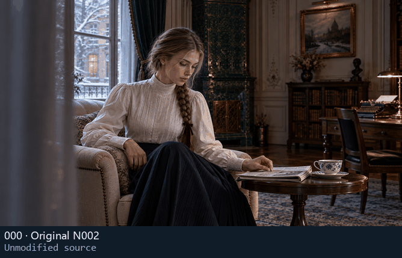
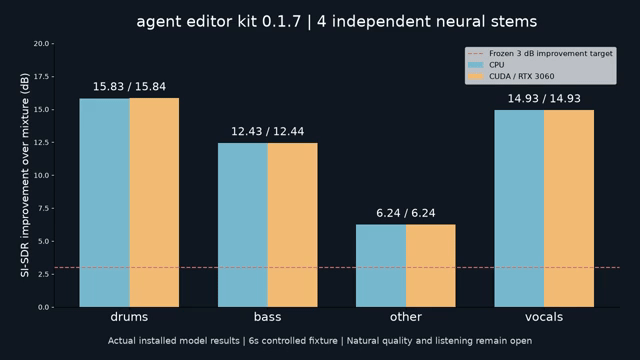
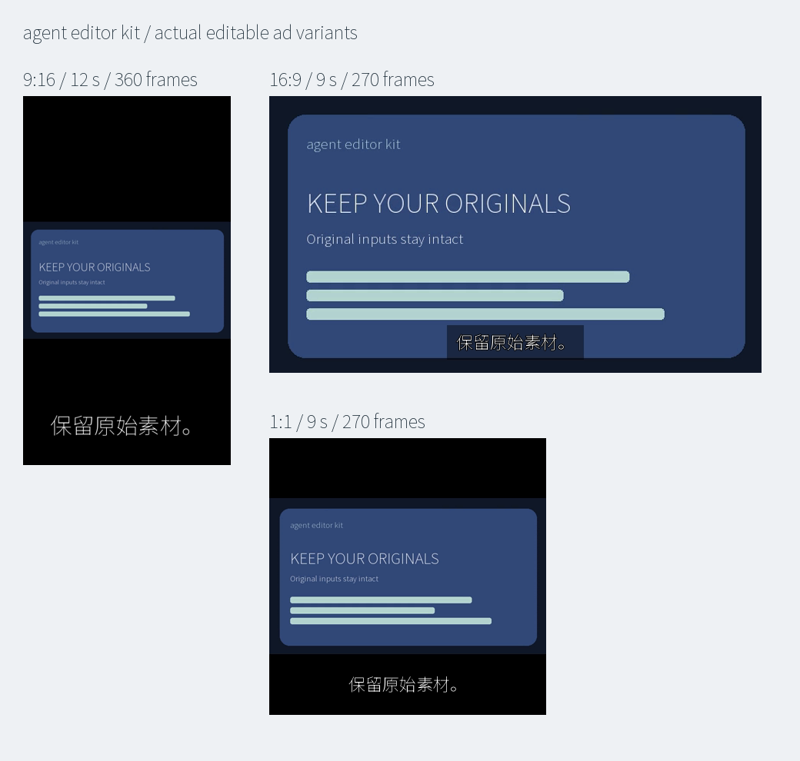

# 完整演示案例与原始证据 / Complete demonstrations and source evidence

[简体中文](../../README.md) · [繁體中文](../../README.zh-TW.md) · [English](../../README.en.md)

## C10–C12：配音、翻译、配乐与 GPU / Voice, translation, music and GPU

当前本机 CLI 0.1.3 真实执行；公开 alpha.3 仍保留原运行包。完整命令和限制见[简体中文](COMMUNITY_MATERIALS.md)、[繁體中文](COMMUNITY_MATERIALS.zh-TW.md)、[English](COMMUNITY_MATERIALS.en.md)；安装包与哈希见[本地交付](COMMUNITY_LOCAL_DELIVERY.md)。

| 案例 | 输入 → 实际输出 | 证据与限制 |
|---|---|---|
| C10 | 本地文案 + 2 cue SRT + CC0 图片 + GT BGM + Kenney 音效 + Noto 简繁字体 → 3 种真实音色 WAV、译文、双语字幕、独立分轨/闪避、12 秒可编辑工程/成片和工程包往返 | [CPU 46 条命令](../validation/evidence/community-materials-20261025-r1/cpu/verification.json)；[排版修正 8 条命令](../validation/evidence/community-materials-20261025-r1/cpu/presentation-correction/verification.json)；完整配音成片留在本机，未做听审/语义接受 |
| C11 | 已安装 GPU 包 + RTX 3060 → 实际 CUDA 配音/翻译、繁体字幕、严格错误、CPU 指定与 auto 回退；统一 Skill 默认 GPU | [GPU 15 条命令](../validation/evidence/community-materials-20261025-r1/gpu/verification.json)；[真实注册入口 11 条](../validation/evidence/community-materials-20261025-r1/skill/verification.json)；只测试本机 NVIDIA，cold/warm 分别记录 |
| C12 | 可公开 CC0 图片、CC-BY 音乐、CC0 音效、OFL 字体、MIT LUT → 12 秒 360×640 / 30fps / 360 帧 MP4 与无声 GIF | [14 条 CLI](../assets/community-materials-20261025-r2/verification.json)；发布权利门禁与完整解码通过，无生成配音；[来源/许可](../assets/community-materials-20261025-r2/SOURCE_AND_LICENSES.md) |

[MP4](../assets/community-materials-20261025-r2/community-resources.mp4) · [PNG](../assets/community-materials-20261025-r2/preview.png) · [原始图片](../assets/release-v0.1.0-alpha.3-r1/input/card-1.png) · [复现脚本](../../scripts/build_community_public_demo.py)。

首次排版因作者画布与输出画布混用而溢出，原始失败仍保留：[问题记录](../assets/community-materials-20261025-r1/KNOWN_ISSUE.md)。修正使用目标 sequence canvas，再按相同像素坐标设置字幕；自动解码通过不等于排版可用。内部配音例编码帧与预览平均 RGB 差约 1.34/255，不代表质量评分。自动音频测量、静态目检、连续播放和听审分别记录。

The current cases actually use the installed CLI. Local speech/mixed outputs are retained without public redistribution while their project-context rights and human review remain open. The public MP4 includes credited music/SFX; its GIF is silent. The first cropped-text case is preserved; the corrected example uses a matching author/output raster. These counts are not combined with historical regression totals or used to claim CapCut equivalence.

## C01–C04：广告、模板、浮点色彩与可恢复交付 / Ads, templates, float color and delivery

[完整步骤、输入、编辑 JSON、实际响应、输出、GIF、音频和复现脚本](../releases/v0.1.0-alpha.1/CASES.md)。这些为已保留的发行案例，不计作本轮新执行。
The release casebook retains inputs, edit JSON, actual responses, output, GIF/audio and reproduction scripts. These are dated executions, not new runs in this documentation update.

## C05：N002 母图 × 500 套滤镜 / Supplied still × all 500 looks

本轮使用正式安装版 CLI 逐项执行 500 次预览。母图为用户提供的 1672×940 RGB PNG，原始字节不变；每套均使用四面体插值、强度 1.0。500 张无损 WebP 与 CLI PNG 解码 RGB 逐像素相同。小图和对照板仅用于浏览。
This update actually executes all 500 previews on the supplied still in the installed CLI, with tetrahedral interpolation and strength 1.0. Every full-size lossless WebP matches the decoded CLI PNG exactly. Thumbnails and boards are browsing aids.

[原始 PNG](../assets/looks-n002-20261024-r1/source.png) · [交互选型页](../assets/looks-n002-20261024-r1/index.html) · [全部编号图册](../local/FILTER_GALLERY.md) · [500 次 CLI 记录](../validation/evidence/looks-n002-20261024-r1/render-verification.json) · [样例/许可清单](../assets/looks-n002-20261024-r1/manifest.json)

下面 GIF 是实际静态滤镜样例的切换，不是新视频渲染或模型推理。Below is an animation of actual still previews, not a new video render or model inference.

## C06：客户候选对照板 / Client shortlist board

Skill 的 `look_gallery.py` 可按稳定 ID 导出原图 + 1–12 套样例、完整 ID、许可和 `selection.json`；不修改时间线。客户选型后再按目标素材重新试片和应用。
The Skill helper exports the original plus 1–12 selected looks with stable IDs, licenses and selection.json, without editing a project. Render reviewed candidates on the target media before application.

[实际对照板](../assets/looks-n002-20261024-r1/client-shortlist-example/board.jpg) · [实际候选 JSON](../assets/looks-n002-20261024-r1/client-shortlist-example/selection.json) · [Skill](../../skills/agent-ffmpeg-local-editor/SKILL.md)

## C07：真实选型页、截图与操作录像 / Real selection page, screenshots and recording

原生 Microsoft Edge 实际打开本地 HTML，检查分页、搜索、分类/许可、原图滑杆、勾选、JSON 下载、中英繁切换、空结果和手机布局；全部测试页面已关闭，无外部请求。
Native Edge opens the actual offline HTML to check pagination, search, category/license filters, comparison split, selection, JSON download, three languages, empty results and mobile layout. All owned test pages are closed; no remote requests.

[桌面截图](../assets/looks-n002-20261024-r1/gallery-desktop.png) · [手机截图](../assets/looks-n002-20261024-r1/gallery-mobile.png) · [实际操作录屏 WebM](../assets/looks-n002-20261024-r1/gallery-walkthrough.webm) · [浏览器检查](../validation/evidence/looks-n002-20261024-r1/browser-verification.json)

这是选型文档页，不是视频剪辑 GUI。This is a documentation/selection page, not an editing GUI.

## C08：alpha.3 可移植安装与首次完整成片 / Portable installation and first full render

本次从 Agent kit 安装到新的 E 盘中文/空格路径，注册 17 个 Skill；随包脚本执行 20 次真实 CLI，产出 6 秒/360×640/30 fps/180 帧含音轨视频、可编辑工程、工程包与恢复校验。另有注册入口查询、预期拒绝、图册解包与候选板核验。输入为 CC0 虚构产品图和合成音频，GIF 无声；不计作新模型推理、自然画质或听审验收。
The downloaded Agent kit installs into a fresh Chinese/spaced E-drive path and registers 17 Skills. Its script makes 20 actual CLI calls and delivers a six-second 360×640/30 fps/180-frame video with audio, editable project, package and restored validation. Separate checks cover registered-launcher queries, expected refusals, gallery extraction and a client board. CC0 fictional artwork/synthetic audio are used; the GIF is silent. This is not model inference, natural-footage quality or listening acceptance.

[完整三语上手 / Quickstart](../releases/v0.1.0-alpha.3/QUICKSTART.md) · [原输入 / Inputs](../assets/release-v0.1.0-alpha.3-r1/input/) · [实际 MP4](../assets/release-v0.1.0-alpha.3-r1/demo.mp4) · [编辑 JSON](../validation/evidence/release-v0.1.0-alpha.3-r1/demo/changes.json) · [20 次命令](../validation/evidence/release-v0.1.0-alpha.3-r1/demo/commands.json) · [核验](../validation/evidence/release-v0.1.0-alpha.3-r1/verification.json) · [图册核验](../validation/evidence/release-v0.1.0-alpha.3-r1/gallery-portable/verification.json)

## H 系列：全部既有功能演示 / Complete dated functional demonstrations

以下恢复原演示说明及输入/输出链接，保留原日期、V 编号、指标和失败边界。它们不是本轮重跑结果。研究段落仍明确标注未集成或未达到质量门槛。GIF 不包含声音；听审与自动采样是不同记录。
The following restored demonstrations retain their original dates, V IDs, metrics, input/output links and failure limits. They were not rerun in this update. Research remains labeled as unintegrated or below quality gates; GIFs are silent and listening differs from automatic sample checks.

## 实测演示素材

V53 实际主轨重排：左为 A/B/C/D，右为 CLI 输出 C/A/B/D，帧号和关联配音逐项核对。五组独立纯切 RGB、独立 Alpha 差 0；115.2 万原 PCM 采样帧差 0。复杂作者/转场使用重排前完整块参考，分别计数。9 时刻静帧，未连续播放/听审。 [原视频](../assets/magnetic-reorder-v53-r5-20261018/source-frames.mkv)、[原输入 MP4](../assets/magnetic-reorder-v53-r5-20261018/source-preview.mp4)、[原 WAV](../assets/magnetic-reorder-v53-r5-20261018/source-audio.wav)、[实际 MP4](../assets/magnetic-reorder-v53-r5-20261018/MR01.mp4)、[无损成片](../assets/magnetic-reorder-v53-r5-20261018/MR01.mkv)、[全部数据与失败](../validation/主轨磁吸重排与关联附着实测_2026-10-18.md)。

V52 实际交付对照：原覆盖率、固定 V51 成片与当前无损 VP9。Alpha 一个灰阶差由全像素测量确定；GIF 是实际解码结果的棋盘投影。只做 8 时刻静帧检查，未连续播放或听审。 [原透明源](../assets/delivery-precision-20261018/source-ramp.mkv)、[原源预览](../assets/delivery-precision-20261018/source-checkerboard.mp4)、[原 WAV](../assets/delivery-precision-20261018/source-audio.wav)、[当前 WebM](../assets/delivery-precision-20261018/DP01-vp9-freeze.webm)、[全部数据/失败](../validation/透明视频交付与音画端点实测_2026-10-18.md)。

4.01 秒作者区间的实际 MP4：10 fps 下 41 帧显示到 4.1 秒，音轨元数据 4.01 秒；AAC 解码多出 32 采样帧的填充另行报告。结尾留黑和计数/字幕叠置为诊断布局，未作为自然广告排版验收。 [实际 MP4](../assets/delivery-precision-20261018/DP09-fractional-mp4.mp4)。

V51 实际 CLI 输出：子运镜和字幕随复合片段暂停，父透明度继续。诊断文字与原片计数叠置，自然广告排版未验；仅四时刻静态目检，未连续播放/听审。 [原 A](../assets/nested-freeze-v51-final-20261018/source-a.mp4)、[原 B](../assets/nested-freeze-v51-final-20261018/source-b.mp4)、[实际 MP4](../assets/nested-freeze-v51-final-20261018/NF06.mp4)、[全部样例/透明编码失败](../validation/复合片段定格与完整音画时钟实测_2026-10-18.md)。

**V49 本地 CTC 对齐（精度未达标）**：左为原创波形输入，右为真实模型时间驱动的字幕；1280×720、30 fps、236 帧。GIF 79 帧/7,900 ms，无音频。逐帧高亮与模型时码一致，但词块边界偏差达 258.1875 ms，未通过 66.6667 ms 门槛。

[原视频](../assets/ctc-alignment-20261018/input.mp4) · [原声音](../assets/ctc-alignment-20261018/input.wav) · [原文](../assets/ctc-alignment-20261018/transcript.txt) · [真实成片](../assets/ctc-alignment-20261018/result.mp4) · [原始词块/来源](../assets/ctc-alignment-20261018/input-provenance.json) · [实际安装包](../assets/ctc-alignment-20261018/agent-video-kit-cp313-win_amd64.zip) · [实测/全部失败](../validation/离线CTC字词强制对齐实测_2026-10-18.md)

**V48 OpenFilm 描线复用**：左为原创背景，右为实际 CLI 编码的逐笔 A/I；384×216、12 fps、36 帧/3 秒。GIF 实际 16 帧/2,970 ms，无声，停留帧已合并；原输入为显式笔画和时间，无自动字体或语音对齐。

[原视频](../assets/stroke-motion-verified-20261018/source.mp4) · [原笔画](../assets/stroke-motion-verified-20261018/authored-plan.json) · [实际成片](../assets/stroke-motion-verified-20261018/result.mp4) · [可编辑源码](../assets/stroke-motion-verified-20261018/editable-source.zip) · [更新安装包](../assets/stroke-motion-verified-20261018/agent-video-kit-cp313-win_amd64.zip) · [实测/失败](../validation/离线逐笔描线动效实测_2026-10-18.md)

**V47 安装版实际剪辑**：左为源 1–4 秒，右为关联音画滑移后的 2–5 秒；各 30 帧/10 fps/3 秒，非周期立体声逐采样验证；GIF 无音频。原视频、原音频、编码结果和实测发行 ZIP均可复查。

[原视频](../assets/offline-release-final-20261018/source-a.mp4) · [原音频探针](../assets/offline-release-final-20261018/sound-a.wav) · [实际结果](../assets/offline-release-final-20261018/after.mp4) · [已测试离线发行包](../assets/offline-release-final-20261018/agent-video-kit-cp313-win_amd64.zip) · [安装/边界/证据](../validation/离线发行与随包Schema实测_2026-10-18.md)

**V46 布局诊断与修复**：左为后段标题完全出框，中为 CTA 容器裁切，右为修复。实际三列输出使用新原创完整字体；旧字体的系统 fallback 仅发布诊断元数据。每列 384×216、12 帧/6 fps/2 秒；GIF 768×144、12 帧/2 秒，无音频。

[出框视频](../assets/html-quality-20261018/outside.mp4) · [裁切视频](../assets/html-quality-20261018/clip.mp4) · [修复视频](../assets/html-quality-20261018/fixed.mp4) · [联系表](../assets/html-quality-20261018/contact.png) · [诊断/失败/来源](../validation/HTML文字布局与字体覆盖实测_2026-10-18.md)

**V45 离线模板控件**：左为原模板，中为换品牌色/图片/文案，右为 null 撤销后重建。三列为实际同帧输出；原片 384×216、12 帧/6 fps/2 秒；GIF 768×144、12 帧/2 秒，无音频。

[原模板视频](../assets/html-template-20261018/original.mp4) · [修改后视频](../assets/html-template-20261018/changed.mp4) · [恢复视频](../assets/html-template-20261018/restored.mp4) · [实际联系表](../assets/html-template-20261018/contact.png) · [来源/逐帧证据](../validation/离线HTML模板控件与覆盖恢复实测_2026-10-18.md)

### V44 研究：真正多帧修复与独立背景真值

一个原创双表面受控样本的门槛通过，**自然镜头仍未验收、未接入产品**。图中依次为原输入、实际 LaMa、实际 FGT、独立背景真值；GIF 为半尺寸/64 色展示，评分来自实际解码 RGBA。

[完整 MP4](../assets/fgt-temporal-20261018/comparison.mp4)、[原输入无损视频](../assets/fgt-temporal-20261018/source-lossless.mp4)、[实际 FGT 无损视频](../assets/fgt-temporal-20261018/final-lossless.mp4)、[真值无损视频](../assets/fgt-temporal-20261018/truth-lossless.mp4)、[失败/许可/实测](../validation/开源FGT时序修复候选实测_2026-10-18.md)。私有自然像素留本地，只公开标量与摘要。

### V43 产品：可编辑蒙版修正与真实修复输入

16 帧原创样例的缺臂、部分帧缺腿、圆点/角落误选由正式 CLI 修正，含第 8 帧切镜；输出与独立像素真值一致。GIF 为 2 秒、无音频。自然样例 5/5 旧点通过，但真实 LaMa 背景仍涂抹，私有自然视频不公开。

[原片](../assets/mask-edits-20261018/source.mp4) · [原蒙版](../assets/mask-edits-20261018/mask-input.mov) · [实际蒙版](../assets/mask-edits-20261018/mask-edited.mov) · [对照 MP4](../assets/mask-edits-20261018/comparison.mp4) · [可编辑工程包](../assets/mask-edits-20261018/editable-project.zip) · [复现/全部结果/失败](../validation/本地蒙版笔刷与关键帧修正实测_2026-10-18.md)。

### V42 研究：质量未通过，未进入正式修复内核

三组原创输入公开，保留参考、失败 v1、v3 和遮挡前真值。旧双表面的 v3 与参考相等；新增运动场景仍退步，不能以 GIF 或检查通过数宣称画质提升。每组 12 帧、12 fps、1 秒，无音频；无损 NUT 回读/PTS 与独立指标复核通过，未连续播放或听审。

[双表面原输入](../assets/coherent-reference-20261018/two_surfaces-input.mp4) · [双运动/切镜原输入](../assets/coherent-reference-20261018/two_motion_cut-input.mp4) · [实际双运动 GIF](../assets/coherent-reference-20261018/two_motion_cut-comparison.gif) · [非刚性/曝光原输入](../assets/coherent-reference-20261018/elastic_exposure-input.mp4) · [实际非刚性 GIF](../assets/coherent-reference-20261018/elastic_exposure-comparison.gif) · [复现 CLI/指标与失败](../validation/空间与时序一致参考选择实测_2026-10-18.md)

**正式产品 CLI V41：保留动效源码，生成透明标题并叠入时间线。** 左列为原创底图输入，右列为真实产品时间线成片；SVG 商品、文字、CSS 动画与 Canvas 标记均由本地 Chromium 逐帧生成。

[原输入 PNG](../assets/html-motion-20261018/source.png) · [原输入 MP4](../assets/html-motion-20261018/source.mp4) · [HTML/清单](../assets/html-motion-20261018/template/index.html) · [SVG 原素材](../assets/html-motion-20261018/template/bottle.svg) · [透明原文件 NUT](../assets/html-motion-20261018/S01-alpha.nut) · [实际产品 MP4](../assets/html-motion-20261018/S03-timeline.mp4) · [实际产品 MKV](../assets/html-motion-20261018/S03-timeline.mkv) · [改参预览](../assets/html-motion-20261018/S02-preview.mp4) · [可重建工程包](../assets/html-motion-20261018/editable-project.zip) · [五组/失败/复现](../validation/离线HTML动效源码与透明合成实测_2026-10-18.md)。

自制 CC0 背景、几何商品和原创像素字体；原片/主输出 640×360、12 fps、24 帧、2 秒。双列 GIF **960×270、12 帧/2000 ms**，无声；主 MKV 另有自动生成的精确静音流。96 成功 HTML 输入帧、192 乱序重绘与 24 原生时间线主帧分计，S03 与独立 alpha/RGB 合成最大差 3、均值 0.476496。78 文件/6,332,822 字节、10 视频/1 静音音频流复解码；两组三时刻静态目检，未连续播放/听审。绿色块为几何核验标记；未验中文长标题、照片广告或自然美学。[来源/30 原始 CLI](../assets/html-motion-20261018/verification.json)、[媒体审计](../validation/evidence/html-motion-media-final-20261018.json)、[原 MKV 错位成片](../assets/html-motion-clock-failure-20261018/S03-timeline.mkv)、[失败与原冻结源码](../validation/evidence/html-motion-development-20261018/verification.json)。MIT 只授权复用代码，源码/字体/图片权利继续分别登记。

**正式产品 CLI V40：真实扩展输入范围，并联动音频延长滚动剪口。** 左列固定 V39 手工作者工程，右列本轮实际输出；上行 S02 双侧外扩，下行 S07 关联 roll。

[原视频](../assets/source-edits-20261018/source-a.mp4) · [原声](../assets/source-edits-20261018/sound-a.wav) · [外扩前原片](../assets/source-edits-20261018/S02-original.mp4) · [外扩实际输出](../assets/source-edits-20261018/S02-actual.mp4) · [关联 slip](../assets/source-edits-20261018/S01-actual.mp4) · [滚动剪口](../assets/source-edits-20261018/S07-actual.mp4) · [滑动片段](../assets/source-edits-20261018/S08-actual.mp4) · [曲线倒放](../assets/source-edits-20261018/S05-actual.mp4) · [无损有声 MKV](../assets/source-edits-20261018/S02-actual.mkv) · [九组/复现/原失败](../validation/真实源外扩与关联Slip实测_2026-10-18.md)。

既有自制 CC0 输入、0 新模型推理；**301 文件/64,117,582 字节**，56 视频/55 音频流复解码。505 主帧/2,424,000 立体声采样帧完全相同；同产品手工参照不独立验收渲染算法。两组额外核对 100 个直接源帧身份。GIF 480×272、20 帧/4 秒、无声；各组输出预览 MP4 使用 AAC，对照 comparison.mp4 无声，有声无损核对使用 MKV/PCM。四时刻计数/位置条目检一致，边缘计数局部裁切；无连续播放/听审。79 次为两原生 worker 的真实 CLI main 调用，26 次 wheel CLI 另起独立进程；临时 run-state 快照不是完成状态，以 verification 为准。[输入/SHA/全部原 CLI](../assets/source-edits-20261018/verification.json)、[媒体复核](../validation/evidence/source-media-audit-20261018.json)、[静态记录](../validation/evidence/source-static-review-20261018.json)、[原开发记录](../validation/evidence/source-development-20261018/verification.json)。

**历史产品 CLI V39：覆盖复杂作者片段，并联动音频滑动中间片段。** 左列固定 V38 完整作者的明确选区/拼接，右列本轮实际输出；上行 R02 覆盖，下行 R06 滑动。

[原输入视频](../assets/range-edits-20261018/source-a.mp4) · [原声](../assets/range-edits-20261018/sound-a.wav) · [覆盖前原片](../assets/range-edits-20261018/R02-original.mp4) · [覆盖后实际输出](../assets/range-edits-20261018/R02-actual.mp4) · [滑动前原片](../assets/range-edits-20261018/R06-original.mp4) · [滑动后输出](../assets/range-edits-20261018/R06-actual.mp4) · [关联滚动剪口](../assets/range-edits-20261018/R05-actual.mp4) · [字幕骑乘](../assets/range-edits-20261018/R08-actual.mp4) · [无损有声 MKV](../assets/range-edits-20261018/R06-actual.mkv) · [八组/复现/原失败](../validation/专业范围编辑与滚滑剪口实测_2026-10-18.md)。

自制 CC0 输入，0 新模型推理；**269 文件/36,175,156 字节**，45 视频/45 音频流复解码。340 主帧和 1,632,000 立体声采样帧逐项完全相同；同产品参照不独立验收渲染质量。GIF 480×272、20 帧/4 秒、无声；AAC 为预览，PCM 检查用无损 MKV。抽查 0/12/24/38 帧及 CTA 前后图形；边缘计数有局部裁切，低栅格字幕不可推定自然排版；无连续播放或听审。[输入/SHA/73 原始 CLI](../assets/range-edits-20261018/verification.json)、[媒体复核](../validation/evidence/range-media-audit-20261018.json)、[静态记录](../validation/evidence/range-static-review-20261018.json)、[开发原失败](../validation/evidence/range-development-20261018/verification.json)。

**历史产品 CLI V38：在倒放、曲线变速和定格之后，保真裁切与删除中段。** 左列固定 V37 原片的明确选区，右列新 CLI 实际输出；上行删中段，下行定格内裁切。

[原视频](../assets/clip-windows-20261018/source-a.mp4) · [原声](../assets/clip-windows-20261018/sound-a.wav) · [完整曲线倒放原片](../assets/clip-windows-20261018/C02-original.mp4) · [删中段实际输出](../assets/clip-windows-20261018/C02-actual.mp4) · [定格原片](../assets/clip-windows-20261018/C03-original.mp4) · [定格内裁切](../assets/clip-windows-20261018/C03-actual.mp4) · [多轨黑边](../assets/clip-windows-20261018/C09-actual.mp4) · [无损有声 MKV](../assets/clip-windows-20261018/C02-actual.mkv) · [九组/复现/原失败](../validation/输出窗口裁切与作者时钟实测_2026-10-18.md)。

输入为自制 CC0 计数器、声音和原创网格字体；不含商业字体或新模型推理。九组 300 新主帧、1,440,000 立体声采样帧与固定旧版原片选区全相同，参照仍使用同一产品渲染器。公开 **202 文件/28,282,096 字节**，35 视频/35 音频流复解码；GIF 480×272、20 编码帧/2000 ms、无声。静态抽查第 0/10/19 对照帧；低分辨率样例中部分边缘计数字符被裁，未验广告字幕排版/自然质量，无连续播放或听审。[来源/SHA/54 原始 CLI](../assets/clip-windows-20261018/verification.json)、[媒体审计](../validation/evidence/windows-media-audit-20261018.json)、[静态记录](../validation/evidence/windows-static-review-20261018.json)、[开发原失败](../validation/evidence/windows-development-20261018/verification.json)。

**正式产品 CLI V37：把转场、字幕、LUT 和子序列保存成可编辑组，再跨项目插入。** 左列固定 V36 手工参照，右列实际片段组输出；上行为全组，下行为单选自动补全。

[原视频 A](../assets/fragments-20261018/source-a.mp4) · [原视频 B](../assets/fragments-20261018/source-b.mp4) · [原声](../assets/fragments-20261018/sound-a.wav) · [完整组 MP4](../assets/fragments-20261018/C01-actual.mp4) · [单选自动补全 MP4](../assets/fragments-20261018/C02-actual.mp4) · [重复实例](../assets/fragments-20261018/C04-actual.mp4) · [竖屏目标](../assets/fragments-20261018/C05-actual.mp4) · [继续编辑字幕](../assets/fragments-20261018/C06-actual.mp4) · [有声无损 MKV](../assets/fragments-20261018/C01-actual.mkv) · [库版本文件](../assets/fragments-20261018/library) · [六组/五项拒绝/复现](../validation/可复用片段组库与跨项目插入实测_2026-10-18.md)。

原输入自制 CC0，240×136/10 fps/80 帧/8 秒；原创网格字体、字幕与 LUT 一并公开，无商业字体文件或新模型。六组 340 新主帧、1,632,000 立体声采样帧与固定 V36 手工原作者工程完全一致；340 参考帧另计。公开 **86 文件/44,949,051 字节**、34 视频/33 音频流复解码；GIF 480×272、20 编码帧/4000 ms，另抽对照 MP4 三帧静态目检；低分辨率 CTA 偏小，未验广告字幕可读性；未连续播放或听审。[来源/SHA/原始 CLI](../assets/fragments-20261018/verification.json)、[媒体审计](../validation/evidence/fragments-media-audit-20261018.json)、[原失败/说明](../validation/evidence/fragments-development-20261018/verification.json)。

**正式产品 CLI V36：先完成子级转场，再做父级变速。** 三列为无转场父级输入 / 新版实际输出 / 独立源混合参照；四行依次为裁切、倒放、曲线、子级透明度。

[原视频 A](../assets/nested-transitions-20261018/source-a.mp4) · [原视频 B](../assets/nested-transitions-20261018/source-b.mp4) · [原声](../assets/nested-transitions-20261018/sound-a.wav) · [无转场输入](../assets/nested-transitions-20261018/C03-input.mp4) · [倒放成片](../assets/nested-transitions-20261018/C03-actual.mp4) · [二倍速成片](../assets/nested-transitions-20261018/C04-actual.mp4) · [曲线成片](../assets/nested-transitions-20261018/C05-actual.mp4) · [有声无损 MKV](../assets/nested-transitions-20261018/C03-actual.mkv) · [对照 MP4](../assets/nested-transitions-20261018/comparison.mp4) · [22 组、失败与复现](../validation/嵌套转场与父级重映射实测_2026-10-18.md)。

原片自制 CC0、240×136/10 fps/80 帧/8 秒；对照 720×544/40 帧/4 秒、无声，GIF **20 编码帧/4000 ms**。920 新主帧、440 无转场输入和 720 固定子级参照帧分计，另有 40 固定旧版兼容帧。22 组全部按固定子级和解析父时钟核对；其中 12 组/520 帧另有独立源 RGB 参照，六组/144 万立体声采样帧有独立 PCM，变速其余组仅验长度/有限性。[112 文件来源/SHA](../assets/nested-transitions-20261018/verification.json)、[复解码审计](../validation/evidence/nested-transitions-media-audit-20261018.json)、[首中末静帧目检](../validation/evidence/nested-transitions-static-review-20261018.json)。未连续播放或听审，0 新模型推理；[二倍速原失败](../validation/evidence/nested-transitions-development-20261018/C04-before.mkv)及开发原日志保留。

**正式产品 CLI V35：真实源句柄、双剪口、改长/擦除、剪口白场和倒放 2 倍。** 两列为作者输入 / 实际 CLI 输出，四行依次 C01–C04；片段源帧号可见，作者剪口与总长不变。全部素材为程序自制 CC0，无模型/外部字体。

[原片 A](../assets/source-transitions-20261017/source-a.mp4) · [原片 B](../assets/source-transitions-20261017/source-b.mp4) · [原片 C](../assets/source-transitions-20261017/source-c.mp4) · [原声音源](../assets/source-transitions-20261017/sound-a.wav) · [编辑前](../assets/source-transitions-20261017/authored-input.mp4) · [双剪口成片 MP4](../assets/source-transitions-20261017/C01-actual.mp4) · [原始无损 MKV](../assets/source-transitions-20261017/C01-actual.mkv) · [独立像素参考](../assets/source-transitions-20261017/C01-independent-reference.mp4) · [倒放 2 倍成片](../assets/source-transitions-20261017/C04-actual.mp4) · [对照 MP4](../assets/source-transitions-20261017/comparison.mp4) · [十五组实测与四项开发记录](../validation/真实源句柄转场与可逆编辑实测_2026-10-17.md) · [来源/SHA](../assets/source-transitions-20261017/verification.json)。

十五组成片各 60 帧/6 秒；900 新帧、432 万新立体声采样帧。四组全像素独立参考最大 RGB 差 1.8，十五组无损 PCM 独立包络参考差 0；其余类型只验实际执行、窗外和恢复。GIF 480×544、30 帧/6 秒、5 fps；对照 MP4 60 帧/10 fps，无声。已目检第 0/20/59 张静帧，未连续播放/听审；AAC 仅预览，不替代无损采样证据。[原白场失败成片](../assets/source-transitions-development-20261017/C03-actual.mp4)仍保留，修正后在作者剪口达到白场。自然广告画质与完整剪映功能继续未验。

**历史正式产品 CLI V34：中文/英文字幕分段、双语与局部回写。** 三列为整句作者输入 / CLI 实际输出 / 手工文字和时钟参考。原片与音频由本地程序构造，人工标记、非 ASR；下面的真实 Whisper 测试另计。参考使用同一渲染器。

[自制原片](../assets/subtitle-segments-20261017/source.mp4) · [原声](../assets/subtitle-segments-20261017/tone.wav) · [中文输出](../assets/subtitle-segments-20261017/S01-segmented.mp4) · [双语输出](../assets/subtitle-segments-20261017/S02-segmented.mp4) · [局部回写输出](../assets/subtitle-segments-20261017/S03-segmented.mp4) · [对照 MP4](../assets/subtitle-segments-20261017/comparison.mp4) · [四组及真实 ASR 实测](../validation/本地字幕分段与双语回写实测_2026-10-17.md) · [来源/SHA](../assets/subtitle-segments-20261017/verification.json)。4×48=192 新帧；编辑前后解码 PCM 一致。真实 Whisper 是一次新 CPU 推理、5 原句→9 字幕、CER 2%，沿用既有中文语料，时间仍为估算，未核验权利的音视频只留本地。GIF 24 秒/48 帧，已看三张静帧，未连续播放或听审。

**历史正式产品 CLI V33：关联剪辑、同步锁与主轨联动。** 三列依次为编辑前作者输入 / CLI 实际输出 / 手工时间线参考。四行展示同步删除、字幕跟随、保留音量的冲突换轨和连续移位 SRT；参考视频使用同一渲染器，音频另做独立 PCM 求和。

[自制原片](../assets/linked-edit-20261017/source.mp4) · [编辑前](../assets/linked-edit-20261017/L01-input.mp4) · [同步删除成片](../assets/linked-edit-20261017/L01-after.mp4) · [冲突换轨成片](../assets/linked-edit-20261017/L05-after.mp4) · [字幕成片](../assets/linked-edit-20261017/L07-after.mp4) · [三列 MP4](../assets/linked-edit-20261017/comparison.mp4) · [九组与失败](../validation/关联剪辑与主轨联动真实音画实测_2026-10-17.md)。

公开 175 文件及来源/SHA，原片/每组为 240×136、8 fps、40 帧/5 秒；三列预览 720×980、40 帧/5 秒，无声，GIF **20 编码帧/5000 ms**。360 新输出帧、360 输入、360 手工参考和 40 固定 V32 控制帧分计；216 万新立体声采样帧最大误差 0。59 视频/69 音频已重新解码，首/中/末图静态目检，**未连续播放或听审**。原声与无损 MKV 有声，AAC MP4 仅供播放。[字体/CC0 来源](../assets/linked-edit-20261017/fixture-provenance.json)、[包与原始 CLI 记录](../validation/关联剪辑与主轨联动真实音画实测_2026-10-17.md#3-原片gif工程及复现)、[完整证据](../validation/evidence/linked-edit-20261017.json)。主轨磁吸重排、源边缘裁切及完整剪映等价未验收。

**历史正式产品 CLI V32：高频缩小与透明面积采样。** 从左至右为固定 V31 / 当前默认双线性 / 显式 area / 独立单元重叠参考。三像素黑/黑/白纹理的三倍缩小均值误差由 85 降为 0；九组最大 RGB 差 4（门槛 4）。

[真实输入 PNG](../assets/sequence-sampling-20261017/S01-source.png) · [源预览 MP4](../assets/sequence-sampling-20261017/S01-source.mp4) · [旧版](../assets/sequence-sampling-20261017/S01-before.mp4) · [area 成片](../assets/sequence-sampling-20261017/S01-area.mp4) · [四列 MP4](../assets/sequence-sampling-20261017/comparison-readable.mp4) · [九组原输入/全部成片/失败](../validation/序列面积采样与工作配额实测_2026-10-17.md)。实际输入为自制 CC0 PNG，源预览 MP4 是黑底展示；软 Alpha 原输入见 S07 PNG。各组视频 16 帧/8 fps/2 秒；预览 768×588、无声，GIF **8 编码帧/2000 ms**。144 area 帧、144 旧帧、144 默认控制与 144 参考分计；45 视频重新解码、27 路预期静音核对，103 文件 SHA/来源见[机器证据](../validation/evidence/sequence-sampling-20261017.json)。静态查看首末帧，**未连续播放或听审**；一般旋转只验源轴矩形核，配额不是进程 RSS 上界。原跨列标题预览与开发夹具失败保留。

**正式产品 CLI V31：独立竖屏子画布与父级投影。** 左至右为固定 V30 / 新版实际解码 / 独立空间参考；四行展示 fit、fill 后旋转、锚点动画与父蒙版。九组分别通过声明门槛，C01–C08 最大 RGB 差 2，继承控制逐字节一致。

[自制原输入](../assets/sequence-canvas-20261017/source-portrait.mp4) · [旧版实际](../assets/sequence-canvas-20261017/C01-before.mp4) · [新版实际](../assets/sequence-canvas-20261017/C01-after.mp4) · [独立参考](../assets/sequence-canvas-20261017/C01-reference.mp4) · [三列对照 MP4](../assets/sequence-canvas-20261017/comparison.mp4) · [九组编号、失败与复现](../validation/独立序列画布与原生坐标投影实测_2026-10-17.md)。

预览 960×920；MP4 12 fps、24 帧/2 秒，无音轨；GIF **12 编码帧/2000 ms**，降低帧率和调色板仅供展示。原输入 CC0，24 帧/12 fps/2 秒，字体许可及全部 SHA-256 见[来源](../assets/sequence-canvas-20261017/fixture-provenance.json)和[63 文件清单](../validation/evidence/sequence-canvas-20261017.json)。216 新主帧中 168 帧有独立空间参考，24 帧只验局部字形投影，24 帧只验继承兼容；24 单独子级帧另计，0 新模型推理。已机器逐帧/静音复核、静态目检首末帧，**未连续播放或听审**；[错误参考与开发失败](../validation/独立序列画布与原生坐标投影实测_2026-10-17.md#5-失败记录与参考修正)保留，不证明任意高频细节/自然画质或完整剪映等价。

**历史正式产品 CLI V30：分段变速的实际音频与完整尾部。** 三列为原始输入 / 固定 V29 / V30 真实解码，上下分开显示 L/R。T01 内部零采样帧 82→0，六组 DC 完整有效区间均通过；自然声音与听感仍未验收。

[原视频](../assets/audio-tempo-context-20261017/source.mp4) · [DC 原声](../assets/audio-tempo-context-20261017/dc.wav) · [旧失败 MP4](../assets/audio-tempo-context-20261017/T01-before.mp4) · [当前 MP4](../assets/audio-tempo-context-20261017/T01-after.mp4) · [无损 MKV](../assets/audio-tempo-context-20261017/T01-after.mkv) · [解码 WAV](../assets/audio-tempo-context-20261017/T01-after.wav) · [三列预览 MP4](../assets/audio-tempo-context-20261017/comparison.mp4) · [完整尾部对照](../assets/audio-tempo-context-20261017/slow-tail-comparison.png) · [11 组编号、来源与复现](../validation/分段音频上下文与完整尾部实测_2026-10-17.md)。

预览 960×544；MP4 12 fps、36 帧/3 秒，GIF **18 编码帧/3000 ms**，均无声；原 WAV/正式成片有声。自制 CC0，0 新模型推理，[来源与 SHA-256](../assets/audio-tempo-context-20261017/fixture-provenance.json)。396 个新视频帧及 1,584,000 个新立体声采样帧完成声明范围的自动检查；目检首末/慢速尾部静态图，**未连续播放或听审**。这不等于全部采样与独立高质量变速参考相等；AAC MP4 仅供播放。另公开[开发版尾部缺样](../assets/audio-tempo-context-20261017/development-context-only-T05.mkv)、[错误参考截图](../assets/audio-tempo-context-20261017/development-preview-invalid-reference.png)与[失败说明](../assets/audio-tempo-context-20261017/development-verification.json)。

**历史 V29 正式产品 CLI：分层混音与逐采样核验。** 左至右为固定 V28 / 新版实际解码 / 独立参考 PCM；上下独立显示 L/R 通道。12 组无损采样检查通过，旧版 11 组失败、1 正控制；自然声音与听感仍未验收。

[原视频](../assets/audio-buses-20261017/source.mp4) · [A 原声](../assets/audio-buses-20261017/tone_a.wav) · [B 原声](../assets/audio-buses-20261017/tone_b.wav) · [旧包络失败 MP4](../assets/audio-buses-20261017/B04-before.mp4) · [新包络 MP4](../assets/audio-buses-20261017/B04-after.mp4) · [无损新 MKV](../assets/audio-buses-20261017/B04-after.mkv) · [参考 WAV](../assets/audio-buses-20261017/B04-reference.wav) · [三列预览 MP4](../assets/audio-buses-20261017/comparison.mp4) · [12 组编号、原始日志与复现](../validation/分层音频总线与真实采样实测_2026-10-17.md)。

预览 960×1074；MP4 12 fps、24 帧/2 秒，GIF **12 编码帧/2000 ms**，均无声；正式成片/WAV 有声。源素材为自制双声道正弦波和移动帧码，[CC0 来源/许可](../assets/audio-buses-20261017/fixture-provenance.json)。全部 1,152,000 新采样帧及 288 新视频帧已自动检查，并目检预览首末图，**未连续播放或听审**。MKV float PCM 用于精度验收，AAC MP4 仅供播放。另公开[非线性 atempo DC 失败](../assets/audio-buses-20261017/dc-diagnostic-retimed-plain.mkv)及[采样诊断](../assets/audio-buses-20261017/dc-diagnostic-verification.json)；该 V29 历史输出保留；V30 对同字节输入的受控重验已消除检查区 82 个零采样帧，通用音高/相位与听感仍开放。旧多轨工程音量可能因关闭自动归一化而变化，未自动加限制器。

补充 [S01 容器内部画面静音对照](../assets/audio-buses-20261017/S01-verification.json)：只有子容器提供画面时，静音/有声版 24 帧逐像素一致，静音 PCM 为零、有声 PCM 与原 WAV 一致；10 次额外 CLI 与主批次分计。[有声 MP4](../assets/audio-buses-20261017/S01-audible.mp4) · [静音 MP4](../assets/audio-buses-20261017/S01-muted.mp4)。

**历史 V28 正式产品 CLI：子序列先合成，再处理父级。** 左至右为固定 V27 / 新版实际视频 / 独立参考，展示重叠 opacity、父枢轴、父 mask 和整组旋转。14 组全部像素最大 RGB 差 3；原视频和旧失败成片同时公开。

[原红色视频](../assets/sequence-compositing-20261017/source-red.mp4) · [原蓝色视频](../assets/sequence-compositing-20261017/source-blue.mp4) · [旧重叠失败](../assets/sequence-compositing-20261017/G01-before.mp4) · [新重叠成片](../assets/sequence-compositing-20261017/G01-after.mp4) · [完整旋转成片](../assets/sequence-compositing-20261017/G11-after.mp4) · [三列 MP4](../assets/sequence-compositing-20261017/comparison.mp4) · [14 组原片/新旧/参考与复现](../validation/嵌套序列隔离合成与逐帧像素实测_2026-10-17.md)。

MP4 960×920、12 fps、24 帧/2 秒；GIF 同尺寸、**12 编码帧/2000 ms**，平均 6 fps，均无声。输入是自制移动图形，非自然广告。已做全帧检查和首末静态图目检，**未连续播放或听审**。[来源/许可](../assets/sequence-compositing-20261017/fixture-provenance.json)、102 文件 SHA-256 与原日志保留。另公开[开发动态栅格失败](../assets/sequence-compositing-20261017/development-raster-before.mp4)和[同源修复](../assets/sequence-compositing-20261017/development-raster-after.mp4)，57 帧补充回归单独计数；其“修复前”是开发中实现，不是固定 V27。

**历史 V27 正式产品 CLI：R3 声道策略，音高失败保留。** 左至右为原片 / 固定 V26 together / V27 apart；下方绿色/蓝色是实际左右声道 PCM，原音频横轴 4 ms、成片横轴 250 ms，幅度同尺度。两种模式均未通过极短音高门槛。

[原视频](../assets/audio-channel-modes-20261017/source.mp4) · [原双音](../assets/audio-channel-modes-20261017/stereo-tones.wav) · [原反相](../assets/audio-channel-modes-20261017/antiphase.wav) · [together 实际成片](../assets/audio-channel-modes-20261017/after-tiny-forward-together.mp4) · [apart 实际成片](../assets/audio-channel-modes-20261017/after-tiny-forward-apart.mp4) · [apart 无损 WAV](../assets/audio-channel-modes-20261017/after-tiny-forward-apart.wav) · [普通慢放通过样例](../assets/audio-channel-modes-20261017/after-scalar-slow-apart.mp4) · [反相失败成片](../assets/audio-channel-modes-20261017/after-antiphase-apart.mp4) · [对照 MP4](../assets/audio-channel-modes-20261017/waveform-comparison.mp4) · [20 组结果与复现](../validation/R3声道策略与立体声权衡实测_2026-10-17.md)。

预览 MP4 1536×548、24 fps、24 帧/1 秒；GIF 1152×411、**24 编码帧/1000 ms**，预览无声，正式成片/WAV 有声。波形按列抽样，音高由完整 PCM 另算。全帧/PCM 自动检查、首末静态图目检已做，未连续播放或听审；[来源/许可](../assets/audio-channel-modes-20261017/fixture-provenance.json)及 153 份公开文件 SHA-256 保留。极短双音主峰 together 约 797.24/797.24 Hz，apart 375/819.95 Hz；8 组极短音高失败、1 组 apart 反相混合失败仍属未通过内容。

**历史 V26 正式产品 CLI：本地 R3 整段离线音频变速。** 左至右为原片、固定 V25、显式本地 R3 的实际视频；下方为真实解码的左声道波形，原音频横轴 4 ms、成片横轴 250 ms，幅度同尺度。音高和双声道另行检查。

[原视频](../assets/offline-audio-stretch-20261017/source.mp4) · [原双声道音频](../assets/offline-audio-stretch-20261017/stereo-tones.wav) · [前轮原脉冲](../assets/offline-audio-stretch-20261017/pulses.wav) · [旧版静音成片](../assets/offline-audio-stretch-20261017/before-tiny-forward.mp4) · [R3 实际成片，音高失败](../assets/offline-audio-stretch-20261017/after-tiny-forward.mp4) · [无损 WAV](../assets/offline-audio-stretch-20261017/after-tiny-forward.wav) · [普通慢放通过样例](../assets/offline-audio-stretch-20261017/after-scalar-slow.mp4) · [波形 MP4](../assets/offline-audio-stretch-20261017/waveform-comparison.mp4) · [八组结果与复现](../validation/离线音频伸缩与真实采样实测_2026-10-17.md)。

预览 MP4 为 1536×470、24 fps、24 帧/1 秒；GIF 为 1152×353、24 编码帧/1000 ms。预览无声，正式 MP4/WAV 带实际音频。全部双声道采样/视频已自动核对，首末帧和波形已静态目检，未连续播放或听审；[来源与许可](../assets/offline-audio-stretch-20261017/fixture-provenance.json)、命令和全部输出 SHA-256 保留，0 新模型推理。

**未通过：4 组极短音高。** 原脉冲正/倒放主峰约 386.72 Hz（原 400 Hz），双声道样例两路约 797.24 Hz（原 400/800 Hz），超过 ±5 Hz 门槛。采样数和非静音通过不能关闭这些交付失败；未配置 R3 继续默认 atempo，瞬态/相位/听感待验收。

**历史 V25 正式产品 CLI：嵌套倒放首尾帧修复。** 左列按独立作者时钟从原视频选择真实源帧（作者留白为黑）；中、右列分别为固定旧版和本轮 CLI 实际成片。第 50/51 帧此前仅剩文字，本轮恢复原视频背景。

[原视频](../assets/nested-frame-coverage-20261017/source.mp4) · [原音频](../assets/nested-frame-coverage-20261017/pulses.wav) · [分数帧率输入](../assets/nested-frame-coverage-20261017/source-fractional.mp4) · [旧版失败](../assets/nested-frame-coverage-20261017/before-retained-typing-tail.mp4) · [修复后成片](../assets/nested-frame-coverage-20261017/after-retained-typing-tail.mp4) · [三列 MP4](../assets/nested-frame-coverage-20261017/nested-frame-comparison.mp4) · [10 组编号表和复现](../validation/嵌套视频帧区间与结束时钟实测_2026-10-17.md)。

三列预览 MP4 为 1536×332、24 fps、52 帧/2.166667 秒；GIF 为 1152×249、**45 个编码帧、2170 ms**，52 个显示时隙的相邻相同画面已合并。预览无声，正式成片保留实际音轨。自动全帧/PCM 检查及 0/26/51 接触表、尾帧静态目检已做，未连续播放或听审；[来源/字体许可](../assets/nested-frame-coverage-20261017/fixture-provenance.json)、命令、probe 和全部 85 份公开文件 SHA-256 保留，0 新模型推理。

**未通过：[4 毫秒正放音频](../assets/nested-frame-coverage-20261017/after-tiny-forward.mp4)与[倒放音频](../assets/nested-frame-coverage-20261017/after-tiny-reverse.mp4)** 拉伸到 250 毫秒后解码全静音，质量 CLI 返回 `OUTPUT_TRUE_PEAK_UNAVAILABLE`。两组视频帧正确，整体交付失败；原生 `atempo` 探针为 0 输出样本，该轮补静音或更换滤镜的诊断不算修复。V26 已接入显式 R3，同源脉冲恢复声音仍未通过音高门槛。

**历史 V24 正式产品 CLI：文字动画、高亮与原生打字机，3 秒。** 左至右为原视频 / 固定旧版实际输出 / 新版实际输出。文字基于完整段落居中，逐字显示时保持锚点和行基线；普通/激活文字同步更新。

[原视频](../assets/text-animation-20261017/source.mp4) · [原音频](../assets/text-animation-20261017/pulses.wav) · [旧版失败](../assets/text-animation-20261017/before-typing-center.mp4) · [新版实际成片](../assets/text-animation-20261017/after-typing-center.mp4) · [整段普通对照](../assets/text-animation-20261017/full-typing-center.mp4) · [三列 MP4](../assets/text-animation-20261017/text-animation-comparison.mp4) · [12 组编号表和复现](../validation/文字动画高亮组合与原生打字机实测_2026-10-17.md)。

预览 MP4 1536×332、24 fps、72 帧/3 秒；GIF 1152×249、72 帧、40/50 ms 合计 3000 ms，无声。50 份正式渲染变体有实际脉冲音轨。自动全帧/PCM 检查、0/36/71 帧接触表静态目检已做，未连续播放或听审；[来源/字体许可](../assets/text-animation-20261017/fixture-provenance.json)与逐文件 SHA-256 保留。0 新模型推理。

**V24 历史失败（V25 已另行复验修复，原证据保留）：[裁切倒放实际成片](../assets/text-animation-20261017/after-typing-nested-trim.mp4)** 末尾第 50/51 帧背景视频消失，文字显示仍正确；该组交付未通过。另保留 [29.97 fps 首次发布拒绝](../validation/evidence/text-animation-initial-media-20261017.log)，最终样例明确设为 90 帧/3.003 秒，不宣称任意时长均可发布。

**历史 V23 正式产品 CLI：文字颜色与透明度，3 秒。** 左至右为原视频 / 固定旧版实际输出 / 新版实际输出 / 数值公式参考。修复半透明文字过暗、alpha 重复相乘；第四列是独立计算的参考图，不是 CLI 成片。

[原视频](../assets/text-paint-20261016/source.mp4) · [原音频](../assets/text-paint-20261016/pulses.wav) · [旧版失败](../assets/text-paint-20261016/before-styled.mp4) · [新版实际成片](../assets/text-paint-20261016/after-styled.mp4) · [不透明字面覆盖率对照](../assets/text-paint-20261016/fontcolor-styled.mp4) · [空白底片](../assets/text-paint-20261016/blank-styled.mp4) · [四列 MP4](../assets/text-paint-20261016/text-paint-comparison.mp4) · [九组编号误差表、全部对照和复现](../validation/文字颜色透明度与实际合成实测_2026-10-16.md)。

预览 MP4 为 2048×332、24 fps、72 帧/3 秒；GIF 为 1536×249、72 帧，40/50 ms 帧时长合计 3000 ms，两者无声。39 份正式渲染变体带真实脉冲音轨；逐帧/PCM 自动核对及接触表 0/36/71 帧静态目检已做，未做连续播放或听审。素材/字体许可与 SHA-256 见[来源记录](../assets/text-paint-20261016/fixture-provenance.json)。

**历史 V22 正式产品 CLI：逐字高亮原生排版，3 秒。** 左至右为原视频 / 固定旧版 / 新版实际输出；相同整段字形只切换颜色，修复错位残字、重复词居中和多行串色。

[原视频](../assets/word-layout-20261016/source.mp4) · [原音频](../assets/word-layout-20261016/pulses.wav) · [旧输出](../assets/word-layout-20261016/before-inline.mp4) · [新输出](../assets/word-layout-20261016/after-inline.mp4) · [普通字幕对照](../assets/word-layout-20261016/reference-inline.mp4) · [对照 MP4](../assets/word-layout-20261016/word-layout-comparison.mp4) · [九组全部视频与复现](../validation/逐字高亮原生排版与真实成片实测_2026-10-16.md)。

原片和对照均 72 帧/24 fps/3 秒，GIF 72 帧、40/50 ms、合计 3 秒，无声；27 份正式变体带实际脉冲音轨。独立逐词复核覆盖 632 个新主帧和 632 个普通字幕对照帧。公开自制 CC0 输入、两种字体独立许可、原始日志及 SHA-256；CJK 只验四字。已抽帧目检 0/36/71 和部分第 40 帧，未连续播放/听审。

[开发失败多行](../assets/word-layout-failures-20261016/failed-multiline.mp4) · [开发失败换行](../assets/word-layout-failures-20261016/failed-wrap.mp4) · [失败与当前抽帧](../assets/word-layout-failures-20261016/failed-vs-current.png)。两次失败各有 15/40 帧词状态不匹配；R/G 轮廓仍可通过，因此保留逐词核对和失败媒体，最终九组已重验通过。

**历史 V21 正式产品 CLI：嵌套字幕原时钟，约 2.46 秒。** 左至右：原片前缀 / 固定旧版本 / V21 CLI，黄色为激活词。该轮时间对应通过、字形仍偏移；原失败画面保留，后续排版修复见 V22。

[原视频](../assets/subtitle-clock-20261016/source.mp4) · [原音频](../assets/subtitle-clock-20261016/pulses.wav) · [原 SRT](../assets/subtitle-clock-20261016/clip-cues.srt) · [旧输出](../assets/subtitle-clock-20261016/before-words-inline.mp4) · [新输出](../assets/subtitle-clock-20261016/after-words-inline.mp4) · [对照 MP4](../assets/subtitle-clock-20261016/subtitle-clock-comparison.mp4) · [八组全部成片/复现与失败](../validation/嵌套字幕与文字动画原时钟实测_2026-10-16.md)。

原片 72 帧/24 fps/3 秒；对照 59 帧/2.458333 秒，GIF 59 帧/40–50 ms/2.460 秒，无声。左列仅原片前 59 帧。105 次正式 CLI 含 20 次渲染、12 次质量；448 主帧与 288 校准帧分别核对。静态目检 0/29/58 帧，无连续播放/听审；自制 CC0 媒体与 DejaVu 字体许可证分开记录，未分发字体。

**正式产品 CLI：速度 easing/Bezier 与原动画时钟。** 左至右为原片前缀 / 旧版线性化 / 新版实际曲线；各帧保留可读源帧号。

[完整原视频](../assets/speed-easing-20261016/source.mp4) · [原始 WAV](../assets/speed-easing-20261016/pulses.wav) · [旧成片](../assets/speed-easing-20261016/before-forward.mp4) · [新成片](../assets/speed-easing-20261016/after-forward.mp4) · [Bezier 动画新成片](../assets/speed-easing-20261016/after-animated.mp4) · [对比 MP4](../assets/speed-easing-20261016/speed-easing-comparison.mp4) · [全部七组、复现与边界](../validation/速度Easing与Bezier原时钟实测_2026-10-16.md)。

完整源视频 72 帧、3 秒、24 fps；演示源面板只取前 59 帧。对比 MP4 为 59 帧、2.458333 秒；GIF 同 59 帧、40/50 ms 量化后为 **2.460 秒**，无声，不能说时长完全一致。十四份实际前后成片含脉冲音轨。已静态目检 0/29/58 帧，未连续播放或听审。额外三帧 PTS 诊断确认了长时低速数值修复，原失败记录保留。素材/字体许可、独立积分、源码/媒体摘要分别保留；不把受控零源帧误差推广为整体剪映等效。

**正式产品 CLI：嵌套变速与倒放的源时钟修复。** 左至右为原视频前缀 / 旧版 / 新版；源帧号可直接核对。旧版从本地固定 Git 提交真实运行。

[完整原视频](../assets/nested-time-20261016/source.mp4) · [原始脉冲 WAV](../assets/nested-time-20261016/pulses.wav) · [旧成片](../assets/nested-time-20261016/before-forward.mp4) · [新成片](../assets/nested-time-20261016/after-forward.mp4) · [关键帧缩放新成片](../assets/nested-time-20261016/after-animated.mp4) · [对比 MP4](../assets/nested-time-20261016/nested-time-comparison.mp4) · [全部五组前后成片、复现和边界](../validation/嵌套变速倒放与关键帧时钟实测_2026-10-16.md)。

完整源视频 72 帧、24 fps、3 秒；对比面板只用前 33 帧。对比 MP4 为 33 帧、1.375 秒，GIF 同 33 帧、40/50 ms 量化后为 **1.380 秒**，无声；十份实际前后成片含脉冲音轨。自制素材与字体许可分别保留，0 新模型实测推理。已静态目检 0/16/32 帧，未连续播放或听审。全组最大源帧误差≤1，不能将主样例零误差推广到全部视频。

**正式产品 CLI：动态裁切、旋转与独立文字的透明合成修复，4 秒。** 上排为原背景 / 旧实现 / 新实现；下排为原 RGBA / 旧白底 / 新白底核验。白图层和白字叠白底应保持白色，另有深底可见性对照，未以删除图层通过核验。

[原视频](../assets/alpha-geometry-20261016/source.mp4) · [原 RGBA](../assets/alpha-geometry-20261016/marker-black.png) · [旧组合成片](../assets/alpha-geometry-20261016/before-combined.mp4) · [新组合成片](../assets/alpha-geometry-20261016/after-combined.mp4) · [旧白底核验](../assets/alpha-geometry-20261016/before-white.mp4) · [新白底核验](../assets/alpha-geometry-20261016/after-white.mp4) · [完整对照 MP4](../assets/alpha-geometry-20261016/alpha-geometry-comparison.mp4) · [全部输入/输出、复现与失败边界](../validation/仿射动态裁切与文字透明合成实测_2026-10-16.md)。

原视频和六份实际成片均为 32 帧、8 fps、4 秒；GIF 为 32 帧、120/130 ms 交替、4 秒，无声。旧版固定本地 Git 提交真实执行。背景/RGBA 自制 CC0，字体采用有独立许可证的本地 DejaVuSans，未分发字体二进制。已静态目检 0/16/31 帧，未据此声明连续播放/听审或整体剪映质量通过。

**正式产品 CLI：透明标签缩放修复，4 秒。** 左至右为原视频、旧实现、新实现；下方放大窗来自实际解码像素。两份原标签仅全透明 RGB 不同，旧版从本地固定 Git 提交执行，没有用新代码模拟旧效果。

[原视频](../assets/alpha-resize-20261016/source.mp4) · [原黑标签](../assets/alpha-resize-20261016/marker-black.png) · [原绿标签](../assets/alpha-resize-20261016/marker-green.png) · [旧黑标签成片](../assets/alpha-resize-20261016/before-black.mp4) · [新黑标签成片](../assets/alpha-resize-20261016/after-black.mp4) · [旧绿标签成片](../assets/alpha-resize-20261016/before-green.mp4) · [新绿标签成片](../assets/alpha-resize-20261016/after-green.mp4) · [完整对照 MP4](../assets/alpha-resize-20261016/alpha-resampling-comparison.mp4) · [复现和失败边界](../validation/透明素材缩放边缘与标签精度实测_2026-10-16.md)。

原视频和实际 MP4 均为 32 帧、8 fps、4 秒；GIF 为 32 帧、120/130 ms 交替、总 4 秒，无声。自制 CC0 素材、10 次真实 CLI、SHA-256 和媒体探测见[本批机器记录](../assets/alpha-resize-20261016/evidence.json)。自然人物原片权利未核验，只公开测量记录；标签门槛通过不代表蒙版语义或整体剪映质量通过。

以下为实际输出的本地媒体，均随仓库提交。GIF 无声并降低色数便于预览，部分演示降低帧率；MP4 保留展示帧率，多轨合成组包含实际渲染音频。所有公开输入为本地合成素材；未确认发布权利的自然人物视频仅保留实测记录。

**正式产品 CLI：蒙版驱动锚定、变换后重算与竖屏，4 秒。** 从左到右：原视频 / 跟随标签 / 源缩放旋转后重新绑定 / 自动竖屏。选区为自制几何，未调用分割模型。

[原视频](../assets/mask-track-20261016/source.mp4) · [原 alpha 蒙版](../assets/mask-track-20261016/selected-mask.mov) · [横屏输出](../assets/mask-track-20261016/bound.mp4) · [变换后输出](../assets/mask-track-20261016/bound-transformed.mp4) · [竖屏输出](../assets/mask-track-20261016/portrait.mp4) · [对照 MP4](../assets/mask-track-20261016/mask-tracking-comparison.mp4) · [16 次调用/逐帧测量与摘要](../assets/mask-track-20261016/evidence.json)

原输入和 MP4 均为 16 fps、64 帧；GIF 间隔取样 32 帧、平均 8 fps、4 秒、无声。已修复透明标签黑色补边，修复前[实际成片](../assets/mask-track-20261016/before-alpha-fix-bound.mp4)和[抽帧](../assets/mask-track-20261016/before-alpha-fix-contact-frame-32.png)同样保留。自然 SAM2 选区手腕仍漏选，补边修复时标签最大 4.10 px 超过 3 px；后续 V17 预乘 alpha 缩放已将同一样例降至 2.07 px，原失败保留，详情见[实测和复现](../validation/本地蒙版驱动锚定与重构图实测_2026-10-16.md)。

**正式蒙版核验：漏选失败与补全几何通过，4 秒。** 从左到右：完整输入 / 漏选蒙版 / 恢复几何的样例。核验报告来自实际产品 CLI；恢复几何由脚本完成，未调用修复模型。

[完整原蒙版 MOV](../assets/mask-review-20261016/mask-full.mov) · [漏选原蒙版 MOV](../assets/mask-review-20261016/mask-under-test.mov) · [对照 MP4](../assets/mask-review-20261016/mask-review-comparison.mp4) · [检查点 JSON](../assets/mask-review-20261016/expectations.json) · [失败报告](../assets/mask-review-20261016/under-test-report.json) · [通过报告](../assets/mask-review-20261016/full-report.json)

MP4 与原蒙版均为 8 fps、32 帧；GIF 保留全部 32 帧，帧时长交替 120/130 ms，总计 4 秒。自然场景另有真实 SAM2 修正记录：目标是男孩（对象 2），女孩（对象 1）应保留；修正后女孩前臂误选消除，男孩手腕仍漏选。该自然样例继续失败，源与衍生画面因发布权利未核验而不公开，见[逐点实测和未通过项](../validation/本地蒙版范围与正负检查点实测_2026-10-16.md)。

**正式产品 CLI：多轨与运镜合成，5.5 秒。** 图形和音频由脚本生成，编辑、合成、编码由产品 CLI 执行。

[原视频 A](../assets/readme-20261016/source-a.mp4) · [原视频 B](../assets/readme-20261016/source-b.mp4) · [原音频](../assets/readme-20261016/source-audio.wav) · [实际成片 MP4（含音频）](../assets/readme-20261016/cli-showcase.mp4) · [可导入项目包](../assets/readme-20261016/cli-showcase.aevpkg.zip)

**研究对照：独立平移表面，12 帧。** 从左到右：遮挡输入 / 回退填充 / 前序光流 / 当前参考选择 / 未遮挡真值。

[原输入 MP4](../assets/readme-20261016/translation-input.mp4) · [完整对照 MP4](../assets/readme-20261016/translation-comparison.mp4)

**研究对照：独立运动与形变的双表面，12 帧。** 保留当前方法相对前序略退化的样例，列顺序同上。

[原输入 MP4](../assets/readme-20261016/two-surfaces-input.mp4) · [完整对照 MP4](../assets/readme-20261016/two-surfaces-comparison.mp4)

研究数组没有原始播放时钟，公开动画统一按 5 fps 展示，每组 2.4 秒；PSNR 在原始无损数组上计算，GIF/MP4 不用于指标计算。已完成全部媒体解码和抽帧目检，尚未做连续播放/听审。复现命令、素材哈希、检查边界与维护规则见[演示核验记录](../validation/README功能核验与实测演示_2026-10-16.md)。

## CLI 0.1.4 原生采集案例 / Native capture case

自身动态测试窗口 → CPU/NVENC 各 2 秒/30 帧 → 完整解码、画面变化 → 可编辑资产与来源记录。开发版/安装版各 10 次命令。

Owned animated test window → two-second/30-frame CPU and NVENC recordings → complete decode and moving pixels → editable local assets and provenance. Ten development calls and ten separate installed calls.

[步骤、原始 MP4 与未验边界 / Workflow, source outputs and limits](NATIVE_CAPTURE.md) · [完整证据 / Evidence](../validation/补齐实施首批实测_2026-10-25.md)。摄像头、麦克风、音画同步与连续人工观看仍待验收 / Camera, microphone, AV sync and continuous human viewing remain unaccepted.

## C14：检索候选 → 可编辑成片 / Retrieval to editable output

冻结查询的真实返回中，明确选择猫、咖啡、宇航员三个视频候选，保留其原排名和源时间；每段人工规则指定 1 秒。安装版 11 次 CLI 完成工程、字幕、渲染、质检、工程包导出/导入和重渲染：3 秒、640×360、30fps/90 帧，往返解码画面相同。输入为自然静态图组成的序列，不能推断自然运动或广告质量；音轨与人工视听范围单列。

Explicitly select cat, coffee and astronaut video candidates from actual frozen-query responses, preserving overall returned ranks and source times. Author one second per clip. Eleven installed CLI calls build the project/captions, render, check, export/import and rerender: 3s, 640×360, 30fps/90 frames, with identical decoded roundtrip pixels. The input is a sequence of natural stills, not an acceptance test for natural motion or ad quality; audio and human review are recorded separately.

| 输入/输出 / Artifact | 路径 / Evidence |
|---|---|
| 原序列 / Original sequence | [6s/72-frame input MP4](../assets/semantic-20261025-r1/asset_v1.mp4) · [image sources/licenses](../assets/semantic-20261025-r1/SOURCE.json) · [notices](../assets/semantic-20261025-r1/NOTICE.txt) |
| 实际安装版输出 / Installed output | [MP4](../assets/semantic-20261025-r1/demo-installed-r1-workflow/semantic-cut.mp4) · [candidate/output board](../assets/semantic-20261025-r1/demo-installed-r1-workflow/candidate-to-output.png) |
| 可编辑内容 / Editable delivery | [project package](../assets/semantic-20261025-r1/demo-installed-r1-workflow/editable-project.aevpkg.zip) · [actual selected hits/ranks](../assets/semantic-20261025-r1/demo-installed-r1-workflow/selected-hits.json) |
| 原始响应与逐帧校验 / CLI and decode | [11 calls](../validation/evidence/semantic-20261025-r1/demo-installed-r1-workflow/calls.json) · [verification](../validation/evidence/semantic-20261025-r1/installed-r1/demo/verification.json) |
| 不筛掉的失败 / All query failures retained | [all 20 results](../assets/semantic-20261025-r1/all-query-results.png) · [full scoring](../validation/evidence/semantic-20261025-r1/skill-r1/quality.json) |

复现 / Reproduce: `scripts/verify_semantic_20261025.py --run <new-run> --phase setup --installed <installed>`，
同一新 run 运行 index，再以实际查询响应执行 `--phase demo --demo-response <actual-response.json>`。
不要重用已有输出目录。完整生成器与原始命令以对应 evidence 下的 executed-generator.py/calls.json 为准。
发布门禁未执行；NASA 形象不作产品背书。静态查看、自动解码、连续人工播放和听审分别记录。

## C15：独立四轨 → 可编辑混音 / Four independent stems to editable mixing

明确登记本地 HDemucs 四源 adapter；真实安装版分别保存鼓、贝斯、其他乐器、人声的神经预测，并以 `--apply` 建立四条音轨。示例明确选择 CUDA 轨，其他实验轨静音；原输入保留。原创数值图作为视频画面。

The installed CLI retains four independent neural estimates and creates editable tracks. The case explicitly selects the CUDA tracks and mutes other experimental tracks, preserving the original input. An original numeric board supplies the picture; it is a diagnostic display, not a music-quality demonstration.

| 项目 / Item | 实际结果与边界 / Result and limit |
|---|---|
| 输入 / Input | 6 秒/44.1kHz 受控中文语音＋独立合成鼓/贝斯/和弦；另 6 秒 CC0 音乐仅验执行。受控语音和模型权利未核验，原音不公开 / Controlled speech/synthetic sources plus a separate CC0 music excerpt; source/model rights remain unverified |
| 分离 / Separation | 开发 18 次 CLI/6 模型前向，安装版另 18/6，真实 Skill 11/2；CPU/GPU 每源改善≥3dB，other 绝对 SI-SDR 仅约 1.71dB / Controlled improvement passes; low absolute other score retained |
| 实际成片 / Actual edit | 本地 MKV：640×360、30fps、6 秒/180 帧，48kHz 双声道 float PCM/288,000 样本帧 / Local audiovisual output |
| 混音与往返 / Mixing and roundtrip | 与逐轨重采样求和最大差 0；工程包导入后重渲染 PCM 相同、全部解码 RGB 摘要相同 / Exact comparison verifies engineering preservation, not natural listening quality |
| 本地原音与工程 / Local audio/package | `local/agent-ffmpeg/four-stems-20261025-r1/installed-r1/中文 四轨工程/renders/four-stem-mix.mkv`；同 run 下 `demo-four-stems.aevpkg.zip`。发布门禁按预期拒绝 / Kept local; publication correctly denied |
| 可公开内容 / Public artifacts | [原创 PNG](../assets/four-stems-20261025-r1/demo-r2/installed-metrics.png)、[无声 MP4](../assets/four-stems-20261025-r1/demo-r2/installed-diagnostic-silent.mp4)、GIF 10fps/60 帧/6000ms，无音频；[来源](../assets/four-stems-20261025-r1/demo-r2/SOURCE.json) / Silent numeric diagnostic only |
| 原始响应 / Raw records | [实际安装版渲染与校验](../validation/evidence/four-stems-20261025-r1/demo-r2/verification.json) · [完整实测/保留失败](../validation/独立四轨音源分离实测_2026-10-25.md) · [使用流程](FOUR_STEM_SEPARATION.md) |

未完成自然分离/去混响/人工听审。自动完整解码、静态图检查、连续播放和听审分别记录；强制结束遗留临时目录的失败保留，不因正常取消或工程往返通过而关闭 G17/G33/G36。

Natural separation quality, dereverberation and human listening remain open. Retained forced-termination cache residue is a separate recovery gap. This case does not close G17/G33/G36 or full CapCut parity.

## C16：CLI 0.1.7 成片与强制中断恢复 / Installed output and interruption recovery

当前固定安装版保留 CPU/GPU 四源预测；选择 CUDA 四轨，受控原音仅留本机。9 次实际 CLI 完成原创数值图、6 秒/180 帧成片、检查、工程往返和发布拒绝：混音最大差 0，往返 PCM/解码 RGB 相同。

The current installed build renders a six-second numeric diagnostic with four editable CUDA tracks. Nine CLI calls verify rendering, package roundtrip and the expected rights-gate refusal. Audio stays local; this is not a natural listening-quality demonstration.

[Original numeric PNG](../assets/job-recovery-20261025-r1/installed-metrics.png) · [Silent MP4](../assets/job-recovery-20261025-r1/installed-diagnostic-silent.mp4) · [Source/hash](../assets/job-recovery-20261025-r1/SOURCE.json) · [Actual render/roundtrip](../validation/evidence/job-recovery-20261025-r1/demo-r1/verification.json)。GIF 10fps/60 帧/6000ms，无声；不是中断过程录像。

同一安装工程另在实际 worker 启动、第一输出、元数据待提交和已提交后四个位置强制结束 CLI：前三者恢复原元数据并回收未提交输出；最后保留提交后的 4 WAV/四轨，只清理工作目录。三个边界仅加入观察暂停，模型/DSP/恢复实现未替换；正常渲染流程未注入。

[Four real hard-stop cases](../validation/evidence/job-recovery-20261025-r1/faults-r1/verification.json) · [Full report/retained failures](../validation/任务中断恢复实测_2026-10-25.md) · [Recovery workflow](JOB_RECOVERY.md)。旧非管理缓存保留；断电、磁盘不足、其他模型缓存、长并发、自然音频质量和人工听审仍开放，未关闭完整 G33/G36。

## C17：原 CTC、活动估计与实际高亮字幕 / Raw CTC, activity timing and applied captions

CLI 0.1.8 固定安装版，通过实际注册的统一 Skill 执行。原 CTC 字符/词时间保留，
activity 用同一 PCM 估计有静音分隔的词区间，控制器独立重算；原音仍是独立可编辑音轨。
下图是实际成片的无声诊断，不是自然语音精度或听感验收。

| 项目 / Item | 实际结果与边界 / Actual result and limit |
|---|---|
| 输入 / Input | [原六词 WAV](../assets/ctc-alignment-20261018/input.wav) + [校正文](../assets/ctc-alignment-20261018/transcript.txt) + [不变的作者词块参考](../assets/ctc-alignment-20261018/input-provenance.json)，125850 样本/16kHz/7.865625 秒；不是自然音素精标 |
| 原图与无字幕视频 / Original board | [PNG](../assets/ctc-activity-20261025-r1/demo-r1/comparison-board.png) · [原图无声 MP4](../assets/ctc-activity-20261025-r1/demo-r1/original-board-silent.mp4)；灰=作者摆放、橙=原 CTC 峰、绿=实际 activity |
| 实际输出 / Actual output | [无声 MP4](../assets/ctc-activity-20261025-r1/demo-r1/actual-output-silent.mp4) · [实际第 30 帧](../assets/ctc-activity-20261025-r1/demo-r1/actual-frame-30.png) · [应用的时码](../assets/ctc-activity-20261025-r1/demo-r1/applied-alignment.json)；1280×720 / 30fps / 236 帧 |
| GIF | 79 帧 / 7900ms，实际抽取的无声预览，合并相同帧后的帧数按实际文件记录 |
| 模型与成片 / Execution | 10 次真实 Skill CLI / 1 次 CUDA 前向；`--apply` 写入可编辑字幕，独立音轨与画面经实际 render/quality/package 执行 |
| PCM 与往返 / Preservation | 与原音重采样最大差 0.0；工程包导入并重渲染，PCM 和全部解码 RGB 逐帧摘要完全相同 |
| 本机完整音画和工程 / Local AV and project | `local/agent-ffmpeg/ctc-activity-20261025-r1/installed-r1/original/renders/activity.mkv`；同 run 下 `activity.aevpkg.zip`；公共预览为无声诊断 |
| 来源与复现 / Provenance | [图形来源](../assets/ctc-activity-20261025-r1/demo-r1/SOURCE.json) · [实际执行/摘要](../validation/evidence/ctc-activity-20261025-r1/demo-r1/verification.json) · [执行器副本](../validation/evidence/ctc-activity-20261025-r1/demo-r1/executed-generator.py) |

本原输入在新模式下最大边界误差为 4.75ms，原始 CTC 为 258.1875ms；门槛仍是全词起止 66.6667ms。
另五组受控输入、CPU、安装版与真实 Skill 分别见[完整实测和保留失败](../validation/CTC声学边界实测_2026-10-25.md)。
静态 PNG 已目检；自动解码、连续人工播放、听审和自然精标分别记录，后面三项本轮没有完成。
G15/G33/G36 和完整剪映等价仍开放。

English: the installed unified Skill produces actual editable highlighted captions and an independent audio track.
The source/roundtrip PCM and every decoded RGB frame match. Public previews are silent diagnostics;
controlled authored blocks are not natural phonetic truth. Human listening, continuous playback,
natural speech, Chinese, singing and overlapping voices remain unaccepted.

## C18：字幕翻译 → 完整分段配音 → 可编辑双语成片 / SRT to editable dubbed captions

固定安装版 CLI 0.1.9 / local.7，真实 OPUS CUDA 翻译与 Kokoro CUDA 配音。
每段保留原文、译文、完整 WAV 与原 cue 时间，三个字幕片段和三段声音可独立编辑。
下图是实际编码成片的无声诊断；第三段原始错译保留，不代表广告语义或听感验收。

| 项目 / Item | 实际结果与边界 / Actual result and limit |
|---|---|
| 源字幕 / Source | [三段英文 SRT](../validation/evidence/subtitle-dubbing-20261025-r1/installed-gpu-r2/basic.srt)，0–6、6.5–12.5、13–19 秒；作者文本，无自然语音精标 |
| 原画面 / Source image | [原创数值图](../assets/subtitle-dubbing-20261025-r1/demo-r1/source-board.png)，来自实际 WAV 时长；[CC0/OFL 来源](../assets/subtitle-dubbing-20261025-r1/demo-r1/source-provenance.json) |
| 真实模型 / Actual models | zf_001/zf_002/zf_003，完整声音 2.2669167/2.7879583/2.683375 秒；一次 voice batch 初始化，全部实际样本数适配 6 秒窗口 |
| 实际视频 / Output | [无声 MP4](../assets/subtitle-dubbing-20261025-r1/demo-r1/output-silent.mp4)，1280×720 / 30fps / 19 秒 / 570 帧；[第 1](../assets/subtitle-dubbing-20261025-r1/demo-r1/frame-1.png) / [第 2](../assets/subtitle-dubbing-20261025-r1/demo-r1/frame-2.png) / [第 3](../assets/subtitle-dubbing-20261025-r1/demo-r1/frame-3.png) 段实际抽帧 |
| GIF | 实际抽取 5fps / 95 帧 / 19000ms，无音轨；不是实时执行录像 |
| 成片与往返 / Render and roundtrip | 8 次实际 CLI；与三个 WAV 重采样摆放最大 PCM 差 0；工程包导入重渲染 PCM 和全部解码 RGB 摘要相同 |
| 本地完整音画 / Local audiovisual file | `local/agent-ffmpeg/dubbing-20261025-r1/installed-gpu-r2/basic/renders/dubbing.mkv`；声音权利 unverified/internal，仅留本机 |
| 可编辑包 / Editable package | 同 run 下 `dubbing.aevpkg.zip`；保留原/译/双语字幕、三段声音、报告与模型许可；SHA-256 `1fff5d866ef2c548f310800d39895c59f09def3f16c215a6769f51911a720c6a` |
| 复现与响应 / Reproduction | [完整实测与失败](../validation/字幕翻译配音联合流程实测_2026-10-25.md) · [8 次 CLI/编码/往返检查](../validation/evidence/subtitle-dubbing-20261025-r1/demo-r1/verification.json) · [执行器副本](../validation/evidence/subtitle-dubbing-20261025-r1/demo-r1/executed-generator.py) |

实际第三段译文是“以秒数创建另一个版本 。”，需语境校对；技术通过不意味着该译文可交付客户。
两次 CPU 字幕合成 render 为 210.470/197.556 秒，当时并行其他检查，不能用作独占性能结论。
3 张静态帧已检查字幕完整且在画布内；连续人工播放、听审和人类语义接受未完成。
默认超窗拒绝、显式完整再生成、CPU 双向、重叠混音、幂等、取消/超时与强制中断另见完整实测。

English: actual local CUDA translation/speech creates three editable voice clips and bilingual captions.
The package roundtrip preserves PCM and decoded RGB exactly; public previews are silent.
Awkward original translation and CPU rendering cost are retained. This case does not close
naturalness, semantic acceptance, word timing, lip sync or complete G19/G32/G33/G36.

## C19：条件/拒识完整预览与真实工程迁移失败 / Decisions and migration failure

历史 CLI 0.1.10 实测保留。CLI 0.1.11 的新包修复与真实往返见 [C20](#c20-semantic-package)；旧损坏包本身未被修改或自动修复。

[完整实测](../validation/语义条件与校准拒识实测_2026-10-25.md) · [全部 80 条决策](../assets/semantic-decision-20261025-r1/installed-r1/index.html) · [实际源与许可](../assets/semantic-decision-20261025-r1/SOURCE.json)。

| 编号 | 输入/输出 | 实际核验与边界 |
|---|---|---|
| C19-01 | 已冻结 40 校准/60 另组/20 原查询，11 资产/10 类熟悉静态图 | 真实安装 CPU/CUDA 与统一 Skill；另组库外 18/20，保留大象/吉他误选与原钟表误拒 |
| C19-02 | 全部 80 条实际决策 → HTML/4 张 PNG/JSON | 包含全部失败；其余候选不保证全部相关；无新的模型推理 |
| C19-03 | 六张实际结果卡 → [12 秒 MP4](../assets/semantic-decision-20261025-r1/demo-installed-r1/decisions.mp4) / GIF | 960×540 / 30fps / 360 帧；GIF 5fps / 60 帧 / 12000ms，非执行录像或自然广告 |
| C19-04 | [六段可编辑卡片包](../assets/semantic-decision-20261025-r1/demo-installed-r1/editable-cards.aevpkg.zip) → 导入/重渲染 | 全部解码帧摘要相同；六段 image clips 可编辑，卡内文字是栅格图 |
| C19-05 | 新检索/校准工程 → 导出/导入/通用 validate → search dry-run | 前三步成功、search 实际失败 `SEMANTIC_INDEX_INVALID`；[错误与复现包说明](../assets/semantic-decision-20261025-r1/demo-installed-r1/KNOWN_ISSUE.md)，不计可搬迁通过 |
| C19-06 | [六张实际编码帧](../assets/semantic-decision-20261025-r1/demo-installed-r1/actual-encoded-frames.png) | Agent 静态检查；不是人类连续播放/听审/语义接受，无声音音轨 |

[19 次 CLI 原始失败](../validation/evidence/semantic-decision-20261025-r1/demo-installed-r1/failure.json)与
[已完成媒体核验](../validation/evidence/semantic-decision-20261025-r1/demo-finalization-r1/verification.json)分别保存。
English: real output retains all mistakes. Card-package frames match; the separate indexed/calibrated project fails search after import.
All original G26/G31/G32/G33/G36 conditions remain; no natural-action, human acceptance or clean-host migration claim.

## C20：真实语义工程包迁移 / Portable semantic project

[完整流程](SEMANTIC_PROJECT_PACKAGE.md) · [完整实际核验](../validation/语义工程包迁移实测_2026-10-25.md) · [迁移后 80 决策](../assets/semantic-package-20261025-r1/installed-r1/index.html)。

| 编号 | 内容 | 实际核验与限制 |
|---|---|---|
| C20-01 | 11 资产、40 校准、80 查询，含一个明确外部源 | CPU/CUDA/Skill 各 80 条迁移后决策与原工程一致；向量、阈值、数据、设备和模型 pin 保留，原源路径已移走 |
| C20-02 | [完整 HTML/PNG/JSON](../assets/semantic-package-20261025-r1/installed-r1/index.html) | 实际返回预览，保留大象/吉他误接受和钟表误拒；熟悉静态图，非新自然质量 |
| C20-03 | [12 秒 MP4](../assets/semantic-package-20261025-r1/demo-installed-r1/decisions.mp4) / GIF | 960×540 / 30fps / 360 帧；GIF 5fps / 60 帧 / 12000ms，诊断卡片，非执行录像 |
| C20-04 | [可编辑卡片包](../assets/semantic-package-20261025-r1/demo-installed-r1/editable-cards.aevpkg.zip) | 导入重渲染全部帧摘要相同；6 段 image clips 可编辑，卡内排版为栅格 |
| C20-05 | [索引/校准工程包](../assets/semantic-package-20261025-r1/demo-installed-r1/retrieval-project.aevpkg.zip) | 包含本批已迁移工程素材与数据；原生模型/运行时不在包中，使用时原 pin 必须仍匹配 |
| C20-06 | [实际编码帧](../assets/semantic-package-20261025-r1/demo-installed-r1/actual-encoded-frames.png) | Agent 静态目检另行记录，无人类连续观看、听审或语义接受；[媒体收据](../validation/evidence/semantic-package-20261025-r1/demo-installed-r1/verification.json) |

旧 C19 失败原样保留，新版拒绝该损坏 ZIP；从完好源重新导出。Same-host package integrity preserves mistakes too; full G26/G31 and all original goal conditions remain open.

## C21：语义任务真实中断、恢复与失败边界 / Native semantic recovery

[使用流程](SEMANTIC_JOB_RECOVERY.md) · [输入/全部命令/结果](../validation/语义任务中断恢复实测_2026-10-25.md)。

| 编号 | 案例 | 实际结果与限制 |
|---|---|---|
| C21-01 | 11 本地资产、明确外部授权源、40 校准、80 查询 | 采用既有熟悉静态图协议，实际 CPU/CUDA/Skill，三条原查询错误保留 |
| C21-02 | 真实索引/校准发布后、提交前结束 CLI | 显式恢复后回收未引用目录，元数据与原输入不变 |
| C21-03 | 校准提交后结束 CLI | 已提交整树保留，清理缓存后使用原新 ID 真实查询通过 |
| C21-04 | model-loading 阶段强停和取消 | 原生句柄验证仅本任务 worker 退出；不推断 kernel 中取消 |
| C21-05 | 1 秒超时 | 返回 PROCESS_TIMEOUT，但同步完整性检查导致墙钟显著超限；作为明确未通过的及时性边界保留 |
| C21-06 | 显式诊断清理与工程两次往返 | 索引/校准/权利/素材保留，原路径移走后 CPU/CUDA/Skill 各 80 决策一致 |

本批是文件/进程/模型任务行为，未制作新的视觉效果或冒充屏幕录制。[C20](#c20-semantic-package)提供前一版同组查询的实际图片、MP4/GIF与可编辑卡片包，日期和版本分别保留。

## C22：真实完整性读取中的超时与取消

CLI 0.1.13 在实际模型/运行库字节读取中响应超时和取消，部分摘要丢弃，原素材与元数据保留。
[五例原始命令/响应/耗时](../validation/完整性校验超时取消实测_2026-10-25.md)；CPU/CUDA/实际统一入口各 80 决策往返一致，原错误保留。
本案例是原生进程与文件行为，无新视觉效果/屏幕录制，不使用历史 GIF 冒充当轮输出。

## C23：真实广告分镜、三种画幅与只改末镜

推广 agent editor kit 的审核 brief 与 4 套自制动态产品图卡，导入真实字幕字体/资源库音乐，用同语种 CUDA 完整批量配音，编译为三套普通可编辑五轨序列。
[完整 JSON 与使用流程](AD_STORYBOARD.md) · [审核 brief](../assets/ad-storyboard-20261025-r1/reviewed-brief.json) · [原始输入/CC0 与字体来源](../assets/ad-storyboard-20261025-r1/source/SOURCE.txt) · [完整实测及原失败](../validation/可编辑广告分镜与返工实测_2026-10-25.md)。

| 变体 | 实际输出 | GIF | 原输入/静帧 |
|---|---|---|---|
| 9:16 / 12 秒 / 360 帧 / 30fps | [无声 MP4](../assets/ad-storyboard-20261025-r1/vertical12-silent.mp4) | [60 帧 GIF](../assets/ad-storyboard-20261025-r1/vertical12.gif) | [实际静帧](../assets/ad-storyboard-20261025-r1/vertical12.png) |
| 16:9 / 9 秒 / 270 帧 / 30fps | [无声 MP4](../assets/ad-storyboard-20261025-r1/wide9-silent.mp4) | [45 帧 GIF](../assets/ad-storyboard-20261025-r1/wide9.gif) | [实际静帧](../assets/ad-storyboard-20261025-r1/wide9.png) |
| 1:1 / 9 秒 / 270 帧 / 30fps | [无声 MP4](../assets/ad-storyboard-20261025-r1/square9-silent.mp4) | [45 帧 GIF](../assets/ad-storyboard-20261025-r1/square9.gif) | [实际静帧](../assets/ad-storyboard-20261025-r1/square9.png) |

只替换横屏 cta 镜头和文字：前 180 帧完全一致，末 90 帧改变，解码 PCM/其他两套序列/原资产不变。实际注册 Skill 独立重复返工通过。
[修改前 7.5 秒帧](../assets/ad-storyboard-20261025-r1/revision-before.png) · [修改后同一帧](../assets/ad-storyboard-20261025-r1/revision-after.png) · [安装版证明](../validation/evidence/ad-storyboard-20261025-r1/revision-r1/verification.json) · [真实 Skill](../validation/evidence/ad-storyboard-20261025-r1/skill-r1/verification.json)。

完整声音/分轨/修改后视频在本地 `workspace/ad-storyboard-20261025-installed-r1/original-project-offline/`；可编辑包为该工作目录的 `campaign.aevpkg.zip`，另有 `restored/` 与 `skill-restored/`。原工程不可用时已导入并重渲染，RGB/PCM 相同。公开媒体不含未核验发布权利的生成配音。
这是自制图卡产品广告，非自然广告或独立 Agent 质量基准；程序完整解码、静帧检查、连续播放、人类听审分别记录。当前只有前两者，不宣称后两者。[媒体 SHA/帧数](../assets/ad-storyboard-20261025-r1/media-manifest.json)。

## C24：旧安装不可用后的显式零推理迁移

同一组冻结的 80 查询，在案例独有的旧安装移走前后分别由 CPU/CUDA 运行。新命令派生 1 索引/2 设备校准，零新模型前向，向量/预览/数据集和原资产/记录保留。升级后工程包导入、原工程移走，再由真实注册 Skill 查询。决定/排序保持，分数误差不超过 1e-6；三条旧错误保留。

[使用流程](SEMANTIC_RUNTIME_UPGRADE.md) · [原命令/响应/耗时/失败与范围](../validation/语义运行时升级实测_2026-10-25.md)。该批修复数据与运行时绑定，没有新视觉效果，不制作替代性 GIF；既有查询真实预览见 C20，广告/滤镜演示保留。

## C25：可复用参数运镜、完整作者曲线与实际预览

自制 FIELD NOTES 图卡 → 六套版本化 JSON → 明确参数 → 普通可编辑关键帧 → 真实无损渲染/MP4/GIF → 动画捕获/新序列复用 → 工程包迁移 → 注册 Skill 再现。

[完整参数/命令和逐项 MP4/GIF/JSON](MOTION_PACKS.md) · [原图](../assets/motion-pack-20261025-r1/original.png) · [来源](../assets/motion-pack-20261025-r1/SOURCE.txt) · [媒体摘要/帧率/时长](../assets/motion-pack-20261025-r1/media-manifest.json) · [全部实测、失败及性能边界](../validation/可复用运镜包实测_2026-10-25.md)。

六条 MP4 各为 4 秒/30fps/120 帧；六条 GIF 各 4 秒/10fps/40 帧。原生裁切前后字节相同，非线性嵌套倒放的独立几何 oracle 通过；换时长/画幅可复用。捕获外部包和原工程不可用后，导入工程及真实注册 Skill 的 120 帧分别与原结果相同。

本地编辑包 `workspace/motion-pack-20261025-installed-r1/editable-motion.aevpkg.zip`，项目在同目录 `导入工程/`。已做程序完整解码与联系表静帧目检，未做连续播放/人工美学验收。65 点空间折线、CPU 变换、约 65 秒的四秒旋转样例和跟踪组合边界明确保留；这是 G04 子项，不是完整目标验收。

## C26 仿射扫描行复用 / Affine scanline reuse

固定画布旋转/缩放自动复用扫描行参数；同工程三轮中位数 95.03 → 30.27 秒（3.14×），六次全部120帧及PCM相同。CPU合成，GPU编码仍显式选择。

[使用 / Workflow](AFFINE_RENDERING.md) · [原始命令、完整逐帧与计时 / Evidence](../validation/仿射扫描行复用实测_2026-10-25.md) · [原图](../assets/affine-scanline-20261025-r1/original.png) · [MP4](../assets/affine-scanline-20261025-r1/detail-scan.mp4)

Four-second self-authored graphic, silent; no natural-footage or continuous-playback acceptance. Full goal remains active.

## C27 动态裁切与嵌套投影 / Crop and nested projection

动态裁切及嵌套crop/fit/TRS支持扫描行复用，双线性/面积采样保持精度；同组合工程三轮中位数327.62→88.41秒（3.71×），六次120帧及PCM相同。

[完整使用流程](PROJECTION_RENDERING.md) · [原始实测](../validation/裁切与序列投影实测_2026-10-26.md) · [可编辑案例](../assets/projection-scanline-20261026-r2/editable-projection.aevpkg.zip) · [原图](../assets/projection-scanline-20261026-r2/original.png) · [实际MP4](../assets/projection-scanline-20261026-r2/projection.mp4)

Native child480×270/output384×216,30fps/4s, reverse clock, animated crop, arc_push and area sampling. Self-authored graphic; natural-motion, continuous-playback and listening acceptance remain open.

## C28 原生GPU裁切、运镜与面积投影 / Native GPU projection

原生 GPU 动态裁切、仿射运镜及子画布双线性/面积投影已交付。相同编码与工程三轮中位数 77.85→12.51秒（6.22×），六次全部120帧、时钟和PCM相同；默认CPU，显式策略决定使用/回退。

[使用流程](OPENCL_PROJECTION.md) · [完整实测](../validation/OpenCL原生投影实测_2026-10-26.md) · [原图](../assets/opencl-projection-20261026-r1/original.png) · [MP4](../assets/opencl-projection-20261026-r1/projection.mp4) · [可编辑工程包](../assets/opencl-projection-20261026-r1/editable-projection.aevpkg.zip)

自制FIELD NOTES图卡；480×270原生子画布，384×216/30fps/4秒输出，动态裁切、仿射、反向与arc_push。相同libx264编码；预览另用NVENC压缩，不混作投影性能。自然视听、连续播放/听审及完整目标保持开放。

## C29 线性浮点转场、原素材音轨与子序列倒放 / Float32 transitions

实际单一注册 Skill 调用 CLI0.1.21，6秒/72帧/12fps；五个真实源剪口、独立关联声音、子序列倒放、组级擦除/推移。自制几何图像与合成双声道音调，CC0。预览、编码、编码器启动后取消/原设置恢复、显式MKV/PCM队列、完整帧/时钟/PCM一致，quality通过。音频为验证信号，不是配音/音乐自然质量证明。

[完整流程](FLOAT_TRANSITIONS.md) · [实测](../validation/Float32转场实测_2026-10-26.md) · [原视频](../assets/float-transition-20261026-r3/original.native.mkv) · [原音轨](../assets/float-transition-20261026-r3/original.audio.wav) · [实际MP4](../assets/float-transition-20261026-r3/transitions.mp4) · [可编辑包](../assets/float-transition-20261026-r3/editable-transitions.aevpkg.zip)

CPU Float32；512MiB工作区单帧4K核对不等于实时或全进程资源验收。未做连续播放/人工听审，自然视听/HDR/长片/全剪映等价仍开放。

## C30 浮点文字、打字机、逐词高亮与中文SRT / Native Float32 text

真实注册Skill调用CLI0.1.22，6秒/72帧/12fps。中文Noto字体、整段前缀打字机与逐词选色、字层旋转、内嵌标题、根SRT、父级倒放及五组真实源句柄/关联音轨同时编辑。原生覆盖率256码值重建准确；颜色与合成为线性Float32。

[使用流程](FLOAT_TEXT.md) · [完整实测](../validation/Float32文字字幕实测_2026-10-26.md) · [原视频](../assets/float-text-20261026-r3/original.native.mkv) · [原音轨](../assets/float-text-20261026-r3/original.audio.wav) · [MP4](../assets/float-text-20261026-r3/native-text.mp4) · [可编辑包](../assets/float-text-20261026-r3/editable-native-text.aevpkg.zip)

自制几何视频、字幕与合成验证音调为CC0；Noto Sans SC为OFL-1.1，原字体与许可保留。GIF无声，MP4的验证音调不代表配音/音乐质量。取消恢复及队列完整帧/时钟/PCM相同，逐采样对照原源。CPU文字，未做连续播放或人工听审；自然视听、4K字层、GPU文字、HDR及完整目标保持开放。
