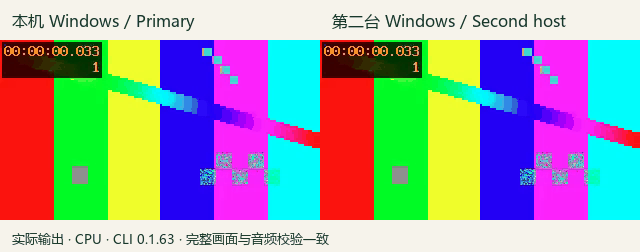

# 第二台原生 Windows 安装与完整音画基线

2026-11-06，Asia/Taipei。此项推进 G34 的跨机器安装与工程搬迁，并为后续 CLI66 升级／回滚建立真实的 CLI63 对照。完整 G01—G38 条件保留。

**结果：第二台机器实际离线安装 CLI0.1.63，注册一个隔离发现的统一 Skill，导入本机工程包，应用原工程的滤镜并渲染成功。全部60帧 RGBA、完整解码 PCM、视频时钟及两份母素材摘要与本机一致。** 实际后台任务已退出，终态为 passed；不是只检查版本号或文件存在。

本机正式入口仍为 CLI0.1.63／local61／r58；新66源码整套仍独立运行。此次没有将旧版基线计为66安装、干净主机、GPU推理、自然视听或完整剪映等价验收。



[本机实际MP4](../assets/cross-machine63-20261106-r1/primary.mp4) · [第二台实际MP4](../assets/cross-machine63-20261106-r1/second-host.mp4) · [原始测试视频](../assets/cross-machine63-20261106-r1/input-pattern.mp4) · [原始440Hz音频](../assets/cross-machine63-20261106-r1/input-tone.wav) · [媒体摘要与元数据](../assets/cross-machine63-20261106-r1/metadata.json)

## 实际完成范围

| 编号 | 操作 | 结果及边界 |
| --- | --- | --- |
| X01 | 本机正式63版创建工程，导入视频与独立音频轨 | 使用返回的真实asset ID及轨道ID；320×180、30fps、2秒 |
| X02 | 应用 t3-kodak-gold-200，global，strength=0.65 | 实际滤镜与完整成片；不将一项滤镜实测当作500项自然质量验收 |
| X03 | 本机导出工程包、导入新目录、重新渲染 | 全部RGBA／PCM及视频时钟一致，原始记录保留 |
| X04 | 第二台离线安装原应用ZIP | 8个wheel，283个应用Python模块与本机摘要一致；现有原生CPython3.13.14 x64，不改其安装或包环境 |
| X05 | 原r58 Skill ZIP解包到中文与空格路径 | 原清单160文件安装前后摘要不变，包含93个Skill文件；归档正文、脚本及指南均未改写 |
| X06 | 调用原注册器和实际PowerShell Skill入口 | 一个隔离发现入口、17内部模块；安装和Skill路径均包含中文／空格；不修改远端全局Codex注册 |
| X07 | 第二台导入工程包、验证、实际渲染 | 全部60帧、完整非静音PCM、视频时钟与两份母素材均与本机一致 |
| X08 | 核实实际任务终态与临时传输清理 | 原任务PID35420、创建时间134384200728609440；实际进程已退出，passed收据存在，无failure收据；下载核验后关闭本机临时服务 |

原始输入由FFmpeg的testsrc2及440Hz sine生成，无人物、第三方音乐、模型生成或客户素材。GIF只是两份实际MP4的10fps展示，完整比对使用原始30fps成片及完整音轨。

## 完整媒体核验

| 项目 | 实际结果 |
| --- | --- |
| 视频 | 320×180，30/1fps，60个实际解码帧，视频time_base=1/15360，duration_ts=30720 |
| 全部RGBA SHA256 | bdea4fdebedcfebe81a4f01a4196e56ed27b50da253e4685640f2309fb7c691c |
| 完整解码Float32 PCM SHA256 | 2b454d04491619424791f06b0875151d72dccad6734f3e66866de8869eca0d12 |
| 音频 | 48kHz双声道，每声道实际解码96256样本，全部有限，RMS=0.062363260558425795 |
| 第二台实际MP4 SHA256 | 273ccb54c829a6feec6c5ef51a8fdc05cb127d05bc7540b2c004ff38a098f9d2 |
| GIF | 640×252，20帧，2000ms；实际静帧已目检，无新增人工听审结论 |

源WAV为每声道96000样本；AAC解码包含256个尾部样本。比对覆盖全部96256个解码样本，不将容器2秒标签写成PCM恰好96000样本。非静音、有限样本及摘要检查不能代替完整听审。

实际任务总耗时约167.96秒，包含下载、安装、注册及重放。机器同时运行其他任务，此数不是独占性能基准，不能外推为大工程或模型吞吐。

## 安装、模型及旧版配置边界

本次应用为正式 `v0.1.0-alpha.4-local.61`，CLI0.1.63，应用归档305698303字节，SHA256：

```text
c9151896fe28de8446adfe35633b18956e3e390bac0ccaa038f713be233e9727
```

对应安装清单：

```text
sha256:65e94e4ed549d065175a31b891f7890fc4e23cece74733710a21629b8f06bdca
```

原r58 Skill ZIP为762775字节，SHA256：

```text
bc19f2b64ae88997e4ca5fae1a3c59b016541d1c9bae0393b8f37cb522c19c0a
```

第二台复用已有原生Python；FFmpeg／ffprobe来自本机同一已固定二进制，连同LICENSE及README复制到测试目录，只设置子进程PATH。原安装器将8个wheel装入独立应用目录；既有Python包环境、驱动、模型、解释器、._pth、系统执行策略、全局PATH和ComfyUI服务均未改动。

**r58早于新的`--base-only`配置器。** 此次只写独立测试目录中的runtime.json和空community-runtime.json，随后调用未改字节的原注册器及Skill。它证明旧版无模型基础编辑基线，不证明新66的`--base-only`工具已经实装通过；新工具必须在66独立安装中另验。

远端GPU当时被既有任务占用，基线明确使用CPU。远端已有Python／模型环境，因此clean_host=false；未执行任何模型推理或GPU渲染。主项目、构建及证据仍在本机E盘，远端副本位于该设备Skill约定的独立C:/dev测试目录。

## 完整代码批次与原失败

五个操作脚本先写齐、编译并保存摘要，再执行功能流程。它们是固定设备的验收工具，不是通用产品安装器；换机或重跑须选择新编号、修改显式路径并重新冻结，禁止覆盖本次目录或收据。

| 批次 | 实际结果 | 后续处理 |
| --- | --- | --- |
| r1 | 本机完整工程重放通过；远端启动请求因WinError206命令长度限制失败 | 实际远端检查确认没有测试根目录、没有匹配任务；本机临时服务已退出；原代码与失败保留 |
| r2 | 整批改为短启动、摘要固定的文件下载、完整60帧计数和非静音PCM检查 | 五文件重新冻结后集中运行，本机及第二台完整基线通过 |
| r2启动观察 | PowerShell调用返回观察超时 | 查询同一已拥有目录的launch／state及实际进程；原任务已完成并退出，未重启或重复安装 |

[r1代码冻结](../validation/evidence/delivery66-cross-machine-20261106-r1/baseline-code-phase-r1/verification.json) · [r1启动失败及实际现场](../validation/evidence/delivery66-cross-machine-20261106-r1/baseline-launch-r1/verification.json) · [r2完整代码冻结](../validation/evidence/delivery66-cross-machine-20261106-r1/baseline-code-phase-r2/verification.json) · [r2实际终态及进程观察](../validation/evidence/delivery66-cross-machine-20261106-r1/baseline-round-r2/remote-terminal-status.json)

本次实际调用顺序为 prepare_transfer.py freeze → 固定工具归档 → case.py prepare → prepare_transfer.py parcels → transfer_server.py → remote_control.py start → status → fetch。遇到启动观察超时，先查询原任务；不得因此重新启动。只有下载核验收据存在后才关闭临时服务。

代码：[case.py](../validation/cross_machine63_20261106_r2/case.py)、[离线安装／注册](../validation/cross_machine63_20261106_r2/remote_baseline.py)、[原生远端控制与状态](../validation/cross_machine63_20261106_r2/remote_control.py)、[临时传输](../validation/cross_machine63_20261106_r2/transfer_server.py)、[冻结与输入固定](../validation/cross_machine63_20261106_r2/prepare_transfer.py)。

使用已安装[remote-4090 Skill](C:/Users/carzy/.codex/skills/remote-4090/SKILL.md)的原生Windows-MCP入口，设备调用串行，认证配置只在内存及私有本地工作区使用。公开材料不含认证、临时下载地址、设备桌面截图或用户其他窗口。

## 证据与尚未完成范围

[本机r2完整结果](../validation/evidence/delivery66-cross-machine-20261106-r1/baseline-primary-r2/verification.json) · [第二台完整结果](../validation/evidence/delivery66-cross-machine-20261106-r1/baseline-remote-r2/verification.json) · [实际安装器输出](../validation/evidence/delivery66-cross-machine-20261106-r1/baseline-remote-r2/offline-install.stdout) · [原注册器收据](../validation/evidence/delivery66-cross-machine-20261106-r1/baseline-remote-r2/registration.json) · [实际Skill命令记录](../validation/evidence/delivery66-cross-machine-20261106-r1/baseline-remote-r2/actual-case/calls.json) · [全部原始案例文件摘要](../validation/evidence/delivery66-cross-machine-20261106-r1/baseline-round-r2/artifacts.json)。

当前r6源码整套中的原Unicode、两项工程锁、音频诊断、TTS断网共五项均已实际为ok，是原4124项子集，不新增计数。完整源码及安装版终态仍另验。[五项实际行](../validation/evidence/delivery66-cross-machine-20261106-r1/baseline-round-r2/source-original-cases.json) · [该时刻实际进程观察](../validation/evidence/delivery66-cross-machine-20261106-r1/baseline-round-r2/source-intermediate-status.json)。

G34继续开放：66新包与新配置器、CPU／GPU典型任务、从63升级到66、回滚到63并重放、干净主机及全部外部依赖迁移。G33恢复缺陷、G35自然任务自主性、G36自然视听质量、G37完整权利及G38新版发行也不由本次短工程关闭。[完整未完成内容](UNFINISHED_20261106.md)。
