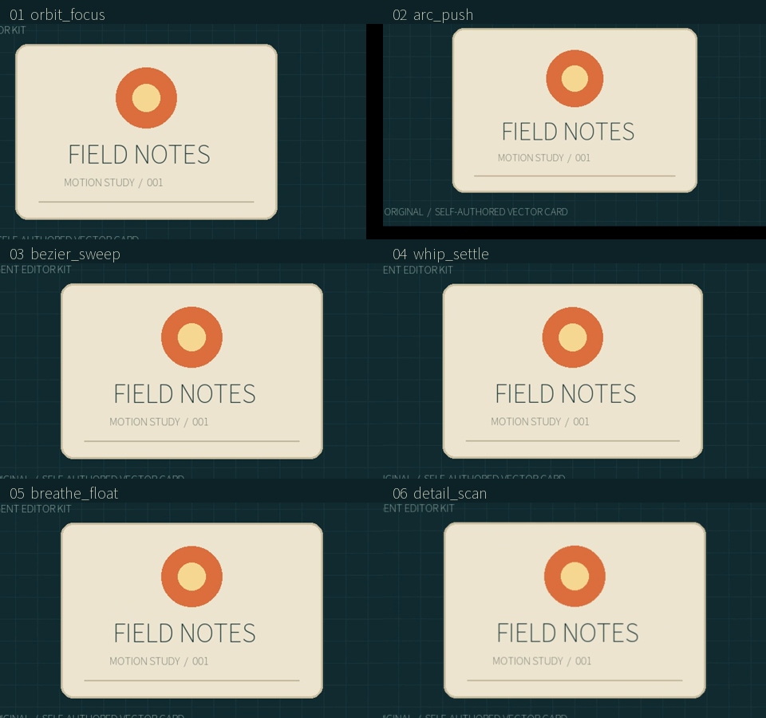

# 可复用运镜包 / Portable motion packs

CLI **0.1.16 / alpha.4-local.14** 引入；当前 0.1.17：六套参数化路径和已有关键帧捕获，最终写成普通可编辑 transform 关键帧。保留原 `motion list/inspect/apply` 的 12 项基础预设。

**English:** Six parameterized motion paths and capture of existing transform animation compile into ordinary editable keys. Recipes are local versioned JSON, contain no media paths or executable expressions, and can be reused across durations and canvases. The original twelve `motion apply` presets remain available.

CLI 0.1.17 自动复用固定画布仿射参数；[使用与同源交错计时](AFFINE_RENDERING.md)。原六包、参数和作者时钟保持，历史65秒记录保留。

[完整实测 / Evidence](../validation/可复用运镜包实测_2026-10-25.md) · [案例 C25](CASES.md#c25-motion-packs) · [全部目标](GOAL_GAPS_20261025.md) · [单入口 Skill](../skills/UNIFIED_SKILL.md)

## 预览 / Preview

所有图来自同一张自制原图的实际程序渲染，非 GUI 截图、非研究效果。MP4 为 640×360 / 30fps / 4 秒 / 120 帧，无声；GIF 为 480×270 / 10fps / 4 秒。动画由 CPU 原生 FFmpeg 合成，公开 MP4 使用 NVENC 编码。滤镜选型仍使用已有 N002 的 500 项真实图册。

**English:** These are actual renders of one self-authored vector card. MP4: 640×360, 30fps, four seconds, 120 frames, silent. GIF: 480×270, 10fps. Transform composition runs on CPU; NVENC encodes the preview videos. These examples establish reproducibility, not natural-footage or human aesthetic acceptance.



| ID | 路径 / Path | 参数 / Parameters (default; range) | 实际预览与可复用包 / Actual outputs and recipe |
|---|---|---|---|
| `orbit_focus` | 绕中心一圈椭圆 / One elliptical orbit | `radius=.12 [0,.35]`; `zoom=.15 [0,.5]` | [MP4](../assets/motion-pack-20261025-r1/orbit_focus.mp4) · [GIF](../assets/motion-pack-20261025-r1/orbit_focus.gif) · [JSON](../assets/motion-pack-20261025-r1/orbit_focus.aek-motion.json) |
| `arc_push` | 水平移动、抬升成弧并推进 / Horizontal arc with push | `travel=.20 [-.6,.6]`; `height=.10 [-.4,.4]`; `zoom=.15 [0,.5]` | [MP4](../assets/motion-pack-20261025-r1/arc_push.mp4) · [GIF](../assets/motion-pack-20261025-r1/arc_push.gif) · [JSON](../assets/motion-pack-20261025-r1/arc_push.aek-motion.json) |
| `bezier_sweep` | 三次 S 路径，中心放大 / Cubic S sweep with center zoom | `travel=.35 [-.8,.8]`; `height=.25 [-.6,.6]`; `zoom=.15 [0,.5]` | [MP4](../assets/motion-pack-20261025-r1/bezier_sweep.mp4) · [GIF](../assets/motion-pack-20261025-r1/bezier_sweep.gif) · [JSON](../assets/motion-pack-20261025-r1/bezier_sweep.aek-motion.json) |
| `whip_settle` | 甩入、衰减回摆并停稳 / Damped throw and settle | `travel=.35 [-.8,.8]`; `zoom=.15 [0,.5]` | [MP4](../assets/motion-pack-20261025-r1/whip_settle.mp4) · [GIF](../assets/motion-pack-20261025-r1/whip_settle.gif) · [JSON](../assets/motion-pack-20261025-r1/whip_settle.aek-motion.json) |
| `breathe_float` | 上下浮动并呼吸缩放 / Vertical float and breathing scale | `height=.06 [-.3,.3]`; `zoom=.15 [0,.5]` | [MP4](../assets/motion-pack-20261025-r1/breathe_float.mp4) · [GIF](../assets/motion-pack-20261025-r1/breathe_float.gif) · [JSON](../assets/motion-pack-20261025-r1/breathe_float.aek-motion.json) |
| `detail_scan` | 三处停顿、平滑扫视及摇转 / Three rests, smooth scan and tilt | `travel=.30 [-.8,.8]`; `tilt=5 [-45,45]` degrees; `zoom=.15 [0,.5]` | [MP4](../assets/motion-pack-20261025-r1/detail_scan.mp4) · [GIF](../assets/motion-pack-20261025-r1/detail_scan.gif) · [JSON](../assets/motion-pack-20261025-r1/detail_scan.aek-motion.json) |

位置参数按目标画布宽/高归一化；正 travel 向右，正 height 的弧形推进向上。相对位置叠加静态基值，scale 乘静态基值，旋转加静态角度。大幅位移可能露出背景，需在客户目标画幅上预览。

**English:** Position values are fractions of the target canvas dimensions. Relative position/rotation add to the static transform; scale multiplies its static value. Large offsets can expose the background. Inspect actual target footage rather than inferring its framing from this card.

## 使用流程 / Workflow

先设置 `$avk` 为已注册 Skill 的 `scripts/run.ps1`，`$project` 为已有工程；素材和目标片段应先导入/建立。使用 `project inspect` 返回的稳定序列/片段 ID。

```powershell
& $avk motion pack list
& $avk motion pack inspect --name arc_push
& $avk motion pack create --name arc_push --output 'E:/video-work/arc-v1.aek-motion.json'

# Use actual IDs. A dry run compiles and validates but does not change the project.
& $avk motion pack apply --project $project --sequence-id $sequence --clip-id $clip --input 'E:/video-work/arc-v1.aek-motion.json' --param travel=0.18 --param zoom=0.12 --dry-run
& $avk motion pack apply --project $project --sequence-id $sequence --clip-id $clip --input 'E:/video-work/arc-v1.aek-motion.json' --param travel=0.18 --param zoom=0.12 --idempotency-key arc-shot-1
& $avk preview frame --project $project --sequence-id $sequence --frame 30
& $avk render --project $project --sequence-id $sequence --output "$project/renders/motion-review.mp4"
```

也可直接 `--name arc_push`，省去外部 JSON。不同包可能共享属性：默认 `MOTION_PACK_CONFLICT`；只有确认替换时才加 `--replace`。替换的是**整条同属性轨**，不是无损合并片段内局部点；未涉及属性、源范围、倒放/速度曲线保持。应用局部区间时，区间外保持新首尾值。

**English:** `--name` applies a builtin without a standalone JSON file. Existing keys on a touched property produce `MOTION_PACK_CONFLICT`. Explicit `--replace` replaces that entire property track, including points outside the application interval. Untouched properties and native source/retiming fields remain. `--start-tick/--end-tick` refer to the current visible clip output; outside that interval, new endpoint values hold.

## 捕获与跨工程复用 / Capture and reuse

```powershell
& $avk motion pack capture --project $project --sequence-id $sequence --clip-id $clip --id customer_camera --title 'Customer camera v1' --version 1.0.0 --creator 'Your credited creator' --license LicenseRef-UNVERIFIED --output 'E:/video-work/customer-camera.aek-motion.json'
& $avk motion pack inspect --input 'E:/video-work/customer-camera.aek-motion.json'
& $avk motion pack apply --project $otherProject --sequence-id $otherSequence --clip-id $otherClip --input 'E:/video-work/customer-camera.aek-motion.json'
```

capture 捕获**完整作者输出时段**，包括被 presentation-window 隐藏的部分；保留 hold/linear/ease/bezier 及控制点，补齐端点并按有理数归一化。它输出绝对值、零参数包，避免猜测如何反推出原作者参数；可用 `--property transform.scale` 重复选择属性。包不携带素材路径，能按新时长和画幅复用。

**English:** Capture preserves the complete authored output interval, including portions hidden by a presentation window. Easing and Bezier controls survive; missing endpoint holds are made explicit and times become rational normalized positions. Captures use absolute values with no inferred parameters. Repeat `--property` to select supported properties. The recipe does not include the source media.

`--idempotency-key` 仅允许 apply；capture/查询明确拒绝，不向工程写隐式记录。自定义 scale 的 add 模式允许负增量，最终缩放须在 .001..100；absolute/multiply 的缩放系数须为正。

**English:** Project idempotency keys are supported only for apply; capture/query reject them without writing project records. Additive scale may use negative deltas, while the resolved scale must remain .001..100. Absolute/multiplicative scale coefficients must be positive.

来源作者/许可是调用者的**声明**，不会自动验证授权。未知许可保持 `LicenseRef-UNVERIFIED`；自制六包为 MIT，图卡源码为本仓库自制，字体单独采用已有 OFL 来源。发布媒体仍要检查整个项目的 Rights Ledger；包中的许可文字不构成权利证明。

**English:** Creator/license strings are declarations, not automatic rights verification. Keep unknown rights unverified and retain evidence in the project ledger. The six builtin recipes are MIT; the example illustration is self-authored and uses an independently licensed OFL font.

## 格式、时钟与边界 / Format and limits

格式 `agent-editor-motion-pack`, `format_version=1`。稳定 ID 与三段 `version` 独立于应用版本。`parameters` 最多 16 项，有 default/minimum/maximum；值可为数字或 `{parameter,factor,offset}` 的单参数仿射绑定；不运行 Python/FFmpeg 表达式。`tracks` 只接受七个规范 transform 属性，每轨最多 1025 点，时间 `[numerator,denominator]` 必须严格递增并包含 0/1。文件最多 1MiB，重复键、未知字段、非有限值和远程路径拒绝。

**English:** Values are scalars or bounded single-parameter affine bindings, never executable expressions. Up to sixteen parameters, seven canonical transform properties, 1,025 points per track and 1MiB input. Normalized rational times are strictly increasing and include both endpoints. Malformed/duplicate keys, unknown fields, non-finite values, remote paths and sub-tick rounding collisions reject explicitly.

六个内置路径是 **64 段 / 65 点线性折线**，不是解析空间贝塞尔或 3D 摄像机。插值 `bezier` 表示已有属性的时间缓动，与空间路径区别开。更大画幅/更短时长须重新预览采样误差；太短导致两个点舍入到同一 tick 会拒绝。捕获本身不重建物理镜头或主体跟随。

**English:** The six generated spatial paths are 64-segment polylines. Captured native `bezier` interpolation is temporal easing. They do not implement a physical 3D camera or subject tracking. The project renderer maps the existing author clock through trims, reverse and nonlinear nested speed; recipes do not rewrite that mapping.

应用有快照、工程写锁、事务、幂等、预算和取消；dry-run 不写工程。规范内容 SHA 和输入文件 SHA 分开记录，完整 recipe/参数嵌入 provenance；之后渲染/工程包无需原外部 JSON。锁定轨道、跟踪绑定和被跟踪源拒绝，避免覆盖正在使用的轨迹。内容改变要改版本并重新预览；原输出不覆盖。

**English:** Application uses snapshot, project lock, transaction, idempotency and cooperative timeout/cancellation. The receipt embeds recipe, resolved parameters and separate canonical-content/raw-file hashes. Rendering and editable-package import therefore do not require the original standalone recipe. Locked tracks and tracking relationships reject. Full G04/G12/G32/G33 and the complete CapCut-level target remain open.

2026-10-26: CLI0.1.19 extends pure scanline reuse to animated crop and child crop/fit/TRS, for bilinear and area. [Current workflow / 当前使用](PROJECTION_RENDERING.md) includes the editable combination case and actual previews; historical timing remains scoped to its original fixture.
