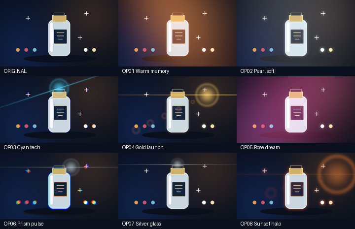

# 首批8套可编辑复合光效模板

这是一套可直接调用的MIT内容模板包，复用已有光学内核；没有增加8个新算子或神经模型。每套保留独立效果参数和动画键，可先展示样片，再由Agent应用到明确片段。

[实际选型页](../assets/optical-pack-20261029-r1/index.html) · [模板ZIP](../content/effect-packs/optical-v1.zip) · [摘要](../content/effect-packs/optical-v1.sha256.json) · [逐模板目录](../content/effect-packs/optical-v1/catalog.json)



## 模板清单

| 编号 | 名称 | 实际效果 | 建议选型方向 | 真实样片与可编辑工程 |
| --- | --- | --- | --- | --- |
| OP01 | 暖光回忆 / Warm memory | 暖色椭圆漏光从左上移向右侧；高光产生暖红晕边。 | 文旅／复古产品 | [MP4](../assets/optical-pack-20261029-r1/OP01.mp4) · [GIF](../assets/optical-pack-20261029-r1/OP01.gif) · [工程包](../assets/optical-pack-20261029-r1/OP01.aevpkg.zip) |
| OP02 | 珍珠柔光 / Pearl soft | 中性偏冷高光柔化；低强度白色漏光缓缓移过。不是皮肤美颜。 | 珠宝／静物产品 | [MP4](../assets/optical-pack-20261029-r1/OP02.mp4) · [GIF](../assets/optical-pack-20261029-r1/OP02.gif) · [工程包](../assets/optical-pack-20261029-r1/OP02.aevpkg.zip) |
| OP03 | 青蓝科技 / Cyan tech | 青蓝镜头星芒斜向扫过，红蓝通道小幅径向分离并在中段增强。 | 电子产品／科技发布 | [MP4](../assets/optical-pack-20261029-r1/OP03.mp4) · [GIF](../assets/optical-pack-20261029-r1/OP03.gif) · [工程包](../assets/optical-pack-20261029-r1/OP03.aevpkg.zip) |
| OP04 | 鎏金发布 / Gold launch | 金色横向长星芒由暗转亮再回落；叠加少量暖色高光扩散。 | 新品发布／品牌片 | [MP4](../assets/optical-pack-20261029-r1/OP04.mp4) · [GIF](../assets/optical-pack-20261029-r1/OP04.gif) · [工程包](../assets/optical-pack-20261029-r1/OP04.aevpkg.zip) |
| OP05 | 玫瑰梦境 / Rose dream | 玫瑰紫漏光对角流动，与偏粉高光扩散组成梦境氛围。 | 香氛／生活方式 | [MP4](../assets/optical-pack-20261029-r1/OP05.mp4) · [GIF](../assets/optical-pack-20261029-r1/OP05.gif) · [工程包](../assets/optical-pack-20261029-r1/OP05.aevpkg.zip) |
| OP06 | 棱镜脉冲 / Prism pulse | 红蓝径向分离在中段快速增强，配合冷白星芒脉冲。不是语义节拍检测。 | 运动／节奏产品展示 | [MP4](../assets/optical-pack-20261029-r1/OP06.mp4) · [GIF](../assets/optical-pack-20261029-r1/OP06.gif) · [工程包](../assets/optical-pack-20261029-r1/OP06.aevpkg.zip) |
| OP07 | 银色玻璃 / Silver glass | 细窄冷白横向星芒与柔和中性高光；亮点从右上移向左侧。 | 玻璃器皿／极简品牌 | [MP4](../assets/optical-pack-20261029-r1/OP07.mp4) · [GIF](../assets/optical-pack-20261029-r1/OP07.gif) · [工程包](../assets/optical-pack-20261029-r1/OP07.aevpkg.zip) |
| OP08 | 落日光晕 / Sunset halo | 偏橙低角度圆光源缓缓下落，亮部叠加暖色边缘晕光。不是日光重打光。 | 户外／旅行氛围 | [MP4](../assets/optical-pack-20261029-r1/OP08.mp4) · [GIF](../assets/optical-pack-20261029-r1/OP08.gif) · [工程包](../assets/optical-pack-20261029-r1/OP08.aevpkg.zip) |

## Agent使用流程

1. 用唯一`$agent-ffmpeg-local-editor`入口运行`version`。本轮当前正式入口CLI59已实际导入OP01工程并改选OP08；8套完整案例由独立安装CLI63执行。不能把后者写成已正式注册CLI63。
2. 从客户现有工程读取目标`clip_id`、原作者时钟和来源／工作／输出信号。模板要求`float32-native-v1`；本轮采用线性BT.709、显式sRGB输入／输出，不自动猜色彩。
3. 先显示原素材、真实MP4／GIF与模板ID。选型页仅记录视觉方向；需要在客户素材上再次预览，不自动通过权利、音乐或人物质量审核。
4. 读取该模板JSON。应用会**替换目标片段整条effects数组**，所以必须先审阅既有效果；需要共存时保留原数组并明确合并，不能静默删除。不会覆盖原素材、其他轨或声音。
5. 提供`clip_id`、`middle_tick`、`end_tick`变量。示例为90000 ticks/s、4秒作者时钟；剪裁／滑移／倒放及其他原作者范围需重新核对，不自动适配。半径／色差使用源像素，其他分辨率需要调整参数并验收。
6. dry-run确认替换计划，再实际应用、validate、preview、render并导出可编辑工程。dry-run只替换变量，不证明最终渲染或视听质量。

```powershell
$entry = 'C:/Users/carzy/.codex/skills/agent-ffmpeg-local-editor/scripts/run.ps1'
$project = 'E:/video-work/optical-demo' # 新空目录
$template = 'E:/dev/sandbox/AI广告剪辑/docs/content/effect-packs/optical-v1/OP08-sunset-halo.json'
$variables = 'E:/video-work/optical-variables.json'
'{"clip_id":"hero","middle_tick":180000,"end_tick":360000}' | Set-Content -LiteralPath $variables -Encoding utf8
& $entry convert import --input 'E:/dev/sandbox/AI广告剪辑/docs/assets/optical-pack-20261029-r1/OP01.aevpkg.zip' --output $project
& $entry template apply --project $project --input $template --variables $variables --dry-run
& $entry template apply --project $project --input $template --variables $variables
& $entry validate --project $project
& $entry preview frame --project $project --frame 24
& $entry render --project $project --output "$project/renders/selected.mp4" --projection-acceleration require --projection-device 0.0
```

## 实际验收和边界

8套各4秒／12fps／48帧、480×270，实际RTX3060 OpenCL操作而非仅探测编码器。每套完整24883200字节RGBA及768000字节PCM在工程导出／导入后相同；8套输出摘要互不相同，首帧与中间帧不同，原始图与效果图不同。GPU操作、进程、控制线程和共享句柄均检查关闭，没有运行时CPU回退。硬件编码关闭；H.264交付编码、颜色转换及音频仍CPU。

真实C盘统一Skill CLI59导入OP01后改选OP08；全部RGBA／PCM与独立安装CLI63的OP08相同。这里只验证一套正式入口改选，不冒充8套均经正式入口独立重跑。完整406-r2、正式Skill63及r58工具包有各自门禁，不被本内容库验证替代。

[8套真实执行及包重放](../validation/evidence/optical-pack-20261029-r1/verification.json) · [正式CLI59改选](../validation/evidence/optical-pack-20261029-registered59-r1/verification.json) · [GPU逐项与跨入口对照](../content/effect-packs/optical-v1/ACCEPTANCE.json) · [媒体摘要](../assets/optical-pack-20261029-r1/media-manifest.json)。样片为项目原创几何产品图与诊断双音；PNG／WAV为CC0、模板MIT，没有外部影像／权重或真实品牌素材。

这是G06／G29首批可用复合内容，不是成熟全品类库、AI语义效果、3D镜头模拟、美颜、重打光、自然实拍审美／连续听审或完整剪映等价验收。全部38项原关闭条件保持。

## 每项完整参数

下列`middle_tick`和`end_tick`由显式变量替换；参数未列字段采用版本化内核默认值。光色为线性工作域RGB倍率，不是可直接等同的sRGB十六进制颜色。源像素和信号说明见[光学算子](OPTICAL_EFFECTS.md)／[高光扩散](HIGHLIGHT_GLOW.md)。

### OP01 暖光回忆

Moving amber light leak with warm highlight halation.

实际替换的效果参数及作者时钟关键帧：

```json
{
  "effects": [
    {
      "type": "light_leak",
      "parameters": {
        "intensity": 0.55,
        "x": 0.1,
        "y": 0.25,
        "radius": 0.35,
        "aspect": 1.8,
        "angle": -25,
        "red": 1.0,
        "green": 0.32,
        "blue": 0.08,
        "brightness": 0.45
      },
      "keyframes": [
        {
          "property": "x",
          "keyframes": [
            {
              "at_tick": 0,
              "value": -0.2,
              "interpolation": "ease_in_out"
            },
            {
              "at_tick": "{{end_tick}}",
              "value": 1.15,
              "interpolation": "ease_in_out"
            }
          ]
        },
        {
          "property": "intensity",
          "keyframes": [
            {
              "at_tick": 0,
              "value": 0.15,
              "interpolation": "ease_in_out"
            },
            {
              "at_tick": "{{middle_tick}}",
              "value": 0.62,
              "interpolation": "ease_in_out"
            },
            {
              "at_tick": "{{end_tick}}",
              "value": 0.15,
              "interpolation": "ease_in_out"
            }
          ]
        }
      ]
    },
    {
      "type": "halation",
      "parameters": {
        "intensity": 0.45,
        "threshold": 0.48,
        "knee": 0.12,
        "radius": 4,
        "gain": 1.3,
        "red": 1,
        "green": 0.15,
        "blue": 0.03
      },
      "keyframes": []
    }
  ]
}
```

### OP02 珍珠柔光

Soft neutral highlights and a faint moving white leak; no skin retouch.

实际替换的效果参数及作者时钟关键帧：

```json
{
  "effects": [
    {
      "type": "bloom",
      "parameters": {
        "intensity": 0.65,
        "threshold": 0.52,
        "knee": 0.15,
        "radius": 5,
        "gain": 0.85,
        "red": 0.9,
        "green": 0.95,
        "blue": 1
      },
      "keyframes": []
    },
    {
      "type": "light_leak",
      "parameters": {
        "intensity": 0.22,
        "x": 0.2,
        "y": 0.2,
        "radius": 0.5,
        "aspect": 1.6,
        "red": 0.9,
        "green": 0.95,
        "blue": 1,
        "brightness": 0.22
      },
      "keyframes": [
        {
          "property": "x",
          "keyframes": [
            {
              "at_tick": 0,
              "value": -0.3,
              "interpolation": "ease_in_out"
            },
            {
              "at_tick": "{{end_tick}}",
              "value": 1.3,
              "interpolation": "ease_in_out"
            }
          ]
        }
      ]
    }
  ]
}
```

### OP03 青蓝科技

Sweeping cyan flare with a small radial red/blue split peaking at mid-shot.

实际替换的效果参数及作者时钟关键帧：

```json
{
  "effects": [
    {
      "type": "lens_flare",
      "parameters": {
        "intensity": 0.55,
        "x": 0.2,
        "y": 0.18,
        "radius": 0.05,
        "red": 0.08,
        "green": 0.7,
        "blue": 1,
        "brightness": 0.6,
        "streak": 1.5,
        "streak_width": 0.004,
        "halo": 0.2,
        "ghosts": 3,
        "ghost_spacing": 0.55,
        "angle": -18
      },
      "keyframes": [
        {
          "property": "x",
          "keyframes": [
            {
              "at_tick": 0,
              "value": -0.12,
              "interpolation": "ease_in_out"
            },
            {
              "at_tick": "{{end_tick}}",
              "value": 1.12,
              "interpolation": "ease_in_out"
            }
          ]
        },
        {
          "property": "intensity",
          "keyframes": [
            {
              "at_tick": 0,
              "value": 0.12,
              "interpolation": "ease_in_out"
            },
            {
              "at_tick": "{{middle_tick}}",
              "value": 0.8,
              "interpolation": "ease_in_out"
            },
            {
              "at_tick": "{{end_tick}}",
              "value": 0.12,
              "interpolation": "ease_in_out"
            }
          ]
        }
      ]
    },
    {
      "type": "chromatic_aberration",
      "parameters": {
        "intensity": 0.35,
        "red_shift": 2,
        "blue_shift": -2,
        "falloff": 1.5,
        "edge": "clamp"
      },
      "keyframes": [
        {
          "property": "intensity",
          "keyframes": [
            {
              "at_tick": 0,
              "value": 0.12,
              "interpolation": "ease_in_out"
            },
            {
              "at_tick": "{{middle_tick}}",
              "value": 0.4,
              "interpolation": "ease_in_out"
            },
            {
              "at_tick": "{{end_tick}}",
              "value": 0.12,
              "interpolation": "ease_in_out"
            }
          ]
        }
      ]
    }
  ]
}
```

### OP04 鎏金发布

A long golden flare rises and falls over gentle warm highlight bloom.

实际替换的效果参数及作者时钟关键帧：

```json
{
  "effects": [
    {
      "type": "lens_flare",
      "parameters": {
        "intensity": 0.6,
        "x": 0.75,
        "y": 0.28,
        "radius": 0.06,
        "red": 1,
        "green": 0.65,
        "blue": 0.18,
        "brightness": 0.55,
        "streak": 2.2,
        "streak_width": 0.003,
        "halo": 0.25,
        "ghosts": 5,
        "ghost_spacing": 0.48
      },
      "keyframes": [
        {
          "property": "intensity",
          "keyframes": [
            {
              "at_tick": 0,
              "value": 0.05,
              "interpolation": "ease_in_out"
            },
            {
              "at_tick": "{{middle_tick}}",
              "value": 0.9,
              "interpolation": "ease_in_out"
            },
            {
              "at_tick": "{{end_tick}}",
              "value": 0.05,
              "interpolation": "ease_in_out"
            }
          ]
        }
      ]
    },
    {
      "type": "bloom",
      "parameters": {
        "intensity": 0.4,
        "threshold": 0.6,
        "knee": 0.15,
        "radius": 4,
        "gain": 0.7,
        "red": 1,
        "green": 0.8,
        "blue": 0.45
      },
      "keyframes": []
    }
  ]
}
```

### OP05 玫瑰梦境

Diagonal rose-purple light leak and pink-tinted bloom.

实际替换的效果参数及作者时钟关键帧：

```json
{
  "effects": [
    {
      "type": "light_leak",
      "parameters": {
        "intensity": 0.52,
        "x": 0.1,
        "y": 0.2,
        "radius": 0.38,
        "aspect": 2.1,
        "angle": 40,
        "red": 1,
        "green": 0.12,
        "blue": 0.45,
        "brightness": 0.4
      },
      "keyframes": [
        {
          "property": "x",
          "keyframes": [
            {
              "at_tick": 0,
              "value": -0.2,
              "interpolation": "ease_in_out"
            },
            {
              "at_tick": "{{end_tick}}",
              "value": 1.1,
              "interpolation": "ease_in_out"
            }
          ]
        },
        {
          "property": "y",
          "keyframes": [
            {
              "at_tick": 0,
              "value": -0.1,
              "interpolation": "ease_in_out"
            },
            {
              "at_tick": "{{end_tick}}",
              "value": 1.05,
              "interpolation": "ease_in_out"
            }
          ]
        }
      ]
    },
    {
      "type": "bloom",
      "parameters": {
        "intensity": 0.45,
        "threshold": 0.5,
        "knee": 0.2,
        "radius": 6,
        "gain": 0.65,
        "red": 1,
        "green": 0.6,
        "blue": 0.8
      },
      "keyframes": []
    }
  ]
}
```

### OP06 棱镜脉冲

A timed radial RGB pulse and cool white flare; no automatic beat detection.

实际替换的效果参数及作者时钟关键帧：

```json
{
  "effects": [
    {
      "type": "chromatic_aberration",
      "parameters": {
        "intensity": 0.8,
        "red_shift": 4,
        "blue_shift": -4,
        "x": 0.5,
        "y": 0.5,
        "falloff": 1,
        "edge": "clamp"
      },
      "keyframes": [
        {
          "property": "intensity",
          "keyframes": [
            {
              "at_tick": 0,
              "value": 0.05,
              "interpolation": "ease_in_out"
            },
            {
              "at_tick": "{{middle_tick}}",
              "value": 0.95,
              "interpolation": "ease_in_out"
            },
            {
              "at_tick": "{{end_tick}}",
              "value": 0.05,
              "interpolation": "ease_in_out"
            }
          ]
        }
      ]
    },
    {
      "type": "lens_flare",
      "parameters": {
        "intensity": 0.4,
        "x": 0.6,
        "y": 0.22,
        "radius": 0.045,
        "red": 0.75,
        "green": 0.9,
        "blue": 1,
        "brightness": 0.4,
        "streak": 1,
        "streak_width": 0.004,
        "halo": 0.12,
        "ghosts": 2,
        "ghost_spacing": 0.65
      },
      "keyframes": [
        {
          "property": "intensity",
          "keyframes": [
            {
              "at_tick": 0,
              "value": 0.03,
              "interpolation": "ease_in_out"
            },
            {
              "at_tick": "{{middle_tick}}",
              "value": 0.65,
              "interpolation": "ease_in_out"
            },
            {
              "at_tick": "{{end_tick}}",
              "value": 0.03,
              "interpolation": "ease_in_out"
            }
          ]
        }
      ]
    }
  ]
}
```

### OP07 银色玻璃

A thin cool-white streak moves right to left above neutral bloom.

实际替换的效果参数及作者时钟关键帧：

```json
{
  "effects": [
    {
      "type": "lens_flare",
      "parameters": {
        "intensity": 0.5,
        "x": 0.8,
        "y": 0.18,
        "radius": 0.035,
        "red": 0.75,
        "green": 0.88,
        "blue": 1,
        "brightness": 0.5,
        "streak": 2.6,
        "streak_width": 0.002,
        "halo": 0.08,
        "ghosts": 2,
        "ghost_spacing": 0.6
      },
      "keyframes": [
        {
          "property": "x",
          "keyframes": [
            {
              "at_tick": 0,
              "value": 1.15,
              "interpolation": "ease_in_out"
            },
            {
              "at_tick": "{{end_tick}}",
              "value": -0.15,
              "interpolation": "ease_in_out"
            }
          ]
        }
      ]
    },
    {
      "type": "bloom",
      "parameters": {
        "intensity": 0.35,
        "threshold": 0.7,
        "knee": 0.1,
        "radius": 2.5,
        "gain": 0.6,
        "red": 1,
        "green": 1,
        "blue": 1
      },
      "keyframes": []
    }
  ]
}
```

### OP08 落日光晕

A low orange flare descends over warm highlight edges; no scene relighting.

实际替换的效果参数及作者时钟关键帧：

```json
{
  "effects": [
    {
      "type": "lens_flare",
      "parameters": {
        "intensity": 0.45,
        "x": 0.85,
        "y": 0.3,
        "radius": 0.1,
        "red": 1,
        "green": 0.28,
        "blue": 0.04,
        "brightness": 0.5,
        "streak": 0.3,
        "streak_width": 0.01,
        "halo": 0.6,
        "ghosts": 4,
        "ghost_spacing": 0.4
      },
      "keyframes": [
        {
          "property": "y",
          "keyframes": [
            {
              "at_tick": 0,
              "value": 0.1,
              "interpolation": "ease_in_out"
            },
            {
              "at_tick": "{{end_tick}}",
              "value": 0.55,
              "interpolation": "ease_in_out"
            }
          ]
        }
      ]
    },
    {
      "type": "halation",
      "parameters": {
        "intensity": 0.6,
        "threshold": 0.5,
        "knee": 0.15,
        "radius": 5,
        "gain": 1.4,
        "red": 1,
        "green": 0.2,
        "blue": 0.03
      },
      "keyframes": []
    }
  ]
}
```


公开MP4视频轨各48帧／12fps；GIF各32帧，制作目标8fps，实际GIF时间基和容器时长逐文件记录在媒体清单。MP4／GIF是分发预览，工程重放比较使用项目渲染的完整MKV解码音画，不将有损MP4视作原始PCM。
