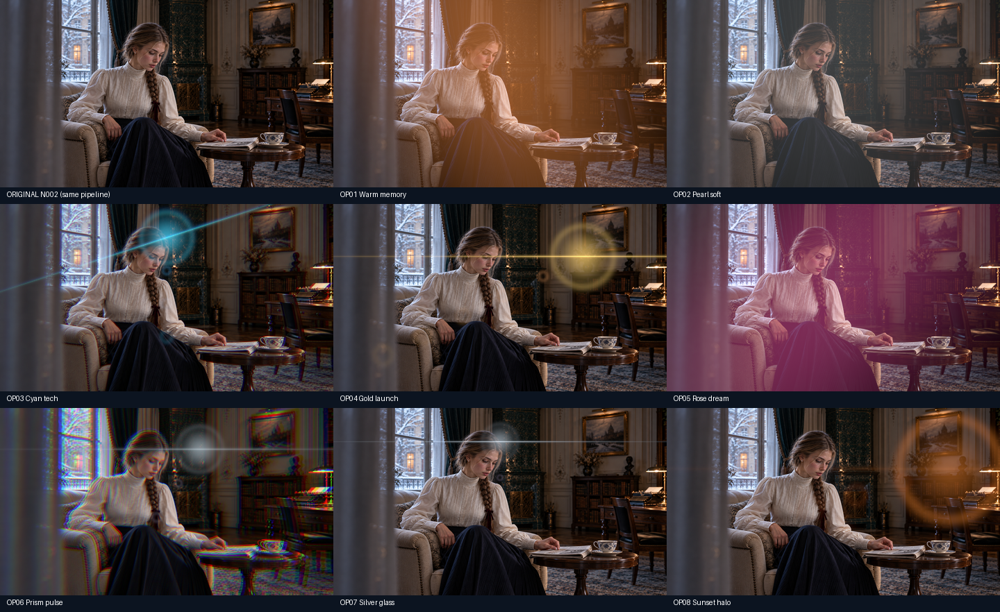
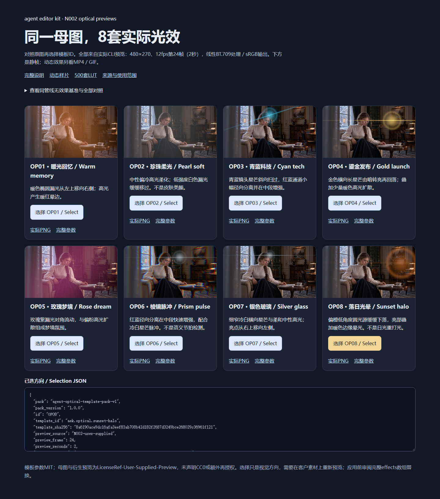

# N002母图的8套复合光效实际预览

与[现有500套LUT滤镜](../assets/looks-n002-20261024-r1/index.html)使用同一张用户提供的N002母图。这8套是额外的可编辑复合光效模板，不改变500套LUT的数量。这里的PNG由独立安装CLI0.1.63实际预览生成，不是示意图或新生成的照片。

[离线选型页](../assets/optical-n002-20261029-r1/index.html) · [原始N002](../assets/looks-n002-20261024-r1/source.png) · [逐帧实际证据](../validation/evidence/optical-n002-20261029-r1/verification.json) · [动态样片与完整参数](OPTICAL_EFFECT_PACK.md)

统一条件：原图1672×940先用Lanczos缩至480×270，无内嵌色彩配置的原图在本例显式按sRGB解释；线性BT.709工作域，再输出sRGB。每项都在12fps的第24帧（2秒／作者时钟180000tick）取样，使用同一套原始参数。半径和色差仍按该480×270来源像素，未声称已自动适配其他分辨率。

| 编号 | 名称 | 具体效果 | 本母图实际预览 |
| --- | --- | --- | --- |
| OP01 | 暖光回忆 / Warm memory | 暖色椭圆漏光从左上移向右侧；高光产生暖红晕边。 | [实际PNG](../assets/optical-n002-20261029-r1/OP01.png) |
| OP02 | 珍珠柔光 / Pearl soft | 中性偏冷高光柔化；低强度白色漏光缓缓移过。不是皮肤美颜。 | [实际PNG](../assets/optical-n002-20261029-r1/OP02.png) |
| OP03 | 青蓝科技 / Cyan tech | 青蓝镜头星芒斜向扫过，红蓝通道小幅径向分离并在中段增强。 | [实际PNG](../assets/optical-n002-20261029-r1/OP03.png) |
| OP04 | 鎏金发布 / Gold launch | 金色横向长星芒由暗转亮再回落；叠加少量暖色高光扩散。 | [实际PNG](../assets/optical-n002-20261029-r1/OP04.png) |
| OP05 | 玫瑰梦境 / Rose dream | 玫瑰紫漏光对角流动，与偏粉高光扩散组成梦境氛围。 | [实际PNG](../assets/optical-n002-20261029-r1/OP05.png) |
| OP06 | 棱镜脉冲 / Prism pulse | 红蓝径向分离在中段快速增强，配合冷白星芒脉冲。不是语义节拍检测。 | [实际PNG](../assets/optical-n002-20261029-r1/OP06.png) |
| OP07 | 银色玻璃 / Silver glass | 细窄冷白横向星芒与柔和中性高光；亮点从右上移向左侧。 | [实际PNG](../assets/optical-n002-20261029-r1/OP07.png) |
| OP08 | 落日光晕 / Sunset halo | 偏橙低角度圆光源缓缓下落，亮部叠加暖色边缘晕光。不是日光重打光。 | [实际PNG](../assets/optical-n002-20261029-r1/OP08.png) |

## Agent如何接续

1. 让客户比较本母图静帧、原图和已有动态MP4／GIF，记录明确模板ID。静帧仅对应2秒时刻，不代表整段动画。
2. 将页面输出的模板ID、版本、SHA256和作者时钟示例交给Agent；核对本地模板文件后，再读取客户实际片段。
3. 审阅既有效果数组。`template apply`替换目标片段完整`effects`数组；需要与LUT或其他效果并存时，先明确合并，不能静默覆盖。
4. 按客户分辨率、原作者时钟和实际素材调整参数，预检后应用、预览、渲染并导出可编辑工程。完整命令见[模板说明](OPTICAL_EFFECT_PACK.md)。

## 来源与范围

N002与衍生预览使用`LicenseRef-User-Supplied-Preview`；展示依据是用户提供母图并要求在README／Skill中制作预览，未推断更广的版权归属、独立再利用许可或CC0授权。模板参数本身是MIT，与母图的权利分开。[完整来源记录](../assets/optical-n002-20261029-r1/SOURCE.md)。

8项完整RGB摘要各不相同，均与同管线无效果基准不同。当前验证的是实际单帧预览、明确参数与同图选型；没有新增模型推理，不是自动打光、美颜、整段自然视频审美或人类质量验收。

These eight real CLI63 stills use the same user-supplied N002 image as the 500 LUT examples. They show frame24 at12fps with explicit sRGB interpretation and a480×270 reference size. Template IDs/hashes remain selectable; source-image rights are separate from MIT template parameters. They are still previews, not new video footage or human quality approval.

## 真实选型页面

原生Chrome实际点击8项选择并核对模板ID／摘要，8张图片均成功加载，37个本地链接或资源目标存在；420像素宽度下Enter键选择与无横向溢出检查通过。页面错误及外部请求均为0。本次独立页面、上下文和浏览器已关闭；缓存和截图位于E盘。[实际浏览器收据](../validation/evidence/optical-n002-gallery-20261029-r1/verification.json) · [手机宽度截图](../assets/optical-n002-gallery-20261029-r1/mobile.png)。

