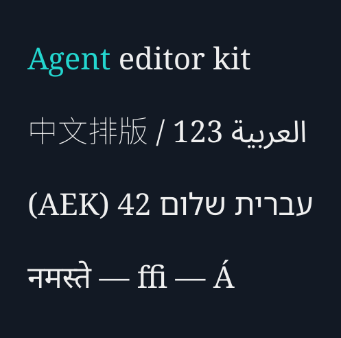

# 原生文字塑形、双向布局与真实字形选区

2026-11-07，独立开发批`development/shaping69/`。本批提供可离线调用的Windows x64文字内核及独立CLI；**尚未接入正式产品工程、渲染／编码链或唯一Skill，不是产品CLI0.1.69**。正式入口仍CLI0.1.66。

整批16项实现、测试、构建与案例代码先写齐冻结，再集中执行。原构建失败、缺终态记录以及首轮22项中的2项失败均保留。最终freeze-r3／build-r4／tests-r2／case-r2分别有实际终态；原CLI67与正式66冻结保持。

## 具体实现

| 编号 | 能力 | 实际行为与边界 |
| --- | --- | --- |
| T01 | 原生离线包 | 固定SheenBidi3.0.0／HarfBuzz15.1.0／FreeType2.15.0源码，MSVC原生静态CRT构建27单元；DLL、Python接口、5显式字体、许可和摘要清单进入ZIP；运行时无下载／系统字体回退 |
| T02 | 双向与脚本 | SheenBidi段落及逐行L1／视觉L2，保留原文Unicode标量索引；U+2028行分隔保持段落方向；脚本分段后交给HarfBuzz。完整官方双向集验证至L2，不能外推所有排版应用情形 |
| T03 | 真字形与字体栈 | HarfBuzz塑形，FreeType同一字体面实际轮廓／灰度栅格；中英、阿拉伯、希伯来、天城文、附标和CJK实际用例；完整字素选择显式字体，不拼接不同字体的半个字素 |
| T04 | 字体变体与缺字 | 固定字体SHA、字号、face index和变体轴；CJK真实wght差异已验。缺字、非法轴、摘要不符和关闭句柄均明确失败；彩色字体和系统替代不在本profile |
| T05 | 真实选区 | 原文范围映射到塑形簇及26.6字形几何；连字内部使用字体实际GDEF caret，不按平均字符宽度切分。缺完整caret默认严格拒绝，显式`partial: cluster`才扩大并记录范围 |
| T06 | 换行与逐字呈现 | 复用已验收text68字素／换行；实际塑形宽度折行，不用平均字宽；显示前缀重新塑形，不让隐藏后缀影响连接形；维持已确定画布、换行、基线及RTL右锚点 |
| T07 | 灰度覆盖与高亮 | 每个真实字形灰度覆盖合成；逐词高亮保持总alpha与未选区域RGBA，26.6局部裁切和位图缓存。当前是RGBA8预览profile，尚非Float32／HDR正式字层 |
| T08 | Agent独立入口 | `inspect`输出字形／布局／选区计划；`render`输出PNG、计划与收据。严格UTF-8 JSON、未知／重复字段与非有限数字拒绝，已有输出和真实写入竞态保留外部文件 |

## 分范围的真实验证

| 编号 | 实际执行 | 结果 | 证据 |
| --- | --- | --- | --- |
| V01 | 原生字体、几何、选区、变体、前缀、CLI及真实输出竞态 | 22项通过，0失败／错误／跳过 | [tests-r2](../validation/evidence/shaping69-20261107-r1/tests-r2/verification.json)／[原测试日志](../validation/evidence/shaping69-20261107-r1/tests-r2/tests.stderr) |
| V02 | Unicode17 BidiCharacterTest全量 | 91,707行／方向用例全部通过，0排除／跳过，至L2 | [完整摘要](../validation/evidence/shaping69-20261107-r1/tests-r2/BidiCharacterTest.txt.json) |
| V03 | Unicode17 BidiTest全量全部方向模式 | 490,846行、770,241方向用例全部通过，0排除／跳过，至L2 | [完整摘要](../validation/evidence/shaping69-20261107-r1/tests-r2/BidiTest.txt.json) |
| V04 | 多语高亮／前缀实际成片 | 36帧、8FPS、4.5秒；497×492无损母版，MP4补边为498×492；完整母版RGBA解码逐帧摘要一致 | [case-r2](../validation/evidence/shaping69-20261107-r1/case-r2/verification.json) |
| V05 | ZIP真实解压至中文／空格路径 | 仅使用包内run.py／DLL／字体，完整payload摘要一致，实际PNG与源案例逐字节一致，无源码回退 | 同一case-r2收据，独立于产品安装版验收 |
| V06 | 静态目检 | 实际查看004／027／035帧，未见明显裁切、重叠或溢出；没有声轨，未做连续播放或母语者语义审核 | [发布与目检记录](../validation/evidence/shaping69-20261107-r1/publication-r1/verification.json) |

各组分别记录，不相加成产品测试数或完整目标完成率。字形实际GSUB／GDEF与镜像／附标由V01另验，V02／V03范围仅到L2。

首轮失败的原因也保留：固定NotoSansArabic将beh拆成`dotbelowar`加主体，lam-alef使用`uni0627.fina.rlig`和`uni0644.init.rlig`两个字形。旧断言误要求分别固定为2／1个总字形。修正检查直接解析字体`post`表的原作者名称，并检查每个原文簇、零宽点及开关rlig的实际差异；不是删掉阿拉伯用例。自制真实ffi GSUB／GDEF字体仍严格要求一字形覆盖三字符，caret为不等分位置。[首次完整失败](../validation/evidence/shaping69-20261107-r1/tests-r1/verification.json)／[原堆栈](../validation/evidence/shaping69-20261107-r1/tests-r1/tests.stderr)。



[MP4](../assets/shaping69-20261107-r1/actual.mp4) · [无损MOV母版](../assets/shaping69-20261107-r1/master.mov) · [静态帧](../assets/shaping69-20261107-r1/preview.png) · [原文字形计划](../assets/shaping69-20261107-r1/plan.json)

## 本地独立使用流程

本机已编译包位于`local/agent-ffmpeg/shaping69-native-20261107-r4/aek-shaping69-windows-x64.zip`，运行目录是其同级`runtime/`。本包使用现有原生Python，无需pip安装、虚拟环境、Docker或WSL。原CLI66／Skill入口不变。

以下生成显式字体请求；请求与输出均留在E盘。`inspect`输出文件和`render`输出目录必须不存在，重复执行请换新输出名。位置范围使用Unicode标量索引，不是UTF-16或字节偏移。

```powershell
$shapeRuntime = 'E:/dev/sandbox/AI广告剪辑/local/agent-ffmpeg/shaping69-native-20261107-r4/runtime'
$shapeWork = 'E:/dev/sandbox/AI广告剪辑/local/agent-ffmpeg/my-text-preview'
New-Item -ItemType Directory -Path $shapeWork -ErrorAction Stop | Out-Null
$shapeNative = Get-Content -LiteralPath "$shapeRuntime/native.json" -Raw | ConvertFrom-Json
$shapeFonts = foreach ($shapeRole in @('latin', 'arabic', 'hebrew', 'devanagari', 'cjk')) {
    $shapeFont = $shapeNative.fonts.$shapeRole
    @{ path = "$shapeRuntime/$($shapeFont.path)"; sha256 = $shapeFont.sha256; pixels = 44 }
}
$shapeRequest = @{
    format = 'aek-shaping69-request-v1'; runtime = "$shapeRuntime/native.json"
    text = "Agent editor kit`n中文排版 / العربية 123`nעברית שלום 42 (AEK)`nनमस्ते — ffi — Á"
    fonts = @($shapeFonts); layout = @{ max_width = 960 }
    render = @{ padding = 40; line_spacing = 12 }
}
[IO.File]::WriteAllText("$shapeWork/request.json", ($shapeRequest | ConvertTo-Json -Depth 8), [Text.UTF8Encoding]::new($false))
& 'C:/Python313/python.exe' -I -B -X utf8 "$shapeRuntime/run.py" inspect --request "$shapeWork/request.json" --output "$shapeWork/plan.json"
& 'C:/Python313/python.exe' -I -B -X utf8 "$shapeRuntime/run.py" render --request "$shapeWork/request.json" --output "$shapeWork/render01"
```

可选`selection: {ranges: [[start,end]], partial: "strict"}`选择原文；显式`cluster`允许连字簇整体扩选。可选`reveal_end`必须落在完整字素边界，不能把组合附标或CRLF拆开；前缀只影响本次显示，完整原文计划保留。两者可组合。

## 尚未完成

| 编号 | 还需交付 | 原目标 |
| --- | --- | --- |
| P01 | 正式工程版本化字段、可编辑字幕／标题、预览与最终编码入口，安装包与唯一Skill同版升级 | G02、G13、G34 |
| P02 | 富ASS、Float32／HDR、组级混合／转场及其他正式渲染路径统一；当前RGBA8不能自动推导这些支持 | G05、G08、G13 |
| P03 | 成熟标题／动态版式、跨时长／语言／画幅模板、安全区全动画与自然长文本质量 | G13、G29、G36 |
| P04 | 本profile拒绝的制表符／非布局控制符、彩色字体、未覆盖的垂直或高级字体排版，须按完整需求另行实现 | G13；不将显式拒绝当作完整功能 |
| P05 | 正式安装整套、真实复杂工程与音轨、干净主机／跨机兼容、完整播放及人类选型任务 | G32—G36、G38 |

当前CPU工作是文字塑形与FreeType栅格，没有神经推理；本批未声称GPU加速。GPU配音、翻译和其他模型沿正式产品各自实际支持矩阵执行。

源码来源与许可：SheenBidi Apache-2.0、HarfBuzz Old MIT、FreeType FTL、Noto OFL-1.1，复用text68的Unicode与uniseg许可。实际来源／文件摘要在[固定来源清单](../validation/evidence/shaping69-20261107-r1/acquisition-r1/sources.json)，包内保留各许可；运行时不访问这些网址。具体原冻结与构建见[freeze-r3](../validation/evidence/shaping69-20261107-r1/freeze-r3/verification.json)、[build-r4](../validation/evidence/shaping69-20261107-r1/build-r4/verification.json)。
