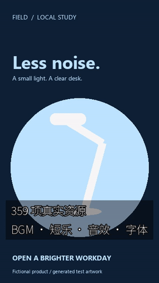

# v1.0.0 casebook / 案例集 / 案例集

| ID | Input and actual output | Evidence / status |
|---|---|---|
| V1-C01 | This release's native offline package → Chinese/space path install → one registered PowerShell Skill → 2s / 60 frames test pattern + independent 48kHz stereo test tone → actual LUT edit and editable package replay | [Local acceptance](../../validation/evidence/release-v1-20261107/local-r1/verification.json); full decoded RGBA/PCM, timing and source hashes; diagnostic media, not natural content quality |
| V1-C02 | Anonymous official public downloads → all seven hashes → another new native directory → same complete Skill/package/media workflow | [Public acceptance](../../validation/evidence/release-v1-20261107/public-download-r1/verification.json); same host, not a clean machine |
| C05–C07 | User supplied N002 → 500 actual full-resolution images + 500 thumbnails → real gallery, shortlist and recorded interaction | [Full style gallery](../../assets/looks-n002-20261024-r1/index.html); historical actual installed-CLI execution, not 500 new executions this round |
| C01–C15 and later | Ads, templates, captions, voice/translation/GPU, real resource edits, semantic search, stems and independent modules | [Complete dated casebook](../../product/CASES.md); retain each actual input/output/version and rights boundary |
| CLI66 delivery | Actual CUDA music and complete media/package replay, cancellation/timeout/output conflict, two native Windows CPU upgrade/rollback | [Full formal acceptance](../../product/DELIVERY66_FORMAL_ACCEPTANCE.md), [actual model faults](../../product/DELIVERY66_ACTUAL_FAULTS.md), [second-host evidence](../../product/CROSS_MACHINE66_RESULTS.md); historical acceptance, not new model inference |

[Actual resource MP4](../../assets/community-materials-20261025-r2/community-resources.mp4)
· [original inputs and editable case files](../../releases/v0.1.0-alpha.1/CASES.md)
· [historical full RGBA/PCM public replay](../../product/PUBLIC_RELEASE66_ACCEPTANCE.md)

The stable README preserves the complete case tables, real screenshots, MP4/GIF
links, original inputs, command/JSON details and per-case limitations. Model clips
without confirmed public redistribution rights remain local and link only to
their evidence. Silent GIFs do not establish audio quality or human listening.
