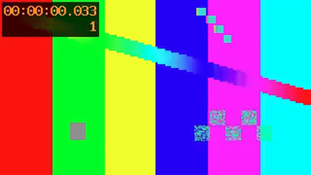
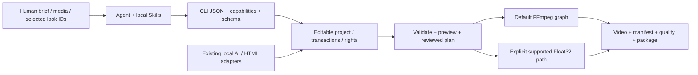
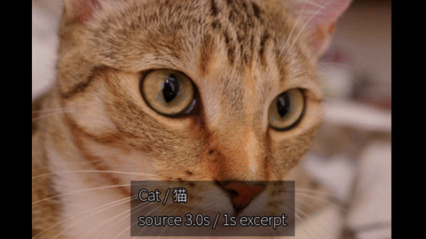
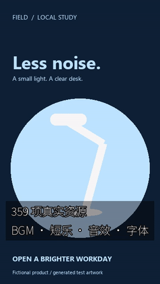
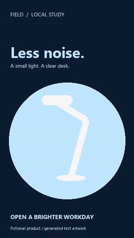
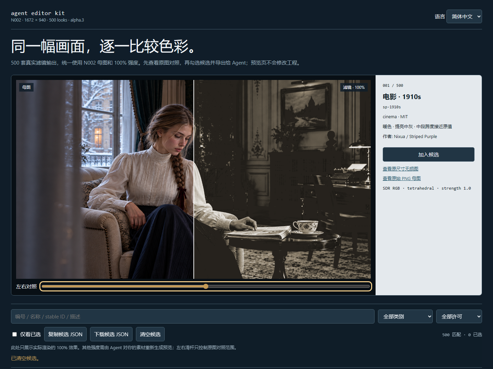

# agent editor kit

[简体中文](../../../README.md) · [繁體中文](../../../README.zh-TW.md) · [English](../../../README.en.md)

An open-source video editing and generation engine for agents. One Skill or a native CLI manages media, editable timelines, 500 looks, keyframes, captions, audio, local AI jobs and portable delivery. FFmpeg and explicitly registered native runtimes operate on your own project files.

**Stable distribution: v1.0.0. Engine identifier: CLI0.1.66. Unified Skill: r60.** The distribution version and existing engine build identifier are recorded separately. This release rebuilds the accepted engine, pinned offline dependencies, single-Skill toolkit and complete trilingual manuals, consolidating implemented capabilities. It does not certify complete CapCut feature parity or natural audiovisual quality. Unaccepted CLI67 portrait regions and experimental shaping/typography remain development candidates, outside the stable packages.

[Stable Release and all assets](https://github.com/copypasteltd/agent-editor-kit/releases/tag/v1.0.0) · [Release notes](../../../docs/releases/v1.0.0/RELEASE-NOTES.md) · [Versioned manual](../../../docs/releases/v1.0.0/README.en.md) · [Original G01–G38 and remaining work](../../../docs/product/UNFINISHED_20261107.md)

## Packages and prerequisites

| ID | Distribution | Purpose |
|---|---|---|
| D01 | [Windows x64 offline application](https://github.com/copypasteltd/agent-editor-kit/releases/download/v1.0.0/agent-editor-kit-v1.0.0-cp313-win_amd64.zip) | Native application wheel, pinned offline dependencies, installer, third-party notices and distribution manifest; CLI0.1.66 engine |
| D02 | [Unified Skill toolkit r60](https://github.com/copypasteltd/agent-editor-kit/releases/download/v1.0.0/agent-editor-kit-v1.0.0-unified-skill-r60.zip) | One public Skill, 17 internal modules, registration/configuration helpers and complete manuals; hash-paired with D01 |
| D03 | [SHA256SUMS.txt](https://github.com/copypasteltd/agent-editor-kit/releases/download/v1.0.0/SHA256SUMS.txt) | Asset checksums; the release also supplies three QUICKSTART languages and release notes, seven assets total |

Use native Windows x64 with an existing CPython3.13 x64 and FFmpeg/ffprobe. Basic editing works on CPU. Python, FFmpeg, drivers, model weights and the complete Torch/CUDA runtime are separate prerequisites. Register existing local models and dependencies for optional AI services in the table below. This project uses no Docker, WSL or virtual environment. Windows is the verified binary distribution target; portable Python source does not establish a tested Linux/macOS installer.

## Complete download-to-delivery workflow

<details>
<summary>Alternative: download anonymously through the official GitHub asset API</summary>

Use this when the web download connection fails. Verify SHA256 and continue with the installation steps below.

```powershell
$downloads = "E:/video-tools/downloads"
New-Item -ItemType Directory -Path $downloads -Force | Out-Null
$aekRelease = Invoke-RestMethod -Uri "https://api.github.com/repos/copypasteltd/agent-editor-kit/releases/tags/v1.0.0"
foreach ($aekAsset in $aekRelease.assets) {
    & curl.exe --fail --location --retry 3 --connect-timeout 20 `
      --header "Accept: application/octet-stream" `
      --output (Join-Path $downloads $aekAsset.name) $aekAsset.url
    if ($LASTEXITCODE -ne 0) { throw "Download failed: $($aekAsset.name)" }
}
```

</details>

Native Windows CPython3.13 x64 application. The only public entry is `$agent-ffmpeg-local-editor`, with 17 internal modules. Python, FFmpeg/ffprobe, drivers, model weights and the complete music runtime are separate local dependencies. Do not use Docker, WSL or virtual environments.

1. Download both ZIPs, SHA256SUMS.txt and this quickstart from the same release into one directory. Replace the example paths. Compare each computed digest with the checksum list before extracting into new directories; the installer also checks the internal application inventory.

```powershell
$downloads = "E:/video-tools/downloads"
$bundle = "E:/video-tools/application-bundle"
$kit = "E:/video-tools/skill-kit"
Get-Content -LiteralPath "$downloads/SHA256SUMS.txt"
Get-FileHash -LiteralPath "$downloads/agent-editor-kit-v1.0.0-cp313-win_amd64.zip" -Algorithm SHA256
Get-FileHash -LiteralPath "$downloads/agent-editor-kit-v1.0.0-unified-skill-r60.zip" -Algorithm SHA256
Expand-Archive -LiteralPath "$downloads/agent-editor-kit-v1.0.0-cp313-win_amd64.zip" -DestinationPath $bundle
Expand-Archive -LiteralPath "$downloads/agent-editor-kit-v1.0.0-unified-skill-r60.zip" -DestinationPath $kit
```

2. Install the application offline into a new target. This does not download models. Before model setup, the installed entry can already run version/doctor and basic editing commands.

```powershell
$python = "C:/Python313/python.exe"
$installed = "E:/video-tools/application-installed"
& $python -E -B -X utf8 "$bundle/install.py" --bundle $bundle --target $installed --manifest-sha256 "sha256:8946cc2eedfab5b4f7c8f536b5277e3c6a636a0e700754a3cf25c76bfba9d0cd"
& $python -I -S -B -X utf8 "$installed/run.py" version
& $python -I -S -B -X utf8 "$installed/run.py" doctor
```

3. Configure basic editing by binding the unified Skill to the installation above. Timeline editing, filters, captions, previews and rendering are available through this entry. Configure voice, translation and semantic models separately below. The configurator backs up previous settings and creates a basic binding without inherited machine model paths.

```powershell
& $python -E -B -X utf8 "$kit/scripts/activate_community_runtime.py" --installed $installed --base-only
```

Optional models: prepare verified `kokoro-zh-en-int8` and `opus-zh-en-cpu-int8` CPU packs before enabling voice/translation. `kokoro-zh-en-cuda13` and `opus-zh-en-cuda12-int8` are optional GPU packs. PACKS is the parent of these extracted pack directories. Model configuration requires both CPU packs and verifies each selected pack before binding it. The two release ZIPs do not contain these packs; use the source, license, digest and reproduction links below.

[Model catalog and pinned manifests](https://github.com/copypasteltd/agent-editor-kit/blob/main/product/src/ai_ad_editor/material_data/model-packs.json) · [CPU pack builder](https://github.com/copypasteltd/agent-editor-kit/blob/main/scripts/build_community_model_pack.py) · [GPU pack builder](https://github.com/copypasteltd/agent-editor-kit/blob/main/scripts/build_community_gpu_packs.py) · [Offline pack installer](https://github.com/copypasteltd/agent-editor-kit/blob/main/scripts/install_community_pack.py)

```powershell
$packs = "E:/video-tools/model-packs"
& $python -E -B -X utf8 "$kit/scripts/activate_community_runtime.py" --installed $installed --packs $packs
```

For GPU packs, replace the configuration command with the following and provide the actual matching DLL directories. Speech and translation require different CUDA versions. Use `--device auto` to prefer the configured GPU, and inspect the actual device/provider and any reported CPU fallback.

```powershell
& $python -E -B -X utf8 "$kit/scripts/activate_community_runtime.py" --installed $installed --packs $packs --voice-cuda-lib "E:/video-tools/cuda13/bin" --translation-cuda-lib "E:/video-tools/cuda12/bin"
```

4. Register the one Skill and inspect the actual installed version. A same-name entry pointing elsewhere is preserved and registration refuses to replace it. For upgrades, read the shipped delivery guide rather than deleting an unknown directory. Select `$agent-ffmpeg-local-editor` from the outer Agent.

```powershell
powershell.exe -NoProfile -ExecutionPolicy Bypass -File "$kit/register-agent-ffmpeg-local-skills.ps1"
$entry = "$kit/skills/agent-ffmpeg-local-editor/scripts/run.ps1"
& $entry version
& $entry doctor
& $entry capabilities
& $entry model-pack list
& $entry gpu inspect
```

5. Create a project and ingest your authorized media. The example video, still, subtitles, narration text and changes.json must exist. Read the returned `data.asset.id`, then author changes.json using the schema and command help; never copy a random asset ID from an old case. Author video and audio tracks separately, preview real look candidates and record client choices before composing.

```powershell
$aekProject = "E:/video-work/my-ad"
& $entry project init $aekProject --name "My ad"
& $entry media ingest --project $aekProject --input "E:/media/product.mp4"
& $entry schema show
& $entry timeline compose --help
& $entry look list --query "Kodak"
& $entry look inspect --id t3-kodak-gold-200
& $entry look preview --id t3-kodak-gold-200 --input "E:/media/still.png" --output "$aekProject/exports/film-preview.png" --strength 0.65
& $entry timeline compose --project $aekProject --input "E:/video-work/changes.json"
& $entry look apply --project $aekProject --id t3-kodak-gold-200 --global --strength 0.65 --dry-run
& $entry look apply --project $aekProject --id t3-kodak-gold-200 --global --strength 0.65
```

The optional speech/translation examples perform actual inference. Prepare their inputs, model packs and configuration first, and use a new asset ID. Review complete audio, pronunciation, translation meaning and duration. Then author voice-changes.json with the actual audio asset ID and an explicit audio track before the final compose command below; place translated subtitles on their intended track too.

```powershell
& $entry voice list
& $entry voice synthesize --project $aekProject --voice zf_001 --input "E:/media/narration.txt" --device auto --asset-id asset_voice
& $entry translate subtitles --project $aekProject --from zh-Hans --to en --input "E:/media/captions.srt" --output exports/bilingual.srt --mode bilingual --device auto
& $entry timeline compose --project $aekProject --input "E:/video-work/voice-changes.json"
```

6. Validate, preview, render and inspect the encoded movie, then export an editable project package. Import into a new directory and re-render; check images, complete audio, clocks and recipes separately. Inspect exit codes and JSON ok/status/errors/warnings/artifacts together. Automated quality checks do not replace continuous playback or listening.

```powershell
& $entry validate --project $aekProject
& $entry preview frame --project $aekProject --frame 0
& $entry render --project $aekProject --output "$aekProject/renders/ad.mp4"
& $entry quality check --project $aekProject --input "$aekProject/renders/ad.mp4"
& $entry convert export --project $aekProject --target-format package --output "$aekProject/exports/ad.aevpkg.zip"
& $entry convert import --input "$aekProject/exports/ad.aevpkg.zip" --output "E:/video-work/restored-ad"
& $entry render --project "E:/video-work/restored-ad" --output "E:/video-work/restored-ad/renders/replay.mp4"
& $entry rights check --project $aekProject
```

Neural music additionally needs an explicitly registered existing local adapter, native runtime and weights; the four packs above do not supply that model. Read [neural music](https://github.com/copypasteltd/agent-editor-kit/blob/v1.0.0/skills/agent-ffmpeg-local-editor/references/neural-music.md). Editable score synthesis, loop repair and neural generation are separate operations.

```powershell
& $entry music generate --help
& $entry delivery --help
```

[Skill and 17 modules](https://github.com/copypasteltd/agent-editor-kit/blob/v1.0.0/skills/agent-ffmpeg-local-editor/SKILL.md) · [Client look selection](https://github.com/copypasteltd/agent-editor-kit/blob/v1.0.0/skills/agent-ffmpeg-local-editor/references/client-look-selection.md) · [Speech, translation and audio](https://github.com/copypasteltd/agent-editor-kit/blob/v1.0.0/skills/agent-ffmpeg-local-editor/references/community-materials.md) · [Upgrade, recovery and rollback](https://github.com/copypasteltd/agent-editor-kit/blob/v1.0.0/docs/product/DELIVERY_CONTROLLER.md)

Before publishing media, add source/model/voice-use rights evidence and run rights check. render --publish is a local rights gate, not an upload. Review generated content individually; these attachments exclude unreviewed model audio. A new directory on the same host does not establish clean-host or cross-machine acceptance. Full CapCut parity and all original G01–G38 conditions remain open.

`v1.0.0` / CLI`0.1.66`


Capabilities and cases below retain their evidence dates. Older CLI identifiers describe actual historical runs, not tests repeated for this release. Use the installation workflow above and R618–R620 for v1.0.0.

## Actual output from this release’s fresh installation and replay

A generated test pattern and independent diagnostic tone pass through the installed editor, LUT and editable package replay: two seconds, 60 frames and full stereo comparison. This checks distribution/rendering; real-resource and AI cases are documented in the complete case tables below.



[MP4](../../../docs/assets/release-v1-20261107/actual.mp4) · [PNG](../../../docs/assets/release-v1-20261107/preview.png) · [Input video](../../../docs/assets/release-v1-20261107/input-pattern.mp4) · [Input WAV](../../../docs/assets/release-v1-20261107/input-tone.wav) · [Editable project](../../../docs/assets/release-v1-20261107/editable.aevpkg.zip) · [Source and notices](../../../docs/assets/release-v1-20261107/SOURCE_AND_LICENSES.md)

## Architecture and complete execution logic



The implementation is **Python CLI + Agent Project schema + FFmpeg**, with an explicitly selected Float32 subset. Concat was an early architecture research candidate; the release is not a Concat binary with its GUI deleted. Adopted OpenFilm caption segmentation, frame-clock and HTML/template work retains provenance/licenses and needs no OpenFilm online service.

1. Read version/doctor/capabilities/schema to determine actual local support and dependencies.
2. Turn the brief into a plan covering assets, canvas, duration, cuts, audio, captions, motion, looks and delivery evidence.
3. Create an owned project, ingest local media, and author edit JSON using actual asset IDs and integer ticks; add audio explicitly.
4. Apply transactional compose/edit/apply operations with snapshots, validate, then preview important frames/ranges.
5. For selection, show the original and a small candidate set, record final IDs/strength/scope and trial them on target media.
6. Render to a new project-owned path, inspect the encoded output, manifest, warnings, A/V and rights, then export the project package.

<a id="feature-modules"></a>

## Functional modules and actual support boundaries

IDs locate documentation groups with dependencies/overlap; they are not 43 independent kernels or a completion score. The table describes behavior, commands and limits. The [complete machine capability manual](../../../docs/product/CAPABILITIES.en.md) retains every field.

**F45 voice status update (2026-11-06):** the independently installed CLI61 produced actual WAVs for all 103 voices (100 Chinese, three English), with complete PCM project replay. F45 below preserves its earlier seven-voice evidence floor. Use the [local audition workflow](../../../docs/validation/CLI61全音色试听_2026-10-29.md) for selection. Human listening, naturalness, emotion/dialects and output rights remain unaccepted; this documentation update generated no new audio.

| ID | Module | Behavior and input → output | Entry | Dependency/limit |
|---|---|---|---|---|
| F01 | Agent command protocol | Task arguments → JSON responses, exit codes, errors, warnings, artifacts and provenance; queryable capabilities and schema. | `version; doctor; capabilities; schema show` | Skills guide the task; the CLI executes it. No hosted Agent service. |
| F02 | Editable projects | Create/inspect Agent Projects with assets, sequences, tracks, tick clocks, output settings and rights references. | `project init/inspect` | Source media and metadata are separate; relocation requires relinking and evidence-path review. |
| F03 | Transactions, recovery and snapshots | Metadata transactions/snapshots, native child-tree ownership and explicit recovery of durable four-source/subtitle-dubbing workspaces and uncommitted outputs.  Adds managed semantic registration/index/calibration/search jobs.| `project snapshot/restore/migrate/recover; operation inspect` | Whole referenced semantic directories protected; active/changed/unknown/legacy paths retained. Only integrated jobs; no inference resume; current integrity reads observe deadlines/cancellation; other workers/OS blocking I/O retain limits. |
| F04 | Media ingestion and relinking | Local images/video/audio/fonts → probe results, stable asset IDs, hashes and provenance. | `media ingest/relink` | No online-media fetching; ingestion does not establish commercial rights. |
| F05 | Proxies, thumbnails and waveforms | Media → lightweight proxies, thumbnails, waveforms and auditable contact sheets. | `media prepare/contact-sheet` | Contact sheets are samples, not exhaustive visual understanding. |
| F06 | Scene, silence and highlight analysis | Local video/audio → scene, silence, beat or heuristic highlight candidates and timing evidence. | `media understand/highlights` | Heuristic candidates require Agent or registered-adapter review for semantics. |
| F07 | Rough cuts and ad plans | Reviewed silence/transcript segments or an ad brief → edit plan → editable rough cut. | `media smart-cut; ad plan/apply` | Planning and applying are separate; no automatic directing or campaign-performance guarantee. |
| F08 | Beat cuts and multicamera sync | Beat anchors/local camera audio → cuts or offset/explicit affine clocks and switch plans. | `media beat-cut/multicam` | Low confidence, coverage shortfalls and nonlinear drift require refusal or explicit treatment; audio tracks remain explicit. |
| F09 | Multitrack editing | Edit JSON → tracks, insertion, updates, split/delete, duration/placement edits and canvas settings. | `timeline compose/edit` | Track locks, integer ticks, asset duration and advertised contracts apply. |
| F10 | Range and output-window edits | Explicit ranges → trim/delete/ripple edits while preserving author time and source mapping. | `timeline edit` | Check contracts for complex retiming/nesting combinations rather than assuming universal support. |
| F11 | Source handles, slip and slide | Source in/out points and neighbors → reversible source edits, handle transitions and cut adjustments. | `timeline edit/transition` | Insufficient source handles are reported rather than silently inventing coverage. |
| F12 | Magnetic tracks and linked edits | Main-track reorder, synchronized native tracking cuts, region-specific links and attached audio. | `timeline edit` | Explicit sync/split policies; locks, transition endpoints and resource gates. Non-native tracking cuts remain guarded. |
| F13 | Compound and nested sequences | Child sequences → independent canvases, parent transforms/opacity, nested clocks and freezes. | `timeline compose/edit` | Independent spatial canvases do not imply independent color/fps; some group spatial transitions remain unsupported. |
| F14 | Speed, reverse and freeze | Shared complete author clock, selected layers and single sound instance; independent native spatial edges retained. | `timeline edit; render` | Paired endpoints require the complete parent; ripple/retime, lock, budget and audio-backend limits remain. |
| F15 | Keyframes and easing | Position, anchor, scale, rotation, opacity, crop, masks, volume and pan → frame-evaluated animation. | `timeline compose; schema show` | hold/linear/ease_in/ease_out/ease_in_out/bezier; enum/boolean channels are not assumed continuous. |
| F16 | 12 camera/motion presets | Push/pull, four pan directions, Ken Burns, rotation, fades and shake → editable keyframes. | `motion list/inspect/apply` | Bounded keyframe presets, not AI 3D cameras or an entire commercial motion library. |
| F17 | Transitions and cut effects | Adjacent clips and handles → declared fades, wipes, slides, black/white fades, circular and other transitions. | `timeline transition; capabilities` | Select by renderer and layer context; the explicit CPU Float32 subset is delivered under the separate F55 contract. |
| F18 | Geometric masks and frame corrections | Rectangles/circles/ellipses/paths/polygons → inversion, feathering, animation, encoded masks and corrections. | `timeline compose; media mask-edit; quality mask` | Point topology and sampling are bounded; geometric checks do not prove semantic identity. |
| F19 | Layer compositing and blending | Visual layers → normal/multiply/screen/overlay/difference/addition/softlight/hardlight. | `timeline compose; capabilities` | The default path mainly uses encoded 8-bit RGB, without general linear-light/HDR equivalence. |
| F20 | 51 processing operators | Blur/sharpen, denoise, tone, curves, HSL, keying, vignette, noise and more → configurable chains. | `effects list/inspect` | Inspect animated parameters and backends individually; 51 operators and 500 LUT looks are separate inventories. |
| F21 | 500 offline looks | Name/ID/category/license search → details, still previews, clip/global application and provenance copies. | `look list/inspect/preview/apply` | 500 distinct transforms include related curve variants; creative SDR mapping, not 500 unrelated families. |
| F22 | Custom LUTs and color automation | Local .cube/.3dl/.csp/.dat → registration/inspection; supported 3D LUT strength and color channels follow automation contracts. | `lut register/list/inspect; effects inspect` | Registration does not imply complete parsing on every path; full CUBE data is required for the corresponding intensity/float features. |
| F23 | Explicit Float32 pixel pipeline | Declared source/working/output signals, ordering and budgets → float color, LUT/shaper, selected spatial processing and surfaces. | `render; preview; surface export/inspect` | Explicit float32-native-v1 selection; a bounded subset that refuses unsupported features, not a complete HDR/ICC pipeline. |
| F24 | Subtitles, text and segmentation | SRT/VTT/ASS/SSA/TTML or text → normalization, segmentation, bilingual text, layers, word highlighting and text animation. | `subtitle validate/normalize/segment; timeline compose` | Fonts must exist locally; complex layout, bidi shaping and some clock/animation combinations have explicit approximations or refusals. |
| F25 | Offline transcription and alignment | Audio + existing Whisper/CTC weights/corrected text → transcripts, captions, word/character timings and CER evaluation. | `asr adapter; subtitle transcribe/align/evaluate` | Weights remain separate; activity preserves raw CTC and passes six controlled word-block cases. Natural continuous speech, Chinese and lyrics remain unaccepted. [Workflow](../../../docs/product/CTC_ACTIVITY_ALIGNMENT.md) |
| F26 | Multitrack audio and buses | Explicit audio tracks → mixing/buses, volume/pan, mute/solo, fades, EQ, compression, denoise, loudness and ducking. | `audio extract; timeline compose; quality check` | A video containing sound does not automatically author an audio track; PCM/LUFS checks do not replace listening. |
| F27 | Local speech synthesis | Existing flite or registered SoulX weights/authorized voice references → WAV assets and optional audio tracks. | `tts adapter/voice; tts synthesize` | flite depends on the FFmpeg build and is ASCII-English only; SoulX needs CUDA/native dependencies, not bundled voices. |
| F28 | Four-source and two-source separation | Audio → independent drums/bass/other/vocals estimates, float WAV assets and editable tracks; existing two-source and mid/side retained. | `audio separate-stems; audio separate; audio adapter` | Native runtime/weights supplied separately; controlled CPU/GPU tested; natural quality, listening and model rights open. |
| F29 | Tracking, binding and reframing | Template/model/encoded-mask tracks → anchored text/stickers, crop and subject-reframe keyframes. | `media track/track-bind/reframe` | Choose the object explicitly; confidence/masks do not guarantee identity, and supported transforms/clocks must be checked. |
| F30 | OCR anchors and face retouch | Existing PP-OCR/OpenSeeFace models → text polygons, anchor camera keys, landmarks and bounded retouch. | `ocr adapter/scan/anchors; face adapter/scan/retouch` | Existing ONNX CPU runtime and weights; not full UI action detection, makeup, body sculpting or face generation. |
| F31 | Human matting and object segmentation | Existing RVM/SAM2 + points/boxes → alpha video, object masks and editable derived assets. | `media adapter; media matting` | RVM human matting and SAM2 segmentation differ; probability masks are not physical hair mattes and require motion/occlusion review. |
| F32 | Inpainting, generative edits and outpainting | Existing LaMa/VACE + masks/prompts → repairs or expanded canvases with provenance and replayable recipes. | `media inpaint/outpaint; media adapter` | Framewise LaMa has no temporal guarantee; VACE needs CUDA and joint windows only; broad natural texture/temporal quality remains unaccepted. |
| F33 | HTML/CSS/SVG/Canvas motion | Trusted local source/assets/fonts → editable controls, alpha titles, stroke motion, layout diagnostics and timeline compositing. | `motion html-*; motion stroke-source` | Requires existing Node/Playwright/Chromium; not an arbitrary-page sandbox and does not download a browser. |
| F34 | Parameterized templates and variants | Local JSON templates + typed variables → editable variants, batch inputs and template snapshots. | `template apply/batch` | Includes asset/color/enum types; complex conditional graphs and expression evaluation are pending. |
| F35 | Asset indexing and reusable fragments | Asset folders/edited clips → search, duplicates/similarity, cross-project fragments and dependency closure. | `library index/search/duplicates/similar; fragment` | User-owned libraries; no bundled commercial stock subscription or licensed-music catalog. |
| F36 | Frame/range preview and caching | Projects + explicit frames/ranges → PNG/short video/cache and verifiable sample evidence. | `preview frame/range; cache; preview cache-*` | Preview does not validate the entire delivery; renderer/color path and cache signatures must match. |
| F37 | Delivery,encoding and GPU projection | Projects → MP4/WebM/MKV,explicit OpenCL crop/affine/child-canvas samplers,codec probes and manifests. | `render --projection-acceleration; render` | Requires native GPU binary64/image probes;CPU default,other effects remain CPU,no realtime/general4K guarantee. |
| F38 | Persistent queues,retry and cancel | Frozen snapshots → local jobs,bounded workers,explicit retry/cancel and serialized commits. | `queue enqueue/list/inspect/run/cancel` | Per-job GPU projection policy rejects --reuse-identical bypass;not cloud rendering. |
| F39 | Output, scopes and golden checks | Actual encoded files → stream/fps/canvas/duration, loudness/black frames, scopes, masks and golden differences. | `quality check/scopes/mask/golden` | Automatic checks, static review, playback and listening are recorded separately, without general creative-quality certification. |
| F40 | Rights ledger and local policy | Media/font/LUT/model/template evidence → dependency ledger, history, impact/retraction and publish gates. | `rights; policy audit; render --publish` | --publish checks local rights without uploading; the ledger does not adjudicate copyright. |
| F41 | Project and timeline interchange | Agent JSON/package, OTIO, Kdenlive MLT and lawful local plaintext drafts → import/export and loss reports. | `convert import/export` | Per-feature Exact/Approximate/Unsupported/Failed reports; plaintext drafts neither run Jianying nor decrypt/fetch proprietary resources. |
| F42 | Pipeline diagnostics and failure artifacts | Failed operations → bounded logs, diagnostic manifests, explicit exports and inspectable errors. | `diagnostics list/show/export; operation inspect` | A failure/refusal is not a successful render; review local-path information before sharing diagnostics. |
| F43 | Creative, content and campaign guidance | Supplied products, audiences, references or campaign tables → scripts, structure, variant suggestions and analysis. | `ad plan/apply; advisory Skills` | Advisory Skills do not supply ad-platform connectors, automatic buying, live data or performance guarantees. |
| F44 | Bundled open media library | 359 individually identified BGM/jingles/SFX/Chinese fonts → search, verification, rights records and project assets. | `materials list/inspect/verify/ingest` | 44 BGM, 85 jingles, 228 SFX, 2 fonts; retain individual provenance/licenses; video/sticker/industry coverage remains limited. |
| F45 | Kokoro Chinese/English voices | Text, 103 named voices and speed → complete WAV, actual duration and editable speech assets. | `voice list/synthesize; model-pack` | Optional CPU/CUDA packs; at least seven distinct voices generated; complete auditions, emotion/dialects and human listening unaccepted. |
| F46 | Translation and bilingual captions | Text/plain SRT → Chinese-English translation, simplified/traditional conversion, bilingual SRT and explicit post-translation glossary. | `translate text/subtitles` | Existing OPUS models required; cue order/milliseconds retained; awkward translations remain and semantic acceptance is pending. |
| F47 | GPU voice/translation selection | Explicit CPU/CUDA/auto and free-VRAM checks → actual provider/device and explicit fallback/failure. | `gpu inspect; voice; translate; --device` | RTX 3060 tested; CUDA 13 voice / CUDA 12 translation, voice device 0 only; this does not accelerate all filters. |
| F48 | Music preparation and mixing | Actual music/speech assets → trim, loop, fades, explicit gain and speech-ducked mix. | `music prepare/mix` | Preserves stems and complete speech. Editable score synthesis is F83; overlap repair is F84. Automatic visual semantic matching remains open. |
| F49 | Native capture | Explicit window/desktop/region/camera/microphone → finite recording, CPU/NVENC, cancellation and project assets. | `capture devices/record` | Actual CPU/GPU window evidence; camera/microphone, joint AV sync, device faults and long recording unaccepted. |
| F50 | Offline visual semantic retrieval and conditions | Local index, Chinese/English/reference images, same-frame positive/negative clauses, empirical profiles, actual previews/source times and editable references. | `semantic adapter-register/index/calibrate/calibration-list/search/verify` | URI-only portable semantic package; all 80 decisions retained with 3 known errors; same-host runtime pins remain external; G26/G31 open |
| F51 | Joint subtitle translation/dubbing | Plain Chinese/English SRT and explicit voices/tracks → translation or preserved same-language copy, complete batched WAV, actual fit, editable audio/captions and atomic application. | `dub subtitles` | Same-language mode initializes only voice; preserves originals/retries/awkward translations; cue fit does not establish word precision, naturalness or lip sync. |
| F52 | Editable ad storyboards and revision | Reviewed brief/actual assets → separate picture/caption/voice/source/music tracks for multiple canvases/durations; selected-shot/variant revisions. | `ad storyboard/build/revise` | Whole-frame allocation, actual asset locks, real font layout and complete voice-window checks; caller supplies claims and semantic choices. |
| F53 | Semantic runtime relocation | Old adapter/index/profiles → new installation-bound identities, copying vectors/previews/datasets and retaining fitted observations. | `project upgrade-semantic` | All 19 implementation files and external dependencies must be byte-identical; zero new model forwards; original records retained; changed bytes require rebuilding. |
| F54 | Portable parameterized motion | Versioned local JSON / captured authored curves → editable keys, resolved parameters/digests/snapshot and cross-project reuse, with six actual previews. | `motion pack list/inspect/create/capture/apply` | 65-point paths, transform properties; conflicts reject unless whole-property replacement is explicit; tracking bindings reject; CPU performance/natural quality remain open. |
| F55 | Linear Float32 transitions and group edges | Explicit Float32 projects → 57 xfade patterns+2 dips,premultiplied alpha,real handles/original clocks,linked audio,group wipe/slide,actual preview and encoding. | `timeline transition; preview; render; queue` | CPU;12 real-handle declaration types,other patterns use overlap/edges;normal paired blending;platform-dependent wind,HDR/natural quality open. |
| F56 | Linear Float32 text and captions | Independent/inline/SRT,joint word/typewriter → native byte coverage,reusable glyphs,tiled linear composition,original clocks,4K titles and actual delivery. | `timeline compose; preview; render; queue` | Explicit local font;CPU/explicit GPU;8bit coverage/Float32 colors;admission is not peak RSS;rich ASS/Bidi/natural quality open. |
| F57 | Native Float32 GPU execution | Affine/normal composition, text components/word selection, particle rasterization and optical/highlight-glow effects; owned pipes/shared pixels across render/preview/queue/recovery. | `projection_acceleration; render; preview; queue` | off/prefer/require; binary64/subnormal probes, Float32 particle math; bounded control and owned process/thread/stream cleanup. Other operators remain CPU. |
| F58 | Float32 global/interval adjustments | Ordered grading/light effects after all tracks/subtitles; existing float effects plus optical/highlight-glow operators, six easings and one application to the selected root. | `settings.adjustments; preview; render; queue` | Explicit linear signals; optics/highlight glow can use GPU, other effects use CPU. LUT locks/package migration retain interval author time; full HDR remains open. |
| F59 | Native PTS tracking and overlay tracks | Saved source observations → actual selected-frame anchors;shared crop/TRS,ROI scale/relative rotation,alpha,windows and nested audio. | `media track-bind; preview; render; queue; package` | Explicit Float32,no display-key bake,budget/cycle gates;template drift/occlusion require review;native interchange baking pending. |
| F60 | Native tracking and baked delivery | Actual alpha/five masks/59 transition footprints; edits and shared retime retain observations; native bake verifies all frames and retains source sidecars. | `media track-bind; timeline compose/edit; convert export --bake-tracking` | Frozen graph/FPS;20,000 frames/256,000 samples;unrepresentable integer steps reject;external players and natural identity/occlusion remain unaccepted. |
| F61 | Local GPU video generation | Text,image,last/first-last conditions; prompt/sampling,real model windows,editable clips,endpoint proofs,portable recipes and managed recovery. | `media adapter; media generate` | Existing native VACE/CUDA required;silent8bit SDR;known endpoints retained;natural quality,output rights and complete CapCut AI unaccepted. |
| F62 | Native GPU model sessions | Reuse weights/embeddings per project/adapter/prompt; reset jobs, transfer live locked digests, retire on cancel/deadline/idle/job budget. | `media model-session; media generate --model-session` | Native Windows VACE; first job still loads; new prompt needs a new serial session; no global VRAM reservation/multi-GPU. |
| F63 | Editable particles and emitter animation | Six original recipes/five shapes/seed/native CFR;21 source-clock animated properties,six easings,emission pauses and actual GPU rasterization. Editing/preview/queue/package/local OTIO. | `vfx list/inspect/apply/update/show/animation-properties/animate` | CPU rate integration/birth evaluation,GPU painting;64 points/property,16 emitters,4096 reserved live particles;no3-D/collision/depth. |
| F64 | Editable GPU optical effects | Flare core/streak/halo/ghosts, rotated elliptical leak and radial red/blue split; all numeric channels animate on original author clocks. Clip/interval adjustments, CPU/OpenCL. | `effects list/inspect` → `timeline compose` → preview/render | Explicit linear RGB; original alpha bits retained; transparent hidden RGB does not bleed. Static ghosts/edge; no physical lens, automatic light detection or bloom. |
| F65 | Highlight Bloom / film Halation | Actual soft-knee highlight extraction→separable Gaussian spread→core suppression/linear tint; editable numeric author-clock tracks in clips or selected-root adjustment intervals. | `effects list/inspect; timeline compose; preview; render; queue` | sigma0…32 input pixels; transparent/clamp edges; alpha bits preserved; actual four-kernel GPU or CPU reference; bounded workspace/visits; physical film/HDR unaccepted. |
| F66 | Native PQ/HLG HDR and SDR viewing | Explicit reference white/HLG peak/gamma → display-linear edits; mixed-nit assets, ordinary effects/composition and10-bit BT.2020 NCL delivery; separate SDR trim and PNG/MP4 previews.  Source51 adds OKLab lightness/hue chroma reduction; installed50 does not include it yet.| `timeline compose; validate; preview; render; convert` | CPU transfer math; existing GPU composition/effects; rejects8-bit/mismatched tags/missing units; alpha bits retained. ICC/dynamic metadata/HDR monitoring unaccepted. |
| F67 | Local neural lip sync | Image/video + separate speech → actual CUDA MuseTalk mouth;25FPS box keys, semantic lower-face blend, complete PCM/alpha, rerunnable recipe and linked editable video/audio clips. | `lipsync adapter register/list/inspect; lipsync generate` | Explicit local safetensors/native Torch runtime;256×256 face,8bit SDR/source motion,no CPU fallback; natural quality/full digital human remain open. |
| F68 | CUDA neural interpolation / slow motion | Native CFR/VFR,all original RGBA anchors,premultiplied alpha,complete PCM;factor2..8,cut holds,linked slow-motion tracks,recipes/packages. | `interpolate adapter; interpolate generate` | Explicit RIFE4.25 safetensors/native CUDA Python;no CPU fallback;difficult motion/occlusion/natural-quality/HDR acceptance open. |
| F69 | CUDA speech denoising | Native sample clock/mono-stereo,actual model,dry/wet attenuation,editable audio,portable recipes/packages,owned cancel/rollback. | `audio enhancement-adapter; audio enhance` | Fixed DF3 safetensors/existing native CUDA;segment state resets,CPU frontend;full dereverb/music fidelity open. |
| F70 | HDR10 static metadata delivery | Mastering RGB/white xy,min/max nits,MaxCLL/MaxFALL → actual HEVC SEI and decoded verification receipt. | `settings.output.hdr10; validate; render; convert` | Explicit native PQ/BT2020 NCL limited range,libx265/10bit420/MP4 or MKV; author declarations,prefix32-packet verification. |
| F71 | Explicit-white and wide-gamut working configurations | ProPhoto D50/AP1 D60/explicit xy → linear XYZ Bradford,nit scaling,actual D65 previews and editable packages. | `native_chromatic_adaptation; render; preview; surface export; convert` | CPU color math,working-white-aware GPU glow; no ICC parsing/full ACES/automatic white balance. |
| F72 | Native ICC source color management | RGB ICC v2/v4 matrix/CLUT, explicit SHA/intent/BPC → linear working RGB, Float32/alpha, actual previews and portable profile dependencies. | `native_icc_source_profiles; surface inspect-profile; surface export; render; preview; convert` | Pinned MIT LittleCMS/native CPU; no arbitrary output ICC, softproofing, CMYK or embedded-profile inference. |
| F73 | HLG display black and complete signal CLI | BT.2100 black lift/inverse,explicit nits,unchanged zero-black numeric path,complete RGB/HDR/ICC JSON and explicit domain policies. | `native_hlg_black_level; surface export; render; preview; convert` | No monitor inference; nominal0..1; reject or explicit counted clipping; no dynamic HDR/full ACES. |
| F74 | Native ICC output and soft proof | RGB v2/v4 matrix/B2A CLUT,intents/BPC,explicit nits,individually ICC-embedded RGBA16 PNGs and authored PCM,real SOFTPROOFING and complete delivery verification. | `native_icc_output_profiles; surface render; surface inspect-output; render; preview; convert` | CPU CMM;separate GPU editing;8GiB file budget;no CMYK/ICC5/physical-device calibration. |
| F75 | Pre/post-codec HDR light and colour receipts | Explicit nits;separate authored RGB16 input/native decoded RGB/YCbCr measurements;MaxRGB/CIE Y,locations/durations,pixel/clock digests and all-frame clipping ledgers. | `native_hdr_light_measurement; surface measure; surface measure-media; surface export; render` | CPU meter;no inferred monitor or automatic SEI;native exposure gaps/overlaps not filled. |
| F76 | Native ACES timeline/display views | PinnedACES1.3/2.0/2.1,AP1/D60 scene input,exposure,formal SDR/PQ/HLG,separate viewing trim,display-linear resize and metering. | `native_aces_display; surface ocio-configs; render; preview; surface measure` | SourceCLI53/CPU;no automatic camera IDT/AMF/LMT/GPU or monitor acceptance;installed Skill now53. |
| F77 | Calibrated semantic ad selection | Batched semantic service, all-variant source/audio/rights gates, global distinct-asset assignment, portable shot receipts and ordinary editable plans. | `ad select; ad build; ad revise` | SourceCLI54;45 tests passed; actual CUDA/install/Skill acceptance separate; not whole-shot semantics or natural ad quality. |
| F78 | Inherited native-process controls | Under an operation-budget context,check ancestor deadline/cancel before spawn,during wait and before return;close owned jobs/readers on interruption. | `run_process / operation_budget` | SourceCLI55;15 control tests passed;no hard real-time preemption of blocked OS calls. |
| F79 | Native semantic dependency isolation | Pin the owned app package,then restore model-Python dependency resolution;retain version/path/hash checks so controller NumPy/Pillow cannot silently override the model runtime. | `semantic / ad select / project upgrade-semantic` | CLI56 source/installed bootstrap and actual CUDA cases passed;changed implementation requires fresh binding,not arbitrary-environment compatibility. |
| F80 | Native-worker dependency isolation | Temporarily pin the owned application,restore the model runtime dependency search order,reject preloaded foreign packages,and preserve version/path/hash checks. | Native ASR/CTC/matting/segmentation/tracking/inpainting/generation/lip-sync/interpolation/denoising/separation entries | Source CLI57 passed31 subprocess regressions;new installed/model acceptance remains separate;live Skill stays56. |
| F81 | Exact-content selection deduplication | Canonical SHA256 groups with global assignment; explicit ID-only or reuse options. | ad select; byte-identical assets under different IDs; not perceptual deduplication | Source58 passed57 selection/storyboard tests; [rules and evidence](../../../docs/product/AD_CONTENT_UNIQUENESS.md); installed58 remains unaccepted. |
| F82 | Synchronous owned-process cleanup | Retain and wait owned process handles; independent jobs remain unaffected; preserve outer-budget exceptions. | Windows model/tool children and interpolation preprocessing deadlines | Source58 passed19 control and3 targeted timeout tests separately; [behavior and evidence](../../../docs/product/OWNED_PROCESS_CLEANUP.md). |
| F83 | Editable score and procedural effects(CLI59) | Beat/MIDI score and8 analytical instruments →48kHz stereo WAV,stems and editable package;4 electronic effects. | `music inspect-score/compose/effect` | [Implementation,workflow and limits](../../../docs/product/MUSIC_SCORE.md);not neural text-to-music,available in registered CLI59. |
| F84 | Loop overlap repair (registered CLI63) | Sample-clock crossfade, two curves, editable recipe, inherited rights, cancellation and transactional rollback; explicitly shorter cycle. | `music repair-loop` | [Workflow and C76 audio](../../../docs/product/MUSIC_LOOP.md); installed, staged and registered complete PCM/project replay passed. Listening approval remains separate. |
| F85 | Eight editable composite optical templates | OP01–OP08 parameters, author-clock animation, actual MP4/GIF and editable projects reuse existing optical kernels. | `template apply` | [Parameters and samples](../../../docs/product/OPTICAL_EFFECT_PACK.md); replaces the full effects array, so review existing effects. These are content templates, not eight new operators. |
| F86 | N002 optical preview selection | Eight actual PNGs use the same N002 input/time (2seconds). Selection returns ID/version/hash; desktop/mobile-width interaction and screenshots passed. | `preview frame; template apply` | [N002 previews and selection](../../../docs/product/OPTICAL_N002_PREVIEWS.md); reference480×270 stills plus separate animated samples. Image rights differ from MIT templates; the500 LUT count is unchanged. |
| F87 | Native GPU neural music (development) | Explicit style/lyrics, pinned ACE-Step1.5 Turbo, observed CUDA forwards, native48kHz stereo Float32 WAV, generation recipes and an independent audio track. | `music generator-adapter; music inspect-generation; music generate` | [Complete music interface, parameters and limits](../../../docs/product/NEURAL_MUSIC_GENERATION.md)；CLI64 development interface; absent from registered63. Not MIDI, instrument stems or accepted natural music quality. |
| F88 | Neural music weight reads and complete timing (development) | Observed pread for four components, static loading, import/checkpoint/generation clocks; no mmap or CPU neural fallback. | `music generator-adapter; music generate` | [CLI65 workflow and timing scope](../../../docs/product/NEURAL_MUSIC_LOADING.md); quality/performance require actual tasks. |
| F89 | Formal Skill delivery control (development66) | Inspect, activate, full backup preflight, recover and rollback; five evidence roles bind application/Skill bytes. Registered63 lacks these commands; new-version acceptance is pending. | `delivery inspect/activate/recover/rollback` | [Workflow and limits](../../../docs/product/DELIVERY_CONTROLLER.md) |
| F90 | Independent basic configuration (development66) | Model-free setup, prior-config backups, foreign-path removal and conflicting-argument/install-identity rejection; four real-file/CLI tool contracts passed, new-kit installation pending. | `scripts/activate_community_runtime.py --base-only` | [Workflow and limits](../../../docs/product/DELIVERY66_R5_CANDIDATE.md) |

## Supported service modules and dependencies

“Service” here means a local processing module or adapter. The base package supplies the CLI, projects and rendering; models, browser runtimes, fonts and user assets follow the conditions below.

| ID | Service module | Execution | Needs/provides | Entry | Scope |
|---|---|---|---|---|---|
| S01 | Local Agent tool interface | Native process/JSON | Python 3.13 + installed package; callable by an Agent shell or Skill. | `version / capabilities / schema show` | No built-in SaaS, HTTP API or MCP server; callers may wrap the CLI. |
| S02 | Project and operation storage | Local files/transactions | Agent Projects, snapshots, locks, operations and recovery records. | `project / operation` | Not a multiuser cloud collaboration database. |
| S03 | Media processing and default rendering | On-demand processing | Existing FFmpeg/ffprobe and local media. | `media / timeline / render` | Codec/filter availability depends on the installed FFmpeg build. |
| S04 | Explicit float pixel engine | Explicit opt-in | NumPy and declared signals/budgets; checked separately from the default pipeline. | `surface / render / preview` | A supported subset, not a complete replacement for every FFmpeg/Jianying operation. |
| S05 | Captions and speech | Base parsing + optional models | Subtitle parsing is direct; Whisper/CTC/SoulX need registered existing runtimes. | `subtitle / asr / tts` | No default cloud transcription or voice provider. |
| S06 | Visual AI and repair | Optional local adapters | Per-adapter native dependencies and weights for RVM/SAM2/LaMa/VACE/tracking/OCR/faces. | `media adapter / ocr / face` | No bundled model weights; an unconfigured adapter is not an executed capability. |
| S07 | HTML motion rendering | Optional local runtime | Explicitly registered existing Node, Playwright, Chromium, templates, images and fonts. | `motion html-*` | No OpenFilm online service dependency or automatic browser installation. |
| S08 | Assets, templates and looks | Bundled catalog + user libraries | 500 bundled LUTs; media, fonts, music and templates are registered/provided by users. | `look / lut / template / library / fragment` | No complete commercial stock/template subscription library. |
| S09 | Local render queue and cache | Persistent job files | Single-process sequential default, with gated bounded local workers and caches. | `queue / preview / cache` | No cross-machine orchestration, cloud rendering or remote billing. |
| S10 | Quality checks and diagnostics | Local artifact checks | FFmpeg decode/scopes, PNG/JSON reports, goldens and failure diagnostics. | `quality / diagnostics` | Objective checks and subjective acceptance remain distinct. |
| S11 | Rights and interchange | Local evidence and file exchange | Ledger/policy/package hashes/loss reports without invoking a proprietary editor. | `rights / policy / convert` | Does not grant commercial rights to third-party media/models. |
| S12 | Creative and campaign assistance | Agent task guidance | Uses supplied business information and data to produce scripts/suggestions/analysis. | `$agent-ffmpeg-local-editor` / K01–K17 | No ad-account integration, buying or automatic data collection. |
| S13 | Bundled community resources | Offline catalog | 359 source/license-pinned music/jingle/SFX/font files | `materials list/inspect/verify/ingest` | Per-resource rights; no commercial stock subscription |
| S14 | Local speech/translation | Native model workers | Four optional pinned CPU/CUDA packs; 103 voice mappings and OPUS text/subtitles | `voice / translate / model-pack` | Actual WAVs exist for all 103 voices: 100 Chinese and three English; see the [audition workflow](../../../docs/validation/CLI61全音色试听_2026-10-29.md). Human listening, naturalness and output rights remain unaccepted |
| S15 | Music preparation, score and loop repair | Native FFmpeg + CPU DSP | Explicit trim/loop/fades, independent stems, ducking, editable score synthesis and sample overlap repair. | `music prepare/mix/compose/repair-loop` | Score synthesis and overlap use CPU DSP. Neural music generation is separate; verify shortened timing, auditions and rights. |
| S16 | GPU compatibility | Existing native OpenCL ICD / NVIDIA model libraries | Graph projection; independent Float32 affine/normal over/text/words/particles/optics/highlight-glow; off/prefer/require and model auto/cpu/cuda; actual probes/budgets/cleanup | `render --projection-acceleration; gpu inspect; --device` | RTX3060 tested; glyphs, other effects and transitions remain CPU. System-library licenses are separate. |
| S17 | Native Windows capture | FFmpeg gdigrab / DirectShow | Explicit source/device IDs, finite duration, full decode and asset registration | `capture devices/record` | Actual CPU/GPU window test; camera/microphone/AV sync pending |
| S18 | Visual semantics and empirical calibration | Explicit native SigLIP2 worker | Existing Torch/Transformers/weights; profile binds index/implementation/kind/actual device | `semantic adapter-register/index/calibrate/calibration-list/search/verify` | Scores are not probabilities; cold start, scale and calibrated-project migration remain limited |
| S19 | Independent four-source separation | Native Torch/TorchAudio HDemucs worker | Explicit native Python, weights/evidence/implementation hashes; auto/cpu/cuda, four float WAV/tracks | `audio adapter; audio separate-stems` | Torch/weights excluded from base ZIP; natural listening and weight licensing remain open |
| S20 | Joint subtitle dubbing | Existing native OPUS/Kokoro workers + managed project transaction | Plain SRT, explicit languages/voices/tracks, CPU/CUDA/auto, batch reuse | `dub subtitles` | [Workflow](../../../docs/product/SUBTITLE_DUBBING.md); complete utterances/retries retained; words/lip sync/natural quality open |
| S21 | Local resident GPU inference session | Native process, authenticated Windows named pipe, JSON/raw frames, overlapping deny-write locks and lifecycle watchdog. | Existing local VACE adapter, repeated variants of one prompt. | `media model-session start/status/stop` | No network port; serial per project; initial loading and reuse of other models remain limited. |
| S22 | MuseTalk CUDA neural mouth service | Local Whisper-tiny, MuseTalk1.5 UNet, SD VAE and BiSeNet; fixed safetensors, deny-write locks and owned native cleanup. | Explicit existing native Torch/Diffusers/Transformers/OpenCV and model evidence; no automatic install. | `lipsync adapter; lipsync generate` | 256×256 face/25FPS; rights,naturalness,full digital human and HDR acceptance remain separate. |
| S23 | RIFE CUDA interpolation | Fixed five-stage IFNet/158 FP32 inference tensors,local artifact hashes,actual CUDA;no model-directory code/Pickle. | Existing native Torch/safetensors and MIT model evidence;no installation. | `interpolate adapter; interpolate generate` | Native interval subdivision,complete frame/PCM proofs;RGB threshold is not semantic cuts;quality review required. |
| S24 | DeepFilterNet3 speech service | Fixed133-tensor48kHz full-band model;CUDA neural graph,NumPy CPU frontend,FFmpeg resampling. | Explicit local weights/native Torch/safetensors and MIT OR Apache-2.0 evidence. | `audio enhancement-adapter; audio enhance` | 8..96kHz,mono/stereo,source≤1800s/selection≤600s;no downloads,installs or CPU fallback. |
| S25 | x265 static HDR10 SEI service | Fixed encoder grammar plus exact rational checks of actual native ffprobe decoded side data before publication. | Existing native FFmpeg/libx265/ffprobe; no new model. | `render` | CPU encoding; observed prefix,not whole-movie certification or peak measurement. |
| S26 | Explicit-white RGB conversion service | Native tiled Float64 math/Float32 surfaces,ProPhoto piecewise transfer,Bradford matrices and white geometry checks. | Existing NumPy; no new model/service. | `render; preview; surface` | D65 encoded delivery,alpha bits retained; no ICC or scene-illuminant inference. |
| S27 | Native ICC CMM service | Pinned LittleCMS2.19.1 Windows x64 DLL, private contexts, tiled Float32, read locks/cancellation/cleanup and actual profile-byte verification. | Bundled DLL/MIT license; no new model/global installation. | `surface; render; preview; convert` | 16MiB/4096 tags and surface budgets; CPU conversion, independently selected GPU composition. |
| S28 | Explicit HLG black service | Tiled Float32/alpha,beta validation,source/target black,domain counts and native-clock raw bundles. | Native Windows CPU math; separately configured GPU composition. | `surface; render; preview; convert` | No new model/global install; no replacement for display measurement/HDR monitor acceptance. |
| S29 | ICC delivery and simulation service | Per-frame device-profile output,standard-movie soft proof,owned CMM handles/read locks,PNG CRC/all-pixel/PCM verification. | Pinned MIT LittleCMS on native Windows;no new model. | `surface render; surface inspect-output; render; preview; convert` | Separate native profile mapping from application clipping;PNG sequence/PCM,never relabel arbitrary device RGB as standard YUV. |
| S30 | Pre/post-codec light diagnostics and colour audit | Readonly native timeline/media,cancellable tiled metering,RGB16/decoded RGBA/native-clock digests,all-frame receipts and owned-process/thread cleanup. | Existing FFmpeg/NumPy,optional OpenCL;no model downloads. | `surface measure; surface measure-media; surface export; render` | Explicit colour/progressive YCbCr and positive native durations;partial regions not full-canvas certification;768MiB operator estimate not total RSS. |
| S31 | Local native ACES service | PinnedWindows CPython3.13 x64 runtime,config/processor hashes,alpha,cancellation,close receipts,native/numerical dependency verification. | BundledOCIO2.6.0 BSD-3-Clause/third-party licenses;noGUI/global install/network LUTs. | `surface ocio-configs; aces_display; aces_preview` | SourceCLI53;HLG1000nit/gamma1.2/zero black;ICC compound and installed delivery unaccepted. |

**Observed local environment:** this update’s doctor sees native Python 3.13.1, FFmpeg/ffprobe 8.1 and Node; this does not establish registration of every model/browser adapter. doctor merely discovers Docker/WSL executable paths and does not run them. This project uses native tools without invoking Docker/WSL/virtual environments.

### What the optional AI modules actually provide

| Stack | Capability and prerequisite | Commands |
|---|---|---|
| Whisper / CTC | Transcription/captions/corrected-text alignment/CER; existing weights/native runtime required. | asr adapter; subtitle transcribe/align/evaluate |
| flite / SoulX | Basic English speech or authorized-reference voice synthesis; SoulX requires existing CUDA BF16 runtime. | tts adapter/voice/synthesize |
| HDemucs | Vocal/accompaniment separation, distinct from model-free mid/side approximation. | audio adapter; audio separate |
| Tracking / YOLOv10 ONNX | Template/native ONNX/command-JSON tracking for binding/reframing; explicitly choose objects. | media adapter/track/track-bind/reframe |
| PP-OCRv4 / OpenSeeFace | OCR polygons/camera anchors, 66-point faces and bounded retouch; existing ONNX CPU dependencies. | ocr; face |
| RVM / SAM2 | Human soft-alpha matting / prompted object segmentation; review models, prompts, cuts and masks. | media adapter; media matting |
| LaMa / VACE | Framewise repair / CUDA joint-window generative edits and outpainting, retaining temporal/texture acceptance limits. | media inpaint/outpaint |

These interfaces do not mean the base bundle contains the weights. A historical model execution does not establish configuration of the current project; inspect its registry and results. Model, voice and media licenses are separate from software MIT.

## 51 effect operators and 12 motion presets

| Effect category | Actual discoverable operators |
|---|---|
| blur | `avgblur`, `blur`, `box_blur`, `smartblur` |
| color | `brightness`, `color_balance`, `color`, `color_contrast`, `color_levels`, `color_temperature`, `color_wheel`, `contrast`, `curves`, `exposure`, `gamma`, `hsl`, `histeq`, `hue`, `lut3d`, `rgb_curves`, `selective_hsl`, `saturation` |
| keying | `chroma_key` |
| repair | `deband`, `deflicker`, `deshake`, `dctdnoiz`, `gradfun`, `hqdn3d` |
| overlay | `draw_box` |
| stylize | `edgedetect`, `grayscale`, `invert`, `noise`, `posterize`, `sepia`, `solarize`, `threshold`, `vignette` |
| motion | `frame_interpolation` |
| transform | `hflip`, `vflip` |
| distortion | `lens_correction` |
| detail | `sharpen` |
| temporal | `tblend`, `tmix` |

12 motion presets: `zoom_in`, `zoom_out`, `pan_left`, `pan_right`, `pan_up`, `pan_down`, `ken_burns`, `rotate_in`, `rotate_out`, `fade_in`, `fade_out`, `shake`.

See [every effect’s parameters](../../../docs/product/EFFECTS.en.md) for defaults, bounds, keyframe support and backend. LUTs map color; grain, vignette, blur, geometry, masks and AI repair are separate operations and are not automatically added by selecting a look.

## 500 looks: names, detail and client selection

001–100 retain `sp-`/`t3-`; 101–500 use source prefixes `nt-`/`fl-`. Names retain upstream film/style/curve variants; stable IDs are the command identifiers. The 500 distinct transforms include related upstream curves and do not count strength/format copies or imply 500 unrelated families.

| Category | Count |
|---|---|
| cinema | 39 |
| creative | 135 |
| film-bw | 37 |
| film-negative | 112 |
| film-slide | 41 |
| infrared | 2 |
| instant-consumer | 54 |
| instant-pro | 65 |
| landscape | 10 |
| lomography | 5 |

Each profile includes original/localized names, ID/category, measured gray/skin/RGB values, trial use/strength, cautions, creator, source commit, conversion error, LUT hash/license, this N002 sample and dated synthetic-card PNG/video.

| Numbers | Profiles and supplied-image samples |
|---|---|
| 001–100 | [Profiles](../../../docs/local/look-profiles/001-100.en.md) · [N002 samples](../../../docs/local/filter-gallery/001-100.en.md) |
| 101–200 | [Profiles](../../../docs/local/look-profiles/101-200.en.md) · [N002 samples](../../../docs/local/filter-gallery/101-200.en.md) |
| 201–300 | [Profiles](../../../docs/local/look-profiles/201-300.en.md) · [N002 samples](../../../docs/local/filter-gallery/201-300.en.md) |
| 301–400 | [Profiles](../../../docs/local/look-profiles/301-400.en.md) · [N002 samples](../../../docs/local/filter-gallery/301-400.en.md) |
| 401–500 | [Profiles](../../../docs/local/look-profiles/401-500.en.md) · [N002 samples](../../../docs/local/filter-gallery/401-500.en.md) |

Sources/licenses: Striped Purple 49 + t3mujinpack 51 (MIT), Natron 267 (CC BY-SA 4.0), FreshLUTs 133 (CC0). Natron Hald-to-CUBE approximation is disclosed per entry. Community film/product names are not official Leica/CapCut/manufacturer algorithms. `fl-0000228-science-fiction-for-flog` has an ambiguous Rec.709 label versus FLog title; use only for experimental creative comparison, not verified camera-log conversion.

**Client workflow:** show the original plus 3–6 relevant actual samples, identifying number, name, stable ID, strength, color change and license. Clients can filter/export candidates or give numbers. Render selected strengths on the actual target media, record final ID/strength/clip-or-global scope, then dry-run/apply. The split slider changes the original comparison region and does not simulate strength.

```powershell
$avkHome = 'E:/video-tools/skill-kit-r58'
$avk = Join-Path $avkHome 'skills/agent-ffmpeg-local-editor/scripts/run.ps1'
$aekGallery = Join-Path $avkHome 'skills/agent-ffmpeg-local-editor/scripts/look_gallery.py'
& 'C:/Python313/python.exe' -I -S -B -X utf8 $aekGallery --query '黑白' --limit 6
& 'C:/Python313/python.exe' -I -S -B -X utf8 $aekGallery --ids t3-fuji-superia-800 nt-bw-agfa-apx-100 fl-0000634-darkblue --output 'E:/video-work/client-look-options'
& $avk look inspect --id t3-fuji-superia-800
& $avk look preview --id t3-fuji-superia-800 --input 'E:/media/client-frame.png' --output 'E:/video-work/client-strength-065.png' --strength 0.65
& $avk look apply --project 'E:/video-work/my-ad' --id t3-fuji-superia-800 --clip-id clip_1 --strength 0.65 --dry-run
& $avk look apply --project 'E:/video-work/my-ad' --id t3-fuji-superia-800 --clip-id clip_1 --strength 0.65
```

Use a new output directory and replace `clip_1` with an actual clip ID. The helper writes only `board.jpg` and `selection.json`, without project edits; samples are at 100%. `look apply` replaces built-in looks in scope while preserving manual effects; stacking requires `--append`, and `--global` affects every sequence. Static strength mixes encoded RGB. Prepare Float32/Log/HDR through a separate color contract before creative SDR looks.

## One Skill, 17 internal modules: responsibility, inputs/outputs and limits

K01–K17 are internal modules, not separate registrations. Describe the outcome; the entry selects the relevant planning, analysis, timeline, template, quality and delivery references.

| ID | Internal module | Responsibility | Input → output | Commands | Dependency/limit |
|---|---|---|---|---|---|
| K01 | [`$agent-ffmpeg-local-editor`](../../../skills/agent-ffmpeg-local-editor/SKILL.md) | Editing and delivery entrypoint | brief + local media → plan, project, video, manifest | `project init; timeline compose; look; render` | Routes by capability, including client look selection; needs the base CLI. |
| K02 | [`timeline`](../../../skills/agent-ffmpeg-local-editor/references/modules/timeline/module.md) | Timeline, keys and motion | Edit JSON → tracks/motion/transitions/nesting | `timeline compose/edit; motion apply; motion pack list/inspect/create/capture/apply` | Explicit track/clip targets and author clocks. |
| K03 | [`quality`](../../../skills/agent-ffmpeg-local-editor/references/modules/quality/module.md) | Output and pixel review | Video + manifest + reference → reports/scopes/differences | `quality check/scopes/mask/golden` | Separate static review/playback/listening; review look selections. |
| K04 | [`project-ops`](../../../skills/agent-ffmpeg-local-editor/references/modules/project-ops/module.md) | Project operations, recovery and queues | Projects + jobs → snapshots/recovery/relink/results | `project snapshot/recover; media relink; queue` | Preserve sources/failures; not a cloud scheduler. |
| K05 | [`local-policy`](../../../skills/agent-ffmpeg-local-editor/references/modules/local-policy/module.md) | Local execution policy | Project references → audit/structured refusal | `policy audit` | Remote references refused; not an OS sandbox. |
| K06 | [`rights-ledger`](../../../skills/agent-ffmpeg-local-editor/references/modules/rights-ledger/module.md) | Media and model rights evidence | Source/license/local evidence → ledger/impact/gates | `rights list/check/update/impact` | Treat image and LUT rights separately; no automatic legal determination. |
| K07 | [`local-models`](../../../skills/agent-ffmpeg-local-editor/references/modules/local-models/module.md) | Existing offline model registration | Native runtime + weights/hashes/licenses → adapters/artifacts | `audio adapter; audio separate-stems; media adapter; asr adapter; ocr; face; tts` | No weight downloads; check capability/runtime before execution. |
| K08 | [`video-understand`](../../../skills/agent-ffmpeg-local-editor/references/modules/video-understand/module.md) | Scene/silence, semantic retrieval and video evidence | Local video/images/text/reference → analysis, previews, source times and candidates | `media understand/contact-sheet; subtitle transcribe; semantic index/calibrate/calibration-list/search; project upgrade-semantic` | [Retrieval reference](../../../skills/agent-ffmpeg-local-editor/references/semantic-retrieval.md); sample points provide no event duration; review candidates. |
| K09 | [`template-library`](../../../skills/agent-ffmpeg-local-editor/references/modules/template-library/module.md) | Templates and reusable fragments | Templates/variables/library → editable variants/index | `template apply/batch; library; fragment` | User-provided assets and per-resource licenses. |
| K10 | [`long-to-short`](../../../skills/agent-ffmpeg-local-editor/references/modules/long-to-short/module.md) | Long video to short clips | Local lesson/talk + reviewed text → rough cuts/short projects | `media highlights/smart-cut; timeline compose` | Review candidate segments; no autonomous semantic-director claim. |
| K11 | [`screen-demo`](../../../skills/agent-ffmpeg-local-editor/references/modules/screen-demo/module.md) | Screen demos and camera anchors | Recording + action anchors → zoom/return/caption demo | `timeline compose; ocr anchors; preview range` | OCR needs existing models; text boxes are not clickable-control bounds. |
| K12 | [`reference-remake`](../../../skills/agent-ffmpeg-local-editor/references/modules/reference-remake/module.md) | Reference pacing/layout remake | Local reference + replacement assets → editable remake | `media understand; timeline compose` | Rebuild structure; no automatic acquisition or rights grant. |
| K13 | [`ffmpeg`](../../../skills/agent-ffmpeg-local-editor/references/modules/ffmpeg/module.md) | Native media tools | Local files + settings → conversion/resize/extraction/compression | `native ffmpeg / ffprobe` | Native tools; inspect codec availability. |
| K14 | [`video-edit`](../../../skills/agent-ffmpeg-local-editor/references/modules/video-edit/module.md) | General video-edit workflows | Local files + edit instructions → trims/concat/overlays | `native ffmpeg; installed CLI` | Use timeline/editor for complex editable projects. |
| K15 | [`ad-creative`](../../../skills/agent-ffmpeg-local-editor/references/modules/ad-creative/module.md) | Creative planning, editable storyboards and variants | Product/audience/reviewed copy/actual assets → plans, independent sequences and scoped revisions | `advisory; ad plan; ad storyboard/build/revise` | Explicit creative decisions and claim evidence; no bundled video-generation model. |
| K16 | [`video-content-strategist`](../../../skills/agent-ffmpeg-local-editor/references/modules/video-content-strategist/module.md) | Video content strategy | Goals/audience/supplied references → direction/series/scripts | `advisory Skill` | No live trends, platform accounts or crawler. |
| K17 | [`campaign-analytics`](../../../skills/agent-ffmpeg-local-editor/references/modules/campaign-analytics/module.md) | Supplied campaign-data analysis | Local campaign tables → ROAS/CPA/funnel/suggestions | `advisory Skill` | No ad-platform connector; metrics depend on data/attribution assumptions. |

Typical routing: creative/content strategy → editor → understanding → timeline/template → quality → project operations. Rights/policy check relevant dependencies; local-models is used when actual inference is needed. The editor presents/records look choices and quality reviews the target-media result.

```text
$agent-ffmpeg-local-editor 用本地素材做 6 秒竖屏广告，保留工程、音轨、权利证据和成片核验。
$agent-ffmpeg-local-editor 用 N002 图册向客户展示暖色胶片、黑白、冷色电影各两套；给编号/ID/强度/许可和对照板，等客户选型后再试目标素材。
$agent-ffmpeg-local-editor 给 clip_1 添加可编辑推近和关键帧，预览首中末帧。
$agent-ffmpeg-local-editor 用提供的本地产品图和变量生成一个可编辑模板变体。
$agent-ffmpeg-local-editor 对实际输出、manifest 和 Scope 复核，分别说明自动检查、目检、播放和听审。
```

[Current full Skill manual](../../../docs/product/SKILLS.en.md) · [Client selection workflow](../../../skills/agent-ffmpeg-local-editor/references/client-look-selection.md) · [Registration/install](../../../docs/local/INSTALLATION.md). Skills are task instructions, without additional model/stock subscriptions or automatic ad-platform access.

## Complete cases, original inputs, actual output and GIFs

### C15: four independent audio tracks → exact mixing → editable roundtrip

The installed runtime generates 6s/180 frames and 48kHz PCM; four-track mix error is zero, with identical audio/pixels after package roundtrip. [Case/silent diagnostic GIF](../../../docs/product/CASES.md#c15-four-stems) and [raw responses](../../../docs/validation/evidence/four-stems-20261025-r1/demo-r2/verification.json) are retained. Audio/project packages remain local; no human-listening acceptance.

### C14: actual retrieval candidates → editable clips → installed output

Explicitly select cat, coffee and astronaut video candidates from actual frozen-query responses, preserving overall returned ranks and source times. Author one second per clip. Eleven installed CLI calls build the project/captions, render, check, export/import and rerender: 3s, 640×360, 30fps/90 frames, with identical decoded roundtrip pixels. The input is a sequence of natural stills, not an acceptance test for natural motion or ad quality; audio and human review are recorded separately.



[Input MP4](../../../docs/assets/semantic-20261025-r1/asset_v1.mp4) · [Output MP4](../../../docs/assets/semantic-20261025-r1/demo-installed-r1-workflow/semantic-cut.mp4) · [Candidate/output board](../../../docs/assets/semantic-20261025-r1/demo-installed-r1-workflow/candidate-to-output.png) · [Editable package](../../../docs/assets/semantic-20261025-r1/demo-installed-r1-workflow/editable-project.aevpkg.zip) · [Full case](../../../docs/product/CASES.md#c14-semantic-retrieval)

<!-- community-cases -->

**C10–C12: actual local extension cases.** C10 retains three speech WAVs, bilingual captions, BGM/ducked stems, an editable project and a corrected 12-second video locally. C11 actually invokes the registered Skill with default GPU speech/translation, while retaining explicit CPU. C12 is the publishable music/SFX/font example below; the GIF is silent and the MP4 includes licensed music/SFX. Generated speech is kept in local review records.



[MP4](../../../docs/assets/community-materials-20261025-r2/community-resources.mp4) · [Original art](../../../docs/assets/release-v0.1.0-alpha.3-r1/input/card-1.png) · [Sources/licenses](../../../docs/assets/community-materials-20261025-r2/SOURCE_AND_LICENSES.md) · [Steps and limits](../../../docs/product/COMMUNITY_MATERIALS.en.md) · [Acceptance and remaining product gaps](../../../docs/product/COMMUNITY_ACCEPTANCE.md).

<!-- /community-cases -->

| ID | Scenario and actual scope | Original/output/evidence |
|---|---|---|
| C01 | Six-second FIELD ad: original cards + synthetic audio → 360×640/30 fps/180 frames. | [Input](../../../docs/assets/release-v0.1.0-alpha.1-r2/input.mp4) · [MP4](../../../docs/assets/release-v0.1.0-alpha.1-r2/field.mp4) · [GIF](../../../docs/assets/release-v0.1.0-alpha.1-r2/field.gif) · [JSON](../../../docs/validation/evidence/release-v0.1.0-alpha.1-r2/changes.json) |
| C02 | Three-second template variant: real asset/duration variables → editable silent output. | [Template](../../../docs/validation/evidence/release-v0.1.0-alpha.1-r2/template.json) · [Variables](../../../docs/validation/evidence/release-v0.1.0-alpha.1-r2/variables.json) · [MP4](../../../docs/assets/release-v0.1.0-alpha.1-r2/variant.mp4) · [GIF](../../../docs/assets/release-v0.1.0-alpha.1-r2/variant.gif) |
| C03 | Dated Float32 1D/shaper + 3D LUT color-chain, source-clock and independent-preview execution. | [Input](../../../docs/assets/float-shaper-20261023-installed-r1/original.mp4) · [Output](../../../docs/assets/float-shaper-20261023-installed-r1/edited.mp4) · [GIF](../../../docs/assets/float-shaper-20261023-installed-r1/formal-comparison.gif) |
| C04 | Package export/restore and actual remote-reference refusal, with complete CLI responses. | [Export](../../../docs/validation/evidence/release-v0.1.0-alpha.1-r2/export-package.stdout.json) · [Restored validation](../../../docs/validation/evidence/release-v0.1.0-alpha.1-r2/restored-validate.stdout.json) · [Refusal](../../../docs/validation/evidence/release-v0.1.0-alpha.1-r2/remote-refused.stdout.json) |
| C05 | New N002 × 500: 500 installed previews with 500 full-size lossless pixel matches. | [Source](../../../docs/assets/looks-n002-20261024-r1/source.png) · [Gallery](../../../docs/assets/looks-n002-20261024-r1/index.html) · [All samples](../../../docs/local/FILTER_GALLERY.en.md) · [GIF](../../../docs/assets/looks-n002-20261024-r1/look-selection.gif) |
| C06 | Client board: original plus selected stable IDs, names, licenses and returnable selection.json. | [Board](../../../docs/assets/looks-n002-20261024-r1/client-shortlist-example/board.jpg) · [JSON](../../../docs/assets/looks-n002-20261024-r1/client-shortlist-example/selection.json) |
| C07 | Real gallery: desktop/mobile screenshots, actual interaction recording and assertions. | [Desktop](../../../docs/assets/looks-n002-20261024-r1/gallery-desktop.png) · [Mobile](../../../docs/assets/looks-n002-20261024-r1/gallery-mobile.png) · [WebM](../../../docs/assets/looks-n002-20261024-r1/gallery-walkthrough.webm) |
| H01 / V35 | Source-handle transitions: authored input, actual two-cut result and independent pixel reference. | [Input](../../../docs/assets/source-transitions-20261017/authored-input.mp4) · [Output](../../../docs/assets/source-transitions-20261017/C01-actual.mp4) · [GIF](../../../docs/assets/source-transitions-20261017/comparison.gif) |
| H02 / V41 | Native HTML motion: editable source, alpha titles and timeline composition with an existing browser runtime. | [Source](../../../docs/assets/html-motion-20261018/source.mp4) · [HTML](../../../docs/assets/html-motion-20261018/template/index.html) · [Output](../../../docs/assets/html-motion-20261018/S03-timeline.mp4) · [GIF](../../../docs/assets/html-motion-20261018/native-comparison.gif) |
| H03 / V43 | Frame mask corrections: selected/clear errors corrected; geometry passes while natural LaMa repair still smears. | [Source](../../../docs/assets/mask-edits-20261018/source.mp4) · [Before](../../../docs/assets/mask-edits-20261018/mask-input.mov) · [After](../../../docs/assets/mask-edits-20261018/mask-edited.mov) · [GIF](../../../docs/assets/mask-edits-20261018/comparison.gif) |
| H04 / V37 | Cross-project fragments: transitions, captions, LUTs, child sequences and linked dependencies. | [Input](../../../docs/assets/fragments-20261018/source-a.mp4) · [Output](../../../docs/assets/fragments-20261018/C01-actual.mp4) · [GIF](../../../docs/assets/fragments-20261018/comparison.gif) |
| H05 / V34 | Caption segmentation/bilingual text: authored timings, actual output and reference; not an ASR demonstration. | [Input](../../../docs/assets/subtitle-segments-20261017/source.mp4) · [Output](../../../docs/assets/subtitle-segments-20261017/S01-segmented.mp4) · [GIF](../../../docs/assets/subtitle-segments-20261017/comparison.gif) |
| H06 / V49 | Actual offline CTC: model-timed captions; 258.1875 ms boundary error fails the 66.6667 ms gate. | [Input audio](../../../docs/assets/ctc-alignment-20261018/input.wav) · [Output](../../../docs/assets/ctc-alignment-20261018/result.mp4) · [GIF](../../../docs/assets/ctc-alignment-20261018/comparison.gif) |
| H07 / V53 | Magnetic primary-track reorder: A/B/C/D → C/A/B/D with linked audio and author constraints. | [Input](../../../docs/assets/magnetic-reorder-v53-r5-20261018/source-preview.mp4) · [Output](../../../docs/assets/magnetic-reorder-v53-r5-20261018/MR01.mp4) · [GIF](../../../docs/assets/magnetic-reorder-v53-r5-20261018/reorder-before-after.gif) |

<!-- unified-skill-demo -->

### C09: actual delivery through the unified Skill kit

This update installs the unified kit offline in a fresh E-drive path with Chinese characters/spaces, registers one entry, then runs 20 real CLI calls for a six-second 360×640/30 fps/180-frame video with audio, quality checks and package recovery. Separate receipts cover four expected refusals, 17→1 migration and repeat registration; there is no new model inference. The GIF is a reduced silent preview of the new MP4 (48 frames/6.01 seconds), not an editing-GUI recording. A still was reviewed; continuous playback and listening were not reviewed.

[MP4](../../../docs/assets/unified-skill-20261024-r1/demo.mp4) · [GIF](../../../docs/assets/unified-skill-20261024-r1/demo.gif) · [Inputs](../../../docs/assets/release-v0.1.0-alpha.1-r2/input/) · [Commands](../../../docs/validation/evidence/unified-skill-20261024-r1/native-r2/demo-commands.json) · [Verification](../../../docs/validation/evidence/unified-skill-20261024-r1/verification.json) · [Media hashes](../../../docs/assets/unified-skill-20261024-r1/manifest.json)


<!-- /unified-skill-demo -->

### C08: from downloaded kit to actual delivery

This release is installed into a fresh E-drive path with Chinese characters/spaces, registers 17 Skills, then runs 20 actual CLI calls: two CC0 images and synthetic audio → motion and a 0.65-strength look → video/quality checks → project-package export, import and restored validation.

[MP4](../../../docs/assets/release-v0.1.0-alpha.3-r1/demo.mp4) · [GIF](../../../docs/assets/release-v0.1.0-alpha.3-r1/demo.gif) · [Changes](../../../docs/validation/evidence/release-v0.1.0-alpha.3-r1/demo/changes.json) · [Commands](../../../docs/validation/evidence/release-v0.1.0-alpha.3-r1/demo/commands.json) · [Verification](../../../docs/validation/evidence/release-v0.1.0-alpha.3-r1/verification.json)



Actual desktop screenshot of the selection page, with original comparison and shortlist export:



Below is the actual CLI-rendered FIELD ad. The casebook retains source cards/audio, edit JSON, responses and stream data. GIF is silent; inspect the MP4 for audio.


Dated execution of editable HTML motion and timeline compositing:


Dated actual keyframe/camera/mask/title/transition/audio composition:


[**Complete casebook: all restored functional demos, inputs/outputs, metrics and failures**](../../../docs/product/CASES.md) · [Release reproduction steps](../../../docs/releases/v0.1.0-alpha.1/CASES.md). N002 gallery and this fresh-directory installation example retain separate evidence. Other cases keep their dates and are not counted as new inference/regression. Experimental temporal repair remains separately labeled unintegrated/unaccepted.

## Troubleshooting, recovery and delivery

| Symptom | Action |
|---|---|
| Missing FFmpeg/model/browser | Run doctor/inspect and supply existing native dependencies; no automatic download or undeclared fallback. |
| Output exists / outside project | Choose a new absolute project-owned path; preserve earlier results/failures. |
| Project locked/interrupted | Inspect operations/queue, cancel or recover through supported commands; do not blindly remove locks. |
| Publish gate blocks | Supply actual per-media/font/LUT/model license and local evidence, then recheck rights. |
| Unsupported effect/float combination | Read the capability contract and revise the reviewed plan/renderer, without silent degradation. |
| Gallery without runtime | The gallery can be browsed offline; new strengths and project edits require the pinned CLI installation. |

## Stable acceptance, dated history and remaining work

| ID | Work | Results and evidence |
|---|---|---|
| R618 | v1.0.0 distribution rebuild and complete trilingual documentation | [Build](../../../docs/validation/evidence/release-v1-20261107/build-r1/verification.json) · [This release's native install, real Skill and whole-media replay](../../../docs/validation/evidence/release-v1-20261107/local-r1/verification.json) · [178 committed repository targets](https://github.com/copypasteltd/agent-editor-kit/blob/main/docs/validation/evidence/release-v1-20261107/public-source-links-r1/verification.json). The 4,124 source and 4,124 installed engine tests are historical acceptance, reused through exact application byte binding; they are not 8,248 newly executed tests |
| R619 | Public stable publication | [Publication receipt](https://github.com/copypasteltd/agent-editor-kit/blob/main/docs/validation/evidence/release-v1-20261107/publication-r1/verification.json); new tag/assets, non-prerelease; existing alphas preserved  · 2026-11-07 05:27 +08:00 |
| R620 | Independent public download verification | [Anonymous download, all seven hashes, new native install and actual single-Skill whole-media replay](https://github.com/copypasteltd/agent-editor-kit/blob/main/docs/validation/evidence/release-v1-20261107/public-download-r1/verification.json). A fresh directory on this host is not a clean-host, new-GPU or model-quality acceptance |

All 707 prior F/R records remain in the [browsable historical README](../../../docs/history/readme-before-v1.0.0/README.en.md), with an [exact original byte snapshot](../../../docs/history/readme-before-v1.0.0/README.en.md.original.txt) and [original trilingual numbered rows](../../../docs/history/readme-before-v1.0.0/numbered-rows.json). Functional tables, services and cases remain in this manual. Dated development status no longer precedes current installation instructions. New observations append IDs without deleting old failures or reassigning test results.

| ID | Still open | Boundary and next work |
|---|---|---|
| P01 | CLI67 portrait-region candidate | The original 4,154-test regression and subsequent actual GPU/install/upgrade chain are incomplete. Paused records remain preserved; the stable distribution excludes it |
| P02 | Complete typography integration | Independent Unicode/Bidi/shaping evidence exists; project/subtitle/Float32 integration, portable font notices and complete actual-media acceptance remain |
| P03 | Natural content quality | Lip sync, difficult interpolation, denoising, translation/speech semantics, music quality, HDR monitoring and long-form performance require separate model/device acceptance |
| P04 | Full product goal | Original G01–G38 remains open, including advanced effects/templates/AI and cross-device delivery. See [itemized unfinished conditions](../../../docs/product/UNFINISHED_20261107.md) |

## Documentation and licensing

[Stable Skill guide](../../../docs/releases/v1.0.0/SKILL.md) · [Stable casebook](../../../docs/releases/v1.0.0/CASES.md) · [Detailed capability matrix](../../../docs/product/CAPABILITIES.en.md) · [Architecture and requirements](../../../docs/README.md) · [MIT source license](../../../LICENSE) · [500 LUT notices](../../../docs/releases/v0.1.0-alpha.3/THIRD_PARTY.md) · [Supplied image rights](../../../docs/assets/looks-n002-20261024-r1/SOURCE_AND_LICENSES.md)

The software license does not automatically license media, fonts, models, voices or client outputs. `rights check` checks the project ledger; `render --publish` is a local gate and does not upload to a social platform. Camera/film look names describe creative styles, without manufacturer endorsement or official color matching. GIFs are silent; use MP4/WAV and a separate listening review for audio.
