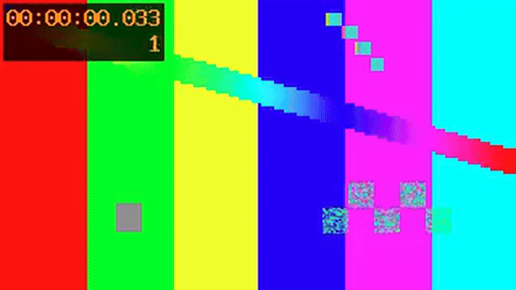
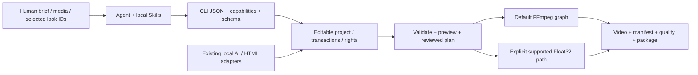
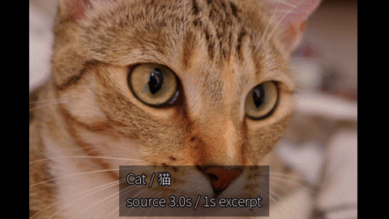
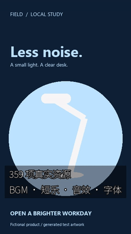
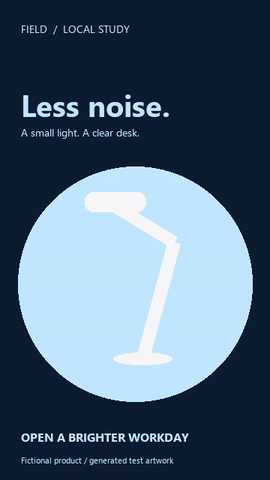

# agent editor kit

[简体中文](../../../README.md) · [繁體中文](../../../README.zh-TW.md) · [English](../../../README.en.md)

面向Agent的开源视频剪辑与生成内核：通过一个Skill或原生CLI管理素材、可编辑时间线、500套风格滤镜、关键帧、字幕、声音、AI模型任务与交付。以FFmpeg和明确登记的本地运行库为基础，直接处理自己的工程文件。

**正式发行：v1.0.0；内核标识：CLI0.1.66；统一Skill：r60。** 发行版本与内核构建编号分别记录。本版重新构建已验收的66内核、离线依赖包、单Skill工具包和三语手册，整合此前已实现能力。它不是所有剪映功能或自然视听质量已经达标的声明。CLI67人像分区和独立文字塑形/排版候选继续保留在开发区，未收入正式包。

[正式Release与全部附件](https://github.com/copypasteltd/agent-editor-kit/releases/tag/v1.0.0) · [发行说明](../../../docs/releases/v1.0.0/RELEASE-NOTES.md) · [完整版本手册](../../../docs/releases/v1.0.0/README.md) · [原G01–G38与剩余工作](../../../docs/product/UNFINISHED_20261107.md)

## 安装包与运行条件

| 编号 | 交付物 | 用途 |
|---|---|---|
| D01 | [Windows x64离线应用包](https://github.com/copypasteltd/agent-editor-kit/releases/download/v1.0.0/agent-editor-kit-v1.0.0-cp313-win_amd64.zip) | 原生应用wheel、固定离线依赖、安装器、第三方许可与分发清单；内核CLI0.1.66 |
| D02 | [统一Skill工具包r60](https://github.com/copypasteltd/agent-editor-kit/releases/download/v1.0.0/agent-editor-kit-v1.0.0-unified-skill-r60.zip) | 一个外层Skill、17内部模块、注册/配置脚本、完整使用说明；与D01摘要绑定 |
| D03 | [SHA256SUMS.txt](https://github.com/copypasteltd/agent-editor-kit/releases/download/v1.0.0/SHA256SUMS.txt) | 核对附件字节；另有简体、繁体、英文快速开始及发布说明，共7附件 |

原生Windows x64、已有CPython3.13 x64和FFmpeg/ffprobe；基础剪辑可用CPU。包内不含Python、FFmpeg、驱动、模型权重或完整Torch/CUDA运行库。可选AI功能需按下文服务表登记已有本地模型与依赖；本项目不用Docker、WSL或虚拟环境。当前正式二进制交付与实测平台为Windows，不能把Python跨平台代码当成已验证的Linux/macOS安装包。

## 从下载到交付的完整流程

原生Windows CPython3.13 x64应用；唯一公开入口为 `$agent-ffmpeg-local-editor`，包含17个内部模块。应用ZIP不包含Python、FFmpeg／ffprobe、驱动、模型权重或完整音乐运行库。先准备本机依赖；不使用Docker、WSL或虚拟环境。

1. 下载本次Release的两个ZIP、SHA256SUMS.txt及本语言快速开始到同一目录。把下面的路径改为实际路径。逐项比较计算摘要与清单，全部匹配后解包到新目录；后续安装器还会校验应用内部清单。

```powershell
$downloads = "E:/video-tools/downloads"
$bundle = "E:/video-tools/application-bundle"
$kit = "E:/video-tools/skill-kit"
Get-Content -LiteralPath "$downloads/SHA256SUMS.txt"
Get-FileHash -LiteralPath "$downloads/agent-editor-kit-v1.0.0-cp313-win_amd64.zip" -Algorithm SHA256
Get-FileHash -LiteralPath "$downloads/agent-editor-kit-v1.0.0-unified-skill-r60.zip" -Algorithm SHA256
Expand-Archive -LiteralPath "$downloads/agent-editor-kit-v1.0.0-cp313-win_amd64.zip" -DestinationPath $bundle
Expand-Archive -LiteralPath "$downloads/agent-editor-kit-v1.0.0-unified-skill-r60.zip" -DestinationPath $kit
```

2. 离线安装应用。目标目录必须是新路径。此步骤不下载模型；模型尚未准备时，可先通过安装版入口执行version／doctor及基础剪辑命令。

```powershell
$python = "C:/Python313/python.exe"
$installed = "E:/video-tools/application-installed"
& $python -E -B -X utf8 "$bundle/install.py" --bundle $bundle --target $installed --manifest-sha256 "sha256:8946cc2eedfab5b4f7c8f536b5277e3c6a636a0e700754a3cf25c76bfba9d0cd"
& $python -I -S -B -X utf8 "$installed/run.py" version
& $python -I -S -B -X utf8 "$installed/run.py" doctor
```

3. 配置基础剪辑模式，将统一Skill绑定到上述安装目录。时间线、滤镜、字幕、预览和渲染可直接使用；配音、翻译和语义模型按下一段另行配置。配置器先备份旧配置，再建立基础绑定并清除旧机器模型路径。

```powershell
& $python -E -B -X utf8 "$kit/scripts/activate_community_runtime.py" --installed $installed --base-only
```

可选模型：需要配音／翻译时，先准备已校验的 `kokoro-zh-en-int8` 与 `opus-zh-en-cpu-int8` 两个CPU包；`kokoro-zh-en-cuda13` 与 `opus-zh-en-cuda12-int8` 为可选GPU包。PACKS指向包含这四种解包目录的父目录；配置器要求两个CPU包，并逐包验证后写入模型绑定。本次两个ZIP未包含这些模型包；来源、许可、预期摘要与复现工具见下方链接。

[Model catalog and pinned manifests](https://github.com/copypasteltd/agent-editor-kit/blob/main/product/src/ai_ad_editor/material_data/model-packs.json) · [CPU pack builder](https://github.com/copypasteltd/agent-editor-kit/blob/main/scripts/build_community_model_pack.py) · [GPU pack builder](https://github.com/copypasteltd/agent-editor-kit/blob/main/scripts/build_community_gpu_packs.py) · [Offline pack installer](https://github.com/copypasteltd/agent-editor-kit/blob/main/scripts/install_community_pack.py)

```powershell
$packs = "E:/video-tools/model-packs"
& $python -E -B -X utf8 "$kit/scripts/activate_community_runtime.py" --installed $installed --packs $packs
```

若使用GPU包，将配置命令替换为下面的形式，并填写对应的实际DLL目录。配音与翻译的CUDA版本要求不同；不要把两个目录混写。后续使用 `--device auto` 优先选择配置的GPU，并检查返回的实际设备／provider及CPU回落说明。

```powershell
& $python -E -B -X utf8 "$kit/scripts/activate_community_runtime.py" --installed $installed --packs $packs --voice-cuda-lib "E:/video-tools/cuda13/bin" --translation-cuda-lib "E:/video-tools/cuda12/bin"
```

4. 注册唯一Skill并检查实际安装版本。已有同名入口且指向其他位置时，注册器会保留并拒绝替换；升级请先阅读随包交付说明，不手工删除不明目录。Agent外层只需指定 `$agent-ffmpeg-local-editor`。

```powershell
powershell.exe -NoProfile -ExecutionPolicy Bypass -File "$kit/register-agent-ffmpeg-local-skills.ps1"
$entry = "$kit/skills/agent-ffmpeg-local-editor/scripts/run.ps1"
& $entry version
& $entry doctor
& $entry capabilities
& $entry model-pack list
& $entry gpu inspect
```

5. 创建工程并导入自己的授权素材。下例中的视频、图片、字幕、配音文本和changes.json必须实际存在。读取导入返回的 `data.asset.id`，再依据schema及帮助编写changes.json；不能照抄旧案例的随机ID。视频和音频轨须分别编排，先预览实际滤镜候选并记录客户选择，再合成时间线。

```powershell
$aekProject = "E:/video-work/my-ad"
& $entry project init $aekProject --name "My ad"
& $entry media ingest --project $aekProject --input "E:/media/product.mp4"
& $entry schema show
& $entry timeline compose --help
& $entry look list --query "Kodak"
& $entry look inspect --id t3-kodak-gold-200
& $entry look preview --id t3-kodak-gold-200 --input "E:/media/still.png" --output "$aekProject/exports/film-preview.png" --strength 0.65
& $entry timeline compose --project $aekProject --input "E:/video-work/changes.json"
& $entry look apply --project $aekProject --id t3-kodak-gold-200 --global --strength 0.65 --dry-run
& $entry look apply --project $aekProject --id t3-kodak-gold-200 --global --strength 0.65
```

可选配音／翻译示例会真实运行模型，需先准备输入文件、模型包与配置，并使用新的asset ID。完整音频、发音、翻译语义和时长仍需复核。生成后用真实音频资产ID编写voice-changes.json，将声音显式编入音轨，再执行下面最后一条compose；翻译字幕也须按目标轨道编排。

```powershell
& $entry voice list
& $entry voice synthesize --project $aekProject --voice zf_001 --input "E:/media/narration.txt" --device auto --asset-id asset_voice
& $entry translate subtitles --project $aekProject --from zh-Hans --to en --input "E:/media/captions.srt" --output exports/bilingual.srt --mode bilingual --device auto
& $entry timeline compose --project $aekProject --input "E:/video-work/voice-changes.json"
```

6. 验证、预览、渲染并检查实际成片，再导出可编辑工程包。导入使用新的目标目录；重新渲染后分别检查画面、完整音轨、时钟及配方。JSON的ok／status／errors／warnings／artifacts与进程退出码需要同时检查，质量检查不能代替完整播放及听审。

```powershell
& $entry validate --project $aekProject
& $entry preview frame --project $aekProject --frame 0
& $entry render --project $aekProject --output "$aekProject/renders/ad.mp4"
& $entry quality check --project $aekProject --input "$aekProject/renders/ad.mp4"
& $entry convert export --project $aekProject --target-format package --output "$aekProject/exports/ad.aevpkg.zip"
& $entry convert import --input "$aekProject/exports/ad.aevpkg.zip" --output "E:/video-work/restored-ad"
& $entry render --project "E:/video-work/restored-ad" --output "E:/video-work/restored-ad/renders/replay.mp4"
& $entry rights check --project $aekProject
```

神经音乐是额外能力，需要显式登记已有本地适配器、原生运行库和权重；上述四包不能替代音乐模型。先阅读[神经音乐说明](https://github.com/copypasteltd/agent-editor-kit/blob/v1.0.0/skills/agent-ffmpeg-local-editor/references/neural-music.md)。普通谱面合成、循环修复和神经生曲的含义不同。

```powershell
& $entry music generate --help
& $entry delivery --help
```

[Skill详情与17模块](https://github.com/copypasteltd/agent-editor-kit/blob/v1.0.0/skills/agent-ffmpeg-local-editor/SKILL.md) · [滤镜客户选型](https://github.com/copypasteltd/agent-editor-kit/blob/v1.0.0/skills/agent-ffmpeg-local-editor/references/client-look-selection.md) · [配音／翻译／音频](https://github.com/copypasteltd/agent-editor-kit/blob/v1.0.0/skills/agent-ffmpeg-local-editor/references/community-materials.md) · [升级、恢复及回滚](https://github.com/copypasteltd/agent-editor-kit/blob/v1.0.0/docs/product/DELIVERY_CONTROLLER.md)

发布成片前补充素材／模型／声音用途的权利证据，并执行rights check。render的--publish仅执行本地权利门禁，不上传平台。模型生成内容仍须逐项审查；本包不附未审核模型音频。同机新目录验收不等于干净主机或跨机器通过，完整剪映等价及原G01—G38条件继续开放。

`v1.0.0` / CLI`0.1.66`


下面的功能与案例按各自证据日期保留；旧案例的CLI编号是实际执行版本，不代表本轮重新执行。正式1.0.0的安装和调用以本页前述流程及R618–R620为准。

## 本版新安装与工程重放的实际输出

程序图案与独立测试音经真实安装版剪辑、LUT及工程包重放；2秒、60帧、完整立体声对照。该例用于核验分发/渲染链路，真实素材及AI案例见后面的完整案例表。



[MP4](../../../docs/assets/release-v1-20261107/actual.mp4) · [PNG](../../../docs/assets/release-v1-20261107/preview.png) · [Input video](../../../docs/assets/release-v1-20261107/input-pattern.mp4) · [Input WAV](../../../docs/assets/release-v1-20261107/input-tone.wav) · [Editable project](../../../docs/assets/release-v1-20261107/editable.aevpkg.zip) · [Source and notices](../../../docs/assets/release-v1-20261107/SOURCE_AND_LICENSES.md)

## 产品方案与完整执行逻辑



当前实现是 **Python CLI + Agent Project schema + FFmpeg**，并有显式的 Float32 处理子集。Concat 是早期路线研究对象，发行包不是“删除 Concat GUI 的二进制”。已采用的 OpenFilm 字幕分段、帧时钟、HTML 动效/模板等复用保留来源与许可；当前运行不依赖 OpenFilm 在线服务。

1. 读取 version/doctor/capabilities/schema，确定本机真实可用的能力与依赖。
2. 把 brief 写成计划：素材、画幅、时长、镜头、音轨、字幕、运镜、风格、交付与证据。
3. 创建独立工程，导入本地素材，用真实 asset ID 与整数 ticks 编写编辑 JSON；音轨明确添加。
4. 通过事务 compose/edit/apply 写入时间线，保留快照；先校验，再预览关键帧和区间。
5. 若需要选型，展示原图与少量候选，记录最终 ID/强度/作用域；在目标素材上复试。
6. 渲染至工程内新路径，检查实际编码文件、manifest、warning、音画与权利，再导出项目包。

<a id="feature-modules"></a>

## 功能模块与实际支持边界

编号用于定位文档；各模块有依赖与交叉，不是“43 个独立内核”或完成率。下表直接写明行为、入口与限制；[完整机器能力清单及每项契约](../../../docs/product/CAPABILITIES.md)保留全部字段。

**F45音色状态补充（2026-11-06）：** 已有CLI61独立安装版实际生成的全部103个音色WAV及完整PCM工程包重放，中文100／英文3。下表F45保留早期“至少7个”证据下限；完整样音可按[本地试听流程](../../../docs/validation/CLI61全音色试听_2026-10-29.md)选型。人类完整听审、自然度、情绪／方言及输出权利仍未验收，本次未重新生成声音。

| 编号 | 功能模块 | 具体行为与输入 → 输出 | 入口 | 依赖/边界 |
|---|---|---|---|---|
| F01 | Agent 调用协议 | 任务参数 → JSON 响应、退出码、错误、warning、产物与 provenance；能力与 schema 可查询。 | `version; doctor; capabilities; schema show` | Skill 组织任务，CLI 执行；没有后台云端 Agent 服务。 |
| F02 | 可编辑项目 | 创建/检查 Agent Project，保存资产、序列、轨道、ticks 时钟、输出配置和权利引用。 | `project init/inspect` | 源媒体与项目元数据分离，移动工程后需重链并复核证据路径。 |
| F03 | 事务、恢复与快照 | 元数据事务/快照；原生子进程树归属；显式恢复四轨及字幕配音的持久化工作目录和未提交输出。  新增语义登记/索引/校准/检索的受管任务。| `project snapshot/restore/migrate/recover; operation inspect` | 整棵已引用语义目录保护；活跃/变化/未知/旧缓存保留。仅已接入任务，不是模型续算；当前完整性读取已响应超时/取消；其他 worker/OS 阻塞 I/O 仍有边界。 |
| F04 | 素材导入与重链 | 本地图片/视频/音频/字体 → 探测结果、稳定资产 ID、哈希和来源记录。 | `media ingest/relink` | 不抓取在线素材；导入不自动证明商业授权。 |
| F05 | 代理、缩略图与波形 | 素材 → 轻量代理、图片缩略图、音频波形、可核查联系表。 | `media prepare/contact-sheet` | 联系表是抽样证据；不代表逐帧视觉理解。 |
| F06 | 镜头、静音与高光分析 | 本地视频/音频 → 切镜、静音、节拍或启发式高光候选与时间证据。 | `media understand/highlights` | 高光是启发式候选，语义判断需要 Agent/已注册适配器复核。 |
| F07 | 智能粗剪与广告计划 | 经检查的静音/文本片段或广告 brief → 编辑计划 → 可编辑粗剪。 | `media smart-cut; ad plan/apply` | 计划与实际 apply 分开；不承诺自动导演效果或投放表现。 |
| F08 | 节拍剪辑与多机同步 | 节拍锚点/本地多机音轨 → 剪切或 offset/显式 affine 时钟及切机计划。 | `media beat-cut/multicam` | 低置信度、覆盖不足、非线性漂移需拒绝/显式处理；不自动添加音轨。 |
| F09 | 多轨基础剪辑 | 编辑 JSON → 加轨、插入、更新、拆分、删除、时长/位置修改与画幅设置。 | `timeline compose/edit` | 遵守轨道锁、整数 ticks、资产时长与实际能力契约。 |
| F10 | 范围与输出窗口编辑 | 明确区间 → 裁切/删除/波纹等范围编辑，保留作者时间与源映射。 | `timeline edit` | 复杂变速与嵌套的组合需按具体契约检查，不推断所有组合均可用。 |
| F11 | 源句柄、滑移与滑动 | 源入出点与邻接片段 → 可逆源编辑、源句柄转场和剪口调整。 | `timeline edit/transition` | 源句柄不足会报错；不以静默复制帧替代。 |
| F12 | 磁吸、主轨与关联音画 | 主轨重排、原生跟踪跨剪口同步拆分、区域关联ID和音画附着。 | `timeline edit` | 显式同步及拆分策略；锁、转场端点和资源门禁；非原生跟踪跨剪口继续受限。 |
| F13 | 复合与嵌套序列 | 子序列 → 独立画布合成、父变换/透明度、嵌套时钟与定格。 | `timeline compose/edit` | 独立空间不代表独立色彩/帧率；部分组级空间转场未接受。 |
| F14 | 变速、倒放与定格 | 共享完整作者时钟、逐层输出和单次声音；原生独立空间入出场可保留。 | `timeline edit; render` | 跨片段转场仍需完整上级；ripple/retime、锁、预算和音频后端边界保留。 |
| F15 | 关键帧与缓动 | 位置、锚点、缩放、旋转、透明度、裁切、蒙版、音量/声像 → 逐帧动画。 | `timeline compose; schema show` | hold/linear/ease_in/ease_out/ease_in_out/bezier；枚举/布尔值不推断为连续动画。 |
| F16 | 12 套运镜预设 | 推拉、上下左右平移、Ken Burns、旋入/旋出、淡入/淡出、shake → 可编辑关键帧。 | `motion list/inspect/apply` | 参数有界；是明确关键帧预设，不是 AI 三维相机或全部商业运镜库。 |
| F17 | 转场与剪口效果 | 相邻片段与源句柄 → 淡化、擦除、滑动、黑/白场、圆形等已声明转场。 | `timeline transition; capabilities` | 按渲染路径和层级选择；显式 Float32 已提供 F55 的转场子集，CPU 执行，支持范围见其独立契约。 |
| F18 | 几何蒙版与逐帧修正 | 矩形/圆/椭圆/路径/多边形 → 反选、羽化、动画、编码蒙版与修正。 | `timeline compose; media mask-edit; quality mask` | 路径点数和采样受限；几何通过不等于语义分割/身份正确。 |
| F19 | 图层合成与混合 | 多轨视觉层 → normal/multiply/screen/overlay/difference/addition/softlight/hardlight。 | `timeline compose; capabilities` | 默认路径主要为编码 8-bit RGB；不宣称线性光/HDR 合成等价。 |
| F20 | 51 个效果处理算子 | 模糊/锐化、降噪、色调、曲线、HSL、色键、暗角、颗粒等 → 可配置效果链。 | `effects list/inspect` | 可动画参数与实际后端逐项查询；51 算子与 500 成品 LUT 是不同统计。 |
| F21 | 500 套离线风格 | 名称/ID/类别/许可检索 → 详情、图片预览、片段或全局应用与来源副本。 | `look list/inspect/preview/apply` | 500 个不同数值变换含同系列曲线；SDR 创意映射，不是 500 个独立家族。 |
| F22 | 自定义 LUT 与色彩自动化 | 本地 .cube/.3dl/.csp/.dat → 登记、检查；支持的 3D LUT 强度与色彩参数按契约动画。 | `lut register/list/inspect; effects inspect` | 格式登记不等于所有路径都完整解析；完整 CUBE 才有对应强度/浮点支持。 |
| F23 | 显式 Float32 像素路径 | 声明输入/工作/输出信号、顺序与预算 → 原生浮点色彩、LUT/shaper、选定空间处理和 surface。 | `render; preview; surface export/inspect` | 必须显式选择 float32-native-v1；能力子集，拒绝不支持项，非完整 HDR/ICC 管线。 |
| F24 | 字幕、文字与分段 | SRT/VTT/ASS/SSA/TTML 或文字 → 规范化、分段、双语、文字层、逐字高亮和文字动画。 | `subtitle validate/normalize/segment; timeline compose` | 字体需本地可用；复杂排版、双向 shaping 与部分动画/时钟有明确近似或拒绝。 |
| F25 | 离线转写与字词对齐 | 音频 + 已有 Whisper/CTC 模型/校正文 → 转写、字幕、字词时码与 CER 评估。 | `asr adapter; subtitle transcribe/align/evaluate` | 基础包不带权重；activity 保留原 CTC 并通过 6 组受控词块门槛；自然连续语音、中文和歌词精度仍未验收。[流程](../../../docs/product/CTC_ACTIVITY_ALIGNMENT.md) |
| F26 | 多轨音频与总线 | 显式音轨 → 混音、总线、音量/声像、静音/solo、淡化、EQ、压缩、降噪、响度与闪避。 | `audio extract; timeline compose; quality check` | 视频资产有声音不代表时间线自动出声；自动 PCM/LUFS 检查不代替听审。 |
| F27 | 本地语音合成 | 已有本地 flite 或登记 SoulX 权重/授权参考声 → WAV 资产与可选音轨。 | `tts adapter/voice; tts synthesize` | flite 取决于 FFmpeg 构建且限 ASCII 英文；SoulX 需 CUDA/原生依赖，非基础包自带配音库。 |
| F28 | 独立四轨与双轨分离 | 音频 → drums/bass/other/vocals 四个模型预测、float WAV 与可编辑音轨；保留原双轨和 mid/side。 | `audio separate-stems; audio separate; audio adapter` | 另供原生环境/权重；受控 CPU/GPU 实测，自然质量/听审/模型权利仍待验。 |
| F29 | 跟踪、绑定与重构图 | 模板/模型/已编码蒙版轨迹 → 文字/贴纸锚定、裁切与主体重构图关键帧。 | `media track/track-bind/reframe` | 多目标须明确对象；置信度/蒙版不等于身份保证，支持的变换与时钟需检查。 |
| F30 | OCR 锚点与人脸修饰 | 已有 PP-OCR/OpenSeeFace 模型 → OCR 框/文字、锚点运镜、人脸点位与受限修饰。 | `ocr adapter/scan/anchors; face adapter/scan/retouch` | 已有 ONNX CPU 环境与权重；不是完整 UI 行为识别、美妆、瘦身或脸部生成。 |
| F31 | 人像抠像与对象分割 | 已有 RVM/SAM2 + 提示点/框 → 透明视频、对象 mask 和可编辑派生资产。 | `media adapter; media matting` | RVM 人像与 SAM2 对象分割不同；概率 mask 不是物理发丝 matte，需检查运动/遮挡。 |
| F32 | 修复、生成编辑与扩画 | 已有 LaMa/VACE + 蒙版/提示 → 修复或扩大画布，保留来源与可重放 recipe。 | `media inpaint/outpaint; media adapter` | LaMa 逐帧不保证时序；VACE 需 CUDA 且仅窗口联合；自然纹理/时序质量未普遍验收。 |
| F33 | HTML/CSS/SVG/Canvas 动效 | 受信任本地源码/素材/字体 → 可编辑模板控件、透明标题、逐笔描线、布局诊断与时间线合成。 | `motion html-*; motion stroke-source` | 另需已有 Node/Playwright/Chromium；非任意网页沙箱，不自动下载浏览器。 |
| F34 | 参数模板与批量变体 | 本地 JSON 模板 + 类型变量 → 可编辑项目变体、批量输入与模板快照。 | `template apply/batch` | 支持 asset/color/enum 等类型；复杂条件图和表达式执行未实现。 |
| F35 | 素材索引与片段组复用 | 素材目录/已编辑片段 → 检索、重复/相似检查、跨项目片段组与依赖闭包。 | `library index/search/duplicates/similar; fragment` | 用户自建资源库，未内置商业素材订阅/正版音乐库存。 |
| F36 | 帧、区间与缓存预览 | 工程 + 明确帧/区间 → PNG/短视频/缓存与可验证采样证据。 | `preview frame/range; cache; preview cache-*` | 预览不是完整成片核验；色彩路径与缓存签名需一致。 |
| F37 | 输出、编码与GPU投影 | 工程 → MP4/WebM/MKV、显式OpenCL裁切/仿射/子画布投影、编解码探测与manifest。 | `render --projection-acceleration; render` | 原生GPU需双精度/纹理预检；CPU默认，其他特效仍CPU，无实时/通用4K保证。 |
| F38 | 持久队列、重试与取消 | 冻结项目快照 → 本地排队、有限worker、显式重试/取消与串行元数据提交。 | `queue enqueue/list/inspect/run/cancel` | GPU投影策略逐作业传递，拒绝其 --reuse-identical 绕过探测；不是云渲染。 |
| F39 | 成片、Scope 与 golden 核验 | 实际编码文件 → 音画/帧率/画幅/时长、响度/黑场、色彩 Scope、蒙版和 golden 差异报告。 | `quality check/scopes/mask/golden` | 自动检查、静态目检、连续播放、人工听审分别记录；不等于商业成片质量认证。 |
| F40 | 权利台账与本地策略 | 素材/字体/LUT/模型/模板证据 → 依赖台账、变更历史、影响/撤回与发布门禁。 | `rights; policy audit; render --publish` | --publish 只检查本地权利，不上传；台账不自动裁定版权。 |
| F41 | 项目与时间线交换 | Agent JSON/package、OTIO、Kdenlive MLT、已有合法明文草稿 → 导入/导出与损失报告。 | `convert import/export` | Exact/Approximate/Unsupported/Failed 逐项报告；明文草稿不调用剪映，不解密或下载专有资源。 |
| F42 | 管道诊断与错误交付 | 失败操作 → 有界日志、diagnostic manifest、显式导出和可复查错误信息。 | `diagnostics list/show/export; operation inspect` | 失败/拒绝不是成功渲染；包含本地路径的诊断需按交付范围处理。 |
| F43 | 创意、内容与投放分析 | 用户提供的产品、受众、参考片或投放表 → 脚本、结构、变体建议与分析。 | `ad plan/apply; advisory Skills` | 策略 Skill 不提供广告平台连接、自动投放、实时数据或效果保证。 |
| F44 | 内置开源素材库 | 359 项逐项具名 BGM/短乐/音效/简繁字体 → 查询、检查、权利登记与项目资产。 | `materials list/inspect/verify/ingest` | 44 BGM、85 短乐、228 音效、2 字体；每项保留来源/许可，视频/贴纸和行业覆盖不足。 |
| F45 | Kokoro 中英配音库 | 文本、103 具名音色和语速 → 完整 WAV、实际时长与可编辑声音资产。 | `voice list/synthesize; model-pack` | 可选 CPU/CUDA 包；累计至少 7 个音色实际生成，完整试听、情绪/方言与人类听审未验收。 |
| F46 | 中英翻译与双语字幕 | 文本或普通 SRT → 中英双向译文、简繁转换、双语 SRT与显式术语译后替换。 | `translate text/subtitles` | OPUS 需本地模型；保留 cue 顺序/毫秒，错译仍保留，不能替代人工语义接受。 |
| F47 | GPU 配音与翻译选择 | 明确 CPU/CUDA/auto 和显存预检 → 实际 provider、设备与明确回退/失败。 | `gpu inspect; voice; translate; --device` | RTX 3060 实测；配音 CUDA 13 / 翻译 CUDA 12、配音当前仅设备 0，其他滤镜不因此 GPU 化。 |
| F48 | 配乐准备与声音混合 | 实际音乐/人声资产 → 截取、循环、淡入淡出、显式增益和人声闪避混音。 | `music prepare/mix` | 保留原分轨，不静默裁人声；谱面合成见F83，接缝交叠修复见F84，画面语义匹配仍未完成。 |
| F49 | 原生采集 | 明确窗口/屏幕/区域/相机/麦克风 → 有限录制、CPU/NVENC、取消和项目资产登记。 | `capture devices/record` | 真实窗口 CPU/GPU 已验；相机/麦克风、联合音画同步、设备故障和长录制未验。 |
| F50 | 离线图文语义检索与条件选择 | 本地索引、中英/参考图、同帧正负条件、经验校准档案、实际预览/源时间及可编辑引用。 | `semantic adapter-register/index/calibrate/calibration-list/search/verify` | 工程包按需派生路径绑定；同机 80 条迁移决策保留，仍有 3 条已知错误；运行时另备，G26/G31 开放 |
| F51 | 字幕翻译配音联合流程 | 普通中英 SRT、显式音色/轨道 → 译文或保留同语种原文、完整批量 WAV、实际时窗、可编辑声音/字幕和原子提交。 | `dub subtitles` | 同语种只初始化配音模型；保留原声/重试/错译；cue 时窗不证明字词精度、自然韵律或口型同步。 |
| F52 | 可编辑广告分镜与返工 | 已确认 brief/实际素材 → 多画幅与时长的画面/字幕/配音/源音/配乐独立轨道；按镜头与变体局部改稿。 | `ad storyboard/build/revise` | 整帧分配、原素材字节锁、实际字体排版和完整配音时窗；不自动创造卖点或决定素材语义。 |
| F53 | 语义运行时升级 | 旧适配器/索引/校准 → 新安装路径下的新 ID，复制向量/预览/数据集且保留拟合和原观察。 | `project upgrade-semantic` | 全部 19 个实现与外部依赖须字节相同；零新模型前向，原记录不改；内容变化拒绝并要求重建。 |
| F54 | 可复用参数运镜 | 本地版本化 JSON / 已有作者曲线 → 普通关键帧、参数/摘要/快照、跨工程复用。六套真实预览供选型。 | `motion pack list/inspect/create/capture/apply` | 65 点采样、transform 属性；默认拒绝冲突，显式替换整条属性轨；跟踪绑定拒绝，CPU 合成/自然质量未闭。 |
| F55 | 线性浮点转场与组级进出场 | 显式 Float32 工程 → 57 xfade图案+2 dip、预乘alpha混合、真实句柄/原作者时钟、关联音轨、组级擦除/推移与实际预览成片。 | `timeline transition; preview; render; queue` | CPU；12种真实句柄声明，其他图案用显式重叠/边缘；normal双源混合；风噪有平台差异，HDR/自然质量未闭。 |
| F56 | 线性浮点文字与字幕 | 独立/内嵌/SRT、联合逐词/打字机 → 原生字节覆盖率、可复用字形、分块线性合成、原作者时钟、4K标题和实际交付。 | `timeline compose; preview; render; queue` | 明确本地字体；CPU/显式GPU；覆盖率8bit/颜色Float32；工作区准入非峰值RSS；富ASS/Bidi/自然质量未闭。 |
| F57 | 原生Float32 GPU执行 | 仿射、普通合成、文字组件/逐词、粒子栅格及光学/高光扩散效果；任务自有管道/共享像素，贯通渲染/预览/队列/恢复。 | `projection_acceleration; render; preview; queue` | off/prefer/require；binary64精度/次正规探测，粒子保持Float32；有界控制及所属进程/线程/流清理，其他算子CPU。 |
| F58 | Float32全局/区间调整层 | 全轨含字幕合成后按顺序调色/光效；既有浮点效果与光学/高光扩散效果、六种插值，选中根只应用一次。 | `settings.adjustments; preview; render; queue` | 明确线性工作域/效果信号；光学/高光扩散可GPU，其余CPU；LUT持锁/包迁移，原作者区间时钟，非完整HDR。 |
| F59 | 原生PTS跟踪与叠加轨 | 保存源观测→按实际原生帧求跟随位置；共享crop/TRS、ROI缩放/相对旋转、透明度、窗口与嵌套声音。 | `media track-bind; preview; render; queue; package` | 显式Float32，原生PTS不烘焙显示键；预算/循环门禁；模板漂移与遮挡另审，中间格式烘焙未接通。 |
| F60 | 原生跟踪与烘焙交付 | 实际alpha/5类遮罩/59转场足迹；剪辑与共享变速保留观察；原生烘焙逐帧核验并保留源旁车。 | `media track-bind; timeline compose/edit; convert export --bake-tracking` | 当前冻结图/FPS；20,000帧/256,000求值；无法表达的整数步进拒绝；外部播放器及自然身份/遮挡待验收。 |
| F61 | 本地GPU视频生成 | 文生、图生、尾帧/首尾帧；原文提示/采样、真实模型窗口、可编辑入轨、端点核验、可移植配方和受管恢复。 | `media adapter; media generate` | 已有原生VACE/CUDA依赖；无声8bit SDR；条件端点合成保留；自然质量/生成权利/全部剪映AI待验收。 |
| F62 | 原生GPU模型会话 | 同工程/适配器/提示词复用权重与嵌入；每任务重置，活连接传递持锁摘要；取消、期限、空闲及任务数退出。 | `media model-session; media generate --model-session` | 原生Windows VACE；首条仍载入；新提示词须新会话，串行执行；非全局显存预留/多GPU。 |
| F63 | 可编辑程序化粒子与发射器动画 | 六种原创建效配方、五形状、seed/独立CFR；21属性源时钟关键帧、六种缓动、发射暂停；真实GPU栅格化。剪辑/预览/队列/包/本地OTIO贯通。 | `vfx list/inspect/apply/update/show/animation-properties/animate` | CPU积分与出生采样，GPU绘制；64点/属性、16发射器、4096预留活粒子；无3D/碰撞/深度。 |
| F64 | 可编辑光学效果与GPU运算 | 眩光核心/条纹/光晕/鬼影、旋转椭圆漏光、径向红蓝色差；全部数值通道关键帧、原作者时钟、片段/区间调整层，CPU/OpenCL。 | `effects list/inspect` → `timeline compose` → preview/render | 明确线性RGB；原alpha位保留，透明隐藏色不渗出；ghosts/edge静态，非物理镜头/自动亮源/bloom。 |
| F65 | 真实高光 Bloom / 胶片 Halation | 软膝阈值提取实际高光→分离高斯扩散→核心抑制/线性着色；可编辑数值轨道和原作者时钟，片段或根区间调整层。 | `effects list/inspect; timeline compose; preview; render; queue` | sigma0…32输入像素；透明/复制边界、原alpha位保持；实际四kernel GPU/CPU参考，有界空间/访问预算；非物理胶片/HDR验收。 |
| F66 | 原生 PQ／HLG HDR 与 SDR 显示 | 明确参考白及HLG峰值/gamma，解码至显示线性光；不同nit素材、普通效果/合成、10-bit BT.2020 NCL交付，单独选择SDR trim及PNG/MP4预览。  源码51另增OKLab保感知明度/色相缩色度；安装50尚未包含。| `timeline compose; validate; preview; render; convert` | 传递CPU，已有合成/光效可GPU；拒绝8-bit/标签不符/缺单位；alpha位保留。非ICC/动态元数据或HDR监看验收。 |
| F67 | 本地神经口型同步 | 图片／视频＋独立声音→真实CUDA MuseTalk口型；25FPS人脸框关键帧、语义下半脸混合、完整PCM及alpha保留，可复用配方并视频/音频关联入轨。 | `lipsync adapter register/list/inspect; lipsync generate` | 本地safetensors及已有原生Torch依赖；脸部256×256、明确8bit SDR与源运镜、无CPU回退；自然口型、完整数字人仍未验收。 |
| F68 | CUDA神经补帧与慢动作 | 原生CFR/VFR、每源帧RGBA、预乘alpha、完整PCM；2..8倍、切镜保持、关联慢放双轨、配方重跑及工程包。 | `interpolate adapter; interpolate generate` | 显式RIFE4.25 safetensors＋原生CUDA Python；无CPU回退；困难运动/遮挡/自然质量/HDR未广泛验收。 |
| F69 | CUDA对白降噪与增强 | 原生采样时钟/单双声道、真实模型、干湿强度/衰减、可编辑独立音轨、配方重跑/工程包、取消回滚。 | `audio enhancement-adapter; audio enhance` | DeepFilterNet3固定safetensors＋已有原生CUDA依赖；分段状态重置、CPU前端；不是完整去混响/音乐保真。 |
| F70 | HDR10静态元数据交付 | 母版RGB/白点xy、最小/最大nit、MaxCLL/MaxFALL → 实际HEVC SEI与解码核验清单。 | `settings.output.hdr10; validate; render; convert` | 明确原生PQ/BT2020 NCL有限量程、libx265/10bit420/MP4或MKV；作者声明、前32包核验。 |
| F71 | 白点适应与宽色域工作配置 | ProPhoto D50／AP1 D60／明确xy → 线性XYZ Bradford、nit缩放、实际D65预览与工程包。 | `native_chromatic_adaptation; render; preview; surface export; convert` | CPU色彩数学，GPU光晕按声明白点；不含ICC解析／完整ACES／自动白平衡。 |
| F72 | 原生ICC来源色彩管理 | RGB ICC v2/v4矩阵/CLUT、明确SHA/意图/BPC → 线性RGB工作域，Float32/alpha、实际预览与工程包依赖闭合。 | `native_icc_source_profiles; surface inspect-profile; surface export; render; preview; convert` | 固定MIT LittleCMS原生CPU；不含任意输出ICC/软打样/CMYK/自动内嵌推断。 |
| F73 | HLG显示黑位与完整信号CLI | BT.2100黑位提升/逆变换、明确nit与黑位、零黑位原数值路径、完整RGB/HDR/ICC JSON与显式域策略。 | `native_hlg_black_level; surface export; render; preview; convert` | 不推测屏幕；nominal0..1；超限拒绝或明确裁切；不含动态HDR/完整ACES。 |
| F74 | 原生ICC输出与软打样 | RGB v2/v4矩阵/B2A CLUT、四意图/BPC、明确nits、逐帧内嵌ICC的RGBA16 PNG及作者PCM、真实SOFTPROOFING和完整交付检查。 | `native_icc_output_profiles; surface render; surface inspect-output; render; preview; convert` | CPU CMM；GPU剪辑独立；8GiB产物预算；无CMYK/ICC5/物理设备校准。 |
| F75 | 编码前后HDR光量与转换收据 | 明确nit；实际作者RGB16输入与编码后原生RGB/YCbCr分别测量，MaxRGB/CIE Y、位置/时长、完整像素与时钟摘要、全帧裁切账本。 | `native_hdr_light_measurement; surface measure; surface measure-media; surface export; render` | CPU测量；不推断显示器、不自动写SEI；原生曝光缺口/重叠不填补。 |
| F76 | 原生 ACES 时间线与显示视图 | 固定ACES1.3/2.0/2.1；AP1/D60场景输入、曝光、正式SDR/PQ/HLG输出、独立观看视图、显示线性缩图与测量。 | `native_aces_display; surface ocio-configs; render; preview; surface measure` | 源码CLI53、CPU；不是自动相机IDT/AMF/LMT/GPU或物理监看；安装Skill已53。 |
| F77 | 校准语义广告联合选材 | 单批真实语义接口、全变体来源窗口／源音／权利筛选、全局去重分配、可移植逐镜头依据和普通分镜计划。 | `ad select; ad build; ad revise` | 源码CLI54；45项测试通过，实际CUDA／安装／Skill另验；不证明整段语义或自然广告质量。 |
| F78 | 原生子进程继承预算 | 在预算上下文内，启动／等待／返回时检查外层期限和取消标记，中断时关闭自有Job并回收读取线程。 | `run_process / operation_budget` | 源码CLI55；15项控制回归通过；不承诺OS阻塞调用硬实时抢占。 |
| F79 | 语义模型原生依赖隔离 | 工作进程固定自己的应用包后恢复模型Python的依赖搜索顺序，保留版本／模块路径／摘要检查，避免安装site覆盖模型NumPy／Pillow。 | `semantic / ad select / project upgrade-semantic` | CLI56源码／安装原生回归与实际CUDA案例通过；新实现须重新登记绑定，非任意环境兼容保证。 |
| F80 | 15类原生工作进程依赖隔离 | 临时固定所属应用包后恢复模型Python依赖搜索顺序，拒绝预加载外部同名包，保留原版本／路径／摘要校验。 | 原生ASR／CTC／分割／抠像／跟踪／修复／生成／口型／补帧／降噪／分离等入口 | CLI57源码31项子进程回归通过；安装和实际模型另验，正式Skill仍CLI56。 |
| F81 | 精确内容去重选材 | 规范SHA256内容分组、全局联合分配，支持显式ID去重或复用。 | ad select；不同ID相同文件；非感知去重 | 源码58选材／分镜57项通过；[规则与证据](../../../docs/product/AD_CONTENT_UNIQUENESS.md)，58安装另验。 |
| F82 | 自有原生进程同步回收 | 持有自有成员句柄并等待退出，独立Job互不影响，保留外层预算异常。 | Windows模型／工具子进程及补帧预处理超时 | 源码58控制19项、超时3项分别通过；[行为与证据](../../../docs/product/OWNED_PROCESS_CLEANUP.md)。 |
| F83 | 可编辑谱面与程序音效（正式CLI59） | 谱面拍点／MIDI音高／8解析乐器 → 48kHz双声道WAV、分轨和可编辑工程；4种电子音效。 | `music inspect-score/compose/effect` | [实际内容、命令、配器与限制](../../../docs/product/MUSIC_SCORE.md)；不是神经生曲，正式Skill59已支持。 |
| F84 | 循环接缝交叠修复（正式CLI63） | 样本时钟、双曲线、可编辑配方、权利继承、取消与事务回滚；周期明确缩短。 | `music repair-loop` | [流程与C76试听](../../../docs/product/MUSIC_LOOP.md)；安装、候选与正式入口完整PCM/工程重放通过，仍须听审。 |
| F85 | 8套可编辑复合光效内容包 | OP01—OP08完整参数、作者时钟动画、实际MP4/GIF与可编辑工程；复用已有光学内核。 | `template apply` | [完整参数与样片](../../../docs/product/OPTICAL_EFFECT_PACK.md)；会替换完整effects数组，需审阅既有效果；不是8个新算子。 |
| F86 | N002母图光效选型 | 同一N002、同一2秒时刻的8张实际PNG；页面选择输出ID/版本/摘要，电脑与手机宽度交互/截图已核验。 | `preview frame; template apply` | [母图预览与选型](../../../docs/product/OPTICAL_N002_PREVIEWS.md)；480×270参考，另有动态样片；母图权利与MIT模板分开，不增加500 LUT数量。 |
| F87 | 原生GPU神经配乐（开发中） | 显式风格／歌词请求、固定ACE-Step1.5 Turbo、CUDA前向证据、原生48kHz双声道Float32 WAV、生成配方与独立音轨。 | `music generator-adapter; music inspect-generation; music generate` | [完整配乐接口、参数与边界](../../../docs/product/NEURAL_MUSIC_GENERATION.md)；CLI64开发接口；正式63暂不含。不是MIDI、乐器分轨或已验收自然音质。 |
| F88 | 神经配乐权重读取与完整计时（开发中） | 四组件实际pread读取记录、静态加载策略、导入／checkpoint／生成分段计时；失败不回退mmap或CPU神经推理。 | `music generator-adapter; music generate` | [CLI65使用逻辑和计时范围](../../../docs/product/NEURAL_MUSIC_LOADING.md)；自然质量与性能按真实任务分别验收。 |
| F89 | 正式Skill交付控制（开发66） | 候选检查、切换、完整备份预检、恢复、回滚；五类证据及应用／Skill字节绑定。正式63尚无此命令，新版验收中。 | `delivery inspect/activate/recover/rollback` | [流程与边界](../../../docs/product/DELIVERY_CONTROLLER.md) |
| F90 | 基础安装独立配置（开发66） | 无模型基础配置、旧配置备份／外机路径清除、矛盾参数及安装身份拒绝；4项真实文件／CLI工具契约通过，新工具包待实装。 | `scripts/activate_community_runtime.py --base-only` | [基础流程与边界](../../../docs/product/DELIVERY66_R5_CANDIDATE.md) |

## 支持的服务模块与依赖

这里的“服务”指本地处理模块与适配器。基础包提供 CLI/项目/渲染能力；模型、浏览器、字体与用户素材按下面条件提供。

| 编号 | 服务模块 | 运行形式 | 需要什么/提供什么 | 入口 | 范围 |
|---|---|---|---|---|---|
| S01 | 本地 Agent 工具服务 | 原生进程/JSON | Python 3.13 + 已安装包；Agent 可通过命令行或 Skill 调用。 | `version / capabilities / schema show` | 不内置 SaaS、HTTP API 或 MCP server；可由调用方自行封装。 |
| S02 | 项目与操作存储 | 本地文件/事务 | Agent Project、快照、锁、操作与恢复记录。 | `project / operation` | 不是多人云协作数据库。 |
| S03 | 媒体处理与默认渲染 | 随功能调用 | 已有 FFmpeg/ffprobe，素材均来自本地。 | `media / timeline / render` | 实际编码器/滤镜可用性取决于当前 FFmpeg。 |
| S04 | 显式浮点像素内核 | 选择性启用 | NumPy 与声明的 signal/预算；与默认管线分开检查。 | `surface / render / preview` | 子集实现，非通用 FFmpeg 或剪映内核的完整替代。 |
| S05 | 字幕与语音 | 基础解析 + 可选模型 | 字幕文件解析可直接用；Whisper/CTC/SoulX 需已有注册环境。 | `subtitle / asr / tts` | 无默认云转写/配音供应商。 |
| S06 | 视觉 AI 与修复 | 可选本地适配器 | RVM/SAM2/LaMa/VACE/跟踪/OCR/人脸的各自原生依赖与权重。 | `media adapter / ocr / face` | 基础包无模型权重，未配置不能声明已执行。 |
| S07 | HTML 动效生成 | 可选本地运行时 | 明确登记已有 Node、Playwright、Chromium、模板、图片和字体。 | `motion html-*` | 不依赖 OpenFilm 在线服务；不自动安装浏览器。 |
| S08 | 资源、模板与风格目录 | 随包目录 + 用户库 | 500 LUT 随包；素材、字体、音乐、模板由用户登记或自建。 | `look / lut / template / library / fragment` | 不存在完整商业素材/模板订阅库。 |
| S09 | 本地渲染队列与缓存 | 持久作业文件 | 单进程默认串行，明确条件下有限本地 worker 与缓存。 | `queue / preview / cache` | 无跨机器调度、云渲染或远端计费服务。 |
| S10 | 质量检查与诊断 | 本地产物服务 | FFmpeg 解码/Scope、PNG/JSON 报告、golden、失败诊断。 | `quality / diagnostics` | 客观检查与主观质量验收分开。 |
| S11 | 权利与交换服务 | 本地证据与文件交换 | 台账/策略/包哈希/损失报告，不调用专有编辑器。 | `rights / policy / convert` | 不自动授予第三方素材/模型商业权利。 |
| S12 | 创意与运营支持 | Agent 任务指导 | 依赖调用方提供业务信息与数据，产出脚本/建议/分析。 | `$agent-ffmpeg-local-editor` / K01–K17 | 不包含广告平台账号接入、投放或自动采集数据。 |
| S13 | 内置社区素材服务 | 离线目录 | 359 项有来源/许可的 BGM、短乐、音效、字体 | `materials list/inspect/verify/ingest` | 逐项权利，不是商业素材订阅库 |
| S14 | 本地配音/翻译 | 原生模型 worker | 4 个可选 CPU/CUDA 包，103 音色映射和 OPUS 文本/字幕 | `voice / translate / model-pack` | 全部103音色已有实际WAV：中文100／英文3，详见[试听流程](../../../docs/validation/CLI61全音色试听_2026-10-29.md)；人类听审、自然度及输出权利仍未验收 |
| S15 | 配乐准备、谱面与循环修复 | 原生FFmpeg + CPU DSP | 明确截取/循环/淡变、独立分轨、闪避；可编辑谱面合成与样本交叠修复。 | `music prepare/mix/compose/repair-loop` | 谱面与交叠为CPU DSP；不是神经音乐生成，周期缩短与试听/权利需核对。 |
| S16 | GPU兼容服务 | 已有原生OpenCL ICD / NVIDIA模型库 | 图投影及独立Float32仿射/普通叠加/字色/逐词/粒子/光学/高光扩散；off/prefer/require，模型auto/cpu/cuda；实际探测/预算/清理 | `render --projection-acceleration; gpu inspect; --device` | RTX3060实测；字形/其他效果/转场等CPU，系统库许可另列。 |
| S17 | 原生 Windows 采集 | FFmpeg gdigrab / DirectShow | 明确来源、设备 ID、有限时长、完整解码与素材登记 | `capture devices/record` | 真实窗口 CPU/GPU 已验；相机/麦克风/同步未验 |
| S18 | 图文语义与经验校准 | 明确登记的原生 SigLIP2 worker | 已有 Torch/Transformers/权重；档案绑定索引/实现/类型/实际设备 | `semantic adapter-register/index/calibrate/calibration-list/search/verify` | 分数非概率；冷启动/大库与校准工程迁移仍有限制 |
| S19 | 独立四轨分离 | 原生 Torch/TorchAudio HDemucs worker | 显式登记原生 Python、权重/证据/实现哈希；auto/cpu/cuda，4 float WAV/轨道 | `audio adapter; audio separate-stems` | 不随基本 ZIP 分发 Torch/权重；自然听感与权重许可未闭 |
| S20 | 字幕翻译配音联合服务 | 既有 OPUS / Kokoro 原生 worker + 受管工程事务 | 普通 SRT、明确语言/音色/轨道，CPU/CUDA/auto，批内复用 | `dub subtitles` | [完整流程](../../../docs/product/SUBTITLE_DUBBING.md)；保留全句和重试，字词/口型/自然质量未闭 |
| S21 | 本地GPU常驻推理会话 | 原生进程、认证Windows命名管道、JSON/原始帧、重叠拒写锁和生命周期看门狗。 | 已有本地VACE适配器；同一提示词多方案。 | `media model-session start/status/stop` | 不开放网络端口；同工程串行，首条加载及其他模型复用仍有限。 |
| S22 | MuseTalk CUDA 神经口型服务 | 本地Whisper-tiny音频特征、MuseTalk1.5 UNet、SD VAE与BiSeNet；固定safetensors与拒写锁、原生任务回收。 | 显式已有Torch/Diffusers/Transformers/OpenCV原生依赖及模型证据；无自动安装。 | `lipsync adapter; lipsync generate` | 模型256×256，25FPS；授权、自然度、完整数字人及HDR另行验收。 |
| S23 | RIFE CUDA补帧服务 | 固定五阶段IFNet/158个FP32推理张量、严格本地摘要、实际CUDA；不执行模型目录代码/Pickle。 | 已有原生Torch＋safetensors依赖和MIT模型证据；无自动安装。 | `interpolate adapter; interpolate generate` | 原生时间细分、全帧/PCM往返；阈值不是语义切镜；自然质量仍须复核。 |
| S24 | DeepFilterNet3对白服务 | 固定133张量/48kHz全带宽模型；神经推理CUDA、NumPy前端CPU、FFmpeg重采样。 | 显式本地权重/原生Torch/safetensors及MIT OR Apache-2.0证据。 | `audio enhancement-adapter; audio enhance` | 8..96kHz、1/2声道、完整源≤1800秒/选区≤600秒；无自动下载/依赖安装/CPU回退。 |
| S25 | x265 HDR10静态SEI服务 | 固定语法参数写入＋原生ffprobe解码逐有理数核对，发布前失败关闭。 | 已有原生FFmpeg/libx265/ffprobe；无新模型。 | `render` | 编码CPU；观察解码前缀，非全片认证/峰值测量。 |
| S26 | 明确白点RGB转换服务 | 原生分块Float64计算／Float32表面、ProPhoto分段传递、Bradford矩阵及白点几何校验。 | 已有NumPy；无新增模型／服务。 | `render; preview; surface` | 编码交付D65，alpha保位；不推断素材ICC或场景光源。 |
| S27 | 原生ICC CMM服务 | 固定LittleCMS2.19.1 Windows x64 DLL、私有上下文、分块Float32、持锁/取消/关闭、实际配置字节核验。 | 包内原生DLL与MIT许可；无需新模型/全局安装。 | `surface; render; preview; convert` | 16MiB/4096标签及表面预算；CPU转换，GPU合成独立选择。 |
| S28 | 明确HLG黑位服务 | 分块Float32/alpha、beta校验、源/目标黑位、输出域计数与原生时钟中间包。 | 包内原生Windows CPU数学；既有GPU合成独立配置。 | `surface; render; preview; convert` | 无新增模型/全局安装；不替代屏幕测量或HDR监看验收。 |
| S29 | ICC交付与模拟服务 | 逐帧ICC设备输出、标准电影软打样、原生CMM句柄/字节持锁、PNG CRC与完整像素/PCM核验。 | 固定MIT LittleCMS原生Windows；无需新模型。 | `surface render; surface inspect-output; render; preview; convert` | 配置自身映射和程序裁切分开；PNG序列与PCM，不把任意ICC RGB冒充标准YUV。 |
| S30 | 编码前后光量诊断与全帧色彩审计 | 只读原生时间线与成片、可取消分块测量、RGB16/解码RGBA与原生时钟摘要、所有帧转换收据及进程线程回收。 | 既有FFmpeg/NumPy与可选OpenCL；不下载模型。 | `surface measure; surface measure-media; surface export; render` | 明确色彩/逐行YCbCr与正原生时长；部分有效区域不代表整片全画布；768MiB算子估算非总RSS。 |
| S31 | 本地原生 ACES 色彩服务 | 固定Windows CPython3.13 x64运行库、配置/处理器摘要、透明度保留、取消与关闭、原生/数值依赖核验。 | 随包OCIO2.6.0 BSD-3-Clause与第三方许可；无GUI/全局安装/联网LUT。 | `surface ocio-configs; aces_display; aces_preview` | 源码CLI53；HLG限定1000nit/gamma1.2/零黑位；ICC复合与安装交付另验。 |

**本机查询与交付状态：** 本轮 doctor 检测到原生 Python 3.13.1、FFmpeg/ffprobe 8.1 和 Node；这不证明每个模型或浏览器适配器均已注册。doctor 只查到系统存在 Docker/WSL 可执行路径，没有运行它们。本项目始终使用原生工具，不调度 Docker/WSL/虚拟环境。

### 可选 AI 模块具体支持什么

| 体系 | 功能与前提 | 命令 |
|---|---|---|
| Whisper / CTC | 转写、字幕、校正文强制对齐、CER；需已有 safetensors/原生环境。 | asr adapter; subtitle transcribe/align/evaluate |
| flite / SoulX | 英文基础语音或授权参考音色合成；SoulX 需已有 CUDA BF16 环境。 | tts adapter/voice/synthesize |
| HDemucs | 人声/伴奏分离，区别于无需模型的 mid/side 声道近似。 | audio adapter; audio separate |
| Tracking / YOLOv10 ONNX | 模板/原生 ONNX/命令 JSON 轨迹，驱动绑定与重构图，须选明确对象。 | media adapter/track/track-bind/reframe |
| PP-OCRv4 / OpenSeeFace | OCR 文字框与相机锚点、66 点人脸与受限修饰；需现有 ONNX CPU 依赖。 | ocr; face |
| RVM / SAM2 | 人像软透明抠像 / 提示式对象分割；模型、提示、场景切换与 mask 都需检查。 | media adapter; media matting |
| LaMa / VACE | 逐帧修复 / CUDA 窗口联合生成编辑与扩画；保留时序/纹理未验收边界。 | media inpaint/outpaint |

以上接口不代表这些权重随基础包分发。历史某模型实测也不等于当前工程已配置；应读取实际 registry 和命令结果。外部模型、音色和素材的许可分别核验，软件 MIT 不覆盖它们。

## 51 个效果算子与 12 个运镜预设

| 效果类别 | 可查询的实际算子 |
|---|---|
| blur | `avgblur`, `blur`, `box_blur`, `smartblur` |
| color | `brightness`, `color_balance`, `color`, `color_contrast`, `color_levels`, `color_temperature`, `color_wheel`, `contrast`, `curves`, `exposure`, `gamma`, `hsl`, `histeq`, `hue`, `lut3d`, `rgb_curves`, `selective_hsl`, `saturation` |
| keying | `chroma_key` |
| repair | `deband`, `deflicker`, `deshake`, `dctdnoiz`, `gradfun`, `hqdn3d` |
| overlay | `draw_box` |
| stylize | `edgedetect`, `grayscale`, `invert`, `noise`, `posterize`, `sepia`, `solarize`, `threshold`, `vignette` |
| motion | `frame_interpolation` |
| transform | `hflip`, `vflip` |
| distortion | `lens_correction` |
| detail | `sharpen` |
| temporal | `tblend`, `tmix` |

12 套运镜：`zoom_in`, `zoom_out`, `pan_left`, `pan_right`, `pan_up`, `pan_down`, `ken_burns`, `rotate_in`, `rotate_out`, `fade_in`, `fade_out`, `shake`.

数值参数、默认值、范围、是否可关键帧和后端逐项见 [全部效果参数](../../../docs/product/EFFECTS.md)。LUT 负责颜色映射；颗粒、暗角、模糊、几何、蒙版和 AI 修复是各自独立处理，不因选择风格而自动加入。

## 500 套滤镜：命名、详情与客户选型

001–100 保留 `sp-`/`t3-`，101–500 使用 `nt-`/`fl-` 来源前缀。名称保留上游胶片/风格与曲线变体；稳定 ID 才是调用标识。目录含 500 个不同数值变换，包含相关上游曲线，不按运行强度或文件格式重复计数，也不代表 500 个互不相关的风格家族。

| Category | Count |
|---|---|
| cinema | 39 |
| creative | 135 |
| film-bw | 37 |
| film-negative | 112 |
| film-slide | 41 |
| infrared | 2 |
| instant-consumer | 54 |
| instant-pro | 65 |
| landscape | 10 |
| lomography | 5 |

每套详情包含：原名/简繁名称/ID/类别、实际灰阶与肤色/RGB 数值、建议场景、试用强度、注意事项、作者、来源 commit、转换误差、LUT 哈希、独立许可、本次 N002 样例以及历史合成卡 PNG/视频。

| 编号 | 详情与母图样例 |
|---|---|
| 001–100 | [Profiles](../../../docs/local/look-profiles/001-100.md) · [N002 samples](../../../docs/local/filter-gallery/001-100.md) |
| 101–200 | [Profiles](../../../docs/local/look-profiles/101-200.md) · [N002 samples](../../../docs/local/filter-gallery/101-200.md) |
| 201–300 | [Profiles](../../../docs/local/look-profiles/201-300.md) · [N002 samples](../../../docs/local/filter-gallery/201-300.md) |
| 301–400 | [Profiles](../../../docs/local/look-profiles/301-400.md) · [N002 samples](../../../docs/local/filter-gallery/301-400.md) |
| 401–500 | [Profiles](../../../docs/local/look-profiles/401-500.md) · [N002 samples](../../../docs/local/filter-gallery/401-500.md) |

来源与许可：Striped Purple 49 + t3mujinpack 51（MIT），Natron 267（CC BY-SA 4.0），FreshLUTs 133（CC0）。Natron Hald 转 CUBE 的数值近似逐项披露；社区胶片/产品名不代表官方徕卡、剪映或厂商算法。`fl-0000228-science-fiction-for-flog` 的 Rec.709 标签与 FLog 标题存在歧义，仅做实验创意比较，不能作为已验证的相机 Log 转换。

**面向客户的流程：** Agent 先展示原图 + 3–6 套符合需求的实际样例，并写清编号、名称、稳定 ID、强度、色彩变化与许可；客户可在选型页筛选并导出候选，或直接报编号。Agent 再对真实目标素材生成选定强度预览，记录最终 ID、强度与片段/全局作用域，再 dry-run/apply。对照滑杆只改变原图显示区域，不模拟滤镜强度。

```powershell
$avkHome = 'E:/video-tools/skill-kit-r58'
$avk = Join-Path $avkHome 'skills/agent-ffmpeg-local-editor/scripts/run.ps1'
$aekGallery = Join-Path $avkHome 'skills/agent-ffmpeg-local-editor/scripts/look_gallery.py'
& 'C:/Python313/python.exe' -I -S -B -X utf8 $aekGallery --query '黑白' --limit 6
& 'C:/Python313/python.exe' -I -S -B -X utf8 $aekGallery --ids t3-fuji-superia-800 nt-bw-agfa-apx-100 fl-0000634-darkblue --output 'E:/video-work/client-look-options'
& $avk look inspect --id t3-fuji-superia-800
& $avk look preview --id t3-fuji-superia-800 --input 'E:/media/client-frame.png' --output 'E:/video-work/client-strength-065.png' --strength 0.65
& $avk look apply --project 'E:/video-work/my-ad' --id t3-fuji-superia-800 --clip-id clip_1 --strength 0.65 --dry-run
& $avk look apply --project 'E:/video-work/my-ad' --id t3-fuji-superia-800 --clip-id clip_1 --strength 0.65
```

上例输出目录必须是新目录；`clip_1` 应替换为真实片段 ID。helper 只输出 `board.jpg` 与 `selection.json`，不改工程；样例均为 100% 强度。`look apply` 默认替换该作用域的内置风格并保留手工效果，`--append` 才叠加；`--global` 作用于全部序列。静态强度混合的是编码 RGB。仅创意 SDR，Float32/Log/HDR 应先按独立色彩契约准备。

## 一个 Skill、17 项内部模块：职责、输入输出与使用边界

| 编号 | 内部模块 | 职责 | 输入 → 输出 | 相关命令 | 依赖/边界 |
|---|---|---|---|---|---|
| K01 | [`$agent-ffmpeg-local-editor`](../../../skills/agent-ffmpeg-local-editor/SKILL.md) | 项目总入口与交付 | brief + 本地素材 → 计划、可编辑工程、成片、manifest | `project init; timeline compose; look; render` | 按能力路由，包含滤镜客户选型；需要基础 CLI。 |
| K02 | [`timeline`](../../../skills/agent-ffmpeg-local-editor/references/modules/timeline/module.md) | 时间线、关键帧与运镜 | 编辑 JSON → 多轨/运镜/转场/嵌套 | `timeline compose/edit; motion apply; motion pack list/inspect/create/capture/apply` | 明确目标轨道/片段与作者时钟。 |
| K03 | [`quality`](../../../skills/agent-ffmpeg-local-editor/references/modules/quality/module.md) | 成片与像素核验 | 成片 + manifest + 参考 → 报告/Scope/差异 | `quality check/scopes/mask/golden` | 区分目检/播放/听审；支持滤镜样例选型复核。 |
| K04 | [`project-ops`](../../../skills/agent-ffmpeg-local-editor/references/modules/project-ops/module.md) | 工程运维、恢复与队列 | 工程 + 作业 → 快照/恢复/重链/运行结果 | `project snapshot/recover; media relink; queue` | 保留旧源与失败；不是云任务调度器。 |
| K05 | [`local-policy`](../../../skills/agent-ffmpeg-local-editor/references/modules/local-policy/module.md) | 本地执行约束 | 工程引用 → 审计/结构化拒绝 | `policy audit` | 运行时禁止远程引用；不推断为 OS 沙箱。 |
| K06 | [`rights-ledger`](../../../skills/agent-ffmpeg-local-editor/references/modules/rights-ledger/module.md) | 素材与模型权利证据 | 来源/许可/本地证据 → 台账/影响/门禁 | `rights list/check/update/impact` | 分别处理母图与 LUT 许可；不自动认定版权。 |
| K07 | [`local-models`](../../../skills/agent-ffmpeg-local-editor/references/modules/local-models/module.md) | 已有离线模型登记 | 原生环境 + 权重/哈希/许可 → 适配器与推理产物 | `audio adapter; audio separate-stems; media adapter; asr adapter; ocr; face; tts` | 无权重下载；先核对能力/环境，再调用。 |
| K08 | [`video-understand`](../../../skills/agent-ffmpeg-local-editor/references/modules/video-understand/module.md) | 镜头/静音、图文语义检索与视频证据 | 本地视频/图片/描述/参考图 → 分析、预览、源时间与候选 | `media understand/contact-sheet; subtitle transcribe; semantic index/calibrate/calibration-list/search; project upgrade-semantic` | [检索说明](../../../skills/agent-ffmpeg-local-editor/references/semantic-retrieval.md)；采样点不定义片段时长，候选需复核。 |
| K09 | [`template-library`](../../../skills/agent-ffmpeg-local-editor/references/modules/template-library/module.md) | 模板与片段组复用 | 模板/变量/素材库 → 可编辑变体与索引 | `template apply/batch; library; fragment` | 用户自有素材，按资源许可复用。 |
| K10 | [`long-to-short`](../../../skills/agent-ffmpeg-local-editor/references/modules/long-to-short/module.md) | 长视频转短片 | 本地课程/口播 + 核对文本 → 粗剪与短片工程 | `media highlights/smart-cut; timeline compose` | 候选段需复核，不声称全自动语义导演。 |
| K11 | [`screen-demo`](../../../skills/agent-ffmpeg-local-editor/references/modules/screen-demo/module.md) | 录屏与锚点运镜 | 录屏 + 操作锚点 → 放大/回全景/字幕演示 | `timeline compose; ocr anchors; preview range` | OCR 需要已有模型，文本框不等于可点击控件。 |
| K12 | [`reference-remake`](../../../skills/agent-ffmpeg-local-editor/references/modules/reference-remake/module.md) | 参考片节奏与布局重建 | 本地参考 + 原创替换素材 → 可编辑重制 | `media understand; timeline compose` | 重建结构，不自动获取或授权参考素材。 |
| K13 | [`ffmpeg`](../../../skills/agent-ffmpeg-local-editor/references/modules/ffmpeg/module.md) | 原生音视频工具 | 本地文件 + 参数 → 转码/缩放/提取/压缩 | `native ffmpeg / ffprobe` | 直接原生工具；先检查编解码器。 |
| K14 | [`video-edit`](../../../skills/agent-ffmpeg-local-editor/references/modules/video-edit/module.md) | 通用视频剪切流程 | 本地文件 + 剪辑要求 → 修剪/拼接/叠加结果 | `native ffmpeg; installed CLI` | 复杂可编辑项目交给 timeline/editor。 |
| K15 | [`ad-creative`](../../../skills/agent-ffmpeg-local-editor/references/modules/ad-creative/module.md) | 广告创意、可编辑分镜与变体 | 产品/受众/审核文案/实际资产 → 计划、独立序列与局部返工 | `advisory; ad plan; ad storyboard/build/revise` | 创意选择与卖点证据明确提供；不自带生成视频模型。 |
| K16 | [`video-content-strategist`](../../../skills/agent-ffmpeg-local-editor/references/modules/video-content-strategist/module.md) | 视频内容策略 | 目标/受众/提供的参考 → 内容定位/系列/脚本 | `advisory Skill` | 不自带实时趋势、平台账号或抓取器。 |
| K17 | [`campaign-analytics`](../../../skills/agent-ffmpeg-local-editor/references/modules/campaign-analytics/module.md) | 提供数据的投放分析 | 本地投放表 → ROAS/CPA/漏斗/建议 | `advisory Skill` | 无广告平台连接；指标依赖原始数据与归因假设。 |

以下 K01–K17 均为统一入口内部模块，不需要另行注册。你只需描述目标，入口会读取相关模块，再按需组合创意、分析、时间线、模板、质检和交付。

```text
$agent-ffmpeg-local-editor 用本地素材做 6 秒竖屏广告，保留工程、音轨、权利证据和成片核验。
$agent-ffmpeg-local-editor 用 N002 图册向客户展示暖色胶片、黑白、冷色电影各两套；给编号/ID/强度/许可和对照板，等客户选型后再试目标素材。
$agent-ffmpeg-local-editor 给 clip_1 添加可编辑推近和关键帧，预览首中末帧。
$agent-ffmpeg-local-editor 用提供的本地产品图和变量生成一个可编辑模板变体。
$agent-ffmpeg-local-editor 对实际输出、manifest 和 Scope 复核，分别说明自动检查、目检、播放和听审。
```

[当前完整 Skill 手册](../../../docs/product/SKILLS.md) · [客户选型工作流](../../../skills/agent-ffmpeg-local-editor/references/client-look-selection.md) · [注册与本地安装](../../../docs/local/INSTALLATION.md)。Skill 是任务指导，不自带额外模型/素材订阅，也不自动连接广告平台。

## 完整案例、原输入、实际输出与 GIF

### C15：四条独立音轨 → 精确混音 → 可编辑工程往返

实际安装版生成 6 秒/180 帧及 48kHz PCM；四轨混音误差 0，工程往返音画相同。[完整案例/无声诊断 GIF](../../../docs/product/CASES.md#c15-four-stems)及[原始响应](../../../docs/validation/evidence/four-stems-20261025-r1/demo-r2/verification.json)保留。音频/工程包只在本地，未做人类听审。

### C14：实际检索候选 → 可编辑片段 → 安装版成片

冻结查询的真实返回中，明确选择猫、咖啡、宇航员三个视频候选，保留其原排名和源时间；每段人工规则指定 1 秒。安装版 11 次 CLI 完成工程、字幕、渲染、质检、工程包导出/导入和重渲染：3 秒、640×360、30fps/90 帧，往返解码画面相同。输入为自然静态图组成的序列，不能推断自然运动或广告质量；音轨与人工视听范围单列。



[Input MP4](../../../docs/assets/semantic-20261025-r1/asset_v1.mp4) · [Output MP4](../../../docs/assets/semantic-20261025-r1/demo-installed-r1-workflow/semantic-cut.mp4) · [Candidate/output board](../../../docs/assets/semantic-20261025-r1/demo-installed-r1-workflow/candidate-to-output.png) · [Editable package](../../../docs/assets/semantic-20261025-r1/demo-installed-r1-workflow/editable-project.aevpkg.zip) · [Full case](../../../docs/product/CASES.md#c14-semantic-retrieval)

<!-- community-cases -->

**C10–C12：本轮真实案例。** C10 在本机保留 3 个音色 WAV、双语字幕、BGM/闪避分轨、可编辑工程和修正后的 12 秒成片；C11 从真正注册入口执行默认 GPU 配音/翻译并验证显式 CPU；C12 为下方可公开音乐/音效/字体演示。GIF 无声，MP4 含有明确来源的音乐/音效；生成配音保留在本地审阅记录中。



[MP4](../../../docs/assets/community-materials-20261025-r2/community-resources.mp4) · [原始图片](../../../docs/assets/release-v0.1.0-alpha.3-r1/input/card-1.png) · [来源/许可](../../../docs/assets/community-materials-20261025-r2/SOURCE_AND_LICENSES.md) · [完整步骤与边界](../../../docs/product/COMMUNITY_MATERIALS.md) · [验收与总产品剩余差距](../../../docs/product/COMMUNITY_ACCEPTANCE.md)。

<!-- /community-cases -->

| 编号 | 场景与实测范围 | 原始文件、输出与证据 |
|---|---|---|
| C01 | 6 秒 FIELD 竖屏广告：原创产品卡 + 合成音 → 360×640/30 fps/180 帧。 | [Input](../../../docs/assets/release-v0.1.0-alpha.1-r2/input.mp4) · [MP4](../../../docs/assets/release-v0.1.0-alpha.1-r2/field.mp4) · [GIF](../../../docs/assets/release-v0.1.0-alpha.1-r2/field.gif) · [JSON](../../../docs/validation/evidence/release-v0.1.0-alpha.1-r2/changes.json) |
| C02 | 3 秒模板换款：真实 asset ID/时长变量 → 可编辑静音变体。 | [Template](../../../docs/validation/evidence/release-v0.1.0-alpha.1-r2/template.json) · [Variables](../../../docs/validation/evidence/release-v0.1.0-alpha.1-r2/variables.json) · [MP4](../../../docs/assets/release-v0.1.0-alpha.1-r2/variant.mp4) · [GIF](../../../docs/assets/release-v0.1.0-alpha.1-r2/variant.gif) |
| C03 | Float32 1D/shaper + 3D LUT：有序色彩链、源时钟和独立预览的历史实测。 | [Input](../../../docs/assets/float-shaper-20261023-installed-r1/original.mp4) · [Output](../../../docs/assets/float-shaper-20261023-installed-r1/edited.mp4) · [GIF](../../../docs/assets/float-shaper-20261023-installed-r1/formal-comparison.gif) |
| C04 | 项目包导出/恢复 + 真实远程引用拒绝；保留完整 CLI 响应。 | [Export](../../../docs/validation/evidence/release-v0.1.0-alpha.1-r2/export-package.stdout.json) · [Restored validation](../../../docs/validation/evidence/release-v0.1.0-alpha.1-r2/restored-validate.stdout.json) · [Refusal](../../../docs/validation/evidence/release-v0.1.0-alpha.1-r2/remote-refused.stdout.json) |
| C05 | 本轮 N002 × 500：500 次安装版预览，500 张全尺寸无损图逐像素一致。 | [Source](../../../docs/assets/looks-n002-20261024-r1/source.png) · [Gallery](../../../docs/assets/looks-n002-20261024-r1/index.html) · [All samples](../../../docs/local/FILTER_GALLERY.md) · [GIF](../../../docs/assets/looks-n002-20261024-r1/look-selection.gif) |
| C06 | 客户候选板：原图 + 指定稳定 ID、名称、许可与可回传 selection.json。 | [Board](../../../docs/assets/looks-n002-20261024-r1/client-shortlist-example/board.jpg) · [JSON](../../../docs/assets/looks-n002-20261024-r1/client-shortlist-example/selection.json) |
| C07 | 真实选型页：桌面/手机截图、实际操作录屏和交互断言。 | [Desktop](../../../docs/assets/looks-n002-20261024-r1/gallery-desktop.png) · [Mobile](../../../docs/assets/looks-n002-20261024-r1/gallery-mobile.png) · [WebM](../../../docs/assets/looks-n002-20261024-r1/gallery-walkthrough.webm) |
| H01 / V35 | 源句柄转场：作者输入、双剪口实际输出、独立像素参考。 | [Input](../../../docs/assets/source-transitions-20261017/authored-input.mp4) · [Output](../../../docs/assets/source-transitions-20261017/C01-actual.mp4) · [GIF](../../../docs/assets/source-transitions-20261017/comparison.gif) |
| H02 / V41 | HTML 原生动效：保留源码、透明标题与时间线合成；已有浏览器环境。 | [Source](../../../docs/assets/html-motion-20261018/source.mp4) · [HTML](../../../docs/assets/html-motion-20261018/template/index.html) · [Output](../../../docs/assets/html-motion-20261018/S03-timeline.mp4) · [GIF](../../../docs/assets/html-motion-20261018/native-comparison.gif) |
| H03 / V43 | 逐帧蒙版修正：缺选/误选修正，几何通过但自然 LaMa 修复仍有涂抹。 | [Source](../../../docs/assets/mask-edits-20261018/source.mp4) · [Before](../../../docs/assets/mask-edits-20261018/mask-input.mov) · [After](../../../docs/assets/mask-edits-20261018/mask-edited.mov) · [GIF](../../../docs/assets/mask-edits-20261018/comparison.gif) |
| H04 / V37 | 片段组跨项目复用：转场、字幕、LUT、子序列与关联依赖。 | [Input](../../../docs/assets/fragments-20261018/source-a.mp4) · [Output](../../../docs/assets/fragments-20261018/C01-actual.mp4) · [GIF](../../../docs/assets/fragments-20261018/comparison.gif) |
| H05 / V34 | 字幕分段与双语：人工标记源文本、实际输出和参考；不是模型转写演示。 | [Input](../../../docs/assets/subtitle-segments-20261017/source.mp4) · [Output](../../../docs/assets/subtitle-segments-20261017/S01-segmented.mp4) · [GIF](../../../docs/assets/subtitle-segments-20261017/comparison.gif) |
| H06 / V49 | 真实离线 CTC：模型时间驱动字幕，边界偏差 258.1875 ms，未通过 66.6667 ms 门槛。 | [Input audio](../../../docs/assets/ctc-alignment-20261018/input.wav) · [Output](../../../docs/assets/ctc-alignment-20261018/result.mp4) · [GIF](../../../docs/assets/ctc-alignment-20261018/comparison.gif) |
| H07 / V53 | 磁吸主轨重排：A/B/C/D → C/A/B/D，保持关联音画与作者约束。 | [Input](../../../docs/assets/magnetic-reorder-v53-r5-20261018/source-preview.mp4) · [Output](../../../docs/assets/magnetic-reorder-v53-r5-20261018/MR01.mp4) · [GIF](../../../docs/assets/magnetic-reorder-v53-r5-20261018/reorder-before-after.gif) |

<!-- unified-skill-demo -->

### C09：统一 Skill 的新目录实际交付

本轮从统一 kit 在 E 盘中文/空格路径离线安装，只注册一个入口，实际执行 20 次 CLI，完成 6 秒/360×640/30 fps/180 帧含音轨视频、质检及工程包往返。4 项预期拒绝、17→1 迁移和重复注册另有原始回执；0 新模型推理。下面 GIF 为本轮实际 MP4 的缩小无声预览，48 帧/6.01 秒，非剪辑 GUI 录像；检查过静态帧，未做连续播放和人工听审。

[MP4](../../../docs/assets/unified-skill-20261024-r1/demo.mp4) · [GIF](../../../docs/assets/unified-skill-20261024-r1/demo.gif) · [Inputs](../../../docs/assets/release-v0.1.0-alpha.1-r2/input/) · [Commands](../../../docs/validation/evidence/unified-skill-20261024-r1/native-r2/demo-commands.json) · [Verification](../../../docs/validation/evidence/unified-skill-20261024-r1/verification.json) · [Media hashes](../../../docs/assets/unified-skill-20261024-r1/manifest.json)


<!-- /unified-skill-demo -->

### C08：从下载包首次安装到实际交付

本次在新的 E 盘中文/空格路径安装 Agent kit，注册 17 个 Skill，再执行随包示例的 20 次实际 CLI：两张 CC0 图片 + 合成音 → 运镜与 0.65 强度风格 → 实际视频/质检 → 工程包导出、导入和恢复验证。

[MP4](../../../docs/assets/release-v0.1.0-alpha.3-r1/demo.mp4) · [GIF](../../../docs/assets/release-v0.1.0-alpha.3-r1/demo.gif) · [Changes](../../../docs/validation/evidence/release-v0.1.0-alpha.3-r1/demo/changes.json) · [Commands](../../../docs/validation/evidence/release-v0.1.0-alpha.3-r1/demo/commands.json) · [Verification](../../../docs/validation/evidence/release-v0.1.0-alpha.3-r1/verification.json)



本轮实际选型页桌面截图，支持原图对照与候选导出：


下面是实际 CLI 渲染的 FIELD 广告；所有源卡片、音频、编辑 JSON、响应与流信息见案例手册。GIF 无声，原 MP4 可检查音轨。


已保留的 HTML 动效源码与时间线合成实测：


关键帧、运镜、动态蒙版、标题、转场和音频组合的既有实际演示：


[**完整案例册：恢复全部既有功能演示、输入/输出、指标与失败**](../../../docs/product/CASES.md) · [首版完整复现步骤](../../../docs/releases/v0.1.0-alpha.1/CASES.md)。N002 图册与本次新目录安装示例分别保留核验记录；其他案例保留日期，不累计为本次新模型或新回归。研究性的时序修复仍单列为未集成/未验收。

## 故障、恢复与交付注意点

| 现象 | 处理方式 |
|---|---|
| 缺少 FFmpeg / 模型 / 浏览器 | 先 doctor/inspect，提供已有原生依赖；不自动联网下载或改用不声明的后端。 |
| 输出已存在 / 路径在工程外 | 选择新的工程内绝对路径；保留原结果与失败证据。 |
| 项目锁或中断 | 查看 operation/queue，按支持入口取消或恢复；不盲删锁。 |
| 发布门禁阻止 | 补全每个素材、字体、LUT、模型的真实许可和本地证据，重新 rights check。 |
| 效果/浮点组合不支持 | 读取能力契约，调整明确计划与所选渲染路径；不悄悄降级。 |
| 只有图册，没有运行能力 | 图册可以纯本地浏览；生成新强度和编辑工程需要另行安装并加载固定 CLI。 |

## 正式版核验、历史记录与剩余工作

| 编号 | 内容 | 结果与证据 |
|---|---|---|
| R618 | v1.0.0正式分发构建与三语文档整理 | [构建](../../../docs/validation/evidence/release-v1-20261107/build-r1/verification.json) · [本轮原生安装、真实Skill、完整音画重放](../../../docs/validation/evidence/release-v1-20261107/local-r1/verification.json)。内核源码/安装版各4,124项为历史验收，经本版完整应用字节绑定复用；不记为本轮新跑8,248项 |
| R619 | 正式公开发行 | [发布收据](https://github.com/copypasteltd/agent-editor-kit/blob/main/docs/validation/evidence/release-v1-20261107/publication-r1/verification.json)；新标签、新附件、non-prerelease；既有alpha不覆盖 |
| R620 | 正式下载独立复核 | [匿名下载、7附件摘要、新目录原生安装与真实单Skill完整重放](https://github.com/copypasteltd/agent-editor-kit/blob/main/docs/validation/evidence/release-v1-20261107/public-download-r1/verification.json)。同机新目录不等于干净主机或新GPU/模型质量验收 |

原先707条F/R记录保留在[可浏览历史README](../../../docs/history/readme-before-v1.0.0/README.md)，并保留[原始逐字节快照](../../../docs/history/readme-before-v1.0.0/README.md.original.txt)与[三语原始编号行](../../../docs/history/readme-before-v1.0.0/numbered-rows.json)。本页的功能表、案例和服务说明继续完整保留，历史状态不再置于当前安装流程之前。每轮新增实测继续追加编号，旧失败不删除、不转记。

| 编号 | 尚未关闭 | 具体边界/下一步 |
|---|---|---|
| P01 | CLI67人像分区候选 | 原4,154项整套和后续真实GPU/安装/升级链未完成；暂停记录保留，正式1.0.0不带入 |
| P02 | 完整文字排版集成 | 独立Unicode/Bidi/塑形结果已有证据；工程、字幕、Float32、字体许可依赖打包和真实成片整体验收仍待 |
| P03 | 真实内容质量 | 自然口型、困难补帧、对白降噪、翻译与配音语义、音乐质量、HDR监看、长片性能需要按对应模型与设备分别验收 |
| P04 | 完整产品目标 | 原G01–G38继续开放，包括全部高级效果/模板/AI功能及跨设备交付；详见[逐项未完成条件](../../../docs/product/UNFINISHED_20261107.md) |

## 文档与许可

[本版Skill详解](../../../docs/releases/v1.0.0/SKILL.md) · [本版案例索引](../../../docs/releases/v1.0.0/CASES.md) · [详细能力表](../../../docs/product/CAPABILITIES.md) · [项目架构与需求](../../../docs/README.md) · [MIT代码许可](../../../LICENSE) · [500 LUT来源许可](../../../docs/releases/v0.1.0-alpha.3/THIRD_PARTY.md) · [母图来源边界](../../../docs/assets/looks-n002-20261024-r1/SOURCE_AND_LICENSES.md)

软件许可不自动覆盖素材、字体、模型、声音或客户成片。`rights check`检查项目权利账本；`render --publish`是本地门禁，不负责上传社交平台。滤镜命名中的相机/胶片名称用于风格描述，不表示原厂授权或官方色彩匹配。实际输出GIF无声，音频必须查看MP4/WAV并单独听审。
