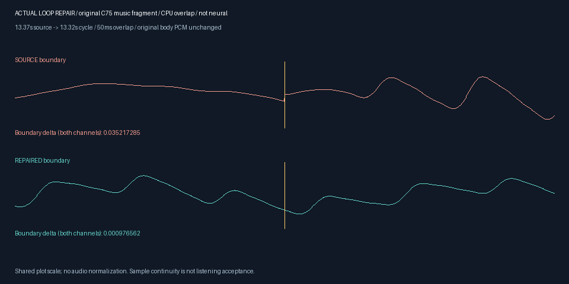

# CLI60 / local58 独立原生候选包

**终态更新：安装400项为399通过、1失败，0错误／跳过；不是仍在运行。草稿真实PowerShell循环与CUDA案例已分别通过，但正式升级仍被完整契约失败拦截。源码CLI61修复及后续验收见 [说明](CLI61口型超时修复_2026-10-29.md)。以下过程段落保留为当时状态。**

此包已从独立ZIP原生安装并逐字节核对，不依赖开发源码回落。**它仍是安装候选，正式注册Skill保持CLI59/local57/r57**，待安装回归、真实案例及候选入口分别通过后再切换。旧包、旧摘要和旧标签不覆盖。

| 编号 | 交付内容 | 实际位置或摘要 |
| --- | --- | --- |
| A01 | 本地离线ZIP | `E:/dev/sandbox/AI广告剪辑/local/agent-ffmpeg/v0.1.0-alpha.4-local.58/candidate-r1/bundle.zip` |
| A02 | ZIP字节数／SHA256 | 305697408／`c97d24799b021d3c14ac26259bbf8ea7d7c38c6531952849b5d7597ca4146cfd` |
| A03 | Manifest SHA256 | `bd7547218c42f1284cf75f9947616121b787750bd19cf95240b4a886a2a71eb2` |
| A04 | 产品wheel SHA256 | `3ecf8c41425453687125f2c10003d3fee289d977ba1f6ba7a8c134facbaec91d` |
| A05 | 独立安装目录 | `E:/dev/sandbox/AI广告剪辑/local/agent-ffmpeg/v0.1.0-alpha.4-local.58/final-r1/installed` |
| A06 | 实际载荷核对 | 1707载荷文件，283应用模块与源码相同，8个原生资源相同；版本及能力查询实际成功 |

[完整安装收据](evidence/music-loop-20261029-r1/installation-candidate-r1/verification.json)。构建与安装使用既有原生Windows Python及本地依赖，没有网络下载、全局安装、Docker或WSL。它不证明另一台干净机器已验收，也不证明所有服务和自然质量已通过。

## 已安装候选的使用逻辑

```powershell
$python = 'C:/Python313/python.exe'
$entry = 'E:/dev/sandbox/AI广告剪辑/local/agent-ffmpeg/v0.1.0-alpha.4-local.58/final-r1/installed/run.py'
& $python -I -S -B -X utf8 $entry version
& $python -I -S -B -X utf8 $entry capabilities
# PROJECT已经登记音频资产music及其权利；先预检，再生成新资产。
$project = 'E:/video-work/my-project'
& $python -I -S -B -X utf8 $entry music repair-loop --project $project --asset-id music --crossfade-ms 50 --new-asset-id loop1 --dry-run
& $python -I -S -B -X utf8 $entry music repair-loop --project $project --asset-id music --crossfade-ms 50 --new-asset-id loop1 --apply --track-id track_audio_1
```

`version`应返回0.1.60；上例明确调用安装目录的 `run.py`，不是 `scripts/run_source_editor.py`，也不是仍绑定CLI59的正式Skill。项目初始化、素材与权利导入、试听选型、验证、预览／渲染及工程包导出沿用[基础流程](CLI59独立安装交付_2026-10-29.md)，新增命令的完整参数与C76试听见[循环修复手册](../product/MUSIC_LOOP.md)。请使用新资产ID保留原版本。

交叠后每周期缩短，不保持原时长；解码工作PCM是48kHz双声道16bit。较小接缝跳变量不等于自然听感无缝；节拍／和声／乐句衔接、真峰值和人工听审仍开放。CPU DSP修复不是GPU或神经音乐生成，既有CUDA降噪独立验证。

## 验收进展与边界

源码37专项／31入口／19控制／57选材／104语义／400完整契约均已有通过终态；C76完整PCM工程包重做和实际DF3 CUDA已通过。安装候选的31入口／37配乐专项／19控制／57选材／104语义分别通过，零失败／错误／跳过。实际DF3 CUDA及C76完整PCM重做也已通过。安装400完整契约单独运行，未出终态收据不计通过。

`stage_source60_skill.py`须看到源码及安装各组、完整400、真实GPU和真实配方案例后才生成候选。此前实际缺证拦截已证明95个正式文件不变。候选PowerShell测试、正式C盘入口切换及公开r58工具包尚未验收，不能把本地ZIP存在当作它们完成。

全部完整目标继续以[G01–G38](../product/GOAL_GAPS_20261025.md)为准，本包不等于完整剪映功能与质量闭合。


## 实际独立安装案例



[实际安装版修复音频](../assets/music-loop60-installed-20261029-r1/actual.wav) · [来源与摘要](../assets/music-loop60-installed-20261029-r1/SOURCE_AND_LICENSES.json) · [完整案例收据](evidence/music-loop-20261029-r1/installed-actual-case-r1/verification.json)。13.37秒源片段经50ms交叠成为13.32秒，完整2557440字节PCM与开发源码和工程包导入后配方重做相同。前后各三周期的完整PCM与单元直接重复相同，中段不改。未人工听审，不计自然音乐无缝验收。

[实际安装CUDA收据](evidence/music-loop-20261029-r1/installed60-gpu-r1/verification.json)：RTX3060／4次DF3模型前向／无CPU回落，完整1124160字节PCM与源码及工程包重放相同，受控噪声MSE改善12.25446dB。这是已有降噪路径的回归，不增加其它模型或自然质量验收。
