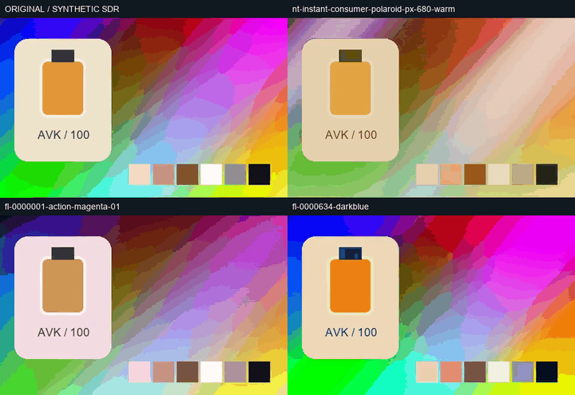

# 500 套风格：本轮构建与真实核验 / 500-look validation

日期：2026-10-24。**v0.1.0-alpha.3 / CLI 0.1.2 / catalog 2.0.0**。本页只统计最终包的当轮执行；历史回归、旧 100 套测量和候选构建不累计。
Only final-package executions are reported below. Historical results and superseded candidates are not added to these counts.

| # | Scope / 实际执行 | Result / 结果 | Evidence / 证据 |
|---|---|---|---|
| V01 | 500 预设编译、签名/预览去重与来源核对 | 原 100 + Natron 267 + FreshLUTs 133；6 个重复候选剔除 | [编译](evidence/look500-sources-20261024-r1/compilation.json) · [来源](evidence/look500-sources-20261024-r1/acquisition.json) |
| V02 | 定向回归：目录、LUT、事务、许可、项目包、安装器与分卷 | 90 tests passed; 0 failures, 0 errors, 0 skipped | [最终回执](evidence/look500-20261024-r1/regression-policy.json) · [日志](evidence/look500-20261024-r1/regression-policy.log)；未重跑历史 2,930 项 |
| V03 | 分卷合成、ZIP/manifest/wheel 摘要及原生依赖审计 | 3 binary parts, 8 pinned wheels, native E: installation | [安装](evidence/look500-20261024-r1/install/installation.json) · [依赖](evidence/look500-20261024-r1/install/dependency-audit.json) |
| V04 | 安装版 CLI 的 inspect + preview；单隔离进程重复调用实际参数解析/处理器 | 1,000 CLI calls, 500 actual PNGs | [批处理回执](evidence/look500-20261024-r1/installed/batch-verification.json) · [逐次命令](evidence/look500-20261024-r1/installed/batch-commands.json)；不是 1,000 次独立进程启动 |
| V05 | 每套原生 FFmpeg 滤镜短视频、ffprobe 与完整解码 | 500 videos; each 1 s, 12 frames, 480×300; 500 distinct first-frame hashes | [逐项摘要及误差](evidence/look500-20261024-r1/installed/batch-presets.json)；该层不等于 500 次完整项目渲染 |
| V06 | 500 套对照锁定上游原始 CUBE/Hald 的原生 FFmpeg 输出 | 500 comparisons; maximum sampled image channel error 30 / 255 | [逐项结果](evidence/look500-20261024-r1/installed/batch-presets.json)；Hald 转换有近似，不是主观画质评分 |
| V07 | 代表性预设通过完整项目 apply/render、权利门禁、质量、强度、幂等、包往返与预期拒绝 | 25 selected look project renders; 100 isolated CLI process calls, including 2 expected refusals | [最终回执](evidence/look500-20261024-r1/installed/verification.json) · [命令](evidence/look500-20261024-r1/installed/commands.json) · [项目成片](../assets/look500-20261024-r1/project-videos) |
| V08 | Codex 联接发现、17 Skill 格式及真实启动器调用 | 17 formats; 24 calls = 23 successes + 1 expected refusal | [Skill 回执](evidence/look500-20261024-r1/skills/verification.json)；包含新 Natron/FreshLUTs 的实际预览/应用/渲染与许可核对 |
| V09 | 三语功能 README、500 项逐项详情、稳定编号、链接、旧包摘要 | See final documentation receipt | [文档核对](evidence/look500-20261024-r1/docs-verification.json) · [完整目录](../local/LOOK_PRESETS.md) |

## 原输入、成片和动态对照

[原视频](../assets/look500-20261024-r1/original.mp4) · [对照 MP4](../assets/look500-20261024-r1/motion-comparison.mp4) · [对照首帧](../assets/look500-20261024-r1/comparison-poster.png) · [500 项总览](../assets/look500-20261024-r1/contact-sheet.jpg) · [全部 PNG/视频入口](../local/LOOK_PRESETS.md) · [可编辑项目包](../assets/look500-20261024-r1/example.avk.zip)。

GIF/MP4 由原视频与 3 个新增风格的实际项目成片逐帧解码后合成，不是研究示意或模型生成。GIF 为 720×495、80 ms 影格延迟；静音对照 MP4 为 960×660、12 fps、1 秒。GIF 调色板会量化颜色，准确数据以 PNG、原 MP4 和数字测量为准。
The comparison uses decoded actual output. It is silent; synthetic source/project audio was checked separately. [合成与视频参数回执](evidence/look500-20261024-r1/motion-comparison.json) · [媒体摘要清单](evidence/look500-20261024-r1/installed/media-manifest.json) · [媒体许可](../assets/look500-20261024-r1/LICENSE.txt)。

## 明确的边界

- 输入是合成色彩卡、虚构产品图、微小推近及 440 Hz 合成音；0 自然素材画质验收、0 人工听审、0 新模型推理。
- 500 表示不同 LUT 变换，含同系列上游曲线变体；不是 500 个独立家族，也不是 500 种 AI/空间效果。
- 色块 Y′、跨度和 RGB 误差是编码域测量；不代表曝光、感知评分或相机校准。`look apply` 明确拒绝 Float32/Log/HDR。
- FreshLUTs 输入依据上传者标签，不是相机标定。`fl-0000228-science-fiction-for-flog` 标签为 Rec.709，但标题包含 FLog；输入有歧义，只作已准备 SDR 的实验创意比较，不当作已验证的 Log 转换。
- 全部 PNG/原生滤镜视频、代表性完整项目和 Skill 调用分别计数，不把批处理包装成独立进程或完整项目执行。
- 软件为 MIT；资源分别为 MIT / CC0 / CC BY-SA。复制证据和门禁成功不代替具体成片权利判断。

## 已发现并修复的检查问题

1. 上游 +/- 曲线标记最初被普通 slug 清理，候选编译被唯一 ID 检查拒绝。现在 ID 保留 curve-plus/minus；失败时未替换正式目录。
2. 首轮 87 项回归发现新目录标记未被项目包转换器识别，`lut_id` 被改成路径；修复并补充策略回归后，最终 90 项通过。[初轮失败](evidence/look500-20261024-r1/regression.json)。
3. 检查脚本初次使用相对路径与不同工作目录，原视频未生成；将安装/证据/媒体路径统一解析为绝对路径后复跑。[初次准备失败](evidence/look500-20261024-r1/installed-setup-r0/failure.json)。
4. 清理并防止 setuptools 缓存带入未引用候选资源；正式 wheel 与安装目录均精确包含 500 份 LUT。18 个上游负片组的黑白变体改名“黑白负片”，ID 和 LUT 字节不变。
5. 完整项目策略审计曾把来源/许可网址及 `CC0:` 文字识别为远程运行引用。现在仅与内置目录逐字段精确匹配的来源信息和许可条款被视为静态证据；篡改证据、远程 LUT 路径与额外接口地址仍拒绝。补充了全部 500 份证据和既有远程拒绝回归，随后重新构建、安装并实测。[原始策略失败](evidence/look500-20261024-r1/policy-failure-r0/policy.stdout.json)。

[构建诊断与保留的候选路径](evidence/look500-sources-20261024-r1/build-diagnostics.json) · [复现脚本](../../scripts/verify_look500_release.py) · [批处理脚本](../../scripts/verify_look500_batch.py) · [动态对照脚本](../../scripts/finalize_look500_evidence.py)。
