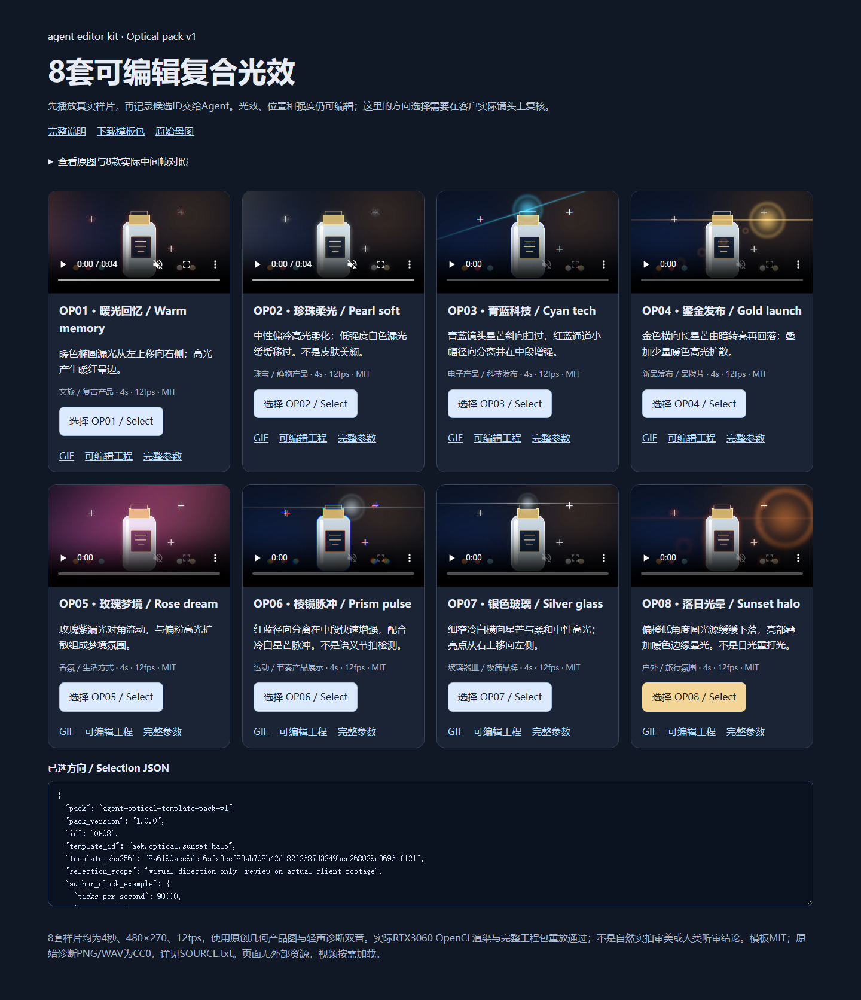

# 8套光效选型页：真实浏览器交互与截图

本轮在原生 Windows Chrome 156.0.8078.73 中打开[离线选型页](../assets/optical-pack-20261029-r1/index.html)，实际点击全部8个选型按钮，并解码播放本地 H.264 样片。结果为通过；[原始收据](evidence/optical-pack-gallery-20261029-r1/verification.json)和[执行脚本快照](evidence/optical-pack-gallery-20261029-r1/executed-runner.cjs)保留。

页面是给人类客户选择视觉方向、给 Agent 读取模板标识的内容浏览器。选择不会直接修改工程，也不构成客户实际素材的画面、音频或版权验收。模板的应用与可编辑工程见[完整功能说明](../product/OPTICAL_EFFECT_PACK.md)。

## 实际检查

| 编号 | 项目 | 结果与范围 |
| --- | --- | --- |
| U01 | 8套卡片和视频 | 页面包含8张独立卡片，8个视频均使用 `preload="none"`。 |
| U02 | 全部选型按钮 | 逐一实际点击 OP01—OP08；每次仅当前按钮标记为已选。 |
| U03 | Agent选型数据 | 每次输出的 ID、`template_id`、模板 SHA256、包版本和作者时钟示例均与实际目录及模板文件核对相符。 |
| U04 | 本地资源与链接 | 44个页面资源或链接目标均为实际存在的本地文件。 |
| U05 | 真正播放 | 第一段 H.264 视频实际解码为480×270，并推进播放时间；不是仅检查视频标签。 |
| U06 | 播放切换 | 启动第二段视频后，第一段自动暂停；截图前全部视频均暂停。 |
| U07 | 电脑页面 | 1440像素宽度实际页面完整截图，OP08被选中。 |
| U08 | 手机宽度 | 420像素宽度实际页面完整截图，重新点击OP03成功，页面没有横向溢出。未声称已在真实手机硬件验收。 |
| U09 | 离线与错误 | 本次浏览器页面错误0，外部请求0。 |
| U10 | 页面释放 | 本次创建的1个页面、独立浏览器上下文和浏览器均已关闭；临时目录、缓存和截图全部位于E盘。未使用Docker、WSL或虚拟化环境。 |

## 真实页面截图

电脑宽度，选中 OP08：

[手机宽度完整截图](../assets/optical-pack-gallery-20261029-r1/mobile.png)包含全部8张卡片及OP03选择结果。

## Agent接续方式

1. 让客户播放候选样片、比较原图和效果图。
2. 从页面选型JSON读取明确的 `id`、`template_id`、包版本和模板摘要，核对实际模板；不根据显示顺序猜测。
3. 检查目标片段的原作者时钟、源分辨率、信号与既有效果数组，然后执行预检。
4. 经审阅后应用到客户工程，在真实素材上重新预览，保留独立修订及可编辑工程包。

本次浏览器检查没有增加新渲染算子或神经模型，也没有替代8套GPU渲染／工程包重放、正式Skill切换或人类视听检查。源码CLI63、独立候选CLI63与正式Skill的交付状态须分别读取各自收据；本页不提前改变其版本。

The offline gallery was exercised in native Chrome: all eight selections matched actual template hashes, local H.264 playback advanced, starting another video paused the first, and desktop/mobile-width screenshots were captured. The owned page and browser were closed. This verifies gallery interaction, not client-footage aesthetics, listening approval, real mobile hardware, or full product parity.
